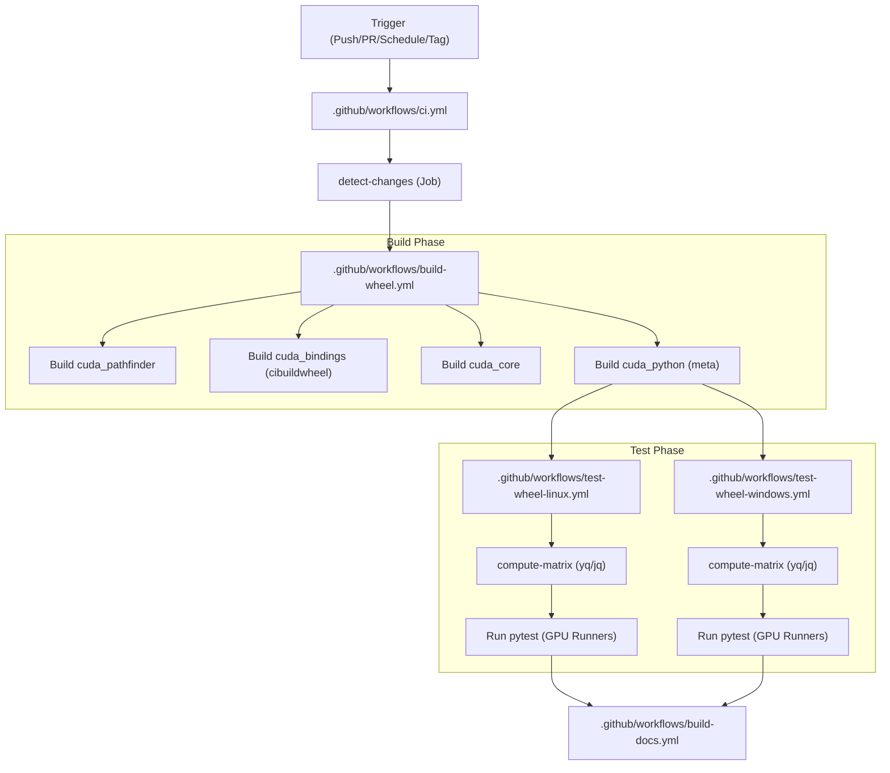
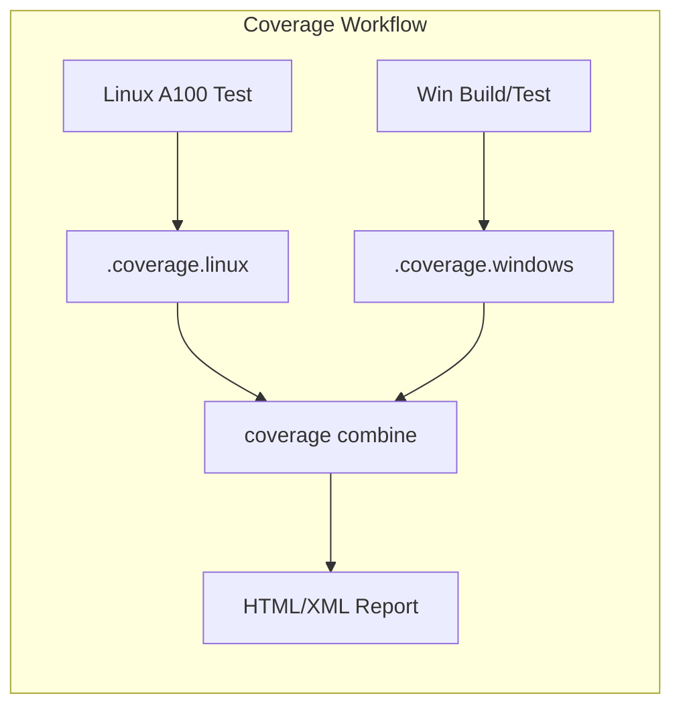

<!-- source: DeepWiki mcp.deepwiki.com · repo NVIDIA/cuda-python · page 5.3 CI/CD Pipeline · fetched 2026-10-26 -->

# CI/CD Pipeline

<details>
<summary>Relevant source files</summary>

The following files were used as context for generating this wiki page:

- [.github/ISSUE_TEMPLATE/release_checklist.yml](.github/ISSUE_TEMPLATE/release_checklist.yml)
- [.github/RELEASE-core.md](.github/RELEASE-core.md)
- [.github/actionlint.yaml](.github/actionlint.yaml)
- [.github/actions/doc_preview/action.yml](.github/actions/doc_preview/action.yml)
- [.github/actions/fetch_ctk/action.yml](.github/actions/fetch_ctk/action.yml)
- [.github/actions/get_pr_number/action.yml](.github/actions/get_pr_number/action.yml)
- [.github/actions/sccache-summary/action.yml](.github/actions/sccache-summary/action.yml)
- [.github/dependabot.yml](.github/dependabot.yml)
- [.github/workflows/backport.yml](.github/workflows/backport.yml)
- [.github/workflows/bandit.yml](.github/workflows/bandit.yml)
- [.github/workflows/build-docs.yml](.github/workflows/build-docs.yml)
- [.github/workflows/build-wheel.yml](.github/workflows/build-wheel.yml)
- [.github/workflows/ci.yml](.github/workflows/ci.yml)
- [.github/workflows/codeql.yml](.github/workflows/codeql.yml)
- [.github/workflows/coverage.yml](.github/workflows/coverage.yml)
- [.github/workflows/release-cuda-pathfinder.yml](.github/workflows/release-cuda-pathfinder.yml)
- [.github/workflows/release-upload.yml](.github/workflows/release-upload.yml)
- [.github/workflows/release.yml](.github/workflows/release.yml)
- [.github/workflows/test-sdist-linux.yml](.github/workflows/test-sdist-linux.yml)
- [.github/workflows/test-sdist-windows.yml](.github/workflows/test-sdist-windows.yml)
- [.github/workflows/test-wheel-linux.yml](.github/workflows/test-wheel-linux.yml)
- [.github/workflows/test-wheel-windows.yml](.github/workflows/test-wheel-windows.yml)
- [ci/test-matrix.yml](ci/test-matrix.yml)
- [ci/tools/env-vars](ci/tools/env-vars)
- [ci/tools/guess_latest.sh](ci/tools/guess_latest.sh)
- [ci/versions.yml](ci/versions.yml)
- [cuda_bindings/docs/source/release/12.9.6-notes.rst](cuda_bindings/docs/source/release/12.9.6-notes.rst)
- [cuda_python/docs/source/release/12.9.6-notes.rst](cuda_python/docs/source/release/12.9.6-notes.rst)
- [cuda_python/docs/source/release/13.2.0-notes.rst](cuda_python/docs/source/release/13.2.0-notes.rst)

</details>


This document describes the Continuous Integration and Continuous Deployment (CI/CD) pipeline for CUDA Python. It covers the automated build, test, and documentation processes that ensure code quality and facilitate smooth releases. For information about the build system itself, see [Build System](5.1). For details about the testing framework, see [Testing Framework](5.2).

## 1. Pipeline Overview

The CUDA Python CI/CD pipeline is orchestrated via GitHub Actions. It implements a complex gating logic to minimize redundant work while ensuring full coverage across supported Python and CUDA versions.

### 1.1 High-Level Workflow Architecture


Sources: [.github/workflows/ci.yml:7-28](), [.github/workflows/build-wheel.yml:25-41](), [.github/workflows/test-wheel-linux.yml:37-79]()

## 2. Change-Gating Logic

To optimize CI duration, the `detect-changes` job in `ci.yml` analyzes the git diff to determine which modules require rebuilding or retesting.

### 2.1 Dependency-Aware Gating
The pipeline respects the internal dependency hierarchy:
*   `cuda_pathfinder` -> No internal deps.
*   `cuda_bindings` -> Depends on `cuda_pathfinder`.
*   `cuda_core` -> Depends on `cuda_pathfinder` and `cuda_bindings`.
*   `cuda_python` -> Metapackage.

| Change Location | Effect |
| :--- | :--- |
| `cuda_pathfinder/` | Rebuilds and retests everything. |
| `cuda_bindings/` | Rebuilds `bindings` and `core`. |
| `cuda_core/` | Skips `bindings` testing if only `core` changed. |
| `ci/` or `.github/` | Forces full pipeline run. |

Sources: [.github/workflows/ci.yml:78-104](), [.github/workflows/ci.yml:144-156]()

## 3. Wheel Building with cibuildwheel

The project uses `pypa/cibuildwheel` to produce platform-specific binary wheels, particularly for the Cython-heavy `cuda.bindings` and `cuda.core` packages.

### 3.1 Build Environment
*   **Linux**: Uses `manylinux` containers with `sccache` enabled via `rapidsai/sccache` for accelerated C++ compilation.
*   **Windows**: Uses `windows-2022` runners with `msvc-dev-cmd` setup.
*   **CUDA Toolkit**: The `fetch_ctk` action downloads a "mini CTK" (redistributable components) to provide headers and stub libraries for linking without requiring a full 4GB+ installation.

Sources: [.github/workflows/build-wheel.yml:47-54](), [.github/workflows/build-wheel.yml:157-181](), [.github/actions/fetch_ctk/action.yml:7-22]()

## 4. Test Matrix Generation

Testing is driven by `ci/test-matrix.yml`, which defines configurations for different architectures (amd64, arm64), GPUs (V100, T4, L4, A100, H100), and Driver modes (WDDM, TCC, MCDM on Windows).

### 4.1 Matrix Computation
The `compute-matrix` job uses `yq` and `jq` to filter the YAML matrix based on the `build-type` (e.g., `pull-request` vs `nightly`).

```bash
# Example logic in test-wheel-linux.yml
TEST_MATRIX=$(yq -o json ".linux[\"${MATRIX_TYPE}\"] | map(select(.ARCH == \"${ARCH}\"))" ci/test-matrix.yml)
```
Sources: [.github/workflows/test-wheel-linux.yml:60-73](), [ci/test-matrix.yml:18-64]()

## 5. Release Process

The release process is a manually triggered `workflow_dispatch` that promotes validated artifacts to PyPI.

### 5.1 Release Stages
1.  **Run ID Detection**: The `lookup-run-id` script finds the successful CI run associated with the release tag.
2.  **Release Note Validation**: `check_release_notes.py` ensures versioned notes exist in `docs/source/release/`.
3.  **TestPyPI Promotion**: Wheels are first uploaded to TestPyPI for final verification.
4.  **PyPI Publication**: Uses `pypa/gh-action-pypi-publish` with OIDC trusted publishing.

Sources: [.github/workflows/release.yml:12-32](), [.github/workflows/release.yml:109-114](), [.github/workflows/release.yml:151-182]()

## 6. Documentation and Reporting

### 6.1 Documentation Builds
The `build-docs.yml` workflow installs the freshly built wheels and uses Sphinx to generate HTML documentation.
*   **Release Docs**: Built when `is-release` is true, targeting specific git tags.
*   **Previews**: Uses the `doc_preview` action to host temporary versions for PR review.

Sources: [.github/workflows/build-docs.yml:64-72](), [.github/workflows/build-docs.yml:181-196]()

### 6.2 Coverage Reporting
A dedicated `coverage.yml` workflow runs daily. It builds the packages with `CUDA_PYTHON_COVERAGE=1` to enable Cython line coverage and aggregates results from Linux (A100) and Windows runners.


Sources: [.github/workflows/coverage.yml:86-96](), [.github/workflows/coverage.yml:142-164]()

## 7. Static Analysis
The pipeline includes automated security and style checks:
*   **CodeQL**: Scans for common vulnerabilities in Python code.
*   **Bandit (via Ruff)**: Performs security-focused linting using `ruff-action` with specific `S` (Bandit) rule selection.

Sources: [.github/workflows/codeql.yml:33-41](), [.github/workflows/bandit.yml:40-43]()

---

