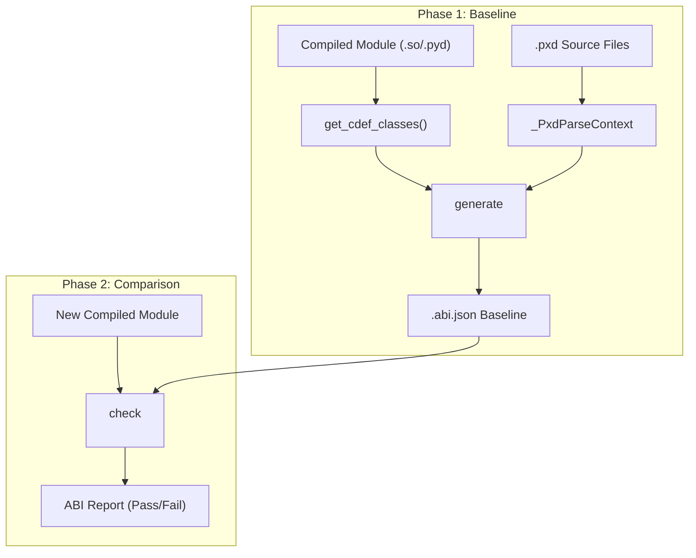
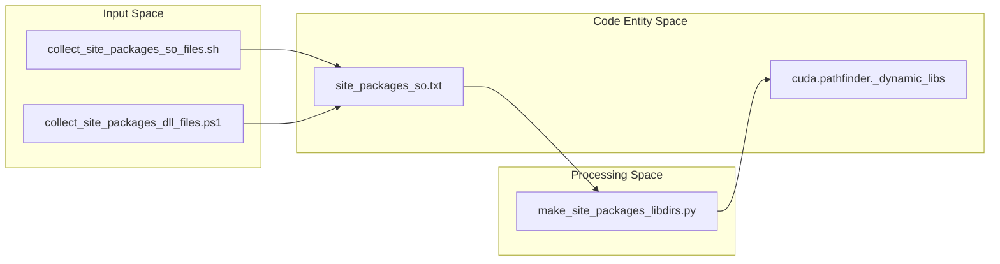

<!-- source: DeepWiki mcp.deepwiki.com · repo NVIDIA/cuda-python · page 5.4 Toolshed and Developer Utilities · fetched 2026-10-26 -->

# Toolshed and Developer Utilities

Relevant source files

The following files were used as context for generating this wiki page:

- [.gitattributes](.gitattributes)
- [.gitignore](.gitignore)
- [.pre-commit-config.yaml](.pre-commit-config.yaml)
- [.spdx-ignore](.spdx-ignore)
- [conftest.py](conftest.py)
- [cuda_pathfinder/tests/conftest.py](cuda_pathfinder/tests/conftest.py)
- [scripts/run_tests.sh](scripts/run_tests.sh)
- [toolshed/check_cython_abi.py](toolshed/check_cython_abi.py)
- [toolshed/check_spdx.py](toolshed/check_spdx.py)
- [toolshed/collect_site_packages_dll_files.ps1](toolshed/collect_site_packages_dll_files.ps1)
- [toolshed/collect_site_packages_so_files.sh](toolshed/collect_site_packages_so_files.sh)

The `toolshed/` directory contains a suite of specialized utilities designed to maintain the integrity of the CUDA Python codebase, ensure legal compliance, and automate the generation of metadata catalogs. These tools assist developers in checking binary compatibility (ABI), verifying licensing headers, and synchronizing the `cuda.pathfinder` library catalogs with the current state of the NVIDIA ecosystem.

## Cython ABI Checker

The Cython ABI checker is a diagnostic tool used to detect breaking changes in the Application Binary Interface (ABI) of compiled Cython modules. This is critical for maintaining compatibility between different versions of `cuda.bindings` and `cuda.core`.

### Implementation Details
The utility operates by inspecting compiled `.so` (Linux) or `.pyd` (Windows) files and comparing them against a baseline JSON representation of the ABI. It specifically monitors:
* **Function Signatures**: Validates PyCapsule strings for `cdef` functions [toolshed/check_cython_abi.py:13-13]().
* **Class Struct Sizes**: Checks the `tp_basicsize` of extension types [toolshed/check_cython_abi.py:14-14]().
* **Field Layouts**: Parses `.pxd` files to ensure `ctypedef struct` fields have not been reordered or altered [toolshed/check_cython_abi.py:15-15]().

### Workflow
1. **Generate**: Extracts the current ABI state into `.abi.json` files using `get_cdef_classes` and `_collect_structs_from_tree` [toolshed/check_cython_abi.py:98-194]().
2. **Check**: Compares a new build against the stored JSON baseline to report discrepancies [toolshed/check_cython_abi.py:33-35]().

**Data Flow: ABI Verification**

Sources: [toolshed/check_cython_abi.py:7-36](), [toolshed/check_cython_abi.py:98-194]()

## SPDX License Checker

The `check_spdx.py` utility ensures that every source file in the repository contains the correct SPDX license identifiers and up-to-date copyright notices. It is integrated into the `pre-commit` pipeline to prevent non-compliant code from being committed [.pre-commit-config.yaml:27-35]().

### Key Components
* **License Mapping**: The script maintains a mapping of top-level directories to their required licenses (e.g., `cuda_core` uses `Apache-2.0`, while `cuda_bindings` uses `LicenseRef-NVIDIA-SOFTWARE-LICENSE`) [toolshed/check_spdx.py:25-36]().
* **Copyright Validation**: It uses `COPYRIGHT_REGEX` to verify the "NVIDIA CORPORATION" affiliation and checks if the copyright year is current for staged files [toolshed/check_spdx.py:57-72]().
* **Automatic Fixing**: When run with the `--fix` flag, the script can update outdated copyright years and insert missing headers [toolshed/check_spdx.py:185-205]().

### Ignored Files
The tool respects a `.spdx-ignore` file, which excludes third-party vendored code (like `dlpack.h`) and binary assets from license enforcement [.spdx-ignore:1-17]().

Sources: [toolshed/check_spdx.py:19-42](), [toolshed/check_spdx.py:89-110](), [toolshed/check_spdx.py:152-182](), [.pre-commit-config.yaml:27-35]()

## Pathfinder Catalog Utilities

These scripts automate the discovery of NVIDIA dynamic libraries across different environments to populate the `cuda.pathfinder` search catalogs.

### Library Discovery Scripts
* **Linux (`collect_site_packages_so_files.sh`)**: Creates temporary virtual environments for different CUDA versions (e.g., CU12, CU13), installs the packages, and uses `find` to locate all `lib*.so` files associated with `nvidia` or `nvpl` [toolshed/collect_site_packages_so_files.sh:12-30]().
* **Windows (`collect_site_packages_dll_files.ps1`)**: Performs the equivalent task on Windows, searching for `.dll` files using PowerShell's `Get-ChildItem` [toolshed/collect_site_packages_dll_files.ps1:13-44]().

### Catalog Writer
The output from the discovery scripts (e.g., `site_packages_so.txt`) is processed by `make_site_packages_libdirs.py`. This script formats the raw paths into the structured Python dictionaries used by `cuda.pathfinder` for dynamic library resolution.

**Code Entity Map: Discovery to Catalog**

Sources: [toolshed/collect_site_packages_so_files.sh:1-31](), [toolshed/collect_site_packages_dll_files.ps1:1-45]()

## Developer Environment Helpers

### Test Orchestration
While not strictly in `toolshed/`, the `scripts/run_tests.sh` utility is the primary entry point for developers to execute the full test suite. It manages:
* **Installation Modes**: Supports `--install` (force editable install), `--no-install`, and `auto` detection [scripts/run_tests.sh:151-182]().
* **Targeted Testing**: Allows running tests for specific components like `core`, `bindings`, or `pathfinder` [scripts/run_tests.sh:25-31]().
* **Specialized Runs**: Can trigger Cython-specific tests (`--with-cython`) or Per-Thread Default Stream (PTDS) validation [scripts/run_tests.sh:75-94]().

### Pre-commit Integration
The repository utilizes `pre-commit` to unify various developer utilities.
| Hook ID | Tool | Purpose |
| :--- | :--- | :--- |
| `ruff-check` | Ruff | Linting and code formatting [.pre-commit-config.yaml:20-23]() |
| `check-spdx` | `check_spdx.py` | License and copyright enforcement [.pre-commit-config.yaml:27-35]() |
| `mypy-pathfinder` | Mypy | Static type checking for pathfinder [.pre-commit-config.yaml:81-84]() |
| `cython-lint` | Cython-lint | Linting for `.pyx` and `.pxd` files [.pre-commit-config.yaml:96-98]() |

Sources: [scripts/run_tests.sh:21-49](), [scripts/run_tests.sh:184-252](), [.pre-commit-config.yaml:17-98]()

---

