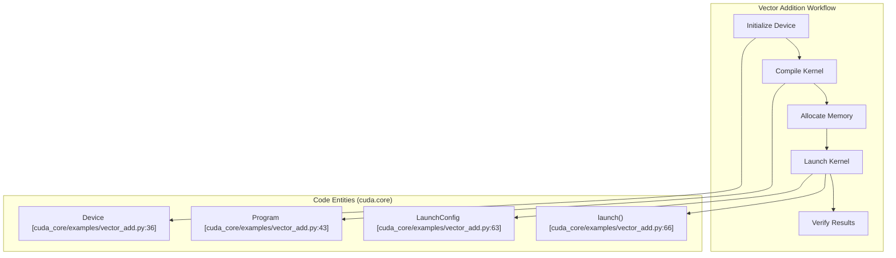
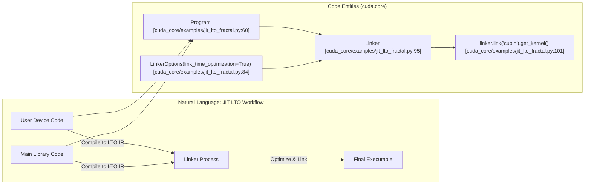

<!-- source: DeepWiki mcp.deepwiki.com · repo NVIDIA/cuda-python · page 6 Examples and Tutorials · fetched 2026-10-26 -->

# Examples and Tutorials

Relevant source files

The following files were used as context for generating this wiki page:

- [cuda_bindings/examples/0_Introduction/clock_nvrtc.py](cuda_bindings/examples/0_Introduction/clock_nvrtc.py)
- [cuda_bindings/examples/0_Introduction/simple_cubemap_texture.py](cuda_bindings/examples/0_Introduction/simple_cubemap_texture.py)
- [cuda_bindings/examples/0_Introduction/simple_p2p.py](cuda_bindings/examples/0_Introduction/simple_p2p.py)
- [cuda_bindings/examples/0_Introduction/simple_zero_copy.py](cuda_bindings/examples/0_Introduction/simple_zero_copy.py)
- [cuda_bindings/examples/0_Introduction/system_wide_atomics.py](cuda_bindings/examples/0_Introduction/system_wide_atomics.py)
- [cuda_bindings/examples/0_Introduction/vector_add_drv.py](cuda_bindings/examples/0_Introduction/vector_add_drv.py)
- [cuda_bindings/examples/0_Introduction/vector_add_mmap.py](cuda_bindings/examples/0_Introduction/vector_add_mmap.py)
- [cuda_bindings/examples/2_Concepts_and_Techniques/stream_ordered_allocation.py](cuda_bindings/examples/2_Concepts_and_Techniques/stream_ordered_allocation.py)
- [cuda_bindings/examples/3_CUDA_Features/global_to_shmem_async_copy.py](cuda_bindings/examples/3_CUDA_Features/global_to_shmem_async_copy.py)
- [cuda_bindings/examples/3_CUDA_Features/simple_cuda_graphs.py](cuda_bindings/examples/3_CUDA_Features/simple_cuda_graphs.py)
- [cuda_bindings/examples/4_CUDA_Libraries/conjugate_gradient_multi_block_cg.py](cuda_bindings/examples/4_CUDA_Libraries/conjugate_gradient_multi_block_cg.py)
- [cuda_core/examples/cuda_graphs.py](cuda_core/examples/cuda_graphs.py)
- [cuda_core/examples/jit_lto_fractal.py](cuda_core/examples/jit_lto_fractal.py)
- [cuda_core/examples/memory_ops.py](cuda_core/examples/memory_ops.py)
- [cuda_core/examples/pytorch_example.py](cuda_core/examples/pytorch_example.py)
- [cuda_core/examples/saxpy.py](cuda_core/examples/saxpy.py)
- [cuda_core/examples/show_device_properties.py](cuda_core/examples/show_device_properties.py)
- [cuda_core/examples/simple_multi_gpu_example.py](cuda_core/examples/simple_multi_gpu_example.py)
- [cuda_core/examples/strided_memory_view_cpu.py](cuda_core/examples/strided_memory_view_cpu.py)
- [cuda_core/examples/strided_memory_view_gpu.py](cuda_core/examples/strided_memory_view_gpu.py)
- [cuda_core/examples/thread_block_cluster.py](cuda_core/examples/thread_block_cluster.py)
- [cuda_core/examples/vector_add.py](cuda_core/examples/vector_add.py)

This page provides a collection of practical examples and tutorials demonstrating the usage of CUDA Python. These examples illustrate various capabilities of the library, from basic operations to advanced features. The examples are designed to help users understand how to use CUDA Python effectively in their own applications.

## Overview

The examples in this collection cover:

1.  **Basic CUDA operations**: Simple kernel compilation and execution.
2.  **Memory management and interoperability**: Using different memory resources and sharing data with PyTorch or CuPy.
3.  **Multi-GPU programming**: Coordinating work across multiple devices.
4.  **Advanced features**: Hardware-specific features like thread block clusters and TMA.
5.  **JIT compilation and link-time optimization (LTO)**: Dynamic linking of device code at runtime.

All examples can be found in the `cuda_core/examples` and `cuda_bindings/examples` directories.

## Basic CUDA Examples

For detailed walkthroughs of these and other fundamental tasks, see [Basic CUDA Operations](#6.1).

### Vector Addition and SAXPY
The Vector Addition and SAXPY examples demonstrate the fundamental workflow of CUDA Python: initializing a `Device`, compiling a templated kernel via `Program`, and launching it using `launch()`.

Sources: [cuda_core/examples/vector_add.py:21-72](), [cuda_core/examples/saxpy.py:28-128]()

### Memory Management and Interoperability
The `memory_ops.py` example illustrates the use of specialized memory resources like `LegacyPinnedMemoryResource` and how to move data between device and host-pinned memory using `copy_to`. It also showcases interoperability with NumPy and CuPy via DLPack.

Sources: [cuda_core/examples/memory_ops.py:31-132]()

## Multi-GPU and Interoperability

### Multi-GPU Programming
The `simple_multi_gpu_example.py` demonstrates managing multiple `Device` objects and coordinating streams across them. It uses a `StreamAdaptor` to wrap foreign streams (e.g., from CuPy) for use within the `cuda.core` ecosystem.

Sources: [cuda_core/examples/simple_multi_gpu_example.py:28-136]()

### PyTorch Interoperability
The `pytorch_example.py` shows how to launch `cuda.core` kernels directly on PyTorch tensors using `data_ptr()` and how to wrap PyTorch streams using the `__cuda_stream__` protocol.

Sources: [cuda_core/examples/pytorch_example.py:22-114]()

## Advanced Features and JIT/LTO

For in-depth technical details on these advanced compilation techniques, see [JIT Compilation and LTO Examples](#6.2).

### Thread Block Clusters
Demonstrates hardware-specific features for GPUs with compute capability 9.0+. It uses `LaunchConfig` with a `cluster` parameter to exploit the distributed shared memory and synchronization capabilities of clusters.

Sources: [cuda_core/examples/thread_block_cluster.py:33-152]()

### JIT LTO Fractal
This example demonstrates the `Linker` class's ability to perform Link-Time Optimization at runtime. It separates a "library" (main workflow) from "user code" (fractal math), linking them into a final executable `cubin`.

Sources: [cuda_core/examples/jit_lto_fractal.py:33-109]()

## Benchmarks

The repository includes a suite for measuring the overhead of Python-to-C calls in the `cuda.bindings` layer. For methodology and results, see [Benchmarks](#6.3).

Sources: [cuda_bindings/examples/3_CUDA_Features/global_to_shmem_async_copy.py:1-156](), [cuda_bindings/examples/4_CUDA_Libraries/conjugate_gradient_multi_block_cg.py:1-178]()

## Prerequisites for Running the Examples

To run these examples, ensure your environment meets the following requirements:

| Requirement | Details |
| :--- | :--- |
| **GPU** | NVIDIA GPU (CC 9.0+ for Clusters/TMA) |
| **Toolkit** | CUDA Toolkit installed and `CUDA_PATH` set |
| **Python Libs** | `numpy`, `cupy`, `torch` (for specific examples), `cffi` |
| **Cuda Python** | `cuda-python` metapackage installed |

Sources: [cuda_core/examples/thread_block_cluster.py:73-81](), [cuda_core/examples/pytorch_example.py:12-14]()

---

