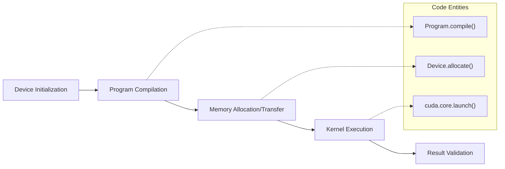
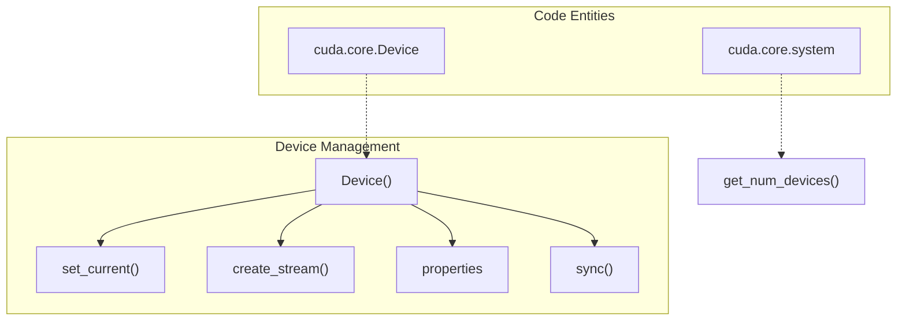
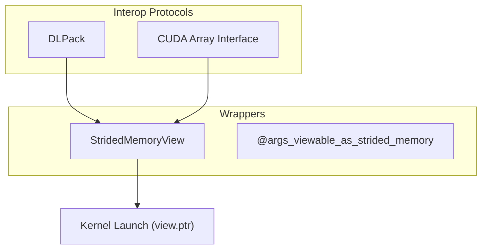

<!-- source: DeepWiki mcp.deepwiki.com · repo NVIDIA/cuda-python · page 6.1 Basic CUDA Operations · fetched 2026-10-26 -->

# Basic CUDA Operations

<details>
<summary>Relevant source files</summary>

The following files were used as context for generating this wiki page:

- [cuda_bindings/examples/0_Introduction/clock_nvrtc.py](cuda_bindings/examples/0_Introduction/clock_nvrtc.py)
- [cuda_bindings/examples/0_Introduction/simple_cubemap_texture.py](cuda_bindings/examples/0_Introduction/simple_cubemap_texture.py)
- [cuda_bindings/examples/0_Introduction/simple_p2p.py](cuda_bindings/examples/0_Introduction/simple_p2p.py)
- [cuda_bindings/examples/0_Introduction/simple_zero_copy.py](cuda_bindings/examples/0_Introduction/simple_zero_copy.py)
- [cuda_bindings/examples/0_Introduction/system_wide_atomics.py](cuda_bindings/examples/0_Introduction/system_wide_atomics.py)
- [cuda_bindings/examples/0_Introduction/vector_add_drv.py](cuda_bindings/examples/0_Introduction/vector_add_drv.py)
- [cuda_bindings/examples/0_Introduction/vector_add_mmap.py](cuda_bindings/examples/0_Introduction/vector_add_mmap.py)
- [cuda_bindings/examples/2_Concepts_and_Techniques/stream_ordered_allocation.py](cuda_bindings/examples/2_Concepts_and_Techniques/stream_ordered_allocation.py)
- [cuda_bindings/examples/3_CUDA_Features/global_to_shmem_async_copy.py](cuda_bindings/examples/3_CUDA_Features/global_to_shmem_async_copy.py)
- [cuda_bindings/examples/3_CUDA_Features/simple_cuda_graphs.py](cuda_bindings/examples/3_CUDA_Features/simple_cuda_graphs.py)
- [cuda_bindings/examples/4_CUDA_Libraries/conjugate_gradient_multi_block_cg.py](cuda_bindings/examples/4_CUDA_Libraries/conjugate_gradient_multi_block_cg.py)
- [cuda_core/examples/cuda_graphs.py](cuda_core/examples/cuda_graphs.py)
- [cuda_core/examples/jit_lto_fractal.py](cuda_core/examples/jit_lto_fractal.py)
- [cuda_core/examples/memory_ops.py](cuda_core/examples/memory_ops.py)
- [cuda_core/examples/pytorch_example.py](cuda_core/examples/pytorch_example.py)
- [cuda_core/examples/saxpy.py](cuda_core/examples/saxpy.py)
- [cuda_core/examples/show_device_properties.py](cuda_core/examples/show_device_properties.py)
- [cuda_core/examples/simple_multi_gpu_example.py](cuda_core/examples/simple_multi_gpu_example.py)
- [cuda_core/examples/strided_memory_view_cpu.py](cuda_core/examples/strided_memory_view_cpu.py)
- [cuda_core/examples/strided_memory_view_gpu.py](cuda_core/examples/strided_memory_view_gpu.py)
- [cuda_core/examples/thread_block_cluster.py](cuda_core/examples/thread_block_cluster.py)
- [cuda_core/examples/vector_add.py](cuda_core/examples/vector_add.py)
- [cuda_core/tests/example_tests/test_basic_examples.py](cuda_core/tests/example_tests/test_basic_examples.py)

</details>


This document provides a comprehensive guide to fundamental CUDA operations using the `cuda-python` library. It focuses on essential operations that form the building blocks for GPU computing workflows, including device initialization, program compilation, kernel launching, and basic memory management.

## Overview of Basic CUDA Operations

CUDA Python operations typically follow a standard workflow pattern from device initialization to result validation:



Sources: [cuda_core/examples/vector_add.py:35-68](), [cuda_core/examples/saxpy.py:44-88]()

## Setting up the CUDA Environment

### Device Initialization

The first step is to initialize and select a CUDA device using the `Device` class.



Sources: [cuda_core/examples/vector_add.py:36-38](), [cuda_core/examples/show_device_properties.py:18-48](), [cuda_core/examples/simple_multi_gpu_example.py:38-45]()

Device initialization typically follows this pattern:

```python
from cuda.core import Device
# Initialize device (typically device 0 by default)
dev = Device()
# Set as current device for subsequent operations
dev.set_current()
# Create a stream for operation scheduling
stream = dev.create_stream()
```

For multi-GPU operations, use `system.get_num_devices()` to query available hardware and specify the device index:

```python
from cuda.core import system, Device
if system.get_num_devices() >= 2:
    dev0 = Device(0)
    dev1 = Device(1)
```

Sources: [cuda_core/examples/simple_multi_gpu_example.py:38-43](), [cuda_core/examples/show_device_properties.py:18]()

### Device Properties

Hardware capabilities can be inspected via the `properties` attribute of a `Device` instance. This includes compute capability, memory clock rates, and feature support (e.g., ECC, managed memory).

Sources: [cuda_core/examples/show_device_properties.py:48-146]()

## Kernel Compilation and Execution

### Program Compilation

CUDA kernels are compiled using the `Program` class. It supports NVRTC-based runtime compilation of C++ strings into target formats like `cubin` or `ptx`.

```python
# Create program options
program_options = ProgramOptions(std="c++17", arch=f"sm_{dev.arch}")
# Initialize program with CUDA code string
prog = Program(code, code_type="c++", options=program_options)
# Compile and retrieve kernel
mod = prog.compile("cubin", name_expressions=("vector_add<float>",))
kernel = mod.get_kernel("vector_add<float>")
```

Sources: [cuda_core/examples/vector_add.py:42-47](), [cuda_core/examples/saxpy.py:52-65]()

### Kernel Launching

Launching a kernel requires a `LaunchConfig` (defining grid and block dimensions) and the `launch` function.

```python
from cuda.core import LaunchConfig, launch
# Configure thread blocks
block = 256
grid = (size + block - 1) // block
config = LaunchConfig(grid=grid, block=block)

# Launch kernel on a specific stream
launch(stream, config, kernel, a_ptr, b_ptr, c_ptr, size)
```

Sources: [cuda_core/examples/vector_add.py:61-66](), [cuda_core/examples/saxpy.py:78-84]()

## Memory Management

### Memory Resources and Allocation

`cuda.core` provides several memory resource types for different allocation strategies:
*   **Device Memory**: Standard GPU memory.
*   **Pinned Memory**: Host memory mapped into the GPU address space for faster transfers and zero-copy access.

```python
from cuda.core import LegacyPinnedMemoryResource
# Allocate pinned memory
pinned_mr = LegacyPinnedMemoryResource()
pinned_buffer = pinned_mr.allocate(total_size)

# Allocate device memory
device_buffer = dev.allocate(total_size, stream=stream)
```

Sources: [cuda_core/examples/memory_ops.py:71-86](), [cuda_core/examples/saxpy.py:103-106]()

### Interoperability and StridedMemoryView

The `StridedMemoryView` class enables zero-copy interoperability with libraries like NumPy, PyTorch, and CuPy via DLPack and the CUDA Array Interface.



Sources: [cuda_core/examples/strided_memory_view_gpu.py:58-75](), [cuda_core/examples/memory_ops.py:82-86]()

Example of PyTorch integration using a stream wrapper:
```python
class PyTorchStreamWrapper:
    def __init__(self, pt_stream):
        self.pt_stream = pt_stream
    def __cuda_stream__(self):
        return (0, self.pt_stream.cuda_stream)

stream = dev.create_stream(PyTorchStreamWrapper(torch.cuda.current_stream()))
launch(stream, config, kernel, a.data_ptr(), x.data_ptr(), out.data_ptr(), size)
```

Sources: [cuda_core/examples/pytorch_example.py:36-43](), [cuda_core/examples/pytorch_example.py:52-83]()

## Advanced Patterns

### Multi-GPU Coordination

When working with multiple GPUs, the `Device.set_current()` method must be used to switch contexts before launching kernels or allocating memory on a specific device.

Sources: [cuda_core/examples/simple_multi_gpu_example.py:43-126]()

### Thread Block Clusters

For hardware with compute capability 9.0 (Hopper) or higher, `LaunchConfig` supports `cluster` dimensions to enable thread block clusters.

```python
# Launch with 4 clusters, each containing 2 blocks
config = LaunchConfig(grid=4, cluster=2, block=32)
launch(dev.default_stream, config, kernel, *args)
```

Sources: [cuda_core/examples/thread_block_cluster.py:107-110](), [cuda_core/examples/thread_block_cluster.py:136]()

### CUDA Graphs

CUDA Graphs allow for recording a sequence of operations (kernels, memcpys) and executing them as a single unit to reduce launch overhead. This is typically achieved via stream capture.

Sources: [cuda_core/examples/cuda_graphs.py]() (Referenced via repository structure).

## Resource Cleanup

Manual resource management is required for streams and buffers to ensure proper deallocation.

```python
try:
    # Operations...
finally:
    if buffer is not None:
        buffer.close(stream)
    stream.close()
```

Sources: [cuda_core/examples/saxpy.py:124-128](), [cuda_core/examples/memory_ops.py:134-144]()

---

