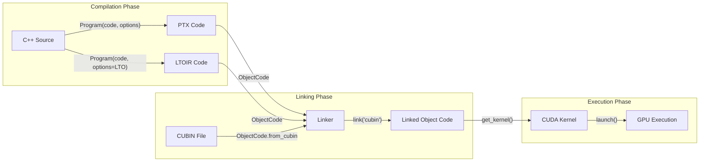
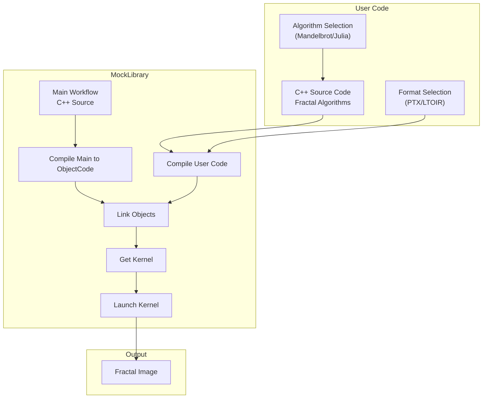
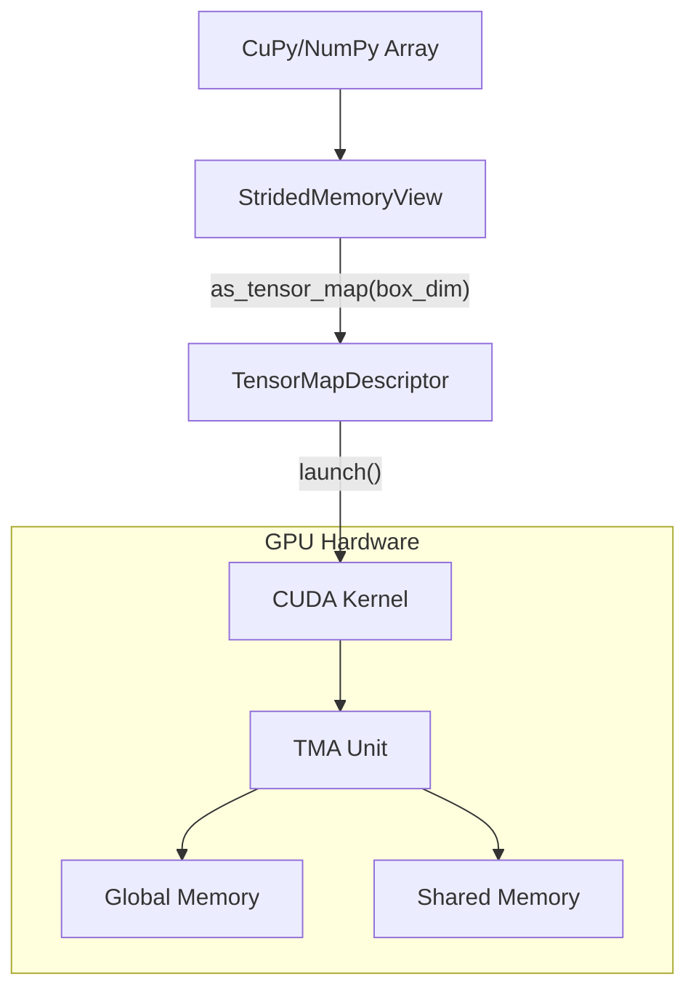

<!-- source: DeepWiki mcp.deepwiki.com · repo NVIDIA/cuda-python · page 6.2 JIT Compilation and LTO Examples · fetched 2026-10-26 -->

# JIT Compilation and LTO Examples

<details>
<summary>Relevant source files</summary>

The following files were used as context for generating this wiki page:

- [cuda_core/cuda/core/__init__.py](cuda_core/cuda/core/__init__.py)
- [cuda_core/cuda/core/_graphics.pxd](cuda_core/cuda/core/_graphics.pxd)
- [cuda_core/cuda/core/_graphics.pyx](cuda_core/cuda/core/_graphics.pyx)
- [cuda_core/docs/source/release/1.0.0-notes.rst](cuda_core/docs/source/release/1.0.0-notes.rst)
- [cuda_core/examples/cuda_graphs.py](cuda_core/examples/cuda_graphs.py)
- [cuda_core/examples/jit_lto_fractal.py](cuda_core/examples/jit_lto_fractal.py)
- [cuda_core/examples/memory_ops.py](cuda_core/examples/memory_ops.py)
- [cuda_core/examples/pytorch_example.py](cuda_core/examples/pytorch_example.py)
- [cuda_core/examples/saxpy.py](cuda_core/examples/saxpy.py)
- [cuda_core/examples/show_device_properties.py](cuda_core/examples/show_device_properties.py)
- [cuda_core/examples/simple_multi_gpu_example.py](cuda_core/examples/simple_multi_gpu_example.py)
- [cuda_core/examples/strided_memory_view_cpu.py](cuda_core/examples/strided_memory_view_cpu.py)
- [cuda_core/examples/strided_memory_view_gpu.py](cuda_core/examples/strided_memory_view_gpu.py)
- [cuda_core/examples/thread_block_cluster.py](cuda_core/examples/thread_block_cluster.py)
- [cuda_core/examples/tma_tensor_map.py](cuda_core/examples/tma_tensor_map.py)
- [cuda_core/examples/vector_add.py](cuda_core/examples/vector_add.py)
- [cuda_core/tests/test_graphics.py](cuda_core/tests/test_graphics.py)
- [cuda_core/tests/test_tensor_map.py](cuda_core/tests/test_tensor_map.py)

</details>


## Purpose and Scope

This document provides detailed technical examples of Just-In-Time (JIT) compilation and Link-Time Optimization (LTO) features provided by the CUDA Python ecosystem. It demonstrates how to use the `Program` and `Linker` classes to compile CUDA C++ code at runtime and link multiple object files together. Additionally, it covers advanced features like Thread Block Clusters, TMA (Tensor Memory Accelerator) tensor maps, and interoperability with PyTorch.

For general information about Program Compilation and the Linker System, see [Program Compilation and Linker System](2.2).

Sources: [cuda_core/examples/jit_lto_fractal.py:5-21](), [cuda_core/examples/tma_tensor_map.py:5-17]()

## JIT Compilation and LTO Fundamentals

Just-In-Time compilation in CUDA Python allows developers to compile CUDA code during program execution rather than ahead of time. This enables dynamic code generation based on runtime conditions. Link-Time Optimization extends this concept by allowing optimizations across multiple compilation units at link time, potentially improving performance.

The CUDA Python ecosystem provides these capabilities through several key classes in `cuda.core`:
- `Program`: Compiles CUDA C++ source code to PTX (Parallel Thread Execution), CUBIN, or LTOIR (Link-Time Optimization IR) [[cuda_core/cuda/core/_program.py:61-61]]().
- `ObjectCode`: Represents compiled code ready for linking or direct kernel extraction [[cuda_core/cuda/core/_module.py:60-60]]().
- `Linker`: Combines multiple `ObjectCode` instances into a single linked result [[cuda_core/cuda/core/_linker.py:45-45]]().

### Compilation and Linking Pipeline

The following diagram illustrates the JIT compilation and linking process in CUDA Python:



Sources: [cuda_core/examples/jit_lto_fractal.py:64-65](), [cuda_core/examples/jit_lto_fractal.py:83-103]()

## Dynamic Linking Example: Fractals

The `jit_lto_fractal.py` example demonstrates a practical application of JIT compilation and linking to create a dynamic workflow between a library and a user's code. The example generates fractal images (Mandelbrot and Julia sets) where the library code handles device setup and the main workflow, while the user provides specific fractal generation logic.

### Library-User Workflow



Sources: [cuda_core/examples/jit_lto_fractal.py:32-111]()

## Thread Block Clusters

Introduced in NVIDIA Hopper architecture (compute capability 9.0+), Thread Block Clusters allow a group of thread blocks to be scheduled together on a single GPC (Graphics Processing Cluster). This enables hardware-accelerated synchronization and data exchange between blocks within the cluster.

The `thread_block_cluster.py` example demonstrates how to configure these clusters using `LaunchConfig`.

### Implementation Detail
- **Launch Configuration**: The `LaunchConfig` class accepts a `cluster` parameter to define the cluster dimensions [[cuda_core/examples/thread_block_cluster.py:110-110]]().
- **Hardware Requirement**: This feature requires compute capability >= 9.0 [[cuda_core/examples/thread_block_cluster.py:88-93]]().
- **Verification**: The kernel uses `cooperative_groups::this_grid().dim_clusters()` to verify that the hardware respects the requested cluster size [[cuda_core/examples/thread_block_cluster.py:40-52]]().

Sources: [cuda_core/examples/thread_block_cluster.py:7-64]()

## TMA and Tensor Map Descriptors

Tensor Memory Accelerator (TMA) is a hardware feature (Hopper+) for efficient bulk data movement. In CUDA Python, this is managed via the `TensorMapDescriptor` and `StridedMemoryView`.

### TMA Data Flow



### Key Operations
1.  **Creation**: A descriptor is created from a memory interface using `as_tensor_map` [[cuda_core/examples/tma_tensor_map.py:162-162]]().
2.  **Address Replacement**: The `replace_address()` method allows reusing a descriptor for a different buffer of the same shape/type without re-creating the descriptor [[cuda_core/examples/tma_tensor_map.py:178-178]]().
3.  **Kernel Integration**: The kernel receives a 128-byte opaque struct and uses `cp_async_bulk_tensor_1d_global_to_shared` to perform the move [[cuda_core/examples/tma_tensor_map.py:65-97]]().

Sources: [cuda_core/examples/tma_tensor_map.py:35-107](), [cuda_core/cuda/core/_tensor_map.py:68-68]()

## PyTorch Interoperability

CUDA Python can interoperate with PyTorch by sharing CUDA streams and memory pointers. This allows JIT-compiled kernels to operate directly on PyTorch tensors.

### Stream Wrapping
Since PyTorch manages its own streams, a wrapper is often used to implement the `__cuda_stream__` protocol required by CUDA Python [[cuda_core/examples/pytorch_example.py:36-43]]().

```python
class PyTorchStreamWrapper:
    def __init__(self, pt_stream):
        self.pt_stream = pt_stream

    def __cuda_stream__(self):
        stream_id = self.pt_stream.cuda_stream
        return (0, stream_id)
```

### Execution Flow
1.  **Stream Capture**: Obtain the current PyTorch stream using `torch.cuda.current_stream()` [[cuda_core/examples/pytorch_example.py:49-49]]().
2.  **Kernel Launch**: Use `data_ptr()` from PyTorch tensors to pass raw device pointers to the `launch` function [[cuda_core/examples/pytorch_example.py:80-83]]().

Sources: [cuda_core/examples/pytorch_example.py:7-112]()

## Comparison of JIT Examples

| Example | Feature Highlight | Key Classes/Functions |
| :--- | :--- | :--- |
| `jit_lto_fractal.py` | Runtime Linking & LTO | `Linker`, `ProgramOptions(link_time_optimization=True)` |
| `thread_block_cluster.py` | Hopper Hardware Scheduling | `LaunchConfig(cluster=...)` |
| `tma_tensor_map.py` | Bulk Data Movement | `TensorMapDescriptor`, `StridedMemoryView` |
| `pytorch_example.py` | Tensor Library Interop | `launch`, `torch.Tensor.data_ptr` |

Sources: [cuda_core/examples/jit_lto_fractal.py:24-25](), [cuda_core/examples/thread_block_cluster.py:22-29](), [cuda_core/examples/tma_tensor_map.py:35-41](), [cuda_core/examples/pytorch_example.py:20-20]()

---

