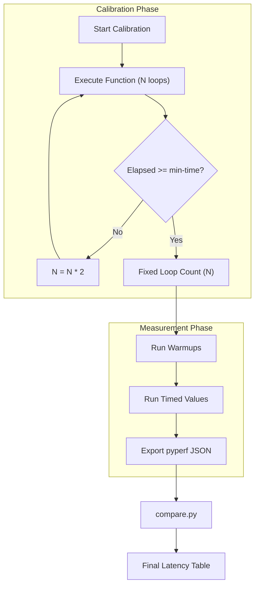
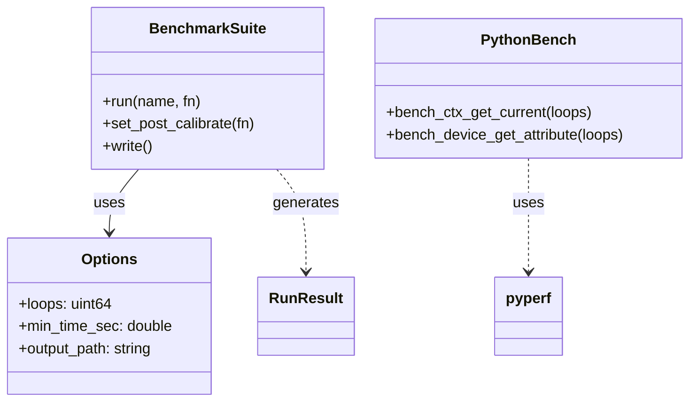

<!-- source: DeepWiki mcp.deepwiki.com · repo NVIDIA/cuda-python · page 6.3 Benchmarks · fetched 2026-10-26 -->

# Benchmarks

<details>
<summary>Relevant source files</summary>

The following files were used as context for generating this wiki page:

- [benchmarks/cuda_bindings/README.md](benchmarks/cuda_bindings/README.md)
- [benchmarks/cuda_bindings/benchmarks/bench_ctx_device.py](benchmarks/cuda_bindings/benchmarks/bench_ctx_device.py)
- [benchmarks/cuda_bindings/benchmarks/bench_enum.py](benchmarks/cuda_bindings/benchmarks/bench_enum.py)
- [benchmarks/cuda_bindings/benchmarks/bench_launch.py](benchmarks/cuda_bindings/benchmarks/bench_launch.py)
- [benchmarks/cuda_bindings/benchmarks/bench_module.py](benchmarks/cuda_bindings/benchmarks/bench_module.py)
- [benchmarks/cuda_bindings/benchmarks/bench_nvrtc.py](benchmarks/cuda_bindings/benchmarks/bench_nvrtc.py)
- [benchmarks/cuda_bindings/benchmarks/bench_pointer_attributes.py](benchmarks/cuda_bindings/benchmarks/bench_pointer_attributes.py)
- [benchmarks/cuda_bindings/benchmarks/bench_tensormap.py](benchmarks/cuda_bindings/benchmarks/bench_tensormap.py)
- [benchmarks/cuda_bindings/benchmarks/cpp/CMakeLists.txt](benchmarks/cuda_bindings/benchmarks/cpp/CMakeLists.txt)
- [benchmarks/cuda_bindings/benchmarks/cpp/bench_ctx_device.cpp](benchmarks/cuda_bindings/benchmarks/cpp/bench_ctx_device.cpp)
- [benchmarks/cuda_bindings/benchmarks/cpp/bench_event.cpp](benchmarks/cuda_bindings/benchmarks/cpp/bench_event.cpp)
- [benchmarks/cuda_bindings/benchmarks/cpp/bench_launch.cpp](benchmarks/cuda_bindings/benchmarks/cpp/bench_launch.cpp)
- [benchmarks/cuda_bindings/benchmarks/cpp/bench_memory.cpp](benchmarks/cuda_bindings/benchmarks/cpp/bench_memory.cpp)
- [benchmarks/cuda_bindings/benchmarks/cpp/bench_module.cpp](benchmarks/cuda_bindings/benchmarks/cpp/bench_module.cpp)
- [benchmarks/cuda_bindings/benchmarks/cpp/bench_nvrtc.cpp](benchmarks/cuda_bindings/benchmarks/cpp/bench_nvrtc.cpp)
- [benchmarks/cuda_bindings/benchmarks/cpp/bench_pointer_attributes.cpp](benchmarks/cuda_bindings/benchmarks/cpp/bench_pointer_attributes.cpp)
- [benchmarks/cuda_bindings/benchmarks/cpp/bench_stream.cpp](benchmarks/cuda_bindings/benchmarks/cpp/bench_stream.cpp)
- [benchmarks/cuda_bindings/benchmarks/cpp/bench_support.hpp](benchmarks/cuda_bindings/benchmarks/cpp/bench_support.hpp)
- [benchmarks/cuda_bindings/benchmarks/cpp/bench_tensormap.cpp](benchmarks/cuda_bindings/benchmarks/cpp/bench_tensormap.cpp)
- [benchmarks/cuda_bindings/compare.py](benchmarks/cuda_bindings/compare.py)
- [benchmarks/cuda_bindings/pixi.toml](benchmarks/cuda_bindings/pixi.toml)
- [benchmarks/cuda_bindings/runner/runtime.py](benchmarks/cuda_bindings/runner/runtime.py)

</details>


The `cuda.bindings` benchmark suite is designed to measure the latency overhead of calling CUDA Driver APIs through Python bindings compared to a native C++ baseline. The primary goal is to ensure that the Python layer maintains a target overhead of less than 1µs for most operations [benchmarks/cuda_bindings/README.md:3-8]().

These benchmarks focus on **latency** (the time cost of the call itself) rather than throughput (the performance of kernels or large data transfers) [benchmarks/cuda_bindings/README.md:17-18]().

## Architecture and Implementation

The benchmarking system consists of a Python framework based on `pyperf` and a custom C++ harness designed to produce compatible results.

### Benchmark Components

| Component | Entity Space | Description |
| :--- | :--- | :--- |
| **Python Runner** | `run_pyperf.py` | Orchestrates Python benchmarks using the `pyperf` module. |
| **C++ Runner** | `run_cpp.py` | Orchestrates the execution of compiled C++ benchmark binaries. |
| **C++ Harness** | `bench_support.hpp` | Provides `BenchmarkSuite` and `calibrate_loops` to mimic `pyperf` behavior in C++. |
| **Comparison Tool** | `compare.py` | Aggregates results from both languages into a side-by-side comparison table. |

### Data Flow and Calibration
The suite uses a calibration phase to determine how many loop iterations are required to reach a stable timing measurement (defined by `--min-time`).


*Sources: [benchmarks/cuda_bindings/benchmarks/cpp/bench_support.hpp:124-193](), [benchmarks/cuda_bindings/README.md:67-71]()*

## Benchmark Categories

### Python-to-C Comparative Benchmarks
Most benchmarks have equivalent implementations in both Python and C++ to measure the exact overhead of the binding layer.

*   **Context and Device**: Measures `cuCtxGetCurrent`, `cuDeviceGetAttribute`, and primary context retention [benchmarks/cuda_bindings/benchmarks/bench_ctx_device.py:22-79](), [benchmarks/cuda_bindings/benchmarks/cpp/bench_ctx_device.cpp:38-93]().
*   **Memory Management**: Covers `cuMemAlloc`/`cuMemFree` (both synchronous and asynchronous) and `cuMemcpy` variants (HtoD, DtoH, DtoD) [benchmarks/cuda_bindings/benchmarks/cpp/bench_memory.cpp:61-101]().
*   **Streams and Events**: Measures creation, destruction, recording, and synchronization overhead [benchmarks/cuda_bindings/benchmarks/cpp/bench_event.cpp:54-85]().
*   **Kernel Launch**: Benchmarks `cuLaunchKernel` with varying numbers of arguments (from 16 to 512) and different data types to measure parameter packing overhead [benchmarks/cuda_bindings/benchmarks/cpp/bench_launch.cpp:171-210]().

### Python-Only Benchmarks
Some benchmarks focus on Python-specific features that have no direct C++ equivalent, such as:
*   **Enum Access**: Performance of `cuda.bindings` enum construction and member access [benchmarks/cuda_bindings/benchmarks/bench_enum.py:1-20]().
*   **FastEnum System**: Validating the performance of the internal `_FastEnum` optimization.

## System Tuning

To achieve stable and reproducible results, especially for sub-microsecond measurements, the Linux system should be tuned to reduce jitter. The suite leverages `pyperf system` for this purpose [benchmarks/cuda_bindings/README.md:34-37]().

```bash
# Show current system state
pixi run -e wheel -- python -m pyperf system show

# Apply tuning (requires root)
$(pixi run -e wheel -- which python) -m pyperf system tune
```
*Sources: [benchmarks/cuda_bindings/README.md:39-45]()*

## Execution and Analysis

The project uses `pixi` to manage environments and task execution. Two main environments are supported: `wheel` (using pre-built packages) and `source` (using the local code) [benchmarks/cuda_bindings/pixi.toml:50-52]().

### Running Benchmarks
```bash
# Run Python benchmarks
pixi run -e wheel bench

# Run C++ benchmarks
pixi run -e wheel bench-cpp

# Compare results
pixi run -e wheel bench-compare
```
*Sources: [benchmarks/cuda_bindings/pixi.toml:54-81](), [benchmarks/cuda_bindings/README.md:49-62]()*

### Analyzing Results
The results are stored in `results-python.json` and `results-cpp.json`. The `compare.py` script generates a table showing C++ latency, Python latency, and the absolute/percentage overhead [benchmarks/cuda_bindings/compare.py:115-128]().

**Example Comparison Output Logic:**
The script calculates mean and relative standard deviation (RSD) for both sets [benchmarks/cuda_bindings/compare.py:40-44]().
*   **Overhead (ns)**: `(Python Mean - C++ Mean) * 1e9` [benchmarks/cuda_bindings/compare.py:62-63]().
*   **Overhead (%)**: `(Python Mean - C++ Mean) / C++ Mean * 100` [benchmarks/cuda_bindings/compare.py:66-70]().

## Code Entity Map

The following diagram maps the benchmarking system names to their specific code implementations.

| System Name | Code Entity | File Path |
| :--- | :--- | :--- |
| **Python Entry** | `run_pyperf.py` | `benchmarks/cuda_bindings/run_pyperf.py` |
| **C++ Suite** | `BenchmarkSuite` | `benchmarks/cuda_bindings/benchmarks/cpp/bench_support.hpp` |
| **Build System** | `CMakeLists.txt` | `benchmarks/cuda_bindings/benchmarks/cpp/CMakeLists.txt` |
| **Environment** | `pixi.toml` | `benchmarks/cuda_bindings/pixi.toml` |


*Sources: [benchmarks/cuda_bindings/benchmarks/cpp/bench_support.hpp:22-43](), [benchmarks/cuda_bindings/benchmarks/bench_ctx_device.py:22-67](), [benchmarks/cuda_bindings/pixi.toml:5-52]()*

---

