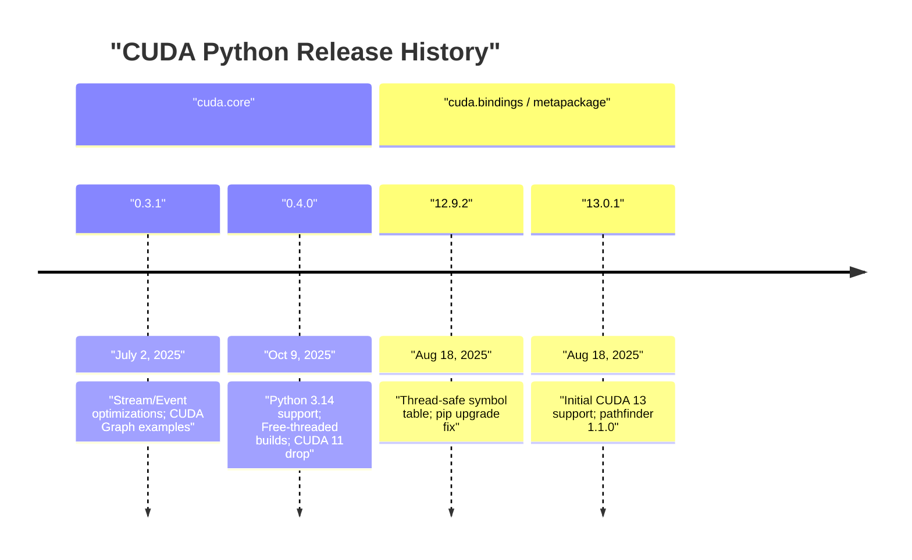
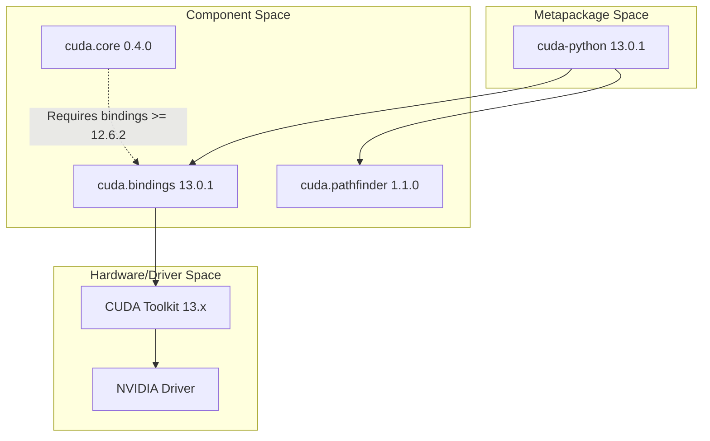
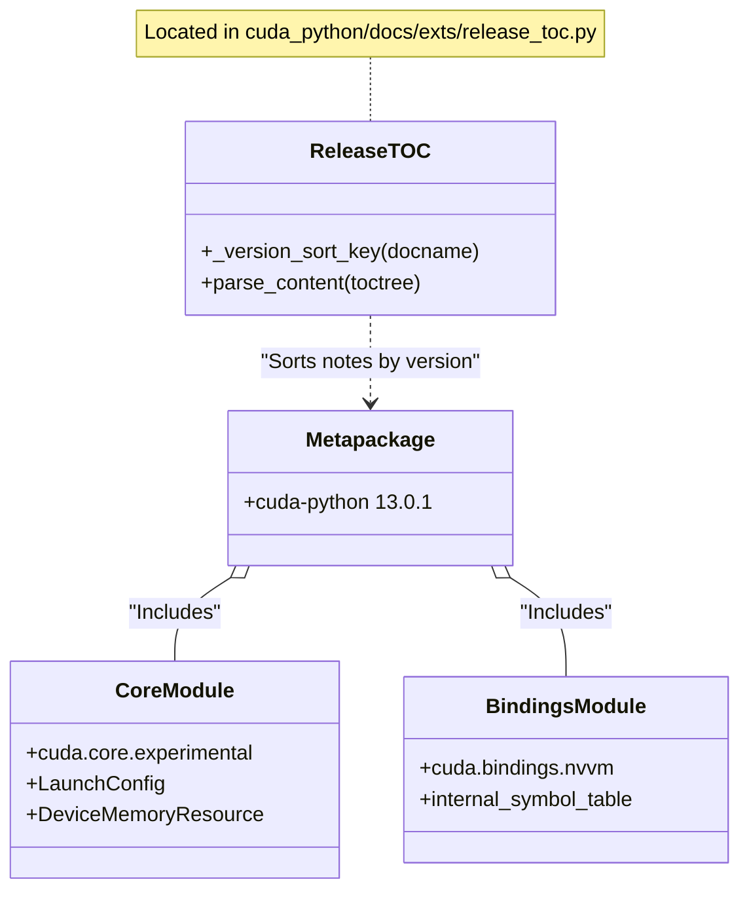

<!-- source: DeepWiki mcp.deepwiki.com · repo NVIDIA/cuda-python · page 7 Release Notes · fetched 2026-10-26 -->

# Release Notes

Relevant source files

The following files were used as context for generating this wiki page:

- [cuda_bindings/docs/source/release.rst](cuda_bindings/docs/source/release.rst)
- [cuda_bindings/docs/source/release/11.8.7-notes.rst](cuda_bindings/docs/source/release/11.8.7-notes.rst)
- [cuda_bindings/docs/source/release/12.9.2-notes.rst](cuda_bindings/docs/source/release/12.9.2-notes.rst)
- [cuda_bindings/docs/source/release/13.0.1-notes.rst](cuda_bindings/docs/source/release/13.0.1-notes.rst)
- [cuda_bindings/docs/versions.json](cuda_bindings/docs/versions.json)
- [cuda_core/docs/source/release.rst](cuda_core/docs/source/release.rst)
- [cuda_core/docs/source/release/0.3.1-notes.rst](cuda_core/docs/source/release/0.3.1-notes.rst)
- [cuda_core/docs/source/release/0.4.0-notes.rst](cuda_core/docs/source/release/0.4.0-notes.rst)
- [cuda_python/docs/exts/release_toc.py](cuda_python/docs/exts/release_toc.py)
- [cuda_python/docs/source/release.rst](cuda_python/docs/source/release.rst)
- [cuda_python/docs/source/release/12.9.2-notes.rst](cuda_python/docs/source/release/12.9.2-notes.rst)
- [cuda_python/docs/source/release/13.0.1-notes.rst](cuda_python/docs/source/release/13.0.1-notes.rst)
- [cuda_python/docs/versions.json](cuda_python/docs/versions.json)

## Overview

This page documents the history of changes, new features, breaking changes, and bug fixes across releases of the CUDA Python ecosystem components. It covers the `cuda.core` package, the `cuda.bindings` package, and the `cuda.pathfinder` utility, all of which are unified under the `cuda-python` metapackage.

For detailed information about specific components, please refer to:
- [cuda.core Release Notes](#7.1)
- [cuda.bindings Release Notes](#7.2)

Sources: [cuda_core/docs/source/release.rst:4-11](), [cuda_bindings/docs/source/release.rst:4-11](), [cuda_python/docs/source/release.rst:4-11]()

## Release Timeline

The project maintains a dual-track release cycle where `cuda.bindings` and the `cuda-python` metapackage follow CUDA Toolkit versioning (e.g., 12.x, 13.x), while `cuda.core` follows semantic versioning for its Pythonic abstractions.

Sources: [cuda_core/docs/source/release/0.3.1-notes.rst:9-16](), [cuda_core/docs/source/release/0.4.0-notes.rst:9-17](), [cuda_bindings/docs/source/release/13.0.1-notes.rst:9-15](), [cuda_python/docs/source/release/13.0.1-notes.rst:7-14]()

## Versioning and Compatibility

The ecosystem versioning strategy ensures that low-level bindings map to hardware/driver capabilities while high-level abstractions evolve independently.

Sources: [cuda_python/docs/source/release/13.0.1-notes.rst:10-14](), [cuda_core/docs/source/release/0.4.0-notes.rst:23-24](), [cuda_bindings/docs/versions.json:1-9]()

## cuda.core Releases

### 0.4.0 (Latest)
Released on Oct 9, 2025. This release focuses on modernization and performance.

*   **Breaking Changes**:
    *   Dropped support for CUDA 11 and `cuda-bindings` < 12.6.2 [cuda_core/docs/source/release/0.4.0-notes.rst:23-24]().
    *   `LaunchConfig` grid parameter now represents clusters when `LaunchConfig.cluster` is specified [cuda_core/docs/source/release/0.4.0-notes.rst:25-25]().
    *   `Buffer` objects now deallocate on the allocation stream by default [cuda_core/docs/source/release/0.4.0-notes.rst:26-26]().
*   **New Features**:
    *   Support for Python 3.14 and experimental free-threaded builds for 3.13/3.14 [cuda_core/docs/source/release/0.4.0-notes.rst:15-17]().
    *   `Device.arch` property for compute capability strings [cuda_core/docs/source/release/0.4.0-notes.rst:32-32]().
    *   `VirtualMemoryResource` for low-level VMM on Linux [cuda_core/docs/source/release/0.4.0-notes.rst:37-37]().
    *   NVVM IR support in `Program` via `code_type="nvvm"` [cuda_core/docs/source/release/0.4.0-notes.rst:35-35]().

Sources: [cuda_core/docs/source/release/0.4.0-notes.rst:1-59]()

### 0.3.1
Released on July 2, 2025.

*   **Highlights**: Performance improvements for `Stream` and `Event` creation [cuda_core/docs/source/release/0.3.1-notes.rst:16-16]().
*   **Enhancements**: Improved compatibility with newer drivers and fixed `cuda-core[cu11/cu12]` optional dependency installation [cuda_core/docs/source/release/0.3.1-notes.rst:41-45]().

Sources: [cuda_core/docs/source/release/0.3.1-notes.rst:1-46]()

## cuda.bindings Releases

### 13.0.1 (Latest)
Released on Aug 18, 2025.

*   **Highlights**: Internal symbol table population is now thread-safe [cuda_bindings/docs/source/release/13.0.1-notes.rst:15-15]().
*   **Known Issues**: Upgrading from versions ≤ 12.6.2.post1 via `pip install -U` may fail; a clean re-install is recommended [cuda_bindings/docs/source/release/13.0.1-notes.rst:21-21]().

Sources: [cuda_bindings/docs/source/release/13.0.1-notes.rst:1-22]()

### 11.8.7
Released on May 5, 2025.

*   **Highlights**: Added `cuda.bindings.nvvm` module wrapping the libNVVM C API [cuda_bindings/docs/source/release/11.8.7-notes.rst:13-14]().
*   **Fixes**: Resolved segfault when converting `char* NULL` to Python bytes [cuda_bindings/docs/source/release/11.8.7-notes.rst:20-20]().

Sources: [cuda_bindings/docs/source/release/11.8.7-notes.rst:1-28]()

## Component Relationships and Feature Evolution

The following diagram maps high-level release concepts to the internal modules and sorting logic used in the documentation build system.

Sources: [cuda_python/docs/exts/release_toc.py:10-39](), [cuda_python/docs/source/release/13.0.1-notes.rst:10-14](), [cuda_core/docs/source/release/0.4.0-notes.rst:4-37]()

---

