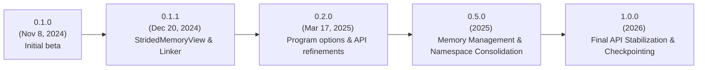
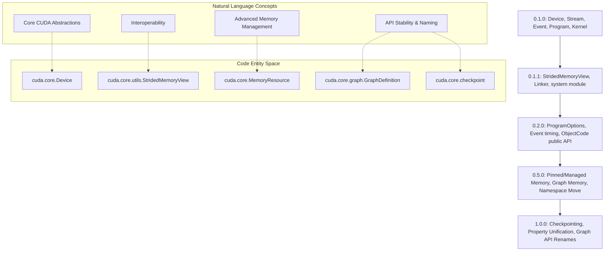
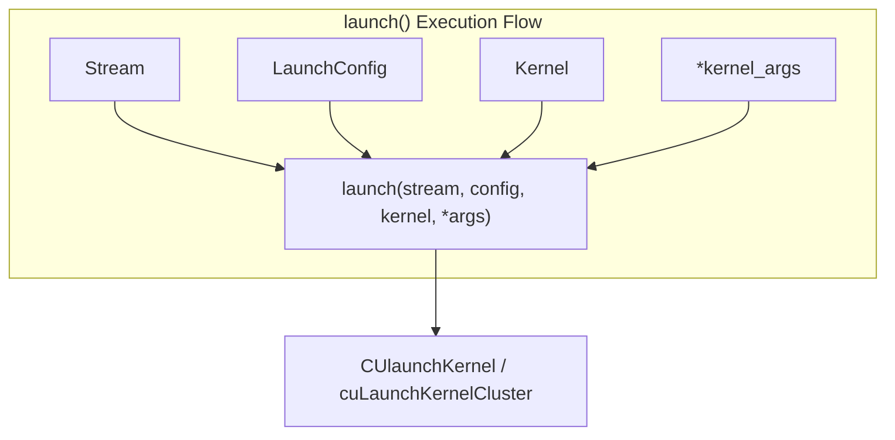

<!-- source: DeepWiki mcp.deepwiki.com · repo NVIDIA/cuda-python · page 7.1 cuda.core Release Notes · fetched 2026-10-26 -->

# cuda.core Release Notes

Relevant source files

The following files were used as context for generating this wiki page:

- [cuda_bindings/docs/source/release.rst](cuda_bindings/docs/source/release.rst)
- [cuda_bindings/docs/source/release/11.8.7-notes.rst](cuda_bindings/docs/source/release/11.8.7-notes.rst)
- [cuda_core/cuda/core/__init__.py](cuda_core/cuda/core/__init__.py)
- [cuda_core/cuda/core/_graphics.pxd](cuda_core/cuda/core/_graphics.pxd)
- [cuda_core/cuda/core/_graphics.pyx](cuda_core/cuda/core/_graphics.pyx)
- [cuda_core/docs/source/release.rst](cuda_core/docs/source/release.rst)
- [cuda_core/docs/source/release/0.1.0-notes.rst](cuda_core/docs/source/release/0.1.0-notes.rst)
- [cuda_core/docs/source/release/0.1.1-notes.rst](cuda_core/docs/source/release/0.1.1-notes.rst)
- [cuda_core/docs/source/release/0.2.0-notes.rst](cuda_core/docs/source/release/0.2.0-notes.rst)
- [cuda_core/docs/source/release/0.3.1-notes.rst](cuda_core/docs/source/release/0.3.1-notes.rst)
- [cuda_core/docs/source/release/0.3.2-notes.rst](cuda_core/docs/source/release/0.3.2-notes.rst)
- [cuda_core/docs/source/release/0.4.0-notes.rst](cuda_core/docs/source/release/0.4.0-notes.rst)
- [cuda_core/docs/source/release/0.5.0-notes.rst](cuda_core/docs/source/release/0.5.0-notes.rst)
- [cuda_core/docs/source/release/1.0.0-notes.rst](cuda_core/docs/source/release/1.0.0-notes.rst)
- [cuda_core/docs/versions.json](cuda_core/docs/versions.json)
- [cuda_core/examples/tma_tensor_map.py](cuda_core/examples/tma_tensor_map.py)
- [cuda_core/tests/test_graphics.py](cuda_core/tests/test_graphics.py)
- [cuda_core/tests/test_tensor_map.py](cuda_core/tests/test_tensor_map.py)
- [cuda_python/docs/exts/release_toc.py](cuda_python/docs/exts/release_toc.py)
- [cuda_python/docs/source/release.rst](cuda_python/docs/source/release.rst)

This page documents the release history of the `cuda.core` package, including version changes, new features, breaking changes, and enhancements. The `cuda.core` package provides Pythonic access to CUDA runtime and other core functionalities.

For information about the lower-level CUDA Python bindings, see [cuda.bindings Release Notes](#).

## Version History Overview

Sources: [cuda_core/docs/versions.json:1-10](), [cuda_core/docs/source/release.rst:1-12](), [cuda_core/cuda/core/__init__.py:1-78]()

## Feature Evolution

The following diagram illustrates how `cuda.core` has evolved across its releases, transitioning from experimental modules to a stabilized top-level API.

Sources: [cuda_core/docs/source/release/0.1.0-notes.rst:1-25](), [cuda_core/docs/source/release/0.1.1-notes.rst:1-54](), [cuda_core/docs/source/release/0.2.0-notes.rst:1-57](), [cuda_core/docs/source/release/0.5.0-notes.rst:1-76](), [cuda_core/docs/source/release/1.0.0-notes.rst:1-155]()

## Release 1.0.0 (2026)

### Highlights
- API stabilization and removal of the `experimental` namespace requirement.
- Introduction of process checkpointing.
- Extensive renaming for cross-API consistency.

### Breaking Changes
- **Graph API Renaming**: `GraphDef` is now `GraphDefinition` [cuda_core/docs/source/release/1.0.0-notes.rst:28-31](). `Condition` is now `GraphCondition` [cuda_core/docs/source/release/1.0.0-notes.rst:32-35]().
- **Property Conversion**: No-argument deterministic getters (e.g., `Buffer.get_ipc_descriptor()`) are now properties (`Buffer.ipc_descriptor`) [cuda_core/docs/source/release/1.0.0-notes.rst:37-46]().
- **Stream Requirements**: `stream` is now a required keyword-only argument on APIs that schedule work, such as `MemoryResource.allocate` and `Device.allocate` [cuda_core/docs/source/release/1.0.0-notes.rst:128-144]().
- **Kernel Attributes**: Attribute queries now use indexing. Instead of `kernel.attributes.num_regs(device)`, use `kernel.attributes[device].num_regs` [cuda_core/docs/source/release/1.0.0-notes.rst:77-91]().

### New Features
- **Process Checkpointing**: Added `cuda.core.checkpoint` module for string process state queries, lock/restore operations, and GPU UUID remapping [cuda_core/docs/source/release/1.0.0-notes.rst:19-22]().

Sources: [cuda_core/docs/source/release/1.0.0-notes.rst:1-155]()

## Release 0.5.0 (2025)

### Highlights
- **Namespace Migration**: All public APIs moved from `cuda.core.experimental` to the top-level `cuda.core` namespace [cuda_core/docs/source/release/0.5.0-notes.rst:24-25]().
- **Memory Management**: Added `PinnedMemoryResource`, `ManagedMemoryResource`, and `GraphMemoryResource` [cuda_core/docs/source/release/0.5.0-notes.rst:13-15]().

### New Features
- **Buffer Initialization**: Added `Buffer.fill` for efficient initialization [cuda_core/docs/source/release/0.5.0-notes.rst:47]().
- **Device Management**: `Device` constructor now accepts either a `Device` instance or an integer ordinal. Added `Device.get_all_devices()` [cuda_core/docs/source/release/0.5.0-notes.rst:52-53]().
- **Peer Access**: Added peer access control to `DeviceMemoryResource` [cuda_core/docs/source/release/0.5.0-notes.rst:15]().

Sources: [cuda_core/docs/source/release/0.5.0-notes.rst:1-76]()

## Release 0.2.0 (March 17, 2025)

### Highlights
- Introduction of `ProgramOptions` for passing runtime compile options to `Program` [cuda_core/docs/source/release/0.2.0-notes.rst:14]().
- Pythonic access to `Device` and `Kernel` attributes [cuda_core/docs/source/release/0.2.0-notes.rst:15]().

### Breaking Changes
- **Launch Signature**: Swapped positional arguments in `launch`. New signature: `(stream, config, kernel, *kernel_args)` [cuda_core/docs/source/release/0.2.0-notes.rst:21]().
- **Stream Handling**: Removed `stream` attribute from `LaunchConfig`. Streams must be passed directly to `launch` [cuda_core/docs/source/release/0.2.0-notes.rst:20]().
- **Handle Types**: `.handle` attributes now return the underlying Python object instead of a type-erased integer [cuda_core/docs/source/release/0.2.0-notes.rst:25]().

Sources: [cuda_core/docs/source/release/0.2.0-notes.rst:1-57]()

## Release 0.1.1 (December 20, 2024)

### Highlights
- **Interoperability**: Added `StridedMemoryView` for DLPack and CUDA Array Interface support [cuda_core/docs/source/release/0.1.1-notes.rst:14-15]().
- **JIT Linking**: Added `Linker` to link multiple `ObjectCode` instances [cuda_core/docs/source/release/0.1.1-notes.rst:16-18]().

### New Features
- **System Introspection**: Added `cuda.core.system` for querying system-wide info [cuda_core/docs/source/release/0.1.1-notes.rst:24]().
- **Hopper Support**: Added `LaunchConfig.cluster` for thread block clusters [cuda_core/docs/source/release/0.1.1-notes.rst:25]().

Sources: [cuda_core/docs/source/release/0.1.1-notes.rst:1-54]()

## Release 0.1.0 (November 8, 2024)

### Highlights
- Initial beta release of `cuda.core`.
- Support for CUDA 11.x and 12.x drivers and toolkits [cuda_core/docs/source/release/0.1.0-notes.rst:14-15]().
- Pythonic CUDA runtime abstractions: `Device`, `Stream`, `Event`, `Program`, `Kernel` [cuda_core/cuda/core/__init__.py:31-67]().

Sources: [cuda_core/docs/source/release/0.1.0-notes.rst:1-25]()

## Summary of Core API Entities

| Entity | Role | Introduced |
| :--- | :--- | :--- |
| `Device` | Physical GPU abstraction and property access | 0.1.0 |
| `Stream` | Asynchronous command queue | 0.1.0 |
| `Program` | NVRTC/NVVM compilation wrapper | 0.1.0 |
| `Linker` | JIT/LTO linking for relocatable code | 0.1.1 |
| `StridedMemoryView` | Tensor interoperability (DLPack/CAI) | 0.1.1 |
| `Buffer` | Memory allocation wrapper | 0.1.0 |
| `GraphDefinition` | Explicit CUDA Graph construction | 0.5.0 (as GraphDef) |
| `GraphBuilder` | Stream-capture based graph construction | 0.5.0 |

Sources: [cuda_core/cuda/core/__init__.py:31-78](), [cuda_core/docs/source/release/0.1.1-notes.rst:14-18](), [cuda_core/docs/source/release/0.5.0-notes.rst:13-15](), [cuda_core/docs/source/release/1.0.0-notes.rst:28-31]()

---

