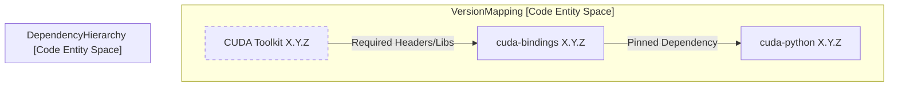
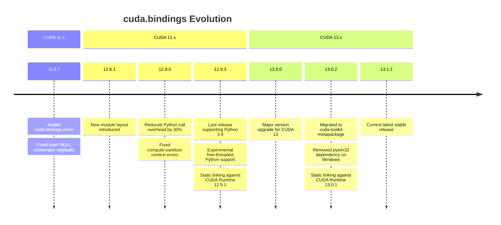
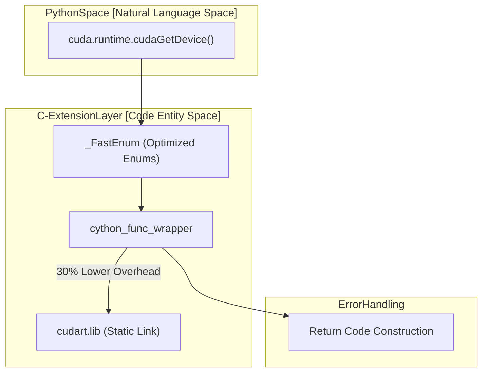

<!-- source: DeepWiki mcp.deepwiki.com · repo NVIDIA/cuda-python · page 7.2 cuda.bindings Release Notes · fetched 2026-10-26 -->

# cuda.bindings Release Notes

Relevant source files

The following files were used as context for generating this wiki page:

- [cuda_bindings/docs/nv-versions.json](cuda_bindings/docs/nv-versions.json)
- [cuda_bindings/docs/source/release.rst](cuda_bindings/docs/source/release.rst)
- [cuda_bindings/docs/source/release/11.8.7-notes.rst](cuda_bindings/docs/source/release/11.8.7-notes.rst)
- [cuda_bindings/docs/source/release/12.9.2-notes.rst](cuda_bindings/docs/source/release/12.9.2-notes.rst)
- [cuda_bindings/docs/source/release/12.9.3-notes.rst](cuda_bindings/docs/source/release/12.9.3-notes.rst)
- [cuda_bindings/docs/source/release/12.9.4-notes.rst](cuda_bindings/docs/source/release/12.9.4-notes.rst)
- [cuda_bindings/docs/source/release/12.9.5-notes.rst](cuda_bindings/docs/source/release/12.9.5-notes.rst)
- [cuda_bindings/docs/source/release/13.0.1-notes.rst](cuda_bindings/docs/source/release/13.0.1-notes.rst)
- [cuda_bindings/docs/source/release/13.0.2-notes.rst](cuda_bindings/docs/source/release/13.0.2-notes.rst)
- [cuda_bindings/docs/source/release/13.0.3-notes.rst](cuda_bindings/docs/source/release/13.0.3-notes.rst)
- [cuda_bindings/docs/source/release/13.1.1-notes.rst](cuda_bindings/docs/source/release/13.1.1-notes.rst)
- [cuda_bindings/docs/versions.json](cuda_bindings/docs/versions.json)
- [cuda_core/docs/source/release.rst](cuda_core/docs/source/release.rst)
- [cuda_core/docs/source/release/0.3.1-notes.rst](cuda_core/docs/source/release/0.3.1-notes.rst)
- [cuda_core/docs/source/release/0.4.0-notes.rst](cuda_core/docs/source/release/0.4.0-notes.rst)
- [cuda_python/docs/exts/release_toc.py](cuda_python/docs/exts/release_toc.py)
- [cuda_python/docs/nv-versions.json](cuda_python/docs/nv-versions.json)
- [cuda_python/docs/source/release.rst](cuda_python/docs/source/release.rst)
- [cuda_python/docs/source/release/12.9.2-notes.rst](cuda_python/docs/source/release/12.9.2-notes.rst)
- [cuda_python/docs/source/release/12.9.3-notes.rst](cuda_python/docs/source/release/12.9.3-notes.rst)
- [cuda_python/docs/source/release/12.9.5-notes.rst](cuda_python/docs/source/release/12.9.5-notes.rst)
- [cuda_python/docs/source/release/13.0.1-notes.rst](cuda_python/docs/source/release/13.0.1-notes.rst)
- [cuda_python/docs/source/release/13.1.0-notes.rst](cuda_python/docs/source/release/13.1.0-notes.rst)
- [cuda_python/docs/source/release/13.1.1-notes.rst](cuda_python/docs/source/release/13.1.1-notes.rst)
- [cuda_python/docs/versions.json](cuda_python/docs/versions.json)

## Purpose and Scope

This document provides comprehensive release notes for the `cuda.bindings` package, which offers low-level Python bindings to CUDA C APIs. These notes detail version history, new features, bug fixes, and performance improvements across releases from 11.8.x through the current 13.x versions. For information about the overall architecture, see [cuda.bindings](#3). For release notes specific to the high-level Pythonic core, see [cuda.core Release Notes](#7.1).

## Version Numbering and Compatibility

`cuda.bindings` follows the CUDA Toolkit version numbering scheme to indicate compatibility. Major and minor versions align with the CUDA Toolkit releases they support.

Sources: [cuda_bindings/docs/versions.json:1-10](), [cuda_python/docs/versions.json:1-10]()

## Release Timeline

The `cuda.bindings` package has transitioned from supporting the CUDA 11 ecosystem to the current CUDA 13 releases, introducing major performance overhauls and dependency refactors.

Sources: [cuda_bindings/docs/nv-versions.json:1-46](), [cuda_bindings/docs/source/release/13.0.2-notes.rst:6-25](), [cuda_bindings/docs/source/release/11.8.7-notes.rst:4-21]()

## Key Version Highlights

### 13.0.x Series
The 13.0.x releases represent a significant shift in how dependencies and library discovery are handled.

*   **Metapackage Migration**: Switched from individual NVIDIA wheel dependencies to the `cuda-toolkit` metapackage for improved resolution [cuda_bindings/docs/source/release/13.0.2-notes.rst:18-18]().
*   **Pathfinder Integration**: `cyruntime.getLocalRuntimeVersion` now utilizes `cuda.pathfinder` for robust runtime discovery [cuda_bindings/docs/source/release/13.0.2-notes.rst:24-24]().
*   **Windows Refinement**: Removed `pywin32` dependency; Windows APIs are now accessed directly via `ctypes` or internal shims [cuda_bindings/docs/source/release/13.0.2-notes.rst:20-20]().
*   **Static Linking**: The `cuda.bindings.runtime` module is now statically linked against the CUDA Runtime library (e.g., 13.0.1) to ensure version consistency [cuda_bindings/docs/source/release/13.0.2-notes.rst:23-23]().

### 12.9.x Series
This series focused on performance and modern Python support.

*   **Performance**: Reduced Python overhead for calling `driver`, `runtime`, and `nvrtc` functions by approximately 30% [cuda_bindings/docs/source/release/12.9.3-notes.rst:19-19]().
*   **Free-threaded Python**: Introduced experimental support for free-threaded builds in Python 3.13 and 3.14 [cuda_bindings/docs/source/release/12.9.3-notes.rst:17-17]().
*   **Automatic Discovery**: Enabled library path detection based on `CUDA_HOME`, removing the requirement for manual `LIBRARY_PATH` configuration [cuda_bindings/docs/source/release/12.9.3-notes.rst:18-18]().

### 11.8.x Series
*   **NVVM Support**: Introduced the `cuda.bindings.nvvm` module, providing a Python interface to `libNVVM` for compiler backend operations [cuda_bindings/docs/source/release/11.8.7-notes.rst:13-14]().

## Binding Implementation and Call Flow

The following diagram bridges the Python call space to the underlying C-extension layer, highlighting the performance improvements made in 12.9.x/13.0.x.

Sources: [cuda_bindings/docs/source/release/13.0.2-notes.rst:21-23](), [cuda_bindings/docs/source/release/11.8.7-notes.rst:13-14]()

## Summary of Changes by Version

| Version | Key Features | Performance/Fixes |
| :--- | :--- | :--- |
| **13.0.2** | `cuda-toolkit` metapackage | Removed `pywin32` dependency [cuda_bindings/docs/source/release/13.0.2-notes.rst:20-20]() |
| **12.9.3** | Python 3.14 support | 30% reduction in call overhead [cuda_bindings/docs/source/release/12.9.3-notes.rst:19-19]() |
| **12.9.0** | - | Fixed `CUDA_ERROR_INVALID_CONTEXT` in sanitizer [cuda_bindings/docs/source/release/11.8.7-notes.rst:27-27]() |
| **11.8.7** | Added `cuda.bindings.nvvm` | Fixed `char* NULL` to bytes segfault [cuda_bindings/docs/source/release/11.8.7-notes.rst:20-20]() |

## Known Issues and Migration Notes

*   **Upgrade Path**: Users upgrading from versions prior to 12.6.2.post1 may encounter issues with `pip install -U`. A clean re-installation (uninstall then install) is recommended [cuda_bindings/docs/source/release/13.0.2-notes.rst:36-36]().
*   **Python Support**: Version 13.0.2 and 12.9.3 are the final releases officially supporting Python 3.9 [cuda_bindings/docs/source/release/13.0.2-notes.rst:15-15]().
*   **Graphics APIs**: In versions 13.0.2 and 12.9.3, graphics APIs in `cuda.bindings.runtime` were inadvertently disabled. Users requiring these should use 13.0.3 or 12.9.4 respectively [cuda_bindings/docs/source/release/13.0.2-notes.rst:37-37]().

Sources: [cuda_bindings/docs/source/release/13.0.2-notes.rst:15-37](), [cuda_bindings/docs/source/release/12.9.3-notes.rst:15-30]()

---

