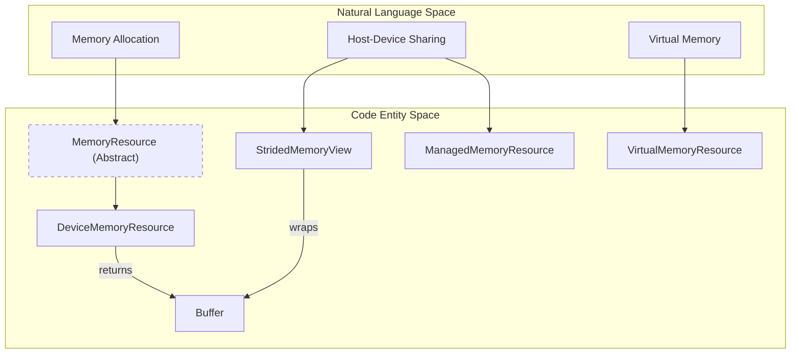
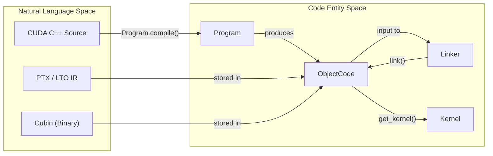

<!-- source: DeepWiki mcp.deepwiki.com · repo NVIDIA/cuda-python · page 8 Glossary · fetched 2026-10-26 -->

# Glossary

Relevant source files

The following files were used as context for generating this wiki page:

- [cuda_bindings/cuda/bindings/_lib/utils.pxd.in](cuda_bindings/cuda/bindings/_lib/utils.pxd.in)
- [cuda_bindings/cuda/bindings/_lib/utils.pxi.in](cuda_bindings/cuda/bindings/_lib/utils.pxi.in)
- [cuda_bindings/cuda/bindings/cyruntime_types.pxi.in](cuda_bindings/cuda/bindings/cyruntime_types.pxi.in)
- [cuda_bindings/cuda/bindings/driver.pxd.in](cuda_bindings/cuda/bindings/driver.pxd.in)
- [cuda_bindings/cuda/bindings/driver.pyx.in](cuda_bindings/cuda/bindings/driver.pyx.in)
- [cuda_bindings/cuda/bindings/runtime.pxd.in](cuda_bindings/cuda/bindings/runtime.pxd.in)
- [cuda_bindings/cuda/bindings/runtime.pyx.in](cuda_bindings/cuda/bindings/runtime.pyx.in)
- [cuda_bindings/docs/source/module/driver.rst](cuda_bindings/docs/source/module/driver.rst)
- [cuda_bindings/docs/source/module/nvrtc.rst](cuda_bindings/docs/source/module/nvrtc.rst)
- [cuda_bindings/docs/source/module/runtime.rst](cuda_bindings/docs/source/module/runtime.rst)
- [cuda_bindings/tests/conftest.py](cuda_bindings/tests/conftest.py)
- [cuda_bindings/tests/test_cuda.py](cuda_bindings/tests/test_cuda.py)
- [cuda_bindings/tests/test_cudart.py](cuda_bindings/tests/test_cudart.py)
- [cuda_core/build_hooks.py](cuda_core/build_hooks.py)
- [cuda_core/cuda/core/_include/aoti_shim.def](cuda_core/cuda/core/_include/aoti_shim.def)
- [cuda_core/cuda/core/_include/aoti_shim.h](cuda_core/cuda/core/_include/aoti_shim.h)
- [cuda_core/cuda/core/_linker.pyx](cuda_core/cuda/core/_linker.pyx)
- [cuda_core/cuda/core/_memoryview.pyx](cuda_core/cuda/core/_memoryview.pyx)
- [cuda_core/cuda/core/_program.pyx](cuda_core/cuda/core/_program.pyx)
- [cuda_core/cuda/core/_tensor_bridge.pyx](cuda_core/cuda/core/_tensor_bridge.pyx)
- [cuda_core/cuda/core/_utils/cuda_utils.pyx](cuda_core/cuda/core/_utils/cuda_utils.pyx)
- [cuda_core/cuda/core/system/_clock.pxi](cuda_core/cuda/core/system/_clock.pxi)
- [cuda_core/cuda/core/system/_cooler.pxi](cuda_core/cuda/core/system/_cooler.pxi)
- [cuda_core/cuda/core/system/_device.pyx](cuda_core/cuda/core/system/_device.pyx)
- [cuda_core/cuda/core/system/_event.pxi](cuda_core/cuda/core/system/_event.pxi)
- [cuda_core/cuda/core/system/_fan.pxi](cuda_core/cuda/core/system/_fan.pxi)
- [cuda_core/cuda/core/system/_inforom.pxi](cuda_core/cuda/core/system/_inforom.pxi)
- [cuda_core/cuda/core/system/_nvlink.pxi](cuda_core/cuda/core/system/_nvlink.pxi)
- [cuda_core/cuda/core/system/_pci_info.pxi](cuda_core/cuda/core/system/_pci_info.pxi)
- [cuda_core/cuda/core/system/_system_events.pyx](cuda_core/cuda/core/system/_system_events.pyx)
- [cuda_core/cuda/core/system/_temperature.pxi](cuda_core/cuda/core/system/_temperature.pxi)
- [cuda_core/docs/source/api.rst](cuda_core/docs/source/api.rst)
- [cuda_core/docs/source/api_private.rst](cuda_core/docs/source/api_private.rst)
- [cuda_core/setup.py](cuda_core/setup.py)
- [cuda_core/tests/conftest.py](cuda_core/tests/conftest.py)
- [cuda_core/tests/system/test_system_device.py](cuda_core/tests/system/test_system_device.py)
- [cuda_core/tests/system/test_system_events.py](cuda_core/tests/system/test_system_events.py)
- [cuda_core/tests/test_cuda_utils.py](cuda_core/tests/test_cuda_utils.py)
- [cuda_core/tests/test_device.py](cuda_core/tests/test_device.py)
- [cuda_core/tests/test_enum_coverage.py](cuda_core/tests/test_enum_coverage.py)
- [cuda_core/tests/test_event.py](cuda_core/tests/test_event.py)
- [cuda_core/tests/test_launcher.py](cuda_core/tests/test_launcher.py)
- [cuda_core/tests/test_linker.py](cuda_core/tests/test_linker.py)
- [cuda_core/tests/test_memory.py](cuda_core/tests/test_memory.py)
- [cuda_core/tests/test_module.py](cuda_core/tests/test_module.py)
- [cuda_core/tests/test_optional_dependency_imports.py](cuda_core/tests/test_optional_dependency_imports.py)
- [cuda_core/tests/test_program.py](cuda_core/tests/test_program.py)
- [cuda_core/tests/test_stream.py](cuda_core/tests/test_stream.py)
- [cuda_core/tests/test_utils.py](cuda_core/tests/test_utils.py)
- [cuda_pathfinder/cuda/pathfinder/__init__.py](cuda_pathfinder/cuda/pathfinder/__init__.py)
- [cuda_pathfinder/cuda/pathfinder/_optional_cuda_import.py](cuda_pathfinder/cuda/pathfinder/_optional_cuda_import.py)
- [cuda_pathfinder/docs/source/api.rst](cuda_pathfinder/docs/source/api.rst)
- [cuda_pathfinder/docs/source/release/1.4.2-notes.rst](cuda_pathfinder/docs/source/release/1.4.2-notes.rst)
- [cuda_pathfinder/tests/test_optional_cuda_import.py](cuda_pathfinder/tests/test_optional_cuda_import.py)

This page provides definitions for codebase-specific terms, jargon, and domain concepts used throughout the `cuda-python` ecosystem. It serves as a technical reference for onboarding engineers to understand the implementation details and data flow of the project.

## Core Domain Concepts

### Buffer
An abstraction representing a contiguous range of memory. In `cuda.core`, a `Buffer` is associated with a `MemoryResource` which handles its lifecycle (allocation and deallocation).
*   **Implementation:** `Buffer` objects can be created from raw pointers using `Buffer.from_handle`.
*   **Code Pointers:**
    *   Definition: [cuda_core/docs/source/api.rst:63-63]()
    *   Initialization: [cuda_core/tests/test_memory.py:68-70]()
    *   Manual Creation: [cuda_core/tests/test_memory.py:98-98]()

### MemoryResource (MR)
A polymorphic interface for managing memory allocations. Different types of MRs handle different memory domains (Device, Host, Managed, etc.).
*   **Types:**
    *   `DeviceMemoryResource`: Standard GPU memory.
    *   `PinnedMemoryResource`: Page-locked host memory accessible by the GPU.
    *   `ManagedMemoryResource`: Unified Virtual Memory (UVM) shared between CPU and GPU.
    *   `VirtualMemoryResource`: Low-level virtual memory management (VMM) APIs.
*   **Code Pointers:**
    *   API Reference: [cuda_core/docs/source/api.rst:64-70]()
    *   Implementation Example: [cuda_core/tests/test_memory.py:62-86]()

### StridedMemoryView
A high-performance bridge for sharing multidimensional arrays between Python libraries (NumPy, PyTorch, CuPy) and CUDA kernels. It implements the `__cuda_array_interface__` and DLPack protocols.
*   **Data Flow:** It captures the pointer, shape, and strides of an external object to allow zero-copy access in CUDA kernels.
*   **Code Pointers:**
    *   Definition: [cuda_core/cuda/core/utils.py:1-1]() (Referenced in [cuda_core/tests/test_utils.py:34-34]())
    *   Interoperability Check: [cuda_core/tests/test_utils.py:164-188]()

## Compilation & Linking Jargon

### NVRTC (CUDA Runtime Compilation)
A library for compiling CUDA C++ source code into PTX at runtime.
*   **Code Pointers:**
    *   Version Check: [cuda_core/tests/test_program.py:50-55]()
    *   PCH Support: [cuda_core/tests/test_program.py:58-65]()

### PTX (Parallel Thread Execution)
A low-level virtual machine and instruction set architecture (ISA) used by NVIDIA. `Program.compile("ptx")` generates this intermediate representation.
*   **Code Pointers:**
    *   Compilation: [cuda_core/tests/test_linker.py:36-38]()

### LTO IR (Link-Time Optimization Intermediate Representation)
A high-level intermediate representation used for cross-module optimization during the linking phase.
*   **Code Pointers:**
    *   Generation: [cuda_core/tests/test_linker.py:45-51]()

### nvJitLink
A library for just-in-time linking of relocatable device code (PTX, LTO IR, or Cubin). It is the modern alternative to the CUDA Driver's built-in linker.
*   **Code Pointers:**
    *   Backend Decision: [cuda_core/tests/test_linker.py:21-25]()
    *   Linker Class: [cuda_core/tests/test_linker.py:7-7]()

## System & Hardware Telemetry

### NVML (NVIDIA Management Library)
A C-based API for monitoring and managing various states of NVIDIA GPU devices. `cuda.core.system` provides Pythonic bindings to this library.
*   **Code Pointers:**
    *   Module Entry: [cuda_core/cuda/core/system/_device.pyx:12-12]()
    *   Device Representation: [cuda_core/cuda/core/system/_device.pyx:142-142]()

### P-State (Performance State)
GPU performance states ranging from P0 (maximum performance) to P15 (minimum power).
*   **Code Pointers:**
    *   Conversion Logic: [cuda_core/cuda/core/system/_device.pyx:38-51]()

## System Architecture Diagrams

### From Natural Language to Code Entities: Memory Management
The following diagram bridges the conceptual "Memory Management" space to specific classes and files in the codebase.

**Sources:** [cuda_core/docs/source/api.rst:58-71](), [cuda_core/tests/test_memory.py:29-41](), [cuda_core/tests/test_utils.py:34-34]()

### From Natural Language to Code Entities: Compilation Toolchain
This diagram maps the compilation workflow to the specific `cuda.core` classes responsible for each stage.

**Sources:** [cuda_core/docs/source/api.rst:167-176](), [cuda_core/tests/test_linker.py:92-94](), [cuda_core/tests/test_module.py:103-109]()

## Technical Terms Table

| Term | Definition | Code Pointer |
| :--- | :--- | :--- |
| **Legacy Stream** | A global, blocking stream used for backward compatibility. | [cuda_core/docs/source/api.rst:42-46]() |
| **Per-Thread Stream** | A stream local to the host thread allowing concurrent execution. | [cuda_core/docs/source/api.rst:48-52]() |
| **PCH** | Precompiled Headers; used in NVRTC to speed up compilation. | [cuda_core/tests/test_program.py:58-65]() |
| **TMA** | Tensor Memory Accelerator; hardware feature for bulk data movement. | [cuda_core/docs/source/api.rst:149-158]() |
| **Affinity** | The association between a GPU and specific CPU cores/NUMA nodes. | [cuda_core/cuda/core/system/_device.pyx:78-81]() |
| **FastEnum** | Internal optimization for rapid enumeration access in bindings. | [cuda_bindings/cuda/bindings/driver.pyx.in:16-16]() |

## Data Flow: Program to Kernel Execution
The lifecycle of a CUDA operation in `cuda-python` follows this technical path:

1.  **Source Definition:** String-based CUDA C++ code is passed to `Program`. [cuda_core/tests/test_module.py:21-33]()
2.  **Compilation:** `Program.compile()` invokes NVRTC or NVVM to produce `ObjectCode`. [cuda_core/tests/test_module.py:103-107]()
3.  **Linking (Optional):** If multiple modules exist, `Linker` combines `ObjectCode` instances into a single executable `ObjectCode`. [cuda_core/tests/test_linker.py:92-93]()
4.  **Module Loading:** `ObjectCode.get_kernel()` lazily loads the binary into the CUDA driver context. [cuda_core/tests/test_module.py:179-181]()
5.  **Execution:** The resulting `Kernel` object is launched via a `Stream`. [cuda_core/docs/source/api.rst:23-27]()

**Sources:** [cuda_core/docs/source/api.rst:167-176](), [cuda_core/tests/test_linker.py:7-9]() [cuda_core/tests/test_module.py:101-109]()