# Page: Overview

# Overview

<details>
<summary>Relevant source files</summary>

The following files were used as context for generating this wiki page:

- [README.md](README.md)
- [cuda_core/cuda/core/__init__.py](cuda_core/cuda/core/__init__.py)
- [cuda_core/cuda/core/_graphics.pxd](cuda_core/cuda/core/_graphics.pxd)
- [cuda_core/cuda/core/_graphics.pyx](cuda_core/cuda/core/_graphics.pyx)
- [cuda_core/docs/source/release/1.0.0-notes.rst](cuda_core/docs/source/release/1.0.0-notes.rst)
- [cuda_core/examples/tma_tensor_map.py](cuda_core/examples/tma_tensor_map.py)
- [cuda_core/tests/test_graphics.py](cuda_core/tests/test_graphics.py)
- [cuda_core/tests/test_tensor_map.py](cuda_core/tests/test_tensor_map.py)
- [cuda_python/DESCRIPTION.rst](cuda_python/DESCRIPTION.rst)
- [cuda_python/LICENSE](cuda_python/LICENSE)
- [cuda_python/README.md](cuda_python/README.md)
- [cuda_python/docs/source/conf.py](cuda_python/docs/source/conf.py)
- [cuda_python/docs/source/index.rst](cuda_python/docs/source/index.rst)
- [cuda_python/pyproject.toml](cuda_python/pyproject.toml)
- [cuda_python/setup.py](cuda_python/setup.py)

</details>


CUDA Python is a comprehensive ecosystem for accessing NVIDIA's CUDA platform from Python. This page provides an introduction to the CUDA Python repository, its components, architecture, and key features.

## Purpose and Scope

The CUDA Python repository (`cuda-python`) serves as a central hub for Python access to CUDA APIs and provides multiple components that serve different user needs. CUDA Python is structured as a metapackage that contains a collection of subpackages, each versioned independently [README.md:20-22]().

The primary components within this repository are:

- `cuda.core`: Pythonic access to CUDA Runtime and other core functionality [README.md:5]().
- `cuda.bindings`: Low-level Python bindings to CUDA C APIs [README.md:6]().
- `cuda.pathfinder`: Utilities for locating CUDA components installed in the user's Python environment [README.md:7]().

For related CUDA Python technologies outside this repository, see:
- `cuda.coop`: CCCL's block-wide and warp-wide device primitives [README.md:8]().
- `cuda.compute`: CCCL's host-callable parallel algorithms [README.md:9]().
- `numba.cuda`: SIMT programming model for Python [README.md:10]().
- `cuda.tile`: Tile programming model for NumPy-like code in kernels [README.md:11]().
- `nvmath-python`: Access to NVIDIA Math Libraries [README.md:12]().

Sources: [README.md:3-16](), [cuda_python/docs/source/index.rst:7-21]()

## CUDA Python Architecture

The CUDA Python ecosystem is organized as a layered architecture where higher-level abstractions build upon low-level bindings to provide a productive development environment.

### Code-to-System Mapping: Abstraction Layers
The following diagram illustrates how Python entities in the `cuda.core` and `cuda.bindings` packages map to the underlying CUDA system components.

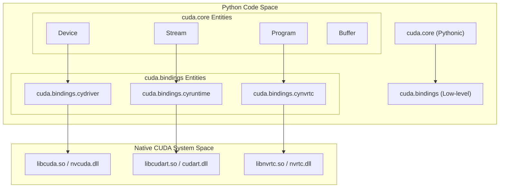

Sources: [cuda_core/cuda/core/__init__.py:11-13](), [cuda_core/cuda/core/_graphics.pyx:7-13](), [README.md:24-48]()

### Component Relationship
The `cuda-python` metapackage manages the dependency hierarchy, ensuring that the correct versions of `cuda.bindings` and `cuda.pathfinder` are available.

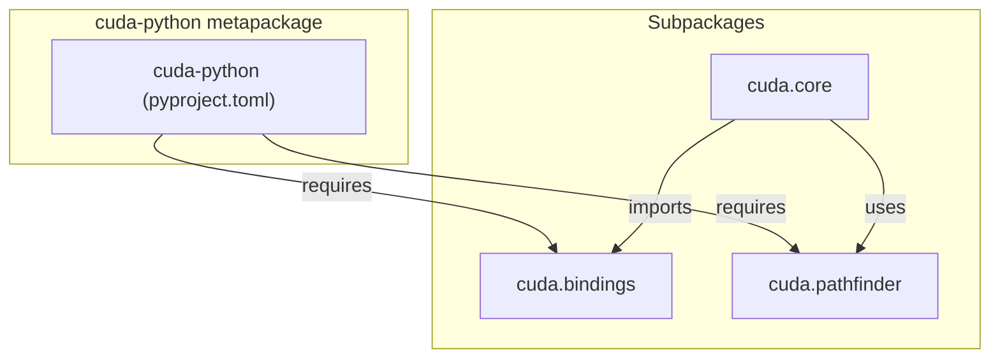

Sources: [cuda_python/setup.py:31-36](), [cuda_core/cuda/core/__init__.py:8-21]()

## Core Components

### cuda.core
The `cuda.core` package offers idiomatic access to the CUDA platform [README.md:24-26](). It introduces high-level abstractions like `Device`, `Stream`, `Event`, and `Buffer` [cuda_core/cuda/core/__init__.py:32-67]().

Key features include:
- **Pythonic Resource Management**: RAII-style objects like `GraphicsResource` for OpenGL interoperability [cuda_core/cuda/core/_graphics.pyx:46-84]().
- **TMA Support**: High-level access to Tensor Memory Accelerator for Hopper+ GPUs via `TensorMapDescriptor` [cuda_core/examples/tma_tensor_map.py:7-16]().
- **Memory Abstractions**: Unified `Buffer` interface supporting `DeviceMemoryResource`, `ManagedMemoryResource`, and `VirtualMemoryResource` [cuda_core/cuda/core/__init__.py:46-59]().

For details, see [Package Structure](#1.1).

### cuda.bindings
The `cuda.bindings` package provides full 1:1 coverage of the CUDA host APIs [README.md:36-38](). It includes bindings for:
- CUDA Driver and Runtime [README.md:42-43]()
- NVRTC (Runtime Compilation) [README.md:44]()
- nvJitLink and NVVM [README.md:45-46]()
- cuFile (GPUDirect Storage) [README.md:47]()

### cuda.pathfinder
`cuda.pathfinder` provides utilities for locating CUDA components, such as headers and dynamic libraries, within the user's environment [README.md:7](). It is used by `cuda.core` to resolve paths for JIT compilation [cuda_core/examples/tma_tensor_map.py:43]().

## Installation and Requirements

CUDA Python requires Python 3.10 or later [cuda_python/pyproject.toml:36](). It supports Linux and Windows platforms [cuda_python/pyproject.toml:16-17]().

The metapackage structure allows for flexible installation:
- `pip install cuda-python`: Installs the metapackage with standard dependencies [cuda_python/setup.py:31-36]().
- `pip install cuda-python[all]`: Installs the metapackage with all optional bindings [cuda_python/setup.py:37-39]().

For details, see [Installation and Requirements](#1.2).

## Current Development Status

The project is currently undergoing an overhaul to improve existing components and introduce new ones [README.md:18](). `cuda.core` is being actively expanded with features like the `cuda.core.checkpoint` module for process state management [cuda_core/docs/source/release/1.0.0-notes.rst:19-22]().

Sources: [README.md:18-22](), [cuda_core/docs/source/release/1.0.0-notes.rst:6-35]()

## Summary

The CUDA Python repository provides a layered approach to accessing NVIDIA's CUDA platform. By bridging low-level C APIs (`cuda.bindings`) with high-level Pythonic abstractions (`cuda.core`), it enables both performance-critical library development and productive application prototyping within the Python ecosystem.

Sources: [README.md:1-48](), [cuda_python/docs/source/index.rst:4-21]()

---

# Page: Package Structure

# Package Structure

<details>
<summary>Relevant source files</summary>

The following files were used as context for generating this wiki page:

- [README.md](README.md)
- [cuda_bindings/README.md](cuda_bindings/README.md)
- [cuda_bindings/build_hooks.py](cuda_bindings/build_hooks.py)
- [cuda_bindings/docs/source/examples.rst](cuda_bindings/docs/source/examples.rst)
- [cuda_bindings/tests/test_examples.py](cuda_bindings/tests/test_examples.py)
- [cuda_core/README.md](cuda_core/README.md)
- [cuda_core/docs/nv-versions.json](cuda_core/docs/nv-versions.json)
- [cuda_core/docs/source/release/0.4.1-notes.rst](cuda_core/docs/source/release/0.4.1-notes.rst)
- [cuda_core/docs/source/release/0.4.2-notes.rst](cuda_core/docs/source/release/0.4.2-notes.rst)
- [cuda_core/docs/source/release/0.6.0-notes.rst](cuda_core/docs/source/release/0.6.0-notes.rst)
- [cuda_core/docs/source/release/0.7.0-notes.rst](cuda_core/docs/source/release/0.7.0-notes.rst)
- [cuda_python/DESCRIPTION.rst](cuda_python/DESCRIPTION.rst)
- [cuda_python/LICENSE](cuda_python/LICENSE)
- [cuda_python/README.md](cuda_python/README.md)
- [cuda_python/docs/source/conf.py](cuda_python/docs/source/conf.py)
- [cuda_python/docs/source/index.rst](cuda_python/docs/source/index.rst)
- [cuda_python/pyproject.toml](cuda_python/pyproject.toml)
- [cuda_python/setup.py](cuda_python/setup.py)

</details>


This document details the organization of the `cuda-python` metapackage and its relationship with the subpackages `cuda.core`, `cuda.bindings`, and `cuda.pathfinder`. It explains the hierarchical dependency structure and the versioning strategy used to maintain compatibility across the CUDA ecosystem.

## CUDA Python Metapackage Architecture

`cuda-python` is a metapackage that contains a collection of subpackages. Each subpackage is versioned independently, allowing installation of each component as needed [README.md:20-22](). This architecture allows the ecosystem to scale by adding specialized modules like `cuda.coop` and `cuda.compute` while maintaining a unified entry point for users [cuda_python/docs/source/index.rst:7-21]().

### Ecosystem Hierarchy

The following diagram illustrates the relationship between the metapackage, its core subpackages, and the underlying CUDA system.

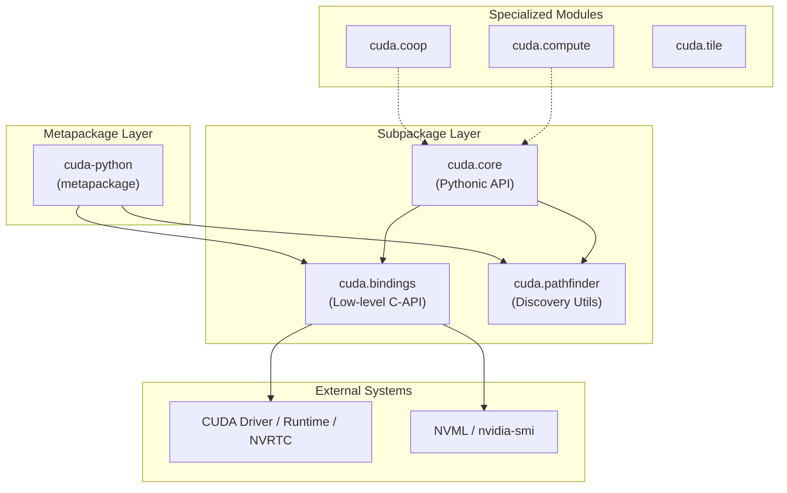

Sources: [README.md:3-16](), [cuda_python/setup.py:33-36](), [cuda_core/docs/source/release/0.6.0-notes.rst:31-32]()

## Package Relationships and Dependencies

The `cuda-python` metapackage uses `setuptools` and `setuptools_scm` to manage dynamic versioning and dependency resolution [cuda_python/setup.py:9-17]().

### Dependency Hierarchy
The dependency flow is strictly defined to ensure that high-level Pythonic abstractions can always resolve to low-level C-API calls and find the necessary binary artifacts:

1.  **`cuda-python`**: Depends on `cuda-bindings` and `cuda-pathfinder` [cuda_python/setup.py:33-36]().
2.  **`cuda.core`**: Requires `cuda-bindings` for API execution. As of version 0.6.0, building `cuda.core` from source requires `cuda-bindings >= 12.9.0` due to Cython-level dependencies on `cynvvm` [cuda_core/docs/source/release/0.6.0-notes.rst:23-25]().
3.  **`cuda.bindings`**: Depends on `cuda.pathfinder` during the build process to locate CUDA headers (e.g., `cuda.h`, `cuda_runtime.h`) via the `build_hooks.py` PEP 517 backend [cuda_bindings/build_hooks.py:4-7](), [cuda_bindings/build_hooks.py:37-64]().

### Versioning Strategy
The project uses `setuptools_scm` to generate versions based on Git tags [cuda_python/setup.py:9-17]().
*   **Tagged Releases**: Use the `~=` compatible release matcher (e.g., `cuda-bindings~=12.8.0`) [cuda_python/setup.py:23-25]().
*   **Pre-releases**: Use the `==` exact matcher to ensure the metapackage aligns precisely with its subpackage development state [cuda_python/setup.py:26-28]().

Sources: [cuda_python/setup.py:20-40](), [cuda_bindings/build_hooks.py:80-96](), [cuda_core/docs/source/release/0.6.0-notes.rst:23-26]()

## Package Components

### `cuda.bindings` (Low-level Interfaces)
This package provides a 1:1 mapping to CUDA host APIs using Cython. It includes support for:
*   **Driver & Runtime**: Core memory and execution management [cuda_bindings/README.md:42-43]().
*   **NVRTC & NVVM**: Runtime compilation and IR manipulation [cuda_bindings/README.md:44-46]().
*   **nvJitLink**: Just-in-time linking of relocatable code [cuda_bindings/README.md:45]().
*   **cuFile**: GPUDirect Storage support [cuda_bindings/README.md:47]().

### `cuda.core` (Pythonic API)
`cuda.core` abstracts the low-level bindings into an object-oriented interface. Key features introduced in recent versions (0.6.0+) include:
*   **`cuda.core.system`**: An NVML-based module for hardware introspection (clocks, fans, PCI info) [cuda_core/docs/source/release/0.6.0-notes.rst:13-13]().
*   **`StridedMemoryView`**: Enhanced interoperability with NumPy and DLPack [cuda_core/docs/source/release/0.6.0-notes.rst:14-15]().
*   **Context Management**: Automatic cleanup to eliminate spurious driver errors during shutdown [cuda_core/docs/source/release/0.6.0-notes.rst:61-62]().

### `cuda.pathfinder` (Discovery)
`cuda.pathfinder` is a utility package used by both `bindings` and `core` to locate CUDA Toolkit components. It is essential for source builds to resolve `CUDA_PATH` or `CUDA_HOME` [cuda_bindings/build_hooks.py:68-74]().

## Code Entity Space Mapping

The following diagram maps high-level package concepts to specific implementation files and classes.

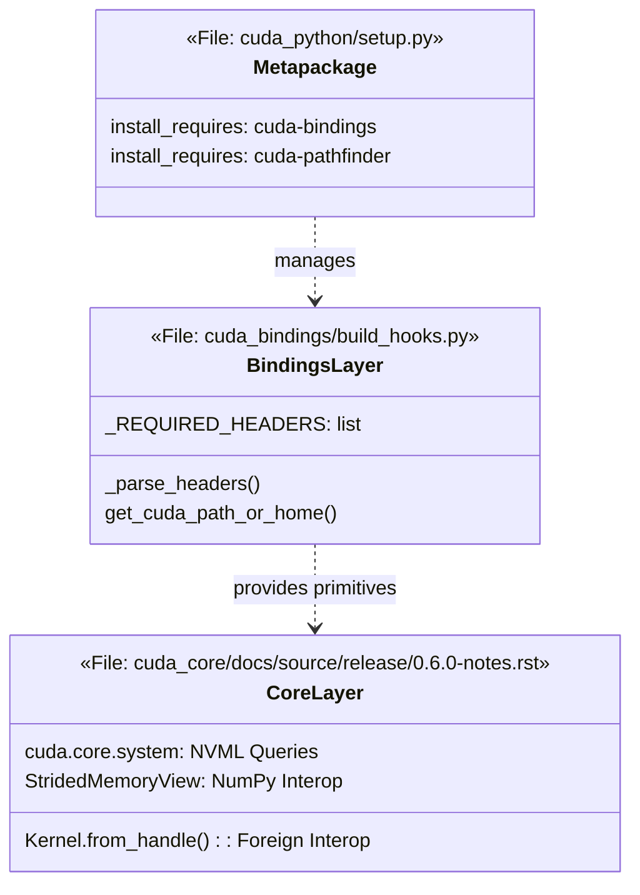

Sources: [cuda_python/setup.py:31-40](), [cuda_bindings/build_hooks.py:80-96](), [cuda_core/docs/source/release/0.6.0-notes.rst:44-49]()

## Distribution and Installation

Packages are distributed as wheels and source distributions (sdists). The metapackage structure simplifies installation for different user needs:

| Package Target | Command | Primary Content |
| :--- | :--- | :--- |
| **Full Ecosystem** | `pip install cuda-python` | Metapackage + Bindings + Pathfinder [cuda_python/setup.py:33-36]() |
| **Low-level Only** | `pip install cuda-bindings` | Cython-generated C-API wrappers [cuda_bindings/README.md:1-3]() |
| **Advanced Bindings** | `pip install cuda-bindings[all]` | Includes optional components like `nvjitlink` [cuda_python/setup.py:38-39]() |
| **Pythonic API** | `pip install cuda-core` | High-level abstractions (Device, Stream, Buffer) [cuda_core/README.md:1-3]() |

### Version Compatibility Table (Example)
The system performs a CUDA version compatibility check at import time to prevent mismatches between `cuda.core` and the installed `cuda-bindings` [cuda_core/docs/source/release/0.6.0-notes.rst:54-55]().

| cuda.core Version | Required cuda-bindings | Note |
| :--- | :--- | :--- |
| 0.6.0 | >= 12.9.0 | Required for `cynvvm` support [cuda_core/docs/source/release/0.6.0-notes.rst:23-25]() |
| 0.5.0 | >= 12.8.0 | Previous minimum requirement [cuda_core/docs/source/release/0.6.0-notes.rst:25-26]() |

Sources: [cuda_python/setup.py:31-40](), [cuda_core/docs/source/release/0.6.0-notes.rst:20-26](), [cuda_core/docs/source/release/0.6.0-notes.rst:54-55]()

---

# Page: Installation and Requirements

# Installation and Requirements

<details>
<summary>Relevant source files</summary>

The following files were used as context for generating this wiki page:

- [ci/tools/run-tests](ci/tools/run-tests)
- [cuda_bindings/DESCRIPTION.rst](cuda_bindings/DESCRIPTION.rst)
- [cuda_bindings/docs/source/install.rst](cuda_bindings/docs/source/install.rst)
- [cuda_bindings/docs/source/support.rst](cuda_bindings/docs/source/support.rst)
- [cuda_bindings/pixi.lock](cuda_bindings/pixi.lock)
- [cuda_bindings/pixi.toml](cuda_bindings/pixi.toml)
- [cuda_bindings/pyproject.toml](cuda_bindings/pyproject.toml)
- [cuda_bindings/setup.py](cuda_bindings/setup.py)
- [cuda_core/DESCRIPTION.rst](cuda_core/DESCRIPTION.rst)
- [cuda_core/docs/source/install.rst](cuda_core/docs/source/install.rst)
- [cuda_core/pixi.lock](cuda_core/pixi.lock)
- [cuda_core/pixi.toml](cuda_core/pixi.toml)
- [cuda_core/pyproject.toml](cuda_core/pyproject.toml)
- [cuda_pathfinder/pixi.lock](cuda_pathfinder/pixi.lock)
- [cuda_pathfinder/pixi.toml](cuda_pathfinder/pixi.toml)

</details>


This document provides comprehensive instructions for installing CUDA Python and its components, including system requirements, CUDA version compatibility, and environment setup. The ecosystem is composed of several packages: `cuda-python` (metapackage), `cuda.bindings`, `cuda.core`, and `cuda.pathfinder`.

## CUDA Python Ecosystem Overview

CUDA Python is structured as a collection of packages that provide both low-level bindings and high-level Pythonic abstractions.

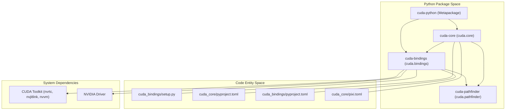

Sources: [cuda_core/pyproject.toml:50-58](), [cuda_bindings/pyproject.toml:35-41](), [cuda_core/pixi.toml:182-187]()

## System Requirements

### Platform Support
CUDA Python supports the following platforms and architectures:
- **Linux**: x86-64, aarch64 (arm64) [cuda_core/pyproject.toml:34-34](), [cuda_core/pixi.toml:7]()
- **Windows**: x86-64 (AMD64) [cuda_core/pyproject.toml:35-35](), [cuda_core/pixi.toml:7]()

### Python Version Requirements
CUDA Python supports Python versions **3.10 through 3.14** [cuda_core/docs/source/install.rst:29-29]().
- Experimental **free-threaded** builds are supported for Python 3.14 [cuda_core/docs/source/install.rst:32-35]().
- Minimum requirement is Python 3.10 [cuda_core/pyproject.toml:22-22](), [cuda_bindings/pyproject.toml:21-21]().

### CUDA Version Compatibility
The ecosystem supports the two latest major CUDA versions.

| Component | CUDA 12 | CUDA 13 |
|-----------|---------|---------|
| CUDA Toolkit | 12.x | 13.x |
| Linux Driver | 525.60.13+ | 580.65+ |
| Windows Driver | 527.41+ | 580.88+ |

Sources: [cuda_core/docs/source/install.rst:13-24](), [cuda_bindings/docs/source/support.rst:9-16]()

## Installation Methods

### Using pip (PyPI)

#### Installing cuda.core
The `cuda-core` package uses optional extras to pin the appropriate `cuda-bindings` version.

```bash
# For CUDA 12
pip install cuda-core[cu12]

# For CUDA 13
pip install cuda-core[cu13]
```
Sources: [cuda_core/docs/source/install.rst:48-54](), [cuda_core/pyproject.toml:56-58]()

#### Installing cuda.bindings
To install bindings with all JIT components (NVRTC, NVVM, nvJitLink, nvFatbin):
```bash
pip install cuda-bindings[all]
```
Sources: [cuda_bindings/pyproject.toml:37-41]()

### Using Conda (conda-forge)
Conda-forge packages allow for explicit CUDA version pinning:
```bash
# Install for CUDA 12
conda install -c conda-forge cuda-core cuda-version=12

# Install for CUDA 13
conda install -c conda-forge cuda-core cuda-version=13
```
Sources: [cuda_core/docs/source/install.rst:63-69]()

### Development Environment Setup

#### Using Pixi
`pixi` is the recommended tool for a reproducible development environment across the repository. It manages CUDA dependencies, compilers, and Python environments automatically.

```bash
# Run tests for cuda.core against CUDA 13
pixi run -e cu13 test-core

# Run all tests (pathfinder -> bindings -> core)
pixi run -e cu13 test
```
Sources: [cuda_core/docs/source/install.rst:105-118](), [cuda_core/pixi.toml:120-129]()

#### Using uv
```bash
git clone https://github.com/NVIDIA/cuda-python
cd cuda-python/cuda_core
uv venv
source .venv/bin/activate
uv pip install -e .[cu13] --group test
```
Sources: [cuda_core/docs/source/install.rst:83-93]()

## Source Build Configuration

When building from source, several environment variables control the build process.

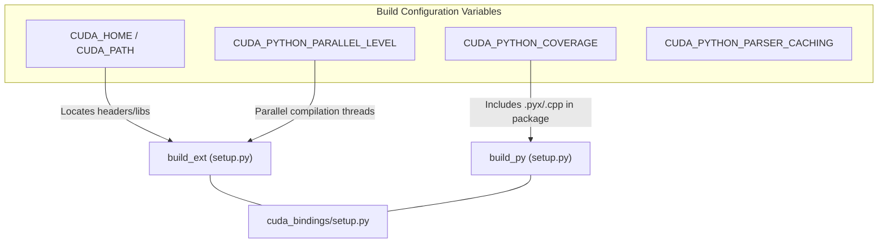

### Key Environment Variables
- `CUDA_HOME`: Path to the CUDA Toolkit installation. Used by `pixi` and `setuptools` to find headers [cuda_core/pixi.toml:143-151]().
- `CUDA_PYTHON_PARALLEL_LEVEL`: Number of threads to use for parallel Cython compilation [cuda_bindings/setup.py:22-22]().
- `CUDA_PYTHON_COVERAGE`: If set to `1`, includes source files in the package for coverage analysis [cuda_bindings/setup.py:24-24]().
- `CUDA_PYTHON_PARSER_CACHING`: Enables caching for the `pyclibrary` header parser during binding generation [cuda_bindings/pixi.toml:100-100]().

Sources: [cuda_bindings/setup.py:14-24](), [cuda_bindings/pixi.toml:99-112](), [cuda_core/pixi.toml:142-152]()

## Verification

To verify the installation and check the version of the installed components:

```python
import cuda.core
import cuda.bindings
import cuda.pathfinder

print(f"Core version: {cuda.core.__version__}")
print(f"Bindings version: {cuda.bindings.__version__}")
```

For automated verification in CI environments, the `ci/tools/run-tests` script is used to install wheels and execute the `pytest` suite for specific modules [ci/tools/run-tests:11-21]().

Sources: [ci/tools/run-tests:7-21](), [cuda_core/pyproject.toml:106-106](), [cuda_bindings/pyproject.toml:94-94]()

---

# Page: cuda.core

# cuda.core

<details>
<summary>Relevant source files</summary>

The following files were used as context for generating this wiki page:

- [cuda_core/cuda/core/__init__.py](cuda_core/cuda/core/__init__.py)
- [cuda_core/cuda/core/_device.pyx](cuda_core/cuda/core/_device.pyx)
- [cuda_core/cuda/core/_event.pyx](cuda_core/cuda/core/_event.pyx)
- [cuda_core/cuda/core/_graphics.pxd](cuda_core/cuda/core/_graphics.pxd)
- [cuda_core/cuda/core/_graphics.pyx](cuda_core/cuda/core/_graphics.pyx)
- [cuda_core/cuda/core/_memory/_buffer.pyx](cuda_core/cuda/core/_memory/_buffer.pyx)
- [cuda_core/cuda/core/_memory/_graph_memory_resource.pyx](cuda_core/cuda/core/_memory/_graph_memory_resource.pyx)
- [cuda_core/cuda/core/_memory/_legacy.py](cuda_core/cuda/core/_memory/_legacy.py)
- [cuda_core/cuda/core/_memory/_memory_pool.pyx](cuda_core/cuda/core/_memory/_memory_pool.pyx)
- [cuda_core/cuda/core/_memory/_virtual_memory_resource.py](cuda_core/cuda/core/_memory/_virtual_memory_resource.py)
- [cuda_core/cuda/core/_module.pyx](cuda_core/cuda/core/_module.pyx)
- [cuda_core/cuda/core/_stream.pyx](cuda_core/cuda/core/_stream.pyx)
- [cuda_core/docs/source/release/1.0.0-notes.rst](cuda_core/docs/source/release/1.0.0-notes.rst)
- [cuda_core/examples/tma_tensor_map.py](cuda_core/examples/tma_tensor_map.py)
- [cuda_core/tests/conftest.py](cuda_core/tests/conftest.py)
- [cuda_core/tests/test_device.py](cuda_core/tests/test_device.py)
- [cuda_core/tests/test_event.py](cuda_core/tests/test_event.py)
- [cuda_core/tests/test_graphics.py](cuda_core/tests/test_graphics.py)
- [cuda_core/tests/test_launcher.py](cuda_core/tests/test_launcher.py)
- [cuda_core/tests/test_memory.py](cuda_core/tests/test_memory.py)
- [cuda_core/tests/test_module.py](cuda_core/tests/test_module.py)
- [cuda_core/tests/test_stream.py](cuda_core/tests/test_stream.py)
- [cuda_core/tests/test_tensor_map.py](cuda_core/tests/test_tensor_map.py)

</details>


## Purpose and Scope

The `cuda.core` package provides a high-level, Pythonic interface to CUDA. It serves as an abstraction layer over the low-level `cuda.bindings` [cuda_core/cuda/core/__init__.py:11-15](), offering an object-oriented API for GPU programming. While `cuda.bindings` provides a direct 1:1 mapping to the CUDA C APIs, `cuda.core` simplifies resource management (e.g., through RAII-like behavior and automatic stream handling) and enhances interoperability with the broader Python ecosystem (e.g., NumPy, PyTorch, CuPy).

For details on the underlying low-level bindings, see [cuda.bindings](#3).

Sources: [cuda_core/cuda/core/__init__.py:31-77](), [cuda_core/docs/source/release/1.0.0-notes.rst:4-30]()

## Architecture Overview

The `cuda.core` architecture is centered around managed handles and resource ownership. Most objects in this package wrap a C++ managed handle that tracks context dependencies and lifetime.

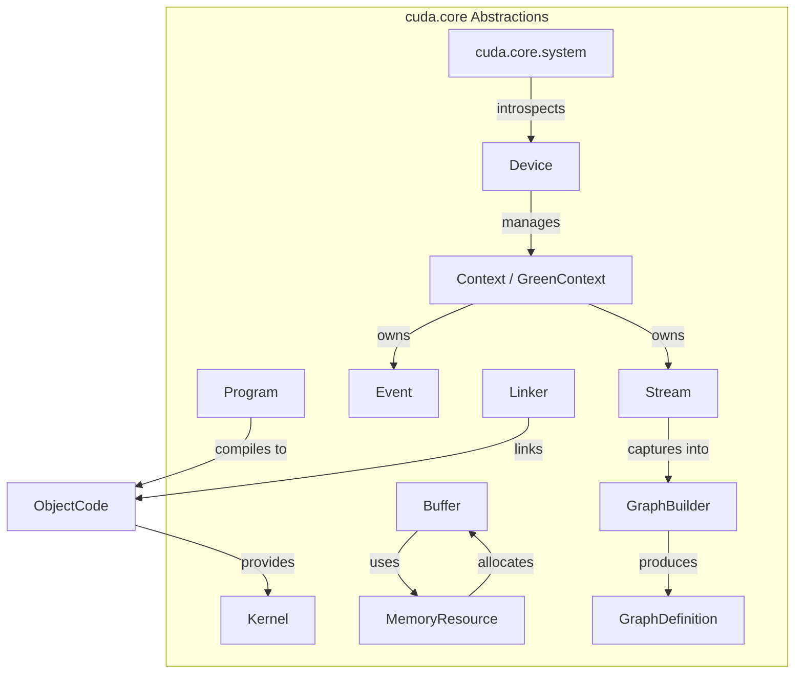

The package is organized into several subsystems, each documented in detail on its own child page.

Sources: [cuda_core/cuda/core/__init__.py:31-77](), [cuda_core/cuda/core/_device.pyx:15-40](), [cuda_core/cuda/core/_memory/_buffer.pyx:81-130]()

## Subsystems and Child Pages

### Device, Stream, and Event Abstractions
The `Device` class [cuda_core/cuda/core/_device.pyx:49-68]() represents a physical GPU and acts as the primary factory for `Stream` and `Event` objects. `cuda.core` supports both standard CUDA contexts and **Green Contexts** (introduced in CUDA 12.5) for fine-grained resource partitioning.
- **Key Classes:** `Device`, `Stream`, `Event`, `Context`.
- **Details:** See [Device, Stream, and Event Abstractions](#2.1).

Sources: [cuda_core/cuda/core/_device.pyx:49-100](), [cuda_core/cuda/core/_stream.pyx:75-138](), [cuda_core/cuda/core/_event.pyx:12-25]()

### Program Compilation and Linker System
`cuda.core` provides a unified interface for runtime compilation (NVRTC) and linking. The `Program` class [cuda_core/cuda/core/_program.py:61]() handles source-to-binary translation, while the `Linker` class [cuda_core/cuda/core/_linker.py:45]() manages JIT linking of PTX, CUBIN, and LTO IR.
- **Key Classes:** `Program`, `Linker`, `ObjectCode`, `Kernel`.
- **Details:** See [Program Compilation and Linker System](#2.2).

Sources: [cuda_core/cuda/core/_program.py:61](), [cuda_core/cuda/core/_linker.py:45](), [cuda_core/cuda/core/_module.pyx:60]()

### Memory Management
Memory is managed through `Buffer` objects [cuda_core/cuda/core/_memory/_buffer.pyx:81]() and `MemoryResource` (MR) implementations. `cuda.core` supports various allocation strategies, including device, pinned, managed (unified), and virtual memory, often backed by CUDA memory pools.
- **Key Classes:** `Buffer`, `DeviceMemoryResource`, `PinnedMemoryResource`, `VirtualMemoryResource`.
- **Details:** See [Memory Management](#2.3).

Sources: [cuda_core/cuda/core/_memory/_buffer.pyx:81-130](), [cuda_core/cuda/core/_memory/_device_memory_resource.py:11](), [cuda_core/cuda/core/_memory/_virtual_memory_resource.py:40]()

### StridedMemoryView and Interoperability
To facilitate zero-copy data exchange, `cuda.core` uses the `StridedMemoryView` [cuda_core/cuda/core/utils.py:57]() and implements the `__dlpack__` and `__cuda_array_interface__` protocols. It also defines a `__cuda_stream__` protocol [cuda_core/cuda/core/_stream.pyx:64-73]() for sharing streams between libraries.
- **Key Classes:** `StridedMemoryView`.
- **Details:** See [StridedMemoryView and Interoperability](#2.4).

Sources: [cuda_core/cuda/core/utils.py:57](), [cuda_core/cuda/core/_stream.pyx:64-73](), [cuda_core/cuda/core/_memory/_buffer.pyx:38-40]()

### Error Handling
`cuda.core` translates CUDA return codes into Python exceptions like `CUDAError` [cuda_core/cuda/core/_utils/cuda_utils.py:35](). It includes a `Transaction` context manager for robust resource cleanup during multi-step CUDA operations.
- **Key Components:** `CUDAError`, `handle_return`, `Transaction`.
- **Details:** See [Error Handling](#2.5).

Sources: [cuda_core/cuda/core/_utils/cuda_utils.py:33-48](), [cuda_core/docs/source/release/1.0.0-notes.rst:128-135]()

### CUDA Graphs
The graph subsystem allows for both stream capture via `GraphBuilder` [cuda_core/cuda/core/graph/__init__.py:72]() and explicit graph construction via `GraphDefinition` [cuda_core/cuda/core/graph/__init__.py:76]().
- **Key Classes:** `GraphBuilder`, `GraphDefinition`, `GraphNode`.
- **Details:** See [CUDA Graphs](#2.6).

Sources: [cuda_core/cuda/core/graph/__init__.py:69-77](), [cuda_core/docs/source/release/1.0.0-notes.rst:28-35]()

### System Telemetry (cuda.core.system)
The `cuda.core.system` module provides NVML-based hardware introspection, allowing users to query GPU temperature, power usage, and clock speeds directly from Python.
- **Key Classes:** `system.Device`, `system.Power`, `system.Clocks`.
- **Details:** See [System Telemetry (cuda.core.system)](#2.7).

Sources: [cuda_core/cuda/core/system/__init__.py:31](), [cuda_core/cuda/core/_device.pyx:23-41]()

## Code Entity Map

The following diagram maps high-level system concepts to the specific code entities that implement them within the `cuda.core` package.

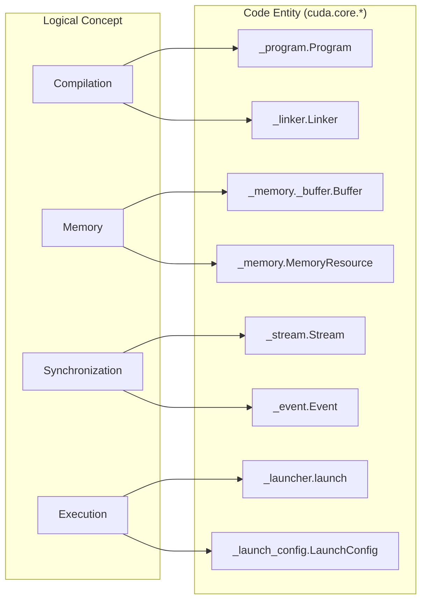

Sources: [cuda_core/cuda/core/__init__.py:31-77](), [cuda_core/cuda/core/_launcher.pyx:44](), [cuda_core/cuda/core/_launch_config.py:43]()

---

# Page: Device, Stream, and Event Abstractions

# Device, Stream, and Event Abstractions

<details>
<summary>Relevant source files</summary>

The following files were used as context for generating this wiki page:

- [cuda_core/cuda/core/_context.pxd](cuda_core/cuda/core/_context.pxd)
- [cuda_core/cuda/core/_context.pyx](cuda_core/cuda/core/_context.pyx)
- [cuda_core/cuda/core/_cpp/REGISTRY_DESIGN.md](cuda_core/cuda/core/_cpp/REGISTRY_DESIGN.md)
- [cuda_core/cuda/core/_device.pyx](cuda_core/cuda/core/_device.pyx)
- [cuda_core/cuda/core/_device_resources.pxd](cuda_core/cuda/core/_device_resources.pxd)
- [cuda_core/cuda/core/_device_resources.pyx](cuda_core/cuda/core/_device_resources.pyx)
- [cuda_core/cuda/core/_event.pyx](cuda_core/cuda/core/_event.pyx)
- [cuda_core/cuda/core/_memory/_buffer.pyx](cuda_core/cuda/core/_memory/_buffer.pyx)
- [cuda_core/cuda/core/_memory/_graph_memory_resource.pyx](cuda_core/cuda/core/_memory/_graph_memory_resource.pyx)
- [cuda_core/cuda/core/_memory/_legacy.py](cuda_core/cuda/core/_memory/_legacy.py)
- [cuda_core/cuda/core/_memory/_memory_pool.pyx](cuda_core/cuda/core/_memory/_memory_pool.pyx)
- [cuda_core/cuda/core/_memory/_virtual_memory_resource.py](cuda_core/cuda/core/_memory/_virtual_memory_resource.py)
- [cuda_core/cuda/core/_module.pyx](cuda_core/cuda/core/_module.pyx)
- [cuda_core/cuda/core/_stream.pyx](cuda_core/cuda/core/_stream.pyx)
- [cuda_core/cuda/core/checkpoint.py](cuda_core/cuda/core/checkpoint.py)
- [cuda_core/cuda/core/typing.py](cuda_core/cuda/core/typing.py)
- [cuda_core/tests/conftest.py](cuda_core/tests/conftest.py)
- [cuda_core/tests/test_checkpoint.py](cuda_core/tests/test_checkpoint.py)
- [cuda_core/tests/test_device.py](cuda_core/tests/test_device.py)
- [cuda_core/tests/test_event.py](cuda_core/tests/test_event.py)
- [cuda_core/tests/test_green_context.py](cuda_core/tests/test_green_context.py)
- [cuda_core/tests/test_launcher.py](cuda_core/tests/test_launcher.py)
- [cuda_core/tests/test_memory.py](cuda_core/tests/test_memory.py)
- [cuda_core/tests/test_module.py](cuda_core/tests/test_module.py)
- [cuda_core/tests/test_stream.py](cuda_core/tests/test_stream.py)
- [cuda_core/tests/test_typing_imports.py](cuda_core/tests/test_typing_imports.py)

</details>


This document explains the core abstractions provided by `cuda.core` for interacting with NVIDIA GPUs. It focuses on three fundamental classes: `Device`, `Stream`, and `Event`. Together, these abstractions enable developers to manage GPU resources, control execution flow, and synchronize operations using a Pythonic interface that wraps the underlying CUDA Driver API.

## Abstraction Relationships

The following diagram illustrates the relationship between the core entities in `cuda.core`. Note that many of these objects wrap internal C++ handles (e.g., `StreamHandle`, `EventHandle`) to manage lifecycle and context dependencies.

**Entity Relationship Diagram**
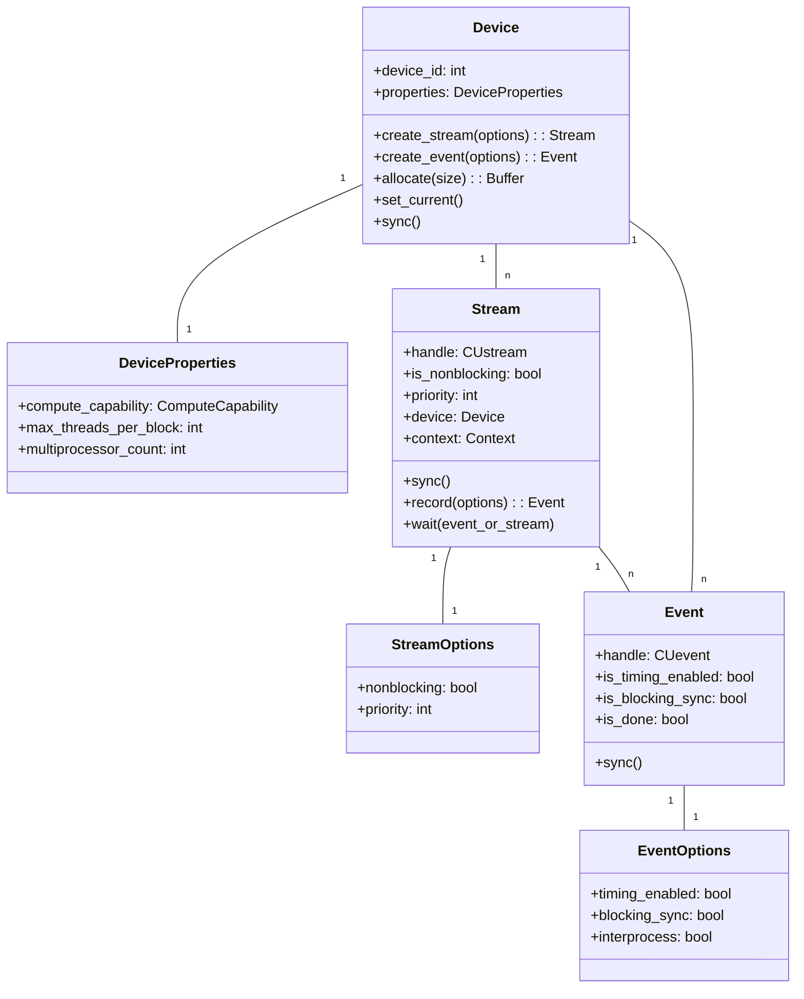
Sources: [cuda_core/cuda/core/_device.pyx:49-67](), [cuda_core/cuda/core/_stream.pyx:47-90](), [cuda_core/cuda/core/_event.pyx:38-78]()

## Device Abstraction

The `Device` class represents a CUDA-capable GPU. It acts as the primary entry point for resource allocation and context management.

### Creating and Selecting a Device
The `Device` class is often used to manage the active CUDA context for a thread.

```python
from cuda.core import Device

# Initialize device 0
device = Device(0)

# Set as the current context for this thread
device.set_current()
```
The implementation uses `cuCtxGetCurrent` and `cuCtxPopCurrent` to manage a stack of contexts via thread-local storage (`_tls`).
Sources: [cuda_core/cuda/core/_device.pyx:44-46](), [cuda_core/tests/test_device.py:51-55](), [cuda_core/tests/conftest.py:149-161]()

### Device Properties
Detailed hardware information is accessed via `Device.properties`, which returns a `DeviceProperties` object. This object lazily fetches and caches attributes from the driver using `cuDeviceGetAttribute`.

| Property | Implementation Mapping |
|----------|------------------------|
| `compute_capability` | Returns a `ComputeCapability` namedtuple (major, minor) |
| `max_threads_per_block` | `CU_DEVICE_ATTRIBUTE_MAX_THREADS_PER_BLOCK` |
| `multiprocessor_count` | `CU_DEVICE_ATTRIBUTE_MULTIPROCESSOR_COUNT` |
| `arch` | String representation of CC (e.g., "80" for CC 8.0) |

Sources: [cuda_core/cuda/core/_device.pyx:87-134](), [cuda_core/tests/test_device.py:128-150]()

## Stream Abstraction

A `Stream` represents a queue of GPU operations. Operations within a stream are executed sequentially, while operations across different streams can be concurrent.

### Stream Creation
Streams are created through the `Device` object. Directly instantiating `Stream()` is disabled to prevent ambiguity.

```python
from cuda.core import Device, StreamOptions

device = Device()
# Create a non-blocking stream (default)
stream = device.create_stream(options=StreamOptions(nonblocking=True))
```
**Green Context Support**: If the current context is a "Green Context" (introduced in CUDA 12.5), `create_stream` automatically dispatches to `cuGreenCtxStreamCreate`.
Sources: [cuda_core/cuda/core/_stream.pyx:91-95](), [cuda_core/cuda/core/_stream.pyx:166-184]()

### Stream Synchronization and Interaction
- `stream.sync()`: Blocks the CPU thread until all work in the stream is finished (calls `cuStreamSynchronize`).
- `stream.wait(event)`: Makes the stream wait for an `Event` before executing subsequent work (calls `cuStreamWaitEvent`).
- `stream.record()`: Captures the current point in the stream as an `Event`.

Sources: [cuda_core/cuda/core/_stream.pyx:235-265](), [cuda_core/tests/test_stream.py:55-67]()

### Default Streams
`cuda.core` provides access to special stream handles:
- `LEGACY_DEFAULT_STREAM`: The global NULL stream.
- `PER_THREAD_DEFAULT_STREAM`: A stream local to the current thread.

Sources: [cuda_core/cuda/core/_stream.pyx:109-116](), [cuda_core/tests/test_stream.py:106-112]()

## Event Abstraction

An `Event` is a synchronization primitive used to monitor stream progress or measure timing.

### Recording and Timing
Events are recorded into streams. If created with `timing_enabled=True`, the elapsed time between two events can be calculated using the subtraction operator.

```python
options = EventOptions(timing_enabled=True)
start = stream.record(options=options)
# ... launch kernels ...
end = stream.record(options=options)
end.sync()

elapsed_ms = end - start
```
The subtraction operator internally calls `cuEventElapsedTime`.
Sources: [cuda_core/cuda/core/_event.pyx:112-126](), [cuda_core/tests/test_event.py:25-48]()

### Event State
- `event.is_done`: Returns `True` if all work captured by the event has completed (calls `cuEventQuery`).
- `event.sync()`: Blocks the CPU until the event is reached (calls `cuEventSynchronize`).

Sources: [cuda_core/cuda/core/_event.pyx:143-164](), [cuda_core/tests/test_event.py:63-78]()

## Context and GreenContext System

The `Context` system manages the lifetime of CUDA contexts. A significant feature is the `GreenContext`, which allows for resource partitioning (e.g., SM and Workqueue resources).

**Context and Resource Mapping**
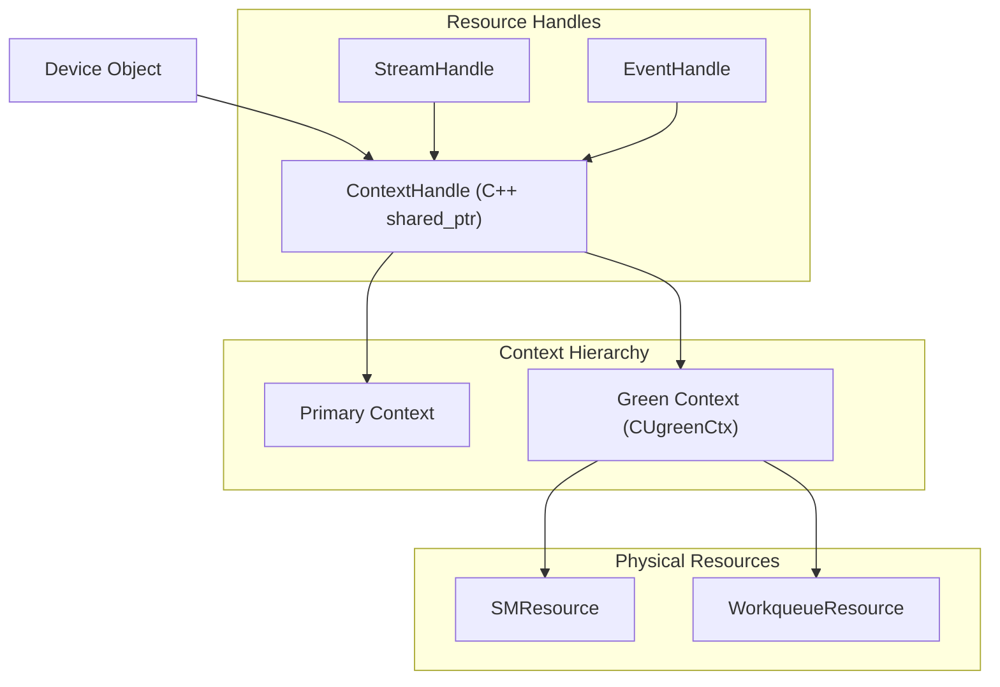
Sources: [cuda_core/cuda/core/_context.pyx:16-40](), [cuda_core/cuda/core/_device.pyx:21-29](), [cuda_core/cuda/core/_device_resources.pyx:15-30]()

### Implementation Detail: Shared Handles
`cuda.core` uses a C++ backend to manage resource handles (`StreamHandle`, `EventHandle`, `ContextHandle`). These handles use `shared_ptr` to ensure that a context is not destroyed while streams or events associated with it are still alive.
Sources: [cuda_core/cuda/core/_resource_handles.pxd:1-30](), [cuda_core/cuda/core/_stream.pyx:165-184]()

## Summary Table: Class Responsibilities

| Class | Role | Key Driver API Calls |
|-------|------|----------------------|
| `Device` | GPU hardware entry point | `cuDeviceGet`, `cuCtxSetCurrent` |
| `DeviceProperties` | Hardware capability query | `cuDeviceGetAttribute` |
| `Stream` | Async command queue | `cuStreamCreate`, `cuStreamSynchronize` |
| `Event` | Sync and timing point | `cuEventCreate`, `cuEventRecord`, `cuEventElapsedTime` |
| `Buffer` | Memory handle | `cuMemAlloc`, `cuMemFree` |

Sources: [cuda_core/cuda/core/_device.pyx:49-67](), [cuda_core/cuda/core/_stream.pyx:75-90](), [cuda_core/cuda/core/_event.pyx:38-78](), [cuda_core/cuda/core/_memory/_buffer.pyx:81-103]()

---

# Page: Program Compilation and Linker System

# Program Compilation and Linker System

<details>
<summary>Relevant source files</summary>

The following files were used as context for generating this wiki page:

- [cuda_bindings/cuda/bindings/_internal/utils.pxd](cuda_bindings/cuda/bindings/_internal/utils.pxd)
- [cuda_bindings/cuda/bindings/_internal/utils.pyx](cuda_bindings/cuda/bindings/_internal/utils.pyx)
- [cuda_bindings/tests/conftest.py](cuda_bindings/tests/conftest.py)
- [cuda_bindings/tests/test_cuda.py](cuda_bindings/tests/test_cuda.py)
- [cuda_bindings/tests/test_cudart.py](cuda_bindings/tests/test_cudart.py)
- [cuda_bindings/tests/test_nvjitlink.py](cuda_bindings/tests/test_nvjitlink.py)
- [cuda_bindings/tests/test_nvvm.py](cuda_bindings/tests/test_nvvm.py)
- [cuda_core/cuda/core/_linker.pyx](cuda_core/cuda/core/_linker.pyx)
- [cuda_core/cuda/core/_program.pxd](cuda_core/cuda/core/_program.pxd)
- [cuda_core/cuda/core/_program.pyx](cuda_core/cuda/core/_program.pyx)
- [cuda_core/cuda/core/_utils/cuda_utils.pyx](cuda_core/cuda/core/_utils/cuda_utils.pyx)
- [cuda_core/cuda/core/utils/__init__.py](cuda_core/cuda/core/utils/__init__.py)
- [cuda_core/cuda/core/utils/_program_cache/__init__.py](cuda_core/cuda/core/utils/_program_cache/__init__.py)
- [cuda_core/cuda/core/utils/_program_cache/_abc.py](cuda_core/cuda/core/utils/_program_cache/_abc.py)
- [cuda_core/cuda/core/utils/_program_cache/_file_stream.py](cuda_core/cuda/core/utils/_program_cache/_file_stream.py)
- [cuda_core/cuda/core/utils/_program_cache/_in_memory.py](cuda_core/cuda/core/utils/_program_cache/_in_memory.py)
- [cuda_core/cuda/core/utils/_program_cache/_keys.py](cuda_core/cuda/core/utils/_program_cache/_keys.py)
- [cuda_core/tests/test_cuda_utils.py](cuda_core/tests/test_cuda_utils.py)
- [cuda_core/tests/test_linker.py](cuda_core/tests/test_linker.py)
- [cuda_core/tests/test_program.py](cuda_core/tests/test_program.py)

</details>


## Overview

This page documents the Program Compilation and Linker System in CUDA Python, which provides a comprehensive framework for compiling CUDA code at runtime and linking multiple code objects together. The system enables dynamic compilation of CUDA C++, PTX, or NVVM IR into executable binary formats (CUBIN) or intermediate representations, utilizing backends like NVRTC, NVVM, nvJitLink, and the CUDA Driver's cuLink.

Sources: [cuda_core/cuda/core/_program.pyx:4-8](), [cuda_core/cuda/core/_linker.pyx:4-9]()

## Compilation and Linking Pipeline

The following diagram bridges the high-level compilation flow to the specific code entities involved in the process:

**Diagram: Compilation and Linking Data Flow**
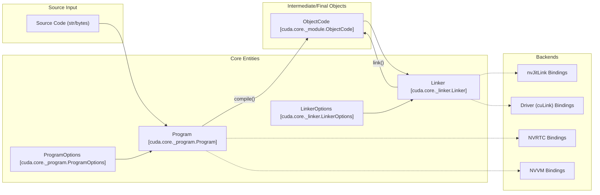

Sources: [cuda_core/cuda/core/_program.pyx:58-77](), [cuda_core/cuda/core/_linker.pyx:56-73](), [cuda_core/cuda/core/_module.py:21-45]()

## Program Class

The `Program` class is the primary entry point for compiling CUDA code. It abstracts the complexities of choosing between NVRTC (for C++) and NVVM (for IR).

### Class Definition and Implementation
The `Program` class handles initialization by normalizing the source code and code type, then selecting the appropriate internal handle (`_h_nvrtc` or `_h_nvvm`).

Sources: [cuda_core/cuda/core/_program.pyx:58-78](), [cuda_core/cuda/core/_program.pxd:9-22]()

### Compilation and Caching
The `compile()` method supports just-in-time compilation with an optional caching layer.

```python
object_code = program.compile(
    target_type="cubin", 
    name_expressions=["my_kernel"], 
    cache=my_cache_resource
)
```

- **Target Types**: Supports `"ptx"`, `"cubin"`, and `"ltoir"` [cuda_core/cuda/core/_program.pyx:99-100]().
- **Program Caching**: If a `ProgramCacheResource` is provided, the system derives a key from the code and options to skip re-compilation [cuda_core/cuda/core/_program.pyx:109-134]().
- **PCH Support**: Supports Precompiled Headers (PCH) through `ProgramOptions` [cuda_core/cuda/core/_program.pyx:122-125]().

Sources: [cuda_core/cuda/core/_program.pyx:87-141](), [cuda_core/tests/test_program.py:145-150]()

## ProgramOptions

`ProgramOptions` is a dataclass that normalizes options for both NVRTC and NVVM.

| Option | Type | Description |
|--------|------|-------------|
| `arch` | str | Target architecture (e.g., "sm_80") [cuda_core/tests/test_program.py:195]() |
| `relocatable_device_code` | bool | Enable RDC for linking [cuda_core/tests/test_program.py:164]() |
| `link_time_optimization` | bool | Enable LTO/NVVM IR generation [cuda_core/tests/test_program.py:168]() |
| `max_register_count` | int | Limit register usage per thread [cuda_core/tests/test_program.py:164]() |
| `no_cache` | bool | Disable internal JIT caching [cuda_core/tests/test_program.py:193]() |

Sources: [cuda_core/cuda/core/_program.pyx:73-76](), [cuda_core/tests/test_program.py:152-195]()

## Linker System

The `Linker` class provides a unified interface for combining multiple `ObjectCode` instances. It dynamically selects between the modern `nvJitLink` backend and the legacy Driver `cuLink` API.

### Backend Selection Logic
The selection is determined by `_linker._decide_nvjitlink_or_driver()`, which checks for `nvJitLink` availability and version (requires ≥ 12.3).

Sources: [cuda_core/tests/test_linker.py:21-26](), [cuda_core/cuda/core/_linker.pyx:108-119]()

### Linking Process
The linker consumes `ObjectCode` objects and produces a new `ObjectCode` containing the linked binary.

**Diagram: Linker Internal Backend Mapping**
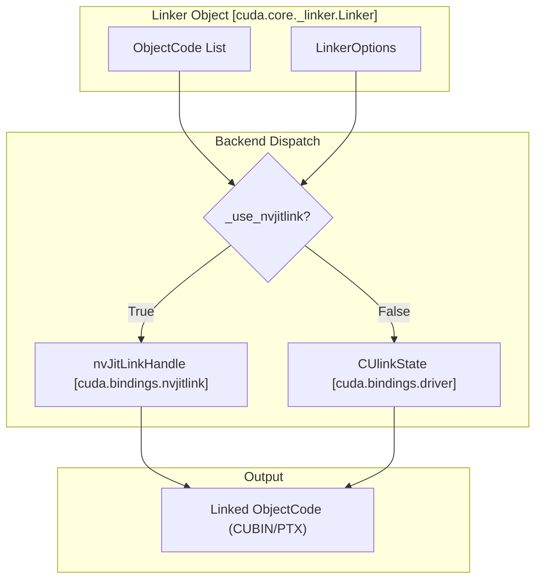

Sources: [cuda_core/cuda/core/_linker.pyx:56-74](), [cuda_core/cuda/core/_linker.pyx:108-119]()

## LinkerOptions

`LinkerOptions` manages parameters for the linking process. Note that some options are backend-specific.

| Option | Backend | Description |
|--------|---------|-------------|
| `arch` | Both | Target compute capability [cuda_core/cuda/core/_linker.pyx:193-196]() |
| `lto` | nvJitLink | Enable Link Time Optimization [cuda_core/cuda/core/_linker.pyx:201]() |
| `ptxas_options` | Both | Options passed to the underlying ptxas tool [cuda_core/tests/test_linker.py:68-70]() |
| `kernels_used` | nvJitLink | Specific kernels to keep in the output [cuda_core/tests/test_linker.py:78-80]() |

Sources: [cuda_core/cuda/core/_linker.pyx:182-220](), [cuda_core/tests/test_linker.py:56-88]()

## ObjectCode

The `ObjectCode` class (defined in `cuda.core._module`) acts as the container for compiled or linked bytes. It holds the raw binary, the target format (`ptx`, `cubin`, `ltoir`), and any symbol mappings (kernel names) generated during compilation.

Key capabilities:
- `from_ptx(code, name)`: Creates an object from existing PTX [cuda_core/tests/test_linker.py:132]().
- `get_kernel(name)`: Retrieves a kernel handle from the compiled code [cuda_core/cuda/core/_module.py:130-159]().

Sources: [cuda_core/cuda/core/_module.py:21-45](), [cuda_core/tests/test_linker.py:93-94]()

## Error Handling

The system uses a specialized translation layer to provide descriptive error messages.

- **NVRTC/NVVM Errors**: Failures during `Program.compile()` raise `NVRTCError` or `nvvmError`, often including the full compilation log from the backend [cuda_core/cuda/core/_utils/cuda_utils.pyx:77-92, 103-118]().
- **Linker Errors**: `Linker.get_error_log()` retrieves detailed diagnostic messages from the linker backend [cuda_core/cuda/core/_linker.pyx:94-119]().
- **Explanations**: The `cuda_utils` layer maps raw error codes to human-readable explanations using `DRIVER_CU_RESULT_EXPLANATIONS` and `RUNTIME_CUDA_ERROR_EXPLANATIONS` [cuda_core/cuda/core/_utils/cuda_utils.pyx:29-30, 161-163]().

Sources: [cuda_core/cuda/core/_utils/cuda_utils.pyx:33-40](), [cuda_core/tests/test_linker.py:147-170](), [cuda_core/tests/test_cuda_utils.py:31-60]()

## Resource Management

Resource cleanup is handled via the `close()` method or internal `shared_ptr` logic in the Cython layer.

- **Program**: `program.close()` resets the internal NVRTC or NVVM handles [cuda_core/cuda/core/_program.pyx:79-86]().
- **Linker**: `linker.close()` destroys the `nvJitLink` or `cuLink` state [cuda_core/cuda/core/_linker.pyx:146-152]().

Sources: [cuda_core/cuda/core/_program.pyx:79-86](), [cuda_core/cuda/core/_linker.pyx:146-152]()

---

# Page: Memory Management

# Memory Management

<details>
<summary>Relevant source files</summary>

The following files were used as context for generating this wiki page:

- [cuda_bindings/cuda/bindings/_test_helpers/mempool.py](cuda_bindings/cuda/bindings/_test_helpers/mempool.py)
- [cuda_core/cuda/core/_layout.pyx](cuda_core/cuda/core/_layout.pyx)
- [cuda_core/cuda/core/_memory/_device_memory_resource.pxd](cuda_core/cuda/core/_memory/_device_memory_resource.pxd)
- [cuda_core/cuda/core/_memory/_device_memory_resource.pyx](cuda_core/cuda/core/_memory/_device_memory_resource.pyx)
- [cuda_core/cuda/core/_memory/_ipc.pyx](cuda_core/cuda/core/_memory/_ipc.pyx)
- [cuda_core/cuda/core/_memory/_managed_memory_resource.pyx](cuda_core/cuda/core/_memory/_managed_memory_resource.pyx)
- [cuda_core/cuda/core/_memory/_peer_access_utils.pyx](cuda_core/cuda/core/_memory/_peer_access_utils.pyx)
- [cuda_core/cuda/core/_stream.pxd](cuda_core/cuda/core/_stream.pxd)
- [cuda_core/tests/conftest.py](cuda_core/tests/conftest.py)
- [cuda_core/tests/helpers/buffers.py](cuda_core/tests/helpers/buffers.py)
- [cuda_core/tests/helpers/collection_interface_testers.py](cuda_core/tests/helpers/collection_interface_testers.py)
- [cuda_core/tests/memory_ipc/test_errors.py](cuda_core/tests/memory_ipc/test_errors.py)
- [cuda_core/tests/memory_ipc/test_ipc_duplicate_import.py](cuda_core/tests/memory_ipc/test_ipc_duplicate_import.py)
- [cuda_core/tests/memory_ipc/test_leaks.py](cuda_core/tests/memory_ipc/test_leaks.py)
- [cuda_core/tests/memory_ipc/test_memory_ipc.py](cuda_core/tests/memory_ipc/test_memory_ipc.py)
- [cuda_core/tests/memory_ipc/test_peer_access.py](cuda_core/tests/memory_ipc/test_peer_access.py)
- [cuda_core/tests/memory_ipc/test_send_buffers.py](cuda_core/tests/memory_ipc/test_send_buffers.py)
- [cuda_core/tests/memory_ipc/test_serialize.py](cuda_core/tests/memory_ipc/test_serialize.py)
- [cuda_core/tests/memory_ipc/test_workerpool.py](cuda_core/tests/memory_ipc/test_workerpool.py)
- [cuda_core/tests/test_build_hooks.py](cuda_core/tests/test_build_hooks.py)
- [cuda_core/tests/test_device.py](cuda_core/tests/test_device.py)
- [cuda_core/tests/test_event.py](cuda_core/tests/test_event.py)
- [cuda_core/tests/test_launcher.py](cuda_core/tests/test_launcher.py)
- [cuda_core/tests/test_managed_memory_warning.py](cuda_core/tests/test_managed_memory_warning.py)
- [cuda_core/tests/test_memory.py](cuda_core/tests/test_memory.py)
- [cuda_core/tests/test_memory_peer_access.py](cuda_core/tests/test_memory_peer_access.py)
- [cuda_core/tests/test_module.py](cuda_core/tests/test_module.py)
- [cuda_core/tests/test_stream.py](cuda_core/tests/test_stream.py)

</details>


This page documents the memory management abstractions and utilities provided by the CUDA Python `cuda.core` package. Memory management in CUDA applications involves handling data across CPU and GPU memory spaces using various resource types, including pooled, managed, pinned, and virtual memory.

## Memory Resource Abstractions

The memory management system in `cuda.core` is built around specialized memory resources (MRs). These classes encapsulate CUDA memory allocation strategies and lifecycle management.

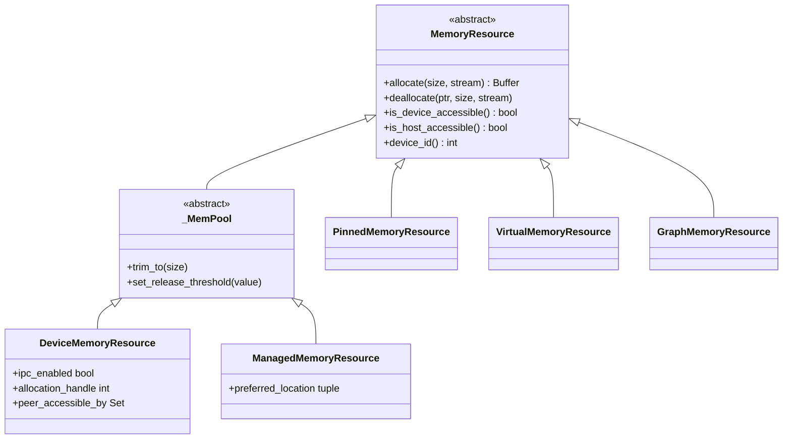

Sources:
- [cuda_core/cuda/core/_memory/_device_memory_resource.pyx:51-128]()
- [cuda_core/cuda/core/_memory/_managed_memory_resource.pyx:62-130]()
- [cuda_core/tests/test_memory.py:62-147]()

### DeviceMemoryResource (Stream-Ordered Pool)

`DeviceMemoryResource` manages a stream-ordered memory pool (`CUmemoryPool`). It is the primary resource for high-performance GPU allocations.

- **Ownership**: If created with `DeviceMemoryResourceOptions`, it creates and owns a new pool. If created with `options=None`, it wraps the driver's current or default pool for the device [cuda_core/cuda/core/_memory/_device_memory_resource.pyx:55-74]().
- **IPC Support**: Can be created with `ipc_enabled=True` to allow sharing allocations across process boundaries via `allocation_handle` [cuda_core/cuda/core/_memory/_device_memory_resource.pyx:77-103]().
- **Peer Access**: Supports cross-GPU access via the `peer_accessible_by` property, which allows managing which other devices can access this MR's allocations [cuda_core/tests/test_memory_peer_access.py:17-52]().

### ManagedMemoryResource (Unified Memory)

`ManagedMemoryResource` provides allocations accessible from both host and device with automatic migration. It wraps `CUmemoryPool` with `CU_MEMPOOL_ATTR_REUSE_ALLOW_MANAGED` [cuda_core/cuda/core/_memory/_managed_memory_resource.pyx:62-89]().

- **Preferred Location**: Users can specify where memory should reside by default (e.g., a specific GPU, Host, or specific Host NUMA node) using `ManagedMemoryResourceOptions` [cuda_core/cuda/core/_memory/_managed_memory_resource.pyx:25-59]().

### Specialized Resources

| Resource | Purpose | Source |
| :--- | :--- | :--- |
| `PinnedMemoryResource` | Page-locked host memory for high-bandwidth HtoD/DtoH transfers. | [cuda_core/cuda/core/_memory/_pinned_memory_resource.pyx]() |
| `VirtualMemoryResource` | Low-level management using the Virtual Memory Management (VMM) APIs. | [cuda_core/tests/test_memory.py:40-41]() |
| `GraphMemoryResource` | Memory management specialized for use within CUDA Graphs. | [cuda_core/tests/test_memory.py:34]() |

## Buffer Abstraction

The `Buffer` class provides a unified Pythonic interface for memory handles, regardless of the underlying `MemoryResource`.

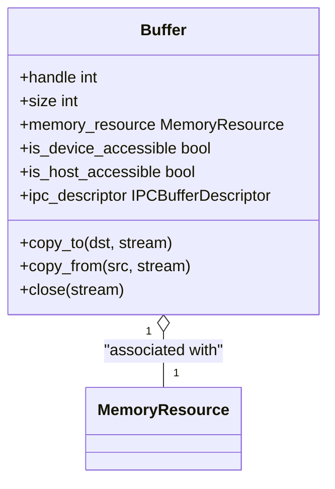

### Memory Operations
- **Allocation**: Typically performed via `mr.allocate(size, stream=stream)` [cuda_core/tests/test_memory.py:172-180]().
- **Data Transfer**: `copy_to` and `copy_from` facilitate asynchronous transfers between buffers on a specified stream [cuda_core/tests/test_memory.py:193-214]().
- **Cleanup**: `close(stream)` triggers asynchronous deallocation. Buffers also support automatic cleanup via finalizers [cuda_core/tests/test_memory.py:179]().

Sources:
- [cuda_core/tests/test_memory.py:30-41]()
- [cuda_core/tests/test_memory.py:172-180]()

## Inter-Process Communication (IPC)

`cuda.core` provides a robust system for sharing GPU memory between processes, particularly optimized for use with Python's `multiprocessing`.

### IPC Data Flow

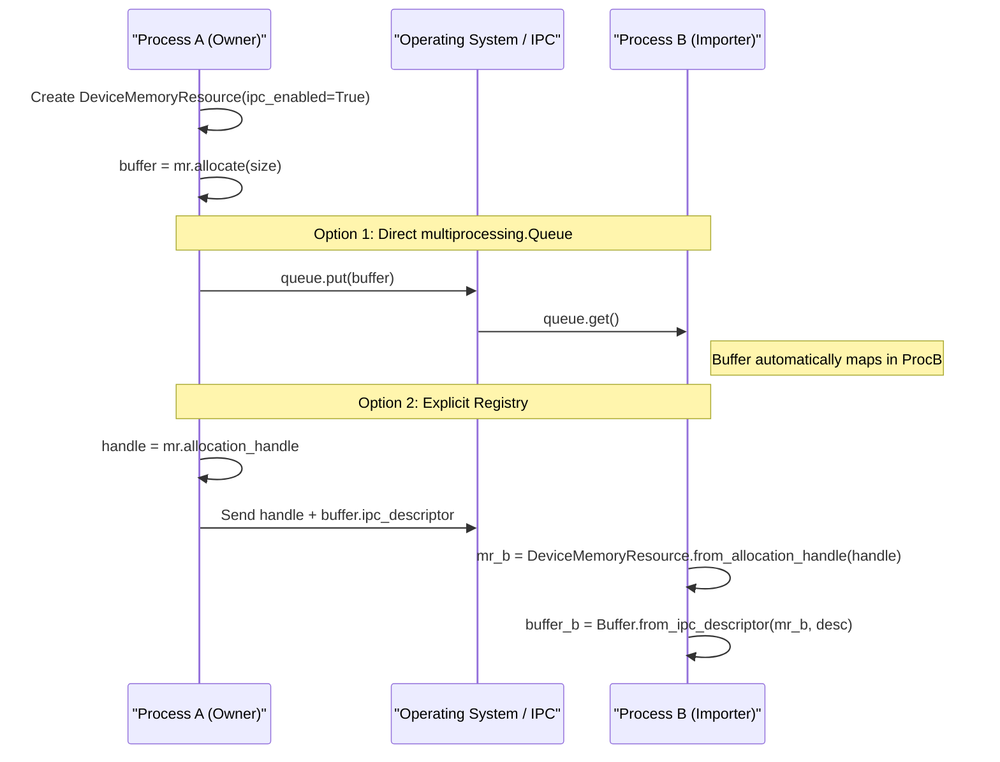

### Key IPC Components
- **`IPCAllocationHandle`**: A shareable reference to a memory pool (e.g., a file descriptor on Linux) [cuda_core/cuda/core/_memory/_device_memory_resource.pyx:163-172]().
- **`IPCBufferDescriptor`**: A serializable object containing the metadata required to map a specific allocation in a remote process [cuda_core/cuda/core/_memory.py:47]().
- **Registry**: A global mapping (per process) that associates UUIDs with `DeviceMemoryResource` instances, allowing `pickle` to automatically reconstruct `Buffer` objects by looking up their parent MR [cuda_core/cuda/core/_memory/_device_memory_resource.pyx:105-112]().

Sources:
- [cuda_core/cuda/core/_memory/_device_memory_resource.pyx:77-128]()
- [cuda_core/tests/memory_ipc/test_workerpool.py:21-58]()
- [cuda_core/tests/memory_ipc/test_send_buffers.py:19-61]()

## Peer-to-Peer (P2P) Access

For multi-GPU systems, `DeviceMemoryResource` allows explicit management of peer access.

- **`peer_accessible_by`**: This property acts like a mutable set of `Device` objects or ordinals. Adding a device to this set enables that device to directly access memory allocated by the resource [cuda_core/tests/test_memory_peer_access.py:17-42]().
- **Implementation**: Managed via `PeerAccessibleBySetProxy`, which performs the underlying `cuDeviceCanAccessPeer` and `cuCtxEnablePeerAccess` (or mempool equivalents) calls [cuda_core/cuda/core/_memory/_peer_access_utils.pyx:10-11]().

Sources:
- [cuda_core/tests/test_memory_peer_access.py:16-52]()
- [cuda_core/cuda/core/_memory/_device_memory_resource.pyx:26]()

## Summary of Allocation Methods

| Method | Context | Return Type | Synchronicity |
| :--- | :--- | :--- | :--- |
| `Device.allocate(size, stream)` | Current Device Pool | `Buffer` | Async |
| `MemoryResource.allocate(size, stream)` | Specific MR | `Buffer` | Resource-dependent |
| `Buffer.from_handle(ptr, size, mr)` | External Pointer | `Buffer` | Immediate |
| `Buffer.from_ipc_descriptor(mr, desc)` | IPC Import | `Buffer` | Immediate |

Sources:
- [cuda_core/tests/test_device.py:63-71]()
- [cuda_core/tests/test_memory.py:68-70]()
- [cuda_core/tests/memory_ipc/test_workerpool.py:100]()

---

# Page: StridedMemoryView and Interoperability

# StridedMemoryView and Interoperability

<details>
<summary>Relevant source files</summary>

The following files were used as context for generating this wiki page:

- [cuda_bindings/docs/build_docs.sh](cuda_bindings/docs/build_docs.sh)
- [cuda_bindings/docs/source/index.rst](cuda_bindings/docs/source/index.rst)
- [cuda_bindings/docs/source/overview.rst](cuda_bindings/docs/source/overview.rst)
- [cuda_bindings/docs/source/tips_and_tricks.rst](cuda_bindings/docs/source/tips_and_tricks.rst)
- [cuda_core/build_hooks.py](cuda_core/build_hooks.py)
- [cuda_core/cuda/core/__init__.pxd](cuda_core/cuda/core/__init__.pxd)
- [cuda_core/cuda/core/_dlpack.pxd](cuda_core/cuda/core/_dlpack.pxd)
- [cuda_core/cuda/core/_dlpack.pyx](cuda_core/cuda/core/_dlpack.pyx)
- [cuda_core/cuda/core/_include/aoti_shim.def](cuda_core/cuda/core/_include/aoti_shim.def)
- [cuda_core/cuda/core/_include/aoti_shim.h](cuda_core/cuda/core/_include/aoti_shim.h)
- [cuda_core/cuda/core/_include/dlpack.h](cuda_core/cuda/core/_include/dlpack.h)
- [cuda_core/cuda/core/_memory/_buffer.pxd](cuda_core/cuda/core/_memory/_buffer.pxd)
- [cuda_core/cuda/core/_memoryview.pyx](cuda_core/cuda/core/_memoryview.pyx)
- [cuda_core/cuda/core/_tensor_bridge.pyx](cuda_core/cuda/core/_tensor_bridge.pyx)
- [cuda_core/docs/build_docs.sh](cuda_core/docs/build_docs.sh)
- [cuda_core/docs/source/examples.rst](cuda_core/docs/source/examples.rst)
- [cuda_core/docs/source/getting-started.rst](cuda_core/docs/source/getting-started.rst)
- [cuda_core/docs/source/index.rst](cuda_core/docs/source/index.rst)
- [cuda_core/docs/source/interoperability.rst](cuda_core/docs/source/interoperability.rst)
- [cuda_core/setup.py](cuda_core/setup.py)
- [cuda_core/tests/test_utils.py](cuda_core/tests/test_utils.py)
- [cuda_python/docs/Makefile](cuda_python/docs/Makefile)
- [cuda_python/docs/build_docs.sh](cuda_python/docs/build_docs.sh)
- [cuda_python/docs/source/_templates/main.html](cuda_python/docs/source/_templates/main.html)

</details>


This document details the `StridedMemoryView` class in `cuda-python` and how it enables interoperability between CUDA-based code and various Python array libraries. The interoperability mechanisms described here allow seamless integration of CUDA kernels with array objects from libraries like NumPy, CuPy, Numba, PyTorch, and others that support standard memory-sharing protocols.

## 1. Overview of StridedMemoryView

`StridedMemoryView` is a class that provides a unified representation of strided dense arrays or tensors from different Python libraries. It extracts and standardizes metadata about memory layout, allowing CUDA kernels to work with arrays regardless of their original source. It is array-library-agnostic, meaning it does not depend on any specific array library to function.

```mermaid
classDiagram
    class StridedMemoryView {
        +int ptr
        +tuple shape
        +tuple strides
        +numpy.dtype dtype
        +int device_id
        +bool is_device_accessible
        +bool readonly
        +Any exporting_obj
        +from_any_interface(obj, stream_ptr)
        +from_dlpack(obj, stream_ptr)
        +from_buffer(buffer, shape, dtype, strides)
    }

    class "Array Protocols" {
        +__dlpack__()
        +__dlpack_device__()
        +__cuda_array_interface__
    }

    class "Tensor Bridge (Fast Path)" {
        +aoti_torch_get_data_ptr()
        +aoti_torch_get_sizes()
        +aoti_torch_get_strides()
    }

    "Array Protocols" <.. StridedMemoryView : via from_any_interface
    "Tensor Bridge (Fast Path)" <.. StridedMemoryView : via PyTorch optimization
```

Sources: [cuda_core/cuda/core/_memoryview.pyx:124-179](), [cuda_core/docs/source/interoperability.rst:69-81]()

The main attributes of `StridedMemoryView` are:

| Attribute | Type | Description |
|-----------|------|-------------|
| `ptr` | int | Pointer to the tensor buffer (as a Python `int`). |
| `shape` | tuple | Shape of the tensor. |
| `strides` | tuple or None | Strides of the tensor in counts (not bytes). |
| `dtype` | numpy.dtype | Data type of the tensor. |
| `device_id` | int | Device ID where the tensor is located (-1 for CPU tensors). |
| `is_device_accessible` | bool | Whether the tensor data can be accessed on the GPU. |
| `readonly` | bool | Whether the tensor data can be modified in place. |
| `exporting_obj` | Any | Reference to the original object (e.g., a `Buffer` or `torch.Tensor`). |

Sources: [cuda_core/cuda/core/_memoryview.pyx:163-178](), [cuda_core/tests/test_utils.py:173-188]()

## 2. Interoperability Protocols

`StridedMemoryView` supports multiple interoperability protocols to ensure compatibility across the ecosystem.

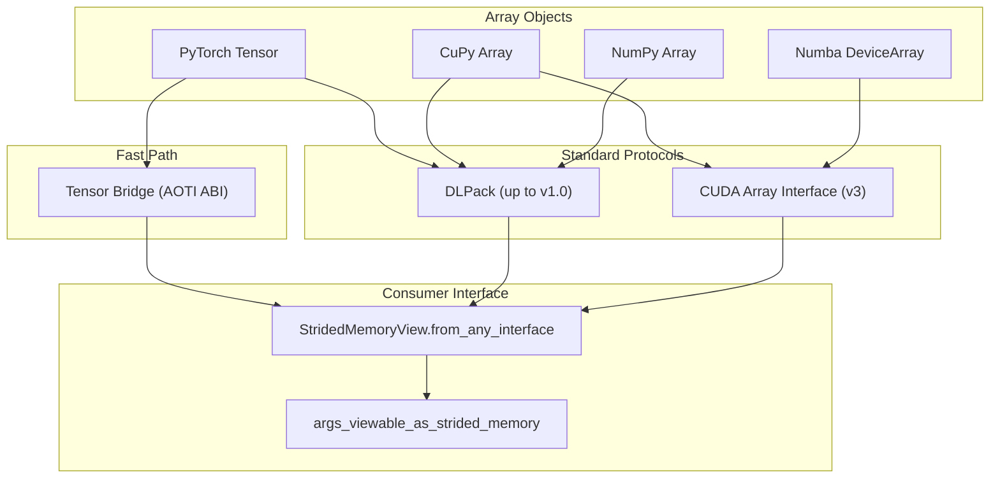

Sources: [cuda_core/cuda/core/_memoryview.pyx:35-55](), [cuda_core/cuda/core/_memoryview.pyx:127-145](), [cuda_core/docs/source/interoperability.rst:62-68]()

### 2.1. DLPack Protocol
`StridedMemoryView` supports DLPack up to version 1.0. When using DLPack, the consumer stream pointer is passed to the object's `__dlpack__` method. If `stream_ptr=-1` is provided, it indicates the consumer does not care about stream ordering, and `-1` is passed internally to `__dlpack__`.

Sources: [cuda_core/cuda/core/_memoryview.pyx:146-152](), [cuda_core/cuda/core/_memoryview.pyx:158-161]()

### 2.2. CUDA Array Interface (CAI)
For objects supporting CAI v3, `StridedMemoryView` establishes a stream order between the consumer stream and the producer stream (retrieved from the `stream` key in the CAI dictionary). This is implemented as an implicit `cudaStreamWaitEvent`.

Sources: [cuda_core/cuda/core/_memoryview.pyx:143-145](), [cuda_core/docs/source/interoperability.rst:62-65]()

### 2.3. PyTorch Tensor Bridge (Fast Path)
For PyTorch tensors, `cuda.core` implements a "Tensor Bridge" fast path using the PyTorch AOT Inductor (AOTI) stable C ABI. This avoids the overhead of the DLPack/CAI Python protocols by calling directly into the PyTorch C++ core via a vendored shim.

- **ABI Range**: Supported for PyTorch 2.3 through 2.11.
- **Implementation**: Uses `ctypes.CDLL` to load `torch._C` symbols with `RTLD_GLOBAL`.
- **Symbols**: Resolves functions like `aoti_torch_get_data_ptr`, `aoti_torch_get_sizes`, and `aoti_torch_get_strides`.

Sources: [cuda_core/cuda/core/_memoryview.pyx:45-70](), [cuda_core/cuda/core/_memoryview.pyx:85-98](), [cuda_core/cuda/core/_include/aoti_shim.h:64-76]()

## 3. Usage Patterns

### 3.1. The `args_viewable_as_strided_memory` Decorator
The recommended way to use `StridedMemoryView` is via the decorator. It wraps specified arguments in a proxy that provides a `.view(stream_ptr)` method.

```python
from cuda.core.utils import args_viewable_as_strided_memory

@args_viewable_as_strided_memory((0, 1)) # Arguments at index 0 and 1
def my_kernel_wrapper(input_arr, output_arr, stream):
    # .view() returns a StridedMemoryView
    in_view = input_arr.view(stream.ptr)
    out_view = output_arr.view(stream.ptr)
    
    # Access raw pointers for kernel launch
    launch_kernel(in_view.ptr, out_view.ptr, stream)
```

Sources: [cuda_core/tests/test_utils.py:154-158](), [cuda_core/docs/source/interoperability.rst:69-72]()

### 3.2. Manual Construction
`StridedMemoryView` can be instantiated manually using class methods:
- `StridedMemoryView.from_any_interface(obj, stream_ptr)`: Tries DLPack then CAI.
- `StridedMemoryView.from_dlpack(obj, stream_ptr)`: Explicitly uses DLPack.
- `StridedMemoryView.from_buffer(buffer, shape, dtype, strides)`: Creates a view from a `cuda.core.Buffer`.

Sources: [cuda_core/cuda/core/_memoryview.pyx:127-133](), [cuda_core/tests/test_utils.py:162-164]()

## 4. Narrow Data Type Support
`StridedMemoryView` supports narrow data types such as `bfloat16` if the `ml_dtypes` package is installed. This allows interoperability with `torch.bfloat16` or CuPy `bfloat16` arrays. If `ml_dtypes` is missing, encountering these types will raise a `NotImplementedError`.

Sources: [cuda_core/docs/source/interoperability.rst:86-95](), [cuda_core/cuda/core/_memoryview.pyx:101-104]()

## 5. Stream Synchronization Details

Proper synchronization is handled based on the source object's protocol:

| Protocol | Synchronization Mechanism |
|----------|---------------------------|
| **DLPack** | `stream_ptr` is passed to `__dlpack__(stream=stream_ptr)`. |
| **CAI** | An event is recorded on the producer stream and waited upon by the consumer stream. |
| **AOTI (Torch)** | Uses PyTorch's internal stream management symbols. |
| **Opt-out** | Pass `stream_ptr=-1` to skip all synchronization. |

Sources: [cuda_core/cuda/core/_memoryview.pyx:140-152](), [cuda_core/cuda/core/_memoryview.pyx:158-160](), [cuda_core/docs/source/interoperability.rst:62-68]()

## 6. Implementation Architecture

The system uses a combination of Cython for performance and a C shim for Windows compatibility.

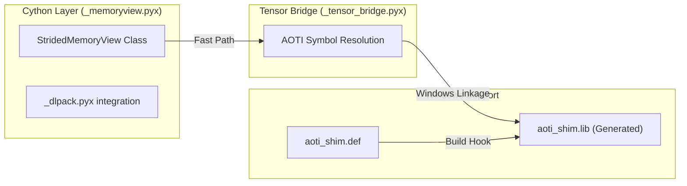

Sources: [cuda_core/setup.py:50-67](), [cuda_core/cuda/core/_include/aoti_shim.def:1-10](), [cuda_core/cuda/core/_memoryview.pyx:85-98]()

---

# Page: Error Handling

# Error Handling

<details>
<summary>Relevant source files</summary>

The following files were used as context for generating this wiki page:

- [cuda_bindings/tests/conftest.py](cuda_bindings/tests/conftest.py)
- [cuda_bindings/tests/test_cuda.py](cuda_bindings/tests/test_cuda.py)
- [cuda_bindings/tests/test_cudart.py](cuda_bindings/tests/test_cudart.py)
- [cuda_core/cuda/core/_cpp/resource_handles.cpp](cuda_core/cuda/core/_cpp/resource_handles.cpp)
- [cuda_core/cuda/core/_cpp/resource_handles.hpp](cuda_core/cuda/core/_cpp/resource_handles.hpp)
- [cuda_core/cuda/core/_resource_handles.pxd](cuda_core/cuda/core/_resource_handles.pxd)
- [cuda_core/cuda/core/_resource_handles.pyx](cuda_core/cuda/core/_resource_handles.pyx)
- [cuda_core/cuda/core/_utils/cuda_utils.pxd](cuda_core/cuda/core/_utils/cuda_utils.pxd)
- [cuda_core/cuda/core/_utils/cuda_utils.pyx](cuda_core/cuda/core/_utils/cuda_utils.pyx)
- [cuda_core/cuda/core/_utils/driver_cu_result_explanations.py](cuda_core/cuda/core/_utils/driver_cu_result_explanations.py)
- [cuda_core/cuda/core/_utils/driver_cu_result_explanations_frozen.py](cuda_core/cuda/core/_utils/driver_cu_result_explanations_frozen.py)
- [cuda_core/cuda/core/_utils/enum_explanations_helpers.py](cuda_core/cuda/core/_utils/enum_explanations_helpers.py)
- [cuda_core/cuda/core/_utils/runtime_cuda_error_explanations.py](cuda_core/cuda/core/_utils/runtime_cuda_error_explanations.py)
- [cuda_core/cuda/core/_utils/runtime_cuda_error_explanations_frozen.py](cuda_core/cuda/core/_utils/runtime_cuda_error_explanations_frozen.py)
- [cuda_core/tests/test_cuda_utils.py](cuda_core/tests/test_cuda_utils.py)
- [cuda_core/tests/test_linker.py](cuda_core/tests/test_linker.py)
- [cuda_core/tests/test_object_protocols.py](cuda_core/tests/test_object_protocols.py)
- [cuda_core/tests/test_utils_enum_explanations_helpers.py](cuda_core/tests/test_utils_enum_explanations_helpers.py)

</details>


This page documents the error handling mechanisms in the `cuda.core` package. The error handling system provides consistent, informative error reporting for operations involving CUDA libraries through a layered approach that transforms low-level CUDA error codes into Python exceptions with detailed explanations and automated resource management.

## Exception Hierarchy

CUDA Python implements a specific exception hierarchy for representing errors from various CUDA subsystems. While `CUDAError` is the primary exception for driver and runtime issues, specialized exceptions exist for compilation and linking backends.

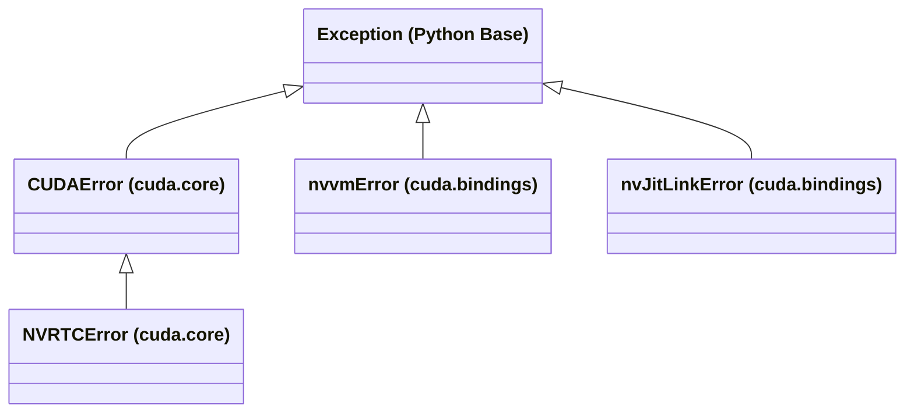

- `CUDAError`: Base exception for any CUDA-related error, primarily wrapping `CUresult` and `cudaError_t` [cuda_core/cuda/core/_utils/cuda_utils.pyx:33-34]().
- `NVRTCError`: Specific exception for NVRTC (runtime compilation) errors, which automatically captures and appends compilation logs [cuda_core/cuda/core/_utils/cuda_utils.pyx:37-38]().
- `nvvmError` / `nvJitLinkError`: Bindings-level exceptions used by the compiler backends in `cuda.core` [cuda_core/cuda/core/_utils/cuda_utils.pyx:22-23]().

Sources: [cuda_core/cuda/core/_utils/cuda_utils.pyx:22-38]()

## Error Handling Flow

The error handling system transforms low-level error codes from CUDA libraries into user-friendly Python exceptions. A critical feature of `cuda.core` is its ability to extract and clear thread-local errors at the C++ level to prevent error pollution.

### Resource Handle Error State
The C++ core maintains thread-local error state using `get_last_error`, `peek_last_error`, and `clear_last_error` [cuda_core/cuda/core/_cpp/resource_handles.hpp:43-50](). This ensures that if a CUDA call fails, the error is captured immediately before subsequent cleanup logic might overwrite it.

### Error Translation Layer
The `cuda_utils` module provides specialized handlers for each CUDA subsystem.

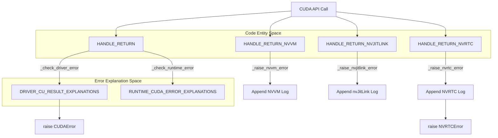

Sources: [cuda_core/cuda/core/_utils/cuda_utils.pyx:63-145](), [cuda_core/cuda/core/_cpp/resource_handles.hpp:40-50]()

## Error Checking Functions

The `cuda.core` package utilizes Cython-level error checkers that are optimized for performance while providing rich diagnostic information.

| Function | Signature | Purpose |
|----------|-----------|---------|
| `HANDLE_RETURN` | `(cydriver.CUresult err)` | Processes Driver API results, raising `CUDAError` on failure [cuda_core/cuda/core/_utils/cuda_utils.pyx:63](). |
| `HANDLE_RETURN_NVRTC` | `(nvrtcProgram prog, nvrtcResult err)` | Processes NVRTC results and fetches the compilation log if an error occurs [cuda_core/cuda/core/_utils/cuda_utils.pyx:69](). |
| `HANDLE_RETURN_NVVM` | `(nvvmProgram prog, nvvmResult err)` | Processes NVVM results and appends the internal program log to the exception [cuda_core/cuda/core/_utils/cuda_utils.pyx:95](). |
| `HANDLE_RETURN_NVJITLINK`| `(nvJitLinkHandle h, nvJitLinkResult err)`| Processes JIT Linker results and extracts the linker error log [cuda_core/cuda/core/_utils/cuda_utils.pyx:120](). |

Sources: [cuda_core/cuda/core/_utils/cuda_utils.pyx:63-145](), [cuda_core/cuda/core/_utils/cuda_utils.pxd:21-25]()

## Error Explanations

A unique feature of `cuda-python` is the inclusion of "Explanation Dictionaries." Standard CUDA error strings (e.g., via `cuGetErrorString`) are often terse. `cuda.core` augments these with detailed, human-readable text derived from the CUDA documentation.

- **`DRIVER_CU_RESULT_EXPLANATIONS`**: Maps `CUresult` integers to detailed descriptions [cuda_core/cuda/core/_utils/driver_cu_result_explanations.py]().
- **`RUNTIME_CUDA_ERROR_EXPLANATIONS`**: Maps `cudaError_t` integers to detailed descriptions [cuda_core/cuda/core/_utils/runtime_cuda_error_explanations.py]().

### Automated Docstring Cleanup
The system includes logic to clean up raw enum docstrings from the bindings to present a polished error message to the user [cuda_core/tests/test_cuda_utils.py:133-138]().

Example of an augmented error message:
`CUDA_ERROR_INVALID_CONTEXT: This most frequently indicates that there is no context bound to the current thread...` [cuda_core/tests/test_cuda_utils.py:94-101]()

Sources: [cuda_core/cuda/core/_utils/cuda_utils.pyx:161-184](), [cuda_core/tests/test_cuda_utils.py:83-138]()

## Resource Cleanup and Transactions

`cuda.core` utilizes a `Transaction` context manager (implemented via `ExitStack`) and RAII-style C++ handles to ensure safe resource cleanup even when errors occur.

### Transaction Context Manager
The `Transaction` system allows multiple CUDA operations to be grouped. If any operation fails, the `ExitStack` ensures that previously allocated resources within that transaction are correctly released [cuda_core/cuda/core/_utils/cuda_utils.pyx:12]().

### C++ Resource Handles
The underlying C++ implementation uses `shared_ptr` with custom deleters for CUDA handles (e.g., `CUcontext`, `CUstream`, `CUevent`). These deleters are GIL-aware:
- **`GILReleaseGuard`**: Releases the Python GIL when calling `cuStreamDestroy` or `cuMemFree` to prevent blocking other Python threads [cuda_core/cuda/core/_cpp/resource_handles.cpp:100-115]().
- **`GILAcquireGuard`**: Re-acquires the GIL if a C++ destructor needs to trigger a Python-level callback (e.g., a Memory Resource deallocation) [cuda_core/cuda/core/_cpp/resource_handles.cpp:134-148]().

```mermaid
sequenceDiagram
    participant P as Python Object
    participant C as C++ shared_ptr
    participant G as GIL Guard
    participant D as CUDA Driver

    P->>C: Drop last reference
    C->>G: Instantiate GILReleaseGuard
    G->>D: Release GIL
    C->>D: cuStreamDestroy(handle)
    D-->>C: Success
    G->>P: Re-acquire GIL
    C-->>P: Object fully destroyed
```

Sources: [cuda_core/cuda/core/_cpp/resource_handles.cpp:93-160](), [cuda_core/cuda/core/_cpp/resource_handles.hpp:150-164]()

## Common Error Scenarios in Tests

The codebase includes extensive tests for error states, particularly in the Linker and Program subsystems:
- **Linker Undefined Reference**: Captured by `test_linker_get_error_log`, which demonstrates how `CUDAError` or `nvJitLinkError` is raised with a log containing the specific missing symbol (e.g., `Undefined reference to '_Z1Zv'`) [cuda_core/tests/test_linker.py:147-169]().
- **Invalid Architecture**: `test_linker_init_invalid_arch` verifies that passing an unsupported compute capability raises an `AttributeError` or `nvJitLinkError` [cuda_core/tests/test_linker.py:98-102]().
- **Memory Pool OOM**: Tests utilize `xfail_if_mempool_oom` to handle expected resource exhaustion in constrained environments [cuda_bindings/tests/test_cuda.py:15]().

Sources: [cuda_core/tests/test_linker.py:98-169](), [cuda_bindings/tests/test_cuda.py:15]()

---

# Page: CUDA Graphs

# CUDA Graphs

<details>
<summary>Relevant source files</summary>

The following files were used as context for generating this wiki page:

- [cuda_core/cuda/core/__init__.py](cuda_core/cuda/core/__init__.py)
- [cuda_core/cuda/core/_graphics.pxd](cuda_core/cuda/core/_graphics.pxd)
- [cuda_core/cuda/core/_graphics.pyx](cuda_core/cuda/core/_graphics.pyx)
- [cuda_core/cuda/core/graph/__init__.pxd](cuda_core/cuda/core/graph/__init__.pxd)
- [cuda_core/cuda/core/graph/__init__.py](cuda_core/cuda/core/graph/__init__.py)
- [cuda_core/cuda/core/graph/_graph_builder.pyx](cuda_core/cuda/core/graph/_graph_builder.pyx)
- [cuda_core/cuda/core/graph/_graph_definition.pyx](cuda_core/cuda/core/graph/_graph_definition.pyx)
- [cuda_core/cuda/core/graph/_graph_node.pyx](cuda_core/cuda/core/graph/_graph_node.pyx)
- [cuda_core/cuda/core/graph/_subclasses.pxd](cuda_core/cuda/core/graph/_subclasses.pxd)
- [cuda_core/cuda/core/graph/_subclasses.pyx](cuda_core/cuda/core/graph/_subclasses.pyx)
- [cuda_core/docs/source/release/1.0.0-notes.rst](cuda_core/docs/source/release/1.0.0-notes.rst)
- [cuda_core/examples/tma_tensor_map.py](cuda_core/examples/tma_tensor_map.py)
- [cuda_core/tests/graph/test_device_launch.py](cuda_core/tests/graph/test_device_launch.py)
- [cuda_core/tests/graph/test_graph_builder.py](cuda_core/tests/graph/test_graph_builder.py)
- [cuda_core/tests/graph/test_graph_builder_conditional.py](cuda_core/tests/graph/test_graph_builder_conditional.py)
- [cuda_core/tests/graph/test_graph_definition.py](cuda_core/tests/graph/test_graph_definition.py)
- [cuda_core/tests/graph/test_graph_memory_resource.py](cuda_core/tests/graph/test_graph_memory_resource.py)
- [cuda_core/tests/graph/test_graph_update.py](cuda_core/tests/graph/test_graph_update.py)
- [cuda_core/tests/graph/test_options.py](cuda_core/tests/graph/test_options.py)
- [cuda_core/tests/helpers/marks.py](cuda_core/tests/helpers/marks.py)
- [cuda_core/tests/helpers/misc.py](cuda_core/tests/helpers/misc.py)
- [cuda_core/tests/test_graphics.py](cuda_core/tests/test_graphics.py)
- [cuda_core/tests/test_tensor_map.py](cuda_core/tests/test_tensor_map.py)

</details>


The CUDA Graph subsystem in `cuda.core` provides two primary mechanisms for creating and executing task graphs: **Stream Capture** (via `GraphBuilder`) and **Explicit Construction** (via `GraphDefinition`). CUDA Graphs allow for reduced kernel launch overhead and the ability to define complex execution topologies, including conditional logic, which the CUDA driver can optimize as a single unit.

### Core Architecture

The graph subsystem is organized into three main phases:
1.  **Definition**: Building the graph structure using either capture or explicit node addition.
2.  **Instantiation**: Validating the definition and creating an executable graph (`Graph`).
3.  **Execution/Update**: Launching the executable graph on a stream and optionally updating its parameters without re-instantiation.

#### System Entities and Code Mapping
The following diagram maps high-level graph concepts to their specific class implementations in the `cuda.core.graph` module.

**Graph Entity Mapping**
```mermaid
graph TD
    subgraph "Definition Space"
        GB["GraphBuilder"] -- "stream capture" --> GDef["GraphDefinition"]
        GDef -- "explicit construction" --> GDef
    end

    subgraph "Node Space"
        GDef -- "contains" --> GN["GraphNode"]
        GN --> KN["KernelNode"]
        GN --> MN["MemcpyNode"]
        GN --> SN["SetNode (Memset)"]
        GN --> AN["AllocNode"]
        GN --> FN["FreeNode"]
        GN --> CN["ConditionalNode"]
    end

    subgraph "Execution Space"
        GDef -- "instantiate()" --> G["Graph (Executable)"]
        G -- "launch(stream)" --> S["cuda.core.Stream"]
    end

    class GB,GDef,GN,KN,MN,SN,AN,FN,CN,G,S internal-link;
```
Sources: [cuda_core/cuda/core/graph/_graph_definition.pyx:110-116](), [cuda_core/cuda/core/graph/_graph_builder.pyx:200-210](), [cuda_core/cuda/core/graph/_subclasses.pyx:38-54]()

---

### Graph Construction

#### 1. Stream Capture (GraphBuilder)
`GraphBuilder` allows users to record existing CUDA stream operations into a graph. This is the most common way to convert legacy imperative code into a graph.

*   **Usage**: Call `Device.create_graph_builder()` followed by `begin_building()`. Any work launched via `cuda.core.launch` or stream methods will be captured until `end_building()` is called.
*   **Nesting**: `GraphBuilder.embed()` (formerly `add_child`) allows including a previously defined graph into the current capture session.

Sources: [cuda_core/cuda/core/graph/_graph_builder.pyx:200-215](), [cuda_core/docs/source/release/1.0.0-notes.rst:69-71]()

#### 2. Explicit Construction (GraphDefinition)
`GraphDefinition` is used to construct a graph by manually adding nodes and defining dependencies (edges).

*   **Node Creation**: Nodes are added using methods like `launch()`, `memcpy()`, `allocate()`, and `memset()`.
*   **Dependencies**: Every node creation method returns a `GraphNode` object. You can create a dependency by calling a builder method on a predecessor node (e.g., `node_a.launch(...)` makes the new kernel node depend on `node_a`).
*   **Synchronization**: The `join(*nodes)` method creates an `EmptyNode` that acts as a barrier, depending on all provided input nodes.

Sources: [cuda_core/cuda/core/graph/_graph_definition.pyx:110-130](), [cuda_core/cuda/core/graph/_graph_node.pyx:75-81](), [cuda_core/cuda/core/graph/_graph_node.pyx:201-217]()

---

### Node Types and Subclasses

All nodes in a graph inherit from the base `GraphNode` class. The subsystem automatically dispatches to specialized subclasses when nodes are created or retrieved from the driver.

| Class | Purpose | Key Properties |
| :--- | :--- | :--- |
| `KernelNode` | Represents a `__global__` function launch. | `grid`, `block`, `shmem_size`, `kernel` |
| `MemcpyNode` | Represents data transfer between host/device. | `src`, `dst`, `size` |
| `MemsetNode` | Sets a memory range to a specific value. | `value`, `width`, `height`, `pitch` |
| `AllocNode` | Performs a memory allocation within the graph. | `dptr`, `bytesize`, `memory_type` |
| `FreeNode` | Frees memory allocated by an `AllocNode`. | `dptr` |
| `HostCallbackNode`| Executes a Python function on the host. | `callback` |
| `EmptyNode` | A "no-op" node used for synchronization. | N/A |

Sources: [cuda_core/cuda/core/graph/_subclasses.pyx:38-54](), [cuda_core/cuda/core/graph/_subclasses.pyx:82-97](), [cuda_core/cuda/core/graph/_subclasses.pyx:162-179]()

---

### Conditional Logic in Graphs

`cuda.core` supports advanced control flow within graphs using `GraphCondition`. This allows for conditional execution (`if/else`), loops (`while`), and multi-way branching (`switch`) entirely on the GPU.

1.  **Create Condition**: Use `gb.create_condition(default_value)` to get a `GraphCondition` handle.
2.  **Define Bodies**: The builder methods for conditionals return sub-builders (for `GraphBuilder`) or take sub-graphs.
3.  **Update at Runtime**: A `GraphCondition` can be passed as a kernel argument to `launch()`. Inside the kernel, the value is updated using `cudaGraphSetConditional`, which dictates which branch the graph takes in subsequent nodes.

**Conditional Node Flow**
```mermaid
sequenceDiagram
    participant P as Python (Host)
    participant GB as GraphBuilder
    participant D as Driver/GPU
    
    P->>GB: create_condition(val)
    GB-->>P: GraphCondition
    P->>GB: if_then(condition)
    Note over GB: Captures conditional body
    P->>D: instantiate() & launch()
    Note over D: Kernel updates condition handle
    D->>D: Driver evaluates condition
    D->>D: Executes/Skips conditional nodes
```
Sources: [cuda_core/cuda/core/graph/_graph_definition.pyx:35-49](), [cuda_core/docs/source/release/1.0.0-notes.rst:97-122](), [cuda_core/tests/graph/test_graph_builder_conditional.py:1-50]()

---

### Instantiation and Execution

#### Graph Completion
A `GraphDefinition` or finished `GraphBuilder` is converted to an executable `Graph` via the `complete()` or `instantiate()` method. 

`GraphCompleteOptions` controls instantiation behavior:
*   `device_launch`: (Hopper+ only) Allows the graph to be launched from within a GPU kernel.
*   `upload_stream`: Automatically uploads the graph to the device after instantiation.
*   `auto_free_on_launch`: Automatically manages memory for internal allocation nodes.

Sources: [cuda_core/cuda/core/graph/_graph_builder.pyx:125-148](), [cuda_core/tests/graph/test_device_launch.py:103-108]()

#### Execution and Updates
Once instantiated, a `Graph` is executed using `graph.launch(stream)`.

If the logic of the graph remains the same but parameters (like kernel arguments or pointers) change, use `graph.update(new_definition)`. This is significantly faster than re-instantiating because it performs an in-place update of the executable graph, provided the topology (number of nodes and their dependencies) is identical.

Sources: [cuda_core/tests/graph/test_graph_update.py:49-58](), [cuda_core/tests/graph/test_graph_update.py:176-196]()

---

# Page: System Telemetry (cuda.core.system)

# System Telemetry (cuda.core.system)

<details>
<summary>Relevant source files</summary>

The following files were used as context for generating this wiki page:

- [cuda_core/cuda/core/_cpp/resource_handles.cpp](cuda_core/cuda/core/_cpp/resource_handles.cpp)
- [cuda_core/cuda/core/_cpp/resource_handles.hpp](cuda_core/cuda/core/_cpp/resource_handles.hpp)
- [cuda_core/cuda/core/_resource_handles.pxd](cuda_core/cuda/core/_resource_handles.pxd)
- [cuda_core/cuda/core/_resource_handles.pyx](cuda_core/cuda/core/_resource_handles.pyx)
- [cuda_core/cuda/core/_utils/cuda_utils.pxd](cuda_core/cuda/core/_utils/cuda_utils.pxd)
- [cuda_core/cuda/core/system/__init__.py](cuda_core/cuda/core/system/__init__.py)
- [cuda_core/cuda/core/system/_clock.pxi](cuda_core/cuda/core/system/_clock.pxi)
- [cuda_core/cuda/core/system/_cooler.pxi](cuda_core/cuda/core/system/_cooler.pxi)
- [cuda_core/cuda/core/system/_device.pyx](cuda_core/cuda/core/system/_device.pyx)
- [cuda_core/cuda/core/system/_event.pxi](cuda_core/cuda/core/system/_event.pxi)
- [cuda_core/cuda/core/system/_fan.pxi](cuda_core/cuda/core/system/_fan.pxi)
- [cuda_core/cuda/core/system/_inforom.pxi](cuda_core/cuda/core/system/_inforom.pxi)
- [cuda_core/cuda/core/system/_nvlink.pxi](cuda_core/cuda/core/system/_nvlink.pxi)
- [cuda_core/cuda/core/system/_nvml_context.pyx](cuda_core/cuda/core/system/_nvml_context.pyx)
- [cuda_core/cuda/core/system/_pci_info.pxi](cuda_core/cuda/core/system/_pci_info.pxi)
- [cuda_core/cuda/core/system/_system.pyx](cuda_core/cuda/core/system/_system.pyx)
- [cuda_core/cuda/core/system/_system_events.pyx](cuda_core/cuda/core/system/_system_events.pyx)
- [cuda_core/cuda/core/system/_temperature.pxi](cuda_core/cuda/core/system/_temperature.pxi)
- [cuda_core/docs/source/api.rst](cuda_core/docs/source/api.rst)
- [cuda_core/docs/source/api_private.rst](cuda_core/docs/source/api_private.rst)
- [cuda_core/tests/system/test_system_device.py](cuda_core/tests/system/test_system_device.py)
- [cuda_core/tests/system/test_system_events.py](cuda_core/tests/system/test_system_events.py)
- [cuda_core/tests/test_enum_coverage.py](cuda_core/tests/test_enum_coverage.py)
- [cuda_core/tests/test_object_protocols.py](cuda_core/tests/test_object_protocols.py)

</details>


The `cuda.core.system` module provides a high-level, Pythonic interface for hardware introspection and management. It leverages the NVIDIA Management Library (NVML) to expose detailed telemetry for NVIDIA GPUs, including power management, thermal monitoring, clock control, and hardware event tracking.

While `cuda.core.Device` focuses on execution and memory management within the CUDA Driver API, `cuda.core.system.Device` provides the "administrative" view of the hardware [cuda_core/cuda/core/system/_device.pyx:143-152]().

## Architecture and Data Flow

The module is built on top of `cuda.bindings.nvml`. It manages an internal NVML context, ensuring the library is initialized before any telemetry calls are made [cuda_core/cuda/core/system/_nvml_context.pyx:1-10]().

### Component Interaction Diagram
This diagram shows how `cuda.core.system` bridges the gap between Python user code and the underlying NVML bindings.

**System Telemetry Component Bridge**
```mermaid
graph TD
    subgraph "Python User Space"
        UserCode["User Application"]
        SysDevice["cuda.core.system.Device"]
        SysEvents["cuda.core.system.RegisteredSystemEvents"]
    end

    subgraph "cuda.core.system (Internal)"
        NVMLCtx["_nvml_context.initialize()"]
        DeviceImpl["_device.pyx"]
        EventImpl["_system_events.pyx"]
    end

    subgraph "cuda.bindings"
        NVMLBind["cuda.bindings.nvml"]
    end

    UserCode --> SysDevice
    UserCode --> SysEvents
    
    SysDevice --> NVMLCtx
    SysDevice --> DeviceImpl
    DeviceImpl --> NVMLBind
    
    SysEvents --> EventImpl
    EventImpl --> NVMLBind
```
Sources: [cuda_core/cuda/core/system/_device.pyx:178-204](), [cuda_core/cuda/core/system/_system_events.pyx:72-103](), [cuda_core/cuda/core/system/_nvml_context.pyx:1-10]()

## The System Device Class

The `cuda.core.system.Device` class is the primary entry point for per-GPU telemetry. Unlike driver-level device handles, a system `Device` can be instantiated via index, UUID, or PCI Bus ID [cuda_core/cuda/core/system/_device.pyx:178-184]().

### Key Telemetry Categories

| Category | Description | Implementation File |
| :--- | :--- | :--- |
| **Identity** | Name, UUID, PCI Info, Architecture | `_device.pyx`, `_pci_info.pxi` |
| **Thermals** | Temperature sensors, thresholds, fan speeds | `_temperature.pxi`, `_fan.pxi` |
| **Clocks** | SM/Memory frequencies, throttle reasons | `_clock.pxi` |
| **Power** | Power usage, management limits, P-States | `_performance.pxi` |
| **Memory** | BAR1 memory, FB memory utilization | `_memory.pxi`, `_utilization.pxi` |
| **Topology** | NVLink status, NUMA affinity, P2P caps | `_nvlink.pxi`, `_device.pyx` |

### Code Entity Mapping
This diagram maps the high-level telemetry concepts to specific internal Cython implementation files (included via `_device.pyx`).

**Telemetry Implementation Mapping**
```mermaid
graph LR
    subgraph "cuda.core.system.Device"
        D["Device Object"]
    end

    subgraph "Feature Implementations (pxi)"
        direction TB
        F1["_clock.pxi (ClockInfo)"]
        F2["_temperature.pxi (Temperature)"]
        F3["_fan.pxi (FanInfo)"]
        F4["_pci_info.pxi (PciInfo)"]
        F5["_nvlink.pxi (NvLink)"]
        F6["_memory.pxi (MemoryInfo)"]
    end

    D --- F1
    D --- F2
    D --- F3
    D --- F4
    D --- F5
    D --- F6
```
Sources: [cuda_core/cuda/core/system/_device.pyx:53-69]()

## Thermal and Fan Management

The module provides granular access to thermal sensors and cooling hardware.

*   **`Temperature`**: Provides current readings and thresholds (Shutdown, Slowdown, etc.) [cuda_core/cuda/core/system/_temperature.pxi:118-162]().
*   **`ThermalSettings`**: On supported architectures, allows iterating through multiple onboard sensors via `ThermalSensor` objects [cuda_core/cuda/core/system/_temperature.pxi:67-115]().
*   **`FanInfo`**: Reports fan speed (RPM) and allows querying or setting fan control policies on supported hardware [cuda_core/cuda/core/system/_fan.pxi:1-20]().

Sources: [cuda_core/cuda/core/system/_temperature.pxi:6-15](), [cuda_core/cuda/core/system/_temperature.pxi:118-141]()

## System Event Monitoring

`cuda.core.system` allows applications to listen for asynchronous hardware events, such as driver unbinding/binding or GPU errors.

### Event Monitoring Flow
1.  **Registration**: Call `register_events()` with a list of `SystemEventType` [cuda_core/cuda/core/system/_system_events.pyx:146-178]().
2.  **Waiting**: Use the returned `RegisteredSystemEvents` object to `wait()` for events [cuda_core/cuda/core/system/_system_events.pyx:109-143]().
3.  **Processing**: Handle the `SystemEvent` which contains the event type and the associated `Device` [cuda_core/cuda/core/system/_system_events.pyx:25-53]().

```python
from cuda.core import system
from cuda.core.system.typing import SystemEventType

# Register for driver unbind events
events = system.register_events([SystemEventType.UNBIND])

try:
    # Wait for 10 seconds
    event_batch = events.wait(timeout_ms=10000)
    for event in event_batch:
        print(f"Device {event.device.name} triggered {event.event_type}")
except system.TimeoutError:
    print("No events occurred")
```
Sources: [cuda_core/cuda/core/system/_system_events.pyx:158-160](), [cuda_core/cuda/core/system/_system_events.pyx:109-143]()

## Versioning and Compatibility

The module includes logic to verify compatibility between the core library and the underlying NVML bindings.

*   **`CUDA_BINDINGS_NVML_IS_COMPATIBLE`**: A boolean flag indicating if the installed `cuda.bindings` version supports the required NVML features (Requires >= 13.2.0 or specific 12.x branches) [cuda_core/cuda/core/system/_system.pyx:11-28]().
*   **`get_driver_version()`**: Can return either the user-mode CUDA driver version or the kernel-mode driver version (e.g., 580.65) if NVML is available [cuda_core/cuda/core/system/_system.pyx:32-48]().

Sources: [cuda_core/cuda/core/system/_system.pyx:11-28](), [cuda_core/cuda/core/system/_system.pyx:50-78]()

---

# Page: cuda.bindings

# cuda.bindings

<details>
<summary>Relevant source files</summary>

The following files were used as context for generating this wiki page:

- [cuda_bindings/README.md](cuda_bindings/README.md)
- [cuda_bindings/build_hooks.py](cuda_bindings/build_hooks.py)
- [cuda_bindings/cuda/bindings/_lib/utils.pxd.in](cuda_bindings/cuda/bindings/_lib/utils.pxd.in)
- [cuda_bindings/cuda/bindings/_lib/utils.pxi.in](cuda_bindings/cuda/bindings/_lib/utils.pxi.in)
- [cuda_bindings/cuda/bindings/cyruntime_types.pxi.in](cuda_bindings/cuda/bindings/cyruntime_types.pxi.in)
- [cuda_bindings/cuda/bindings/driver.pxd.in](cuda_bindings/cuda/bindings/driver.pxd.in)
- [cuda_bindings/cuda/bindings/driver.pyx.in](cuda_bindings/cuda/bindings/driver.pyx.in)
- [cuda_bindings/cuda/bindings/runtime.pxd.in](cuda_bindings/cuda/bindings/runtime.pxd.in)
- [cuda_bindings/cuda/bindings/runtime.pyx.in](cuda_bindings/cuda/bindings/runtime.pyx.in)
- [cuda_bindings/docs/source/api.rst](cuda_bindings/docs/source/api.rst)
- [cuda_bindings/docs/source/examples.rst](cuda_bindings/docs/source/examples.rst)
- [cuda_bindings/docs/source/module/driver.rst](cuda_bindings/docs/source/module/driver.rst)
- [cuda_bindings/docs/source/module/nvjitlink.rst](cuda_bindings/docs/source/module/nvjitlink.rst)
- [cuda_bindings/docs/source/module/nvml.rst](cuda_bindings/docs/source/module/nvml.rst)
- [cuda_bindings/docs/source/module/nvrtc.rst](cuda_bindings/docs/source/module/nvrtc.rst)
- [cuda_bindings/docs/source/module/nvvm.rst](cuda_bindings/docs/source/module/nvvm.rst)
- [cuda_bindings/docs/source/module/runtime.rst](cuda_bindings/docs/source/module/runtime.rst)
- [cuda_bindings/docs/source/release/13.2.0-notes.rst](cuda_bindings/docs/source/release/13.2.0-notes.rst)
- [cuda_bindings/tests/test_examples.py](cuda_bindings/tests/test_examples.py)
- [cuda_core/README.md](cuda_core/README.md)
- [cuda_core/docs/nv-versions.json](cuda_core/docs/nv-versions.json)
- [cuda_core/docs/source/release/0.4.1-notes.rst](cuda_core/docs/source/release/0.4.1-notes.rst)
- [cuda_core/docs/source/release/0.4.2-notes.rst](cuda_core/docs/source/release/0.4.2-notes.rst)
- [cuda_core/docs/source/release/0.6.0-notes.rst](cuda_core/docs/source/release/0.6.0-notes.rst)
- [cuda_core/docs/source/release/0.7.0-notes.rst](cuda_core/docs/source/release/0.7.0-notes.rst)
- [cuda_python/docs/exts/enum_documenter.py](cuda_python/docs/exts/enum_documenter.py)

</details>


## Purpose and Scope

The `cuda.bindings` package provides low-level Python bindings to CUDA C APIs, enabling Python developers to directly access NVIDIA GPU functionality. It serves as a foundation for the CUDA Python ecosystem, offering complete coverage of and access to the CUDA host APIs from Python.

This package focuses on providing Python wrappers for the native CUDA C interfaces including the CUDA Driver API, Runtime API, NVRTC (runtime compilation), NVVM, and various graphics-related APIs. While these bindings are low-level and mirror the C API, they serve as the building blocks for higher-level abstractions like [cuda.core](#2).

Sources: [cuda_bindings/README.md:1-3](), [cuda_bindings/docs/source/api.rst:5-20]()

## Package Architecture

The `cuda.bindings` package uses a layered architecture to bridge Python with NVIDIA's CUDA C APIs. This is accomplished through Cython extensions that wrap the native libraries.

Title: Binding System Architecture
```mermaid
graph TD
    subgraph "Python Application Space"
        userCode["User Python Code"]
        cudaCore["cuda.core (High-level)"]
    end

    subgraph "cuda.bindings"
        driver["driver.pyx"]
        runtime["runtime.pyx"]
        nvrtc["nvrtc.pyx"]
        nvjitlink["nvjitlink.pyx"]
        nvvm["nvvm.pyx"]
        nvml["nvml.pyx"]
        utils["_lib.utils"]
    end

    subgraph "Native CUDA Libraries"
        libCuda["libcuda.so / nvcuda.dll"]
        libCudart["libcudart.so / cudart.dll"]
        libNvrtc["libnvrtc.so / nvrtc.dll"]
        libNvjitlink["libnvjitlink.so / nvjitlink.dll"]
        libNvvm["libnvvm.so / nvvm.dll"]
        libNvml["libnvidia-ml.so / nvml.dll"]
    end

    userCode --> driver
    userCode --> runtime
    cudaCore --> driver
    cudaCore --> nvvm
    
    driver --> libCuda
    runtime --> libCudart
    nvrtc --> libNvrtc
    nvjitlink --> libNvjitlink
    nvvm --> libNvvm
    nvml --> libNvml
    
    driver -.-> utils
    runtime -.-> utils
```

The package uses Cython to create Python extensions. The build process involves parsing CUDA headers at build-time to generate binding code that is compiled into Python-compatible modules.

Sources: [cuda_bindings/cuda/bindings/driver.pyx.in:1-21](), [cuda_bindings/cuda/bindings/runtime.pyx.in:1-22](), [cuda_bindings/build_hooks.py:4-18]()

## Key Components

### 1. CUDA Driver and Runtime Bindings
The Driver API (`cuda.bindings.driver`) and Runtime API (`cuda.bindings.runtime`) provide the primary interfaces for device management and execution. They include:
- **Handle Shadowing**: Cython classes like `CUcontext`, `CUstream`, and `CUevent` wrap native C handles.
- **Parameter Packing**: The `_HelperKernelParams` class in `utils.pxi` handles the complex task of packing Python objects into C-compatible kernel arguments.
- **FastEnum**: A specialized `_FastEnum` system for high-performance enumeration access.

For details, see [CUDA Driver and Runtime Bindings](#3.1).

Sources: [cuda_bindings/cuda/bindings/driver.pxd.in:11-194](), [cuda_bindings/cuda/bindings/_lib/utils.pxi.in:20-128]()

### 2. NVRTC and NVVM Bindings
These modules handle the compilation pipeline within the Python process:
- **NVRTC**: Provides runtime compilation of CUDA C++ source to PTX.
- **NVVM**: Provides a lower-level interface to the LLVM-based compiler infrastructure for generating PTX from LLVM IR.

For details, see [NVRTC and NVVM Bindings](#3.2).

Sources: [cuda_bindings/docs/source/module/nvrtc.rst:1-10](), [cuda_bindings/docs/source/module/nvvm.rst:9-26]()

### 3. nvJitLink Bindings
The `nvjitlink` module provides functionality for just-in-time linking of relocatable device code and LTO IR. It allows combining multiple compiled modules into a single executable binary at runtime.

For details, see [nvJitLink Bindings](#3.3).

Sources: [cuda_bindings/docs/source/module/nvjitlink.rst:1-10]()

### 4. EGL and Graphics Bindings
This area covers interoperability between CUDA and graphics APIs, as well as specialized storage and management interfaces:
- **cuFile**: Support for GPUDirect Storage (GDS).
- **NVML**: Bindings for the NVIDIA Management Library to monitor hardware state (clocks, temperature, etc.).
- **Graphics Interop**: Interfaces for EGL and other graphics frameworks.

For details, see [EGL and Graphics Bindings](#3.4).

Sources: [cuda_bindings/docs/source/module/nvml.rst:1-10](), [cuda_bindings/docs/source/module/cufile.rst:1-10]()

## Build System

Title: Header-to-Binding Code Generation
```mermaid
flowchart TD
    subgraph "Build Environment"
        env["CUDA_PATH / CUDA_HOME"]
        hooks["build_hooks.py"]
    end

    subgraph "Header Discovery"
        headers["cuda.h, cuda_runtime.h, etc."]
    end

    subgraph "Generation Pipeline"
        parser["pyclibrary CParser"]
        gen["Binding Generator"]
    end

    subgraph "Output Modules"
        pyx["driver.pyx, runtime.pyx"]
        pxd["driver.pxd, runtime.pxd"]
    end

    env --> hooks
    hooks --> headers
    headers --> parser
    parser --> gen
    gen --> pyx
    gen --> pxd
```

The build process for `cuda.bindings` is dynamic. It uses `build_hooks.py` to implement PEP 517 backend support, which performs header parsing and code generation before Cythonization. This ensures that the bindings are always synchronized with the version of the CUDA Toolkit present on the build machine.

Sources: [cuda_bindings/build_hooks.py:4-18](), [cuda_bindings/build_hooks.py:80-104](), [cuda_bindings/build_hooks.py:171-196]()

## Usage and Testing

### Testing Framework
The package includes several layers of validation:
- **Python Unit Tests**: Validating binding usage patterns in `tests/`.
- **Cython Unit Tests**: Low-level tests in `tests/cython/` that must be compiled against the CUDA Toolkit.
- **Benchmarks**: Performance analysis using `pytest-benchmark` to measure call overhead.

Sources: [cuda_bindings/README.md:22-49](), [cuda_bindings/README.md:66-73]()

### Kernel Launch Example
Preparing kernel parameters is a critical task handled by the bindings. The `_HelperKernelParams` class allows passing parameters as a tuple of values and a tuple of types, which it then packs into a `void**` for `cuLaunchKernel`.

Sources: [cuda_bindings/cuda/bindings/_lib/utils.pxi.in:57-116](), [cuda_bindings/README.md:33-35]()

---

# Page: CUDA Driver and Runtime Bindings

# CUDA Driver and Runtime Bindings

<details>
<summary>Relevant source files</summary>

The following files were used as context for generating this wiki page:

- [cuda_bindings/cuda/bindings/__init__.py](cuda_bindings/cuda/bindings/__init__.py)
- [cuda_bindings/cuda/bindings/_bindings/cydriver.pxd.in](cuda_bindings/cuda/bindings/_bindings/cydriver.pxd.in)
- [cuda_bindings/cuda/bindings/_bindings/cydriver.pyx.in](cuda_bindings/cuda/bindings/_bindings/cydriver.pyx.in)
- [cuda_bindings/cuda/bindings/_bindings/cyruntime.pxd.in](cuda_bindings/cuda/bindings/_bindings/cyruntime.pxd.in)
- [cuda_bindings/cuda/bindings/_bindings/cyruntime.pyx.in](cuda_bindings/cuda/bindings/_bindings/cyruntime.pyx.in)
- [cuda_bindings/cuda/bindings/_bindings/cyruntime_ptds.pxd.in](cuda_bindings/cuda/bindings/_bindings/cyruntime_ptds.pxd.in)
- [cuda_bindings/cuda/bindings/_bindings/cyruntime_ptds.pyx.in](cuda_bindings/cuda/bindings/_bindings/cyruntime_ptds.pyx.in)
- [cuda_bindings/cuda/bindings/_lib/utils.pxd.in](cuda_bindings/cuda/bindings/_lib/utils.pxd.in)
- [cuda_bindings/cuda/bindings/_lib/utils.pxi.in](cuda_bindings/cuda/bindings/_lib/utils.pxi.in)
- [cuda_bindings/cuda/bindings/cydriver.pxd.in](cuda_bindings/cuda/bindings/cydriver.pxd.in)
- [cuda_bindings/cuda/bindings/cydriver.pyx.in](cuda_bindings/cuda/bindings/cydriver.pyx.in)
- [cuda_bindings/cuda/bindings/cyruntime.pxd.in](cuda_bindings/cuda/bindings/cyruntime.pxd.in)
- [cuda_bindings/cuda/bindings/cyruntime.pyx.in](cuda_bindings/cuda/bindings/cyruntime.pyx.in)
- [cuda_bindings/cuda/bindings/cyruntime_functions.pxi.in](cuda_bindings/cuda/bindings/cyruntime_functions.pxi.in)
- [cuda_bindings/cuda/bindings/cyruntime_types.pxi.in](cuda_bindings/cuda/bindings/cyruntime_types.pxi.in)
- [cuda_bindings/cuda/bindings/driver.pxd.in](cuda_bindings/cuda/bindings/driver.pxd.in)
- [cuda_bindings/cuda/bindings/driver.pyx.in](cuda_bindings/cuda/bindings/driver.pyx.in)
- [cuda_bindings/cuda/bindings/runtime.pxd.in](cuda_bindings/cuda/bindings/runtime.pxd.in)
- [cuda_bindings/cuda/bindings/runtime.pyx.in](cuda_bindings/cuda/bindings/runtime.pyx.in)
- [cuda_bindings/cuda/bindings/utils/__init__.py](cuda_bindings/cuda/bindings/utils/__init__.py)
- [cuda_bindings/cuda/bindings/utils/_nvvm_utils.py](cuda_bindings/cuda/bindings/utils/_nvvm_utils.py)
- [cuda_bindings/cuda/bindings/utils/_ptx_utils.py](cuda_bindings/cuda/bindings/utils/_ptx_utils.py)
- [cuda_bindings/docs/source/module/driver.rst](cuda_bindings/docs/source/module/driver.rst)
- [cuda_bindings/docs/source/module/nvrtc.rst](cuda_bindings/docs/source/module/nvrtc.rst)
- [cuda_bindings/docs/source/module/runtime.rst](cuda_bindings/docs/source/module/runtime.rst)
- [cuda_bindings/docs/source/module/utils.rst](cuda_bindings/docs/source/module/utils.rst)
- [cuda_bindings/tests/test_utils.py](cuda_bindings/tests/test_utils.py)
- [cuda_bindings/tests/utils/check_cyclical_import.py](cuda_bindings/tests/utils/check_cyclical_import.py)

</details>


This page documents the Python bindings for the CUDA Driver and Runtime APIs within the `cuda-python` package. These bindings provide a low-level, high-performance bridge to the native CUDA C APIs.

## Architecture and Implementation

The `cuda.bindings` package uses a layered Cython architecture. The bindings are automatically generated from template files (`.pyx.in`, `.pxd.in`) to match the installed CUDA Toolkit version.

```mermaid
graph TD
    subgraph "Python Interface Space"
        driver_py["cuda.bindings.driver"]
        runtime_py["cuda.bindings.runtime"]
        fast_enum["_FastEnum System"]
    end
    
    subgraph "Cython Implementation Space"
        cydriver["cuda.bindings.cydriver"]
        cyruntime["cuda.bindings.cyruntime"]
        param_packer["param_packer.pyx"]
        utils_pxi["_lib/utils.pxi"]
    end
    
    subgraph "Native CUDA Space"
        libcuda["libcuda.so / nvcuda.dll"]
        libcudart["libcudart.so / cudart.dll"]
    end

    driver_py --> cydriver
    runtime_py --> cyruntime
    cydriver --> libcuda
    cyruntime --> libcudart
    
    utils_pxi -.->|"Handle Shadowing"| driver_py
    param_packer -.->|"Kernel Argument Packing"| driver_py
    fast_enum -.->|"Optimized Enums"| driver_py
```

Sources: [cuda_bindings/cuda/bindings/driver.pyx.in:1-21](), [cuda_bindings/cuda/bindings/runtime.pyx.in:1-22](), [cuda_bindings/cuda/bindings/_lib/utils.pxi.in:9-12]()

## Key Binding Mechanics

### Handle and Struct Shadowing
CUDA handles (e.g., `CUcontext`, `CUstream`) are implemented as Cython extension classes that wrap the underlying C pointer. These classes provide a `getPtr()` method to retrieve the raw memory address.

| Python Class | Native C Type | Description |
| :--- | :--- | :--- |
| `CUcontext` | `CUcontext` | Driver API Context handle [cuda_bindings/cuda/bindings/driver.pxd.in:11-24]() |
| `CUstream` | `CUstream` | Driver API Stream handle [cuda_bindings/cuda/bindings/driver.pxd.in:181-194]() |
| `cudaStream_t` | `cudaStream_t` | Runtime API Stream handle [cuda_bindings/cuda/bindings/runtime.pxd.in:100-113]() |
| `CUgraph` | `CUgraph` | CUDA Graph handle [cuda_bindings/cuda/bindings/driver.pxd.in:249-262]() |

Sources: [cuda_bindings/cuda/bindings/driver.pxd.in:11-363](), [cuda_bindings/cuda/bindings/runtime.pxd.in:20-130]()

### The _FastEnum System
To minimize overhead when passing flags and constants, `cuda-python` uses an internal `_FastEnum` class. This provides the convenience of Python enums with the performance of raw integers during API calls.

Sources: [cuda_bindings/cuda/bindings/driver.pyx.in:16-16](), [cuda_bindings/cuda/bindings/_lib/utils.pxi.in:9-9]()

### Parameter Packing and Kernel Launch
The `_HelperKernelParams` class in `_lib/utils.pxi` handles the complex task of packing Python objects into a `void**` array for `cuLaunchKernel`.

- **Supported Types**: Includes `ctypes` primitives (e.g., `c_int`, `c_float`, `c_double`, `c_void_p`). [cuda_bindings/cuda/bindings/_lib/utils.pxi.in:21-38]()
- **Buffer Protocol**: Automatically extracts pointers from objects implementing the Python Buffer Protocol. [cuda_bindings/cuda/bindings/_lib/utils.pxi.in:50-56]()
- **Automatic Conversion**: Handles cases like passing a Python float to a double kernel parameter using `param_packer`. [cuda_bindings/cuda/bindings/_lib/utils.pxi.in:86-94]()

Sources: [cuda_bindings/cuda/bindings/_lib/utils.pxi.in:20-116]()

## Driver API Bindings (`cuda.bindings.driver`)

The Driver API requires explicit initialization and context management.

### Initialization and Versioning
- `cuInit(flags)`: Must be called before any other Driver API function. [cuda_bindings/cuda/bindings/cydriver.pyx.in:21-23]()
- `CUDA_VERSION`: The version of the CUDA API the bindings were generated against. [cuda_bindings/cuda/bindings/driver.pyx.in:48-48]()

### Memory and Context Constants
The bindings expose all standard CUDA flags, such as:
- `CU_MEMHOSTALLOC_PORTABLE`: For portable pinned memory. [cuda_bindings/cuda/bindings/driver.pyx.in:122-122]()
- `CU_STREAM_LEGACY` / `CU_STREAM_PER_THREAD`: Special stream handles. [cuda_bindings/cuda/bindings/driver.pyx.in:59-67]()

Sources: [cuda_bindings/cuda/bindings/driver.pyx.in:48-152](), [cuda_bindings/cuda/bindings/cydriver.pyx.in:19-50]()

## Runtime API Bindings (`cuda.bindings.runtime`)

The Runtime API provides a higher-level interface with implicit context management.

### Per-Thread Default Stream (PTDS)
The Runtime bindings support an optimized PTDS mode. If the environment variable `CUDA_PYTHON_CUDA_PER_THREAD_DEFAULT_STREAM` is set, the bindings automatically route calls through a PTDS-aware internal layer.

```mermaid
graph LR
    app["Python Call"] --> init_check{"Check Init"}
    init_check -->|"Env Var Set"| ptds_layer["_bindings.cyruntime_ptds"]
    init_check -->|"Default"| std_layer["_bindings.cyruntime"]
    ptds_layer --> native["libcudart"]
    std_layer --> native
```

Sources: [cuda_bindings/cuda/bindings/_bindings/cyruntime.pyx.in:13-27](), [cuda_bindings/cuda/bindings/_bindings/cyruntime.pyx.in:31-45]()

### Attribute Helper Pattern
Structs such as `cudaDeviceProp` or `CUdevprop` are shadowed as Python classes. Attributes are accessed via properties that bridge to the underlying C struct members.

Sources: [cuda_bindings/docs/source/module/driver.rst:21-25](), [cuda_bindings/cuda/bindings/runtime.pyx.in:49-156]()

## Utility and Interop Functions

The `cuda.bindings.utils` module provides helpers for handle management and version validation.

- `get_cuda_native_handle(obj)`: A critical utility that extracts the raw integer address from any `cuda-python` handle object (Driver or Runtime). [cuda_bindings/cuda/bindings/utils/__init__.py:16-33]()
- `warn_if_cuda_major_version_mismatch()`: Ensures the runtime driver version matches the binding version. [cuda_bindings/cuda/bindings/utils/__init__.py:7-7]()
- **PTX Utilities**: Functions like `get_ptx_ver` and `get_minimal_required_cuda_ver_from_ptx_ver` help manage JIT requirements. [cuda_bindings/cuda/bindings/utils/__init__.py:6-6]()

Sources: [cuda_bindings/cuda/bindings/utils/__init__.py:1-33](), [cuda_bindings/tests/test_utils.py:68-101]()

## Graph APIs

Both Driver and Runtime bindings provide extensive coverage for CUDA Graphs, including:
- **Node Parameters**: Shadowing of `CUDA_KERNEL_NODE_PARAMS`, `CUDA_MEMSET_NODE_PARAMS`, and `CUDA_CONDITIONAL_NODE_PARAMS`. [cuda_bindings/docs/source/module/driver.rst:23-30]()
- **Capture/Update**: Bindings for `cuGraphInstantiate`, `cuGraphExecUpdate`, and stream capture attributes. [cuda_bindings/cuda/bindings/driver.pyx.in:75-119]()

Sources: [cuda_bindings/docs/source/module/driver.rst:23-32](), [cuda_bindings/cuda/bindings/driver.pyx.in:75-109]()

---

# Page: NVRTC and NVVM Bindings

# NVRTC and NVVM Bindings

<details>
<summary>Relevant source files</summary>

The following files were used as context for generating this wiki page:

- [cuda_bindings/cuda/bindings/_internal/nvrtc.pxd](cuda_bindings/cuda/bindings/_internal/nvrtc.pxd)
- [cuda_bindings/cuda/bindings/_internal/nvrtc_linux.pyx](cuda_bindings/cuda/bindings/_internal/nvrtc_linux.pyx)
- [cuda_bindings/cuda/bindings/_internal/nvrtc_windows.pyx](cuda_bindings/cuda/bindings/_internal/nvrtc_windows.pyx)
- [cuda_bindings/cuda/bindings/_internal/nvvm.pxd](cuda_bindings/cuda/bindings/_internal/nvvm.pxd)
- [cuda_bindings/cuda/bindings/_internal/utils.pxd](cuda_bindings/cuda/bindings/_internal/utils.pxd)
- [cuda_bindings/cuda/bindings/_internal/utils.pyx](cuda_bindings/cuda/bindings/_internal/utils.pyx)
- [cuda_bindings/cuda/bindings/cynvrtc.pxd](cuda_bindings/cuda/bindings/cynvrtc.pxd)
- [cuda_bindings/cuda/bindings/cynvrtc.pyx](cuda_bindings/cuda/bindings/cynvrtc.pyx)
- [cuda_bindings/cuda/bindings/cynvvm.pxd](cuda_bindings/cuda/bindings/cynvvm.pxd)
- [cuda_bindings/cuda/bindings/cynvvm.pyx](cuda_bindings/cuda/bindings/cynvvm.pyx)
- [cuda_bindings/cuda/bindings/nvrtc.pxd](cuda_bindings/cuda/bindings/nvrtc.pxd)
- [cuda_bindings/cuda/bindings/nvrtc.pyx](cuda_bindings/cuda/bindings/nvrtc.pyx)
- [cuda_bindings/cuda/bindings/nvvm.pxd](cuda_bindings/cuda/bindings/nvvm.pxd)
- [cuda_bindings/cuda/bindings/nvvm.pyx](cuda_bindings/cuda/bindings/nvvm.pyx)
- [cuda_bindings/tests/test_interoperability.py](cuda_bindings/tests/test_interoperability.py)
- [cuda_bindings/tests/test_kernelParams.py](cuda_bindings/tests/test_kernelParams.py)
- [cuda_bindings/tests/test_nvjitlink.py](cuda_bindings/tests/test_nvjitlink.py)
- [cuda_bindings/tests/test_nvrtc.py](cuda_bindings/tests/test_nvrtc.py)
- [cuda_bindings/tests/test_nvvm.py](cuda_bindings/tests/test_nvvm.py)

</details>


## Purpose and Scope

This document covers the Python bindings for NVIDIA Runtime Compiler (NVRTC) and NVIDIA Virtual Machine (NVVM) provided in the CUDA Python ecosystem. These components enable runtime compilation, optimization, and execution of CUDA code directly from Python. They form critical parts of the Just-In-Time (JIT) compilation system for GPU programming within the `cuda.bindings` package.

## Architecture Overview

NVRTC and NVVM serve different but complementary roles in the CUDA compilation pipeline:

### Compilation Data Flow
```mermaid
graph TD
    subgraph "Compilation Pipeline"
        CppSource["CUDA C++ Source"] --> NVRTC["NVRTC (nvrtc.pyx)"]
        LLVMIR["LLVM IR / Bitcode"] --> NVVM["NVVM (nvvm.pyx)"]
        
        NVRTC --> PTX1["PTX Code"]
        NVRTC --> CUBIN["CUBIN"]
        NVRTC --> LTOIR["LTO IR"]
        
        NVVM --> PTX2["PTX Code"]
        
        PTX1 --> Driver["CUDA Driver (cuModuleLoadData)"]
        PTX2 --> Driver
        CUBIN --> Driver
        LTOIR --> JITLink["nvJitLink (nvjitlink.pyx)"]
    end
```

- **NVRTC**: Provides runtime compilation of CUDA C++ source code to PTX (Parallel Thread Execution), CUBIN (CUDA Binary), or LTO IR (Link Time Optimization Intermediate Representation).
- **NVVM**: Works with LLVM-based intermediate representation (IR) for advanced compiler optimizations before generating PTX.

Sources:
- [cuda_bindings/cuda/bindings/nvvm.pyx:150-212]()
- [cuda_bindings/cuda/bindings/cynvrtc.pxd:43-59]()
- [cuda_bindings/tests/test_nvjitlink.py:80-97]()

## NVRTC Bindings

NVRTC allows dynamic compilation of CUDA C++ code at runtime. The bindings provide a direct mapping to the C API, handling string conversions and buffer management for compilation logs and resulting binaries.

### Program Lifecycle and Key Functions

| Function | Code Entity | Description |
|----------|-------------|-------------|
| `nvrtcCreateProgram` | [cuda_bindings/cuda/bindings/cynvrtc.pxd:43]() | Initializes an `nvrtcProgram` handle from source string. |
| `nvrtcCompileProgram` | [cuda_bindings/cuda/bindings/cynvrtc.pxd:47]() | Compiles the program with provided options (e.g., `-dlto`, `-arch`). |
| `nvrtcGetPTX` | [cuda_bindings/cuda/bindings/cynvrtc.pxd:51]() | Retrieves the generated PTX assembly. |
| `nvrtcGetLTOIR` | [cuda_bindings/cuda/bindings/cynvrtc.pxd:59]() | Retrieves LTO IR for use with `nvJitLink`. |
| `nvrtcGetProgramLog` | [cuda_bindings/cuda/bindings/cynvrtc.pxd:67]() | Retrieves compiler warnings and errors. |

### Implementation Detail: LTO IR Generation
NVRTC can produce LTO IR by passing the `-dlto` flag to `nvrtcCompileProgram`. This IR can then be consumed by `nvjitlink` for device-side linking.

Sources:
- [cuda_bindings/tests/test_nvjitlink.py:88-93]()
- [cuda_bindings/cuda/bindings/cynvrtc.pxd:57-59]()

## NVVM Bindings

NVVM works with LLVM-based intermediate representation to optimize CUDA code. It is exposed via the `cuda.bindings.nvvm` module.

### Code Entity Space: NVVM Program Management
The following diagram maps high-level operations to the specific Cython-backed functions used to manage the NVVM compilation lifecycle.

```mermaid
flowchart LR
    subgraph "nvvm.pyx"
        Create["create_program()"] --> Add["add_module_to_program()"]
        Add --> Verify["verify_program()"]
        Verify --> Compile["compile_program()"]
        Compile --> GetRes["get_compiled_result()"]
        GetRes --> Destroy["destroy_program()"]
    end
    
    subgraph "Internal Utils (utils.pyx)"
        Add -.-> BufPtr["get_buffer_pointer()"]
        Compile -.-> NestRes["get_nested_resource_ptr()"]
    end
```

### API Reference

| Function | Description |
|----------|-------------|
| `create_program()` | Creates a new NVVM program handle ([cuda_bindings/cuda/bindings/nvvm.pyx:135]()). |
| `add_module_to_program()` | Adds NVVM IR (bitcode or text) to the program ([cuda_bindings/cuda/bindings/nvvm.pyx:150]()). |
| `lazy_add_module_to_program()` | Lazily adds bitcode modules ([cuda_bindings/cuda/bindings/nvvm.pyx:171]()). |
| `compile_program()` | Compiles the IR to PTX using `nested_resource[char]` for options ([cuda_bindings/cuda/bindings/nvvm.pyx:192]()). |
| `get_compiled_result()` | Retrieves the PTX result into a provided buffer ([cuda_bindings/cuda/bindings/nvvm.pyx:265]()). |

Sources:
- [cuda_bindings/cuda/bindings/nvvm.pyx:135-284]()
- [cuda_bindings/cuda/bindings/_internal/utils.pyx:44-153]()

## Internal Dynamic Loading Mechanism

The bindings utilize a dynamic loading architecture to remain independent of the specific CUDA Toolkit version present on the system at compile-time.

### Loading Logic
```mermaid
sequenceDiagram
    participant User as Python Script
    participant Bind as cuda.bindings.nvrtc
    participant Loader as _internal.nvrtc_windows/linux
    participant PF as cuda.pathfinder
    
    User->>Bind: Import/Call Function
    Bind->>Loader: _init_nvrtc()
    Loader->>PF: load_nvidia_dynamic_lib("nvrtc")
    PF-->>Loader: Handle (HMODULE/void*)
    Loader->>Loader: GetProcAddress / dlsym
    Loader-->>Bind: Function Pointers
    Bind->>User: Execute API Call
```

### Platform Implementations
- **Windows**: Uses `LoadLibraryExW` and `GetProcAddress` via `nvrtc_windows.pyx` [cuda_bindings/cuda/bindings/_internal/nvrtc_windows.pyx:32-53](). It searches for `nvrtc64_*.dll` or `nvvm64_*.dll`.
- **Linux**: Uses `dlopen` and `dlsym` via `nvrtc_linux.pyx`.
- **Pathfinder**: Both implementations rely on `cuda.pathfinder.load_nvidia_dynamic_lib` to locate the libraries in standard paths or Python site-packages [cuda_bindings/cuda/bindings/_internal/nvrtc_windows.pyx:114]().

Sources:
- [cuda_bindings/cuda/bindings/_internal/nvrtc_windows.pyx:105-195]()
- [cuda_bindings/cuda/bindings/_internal/utils.pyx:156-158]()

## Error Handling

Both NVRTC and NVVM use specialized exception classes to translate C return codes into Pythonic errors.

### NVVM Error Translation
NVVM status codes are checked by `check_status` [cuda_bindings/cuda/bindings/nvvm.pyx:55](). If the status is not `NVVM_SUCCESS` (0), an `nvvmError` is raised.

```python
class nvvmError(Exception):
    def __init__(self, status):
        self.status = status
        s = Result(status) # Result is a FastEnum
        cdef str err = f"{s.name} ({s.value})"
        super(nvvmError, self).__init__(err)
```

### NVRTC Error Handling
NVRTC functions return the `nvrtcResult` enum directly as the first element of a tuple. Users typically validate this against `nvrtcResult.NVRTC_SUCCESS`.

Sources:
- [cuda_bindings/cuda/bindings/nvvm.pyx:42-59]()
- [cuda_bindings/tests/test_nvrtc.py:9-14]()
- [cuda_bindings/cuda/bindings/cynvrtc.pxd:11-30]()

## Implementation Utilities

The bindings rely on internal Cython utilities for complex memory management:

- **`get_buffer_pointer`**: Extracts raw C pointers from Python objects supporting the buffer protocol (e.g., `bytes`, `bytearray`) [cuda_bindings/cuda/bindings/_internal/utils.pyx:44]().
- **`nullable_unique_ptr`**: A custom C++ template used in `.pxd` files to manage memory ownership for vectors passed to the C API [cuda_bindings/cuda/bindings/_internal/utils.pxd:15-125]().
- **`get_nested_resource_ptr`**: Handles the conversion of Python lists of strings into the `const char**` format required by compiler options [cuda_bindings/cuda/bindings/_internal/utils.pyx:105]().

Sources:
- [cuda_bindings/cuda/bindings/_internal/utils.pyx:44-153]()
- [cuda_bindings/cuda/bindings/_internal/utils.pxd:15-159]()

---

# Page: nvJitLink Bindings

# nvJitLink Bindings

<details>
<summary>Relevant source files</summary>

The following files were used as context for generating this wiki page:

- [cuda_bindings/cuda/bindings/_internal/_fast_enum.py](cuda_bindings/cuda/bindings/_internal/_fast_enum.py)
- [cuda_bindings/cuda/bindings/_internal/cufile_linux.pyx](cuda_bindings/cuda/bindings/_internal/cufile_linux.pyx)
- [cuda_bindings/cuda/bindings/_internal/nvfatbin.pxd](cuda_bindings/cuda/bindings/_internal/nvfatbin.pxd)
- [cuda_bindings/cuda/bindings/_internal/nvfatbin_linux.pyx](cuda_bindings/cuda/bindings/_internal/nvfatbin_linux.pyx)
- [cuda_bindings/cuda/bindings/_internal/nvfatbin_windows.pyx](cuda_bindings/cuda/bindings/_internal/nvfatbin_windows.pyx)
- [cuda_bindings/cuda/bindings/_internal/nvjitlink.pxd](cuda_bindings/cuda/bindings/_internal/nvjitlink.pxd)
- [cuda_bindings/cuda/bindings/_internal/nvjitlink_linux.pyx](cuda_bindings/cuda/bindings/_internal/nvjitlink_linux.pyx)
- [cuda_bindings/cuda/bindings/_internal/nvjitlink_windows.pyx](cuda_bindings/cuda/bindings/_internal/nvjitlink_windows.pyx)
- [cuda_bindings/cuda/bindings/_internal/nvvm_linux.pyx](cuda_bindings/cuda/bindings/_internal/nvvm_linux.pyx)
- [cuda_bindings/cuda/bindings/_internal/nvvm_windows.pyx](cuda_bindings/cuda/bindings/_internal/nvvm_windows.pyx)
- [cuda_bindings/cuda/bindings/cynvfatbin.pxd](cuda_bindings/cuda/bindings/cynvfatbin.pxd)
- [cuda_bindings/cuda/bindings/cynvfatbin.pyx](cuda_bindings/cuda/bindings/cynvfatbin.pyx)
- [cuda_bindings/cuda/bindings/cynvjitlink.pxd](cuda_bindings/cuda/bindings/cynvjitlink.pxd)
- [cuda_bindings/cuda/bindings/cynvjitlink.pyx](cuda_bindings/cuda/bindings/cynvjitlink.pyx)
- [cuda_bindings/cuda/bindings/nvfatbin.pxd](cuda_bindings/cuda/bindings/nvfatbin.pxd)
- [cuda_bindings/cuda/bindings/nvfatbin.pyx](cuda_bindings/cuda/bindings/nvfatbin.pyx)
- [cuda_bindings/cuda/bindings/nvjitlink.pxd](cuda_bindings/cuda/bindings/nvjitlink.pxd)
- [cuda_bindings/cuda/bindings/nvjitlink.pyx](cuda_bindings/cuda/bindings/nvjitlink.pyx)
- [cuda_bindings/docs/source/module/nvfatbin.rst](cuda_bindings/docs/source/module/nvfatbin.rst)

</details>


## Overview

The nvJitLink bindings provide Python interfaces to NVIDIA's nvJitLink library, which enables just-in-time linking of relocatable device code and LTO IR (Link-Time Optimization Intermediate Representation). These bindings are part of the `cuda.bindings` package and allow Python applications to dynamically link various CUDA code formats—including PTX, CUBIN, LTOIR, and Fatbins—into executable GPU code.

This module serves as a low-level interface for JIT linking operations. For higher-level compilation and linking abstractions that manage these bindings automatically, see the `Linker` class in [Program Compilation and Linker System](2.2).

Sources: [cuda_bindings/cuda/bindings/nvjitlink.pyx:1-317]()

## Architecture

The nvJitLink bindings use a layered architecture to bridge Python calls to the underlying C library. The system uses a platform-specific loader to resolve symbols at runtime, ensuring compatibility across Linux and Windows environments without requiring static linking against the CUDA Toolkit.

### Component Relationship

The following diagram maps the Natural Language concepts to the specific Code Entities used in the implementation:

"Code Entity Space Mapping"
```mermaid
flowchart TB
    subgraph "Python API Space"
        nvjitlink_py["cuda.bindings.nvjitlink"]
        nvfatbin_py["cuda.bindings.nvfatbin"]
    end

    subgraph "Cython Binding Layer"
        cynvjitlink["cynvjitlink.pyx"]
        cynvfatbin["cynvfatbin.pyx"]
        internal_nvjit["_internal.nvjitlink.pxd"]
        internal_fatbin["_internal.nvfatbin.pxd"]
    end

    subgraph "Platform Loaders"
        loader_linux["_internal/nvjitlink_linux.pyx"]
        loader_win["_internal/nvjitlink_windows.pyx"]
        pathfinder["cuda.pathfinder"]
    end

    nvjitlink_py --> cynvjitlink
    nvfatbin_py --> cynvfatbin
    cynvjitlink --> internal_nvjit
    cynvfatbin --> internal_fatbin
    
    internal_nvjit --> loader_linux
    internal_nvjit --> loader_win
    loader_linux & loader_win --> pathfinder
```

1.  **`cuda.bindings.nvjitlink`**: The public Python module providing a JIT linking interface [cuda_bindings/cuda/bindings/nvjitlink.pyx:1-317]().
2.  **`cuda.bindings.nvfatbin`**: A companion module for creating and managing CUDA Fatbinaries [cuda_bindings/cuda/bindings/nvfatbin.pyx:1-210]().
3.  **`cynvjitlink`**: The Cython layer defining C-level types like `nvJitLinkHandle` and `nvJitLinkResult` [cuda_bindings/cuda/bindings/cynvjitlink.pxd:15-50]().
4.  **`_internal/nvjitlink_*.pyx`**: Platform-specific logic that uses `cuda.pathfinder.load_nvidia_dynamic_lib` to find and load `nvJitLink.so` (Linux) or `nvJitLink.dll` (Windows) [cuda_bindings/cuda/bindings/_internal/nvjitlink_linux.pyx:78-81](), [cuda_bindings/cuda/bindings/_internal/nvjitlink_windows.pyx:105-105]().

Sources: [cuda_bindings/cuda/bindings/nvjitlink.pyx:1-317](), [cuda_bindings/cuda/bindings/nvfatbin.pyx:1-210](), [cuda_bindings/cuda/bindings/cynvjitlink.pxd:1-71](), [cuda_bindings/cuda/bindings/_internal/nvjitlink_linux.pyx:1-187]()

## Implementation Details

### Dynamic Symbol Resolution
The bindings do not link directly to `nvJitLink`. Instead, they maintain a set of function pointers (e.g., `__nvJitLinkCreate`, `__nvJitLinkAddData`) that are populated during initialization via `_init_nvjitlink()` [cuda_bindings/cuda/bindings/_internal/nvjitlink_linux.pyx:83-187]().

On Linux, this uses `dlsym(RTLD_DEFAULT, ...)` and falls back to `load_library()` if symbols are not in the global scope [cuda_bindings/cuda/bindings/_internal/nvjitlink_linux.pyx:95-100](). On Windows, it uses `GetProcAddress` on the handle returned by `load_nvidia_dynamic_lib` [cuda_bindings/cuda/bindings/_internal/nvjitlink_windows.pyx:105-109]().

### Data Flow: Linking Workflow
The JIT linking process follows a strict sequence of state transitions managed by the `nvJitLinkHandle`.

"nvJitLink State and Data Flow"
```mermaid
flowchart LR
    subgraph "Input Phase"
        data["bytes/buffer"] --> add_data["add_data()"]
        file["file path"] --> add_file["add_file()"]
    end

    subgraph "Processing Phase"
        handle["nvJitLinkHandle"]
        add_data & add_file --> handle
        handle --> complete["complete()"]
    end

    subgraph "Output Phase"
        complete --> cubin["get_linked_cubin()"]
        complete --> ptx["get_linked_ptx()"]
        complete --> logs["get_error_log()"]
    end

    handle --> destroy["destroy()"]
```

Sources: [cuda_bindings/cuda/bindings/nvjitlink.pyx:93-298](), [cuda_bindings/cuda/bindings/cynvjitlink.pxd:57-70]()

## API Reference

### Error Handling
The bindings use `nvJitLinkError` and `nvFatbinError` to wrap return codes from the C API. Status codes are checked via `check_status()`, which raises these exceptions if the result is not `SUCCESS` (0) [cuda_bindings/cuda/bindings/nvjitlink.pyx:82-86](), [cuda_bindings/cuda/bindings/nvfatbin.pyx:64-68]().

### nvJitLink Core API
- **`create(num_options, options)`**: Initializes a handle. `options` can be a Python sequence of strings, which the binding converts to `const char**` using `get_nested_resource_ptr` [cuda_bindings/cuda/bindings/nvjitlink.pyx:107-131]().
- **`add_data(handle, input_type, data, size, name)`**: Links in-memory buffers. It supports `bytes` and other buffer-protocol objects [cuda_bindings/cuda/bindings/nvjitlink.pyx:134-153]().
- **`complete(handle)`**: Finalizes the link operation. After this call, output can be retrieved [cuda_bindings/cuda/bindings/nvjitlink.pyx:175-185]().
- **`get_linked_cubin(handle, cubin)`**: Populates a provided buffer with the linked binary [cuda_bindings/cuda/bindings/nvjitlink.pyx:203-214]().

### nvFatbin API
The `nvfatbin` module provides specialized support for the CUDA Fatbinary format, often used to bundle code for multiple architectures.
- **`add_ptx(handle, code, size, arch, identifier, options)`**: Adds PTX source to a fatbinary [cuda_bindings/cuda/bindings/nvfatbin.pyx:135-164]().
- **`get_fatbin(handle, fatbin)`**: Retrieves the final fatbinary image [cuda_bindings/cuda/bindings/nvfatbin.pyx:200-210]().

Sources: [cuda_bindings/cuda/bindings/nvjitlink.pyx:107-214](), [cuda_bindings/cuda/bindings/nvfatbin.pyx:135-210]()

## Key Enums

### Result (nvJitLinkResult)
Defines API call result codes.
| Code | Enum Name | Description |
| :--- | :--- | :--- |
| 0 | `SUCCESS` | Operation successful |
| - | `ERROR_PTX_COMPILE` | Issue during PTX compilation |
| - | `ERROR_LTO_NOT_ENABLED` | Linkage requires `-lto` flag |

Sources: [cuda_bindings/cuda/bindings/nvjitlink.pyx:20-45]()

### InputType (nvJitLinkInputType)
Defines valid inputs for `add_data` and `add_file`.
| Value | Name | Description |
| :--- | :--- | :--- |
| 1 | `CUBIN` | CUDA Binaries |
| 2 | `PTX` | Parallel Thread Execution code |
| 3 | `LTOIR` | Link-Time Optimization IR |
| 4 | `FATBIN` | Fat binaries |

Sources: [cuda_bindings/cuda/bindings/nvjitlink.pyx:47-62]()

## Usage Example: LTO Linking

```python
from cuda.bindings import nvjitlink

# Options for LTO
opts = ["-lto", "-arch=sm_90"]
handle = nvjitlink.create(len(opts), opts)

try:
    # Add LTO IR produced by NVRTC or NVVM
    nvjitlink.add_data(handle, nvjitlink.InputType.LTOIR, lto_data, len(lto_data), "module1")
    
    # Perform link
    nvjitlink.complete(handle)
    
    # Retrieve result
    size = nvjitlink.get_linked_cubin_size(handle)
    cubin = bytearray(size)
    nvjitlink.get_linked_cubin(handle, cubin)
finally:
    nvjitlink.destroy(handle)
```

Sources: [cuda_bindings/cuda/bindings/nvjitlink.pyx:107-214]()

---

# Page: EGL and Graphics Bindings

# EGL and Graphics Bindings

<details>
<summary>Relevant source files</summary>

The following files were used as context for generating this wiki page:

- [cuda_bindings/cuda/bindings/_internal/cufile.pxd](cuda_bindings/cuda/bindings/_internal/cufile.pxd)
- [cuda_bindings/cuda/bindings/_internal/nvml.pxd](cuda_bindings/cuda/bindings/_internal/nvml.pxd)
- [cuda_bindings/cuda/bindings/_internal/nvml_linux.pyx](cuda_bindings/cuda/bindings/_internal/nvml_linux.pyx)
- [cuda_bindings/cuda/bindings/_internal/nvml_windows.pyx](cuda_bindings/cuda/bindings/_internal/nvml_windows.pyx)
- [cuda_bindings/cuda/bindings/_lib/cyruntime/cyruntime.pxd](cuda_bindings/cuda/bindings/_lib/cyruntime/cyruntime.pxd)
- [cuda_bindings/cuda/bindings/_lib/cyruntime/cyruntime.pxi](cuda_bindings/cuda/bindings/_lib/cyruntime/cyruntime.pxi)
- [cuda_bindings/cuda/bindings/cufile.pxd](cuda_bindings/cuda/bindings/cufile.pxd)
- [cuda_bindings/cuda/bindings/cufile.pyx](cuda_bindings/cuda/bindings/cufile.pyx)
- [cuda_bindings/cuda/bindings/cycufile.pxd](cuda_bindings/cuda/bindings/cycufile.pxd)
- [cuda_bindings/cuda/bindings/cycufile.pyx](cuda_bindings/cuda/bindings/cycufile.pyx)
- [cuda_bindings/cuda/bindings/cynvml.pxd](cuda_bindings/cuda/bindings/cynvml.pxd)
- [cuda_bindings/cuda/bindings/cynvml.pyx](cuda_bindings/cuda/bindings/cynvml.pyx)
- [cuda_bindings/cuda/bindings/nvml.pxd](cuda_bindings/cuda/bindings/nvml.pxd)
- [cuda_bindings/cuda/bindings/nvml.pyx](cuda_bindings/cuda/bindings/nvml.pyx)
- [cuda_bindings/tests/nvml/conftest.py](cuda_bindings/tests/nvml/conftest.py)
- [cuda_bindings/tests/nvml/test_compute_mode.py](cuda_bindings/tests/nvml/test_compute_mode.py)
- [cuda_bindings/tests/nvml/test_cuda.py](cuda_bindings/tests/nvml/test_cuda.py)
- [cuda_bindings/tests/nvml/test_device.py](cuda_bindings/tests/nvml/test_device.py)
- [cuda_bindings/tests/nvml/test_gpu.py](cuda_bindings/tests/nvml/test_gpu.py)
- [cuda_bindings/tests/nvml/test_init.py](cuda_bindings/tests/nvml/test_init.py)
- [cuda_bindings/tests/nvml/test_nvlink.py](cuda_bindings/tests/nvml/test_nvlink.py)
- [cuda_bindings/tests/nvml/test_page_retirement.py](cuda_bindings/tests/nvml/test_page_retirement.py)
- [cuda_bindings/tests/nvml/test_pci.py](cuda_bindings/tests/nvml/test_pci.py)
- [cuda_bindings/tests/nvml/test_pynvml.py](cuda_bindings/tests/nvml/test_pynvml.py)
- [cuda_bindings/tests/nvml/util.py](cuda_bindings/tests/nvml/util.py)
- [cuda_bindings/tests/test_cufile.py](cuda_bindings/tests/test_cufile.py)
- [cuda_bindings/tests/test_graphics_apis.py](cuda_bindings/tests/test_graphics_apis.py)
- [ruff.toml](ruff.toml)

</details>


## Purpose and Scope

This document describes the EGL (OpenGL ES and EGL Native Platform Interface), GPUDirect Storage (cuFile), and device management (NVML) bindings provided by the CUDA Python library. These bindings enable interoperability between CUDA and various graphics APIs, high-performance storage paths, and hardware monitoring systems.

The bindings covered here include:
- **EGL and Graphics Interoperability**: Mechanism for sharing resources with OpenGL and EGL streams.
- **cuFile (GPUDirect Storage)**: High-bandwidth, low-latency data movement between storage and GPU memory.
- **NVML**: Hardware management and telemetry for NVIDIA GPUs.

Sources: [cuda_bindings/cuda/bindings/cufile.pyx:1-5](), [cuda_bindings/cuda/bindings/nvml.pyx:1-5](), [cuda_bindings/cuda/bindings/_lib/cyruntime/cyruntime.pxd:1-10]()

## Architecture Overview

The graphics and storage bindings provide Pythonic interfaces to specialized NVIDIA libraries. While EGL/Graphics bindings are often thin wrappers around the CUDA Runtime or Driver APIs, `cuFile` and `NVML` are standalone modules within `cuda.bindings`.

### System Entity Mapping

The following diagram maps high-level system components to the specific code entities in the `cuda-python` repository.

```mermaid
graph TD
    subgraph "Python Interface Space"
        CUF["cuda.bindings.cufile"]
        NVM["cuda.bindings.nvml"]
        GLB["Graphics Bindings (Runtime)"]
    end

    subgraph "Code Entity Space"
        CUF_PYX["cufile.pyx"]
        NVM_PYX["nvml.pyx"]
        CYR_PXI["cyruntime.pxi"]
        
        CUF_PXD["cycufile.pxd"]
        NVM_PXD["cynvml.pxd"]
    end

    subgraph "C-Library Space"
        LIBCUF["libcufile.so / cufile.dll"]
        LIBNVML["libnvidia-ml.so / nvml.dll"]
        LIBCUDA["libcuda.so"]
    end

    CUF --> CUF_PYX
    NVM --> NVM_PYX
    GLB --> CYR_PXI

    CUF_PYX --> CUF_PXD
    NVM_PYX --> NVM_PXD

    CUF_PXD --> LIBCUF
    NVM_PXD --> LIBNVML
    CYR_PXI --> LIBCUDA
```

Sources: [cuda_bindings/cuda/bindings/cufile.pyx:1-20](), [cuda_bindings/cuda/bindings/nvml.pyx:1-20](), [cuda_bindings/cuda/bindings/_lib/cyruntime/cyruntime.pxi:1-10]()

## cuFile (GPUDirect Storage)

The `cufile` module provides bindings for NVIDIA GPUDirect Storage (GDS). GDS enables a direct data path between local or remote storage (like NVMe or NVMe-oF) and GPU memory, bypassing the CPU-side bounce buffers in system memory.

### Key Implementation Details
The `cuFile` bindings use a `Handle` (aliased from `CUfileHandle_t`) to represent registered files and a `BatchHandle` for asynchronous batch I/O operations [cuda_bindings/cuda/bindings/cufile.pxd:16-18]().

### cuFile Data Flow
The following diagram illustrates the lifecycle of a GDS operation using the `cuda-python` entities.

```mermaid
sequenceDiagram
    participant App as "Python App"
    participant CF as "cuda.bindings.cufile"
    participant Driver as "cuFile Driver"
    participant Storage as "NVMe Storage"

    App->>CF: driver_open()
    CF->>Driver: cuFileDriverOpen()
    App->>CF: handle_register(fd)
    CF->>Driver: cuFileHandleRegister()
    App->>CF: buf_register(devPtr, length)
    CF->>Driver: cuFileBufRegister()
    Note over App, Storage: Direct Data Path Established
    App->>CF: read_async(fh, buf_ptr, stream)
    CF->>Driver: cuFileReadAsync()
    Driver->>Storage: DMA Transfer to GPU
    App->>CF: driver_close()
```

Sources: [cuda_bindings/cuda/bindings/cufile.pxd:47-86](), [cuda_bindings/tests/test_cufile.py:188-193]()

### Essential Functions

| Function | Description |
|----------|-------------|
| `driver_open()` | Initializes the cuFile driver session. Must be called before I/O [cuda_bindings/cuda/bindings/cufile.pxd:51](). |
| `handle_register(descr)` | Registers an OS file descriptor for GDS operations [cuda_bindings/cuda/bindings/cufile.pxd:47](). |
| `buf_register(ptr, len)` | Registers GPU memory for direct DMA access [cuda_bindings/cuda/bindings/cufile.pxd:49](). |
| `read_async(...)` | Performs asynchronous GDS read into GPU memory using a CUDA stream [cuda_bindings/cuda/bindings/cufile.pxd:63](). |

Sources: [cuda_bindings/cuda/bindings/cufile.pxd:47-73]()

## NVML (NVIDIA Management Library)

The `nvml` module provides bindings for monitoring and managing GPU states. It is extensively used for telemetry, power management, and device introspection.

### Device Management and Telemetry
NVML operates on `Device` handles (aliased from `nvmlDevice_t`) [cuda_bindings/cuda/bindings/nvml.pxd:32](). The library requires an initialization phase via `init_v2()` before any queries can be made [cuda_bindings/cuda/bindings/nvml.pxd:146]().

### NVML Entity Mapping

```mermaid
graph LR
    subgraph "NVML Handles"
        DH["nvmlDevice_t"]
        UH["nvmlUnit_t"]
        ES["nvmlEventSet_t"]
    end

    subgraph "Telemetry Functions"
        GCT["device_get_temperature"]
        GCP["device_get_power_usage"]
        GCF["device_get_curr_clock_freqs"]
    end

    subgraph "Management Functions"
        SCM["device_set_compute_mode"]
        SPL["device_set_power_mgmt_limit"]
    end

    DH --> GCT
    DH --> GCP
    DH --> GCF
    DH --> SCM
    DH --> SPL
```

Sources: [cuda_bindings/cuda/bindings/nvml.pxd:16-73](), [cuda_bindings/tests/nvml/test_device.py:28-44]()

### Important Capabilities

- **Clock Monitoring**: Using `device_get_current_clock_freqs` to retrieve real-time frequency data [cuda_bindings/tests/nvml/test_device.py:40-44]().
- **Power Management**: Setting limits via `device_set_power_management_limit_v2` [cuda_bindings/tests/nvml/test_device.py:142-146]().
- **Compute Mode**: Changing the device's compute mode (e.g., Exclusive Process) via `device_set_compute_mode` [cuda_bindings/tests/nvml/test_compute_mode.py:21-33]().
- **NVLink**: Querying link counts and field values using `device_get_field_values` with `FieldId.DEV_NVLINK_LINK_COUNT` [cuda_bindings/tests/nvml/test_nvlink.py:8-35]().

Sources: [cuda_bindings/tests/nvml/test_device.py:1-168](), [cuda_bindings/tests/nvml/test_nvlink.py:1-35]()

## EGL and Graphics Interoperability

The graphics bindings enable CUDA to interact with external graphics frameworks. These are implemented as part of the runtime bindings and allow sharing of textures and buffers.

### EGL Streams and Frames
EGL streams act as a bridge for frame-based data transfer between producers (e.g., a camera or video decoder) and consumers (e.g., a CUDA kernel).

| Function | Description |
|----------|-------------|
| `cudaEGLStreamConsumerConnect` | Connects CUDA as a consumer to an existing EGL stream [cuda_bindings/cuda/bindings/_lib/cyruntime/cyruntime.pxd:29](). |
| `cudaEGLStreamConsumerAcquireFrame` | Retrieves a frame from the stream for CUDA processing [cuda_bindings/cuda/bindings/_lib/cyruntime/cyruntime.pxd:31](). |
| `cudaGraphicsResourceGetMappedEglFrame` | Extracts EGL frame metadata from a mapped graphics resource [cuda_bindings/cuda/bindings/_lib/cyruntime/cyruntime.pxd:17](). |

Sources: [cuda_bindings/cuda/bindings/_lib/cyruntime/cyruntime.pxd:14-33]()

### OpenGL and VDPAU
- **OpenGL**: Resources like `GLuint` buffers or images are registered via `cudaGraphicsGLRegisterBuffer` and `cudaGraphicsGLRegisterImage` [cuda_bindings/cuda/bindings/_lib/cyruntime/cyruntime.pxd:23-24]().
- **VDPAU**: Video surfaces are registered for CUDA access using `cudaGraphicsVDPAURegisterVideoSurface` [cuda_bindings/cuda/bindings/_lib/cyruntime/cyruntime.pxd:20]().

Sources: [cuda_bindings/cuda/bindings/_lib/cyruntime/cyruntime.pxd:18-25]()

## Implementation Details

The bindings in this module are generated via Cython and provide a bridge to the underlying C headers (`cufile.h`, `nvml.h`, `cudaEGL.h`).

### Struct and Enum Handling
Both `cufile` and `nvml` utilize the `_FastEnum` system for efficient constant lookups [cuda_bindings/cuda/bindings/cufile.pyx:11](), [cuda_bindings/cuda/bindings/nvml.pyx:12](). Complex C structures are mirrored as Cython extension classes (e.g., `_py_anon_pod1` for cuFile descriptors) that support the Python buffer protocol for direct memory access [cuda_bindings/cuda/bindings/cufile.pyx:78-128]().

### Versioning
`cuFile` and `NVML` both provide version-querying utilities:
- `cufile.get_version()` returns the library version as an integer [cuda_bindings/cuda/bindings/cufile.pxd:67]().
- `nvml.system_get_nvml_version()` and `nvml.system_get_driver_version()` provide environment introspection [cuda_bindings/cuda/bindings/nvml.pxd:150-151]().

Sources: [cuda_bindings/cuda/bindings/cufile.pyx:1-128](), [cuda_bindings/cuda/bindings/nvml.pyx:1-152]()

---

# Page: cuda.pathfinder

# cuda.pathfinder

<details>
<summary>Relevant source files</summary>

The following files were used as context for generating this wiki page:

- [cuda_core/tests/test_optional_dependency_imports.py](cuda_core/tests/test_optional_dependency_imports.py)
- [cuda_pathfinder/DESCRIPTION.rst](cuda_pathfinder/DESCRIPTION.rst)
- [cuda_pathfinder/cuda/pathfinder/__init__.py](cuda_pathfinder/cuda/pathfinder/__init__.py)
- [cuda_pathfinder/cuda/pathfinder/_dynamic_libs/descriptor_catalog.py](cuda_pathfinder/cuda/pathfinder/_dynamic_libs/descriptor_catalog.py)
- [cuda_pathfinder/cuda/pathfinder/_headers/find_nvidia_headers.py](cuda_pathfinder/cuda/pathfinder/_headers/find_nvidia_headers.py)
- [cuda_pathfinder/cuda/pathfinder/_headers/header_descriptor.py](cuda_pathfinder/cuda/pathfinder/_headers/header_descriptor.py)
- [cuda_pathfinder/cuda/pathfinder/_headers/header_descriptor_catalog.py](cuda_pathfinder/cuda/pathfinder/_headers/header_descriptor_catalog.py)
- [cuda_pathfinder/cuda/pathfinder/_headers/supported_nvidia_headers.py](cuda_pathfinder/cuda/pathfinder/_headers/supported_nvidia_headers.py)
- [cuda_pathfinder/cuda/pathfinder/_optional_cuda_import.py](cuda_pathfinder/cuda/pathfinder/_optional_cuda_import.py)
- [cuda_pathfinder/docs/nv-versions.json](cuda_pathfinder/docs/nv-versions.json)
- [cuda_pathfinder/docs/source/api.rst](cuda_pathfinder/docs/source/api.rst)
- [cuda_pathfinder/docs/source/release.rst](cuda_pathfinder/docs/source/release.rst)
- [cuda_pathfinder/docs/source/release/1.2.0-notes.rst](cuda_pathfinder/docs/source/release/1.2.0-notes.rst)
- [cuda_pathfinder/docs/source/release/1.2.1-notes.rst](cuda_pathfinder/docs/source/release/1.2.1-notes.rst)
- [cuda_pathfinder/docs/source/release/1.4.2-notes.rst](cuda_pathfinder/docs/source/release/1.4.2-notes.rst)
- [cuda_pathfinder/docs/source/release/1.5.3-notes.rst](cuda_pathfinder/docs/source/release/1.5.3-notes.rst)
- [cuda_pathfinder/docs/source/release/1.5.4-notes.rst](cuda_pathfinder/docs/source/release/1.5.4-notes.rst)
- [cuda_pathfinder/pyproject.toml](cuda_pathfinder/pyproject.toml)
- [cuda_pathfinder/tests/test_find_nvidia_headers.py](cuda_pathfinder/tests/test_find_nvidia_headers.py)
- [cuda_pathfinder/tests/test_optional_cuda_import.py](cuda_pathfinder/tests/test_optional_cuda_import.py)
- [toolshed/conda_create_for_pathfinder_testing.ps1](toolshed/conda_create_for_pathfinder_testing.ps1)
- [toolshed/conda_create_for_pathfinder_testing.sh](toolshed/conda_create_for_pathfinder_testing.sh)

</details>


The `cuda.pathfinder` package is a standalone utility within the CUDA Python ecosystem designed to locate and load NVIDIA CUDA components across different platforms and installation methods [cuda_pathfinder/DESCRIPTION.rst:12-15](). It provides a robust discovery mechanism that handles the complexities of various distribution channels, including NVIDIA Python wheels (PyPI), Conda environments, system-wide CUDA Toolkit (CTK) installations, and OS-specific package managers [cuda_pathfinder/cuda/pathfinder/_headers/find_nvidia_headers.py:189-194]().

### Package Purpose and Scope
`cuda.pathfinder` aims to be a version-agnostic "one-stop solution" for finding CUDA artifacts [cuda_pathfinder/DESCRIPTION.rst:13-15](). It is used internally by `cuda.bindings` and `cuda.core` to resolve dependencies but can also be used independently by developers needing to find CUDA headers or libraries for their own JIT compilation pipelines.

The package maintains a **Descriptor Catalog** system, which defines the expected filenames, subdirectories, and environment variables for each supported CUDA component [cuda_pathfinder/cuda/pathfinder/_dynamic_libs/descriptor_catalog.py:30-34]()[cuda_pathfinder/cuda/pathfinder/_headers/header_descriptor_catalog.py:36-39]().

### High-Level Architecture

The following diagram illustrates how `cuda.pathfinder` maps logical CUDA component requests to physical file system locations.

**Pathfinder Component Discovery Flow**
```mermaid
graph TD
    subgraph "Natural Language Space"
        Req["Request: 'Find nvrtc headers'"]
        LibReq["Request: 'Load cublas library'"]
    end

    subgraph "Code Entity Space: cuda.pathfinder"
        API["__init__.py Public APIs"]
        HDC["HEADER_DESCRIPTOR_CATALOG"]
        LDC["DESCRIPTOR_CATALOG"]
        
        FS["find_nvidia_header_directory()"]
        LS["load_nvidia_dynamic_lib()"]
        
        Steps["FIND_STEPS (Search Cascade)"]
    end

    Req --> FS
    LibReq --> LS
    
    FS --> HDC
    LS --> LDC
    
    FS --> Steps
    
    subgraph "System Search Targets"
        SP["site-packages (Wheels)"]
        CP["$CONDA_PREFIX"]
        CH["$CUDA_HOME / $CUDA_PATH"]
        SYS["System Install Dirs"]
    end
    
    Steps --> SP
    Steps --> CP
    Steps --> CH
    Steps --> SYS
```
Sources: [cuda_pathfinder/cuda/pathfinder/__init__.py:10-62](), [cuda_pathfinder/cuda/pathfinder/_headers/find_nvidia_headers.py:150-156](), [cuda_pathfinder/cuda/pathfinder/_headers/header_descriptor_catalog.py:36-40](), [cuda_pathfinder/cuda/pathfinder/_dynamic_libs/descriptor_catalog.py:30-34]()

---

### Dynamic Library Discovery
The package provides specialized logic for loading NVIDIA dynamic libraries (`.so` on Linux, `.dll` on Windows). This includes handling dependencies between libraries (e.g., `cusolver` requiring `nvJitLink` and `cublas`) and managing platform-specific loader requirements like `RTLD_DEEPBIND` or `AddDllDirectory` [cuda_pathfinder/cuda/pathfinder/_dynamic_libs/descriptor_catalog.py:122-129]()[cuda_pathfinder/cuda/pathfinder/_dynamic_libs/descriptor_catalog.py:65-66]().

Key features include:
*   **Version-Aware Sonames**: Mapping short names like `"cudart"` to specific versions like `libcudart.so.12` or `cudart64_13.dll` [cuda_pathfinder/cuda/pathfinder/_dynamic_libs/descriptor_catalog.py:35-41]().
*   **Subprocess Canary Probing**: A technique to find the system's CUDA installation by loading a "canary" library in an isolated process to avoid polluting the current process state [cuda_pathfinder/cuda/pathfinder/_headers/find_nvidia_headers.py:114-124]().

For details, see [Dynamic Library Discovery](#4.1).

### Header, Bitcode, and Binary Discovery
Beyond dynamic libraries, `cuda.pathfinder` facilitates the discovery of development-time artifacts and static utilities required for compilation and linking.

| Category | Public API | Description |
| :--- | :--- | :--- |
| **Headers** | `find_nvidia_header_directory()` | Locates directories containing headers like `cuda_runtime.h` or `nvrtc.h` [cuda_pathfinder/cuda/pathfinder/__init__.py:27-30](). |
| **Bitcode** | `find_bitcode_lib()` | Finds `libdevice.10.bc` and other bitcode files for NVVM compilation [cuda_pathfinder/cuda/pathfinder/__init__.py:41-43](). |
| **Static Libs** | `find_static_lib()` | Locates static libraries like `cudadevrt` for device-side linking [cuda_pathfinder/cuda/pathfinder/__init__.py:56-58](). |
| **Binaries** | `find_nvidia_binary_utility()` | Locates executable tools such as `nvcc`, `ptxas`, or `nvdisasm` [cuda_pathfinder/cuda/pathfinder/__init__.py:10-12](). |

The discovery process follows a strict search order (cascade) to ensure that if a user has installed NVIDIA wheels via `pip`, those are preferred over system-wide installations [cuda_pathfinder/cuda/pathfinder/_headers/find_nvidia_headers.py:189-194]().

For details, see [Header, Bitcode, and Binary Discovery](#4.2).

### Search Cascade Logic
The discovery functions utilize a common sequence of search steps defined in `FIND_STEPS` [cuda_pathfinder/cuda/pathfinder/_headers/find_nvidia_headers.py:150-156]().

**Discovery Step Priority**
```mermaid
graph LR
    Step1["1. Site Packages<br/>(NVIDIA Wheels)"] --> Step2["2. Conda Prefix<br/>($CONDA_PREFIX)"]
    Step2 --> Step3["3. CUDA Path<br/>($CUDA_PATH)"]
    Step3 --> Step4["4. CTK Root Canary<br/>(Subprocess Probe)"]
    Step4 --> Step5["5. System Paths<br/>(e.g. /usr/local/cuda)"]
```
Sources: [cuda_pathfinder/cuda/pathfinder/_headers/find_nvidia_headers.py:150-156](), [cuda_pathfinder/cuda/pathfinder/_headers/find_nvidia_headers.py:79-142]()

### Package Metadata and Dependencies
`cuda.pathfinder` is distributed as the `cuda-pathfinder` package on PyPI [cuda_pathfinder/pyproject.toml:5](). It is designed to have minimal dependencies, requiring only a modern Python environment (>=3.10) [cuda_pathfinder/pyproject.toml:9-11](). Testing is performed against multiple CUDA Toolkit versions (currently 12.x and 13.x) to ensure broad compatibility [cuda_pathfinder/pyproject.toml:21-47]().

Sources:
* [cuda_pathfinder/DESCRIPTION.rst:4-35]()
* [cuda_pathfinder/cuda/pathfinder/__init__.py:10-62]()
* [cuda_pathfinder/cuda/pathfinder/_headers/find_nvidia_headers.py:79-194]()
* [cuda_pathfinder/cuda/pathfinder/_headers/header_descriptor_catalog.py:36-194]()
* [cuda_pathfinder/cuda/pathfinder/_dynamic_libs/descriptor_catalog.py:30-170]()
* [cuda_pathfinder/pyproject.toml:4-47]()

---

# Page: Dynamic Library Discovery

# Dynamic Library Discovery

<details>
<summary>Relevant source files</summary>

The following files were used as context for generating this wiki page:

- [cuda_pathfinder/cuda/pathfinder/_dynamic_libs/dynamic_lib_subprocess.py](cuda_pathfinder/cuda/pathfinder/_dynamic_libs/dynamic_lib_subprocess.py)
- [cuda_pathfinder/cuda/pathfinder/_dynamic_libs/lib_descriptor.py](cuda_pathfinder/cuda/pathfinder/_dynamic_libs/lib_descriptor.py)
- [cuda_pathfinder/cuda/pathfinder/_dynamic_libs/load_dl_common.py](cuda_pathfinder/cuda/pathfinder/_dynamic_libs/load_dl_common.py)
- [cuda_pathfinder/cuda/pathfinder/_dynamic_libs/load_dl_linux.py](cuda_pathfinder/cuda/pathfinder/_dynamic_libs/load_dl_linux.py)
- [cuda_pathfinder/cuda/pathfinder/_dynamic_libs/load_dl_windows.py](cuda_pathfinder/cuda/pathfinder/_dynamic_libs/load_dl_windows.py)
- [cuda_pathfinder/cuda/pathfinder/_dynamic_libs/load_nvidia_dynamic_lib.py](cuda_pathfinder/cuda/pathfinder/_dynamic_libs/load_nvidia_dynamic_lib.py)
- [cuda_pathfinder/cuda/pathfinder/_dynamic_libs/platform_loader.py](cuda_pathfinder/cuda/pathfinder/_dynamic_libs/platform_loader.py)
- [cuda_pathfinder/cuda/pathfinder/_dynamic_libs/search_platform.py](cuda_pathfinder/cuda/pathfinder/_dynamic_libs/search_platform.py)
- [cuda_pathfinder/cuda/pathfinder/_dynamic_libs/search_steps.py](cuda_pathfinder/cuda/pathfinder/_dynamic_libs/search_steps.py)
- [cuda_pathfinder/cuda/pathfinder/_dynamic_libs/subprocess_protocol.py](cuda_pathfinder/cuda/pathfinder/_dynamic_libs/subprocess_protocol.py)
- [cuda_pathfinder/cuda/pathfinder/_dynamic_libs/supported_nvidia_libs.py](cuda_pathfinder/cuda/pathfinder/_dynamic_libs/supported_nvidia_libs.py)
- [cuda_pathfinder/cuda/pathfinder/_utils/driver_info.py](cuda_pathfinder/cuda/pathfinder/_utils/driver_info.py)
- [cuda_pathfinder/docs/source/release/1.3.5-notes.rst](cuda_pathfinder/docs/source/release/1.3.5-notes.rst)
- [cuda_pathfinder/docs/source/release/1.4.0-notes.rst](cuda_pathfinder/docs/source/release/1.4.0-notes.rst)
- [cuda_pathfinder/tests/child_load_nvidia_dynamic_lib_helper.py](cuda_pathfinder/tests/child_load_nvidia_dynamic_lib_helper.py)
- [cuda_pathfinder/tests/test_ctk_root_discovery.py](cuda_pathfinder/tests/test_ctk_root_discovery.py)
- [cuda_pathfinder/tests/test_driver_lib_loading.py](cuda_pathfinder/tests/test_driver_lib_loading.py)
- [cuda_pathfinder/tests/test_load_nvidia_dynamic_lib.py](cuda_pathfinder/tests/test_load_nvidia_dynamic_lib.py)
- [cuda_pathfinder/tests/test_load_nvidia_dynamic_lib_subprocess.py](cuda_pathfinder/tests/test_load_nvidia_dynamic_lib_subprocess.py)
- [cuda_pathfinder/tests/test_load_nvidia_dynamic_lib_using_mocker.py](cuda_pathfinder/tests/test_load_nvidia_dynamic_lib_using_mocker.py)
- [cuda_pathfinder/tests/test_search_steps.py](cuda_pathfinder/tests/test_search_steps.py)
- [cuda_pathfinder/tests/test_utils_driver_info.py](cuda_pathfinder/tests/test_utils_driver_info.py)

</details>


The `cuda.pathfinder` package provides a robust mechanism for locating and loading NVIDIA dynamic libraries (Shared Objects on Linux, DLLs on Windows). This system is designed to handle the complexities of the CUDA ecosystem, including multiple installation methods (pip wheels, Conda, system-wide installers) and platform-specific loader behaviors.

## Overview

The primary entry point for library discovery is the `load_nvidia_dynamic_lib` function [cuda_pathfinder/cuda/pathfinder/_dynamic_libs/load_nvidia_dynamic_lib.py:193-194](). It implements a multi-phase search strategy that prioritizes local environments (like virtual environments) before falling back to system-wide paths.

The discovery process distinguishes between two categories of libraries:
1.  **CTK Libraries**: Components of the CUDA Toolkit (e.g., `cudart`, `nvrtc`, `cublas`) which may be packaged in various ways [cuda_pathfinder/cuda/pathfinder/_dynamic_libs/supported_nvidia_libs.py:16]().
2.  **Driver Libraries**: System-level libraries shipped with the NVIDIA Display Driver (e.g., `libcuda.so`, `nvml.dll`). These skip local search steps and rely on the platform's native loader [cuda_pathfinder/cuda/pathfinder/_dynamic_libs/load_nvidia_dynamic_lib.py:51-54]().

### Core Architecture

The following diagram illustrates how high-level discovery requests map to internal code entities and search phases.

**Discovery Flow: From Library Name to Loaded Handle**

```mermaid
graph TD
    subgraph "Natural Language Space"
        REQ["Request: 'nvrtc'"]
        PLAT["Platform: Linux/Windows"]
    end

    subgraph "Code Entity Space (cuda.pathfinder)"
        API["load_nvidia_dynamic_lib()"]
        DESC["LIB_DESCRIPTORS (LibDescriptor)"]
        CTX["SearchContext"]
        STEPS["run_find_steps()"]
        LOADER["LOADER (PlatformLoader)"]
    end

    REQ --> API
    API --> DESC
    DESC --> CTX
    CTX --> STEPS
    STEPS --> EARLY["EARLY_FIND_STEPS (site-packages, conda)"]
    EARLY -- "If Not Found" --> SYS["load_with_system_search()"]
    SYS -- "If Not Found" --> LATE["LATE_FIND_STEPS (CUDA_PATH)"]
    LATE -- "If Not Found" --> CANARY["_try_ctk_root_canary()"]
    
    EARLY -- "Path Found" --> LOADER
    SYS -- "Loaded" --> LOADER
    LATE -- "Path Found" --> LOADER
    CANARY -- "Path Found" --> LOADER
    
    LOADER --> HANDLE["LoadedDL (ctypes handle)"]
end
```
**Sources:** [cuda_pathfinder/cuda/pathfinder/_dynamic_libs/load_nvidia_dynamic_lib.py:154-192](), [cuda_pathfinder/cuda/pathfinder/_dynamic_libs/search_steps.py:16-25]()

## Search Phases and Steps

For CTK-packaged libraries, the orchestrator executes a sequence of "Find Steps" [cuda_pathfinder/cuda/pathfinder/_dynamic_libs/search_steps.py:21-30](). Each step is a callable that returns a `FindResult` (containing an absolute path) or `None`.

### 1. Early Find Steps
These steps prioritize libraries installed within the current Python environment:
*   **`find_in_site_packages`**: Searches for libraries within pip-installed wheels (e.g., `nvidia-cuda-runtime-cu12`) [cuda_pathfinder/cuda/pathfinder/_dynamic_libs/search_steps.py:161-170]().
*   **`find_in_conda`**: Searches under `$CONDA_PREFIX` using Conda-specific directory layouts [cuda_pathfinder/cuda/pathfinder/_dynamic_libs/search_steps.py:172-182]().

### 2. System and Late Find Steps
If local search fails, the system attempts:
*   **`load_with_system_search`**: Invokes the native OS loader (`dlopen` on Linux, `LoadLibraryExW` on Windows) to find libraries already in the system search path [cuda_pathfinder/cuda/pathfinder/_dynamic_libs/load_dl_linux.py:158-180](), [cuda_pathfinder/cuda/pathfinder/_dynamic_libs/load_dl_windows.py:118-140]().
*   **`find_in_cuda_path`**: Searches directories specified by the `CUDA_PATH` or `CUDA_HOME` environment variables [cuda_pathfinder/cuda/pathfinder/_dynamic_libs/search_steps.py:185-199]().

### 3. Canary Probe (Subprocess Discovery)
A unique feature of `cuda.pathfinder` is the "Canary Probe". If a primary library (like `nvvm`) cannot be found, the system attempts to resolve a "canary" library (like `cudart`) via a fresh Python subprocess [cuda_pathfinder/cuda/pathfinder/_dynamic_libs/load_nvidia_dynamic_lib.py:102-132]().
*   If the subprocess resolves the canary's absolute path, the system derives the `CTK_ROOT` [cuda_pathfinder/cuda/pathfinder/_dynamic_libs/search_steps.py:139-144]().
*   It then searches for the original target library relative to that `CTK_ROOT` [cuda_pathfinder/cuda/pathfinder/_dynamic_libs/search_steps.py:147-153]().

**Sources:** [cuda_pathfinder/cuda/pathfinder/_dynamic_libs/load_nvidia_dynamic_lib.py:154-192](), [cuda_pathfinder/cuda/pathfinder/_dynamic_libs/search_steps.py:161-199]()

## Platform-Specific Loaders

The `LOADER` object abstracts the OS-level differences in library management.

### Linux (`load_dl_linux.py`)
*   **Mode**: Uses `os.RTLD_NOW | os.RTLD_GLOBAL` [cuda_pathfinder/cuda/pathfinder/_dynamic_libs/load_dl_linux.py:17]().
*   **Deepbind**: Supports `RTLD_DEEPBIND` if specified in the `LibDescriptor` to avoid symbol collisions [cuda_pathfinder/cuda/pathfinder/_dynamic_libs/load_dl_linux.py:153-155]().
*   **Path Resolution**: Uses `dlinfo` with `RTLD_DI_LINKMAP` and `RTLD_DI_ORIGIN` to resolve the absolute path of libraries loaded via system search [cuda_pathfinder/cuda/pathfinder/_dynamic_libs/load_dl_linux.py:88-126]().

### Windows (`load_dl_windows.py`)
*   **DLL Directory Management**: Uses `AddDllDirectory` to ensure dependent DLLs (e.g., `cublasLt` for `cublas`) can be found when loading from an absolute path [cuda_pathfinder/cuda/pathfinder/_dynamic_libs/load_dl_windows.py:60-81]().
*   **Search Flags**: Uses `LOAD_LIBRARY_SEARCH_DEFAULT_DIRS | LOAD_LIBRARY_SEARCH_DLL_LOAD_DIR` to strictly control search behavior in Python 3.8+ environments [cuda_pathfinder/cuda/pathfinder/_dynamic_libs/load_dl_windows.py:160-161]().
*   **Path Resolution**: Uses `GetModuleFileNameW` to retrieve the location of already-loaded modules [cuda_pathfinder/cuda/pathfinder/_dynamic_libs/load_dl_windows.py:83-101]().

**Sources:** [cuda_pathfinder/cuda/pathfinder/_dynamic_libs/load_dl_linux.py:1-180](), [cuda_pathfinder/cuda/pathfinder/_dynamic_libs/load_dl_windows.py:1-168]()

## Implementation Details

### The Library Catalog
The discovery logic is driven by a catalog of `LibDescriptor` objects. Each descriptor defines:
*   `linux_sonames` and `windows_dlls`: Filename patterns for the library [cuda_pathfinder/cuda/pathfinder/_dynamic_libs/supported_nvidia_libs.py:37-45]().
*   `dependencies`: Other libraries that must be loaded first [cuda_pathfinder/cuda/pathfinder/_dynamic_libs/supported_nvidia_libs.py:34-35]().
*   `site_packages_linux/windows`: Relative paths within pip wheels [cuda_pathfinder/cuda/pathfinder/_dynamic_libs/supported_nvidia_libs.py:55-69]().

### Subprocess Protocol
To prevent polluting the main process's dynamic loader state during "probes", `cuda.pathfinder` uses a specialized subprocess protocol [cuda_pathfinder/cuda/pathfinder/_dynamic_libs/subprocess_protocol.py]().
*   **Modes**: `MODE_CANARY` (find path) and `MODE_LOAD` (verify loadability) [cuda_pathfinder/cuda/pathfinder/_dynamic_libs/subprocess_protocol.py:10-12]().
*   **Payload**: A structured string containing status codes and absolute paths is communicated via `stdout` [cuda_pathfinder/cuda/pathfinder/_dynamic_libs/subprocess_protocol.py:33-35]().

**Subprocess Communication Flow**

```mermaid
sequenceDiagram
    participant Main as Main Process (load_nvidia_dynamic_lib)
    participant Sub as Subprocess (dynamic_lib_subprocess.py)
    participant OS as OS Loader (dlopen/LoadLibrary)

    Main->>Sub: spawn(MODE_CANARY, "cudart")
    Sub->>OS: Search for "cudart"
    OS-->>Sub: Return Path or Error
    Sub-->>Main: Write "STATUS_OK|/path/to/lib" to stdout
    Main->>Main: parse_dynamic_lib_subprocess_payload()
```
**Sources:** [cuda_pathfinder/cuda/pathfinder/_dynamic_libs/load_nvidia_dynamic_lib.py:102-132](), [cuda_pathfinder/cuda/pathfinder/_dynamic_libs/subprocess_protocol.py:1-36]()

### Error Handling
The system raises specific exceptions to aid debugging:
*   `DynamicLibUnknownError`: The requested library name is not in the catalog [cuda_pathfinder/cuda/pathfinder/_dynamic_libs/load_nvidia_dynamic_lib.py:15-16]().
*   `DynamicLibNotAvailableError`: The library exists in the catalog but is not supported on the current OS [cuda_pathfinder/cuda/pathfinder/_dynamic_libs/load_nvidia_dynamic_lib.py:14]().
*   `DynamicLibNotFoundError`: The search cascade completed without finding the library. This error includes a detailed log of all directories searched and `listdir` snapshots [cuda_pathfinder/cuda/pathfinder/_dynamic_libs/search_steps.py:63-66]().

**Sources:** [cuda_pathfinder/cuda/pathfinder/_dynamic_libs/load_dl_common.py:1-20](), [cuda_pathfinder/cuda/pathfinder/_dynamic_libs/search_steps.py:47-66]()

---

# Page: Header, Bitcode, and Binary Discovery

# Header, Bitcode, and Binary Discovery

<details>
<summary>Relevant source files</summary>

The following files were used as context for generating this wiki page:

- [cuda_core/tests/test_optional_dependency_imports.py](cuda_core/tests/test_optional_dependency_imports.py)
- [cuda_pathfinder/cuda/pathfinder/__init__.py](cuda_pathfinder/cuda/pathfinder/__init__.py)
- [cuda_pathfinder/cuda/pathfinder/_binaries/find_nvidia_binary_utility.py](cuda_pathfinder/cuda/pathfinder/_binaries/find_nvidia_binary_utility.py)
- [cuda_pathfinder/cuda/pathfinder/_binaries/supported_nvidia_binaries.py](cuda_pathfinder/cuda/pathfinder/_binaries/supported_nvidia_binaries.py)
- [cuda_pathfinder/cuda/pathfinder/_dynamic_libs/descriptor_catalog.py](cuda_pathfinder/cuda/pathfinder/_dynamic_libs/descriptor_catalog.py)
- [cuda_pathfinder/cuda/pathfinder/_headers/find_nvidia_headers.py](cuda_pathfinder/cuda/pathfinder/_headers/find_nvidia_headers.py)
- [cuda_pathfinder/cuda/pathfinder/_headers/header_descriptor.py](cuda_pathfinder/cuda/pathfinder/_headers/header_descriptor.py)
- [cuda_pathfinder/cuda/pathfinder/_headers/header_descriptor_catalog.py](cuda_pathfinder/cuda/pathfinder/_headers/header_descriptor_catalog.py)
- [cuda_pathfinder/cuda/pathfinder/_headers/supported_nvidia_headers.py](cuda_pathfinder/cuda/pathfinder/_headers/supported_nvidia_headers.py)
- [cuda_pathfinder/cuda/pathfinder/_optional_cuda_import.py](cuda_pathfinder/cuda/pathfinder/_optional_cuda_import.py)
- [cuda_pathfinder/cuda/pathfinder/_static_libs/find_static_lib.py](cuda_pathfinder/cuda/pathfinder/_static_libs/find_static_lib.py)
- [cuda_pathfinder/docs/source/api.rst](cuda_pathfinder/docs/source/api.rst)
- [cuda_pathfinder/docs/source/release/1.4.2-notes.rst](cuda_pathfinder/docs/source/release/1.4.2-notes.rst)
- [cuda_pathfinder/docs/source/release/1.5.3-notes.rst](cuda_pathfinder/docs/source/release/1.5.3-notes.rst)
- [cuda_pathfinder/pyproject.toml](cuda_pathfinder/pyproject.toml)
- [cuda_pathfinder/tests/test_find_nvidia_binaries.py](cuda_pathfinder/tests/test_find_nvidia_binaries.py)
- [cuda_pathfinder/tests/test_find_nvidia_headers.py](cuda_pathfinder/tests/test_find_nvidia_headers.py)
- [cuda_pathfinder/tests/test_find_static_lib.py](cuda_pathfinder/tests/test_find_static_lib.py)
- [cuda_pathfinder/tests/test_optional_cuda_import.py](cuda_pathfinder/tests/test_optional_cuda_import.py)
- [toolshed/conda_create_for_pathfinder_testing.ps1](toolshed/conda_create_for_pathfinder_testing.ps1)
- [toolshed/conda_create_for_pathfinder_testing.sh](toolshed/conda_create_for_pathfinder_testing.sh)

</details>


The `cuda.pathfinder` package provides a robust discovery mechanism for locating non-dynamic CUDA components, including C/C++ header directories, LLVM bitcode libraries (`libdevice`), static libraries (e.g., `cudadevrt`), and binary utilities (e.g., `nvcc`, `ptxas`). This system abstracts the differences between various installation layouts, such as NVIDIA Python wheels, Conda environments, and standard CUDA Toolkit (CTK) system installs.

## Header Discovery System

The header discovery system is governed by a descriptor-based architecture. Instead of hardcoded paths, it uses a catalog of `HeaderDescriptorSpec` objects that define how to validate and locate the include directories for specific libraries [cuda_pathfinder/cuda/pathfinder/_headers/header_descriptor_catalog.py:15-33]().

### Header Descriptor Catalog
The `HEADER_DESCRIPTOR_CATALOG` contains specifications for both core CUDA Toolkit headers (packaged as `ctk`) and third-party or separately distributed headers (packaged as `other`) [cuda_pathfinder/cuda/pathfinder/_headers/header_descriptor_catalog.py:36-152]().

| Feature | Description |
| :--- | :--- |
| **Canary Probing** | Uses `use_ctk_root_canary` to trigger a subprocess that identifies the system CUDA root via `cudart` loading [cuda_pathfinder/cuda/pathfinder/_headers/find_nvidia_headers.py:114-122](). |
| **Layout Awareness** | Supports `conda_targets_layout` for handling `targets/<arch>/include` structures found in Conda [cuda_pathfinder/cuda/pathfinder/_headers/header_descriptor_catalog.py:31](). |
| **Subdirectory Search** | Checks specific sub-folders like `cccl` or `nvvm/include` before the base include directory [cuda_pathfinder/cuda/pathfinder/_headers/header_descriptor_catalog.py:48-50](). |

### Discovery Flow (HeaderFindStep)
The `locate_nvidia_header_directory` function executes a sequence of "find steps" [cuda_pathfinder/cuda/pathfinder/_headers/find_nvidia_headers.py:150-156]().

**Discovery Logic: Code Entity Mapping**
The following diagram maps the logical search steps to the internal implementation functions.

Title: Header Discovery Sequence
```mermaid
graph TD
    subgraph "Public API"
        API["locate_nvidia_header_directory(libname)"]
    end

    subgraph "Internal Logic: run_find_steps"
        STEP1["find_in_site_packages"]
        STEP2["find_in_conda"]
        STEP3["find_in_cuda_path"]
        STEP4["find_via_ctk_root_canary"]
        STEP5["find_in_system_install_dirs"]
    end

    subgraph "Code Entities"
        DESC["HeaderDescriptor"]
        CATALOG["HEADER_DESCRIPTOR_CATALOG"]
        ENV["get_cuda_path_or_home"]
        SUBPROC["_resolve_system_loaded_abs_path_in_subprocess"]
    end

    API --> DESC
    DESC --> CATALOG
    DESC --> STEP1
    STEP1 -- "fails" --> STEP2
    STEP2 -- "fails" --> STEP3
    STEP3 -- "fails" --> STEP4
    STEP4 -- "fails" --> STEP5

    STEP1 --> |"uses"| SP["find_sub_dirs_all_sitepackages"]
    STEP3 --> |"uses"| ENV
    STEP4 --> |"uses"| SUBPROC
```
**Sources:** [cuda_pathfinder/cuda/pathfinder/_headers/find_nvidia_headers.py:79-165](), [cuda_pathfinder/cuda/pathfinder/_headers/header_descriptor_catalog.py:36-40]()

## Bitcode and Static Library Discovery

Static libraries and LLVM bitcode (primarily `libdevice.10.bc`) are located using specialized finders that prioritize Python wheels over environment-defined paths.

### Supported Static Components
*   **Bitcode:** `device` (libdevice) [cuda_pathfinder/cuda/pathfinder/__init__.py:82]().
*   **Static Libs:** `cudadevrt` [cuda_pathfinder/cuda/pathfinder/_static_libs/find_static_lib.py:36-46]().

### Search Implementation
The discovery for these components follows a prioritized search order:
1.  **Site-packages:** Scans `nvidia/cu13/lib` or `nvidia/cuda_runtime/lib` [cuda_pathfinder/cuda/pathfinder/_static_libs/find_static_lib.py:74-81]().
2.  **Conda:** Checks `$CONDA_PREFIX/Library` (Windows) or `$CONDA_PREFIX` (Linux) [cuda_pathfinder/cuda/pathfinder/_static_libs/find_static_lib.py:83-93]().
3.  **CUDA Path:** Uses `get_cuda_path_or_home()` to search the `lib64` or `lib/x64` directories of a local toolkit installation [cuda_pathfinder/cuda/pathfinder/_static_libs/find_static_lib.py:95-112]().

**Sources:** [cuda_pathfinder/cuda/pathfinder/_static_libs/find_static_lib.py:120-157](), [cuda_pathfinder/cuda/pathfinder/_static_libs/find_bitcode_lib.py:32-46]()

## Binary Utility Discovery

The `find_nvidia_binary_utility` API locates executable tools required for compilation and profiling. These are mapped in `SITE_PACKAGES_BINDIRS` to specific subdirectories within NVIDIA wheels [cuda_pathfinder/cuda/pathfinder/_binaries/supported_nvidia_binaries.py:13-32]().

### Categorization of Supported Binaries
| Category | Examples |
| :--- | :--- |
| **Compilers/Assemblers** | `nvcc`, `nvdisasm`, `ptxas`, `fatbinary` |
| **Linkers/Archivers** | `nvlink`, `nvprune` |
| **Debuggers/Sanitizers** | `cuda-gdb`, `compute-sanitizer` |
| **Profilers** | `nsys`, `ncu`, `nvprof` |

**Code Entity Association: Binary Search**
This diagram bridges the requested utility name to the filesystem search logic.

Title: Binary Utility Location Logic
```mermaid
graph LR
    UTIL["find_nvidia_binary_utility('nvcc')"]
    MAP["SITE_PACKAGES_BINDIRS"]
    WH_NVCC["nvidia/cuda_nvcc/bin"]
    WH_CU13["nvidia/cu13/bin"]
    PATH["os.environ['PATH']"]

    UTIL --> |"lookup"| MAP
    MAP --> |"Step 1: Wheels"| WH_NVCC
    MAP --> |"Step 1: Wheels"| WH_CU13
    UTIL --> |"Step 2: Environment"| PATH
    UTIL --> |"Step 3: CUDA_HOME"| CH["get_cuda_path_or_home()"]
```
**Sources:** [cuda_pathfinder/cuda/pathfinder/_binaries/supported_nvidia_binaries.py:7-32](), [cuda_pathfinder/cuda/pathfinder/__init__.py:77]()

## Key APIs and Data Structures

### `LocatedHeaderDir`
A dataclass returned by header discovery containing the normalized path and the discovery method [cuda_pathfinder/cuda/pathfinder/_headers/find_nvidia_headers.py:33-40]().
*   `abs_path`: Absolute path to the include directory.
*   `found_via`: String indicating source (e.g., `"site-packages"`, `"conda"`, `"system-ctk-root"`).

### `find_nvidia_header_directory(libname)`
The primary entry point for header discovery. It returns the raw string path or `None`. It is a cached wrapper around `locate_nvidia_header_directory` [cuda_pathfinder/cuda/pathfinder/_headers/find_nvidia_headers.py:198-208]().

### `get_cuda_path_or_home()`
A utility that resolves the local CUDA installation path by checking environment variables in order: `CUDA_HOME`, then `CUDA_PATH` [cuda_pathfinder/cuda/pathfinder/_utils/env_vars.py:62]().

**Sources:** [cuda_pathfinder/cuda/pathfinder/__init__.py:10-62](), [cuda_pathfinder/cuda/pathfinder/_headers/find_nvidia_headers.py:174-187]()

---

# Page: Development Guide

# Development Guide

<details>
<summary>Relevant source files</summary>

The following files were used as context for generating this wiki page:

- [.coveragerc](.coveragerc)
- [.gitattributes](.gitattributes)
- [.gitignore](.gitignore)
- [.pre-commit-config.yaml](.pre-commit-config.yaml)
- [.spdx-ignore](.spdx-ignore)
- [CONTRIBUTING.md](CONTRIBUTING.md)
- [ci/.ci-pipeline-regen.md](ci/.ci-pipeline-regen.md)
- [ci/ci-pipeline.svg](ci/ci-pipeline.svg)
- [cuda_bindings/pyproject.toml](cuda_bindings/pyproject.toml)
- [cuda_bindings/setup.py](cuda_bindings/setup.py)
- [cuda_core/pyproject.toml](cuda_core/pyproject.toml)
- [toolshed/check_spdx.py](toolshed/check_spdx.py)

</details>


This guide provides information for developers contributing to the CUDA Python project. It covers the build system architecture, testing framework, and CI/CD pipeline. For details on the internal architecture, see [Overview](#1) and [cuda.core](#2).

## Repository Structure

The CUDA Python repository is organized as a monorepo containing multiple components that are built and packaged separately.

```mermaid
graph TD
    subgraph "NVIDIA/cuda-python Monorepo"
        repo["/"] --> core["cuda_core/"]
        repo --> bindings["cuda_bindings/"]
        repo --> pathfinder["cuda_pathfinder/"]
        repo --> meta["cuda_python/"]
        repo --> tools["toolshed/"]
        repo --> github[".github/"]
        
        core --> core_hooks["build_hooks.py"]
        core --> core_toml["pyproject.toml"]
        
        bindings --> bind_hooks["build_hooks.py"]
        bindings --> bind_setup["setup.py"]
        
        github --> workflows["workflows/"]
    end
```

Sources: [cuda_core/pyproject.toml:12-13](), [cuda_bindings/pyproject.toml:11-12](), [cuda_bindings/setup.py:9]()

## Build System

The build system uses a custom `build_hooks` backend for `setuptools` to manage complex Cython compilation requirements and dependency discovery.

### Component Build Architecture

| Component | Build Backend | Key Dependencies |
| :--- | :--- | :--- |
| `cuda.core` | `build_hooks` | `Cython>=3.2`, `setuptools-scm`, `cuda-pathfinder` |
| `cuda.bindings` | `build_hooks` | `Cython>=3.2`, `pyclibrary`, `cuda-pathfinder` |
| `cuda.pathfinder` | `setuptools` | `setuptools-scm` |

Sources: [cuda_core/pyproject.toml:5-12](), [cuda_bindings/pyproject.toml:3-11]()

The build system supports parallel compilation via the `CUDA_PYTHON_PARALLEL_LEVEL` environment variable [cuda_bindings/setup.py:22](). It also handles specialized compiler flags, such as adjusting `extra_compile_args` when using `clang` [cuda_bindings/setup.py:46-48]().

For details, see [Build System](#5.1).

## Testing Framework

The repository uses `pytest` for testing, with specialized configurations for benchmarking and GPU-specific requirements.

### Test Environment Configuration
The project defines complex dependency groups in `pyproject.toml` to support different CUDA runtime environments and free-threaded Python builds:
*   `test-cu12`: Includes `cupy-cuda12x` and `cuda-toolkit[cudart]==12.*` [cuda_core/pyproject.toml:63]().
*   `test-cu13-ft`: Specialized group for free-threaded Python 3.13+ builds [cuda_core/pyproject.toml:68]().

### Local Test Execution
To run tests, developers typically use `pytest` with the `pytest-benchmark` plugin. The configuration intentionally disables benchmarks by default using `--benchmark-disable` to speed up standard test runs [cuda_bindings/pyproject.toml:87-88]().

For details, see [Testing Framework](#5.2).

## CI/CD Pipeline

The CI/CD pipeline is implemented using GitHub Actions and `cibuildwheel` to produce binary wheels for Linux (x86_64, aarch64) and Windows (AMD64).

### CI Pipeline Flow

The following diagram maps the high-level CI stages to the code entities and tools involved in the process.

```mermaid
flowchart TD
    subgraph "CI Pipeline [CONTRIBUTING.md]"
        T1["Push/PR Trigger"] --> B1["BUILD STAGE"]
        
        subgraph B1 ["BUILD STAGE"]
            CIB["cibuildwheel"] --> HOOKS["build_hooks.py"]
            HOOKS --> CY["Cython Compilation"]
        end
        
        B1 --> AR["ARTIFACT STORAGE"]
        
        subgraph AR ["ARTIFACT STORAGE"]
            WHL["*.whl (GitHub Artifacts)"]
            CTK["Mini CTK (GitHub Cache)"]
        end
        
        AR --> TS["TEST STAGE"]
        
        subgraph TS ["TEST STAGE"]
            PYT["pytest"]
            SAN["compute-sanitizer"]
        end
        
        TS --> REL["RELEASE PIPELINE"]
        
        subgraph REL ["RELEASE PIPELINE"]
            TAG["Git Tag Verification"]
            PUB["Publish to PyPI"]
        end
    end
```

Sources: [CONTRIBUTING.md:100-155](), [cuda_core/pyproject.toml:111-122](), [cuda_bindings/pyproject.toml:74-84]()

For details, see [CI/CD Pipeline](#5.3).

## Toolshed and Developer Utilities

The `toolshed/` directory contains internal utilities to maintain code quality and compliance.

*   **`check_spdx.py`**: A utility used in `pre-commit` hooks to ensure every file contains the correct SPDX license header [toolshed/check_spdx.py:1-36](). It validates copyright years against the current system time [toolshed/check_spdx.py:62]().
*   **`pre-commit`**: The project enforces strict linting using `ruff`, `mypy` (for `cuda_pathfinder`), and `cython-lint` [.pre-commit-config.yaml:17-98]().
*   **`delvewheel`**: Used on Windows to repair wheels and exclude specific libraries like `torch_cpu.dll` from being bundled [cuda_core/pyproject.toml:121]().

For details, see [Toolshed and Developer Utilities](#5.4).

## Versioning and Release

Versioning is managed by `setuptools_scm`, which derives the version from Git tags. The `tag_regex` is configured to preserve alpha/beta suffixes while stripping release candidate (rc) suffixes [cuda_core/pyproject.toml:104-108]().

Sources: [cuda_core/pyproject.toml:104-110](), [cuda_bindings/pyproject.toml:92-97]()

---

# Page: Build System

# Build System

<details>
<summary>Relevant source files</summary>

The following files were used as context for generating this wiki page:

- [ci/tools/run-tests](ci/tools/run-tests)
- [cuda_bindings/pixi.lock](cuda_bindings/pixi.lock)
- [cuda_bindings/pixi.toml](cuda_bindings/pixi.toml)
- [cuda_bindings/pyproject.toml](cuda_bindings/pyproject.toml)
- [cuda_bindings/setup.py](cuda_bindings/setup.py)
- [cuda_bindings/tests/cython/build_tests.bat](cuda_bindings/tests/cython/build_tests.bat)
- [cuda_bindings/tests/cython/build_tests.py](cuda_bindings/tests/cython/build_tests.py)
- [cuda_bindings/tests/cython/build_tests.sh](cuda_bindings/tests/cython/build_tests.sh)
- [cuda_core/build_hooks.py](cuda_core/build_hooks.py)
- [cuda_core/cuda/core/_include/aoti_shim.def](cuda_core/cuda/core/_include/aoti_shim.def)
- [cuda_core/cuda/core/_include/aoti_shim.h](cuda_core/cuda/core/_include/aoti_shim.h)
- [cuda_core/cuda/core/_memoryview.pyx](cuda_core/cuda/core/_memoryview.pyx)
- [cuda_core/cuda/core/_tensor_bridge.pyx](cuda_core/cuda/core/_tensor_bridge.pyx)
- [cuda_core/pixi.lock](cuda_core/pixi.lock)
- [cuda_core/pixi.toml](cuda_core/pixi.toml)
- [cuda_core/pyproject.toml](cuda_core/pyproject.toml)
- [cuda_core/setup.py](cuda_core/setup.py)
- [cuda_core/tests/cython/build_tests.py](cuda_core/tests/cython/build_tests.py)
- [cuda_core/tests/cython/build_tests.sh](cuda_core/tests/cython/build_tests.sh)
- [cuda_core/tests/test_utils.py](cuda_core/tests/test_utils.py)
- [cuda_pathfinder/pixi.lock](cuda_pathfinder/pixi.lock)
- [cuda_pathfinder/pixi.toml](cuda_pathfinder/pixi.toml)
- [pixi.lock](pixi.lock)
- [pixi.toml](pixi.toml)

</details>


The Build System for the CUDA Python project is responsible for generating Python bindings to CUDA C/C++ APIs, compiling these bindings, and creating the necessary Python packages. This document details the architecture and workflow of the build system, from the `build_hooks` backend to the Cython compilation pipeline and the specialized AOTI shim for PyTorch.

## Overview

The CUDA Python build system serves several key functions:

- **Binding Generation**: Automates the creation of Cython code from CUDA headers.
- **Compilation Pipeline**: Compiles Cython code into C++ and then into Python extension modules using parallel build support.
- **Environment Management**: Utilizes `pixi` for reproducible development environments.
- **Versioning**: Implements `setuptools_scm` for git-based versioning.
- **PyTorch Interoperability**: Implements an Ahead-Of-Time Inductor (AOTI) shim for high-performance tensor bridging.

The project is split into several packages: `cuda.bindings` (low-level), `cuda.core` (high-level), and `cuda.pathfinder` (discovery).

## Build Backend and Hooks

CUDA Python uses a custom build backend defined in `build_hooks.py` to manage complex build-time dependencies, specifically the requirement that `cuda-bindings` must be present and discoverable by Cython when building `cuda-core`.

### PEP 517 Integration

The `pyproject.toml` files for both `cuda-core` and `cuda-bindings` specify `build-backend = "build_hooks"` [cuda_core/pyproject.toml:12-13](). This module implements the standard PEP 517 hooks while wrapping `setuptools.build_meta` [cuda_core/build_hooks.py:21-26]().

### Build Data Flow

The following diagram illustrates how the `build_hooks` backend coordinates the setup of the build environment, particularly the resolution of CUDA paths and versioning.

**Diagram: Build Hooks Logic Flow**
```mermaid
flowchart TD
    subgraph "PEP 517 Entry"
        BH["build_hooks.py"]
    end

    subgraph "Path Discovery"
        PF["cuda.pathfinder"]
        GCH["get_cuda_path_or_home()"]
    end

    subgraph "Version Detection"
        VD["_determine_cuda_major_version()"]
        CH["cuda.h"]
    end

    BH --> GCH
    GCH --> PF
    BH --> VD
    VD --> CH
    CH -- "Extract CUDA_VERSION" --> VD
    VD -- "Set CUDA_CORE_BUILD_MAJOR" --> BH
```

Sources:
- [cuda_core/pyproject.toml:12-13]() - Backend specification
- [cuda_core/build_hooks.py:32-59]() - `_import_get_cuda_path_or_home` implementation
- [cuda_core/build_hooks.py:73-115]() - `_determine_cuda_major_version` implementation

## Cython Compilation Pipeline

The compilation process transforms `.pyx` source files into shared libraries (`.so` or `.pyd`).

### Extension Configuration
Extensions are dynamically discovered by scanning the `cuda/core/` directory for `.pyx` files [cuda_core/build_hooks.py:148-151](). The system also automatically links corresponding `.cpp` files from the `_cpp/` directory if they match the module name [cuda_core/build_hooks.py:153-163]().

### Parallel and Optimized Build
The `setup.py` scripts support parallel compilation via the `CUDA_PYTHON_PARALLEL_LEVEL` environment variable [cuda_bindings/setup.py:14-22](). On Linux, the system defaults to C++17 and applies `-Wl,--strip-all` for non-debug builds [cuda_core/build_hooks.py:174-181]().

**Diagram: Code Entity Mapping (Compilation)**
```mermaid
graph LR
    subgraph "Source Files"
        PYX["*.pyx"]
        PXD["*.pxd"]
        CPP["_cpp/*.cpp"]
    end

    subgraph "Build Entities"
        EXT["setuptools.Extension"]
        CYT["Cython.Build.cythonize"]
        BEXT["build_ext class"]
    end

    subgraph "Binary Output"
        SO[".so / .pyd"]
    end

    PYX --> EXT
    CPP --> EXT
    EXT --> CYT
    CYT --> BEXT
    BEXT --> SO
```

Sources:
- [cuda_bindings/setup.py:42-50]() - `build_ext` class override
- [cuda_core/build_hooks.py:148-163]() - Extension discovery and source mapping
- [cuda_core/build_hooks.py:183-195]() - `cythonize` call with directives

## Versioning and Packaging

### setuptools_scm
Versioning is strictly derived from Git tags using `setuptools_scm`. The configuration preserves alpha/beta suffixes but strips release candidate (rc) suffixes to comply with internal versioning requirements [cuda_core/pyproject.toml:104-109]().

### cibuildwheel
The project uses `cibuildwheel` to generate cross-platform wheels.
- **Linux**: Skips `musllinux` builds and targets native architectures [cuda_core/pyproject.toml:112-116]().
- **Windows**: Uses `delvewheel` to repair wheels and bundle necessary DLLs, while explicitly excluding PyTorch DLLs (`torch_cpu.dll`, `torch_python.dll`) to avoid bloat and conflicts [cuda_core/pyproject.toml:118-122]().

Sources:
- [cuda_core/pyproject.toml:104-109]() - `setuptools_scm` configuration
- [cuda_core/pyproject.toml:111-122]() - `cibuildwheel` configuration

## Pixi Environments

Development and CI environments are managed using `pixi`. This ensures that all developers use the same versions of the CUDA Toolkit, compilers, and Python dependencies.

| Environment | Purpose | Key Features |
| :--- | :--- | :--- |
| `default` | Standard development | Includes `test`, `cython-tests`, and `local-deps` [cuda_core/pixi.toml:121-125]() |
| `cu12` / `cu13` | Version-specific testing | Targets specific CUDA major versions [cuda_core/pixi.toml:126-127]() |
| `docs` | Documentation building | Includes Sphinx and theme dependencies [cuda_core/pixi.toml:129]() |
| `examples` | Running tutorials | Includes `cupy` and `pytorch-gpu` [cuda_core/pixi.toml:128]() |

Sources:
- [cuda_core/pixi.toml:120-130]() - Environment definitions
- [cuda_core/pixi.toml:142-152]() - Platform-specific build configurations

## PyTorch AOTI Shim

The `cuda.core` package includes a high-performance "tensor bridge" for PyTorch. This bypasses standard DLPack/CAI overhead by using the Ahead-Of-Time Inductor (AOTI) C interface.

### Implementation Details
- **AOTI Shim**: Defined in `aoti_shim.h` and `aoti_shim.def`, it provides C-level access to PyTorch tensor internals [cuda_core/cuda/core/_include/aoti_shim.h:1-20]().
- **Lazy Loading**: The bridge is initialized lazily. `_get_tensor_bridge()` bootstraps the AOTI symbols by loading `torch._C` with `RTLD_GLOBAL` only when a `torch.Tensor` is first encountered [cuda_core/cuda/core/_memoryview.pyx:85-98]().
- **Version Guard**: The AOTI path is only used for PyTorch versions between 2.3 and 2.11, as these versions have a stable internal ABI for the `THPVariable` struct [cuda_core/cuda/core/_memoryview.pyx:45-70]().

**Diagram: Tensor Bridge Execution Flow**
```mermaid
sequenceDiagram
    participant User
    participant SMV as StridedMemoryView
    participant TB as _tensor_bridge.pyx
    participant AOTI as aoti_shim.h

    User->>SMV: __init__(torch_tensor)
    SMV->>SMV: _is_torch_tensor()
    Note right of SMV: Check version 2.3 <= v <= 2.11
    SMV->>TB: _get_tensor_bridge()
    TB->>AOTI: Load torch._C (RTLD_GLOBAL)
    TB-->>SMV: Return AOTI symbols
    SMV->>AOTI: torch_tensor_to_aten_handle()
    AOTI-->>SMV: aten::Tensor*
```

Sources:
- [cuda_core/cuda/core/_memoryview.pyx:45-70]() - PyTorch version checking logic
- [cuda_core/cuda/core/_memoryview.pyx:85-98]() - AOTI bootstrap process
- [cuda_core/cuda/core/_tensor_bridge.pyx:1-50]() - Tensor bridge implementation

---

# Page: Testing Framework

# Testing Framework

<details>
<summary>Relevant source files</summary>

The following files were used as context for generating this wiki page:

- [ci/tools/check_release_notes.py](ci/tools/check_release_notes.py)
- [ci/tools/run-tests](ci/tools/run-tests)
- [ci/tools/tests/test_check_release_notes.py](ci/tools/tests/test_check_release_notes.py)
- [cuda_bindings/pixi.lock](cuda_bindings/pixi.lock)
- [cuda_bindings/pixi.toml](cuda_bindings/pixi.toml)
- [cuda_bindings/tests/cython/build_tests.bat](cuda_bindings/tests/cython/build_tests.bat)
- [cuda_bindings/tests/cython/build_tests.py](cuda_bindings/tests/cython/build_tests.py)
- [cuda_bindings/tests/cython/build_tests.sh](cuda_bindings/tests/cython/build_tests.sh)
- [cuda_core/pixi.lock](cuda_core/pixi.lock)
- [cuda_core/pixi.toml](cuda_core/pixi.toml)
- [cuda_core/tests/conftest.py](cuda_core/tests/conftest.py)
- [cuda_core/tests/cython/build_tests.py](cuda_core/tests/cython/build_tests.py)
- [cuda_core/tests/cython/build_tests.sh](cuda_core/tests/cython/build_tests.sh)
- [cuda_core/tests/helpers/__init__.py](cuda_core/tests/helpers/__init__.py)
- [cuda_core/tests/helpers/latch.py](cuda_core/tests/helpers/latch.py)
- [cuda_core/tests/helpers/logging.py](cuda_core/tests/helpers/logging.py)
- [cuda_core/tests/memory_ipc/test_event_ipc.py](cuda_core/tests/memory_ipc/test_event_ipc.py)
- [cuda_core/tests/test_device.py](cuda_core/tests/test_device.py)
- [cuda_core/tests/test_event.py](cuda_core/tests/test_event.py)
- [cuda_core/tests/test_helpers.py](cuda_core/tests/test_helpers.py)
- [cuda_core/tests/test_launcher.py](cuda_core/tests/test_launcher.py)
- [cuda_core/tests/test_memory.py](cuda_core/tests/test_memory.py)
- [cuda_core/tests/test_module.py](cuda_core/tests/test_module.py)
- [cuda_core/tests/test_stream.py](cuda_core/tests/test_stream.py)
- [cuda_pathfinder/cuda/pathfinder/_static_libs/find_bitcode_lib.py](cuda_pathfinder/cuda/pathfinder/_static_libs/find_bitcode_lib.py)
- [cuda_pathfinder/pixi.lock](cuda_pathfinder/pixi.lock)
- [cuda_pathfinder/pixi.toml](cuda_pathfinder/pixi.toml)
- [cuda_pathfinder/tests/test_find_bitcode_lib.py](cuda_pathfinder/tests/test_find_bitcode_lib.py)
- [cuda_python_test_helpers/cuda_python_test_helpers/__init__.py](cuda_python_test_helpers/cuda_python_test_helpers/__init__.py)
- [pixi.lock](pixi.lock)
- [pixi.toml](pixi.toml)
- [pytest.ini](pytest.ini)

</details>


This document describes the testing framework used in the CUDA Python repository. It covers the test organization, infrastructure, execution, and integration with CI/CD pipelines.

## Test Organization

The CUDA Python repository uses `pytest` as its testing framework and organizes tests by package and component.

Title: Test Directory Structure
```mermaid
graph TD
    subgraph "Test Organization"
        cudaCoreTests["cuda_core/tests/"]
        cudaBindingsTests["cuda_bindings/tests/"]
        pathfinderTests["cuda_pathfinder/tests/"]
        
        cudaCoreTests --> testDevice["test_device.py"]
        cudaCoreTests --> testStream["test_stream.py"]
        cudaCoreTests --> testEvent["test_event.py"]
        cudaCoreTests --> testModule["test_module.py"]
        cudaCoreTests --> testLauncher["test_launcher.py"]
        cudaCoreTests --> testMemory["test_memory.py"]
        cudaCoreTests --> conftestCore["conftest.py"]
        
        cudaCoreTests --> cythonTests["cython/"]
        cythonTests --> buildCython["build_tests.py"]
        
        cudaBindingsTests --> testCuda["test_cuda.py"]
        cudaBindingsTests --> testNvrtc["test_nvrtc.py"]
        
        pathfinderTests --> testBitcode["test_find_bitcode_lib.py"]
    end
```

Tests follow the naming convention: `test_*.py` for test files and functions named `test_*` for test cases. 

Sources: [cuda_core/tests/test_device.py:1-12]() [cuda_core/tests/test_stream.py:1-10]() [cuda_core/tests/test_event.py:1-17]() [cuda_core/tests/test_module.py:1-15]() [cuda_core/tests/test_launcher.py:1-30]() [cuda_core/tests/test_memory.py:1-58]() [cuda_pathfinder/tests/test_find_bitcode_lib.py:1-10]()

## Test Infrastructure

The test infrastructure is built on `pytest` with specialized fixtures that manage CUDA initialization and cleanup.

Title: Test Utility Flow
```mermaid
graph TD
    subgraph "Test Utilities and Fixtures"
        conftest["conftest.py"] --> session_setup["session_setup(): cuInit(0) & set_start_method('spawn')"]
        conftest --> init_cuda["init_cuda(): Set current Device(0) and context flags"]
        conftest --> deinit_cuda["deinit_cuda(): Pop CUDA context stack"]
        conftest --> ipc_device["ipc_device(): Validates IPC/Mempool support for multi-process tests"]
        
        helpers["cuda_python_test_helpers"] --> xfail_mempool["xfail_if_mempool_oom(): Handles Windows MCDM issues"]
        helpers --> arch_check["hardware_supports_nvml(): Checks for NVML compatibility"]
    end
    
    subgraph "Test Execution"
        testFile["Test Case"] --> init_cuda
        testFile --> deinit_cuda
        testFile --> xfail_mempool
    end
```

### Key Fixtures and Helpers

The `conftest.py` file defines several critical fixtures:

*   `session_setup`: A session-scoped fixture that calls `cuInit(0)` and forces the multiprocessing start method to `spawn` to ensure CUDA compatibility [cuda_core/tests/conftest.py:124-131]().
*   `init_cuda`: A function-scoped fixture that sets `Device(0)` as current and configures `CU_CTX_SCHED_BLOCKING_SYNC` if the `CUDA_CORE_TEST_BLOCKING_SYNC` environment variable is set [cuda_core/tests/conftest.py:133-147]().
*   `deinit_cuda`: Pops the current CUDA context and clears thread-local device storage [cuda_core/tests/conftest.py:164-169]().
*   `ipc_device`: Checks for mempool and POSIX file descriptor support, skipping tests on platforms like WSL where IPC-enabled mempools are rejected [cuda_core/tests/conftest.py:187-208]().

### Memory Resource Helpers
Tests for `cuda.core.MemoryResource` often use dummy implementations for validation:
*   `DummyDeviceMemoryResource`: Wraps `cuMemAlloc`/`cuMemFree` [cuda_core/tests/test_memory.py:62-86]().
*   `DummyHostMemoryResource`: Uses `ctypes` for host-side allocation [cuda_core/tests/test_memory.py:88-115]().

Sources: [cuda_core/tests/conftest.py:124-208]() [cuda_core/tests/test_memory.py:62-115]()

## Cython Test Compilation

The framework includes tests that exercise the Cython API directly. These require a compilation step before they can be executed by `pytest`.

*   **Build Scripts**: Shell scripts (`build_tests.sh`) and batch files (`build_tests.bat`) invoke Python build scripts [cuda_core/pixi.toml:192-209]().
*   **Implementation**: `build_tests.py` uses `setuptools` and `Cython.Build.cythonize` to compile `.pyx` test files into shared libraries that are then imported by the test suite [cuda_core/tests/cython/build_tests.py:1-50]().
*   **Pixi Tasks**: The `test` task in `pixi.toml` explicitly depends on the `build-cython-tests` task [cuda_core/pixi.toml:211-227]().

Sources: [cuda_core/pixi.toml:192-227]() [cuda_core/tests/cython/build_tests.sh:1-10]() [cuda_bindings/tests/cython/build_tests.py:1-10]()

## Integration with Compute Sanitizer

The testing framework supports integration with NVIDIA's `compute-sanitizer` to detect memory errors and race conditions.

*   **CI Script**: The `run-tests` utility script uses a `${SANITIZER_CMD}` prefix when executing `pytest` [ci/tools/run-tests:51-92]().
*   **Environment**: When running in CI, this allows for tools like `memcheck` or `racecheck` to wrap the entire test process.

Sources: [ci/tools/run-tests:51-92]()

## Multi-process and IPC Testing

Tests involving Inter-Process Communication (IPC) use the `multiprocessing` module with the `spawn` method.

*   **Event IPC**: `test_event_ipc.py` validates sharing events across process boundaries [cuda_core/tests/memory_ipc/test_event_ipc.py:1-50]().
*   **Mempool IPC**: The `ipc_device` fixture ensures the hardware supports `handle_type_posix_file_descriptor_supported` before attempting IPC tests [cuda_core/tests/conftest.py:187-208]().

Sources: [cuda_core/tests/conftest.py:124-131]() [cuda_core/tests/conftest.py:187-208]()

## CI Execution (run-tests)

The `ci/tools/run-tests` script is the entry point for CI testing, handling package installation and test execution for different modules.

| Module | Installation Steps | Execution Command |
| :--- | :--- | :--- |
| **pathfinder** | `pip install ./*.whl --group test` | `pytest tests/` |
| **bindings** | `pip install *.whl[all] --group test` | `pytest tests/` & `pytest tests/cython` |
| **core** | `pip install *.whl --group test-cu{MAJOR}` | `pytest tests/` & `pytest tests/cython` |

The script also manages specific constraints, such as ensuring `cuda-toolkit` matches the requested version to avoid dependency conflicts [ci/tools/run-tests:83-85]().

Sources: [ci/tools/run-tests:1-94]()

## Running Tests Locally

### Using Pixi (Recommended)
The project provides `pixi` environments for consistent test execution:
```bash
# Run all core tests (includes building Cython tests)
pixi run -e default test

# Run tests for a specific CUDA version
pixi run -e cu12 test
```

### Using Pytest Directly
If dependencies are installed manually:
```bash
# Run tests for cuda.core
pytest cuda_core/tests/

# Run tests with specific markers or filters
pytest -v -k "test_device" cuda_core/tests/
```

Sources: [cuda_core/pixi.toml:120-128]() [cuda_core/pixi.toml:211-227]() [pytest.ini:1-10]()

---

# Page: CI/CD Pipeline

# CI/CD Pipeline

<details>
<summary>Relevant source files</summary>

The following files were used as context for generating this wiki page:

- [.github/ISSUE_TEMPLATE/release_checklist.yml](.github/ISSUE_TEMPLATE/release_checklist.yml)
- [.github/RELEASE-core.md](.github/RELEASE-core.md)
- [.github/actionlint.yaml](.github/actionlint.yaml)
- [.github/actions/doc_preview/action.yml](.github/actions/doc_preview/action.yml)
- [.github/actions/fetch_ctk/action.yml](.github/actions/fetch_ctk/action.yml)
- [.github/actions/get_pr_number/action.yml](.github/actions/get_pr_number/action.yml)
- [.github/actions/sccache-summary/action.yml](.github/actions/sccache-summary/action.yml)
- [.github/dependabot.yml](.github/dependabot.yml)
- [.github/workflows/backport.yml](.github/workflows/backport.yml)
- [.github/workflows/bandit.yml](.github/workflows/bandit.yml)
- [.github/workflows/build-docs.yml](.github/workflows/build-docs.yml)
- [.github/workflows/build-wheel.yml](.github/workflows/build-wheel.yml)
- [.github/workflows/ci.yml](.github/workflows/ci.yml)
- [.github/workflows/codeql.yml](.github/workflows/codeql.yml)
- [.github/workflows/coverage.yml](.github/workflows/coverage.yml)
- [.github/workflows/release-cuda-pathfinder.yml](.github/workflows/release-cuda-pathfinder.yml)
- [.github/workflows/release-upload.yml](.github/workflows/release-upload.yml)
- [.github/workflows/release.yml](.github/workflows/release.yml)
- [.github/workflows/test-sdist-linux.yml](.github/workflows/test-sdist-linux.yml)
- [.github/workflows/test-sdist-windows.yml](.github/workflows/test-sdist-windows.yml)
- [.github/workflows/test-wheel-linux.yml](.github/workflows/test-wheel-linux.yml)
- [.github/workflows/test-wheel-windows.yml](.github/workflows/test-wheel-windows.yml)
- [ci/test-matrix.yml](ci/test-matrix.yml)
- [ci/tools/env-vars](ci/tools/env-vars)
- [ci/tools/guess_latest.sh](ci/tools/guess_latest.sh)
- [ci/versions.yml](ci/versions.yml)
- [cuda_bindings/docs/source/release/12.9.6-notes.rst](cuda_bindings/docs/source/release/12.9.6-notes.rst)
- [cuda_python/docs/source/release/12.9.6-notes.rst](cuda_python/docs/source/release/12.9.6-notes.rst)
- [cuda_python/docs/source/release/13.2.0-notes.rst](cuda_python/docs/source/release/13.2.0-notes.rst)

</details>


This document describes the Continuous Integration and Continuous Deployment (CI/CD) pipeline for CUDA Python. It covers the automated build, test, and documentation processes that ensure code quality and facilitate smooth releases. For information about the build system itself, see [Build System](5.1). For details about the testing framework, see [Testing Framework](5.2).

## 1. Pipeline Overview

The CUDA Python CI/CD pipeline is orchestrated via GitHub Actions. It implements a complex gating logic to minimize redundant work while ensuring full coverage across supported Python and CUDA versions.

### 1.1 High-Level Workflow Architecture

```mermaid
graph TD
    Trigger["Trigger (Push/PR/Schedule/Tag)"] --> ci_yml[".github/workflows/ci.yml"]
    ci_yml --> detect_changes["detect-changes (Job)"]
    detect_changes --> build_wheel[".github/workflows/build-wheel.yml"]
    
    subgraph "Build Phase"
        build_wheel --> c_pathfinder["Build cuda_pathfinder"]
        build_wheel --> c_bindings["Build cuda_bindings (cibuildwheel)"]
        build_wheel --> c_core["Build cuda_core"]
        build_wheel --> c_meta["Build cuda_python (meta)"]
    end

    c_meta --> test_linux[".github/workflows/test-wheel-linux.yml"]
    c_meta --> test_win[".github/workflows/test-wheel-windows.yml"]
    
    subgraph "Test Phase"
        test_linux --> compute_matrix_l["compute-matrix (yq/jq)"]
        test_win --> compute_matrix_w["compute-matrix (yq/jq)"]
        compute_matrix_l --> run_tests_l["Run pytest (GPU Runners)"]
        compute_matrix_w --> run_tests_w["Run pytest (GPU Runners)"]
    end

    run_tests_l --> build_docs[".github/workflows/build-docs.yml"]
    run_tests_w --> build_docs
```
Sources: [.github/workflows/ci.yml:7-28](), [.github/workflows/build-wheel.yml:25-41](), [.github/workflows/test-wheel-linux.yml:37-79]()

## 2. Change-Gating Logic

To optimize CI duration, the `detect-changes` job in `ci.yml` analyzes the git diff to determine which modules require rebuilding or retesting.

### 2.1 Dependency-Aware Gating
The pipeline respects the internal dependency hierarchy:
*   `cuda_pathfinder` -> No internal deps.
*   `cuda_bindings` -> Depends on `cuda_pathfinder`.
*   `cuda_core` -> Depends on `cuda_pathfinder` and `cuda_bindings`.
*   `cuda_python` -> Metapackage.

| Change Location | Effect |
| :--- | :--- |
| `cuda_pathfinder/` | Rebuilds and retests everything. |
| `cuda_bindings/` | Rebuilds `bindings` and `core`. |
| `cuda_core/` | Skips `bindings` testing if only `core` changed. |
| `ci/` or `.github/` | Forces full pipeline run. |

Sources: [.github/workflows/ci.yml:78-104](), [.github/workflows/ci.yml:144-156]()

## 3. Wheel Building with cibuildwheel

The project uses `pypa/cibuildwheel` to produce platform-specific binary wheels, particularly for the Cython-heavy `cuda.bindings` and `cuda.core` packages.

### 3.1 Build Environment
*   **Linux**: Uses `manylinux` containers with `sccache` enabled via `rapidsai/sccache` for accelerated C++ compilation.
*   **Windows**: Uses `windows-2022` runners with `msvc-dev-cmd` setup.
*   **CUDA Toolkit**: The `fetch_ctk` action downloads a "mini CTK" (redistributable components) to provide headers and stub libraries for linking without requiring a full 4GB+ installation.

Sources: [.github/workflows/build-wheel.yml:47-54](), [.github/workflows/build-wheel.yml:157-181](), [.github/actions/fetch_ctk/action.yml:7-22]()

## 4. Test Matrix Generation

Testing is driven by `ci/test-matrix.yml`, which defines configurations for different architectures (amd64, arm64), GPUs (V100, T4, L4, A100, H100), and Driver modes (WDDM, TCC, MCDM on Windows).

### 4.1 Matrix Computation
The `compute-matrix` job uses `yq` and `jq` to filter the YAML matrix based on the `build-type` (e.g., `pull-request` vs `nightly`).

```bash
# Example logic in test-wheel-linux.yml
TEST_MATRIX=$(yq -o json ".linux[\"${MATRIX_TYPE}\"] | map(select(.ARCH == \"${ARCH}\"))" ci/test-matrix.yml)
```
Sources: [.github/workflows/test-wheel-linux.yml:60-73](), [ci/test-matrix.yml:18-64]()

## 5. Release Process

The release process is a manually triggered `workflow_dispatch` that promotes validated artifacts to PyPI.

### 5.1 Release Stages
1.  **Run ID Detection**: The `lookup-run-id` script finds the successful CI run associated with the release tag.
2.  **Release Note Validation**: `check_release_notes.py` ensures versioned notes exist in `docs/source/release/`.
3.  **TestPyPI Promotion**: Wheels are first uploaded to TestPyPI for final verification.
4.  **PyPI Publication**: Uses `pypa/gh-action-pypi-publish` with OIDC trusted publishing.

Sources: [.github/workflows/release.yml:12-32](), [.github/workflows/release.yml:109-114](), [.github/workflows/release.yml:151-182]()

## 6. Documentation and Reporting

### 6.1 Documentation Builds
The `build-docs.yml` workflow installs the freshly built wheels and uses Sphinx to generate HTML documentation.
*   **Release Docs**: Built when `is-release` is true, targeting specific git tags.
*   **Previews**: Uses the `doc_preview` action to host temporary versions for PR review.

Sources: [.github/workflows/build-docs.yml:64-72](), [.github/workflows/build-docs.yml:181-196]()

### 6.2 Coverage Reporting
A dedicated `coverage.yml` workflow runs daily. It builds the packages with `CUDA_PYTHON_COVERAGE=1` to enable Cython line coverage and aggregates results from Linux (A100) and Windows runners.

```mermaid
graph LR
    subgraph "Coverage Workflow"
        L_Cov["Linux A100 Test"] --> L_Data[".coverage.linux"]
        W_Cov["Win Build/Test"] --> W_Data[".coverage.windows"]
        L_Data --> Combine["coverage combine"]
        W_Data --> Combine
        Combine --> Report["HTML/XML Report"]
    end
```
Sources: [.github/workflows/coverage.yml:86-96](), [.github/workflows/coverage.yml:142-164]()

## 7. Static Analysis
The pipeline includes automated security and style checks:
*   **CodeQL**: Scans for common vulnerabilities in Python code.
*   **Bandit (via Ruff)**: Performs security-focused linting using `ruff-action` with specific `S` (Bandit) rule selection.

Sources: [.github/workflows/codeql.yml:33-41](), [.github/workflows/bandit.yml:40-43]()

---

# Page: Toolshed and Developer Utilities

# Toolshed and Developer Utilities

<details>
<summary>Relevant source files</summary>

The following files were used as context for generating this wiki page:

- [.gitattributes](.gitattributes)
- [.gitignore](.gitignore)
- [.pre-commit-config.yaml](.pre-commit-config.yaml)
- [.spdx-ignore](.spdx-ignore)
- [conftest.py](conftest.py)
- [cuda_pathfinder/tests/conftest.py](cuda_pathfinder/tests/conftest.py)
- [scripts/run_tests.sh](scripts/run_tests.sh)
- [toolshed/check_cython_abi.py](toolshed/check_cython_abi.py)
- [toolshed/check_spdx.py](toolshed/check_spdx.py)
- [toolshed/collect_site_packages_dll_files.ps1](toolshed/collect_site_packages_dll_files.ps1)
- [toolshed/collect_site_packages_so_files.sh](toolshed/collect_site_packages_so_files.sh)

</details>


The `toolshed/` directory contains a suite of specialized utilities designed to maintain the integrity of the CUDA Python codebase, ensure legal compliance, and automate the generation of metadata catalogs. These tools assist developers in checking binary compatibility (ABI), verifying licensing headers, and synchronizing the `cuda.pathfinder` library catalogs with the current state of the NVIDIA ecosystem.

## Cython ABI Checker

The Cython ABI checker is a diagnostic tool used to detect breaking changes in the Application Binary Interface (ABI) of compiled Cython modules. This is critical for maintaining compatibility between different versions of `cuda.bindings` and `cuda.core`.

### Implementation Details
The utility operates by inspecting compiled `.so` (Linux) or `.pyd` (Windows) files and comparing them against a baseline JSON representation of the ABI. It specifically monitors:
* **Function Signatures**: Validates PyCapsule strings for `cdef` functions [toolshed/check_cython_abi.py:13-13]().
* **Class Struct Sizes**: Checks the `tp_basicsize` of extension types [toolshed/check_cython_abi.py:14-14]().
* **Field Layouts**: Parses `.pxd` files to ensure `ctypedef struct` fields have not been reordered or altered [toolshed/check_cython_abi.py:15-15]().

### Workflow
1. **Generate**: Extracts the current ABI state into `.abi.json` files using `get_cdef_classes` and `_collect_structs_from_tree` [toolshed/check_cython_abi.py:98-194]().
2. **Check**: Compares a new build against the stored JSON baseline to report discrepancies [toolshed/check_cython_abi.py:33-35]().

**Data Flow: ABI Verification**
```mermaid
graph TD
    subgraph "Phase 1: Baseline"
        A["Compiled Module (.so/.pyd)"] --> B["get_cdef_classes()"]
        C[".pxd Source Files"] --> D["_PxdParseContext"]
        B --> E["generate <package> <dir>"]
        D --> E
        E --> F[".abi.json Baseline"]
    end
    subgraph "Phase 2: Comparison"
        G["New Compiled Module"] --> H["check <package> <dir>"]
        F --> H
        H --> I["ABI Report (Pass/Fail)"]
    end
```
Sources: [toolshed/check_cython_abi.py:7-36](), [toolshed/check_cython_abi.py:98-194]()

## SPDX License Checker

The `check_spdx.py` utility ensures that every source file in the repository contains the correct SPDX license identifiers and up-to-date copyright notices. It is integrated into the `pre-commit` pipeline to prevent non-compliant code from being committed [.pre-commit-config.yaml:27-35]().

### Key Components
* **License Mapping**: The script maintains a mapping of top-level directories to their required licenses (e.g., `cuda_core` uses `Apache-2.0`, while `cuda_bindings` uses `LicenseRef-NVIDIA-SOFTWARE-LICENSE`) [toolshed/check_spdx.py:25-36]().
* **Copyright Validation**: It uses `COPYRIGHT_REGEX` to verify the "NVIDIA CORPORATION" affiliation and checks if the copyright year is current for staged files [toolshed/check_spdx.py:57-72]().
* **Automatic Fixing**: When run with the `--fix` flag, the script can update outdated copyright years and insert missing headers [toolshed/check_spdx.py:185-205]().

### Ignored Files
The tool respects a `.spdx-ignore` file, which excludes third-party vendored code (like `dlpack.h`) and binary assets from license enforcement [.spdx-ignore:1-17]().

Sources: [toolshed/check_spdx.py:19-42](), [toolshed/check_spdx.py:89-110](), [toolshed/check_spdx.py:152-182](), [.pre-commit-config.yaml:27-35]()

## Pathfinder Catalog Utilities

These scripts automate the discovery of NVIDIA dynamic libraries across different environments to populate the `cuda.pathfinder` search catalogs.

### Library Discovery Scripts
* **Linux (`collect_site_packages_so_files.sh`)**: Creates temporary virtual environments for different CUDA versions (e.g., CU12, CU13), installs the packages, and uses `find` to locate all `lib*.so` files associated with `nvidia` or `nvpl` [toolshed/collect_site_packages_so_files.sh:12-30]().
* **Windows (`collect_site_packages_dll_files.ps1`)**: Performs the equivalent task on Windows, searching for `.dll` files using PowerShell's `Get-ChildItem` [toolshed/collect_site_packages_dll_files.ps1:13-44]().

### Catalog Writer
The output from the discovery scripts (e.g., `site_packages_so.txt`) is processed by `make_site_packages_libdirs.py`. This script formats the raw paths into the structured Python dictionaries used by `cuda.pathfinder` for dynamic library resolution.

**Code Entity Map: Discovery to Catalog**
```mermaid
graph LR
    subgraph "Input Space"
        SH["collect_site_packages_so_files.sh"]
        PS1["collect_site_packages_dll_files.ps1"]
    end
    subgraph "Processing Space"
        PY["make_site_packages_libdirs.py"]
    end
    subgraph "Code Entity Space"
        TXT["site_packages_so.txt"]
        CAT["cuda.pathfinder._dynamic_libs"]
    end
    SH --> TXT
    PS1 --> TXT
    TXT --> PY
    PY --> CAT
```
Sources: [toolshed/collect_site_packages_so_files.sh:1-31](), [toolshed/collect_site_packages_dll_files.ps1:1-45]()

## Developer Environment Helpers

### Test Orchestration
While not strictly in `toolshed/`, the `scripts/run_tests.sh` utility is the primary entry point for developers to execute the full test suite. It manages:
* **Installation Modes**: Supports `--install` (force editable install), `--no-install`, and `auto` detection [scripts/run_tests.sh:151-182]().
* **Targeted Testing**: Allows running tests for specific components like `core`, `bindings`, or `pathfinder` [scripts/run_tests.sh:25-31]().
* **Specialized Runs**: Can trigger Cython-specific tests (`--with-cython`) or Per-Thread Default Stream (PTDS) validation [scripts/run_tests.sh:75-94]().

### Pre-commit Integration
The repository utilizes `pre-commit` to unify various developer utilities.
| Hook ID | Tool | Purpose |
| :--- | :--- | :--- |
| `ruff-check` | Ruff | Linting and code formatting [.pre-commit-config.yaml:20-23]() |
| `check-spdx` | `check_spdx.py` | License and copyright enforcement [.pre-commit-config.yaml:27-35]() |
| `mypy-pathfinder` | Mypy | Static type checking for pathfinder [.pre-commit-config.yaml:81-84]() |
| `cython-lint` | Cython-lint | Linting for `.pyx` and `.pxd` files [.pre-commit-config.yaml:96-98]() |

Sources: [scripts/run_tests.sh:21-49](), [scripts/run_tests.sh:184-252](), [.pre-commit-config.yaml:17-98]()

---

# Page: Examples and Tutorials

# Examples and Tutorials

<details>
<summary>Relevant source files</summary>

The following files were used as context for generating this wiki page:

- [cuda_bindings/examples/0_Introduction/clock_nvrtc.py](cuda_bindings/examples/0_Introduction/clock_nvrtc.py)
- [cuda_bindings/examples/0_Introduction/simple_cubemap_texture.py](cuda_bindings/examples/0_Introduction/simple_cubemap_texture.py)
- [cuda_bindings/examples/0_Introduction/simple_p2p.py](cuda_bindings/examples/0_Introduction/simple_p2p.py)
- [cuda_bindings/examples/0_Introduction/simple_zero_copy.py](cuda_bindings/examples/0_Introduction/simple_zero_copy.py)
- [cuda_bindings/examples/0_Introduction/system_wide_atomics.py](cuda_bindings/examples/0_Introduction/system_wide_atomics.py)
- [cuda_bindings/examples/0_Introduction/vector_add_drv.py](cuda_bindings/examples/0_Introduction/vector_add_drv.py)
- [cuda_bindings/examples/0_Introduction/vector_add_mmap.py](cuda_bindings/examples/0_Introduction/vector_add_mmap.py)
- [cuda_bindings/examples/2_Concepts_and_Techniques/stream_ordered_allocation.py](cuda_bindings/examples/2_Concepts_and_Techniques/stream_ordered_allocation.py)
- [cuda_bindings/examples/3_CUDA_Features/global_to_shmem_async_copy.py](cuda_bindings/examples/3_CUDA_Features/global_to_shmem_async_copy.py)
- [cuda_bindings/examples/3_CUDA_Features/simple_cuda_graphs.py](cuda_bindings/examples/3_CUDA_Features/simple_cuda_graphs.py)
- [cuda_bindings/examples/4_CUDA_Libraries/conjugate_gradient_multi_block_cg.py](cuda_bindings/examples/4_CUDA_Libraries/conjugate_gradient_multi_block_cg.py)
- [cuda_core/examples/cuda_graphs.py](cuda_core/examples/cuda_graphs.py)
- [cuda_core/examples/jit_lto_fractal.py](cuda_core/examples/jit_lto_fractal.py)
- [cuda_core/examples/memory_ops.py](cuda_core/examples/memory_ops.py)
- [cuda_core/examples/pytorch_example.py](cuda_core/examples/pytorch_example.py)
- [cuda_core/examples/saxpy.py](cuda_core/examples/saxpy.py)
- [cuda_core/examples/show_device_properties.py](cuda_core/examples/show_device_properties.py)
- [cuda_core/examples/simple_multi_gpu_example.py](cuda_core/examples/simple_multi_gpu_example.py)
- [cuda_core/examples/strided_memory_view_cpu.py](cuda_core/examples/strided_memory_view_cpu.py)
- [cuda_core/examples/strided_memory_view_gpu.py](cuda_core/examples/strided_memory_view_gpu.py)
- [cuda_core/examples/thread_block_cluster.py](cuda_core/examples/thread_block_cluster.py)
- [cuda_core/examples/vector_add.py](cuda_core/examples/vector_add.py)

</details>


This page provides a collection of practical examples and tutorials demonstrating the usage of CUDA Python. These examples illustrate various capabilities of the library, from basic operations to advanced features. The examples are designed to help users understand how to use CUDA Python effectively in their own applications.

## Overview

The examples in this collection cover:

1.  **Basic CUDA operations**: Simple kernel compilation and execution.
2.  **Memory management and interoperability**: Using different memory resources and sharing data with PyTorch or CuPy.
3.  **Multi-GPU programming**: Coordinating work across multiple devices.
4.  **Advanced features**: Hardware-specific features like thread block clusters and TMA.
5.  **JIT compilation and link-time optimization (LTO)**: Dynamic linking of device code at runtime.

All examples can be found in the `cuda_core/examples` and `cuda_bindings/examples` directories.

## Basic CUDA Examples

For detailed walkthroughs of these and other fundamental tasks, see [Basic CUDA Operations](#6.1).

### Vector Addition and SAXPY
The Vector Addition and SAXPY examples demonstrate the fundamental workflow of CUDA Python: initializing a `Device`, compiling a templated kernel via `Program`, and launching it using `launch()`.

```mermaid
flowchart TD
    subgraph "Vector Addition Workflow"
        init["Initialize Device"] --> compile["Compile Kernel"]
        compile --> allocMem["Allocate Memory"]
        allocMem --> launch["Launch Kernel"]
        launch --> verify["Verify Results"]
    end

    subgraph "Code Entities (cuda.core)"
        device["Device [cuda_core/examples/vector_add.py:36]"]
        program["Program [cuda_core/examples/vector_add.py:43]"]
        launchConfig["LaunchConfig [cuda_core/examples/vector_add.py:63]"]
        launch_func["launch() [cuda_core/examples/vector_add.py:66]"]
    end

    init --> device
    compile --> program
    launch --> launchConfig
    launch --> launch_func
```

Sources: [cuda_core/examples/vector_add.py:21-72](), [cuda_core/examples/saxpy.py:28-128]()

### Memory Management and Interoperability
The `memory_ops.py` example illustrates the use of specialized memory resources like `LegacyPinnedMemoryResource` and how to move data between device and host-pinned memory using `copy_to`. It also showcases interoperability with NumPy and CuPy via DLPack.

Sources: [cuda_core/examples/memory_ops.py:31-132]()

## Multi-GPU and Interoperability

### Multi-GPU Programming
The `simple_multi_gpu_example.py` demonstrates managing multiple `Device` objects and coordinating streams across them. It uses a `StreamAdaptor` to wrap foreign streams (e.g., from CuPy) for use within the `cuda.core` ecosystem.

Sources: [cuda_core/examples/simple_multi_gpu_example.py:28-136]()

### PyTorch Interoperability
The `pytorch_example.py` shows how to launch `cuda.core` kernels directly on PyTorch tensors using `data_ptr()` and how to wrap PyTorch streams using the `__cuda_stream__` protocol.

Sources: [cuda_core/examples/pytorch_example.py:22-114]()

## Advanced Features and JIT/LTO

For in-depth technical details on these advanced compilation techniques, see [JIT Compilation and LTO Examples](#6.2).

### Thread Block Clusters
Demonstrates hardware-specific features for GPUs with compute capability 9.0+. It uses `LaunchConfig` with a `cluster` parameter to exploit the distributed shared memory and synchronization capabilities of clusters.

Sources: [cuda_core/examples/thread_block_cluster.py:33-152]()

### JIT LTO Fractal
This example demonstrates the `Linker` class's ability to perform Link-Time Optimization at runtime. It separates a "library" (main workflow) from "user code" (fractal math), linking them into a final executable `cubin`.

```mermaid
flowchart LR
    subgraph "Natural Language: JIT LTO Workflow"
        UCode["User Device Code"] -- "Compile to LTO IR" --> Link["Linker Process"]
        Main["Main Library Code"] -- "Compile to LTO IR" --> Link
        Link -- "Optimize & Link" --> Bin["Final Executable"]
    end

    subgraph "Code Entities (cuda.core)"
        prog["Program [cuda_core/examples/jit_lto_fractal.py:60]"]
        l_opt["LinkerOptions(link_time_optimization=True) [cuda_core/examples/jit_lto_fractal.py:84]"]
        linker["Linker [cuda_core/examples/jit_lto_fractal.py:95]"]
        l_kernel["linker.link('cubin').get_kernel() [cuda_core/examples/jit_lto_fractal.py:101]"]
    end

    UCode --> prog
    Main --> prog
    prog --> linker
    l_opt --> linker
    linker --> l_kernel
```

Sources: [cuda_core/examples/jit_lto_fractal.py:33-109]()

## Benchmarks

The repository includes a suite for measuring the overhead of Python-to-C calls in the `cuda.bindings` layer. For methodology and results, see [Benchmarks](#6.3).

Sources: [cuda_bindings/examples/3_CUDA_Features/global_to_shmem_async_copy.py:1-156](), [cuda_bindings/examples/4_CUDA_Libraries/conjugate_gradient_multi_block_cg.py:1-178]()

## Prerequisites for Running the Examples

To run these examples, ensure your environment meets the following requirements:

| Requirement | Details |
| :--- | :--- |
| **GPU** | NVIDIA GPU (CC 9.0+ for Clusters/TMA) |
| **Toolkit** | CUDA Toolkit installed and `CUDA_PATH` set |
| **Python Libs** | `numpy`, `cupy`, `torch` (for specific examples), `cffi` |
| **Cuda Python** | `cuda-python` metapackage installed |

Sources: [cuda_core/examples/thread_block_cluster.py:73-81](), [cuda_core/examples/pytorch_example.py:12-14]()

---

# Page: Basic CUDA Operations

# Basic CUDA Operations

<details>
<summary>Relevant source files</summary>

The following files were used as context for generating this wiki page:

- [cuda_bindings/examples/0_Introduction/clock_nvrtc.py](cuda_bindings/examples/0_Introduction/clock_nvrtc.py)
- [cuda_bindings/examples/0_Introduction/simple_cubemap_texture.py](cuda_bindings/examples/0_Introduction/simple_cubemap_texture.py)
- [cuda_bindings/examples/0_Introduction/simple_p2p.py](cuda_bindings/examples/0_Introduction/simple_p2p.py)
- [cuda_bindings/examples/0_Introduction/simple_zero_copy.py](cuda_bindings/examples/0_Introduction/simple_zero_copy.py)
- [cuda_bindings/examples/0_Introduction/system_wide_atomics.py](cuda_bindings/examples/0_Introduction/system_wide_atomics.py)
- [cuda_bindings/examples/0_Introduction/vector_add_drv.py](cuda_bindings/examples/0_Introduction/vector_add_drv.py)
- [cuda_bindings/examples/0_Introduction/vector_add_mmap.py](cuda_bindings/examples/0_Introduction/vector_add_mmap.py)
- [cuda_bindings/examples/2_Concepts_and_Techniques/stream_ordered_allocation.py](cuda_bindings/examples/2_Concepts_and_Techniques/stream_ordered_allocation.py)
- [cuda_bindings/examples/3_CUDA_Features/global_to_shmem_async_copy.py](cuda_bindings/examples/3_CUDA_Features/global_to_shmem_async_copy.py)
- [cuda_bindings/examples/3_CUDA_Features/simple_cuda_graphs.py](cuda_bindings/examples/3_CUDA_Features/simple_cuda_graphs.py)
- [cuda_bindings/examples/4_CUDA_Libraries/conjugate_gradient_multi_block_cg.py](cuda_bindings/examples/4_CUDA_Libraries/conjugate_gradient_multi_block_cg.py)
- [cuda_core/examples/cuda_graphs.py](cuda_core/examples/cuda_graphs.py)
- [cuda_core/examples/jit_lto_fractal.py](cuda_core/examples/jit_lto_fractal.py)
- [cuda_core/examples/memory_ops.py](cuda_core/examples/memory_ops.py)
- [cuda_core/examples/pytorch_example.py](cuda_core/examples/pytorch_example.py)
- [cuda_core/examples/saxpy.py](cuda_core/examples/saxpy.py)
- [cuda_core/examples/show_device_properties.py](cuda_core/examples/show_device_properties.py)
- [cuda_core/examples/simple_multi_gpu_example.py](cuda_core/examples/simple_multi_gpu_example.py)
- [cuda_core/examples/strided_memory_view_cpu.py](cuda_core/examples/strided_memory_view_cpu.py)
- [cuda_core/examples/strided_memory_view_gpu.py](cuda_core/examples/strided_memory_view_gpu.py)
- [cuda_core/examples/thread_block_cluster.py](cuda_core/examples/thread_block_cluster.py)
- [cuda_core/examples/vector_add.py](cuda_core/examples/vector_add.py)
- [cuda_core/tests/example_tests/test_basic_examples.py](cuda_core/tests/example_tests/test_basic_examples.py)

</details>


This document provides a comprehensive guide to fundamental CUDA operations using the `cuda-python` library. It focuses on essential operations that form the building blocks for GPU computing workflows, including device initialization, program compilation, kernel launching, and basic memory management.

## Overview of Basic CUDA Operations

CUDA Python operations typically follow a standard workflow pattern from device initialization to result validation:

```mermaid
flowchart LR
    A["Device Initialization"] --> B["Program Compilation"]
    B --> C["Memory Allocation/Transfer"]
    C --> D["Kernel Execution"]
    D --> E["Result Validation"]
    
    subgraph "Code Entities"
        direction TB
        B1["Program.compile()"]
        C1["Device.allocate()"]
        D1["cuda.core.launch()"]
    end
    
    B -.-> B1
    C -.-> C1
    D -.-> D1
```

Sources: [cuda_core/examples/vector_add.py:35-68](), [cuda_core/examples/saxpy.py:44-88]()

## Setting up the CUDA Environment

### Device Initialization

The first step is to initialize and select a CUDA device using the `Device` class.

```mermaid
flowchart TD
    subgraph "Device Management"
        A["Device()"] --> B["set_current()"]
        A --> C["create_stream()"]
        A --> D["properties"]
        A --> E["sync()"]
    end
    
    subgraph "Code Entities"
        F["cuda.core.Device"]
        G["cuda.core.system"]
    end
    
    F -.-> A
    G -.-> H["get_num_devices()"]
```

Sources: [cuda_core/examples/vector_add.py:36-38](), [cuda_core/examples/show_device_properties.py:18-48](), [cuda_core/examples/simple_multi_gpu_example.py:38-45]()

Device initialization typically follows this pattern:

```python
from cuda.core import Device
# Initialize device (typically device 0 by default)
dev = Device()
# Set as current device for subsequent operations
dev.set_current()
# Create a stream for operation scheduling
stream = dev.create_stream()
```

For multi-GPU operations, use `system.get_num_devices()` to query available hardware and specify the device index:

```python
from cuda.core import system, Device
if system.get_num_devices() >= 2:
    dev0 = Device(0)
    dev1 = Device(1)
```

Sources: [cuda_core/examples/simple_multi_gpu_example.py:38-43](), [cuda_core/examples/show_device_properties.py:18]()

### Device Properties

Hardware capabilities can be inspected via the `properties` attribute of a `Device` instance. This includes compute capability, memory clock rates, and feature support (e.g., ECC, managed memory).

Sources: [cuda_core/examples/show_device_properties.py:48-146]()

## Kernel Compilation and Execution

### Program Compilation

CUDA kernels are compiled using the `Program` class. It supports NVRTC-based runtime compilation of C++ strings into target formats like `cubin` or `ptx`.

```python
# Create program options
program_options = ProgramOptions(std="c++17", arch=f"sm_{dev.arch}")
# Initialize program with CUDA code string
prog = Program(code, code_type="c++", options=program_options)
# Compile and retrieve kernel
mod = prog.compile("cubin", name_expressions=("vector_add<float>",))
kernel = mod.get_kernel("vector_add<float>")
```

Sources: [cuda_core/examples/vector_add.py:42-47](), [cuda_core/examples/saxpy.py:52-65]()

### Kernel Launching

Launching a kernel requires a `LaunchConfig` (defining grid and block dimensions) and the `launch` function.

```python
from cuda.core import LaunchConfig, launch
# Configure thread blocks
block = 256
grid = (size + block - 1) // block
config = LaunchConfig(grid=grid, block=block)

# Launch kernel on a specific stream
launch(stream, config, kernel, a_ptr, b_ptr, c_ptr, size)
```

Sources: [cuda_core/examples/vector_add.py:61-66](), [cuda_core/examples/saxpy.py:78-84]()

## Memory Management

### Memory Resources and Allocation

`cuda.core` provides several memory resource types for different allocation strategies:
*   **Device Memory**: Standard GPU memory.
*   **Pinned Memory**: Host memory mapped into the GPU address space for faster transfers and zero-copy access.

```python
from cuda.core import LegacyPinnedMemoryResource
# Allocate pinned memory
pinned_mr = LegacyPinnedMemoryResource()
pinned_buffer = pinned_mr.allocate(total_size)

# Allocate device memory
device_buffer = dev.allocate(total_size, stream=stream)
```

Sources: [cuda_core/examples/memory_ops.py:71-86](), [cuda_core/examples/saxpy.py:103-106]()

### Interoperability and StridedMemoryView

The `StridedMemoryView` class enables zero-copy interoperability with libraries like NumPy, PyTorch, and CuPy via DLPack and the CUDA Array Interface.

```mermaid
flowchart TD
    subgraph "Interop Protocols"
        A["DLPack"]
        B["CUDA Array Interface"]
    end
    
    subgraph "Wrappers"
        C["StridedMemoryView"]
        D["@args_viewable_as_strided_memory"]
    end
    
    A & B --> C
    C --> E["Kernel Launch (view.ptr)"]
```

Sources: [cuda_core/examples/strided_memory_view_gpu.py:58-75](), [cuda_core/examples/memory_ops.py:82-86]()

Example of PyTorch integration using a stream wrapper:
```python
class PyTorchStreamWrapper:
    def __init__(self, pt_stream):
        self.pt_stream = pt_stream
    def __cuda_stream__(self):
        return (0, self.pt_stream.cuda_stream)

stream = dev.create_stream(PyTorchStreamWrapper(torch.cuda.current_stream()))
launch(stream, config, kernel, a.data_ptr(), x.data_ptr(), out.data_ptr(), size)
```

Sources: [cuda_core/examples/pytorch_example.py:36-43](), [cuda_core/examples/pytorch_example.py:52-83]()

## Advanced Patterns

### Multi-GPU Coordination

When working with multiple GPUs, the `Device.set_current()` method must be used to switch contexts before launching kernels or allocating memory on a specific device.

Sources: [cuda_core/examples/simple_multi_gpu_example.py:43-126]()

### Thread Block Clusters

For hardware with compute capability 9.0 (Hopper) or higher, `LaunchConfig` supports `cluster` dimensions to enable thread block clusters.

```python
# Launch with 4 clusters, each containing 2 blocks
config = LaunchConfig(grid=4, cluster=2, block=32)
launch(dev.default_stream, config, kernel, *args)
```

Sources: [cuda_core/examples/thread_block_cluster.py:107-110](), [cuda_core/examples/thread_block_cluster.py:136]()

### CUDA Graphs

CUDA Graphs allow for recording a sequence of operations (kernels, memcpys) and executing them as a single unit to reduce launch overhead. This is typically achieved via stream capture.

Sources: [cuda_core/examples/cuda_graphs.py]() (Referenced via repository structure).

## Resource Cleanup

Manual resource management is required for streams and buffers to ensure proper deallocation.

```python
try:
    # Operations...
finally:
    if buffer is not None:
        buffer.close(stream)
    stream.close()
```

Sources: [cuda_core/examples/saxpy.py:124-128](), [cuda_core/examples/memory_ops.py:134-144]()

---

# Page: JIT Compilation and LTO Examples

# JIT Compilation and LTO Examples

<details>
<summary>Relevant source files</summary>

The following files were used as context for generating this wiki page:

- [cuda_core/cuda/core/__init__.py](cuda_core/cuda/core/__init__.py)
- [cuda_core/cuda/core/_graphics.pxd](cuda_core/cuda/core/_graphics.pxd)
- [cuda_core/cuda/core/_graphics.pyx](cuda_core/cuda/core/_graphics.pyx)
- [cuda_core/docs/source/release/1.0.0-notes.rst](cuda_core/docs/source/release/1.0.0-notes.rst)
- [cuda_core/examples/cuda_graphs.py](cuda_core/examples/cuda_graphs.py)
- [cuda_core/examples/jit_lto_fractal.py](cuda_core/examples/jit_lto_fractal.py)
- [cuda_core/examples/memory_ops.py](cuda_core/examples/memory_ops.py)
- [cuda_core/examples/pytorch_example.py](cuda_core/examples/pytorch_example.py)
- [cuda_core/examples/saxpy.py](cuda_core/examples/saxpy.py)
- [cuda_core/examples/show_device_properties.py](cuda_core/examples/show_device_properties.py)
- [cuda_core/examples/simple_multi_gpu_example.py](cuda_core/examples/simple_multi_gpu_example.py)
- [cuda_core/examples/strided_memory_view_cpu.py](cuda_core/examples/strided_memory_view_cpu.py)
- [cuda_core/examples/strided_memory_view_gpu.py](cuda_core/examples/strided_memory_view_gpu.py)
- [cuda_core/examples/thread_block_cluster.py](cuda_core/examples/thread_block_cluster.py)
- [cuda_core/examples/tma_tensor_map.py](cuda_core/examples/tma_tensor_map.py)
- [cuda_core/examples/vector_add.py](cuda_core/examples/vector_add.py)
- [cuda_core/tests/test_graphics.py](cuda_core/tests/test_graphics.py)
- [cuda_core/tests/test_tensor_map.py](cuda_core/tests/test_tensor_map.py)

</details>


## Purpose and Scope

This document provides detailed technical examples of Just-In-Time (JIT) compilation and Link-Time Optimization (LTO) features provided by the CUDA Python ecosystem. It demonstrates how to use the `Program` and `Linker` classes to compile CUDA C++ code at runtime and link multiple object files together. Additionally, it covers advanced features like Thread Block Clusters, TMA (Tensor Memory Accelerator) tensor maps, and interoperability with PyTorch.

For general information about Program Compilation and the Linker System, see [Program Compilation and Linker System](2.2).

Sources: [cuda_core/examples/jit_lto_fractal.py:5-21](), [cuda_core/examples/tma_tensor_map.py:5-17]()

## JIT Compilation and LTO Fundamentals

Just-In-Time compilation in CUDA Python allows developers to compile CUDA code during program execution rather than ahead of time. This enables dynamic code generation based on runtime conditions. Link-Time Optimization extends this concept by allowing optimizations across multiple compilation units at link time, potentially improving performance.

The CUDA Python ecosystem provides these capabilities through several key classes in `cuda.core`:
- `Program`: Compiles CUDA C++ source code to PTX (Parallel Thread Execution), CUBIN, or LTOIR (Link-Time Optimization IR) [[cuda_core/cuda/core/_program.py:61-61]]().
- `ObjectCode`: Represents compiled code ready for linking or direct kernel extraction [[cuda_core/cuda/core/_module.py:60-60]]().
- `Linker`: Combines multiple `ObjectCode` instances into a single linked result [[cuda_core/cuda/core/_linker.py:45-45]]().

### Compilation and Linking Pipeline

The following diagram illustrates the JIT compilation and linking process in CUDA Python:

```mermaid
flowchart LR
    CSource["C++ Source"] --> |"Program(code, options)"|PTX["PTX Code"]
    CSource --> |"Program(code, options=LTO)"|LTOIR["LTOIR Code"]
    PTX --> |"ObjectCode"|Linker["Linker"]
    LTOIR --> |"ObjectCode"|Linker
    
    CUBIN["CUBIN File"] --> |"ObjectCode.from_cubin"|Linker
    
    Linker --> |"link('cubin')"|LinkedCode["Linked Object Code"]
    LinkedCode --> |"get_kernel()"|Kernel["CUDA Kernel"]
    
    Kernel --> |"launch()"|Execution["GPU Execution"]
    
    subgraph "Compilation Phase"
        CSource
        PTX
        LTOIR
    end
    
    subgraph "Linking Phase"
        Linker
        CUBIN
        LinkedCode
    end
    
    subgraph "Execution Phase"
        Kernel
        Execution
    end
```

Sources: [cuda_core/examples/jit_lto_fractal.py:64-65](), [cuda_core/examples/jit_lto_fractal.py:83-103]()

## Dynamic Linking Example: Fractals

The `jit_lto_fractal.py` example demonstrates a practical application of JIT compilation and linking to create a dynamic workflow between a library and a user's code. The example generates fractal images (Mandelbrot and Julia sets) where the library code handles device setup and the main workflow, while the user provides specific fractal generation logic.

### Library-User Workflow

```mermaid
flowchart TD
    subgraph "User Code"
        UserCode["C++ Source Code\nFractal Algorithms"]
        Algorithm["Algorithm Selection\n(Mandelbrot/Julia)"]
        FormatChoice["Format Selection\n(PTX/LTOIR)"]
    end
    
    subgraph "MockLibrary"
        MainWorkflow["Main Workflow\nC++ Source"]
        CompileMain["Compile Main to ObjectCode"]
        CompileUser["Compile User Code"]
        LinkObjects["Link Objects"]
        GetKernel["Get Kernel"]
        LaunchKernel["Launch Kernel"]
    end
    
    UserCode --> CompileUser
    Algorithm --> UserCode
    FormatChoice --> CompileUser
    
    MainWorkflow --> CompileMain
    CompileMain --> LinkObjects
    CompileUser --> LinkObjects
    LinkObjects --> GetKernel
    GetKernel --> LaunchKernel
    
    subgraph "Output"
        FractalImage["Fractal Image"]
    end
    
    LaunchKernel --> FractalImage
```

Sources: [cuda_core/examples/jit_lto_fractal.py:32-111]()

## Thread Block Clusters

Introduced in NVIDIA Hopper architecture (compute capability 9.0+), Thread Block Clusters allow a group of thread blocks to be scheduled together on a single GPC (Graphics Processing Cluster). This enables hardware-accelerated synchronization and data exchange between blocks within the cluster.

The `thread_block_cluster.py` example demonstrates how to configure these clusters using `LaunchConfig`.

### Implementation Detail
- **Launch Configuration**: The `LaunchConfig` class accepts a `cluster` parameter to define the cluster dimensions [[cuda_core/examples/thread_block_cluster.py:110-110]]().
- **Hardware Requirement**: This feature requires compute capability >= 9.0 [[cuda_core/examples/thread_block_cluster.py:88-93]]().
- **Verification**: The kernel uses `cooperative_groups::this_grid().dim_clusters()` to verify that the hardware respects the requested cluster size [[cuda_core/examples/thread_block_cluster.py:40-52]]().

Sources: [cuda_core/examples/thread_block_cluster.py:7-64]()

## TMA and Tensor Map Descriptors

Tensor Memory Accelerator (TMA) is a hardware feature (Hopper+) for efficient bulk data movement. In CUDA Python, this is managed via the `TensorMapDescriptor` and `StridedMemoryView`.

### TMA Data Flow

```mermaid
flowchart TD
    Array["CuPy/NumPy Array"] --> SMV["StridedMemoryView"]
    SMV --> |"as_tensor_map(box_dim)"|TMap["TensorMapDescriptor"]
    TMap --> |"launch()"|Kernel["CUDA Kernel"]
    
    subgraph "GPU Hardware"
        Kernel --> TMA["TMA Unit"]
        TMA --> GlobalMem["Global Memory"]
        TMA --> SharedMem["Shared Memory"]
    end
```

### Key Operations
1.  **Creation**: A descriptor is created from a memory interface using `as_tensor_map` [[cuda_core/examples/tma_tensor_map.py:162-162]]().
2.  **Address Replacement**: The `replace_address()` method allows reusing a descriptor for a different buffer of the same shape/type without re-creating the descriptor [[cuda_core/examples/tma_tensor_map.py:178-178]]().
3.  **Kernel Integration**: The kernel receives a 128-byte opaque struct and uses `cp_async_bulk_tensor_1d_global_to_shared` to perform the move [[cuda_core/examples/tma_tensor_map.py:65-97]]().

Sources: [cuda_core/examples/tma_tensor_map.py:35-107](), [cuda_core/cuda/core/_tensor_map.py:68-68]()

## PyTorch Interoperability

CUDA Python can interoperate with PyTorch by sharing CUDA streams and memory pointers. This allows JIT-compiled kernels to operate directly on PyTorch tensors.

### Stream Wrapping
Since PyTorch manages its own streams, a wrapper is often used to implement the `__cuda_stream__` protocol required by CUDA Python [[cuda_core/examples/pytorch_example.py:36-43]]().

```python
class PyTorchStreamWrapper:
    def __init__(self, pt_stream):
        self.pt_stream = pt_stream

    def __cuda_stream__(self):
        stream_id = self.pt_stream.cuda_stream
        return (0, stream_id)
```

### Execution Flow
1.  **Stream Capture**: Obtain the current PyTorch stream using `torch.cuda.current_stream()` [[cuda_core/examples/pytorch_example.py:49-49]]().
2.  **Kernel Launch**: Use `data_ptr()` from PyTorch tensors to pass raw device pointers to the `launch` function [[cuda_core/examples/pytorch_example.py:80-83]]().

Sources: [cuda_core/examples/pytorch_example.py:7-112]()

## Comparison of JIT Examples

| Example | Feature Highlight | Key Classes/Functions |
| :--- | :--- | :--- |
| `jit_lto_fractal.py` | Runtime Linking & LTO | `Linker`, `ProgramOptions(link_time_optimization=True)` |
| `thread_block_cluster.py` | Hopper Hardware Scheduling | `LaunchConfig(cluster=...)` |
| `tma_tensor_map.py` | Bulk Data Movement | `TensorMapDescriptor`, `StridedMemoryView` |
| `pytorch_example.py` | Tensor Library Interop | `launch`, `torch.Tensor.data_ptr` |

Sources: [cuda_core/examples/jit_lto_fractal.py:24-25](), [cuda_core/examples/thread_block_cluster.py:22-29](), [cuda_core/examples/tma_tensor_map.py:35-41](), [cuda_core/examples/pytorch_example.py:20-20]()

---

# Page: Benchmarks

# Benchmarks

<details>
<summary>Relevant source files</summary>

The following files were used as context for generating this wiki page:

- [benchmarks/cuda_bindings/README.md](benchmarks/cuda_bindings/README.md)
- [benchmarks/cuda_bindings/benchmarks/bench_ctx_device.py](benchmarks/cuda_bindings/benchmarks/bench_ctx_device.py)
- [benchmarks/cuda_bindings/benchmarks/bench_enum.py](benchmarks/cuda_bindings/benchmarks/bench_enum.py)
- [benchmarks/cuda_bindings/benchmarks/bench_launch.py](benchmarks/cuda_bindings/benchmarks/bench_launch.py)
- [benchmarks/cuda_bindings/benchmarks/bench_module.py](benchmarks/cuda_bindings/benchmarks/bench_module.py)
- [benchmarks/cuda_bindings/benchmarks/bench_nvrtc.py](benchmarks/cuda_bindings/benchmarks/bench_nvrtc.py)
- [benchmarks/cuda_bindings/benchmarks/bench_pointer_attributes.py](benchmarks/cuda_bindings/benchmarks/bench_pointer_attributes.py)
- [benchmarks/cuda_bindings/benchmarks/bench_tensormap.py](benchmarks/cuda_bindings/benchmarks/bench_tensormap.py)
- [benchmarks/cuda_bindings/benchmarks/cpp/CMakeLists.txt](benchmarks/cuda_bindings/benchmarks/cpp/CMakeLists.txt)
- [benchmarks/cuda_bindings/benchmarks/cpp/bench_ctx_device.cpp](benchmarks/cuda_bindings/benchmarks/cpp/bench_ctx_device.cpp)
- [benchmarks/cuda_bindings/benchmarks/cpp/bench_event.cpp](benchmarks/cuda_bindings/benchmarks/cpp/bench_event.cpp)
- [benchmarks/cuda_bindings/benchmarks/cpp/bench_launch.cpp](benchmarks/cuda_bindings/benchmarks/cpp/bench_launch.cpp)
- [benchmarks/cuda_bindings/benchmarks/cpp/bench_memory.cpp](benchmarks/cuda_bindings/benchmarks/cpp/bench_memory.cpp)
- [benchmarks/cuda_bindings/benchmarks/cpp/bench_module.cpp](benchmarks/cuda_bindings/benchmarks/cpp/bench_module.cpp)
- [benchmarks/cuda_bindings/benchmarks/cpp/bench_nvrtc.cpp](benchmarks/cuda_bindings/benchmarks/cpp/bench_nvrtc.cpp)
- [benchmarks/cuda_bindings/benchmarks/cpp/bench_pointer_attributes.cpp](benchmarks/cuda_bindings/benchmarks/cpp/bench_pointer_attributes.cpp)
- [benchmarks/cuda_bindings/benchmarks/cpp/bench_stream.cpp](benchmarks/cuda_bindings/benchmarks/cpp/bench_stream.cpp)
- [benchmarks/cuda_bindings/benchmarks/cpp/bench_support.hpp](benchmarks/cuda_bindings/benchmarks/cpp/bench_support.hpp)
- [benchmarks/cuda_bindings/benchmarks/cpp/bench_tensormap.cpp](benchmarks/cuda_bindings/benchmarks/cpp/bench_tensormap.cpp)
- [benchmarks/cuda_bindings/compare.py](benchmarks/cuda_bindings/compare.py)
- [benchmarks/cuda_bindings/pixi.toml](benchmarks/cuda_bindings/pixi.toml)
- [benchmarks/cuda_bindings/runner/runtime.py](benchmarks/cuda_bindings/runner/runtime.py)

</details>


The `cuda.bindings` benchmark suite is designed to measure the latency overhead of calling CUDA Driver APIs through Python bindings compared to a native C++ baseline. The primary goal is to ensure that the Python layer maintains a target overhead of less than 1µs for most operations [benchmarks/cuda_bindings/README.md:3-8]().

These benchmarks focus on **latency** (the time cost of the call itself) rather than throughput (the performance of kernels or large data transfers) [benchmarks/cuda_bindings/README.md:17-18]().

## Architecture and Implementation

The benchmarking system consists of a Python framework based on `pyperf` and a custom C++ harness designed to produce compatible results.

### Benchmark Components

| Component | Entity Space | Description |
| :--- | :--- | :--- |
| **Python Runner** | `run_pyperf.py` | Orchestrates Python benchmarks using the `pyperf` module. |
| **C++ Runner** | `run_cpp.py` | Orchestrates the execution of compiled C++ benchmark binaries. |
| **C++ Harness** | `bench_support.hpp` | Provides `BenchmarkSuite` and `calibrate_loops` to mimic `pyperf` behavior in C++. |
| **Comparison Tool** | `compare.py` | Aggregates results from both languages into a side-by-side comparison table. |

### Data Flow and Calibration
The suite uses a calibration phase to determine how many loop iterations are required to reach a stable timing measurement (defined by `--min-time`).

```mermaid
graph TD
    subgraph "Calibration Phase"
        A["Start Calibration"] --> B["Execute Function (N loops)"]
        B --> C{"Elapsed >= min-time?"}
        C -- "No" --> D["N = N * 2"]
        D --> B
        C -- "Yes" --> E["Fixed Loop Count (N)"]
    end

    subgraph "Measurement Phase"
        E --> F["Run Warmups"]
        F --> G["Run Timed Values"]
        G --> H["Export pyperf JSON"]
    end

    H --> I["compare.py"]
    I --> J["Final Latency Table"]
```
*Sources: [benchmarks/cuda_bindings/benchmarks/cpp/bench_support.hpp:124-193](), [benchmarks/cuda_bindings/README.md:67-71]()*

## Benchmark Categories

### Python-to-C Comparative Benchmarks
Most benchmarks have equivalent implementations in both Python and C++ to measure the exact overhead of the binding layer.

*   **Context and Device**: Measures `cuCtxGetCurrent`, `cuDeviceGetAttribute`, and primary context retention [benchmarks/cuda_bindings/benchmarks/bench_ctx_device.py:22-79](), [benchmarks/cuda_bindings/benchmarks/cpp/bench_ctx_device.cpp:38-93]().
*   **Memory Management**: Covers `cuMemAlloc`/`cuMemFree` (both synchronous and asynchronous) and `cuMemcpy` variants (HtoD, DtoH, DtoD) [benchmarks/cuda_bindings/benchmarks/cpp/bench_memory.cpp:61-101]().
*   **Streams and Events**: Measures creation, destruction, recording, and synchronization overhead [benchmarks/cuda_bindings/benchmarks/cpp/bench_event.cpp:54-85]().
*   **Kernel Launch**: Benchmarks `cuLaunchKernel` with varying numbers of arguments (from 16 to 512) and different data types to measure parameter packing overhead [benchmarks/cuda_bindings/benchmarks/cpp/bench_launch.cpp:171-210]().

### Python-Only Benchmarks
Some benchmarks focus on Python-specific features that have no direct C++ equivalent, such as:
*   **Enum Access**: Performance of `cuda.bindings` enum construction and member access [benchmarks/cuda_bindings/benchmarks/bench_enum.py:1-20]().
*   **FastEnum System**: Validating the performance of the internal `_FastEnum` optimization.

## System Tuning

To achieve stable and reproducible results, especially for sub-microsecond measurements, the Linux system should be tuned to reduce jitter. The suite leverages `pyperf system` for this purpose [benchmarks/cuda_bindings/README.md:34-37]().

```bash
# Show current system state
pixi run -e wheel -- python -m pyperf system show

# Apply tuning (requires root)
$(pixi run -e wheel -- which python) -m pyperf system tune
```
*Sources: [benchmarks/cuda_bindings/README.md:39-45]()*

## Execution and Analysis

The project uses `pixi` to manage environments and task execution. Two main environments are supported: `wheel` (using pre-built packages) and `source` (using the local code) [benchmarks/cuda_bindings/pixi.toml:50-52]().

### Running Benchmarks
```bash
# Run Python benchmarks
pixi run -e wheel bench

# Run C++ benchmarks
pixi run -e wheel bench-cpp

# Compare results
pixi run -e wheel bench-compare
```
*Sources: [benchmarks/cuda_bindings/pixi.toml:54-81](), [benchmarks/cuda_bindings/README.md:49-62]()*

### Analyzing Results
The results are stored in `results-python.json` and `results-cpp.json`. The `compare.py` script generates a table showing C++ latency, Python latency, and the absolute/percentage overhead [benchmarks/cuda_bindings/compare.py:115-128]().

**Example Comparison Output Logic:**
The script calculates mean and relative standard deviation (RSD) for both sets [benchmarks/cuda_bindings/compare.py:40-44]().
*   **Overhead (ns)**: `(Python Mean - C++ Mean) * 1e9` [benchmarks/cuda_bindings/compare.py:62-63]().
*   **Overhead (%)**: `(Python Mean - C++ Mean) / C++ Mean * 100` [benchmarks/cuda_bindings/compare.py:66-70]().

## Code Entity Map

The following diagram maps the benchmarking system names to their specific code implementations.

| System Name | Code Entity | File Path |
| :--- | :--- | :--- |
| **Python Entry** | `run_pyperf.py` | `benchmarks/cuda_bindings/run_pyperf.py` |
| **C++ Suite** | `BenchmarkSuite` | `benchmarks/cuda_bindings/benchmarks/cpp/bench_support.hpp` |
| **Build System** | `CMakeLists.txt` | `benchmarks/cuda_bindings/benchmarks/cpp/CMakeLists.txt` |
| **Environment** | `pixi.toml` | `benchmarks/cuda_bindings/pixi.toml` |

```mermaid
classDiagram
    class BenchmarkSuite {
        +run(name, fn)
        +set_post_calibrate(fn)
        +write()
    }
    class Options {
        +loops: uint64
        +min_time_sec: double
        +output_path: string
    }
    class PythonBench {
        +bench_ctx_get_current(loops)
        +bench_device_get_attribute(loops)
    }
    
    BenchmarkSuite --> Options : uses
    PythonBench ..> pyperf : uses
    BenchmarkSuite ..> RunResult : generates
```
*Sources: [benchmarks/cuda_bindings/benchmarks/cpp/bench_support.hpp:22-43](), [benchmarks/cuda_bindings/benchmarks/bench_ctx_device.py:22-67](), [benchmarks/cuda_bindings/pixi.toml:5-52]()*

---

# Page: Release Notes

# Release Notes

<details>
<summary>Relevant source files</summary>

The following files were used as context for generating this wiki page:

- [cuda_bindings/docs/source/release.rst](cuda_bindings/docs/source/release.rst)
- [cuda_bindings/docs/source/release/11.8.7-notes.rst](cuda_bindings/docs/source/release/11.8.7-notes.rst)
- [cuda_bindings/docs/source/release/12.9.2-notes.rst](cuda_bindings/docs/source/release/12.9.2-notes.rst)
- [cuda_bindings/docs/source/release/13.0.1-notes.rst](cuda_bindings/docs/source/release/13.0.1-notes.rst)
- [cuda_bindings/docs/versions.json](cuda_bindings/docs/versions.json)
- [cuda_core/docs/source/release.rst](cuda_core/docs/source/release.rst)
- [cuda_core/docs/source/release/0.3.1-notes.rst](cuda_core/docs/source/release/0.3.1-notes.rst)
- [cuda_core/docs/source/release/0.4.0-notes.rst](cuda_core/docs/source/release/0.4.0-notes.rst)
- [cuda_python/docs/exts/release_toc.py](cuda_python/docs/exts/release_toc.py)
- [cuda_python/docs/source/release.rst](cuda_python/docs/source/release.rst)
- [cuda_python/docs/source/release/12.9.2-notes.rst](cuda_python/docs/source/release/12.9.2-notes.rst)
- [cuda_python/docs/source/release/13.0.1-notes.rst](cuda_python/docs/source/release/13.0.1-notes.rst)
- [cuda_python/docs/versions.json](cuda_python/docs/versions.json)

</details>


## Overview

This page documents the history of changes, new features, breaking changes, and bug fixes across releases of the CUDA Python ecosystem components. It covers the `cuda.core` package, the `cuda.bindings` package, and the `cuda.pathfinder` utility, all of which are unified under the `cuda-python` metapackage.

For detailed information about specific components, please refer to:
- [cuda.core Release Notes](#7.1)
- [cuda.bindings Release Notes](#7.2)

Sources: [cuda_core/docs/source/release.rst:4-11](), [cuda_bindings/docs/source/release.rst:4-11](), [cuda_python/docs/source/release.rst:4-11]()

## Release Timeline

The project maintains a dual-track release cycle where `cuda.bindings` and the `cuda-python` metapackage follow CUDA Toolkit versioning (e.g., 12.x, 13.x), while `cuda.core` follows semantic versioning for its Pythonic abstractions.

```mermaid
timeline
    title "CUDA Python Release History"
    section "cuda.core"
        "0.3.1" : "July 2, 2025" : "Stream/Event optimizations; CUDA Graph examples"
        "0.4.0" : "Oct 9, 2025" : "Python 3.14 support; Free-threaded builds; CUDA 11 drop"
    section "cuda.bindings / metapackage"
        "12.9.2" : "Aug 18, 2025" : "Thread-safe symbol table; pip upgrade fix"
        "13.0.1" : "Aug 18, 2025" : "Initial CUDA 13 support; pathfinder 1.1.0"
```

Sources: [cuda_core/docs/source/release/0.3.1-notes.rst:9-16](), [cuda_core/docs/source/release/0.4.0-notes.rst:9-17](), [cuda_bindings/docs/source/release/13.0.1-notes.rst:9-15](), [cuda_python/docs/source/release/13.0.1-notes.rst:7-14]()

## Versioning and Compatibility

The ecosystem versioning strategy ensures that low-level bindings map to hardware/driver capabilities while high-level abstractions evolve independently.

```mermaid
graph TD
    subgraph "Metapackage Space"
        CP["cuda-python 13.0.1"]
    end

    subgraph "Component Space"
        CB["cuda.bindings 13.0.1"]
        CC["cuda.core 0.4.0"]
        PF["cuda.pathfinder 1.1.0"]
    end

    subgraph "Hardware/Driver Space"
        CTK["CUDA Toolkit 13.x"]
        DRV["NVIDIA Driver"]
    end

    CP --> CB
    CP --> PF
    CC -.->|"Requires bindings >= 12.6.2"| CB
    CB --> CTK
    CTK --> DRV
```

Sources: [cuda_python/docs/source/release/13.0.1-notes.rst:10-14](), [cuda_core/docs/source/release/0.4.0-notes.rst:23-24](), [cuda_bindings/docs/versions.json:1-9]()

## cuda.core Releases

### 0.4.0 (Latest)
Released on Oct 9, 2025. This release focuses on modernization and performance.

*   **Breaking Changes**:
    *   Dropped support for CUDA 11 and `cuda-bindings` < 12.6.2 [cuda_core/docs/source/release/0.4.0-notes.rst:23-24]().
    *   `LaunchConfig` grid parameter now represents clusters when `LaunchConfig.cluster` is specified [cuda_core/docs/source/release/0.4.0-notes.rst:25-25]().
    *   `Buffer` objects now deallocate on the allocation stream by default [cuda_core/docs/source/release/0.4.0-notes.rst:26-26]().
*   **New Features**:
    *   Support for Python 3.14 and experimental free-threaded builds for 3.13/3.14 [cuda_core/docs/source/release/0.4.0-notes.rst:15-17]().
    *   `Device.arch` property for compute capability strings [cuda_core/docs/source/release/0.4.0-notes.rst:32-32]().
    *   `VirtualMemoryResource` for low-level VMM on Linux [cuda_core/docs/source/release/0.4.0-notes.rst:37-37]().
    *   NVVM IR support in `Program` via `code_type="nvvm"` [cuda_core/docs/source/release/0.4.0-notes.rst:35-35]().

Sources: [cuda_core/docs/source/release/0.4.0-notes.rst:1-59]()

### 0.3.1
Released on July 2, 2025.

*   **Highlights**: Performance improvements for `Stream` and `Event` creation [cuda_core/docs/source/release/0.3.1-notes.rst:16-16]().
*   **Enhancements**: Improved compatibility with newer drivers and fixed `cuda-core[cu11/cu12]` optional dependency installation [cuda_core/docs/source/release/0.3.1-notes.rst:41-45]().

Sources: [cuda_core/docs/source/release/0.3.1-notes.rst:1-46]()

## cuda.bindings Releases

### 13.0.1 (Latest)
Released on Aug 18, 2025.

*   **Highlights**: Internal symbol table population is now thread-safe [cuda_bindings/docs/source/release/13.0.1-notes.rst:15-15]().
*   **Known Issues**: Upgrading from versions ≤ 12.6.2.post1 via `pip install -U` may fail; a clean re-install is recommended [cuda_bindings/docs/source/release/13.0.1-notes.rst:21-21]().

Sources: [cuda_bindings/docs/source/release/13.0.1-notes.rst:1-22]()

### 11.8.7
Released on May 5, 2025.

*   **Highlights**: Added `cuda.bindings.nvvm` module wrapping the libNVVM C API [cuda_bindings/docs/source/release/11.8.7-notes.rst:13-14]().
*   **Fixes**: Resolved segfault when converting `char* NULL` to Python bytes [cuda_bindings/docs/source/release/11.8.7-notes.rst:20-20]().

Sources: [cuda_bindings/docs/source/release/11.8.7-notes.rst:1-28]()

## Component Relationships and Feature Evolution

The following diagram maps high-level release concepts to the internal modules and sorting logic used in the documentation build system.

```mermaid
classDiagram
    class ReleaseTOC {
        +_version_sort_key(docname)
        +parse_content(toctree)
    }
    class Metapackage {
        +cuda-python 13.0.1
    }
    class CoreModule {
        +cuda.core.experimental
        +LaunchConfig
        +DeviceMemoryResource
    }
    class BindingsModule {
        +cuda.bindings.nvvm
        +internal_symbol_table
    }

    ReleaseTOC ..> Metapackage : "Sorts notes by version"
    Metapackage o-- CoreModule : "Includes"
    Metapackage o-- BindingsModule : "Includes"
    
    note for ReleaseTOC "Located in cuda_python/docs/exts/release_toc.py"
```

Sources: [cuda_python/docs/exts/release_toc.py:10-39](), [cuda_python/docs/source/release/13.0.1-notes.rst:10-14](), [cuda_core/docs/source/release/0.4.0-notes.rst:4-37]()

---

# Page: cuda.core Release Notes

# cuda.core Release Notes

<details>
<summary>Relevant source files</summary>

The following files were used as context for generating this wiki page:

- [cuda_bindings/docs/source/release.rst](cuda_bindings/docs/source/release.rst)
- [cuda_bindings/docs/source/release/11.8.7-notes.rst](cuda_bindings/docs/source/release/11.8.7-notes.rst)
- [cuda_core/cuda/core/__init__.py](cuda_core/cuda/core/__init__.py)
- [cuda_core/cuda/core/_graphics.pxd](cuda_core/cuda/core/_graphics.pxd)
- [cuda_core/cuda/core/_graphics.pyx](cuda_core/cuda/core/_graphics.pyx)
- [cuda_core/docs/source/release.rst](cuda_core/docs/source/release.rst)
- [cuda_core/docs/source/release/0.1.0-notes.rst](cuda_core/docs/source/release/0.1.0-notes.rst)
- [cuda_core/docs/source/release/0.1.1-notes.rst](cuda_core/docs/source/release/0.1.1-notes.rst)
- [cuda_core/docs/source/release/0.2.0-notes.rst](cuda_core/docs/source/release/0.2.0-notes.rst)
- [cuda_core/docs/source/release/0.3.1-notes.rst](cuda_core/docs/source/release/0.3.1-notes.rst)
- [cuda_core/docs/source/release/0.3.2-notes.rst](cuda_core/docs/source/release/0.3.2-notes.rst)
- [cuda_core/docs/source/release/0.4.0-notes.rst](cuda_core/docs/source/release/0.4.0-notes.rst)
- [cuda_core/docs/source/release/0.5.0-notes.rst](cuda_core/docs/source/release/0.5.0-notes.rst)
- [cuda_core/docs/source/release/1.0.0-notes.rst](cuda_core/docs/source/release/1.0.0-notes.rst)
- [cuda_core/docs/versions.json](cuda_core/docs/versions.json)
- [cuda_core/examples/tma_tensor_map.py](cuda_core/examples/tma_tensor_map.py)
- [cuda_core/tests/test_graphics.py](cuda_core/tests/test_graphics.py)
- [cuda_core/tests/test_tensor_map.py](cuda_core/tests/test_tensor_map.py)
- [cuda_python/docs/exts/release_toc.py](cuda_python/docs/exts/release_toc.py)
- [cuda_python/docs/source/release.rst](cuda_python/docs/source/release.rst)

</details>


This page documents the release history of the `cuda.core` package, including version changes, new features, breaking changes, and enhancements. The `cuda.core` package provides Pythonic access to CUDA runtime and other core functionalities.

For information about the lower-level CUDA Python bindings, see [cuda.bindings Release Notes](#).

## Version History Overview

```mermaid
graph LR
    v010["0.1.0
    (Nov 8, 2024)
    Initial beta"]
    -->
    v011["0.1.1
    (Dec 20, 2024)
    StridedMemoryView & Linker"]
    -->
    v020["0.2.0
    (Mar 17, 2025)
    Program options & API refinements"]
    -->
    v050["0.5.0
    (2025)
    Memory Management & Namespace Consolidation"]
    -->
    v100["1.0.0
    (2026)
    Final API Stabilization & Checkpointing"]
```

Sources: [cuda_core/docs/versions.json:1-10](), [cuda_core/docs/source/release.rst:1-12](), [cuda_core/cuda/core/__init__.py:1-78]()

## Feature Evolution

The following diagram illustrates how `cuda.core` has evolved across its releases, transitioning from experimental modules to a stabilized top-level API.

```mermaid
graph TD
    subgraph "Natural Language Concepts"
        CoreAbstractions["Core CUDA Abstractions"]
        Interop["Interoperability"]
        AdvMem["Advanced Memory Management"]
        Stability["API Stability & Naming"]
    end

    subgraph "Code Entity Space"
        Device["cuda.core.Device"]
        SMV["cuda.core.utils.StridedMemoryView"]
        MR["cuda.core.MemoryResource"]
        GDef["cuda.core.graph.GraphDefinition"]
        Checkpoint["cuda.core.checkpoint"]
    end

    CoreAbstractions -.-> Device
    Interop -.-> SMV
    AdvMem -.-> MR
    Stability -.-> GDef
    Stability -.-> Checkpoint

    v010["0.1.0: Device, Stream, Event, Program, Kernel"] --> v011["0.1.1: StridedMemoryView, Linker, system module"]
    v011 --> v020["0.2.0: ProgramOptions, Event timing, ObjectCode public API"]
    v020 --> v050["0.5.0: Pinned/Managed Memory, Graph Memory, Namespace Move"]
    v050 --> v100["1.0.0: Checkpointing, Property Unification, Graph API Renames"]
```

Sources: [cuda_core/docs/source/release/0.1.0-notes.rst:1-25](), [cuda_core/docs/source/release/0.1.1-notes.rst:1-54](), [cuda_core/docs/source/release/0.2.0-notes.rst:1-57](), [cuda_core/docs/source/release/0.5.0-notes.rst:1-76](), [cuda_core/docs/source/release/1.0.0-notes.rst:1-155]()

## Release 1.0.0 (2026)

### Highlights
- API stabilization and removal of the `experimental` namespace requirement.
- Introduction of process checkpointing.
- Extensive renaming for cross-API consistency.

### Breaking Changes
- **Graph API Renaming**: `GraphDef` is now `GraphDefinition` [cuda_core/docs/source/release/1.0.0-notes.rst:28-31](). `Condition` is now `GraphCondition` [cuda_core/docs/source/release/1.0.0-notes.rst:32-35]().
- **Property Conversion**: No-argument deterministic getters (e.g., `Buffer.get_ipc_descriptor()`) are now properties (`Buffer.ipc_descriptor`) [cuda_core/docs/source/release/1.0.0-notes.rst:37-46]().
- **Stream Requirements**: `stream` is now a required keyword-only argument on APIs that schedule work, such as `MemoryResource.allocate` and `Device.allocate` [cuda_core/docs/source/release/1.0.0-notes.rst:128-144]().
- **Kernel Attributes**: Attribute queries now use indexing. Instead of `kernel.attributes.num_regs(device)`, use `kernel.attributes[device].num_regs` [cuda_core/docs/source/release/1.0.0-notes.rst:77-91]().

### New Features
- **Process Checkpointing**: Added `cuda.core.checkpoint` module for string process state queries, lock/restore operations, and GPU UUID remapping [cuda_core/docs/source/release/1.0.0-notes.rst:19-22]().

Sources: [cuda_core/docs/source/release/1.0.0-notes.rst:1-155]()

## Release 0.5.0 (2025)

### Highlights
- **Namespace Migration**: All public APIs moved from `cuda.core.experimental` to the top-level `cuda.core` namespace [cuda_core/docs/source/release/0.5.0-notes.rst:24-25]().
- **Memory Management**: Added `PinnedMemoryResource`, `ManagedMemoryResource`, and `GraphMemoryResource` [cuda_core/docs/source/release/0.5.0-notes.rst:13-15]().

### New Features
- **Buffer Initialization**: Added `Buffer.fill` for efficient initialization [cuda_core/docs/source/release/0.5.0-notes.rst:47]().
- **Device Management**: `Device` constructor now accepts either a `Device` instance or an integer ordinal. Added `Device.get_all_devices()` [cuda_core/docs/source/release/0.5.0-notes.rst:52-53]().
- **Peer Access**: Added peer access control to `DeviceMemoryResource` [cuda_core/docs/source/release/0.5.0-notes.rst:15]().

Sources: [cuda_core/docs/source/release/0.5.0-notes.rst:1-76]()

## Release 0.2.0 (March 17, 2025)

### Highlights
- Introduction of `ProgramOptions` for passing runtime compile options to `Program` [cuda_core/docs/source/release/0.2.0-notes.rst:14]().
- Pythonic access to `Device` and `Kernel` attributes [cuda_core/docs/source/release/0.2.0-notes.rst:15]().

### Breaking Changes
- **Launch Signature**: Swapped positional arguments in `launch`. New signature: `(stream, config, kernel, *kernel_args)` [cuda_core/docs/source/release/0.2.0-notes.rst:21]().
- **Stream Handling**: Removed `stream` attribute from `LaunchConfig`. Streams must be passed directly to `launch` [cuda_core/docs/source/release/0.2.0-notes.rst:20]().
- **Handle Types**: `.handle` attributes now return the underlying Python object instead of a type-erased integer [cuda_core/docs/source/release/0.2.0-notes.rst:25]().

```mermaid
graph TD
    subgraph "launch() Execution Flow"
        S["Stream"]
        LC["LaunchConfig"]
        K["Kernel"]
        Args["*kernel_args"]
        L["launch(stream, config, kernel, *args)"]
    end

    S --> L
    LC --> L
    K --> L
    Args --> L
    L --> DriverAPI["CUlaunchKernel / cuLaunchKernelCluster"]
```

Sources: [cuda_core/docs/source/release/0.2.0-notes.rst:1-57]()

## Release 0.1.1 (December 20, 2024)

### Highlights
- **Interoperability**: Added `StridedMemoryView` for DLPack and CUDA Array Interface support [cuda_core/docs/source/release/0.1.1-notes.rst:14-15]().
- **JIT Linking**: Added `Linker` to link multiple `ObjectCode` instances [cuda_core/docs/source/release/0.1.1-notes.rst:16-18]().

### New Features
- **System Introspection**: Added `cuda.core.system` for querying system-wide info [cuda_core/docs/source/release/0.1.1-notes.rst:24]().
- **Hopper Support**: Added `LaunchConfig.cluster` for thread block clusters [cuda_core/docs/source/release/0.1.1-notes.rst:25]().

Sources: [cuda_core/docs/source/release/0.1.1-notes.rst:1-54]()

## Release 0.1.0 (November 8, 2024)

### Highlights
- Initial beta release of `cuda.core`.
- Support for CUDA 11.x and 12.x drivers and toolkits [cuda_core/docs/source/release/0.1.0-notes.rst:14-15]().
- Pythonic CUDA runtime abstractions: `Device`, `Stream`, `Event`, `Program`, `Kernel` [cuda_core/cuda/core/__init__.py:31-67]().

Sources: [cuda_core/docs/source/release/0.1.0-notes.rst:1-25]()

## Summary of Core API Entities

| Entity | Role | Introduced |
| :--- | :--- | :--- |
| `Device` | Physical GPU abstraction and property access | 0.1.0 |
| `Stream` | Asynchronous command queue | 0.1.0 |
| `Program` | NVRTC/NVVM compilation wrapper | 0.1.0 |
| `Linker` | JIT/LTO linking for relocatable code | 0.1.1 |
| `StridedMemoryView` | Tensor interoperability (DLPack/CAI) | 0.1.1 |
| `Buffer` | Memory allocation wrapper | 0.1.0 |
| `GraphDefinition` | Explicit CUDA Graph construction | 0.5.0 (as GraphDef) |
| `GraphBuilder` | Stream-capture based graph construction | 0.5.0 |

Sources: [cuda_core/cuda/core/__init__.py:31-78](), [cuda_core/docs/source/release/0.1.1-notes.rst:14-18](), [cuda_core/docs/source/release/0.5.0-notes.rst:13-15](), [cuda_core/docs/source/release/1.0.0-notes.rst:28-31]()

---

# Page: cuda.bindings Release Notes

# cuda.bindings Release Notes

<details>
<summary>Relevant source files</summary>

The following files were used as context for generating this wiki page:

- [cuda_bindings/docs/nv-versions.json](cuda_bindings/docs/nv-versions.json)
- [cuda_bindings/docs/source/release.rst](cuda_bindings/docs/source/release.rst)
- [cuda_bindings/docs/source/release/11.8.7-notes.rst](cuda_bindings/docs/source/release/11.8.7-notes.rst)
- [cuda_bindings/docs/source/release/12.9.2-notes.rst](cuda_bindings/docs/source/release/12.9.2-notes.rst)
- [cuda_bindings/docs/source/release/12.9.3-notes.rst](cuda_bindings/docs/source/release/12.9.3-notes.rst)
- [cuda_bindings/docs/source/release/12.9.4-notes.rst](cuda_bindings/docs/source/release/12.9.4-notes.rst)
- [cuda_bindings/docs/source/release/12.9.5-notes.rst](cuda_bindings/docs/source/release/12.9.5-notes.rst)
- [cuda_bindings/docs/source/release/13.0.1-notes.rst](cuda_bindings/docs/source/release/13.0.1-notes.rst)
- [cuda_bindings/docs/source/release/13.0.2-notes.rst](cuda_bindings/docs/source/release/13.0.2-notes.rst)
- [cuda_bindings/docs/source/release/13.0.3-notes.rst](cuda_bindings/docs/source/release/13.0.3-notes.rst)
- [cuda_bindings/docs/source/release/13.1.1-notes.rst](cuda_bindings/docs/source/release/13.1.1-notes.rst)
- [cuda_bindings/docs/versions.json](cuda_bindings/docs/versions.json)
- [cuda_core/docs/source/release.rst](cuda_core/docs/source/release.rst)
- [cuda_core/docs/source/release/0.3.1-notes.rst](cuda_core/docs/source/release/0.3.1-notes.rst)
- [cuda_core/docs/source/release/0.4.0-notes.rst](cuda_core/docs/source/release/0.4.0-notes.rst)
- [cuda_python/docs/exts/release_toc.py](cuda_python/docs/exts/release_toc.py)
- [cuda_python/docs/nv-versions.json](cuda_python/docs/nv-versions.json)
- [cuda_python/docs/source/release.rst](cuda_python/docs/source/release.rst)
- [cuda_python/docs/source/release/12.9.2-notes.rst](cuda_python/docs/source/release/12.9.2-notes.rst)
- [cuda_python/docs/source/release/12.9.3-notes.rst](cuda_python/docs/source/release/12.9.3-notes.rst)
- [cuda_python/docs/source/release/12.9.5-notes.rst](cuda_python/docs/source/release/12.9.5-notes.rst)
- [cuda_python/docs/source/release/13.0.1-notes.rst](cuda_python/docs/source/release/13.0.1-notes.rst)
- [cuda_python/docs/source/release/13.1.0-notes.rst](cuda_python/docs/source/release/13.1.0-notes.rst)
- [cuda_python/docs/source/release/13.1.1-notes.rst](cuda_python/docs/source/release/13.1.1-notes.rst)
- [cuda_python/docs/versions.json](cuda_python/docs/versions.json)

</details>


## Purpose and Scope

This document provides comprehensive release notes for the `cuda.bindings` package, which offers low-level Python bindings to CUDA C APIs. These notes detail version history, new features, bug fixes, and performance improvements across releases from 11.8.x through the current 13.x versions. For information about the overall architecture, see [cuda.bindings](#3). For release notes specific to the high-level Pythonic core, see [cuda.core Release Notes](#7.1).

## Version Numbering and Compatibility

`cuda.bindings` follows the CUDA Toolkit version numbering scheme to indicate compatibility. Major and minor versions align with the CUDA Toolkit releases they support.

```mermaid
graph TD
    subgraph "VersionMapping [Code Entity Space]"
        Toolkit["CUDA Toolkit X.Y.Z"]
        Bindings["cuda-bindings X.Y.Z"]
        Meta["cuda-python X.Y.Z"]
    end

    subgraph "DependencyHierarchy [Code Entity Space]"
        Toolkit -- "Required Headers/Libs" --> Bindings
        Bindings -- "Pinned Dependency" --> Meta
    end

    style Toolkit stroke-dasharray: 5 5
```

Sources: [cuda_bindings/docs/versions.json:1-10](), [cuda_python/docs/versions.json:1-10]()

## Release Timeline

The `cuda.bindings` package has transitioned from supporting the CUDA 11 ecosystem to the current CUDA 13 releases, introducing major performance overhauls and dependency refactors.

```mermaid
timeline
    title cuda.bindings Evolution
    section CUDA 11.x
        11.8.7 : Added cuda.bindings.nvvm
               : Fixed char* NULL conversion segfaults
    section CUDA 12.x
        12.6.1 : New module layout introduced
        12.9.0 : Reduced Python call overhead by 30%
               : Fixed compute-sanitizer context errors
        12.9.3 : Last release supporting Python 3.9
               : Experimental free-threaded Python support
               : Static linking against CUDA Runtime 12.9.1
    section CUDA 13.x
        13.0.0 : Major version upgrade for CUDA 13
        13.0.2 : Migrated to cuda-toolkit metapackage
               : Removed pywin32 dependency on Windows
               : Static linking against CUDA Runtime 13.0.1
        13.1.1 : Current latest stable release
```

Sources: [cuda_bindings/docs/nv-versions.json:1-46](), [cuda_bindings/docs/source/release/13.0.2-notes.rst:6-25](), [cuda_bindings/docs/source/release/11.8.7-notes.rst:4-21]()

## Key Version Highlights

### 13.0.x Series
The 13.0.x releases represent a significant shift in how dependencies and library discovery are handled.

*   **Metapackage Migration**: Switched from individual NVIDIA wheel dependencies to the `cuda-toolkit` metapackage for improved resolution [cuda_bindings/docs/source/release/13.0.2-notes.rst:18-18]().
*   **Pathfinder Integration**: `cyruntime.getLocalRuntimeVersion` now utilizes `cuda.pathfinder` for robust runtime discovery [cuda_bindings/docs/source/release/13.0.2-notes.rst:24-24]().
*   **Windows Refinement**: Removed `pywin32` dependency; Windows APIs are now accessed directly via `ctypes` or internal shims [cuda_bindings/docs/source/release/13.0.2-notes.rst:20-20]().
*   **Static Linking**: The `cuda.bindings.runtime` module is now statically linked against the CUDA Runtime library (e.g., 13.0.1) to ensure version consistency [cuda_bindings/docs/source/release/13.0.2-notes.rst:23-23]().

### 12.9.x Series
This series focused on performance and modern Python support.

*   **Performance**: Reduced Python overhead for calling `driver`, `runtime`, and `nvrtc` functions by approximately 30% [cuda_bindings/docs/source/release/12.9.3-notes.rst:19-19]().
*   **Free-threaded Python**: Introduced experimental support for free-threaded builds in Python 3.13 and 3.14 [cuda_bindings/docs/source/release/12.9.3-notes.rst:17-17]().
*   **Automatic Discovery**: Enabled library path detection based on `CUDA_HOME`, removing the requirement for manual `LIBRARY_PATH` configuration [cuda_bindings/docs/source/release/12.9.3-notes.rst:18-18]().

### 11.8.x Series
*   **NVVM Support**: Introduced the `cuda.bindings.nvvm` module, providing a Python interface to `libNVVM` for compiler backend operations [cuda_bindings/docs/source/release/11.8.7-notes.rst:13-14]().

## Binding Implementation and Call Flow

The following diagram bridges the Python call space to the underlying C-extension layer, highlighting the performance improvements made in 12.9.x/13.0.x.

```mermaid
graph TD
    subgraph "PythonSpace [Natural Language Space]"
        UserCall["cuda.runtime.cudaGetDevice()"]
    end

    subgraph "C-ExtensionLayer [Code Entity Space]"
        FastEnum["_FastEnum (Optimized Enums)"]
        BindingFunc["cython_func_wrapper"]
        StaticLib["cudart.lib (Static Link)"]
    end

    UserCall --> FastEnum
    FastEnum --> BindingFunc
    BindingFunc -- "30% Lower Overhead" --> StaticLib

    subgraph "ErrorHandling"
        RetCheck["Return Code Construction"]
    end

    BindingFunc --> RetCheck
```

Sources: [cuda_bindings/docs/source/release/13.0.2-notes.rst:21-23](), [cuda_bindings/docs/source/release/11.8.7-notes.rst:13-14]()

## Summary of Changes by Version

| Version | Key Features | Performance/Fixes |
| :--- | :--- | :--- |
| **13.0.2** | `cuda-toolkit` metapackage | Removed `pywin32` dependency [cuda_bindings/docs/source/release/13.0.2-notes.rst:20-20]() |
| **12.9.3** | Python 3.14 support | 30% reduction in call overhead [cuda_bindings/docs/source/release/12.9.3-notes.rst:19-19]() |
| **12.9.0** | - | Fixed `CUDA_ERROR_INVALID_CONTEXT` in sanitizer [cuda_bindings/docs/source/release/11.8.7-notes.rst:27-27]() |
| **11.8.7** | Added `cuda.bindings.nvvm` | Fixed `char* NULL` to bytes segfault [cuda_bindings/docs/source/release/11.8.7-notes.rst:20-20]() |

## Known Issues and Migration Notes

*   **Upgrade Path**: Users upgrading from versions prior to 12.6.2.post1 may encounter issues with `pip install -U`. A clean re-installation (uninstall then install) is recommended [cuda_bindings/docs/source/release/13.0.2-notes.rst:36-36]().
*   **Python Support**: Version 13.0.2 and 12.9.3 are the final releases officially supporting Python 3.9 [cuda_bindings/docs/source/release/13.0.2-notes.rst:15-15]().
*   **Graphics APIs**: In versions 13.0.2 and 12.9.3, graphics APIs in `cuda.bindings.runtime` were inadvertently disabled. Users requiring these should use 13.0.3 or 12.9.4 respectively [cuda_bindings/docs/source/release/13.0.2-notes.rst:37-37]().

Sources: [cuda_bindings/docs/source/release/13.0.2-notes.rst:15-37](), [cuda_bindings/docs/source/release/12.9.3-notes.rst:15-30]()

---

# Page: Glossary

# Glossary

<details>
<summary>Relevant source files</summary>

The following files were used as context for generating this wiki page:

- [cuda_bindings/cuda/bindings/_lib/utils.pxd.in](cuda_bindings/cuda/bindings/_lib/utils.pxd.in)
- [cuda_bindings/cuda/bindings/_lib/utils.pxi.in](cuda_bindings/cuda/bindings/_lib/utils.pxi.in)
- [cuda_bindings/cuda/bindings/cyruntime_types.pxi.in](cuda_bindings/cuda/bindings/cyruntime_types.pxi.in)
- [cuda_bindings/cuda/bindings/driver.pxd.in](cuda_bindings/cuda/bindings/driver.pxd.in)
- [cuda_bindings/cuda/bindings/driver.pyx.in](cuda_bindings/cuda/bindings/driver.pyx.in)
- [cuda_bindings/cuda/bindings/runtime.pxd.in](cuda_bindings/cuda/bindings/runtime.pxd.in)
- [cuda_bindings/cuda/bindings/runtime.pyx.in](cuda_bindings/cuda/bindings/runtime.pyx.in)
- [cuda_bindings/docs/source/module/driver.rst](cuda_bindings/docs/source/module/driver.rst)
- [cuda_bindings/docs/source/module/nvrtc.rst](cuda_bindings/docs/source/module/nvrtc.rst)
- [cuda_bindings/docs/source/module/runtime.rst](cuda_bindings/docs/source/module/runtime.rst)
- [cuda_bindings/tests/conftest.py](cuda_bindings/tests/conftest.py)
- [cuda_bindings/tests/test_cuda.py](cuda_bindings/tests/test_cuda.py)
- [cuda_bindings/tests/test_cudart.py](cuda_bindings/tests/test_cudart.py)
- [cuda_core/build_hooks.py](cuda_core/build_hooks.py)
- [cuda_core/cuda/core/_include/aoti_shim.def](cuda_core/cuda/core/_include/aoti_shim.def)
- [cuda_core/cuda/core/_include/aoti_shim.h](cuda_core/cuda/core/_include/aoti_shim.h)
- [cuda_core/cuda/core/_linker.pyx](cuda_core/cuda/core/_linker.pyx)
- [cuda_core/cuda/core/_memoryview.pyx](cuda_core/cuda/core/_memoryview.pyx)
- [cuda_core/cuda/core/_program.pyx](cuda_core/cuda/core/_program.pyx)
- [cuda_core/cuda/core/_tensor_bridge.pyx](cuda_core/cuda/core/_tensor_bridge.pyx)
- [cuda_core/cuda/core/_utils/cuda_utils.pyx](cuda_core/cuda/core/_utils/cuda_utils.pyx)
- [cuda_core/cuda/core/system/_clock.pxi](cuda_core/cuda/core/system/_clock.pxi)
- [cuda_core/cuda/core/system/_cooler.pxi](cuda_core/cuda/core/system/_cooler.pxi)
- [cuda_core/cuda/core/system/_device.pyx](cuda_core/cuda/core/system/_device.pyx)
- [cuda_core/cuda/core/system/_event.pxi](cuda_core/cuda/core/system/_event.pxi)
- [cuda_core/cuda/core/system/_fan.pxi](cuda_core/cuda/core/system/_fan.pxi)
- [cuda_core/cuda/core/system/_inforom.pxi](cuda_core/cuda/core/system/_inforom.pxi)
- [cuda_core/cuda/core/system/_nvlink.pxi](cuda_core/cuda/core/system/_nvlink.pxi)
- [cuda_core/cuda/core/system/_pci_info.pxi](cuda_core/cuda/core/system/_pci_info.pxi)
- [cuda_core/cuda/core/system/_system_events.pyx](cuda_core/cuda/core/system/_system_events.pyx)
- [cuda_core/cuda/core/system/_temperature.pxi](cuda_core/cuda/core/system/_temperature.pxi)
- [cuda_core/docs/source/api.rst](cuda_core/docs/source/api.rst)
- [cuda_core/docs/source/api_private.rst](cuda_core/docs/source/api_private.rst)
- [cuda_core/setup.py](cuda_core/setup.py)
- [cuda_core/tests/conftest.py](cuda_core/tests/conftest.py)
- [cuda_core/tests/system/test_system_device.py](cuda_core/tests/system/test_system_device.py)
- [cuda_core/tests/system/test_system_events.py](cuda_core/tests/system/test_system_events.py)
- [cuda_core/tests/test_cuda_utils.py](cuda_core/tests/test_cuda_utils.py)
- [cuda_core/tests/test_device.py](cuda_core/tests/test_device.py)
- [cuda_core/tests/test_enum_coverage.py](cuda_core/tests/test_enum_coverage.py)
- [cuda_core/tests/test_event.py](cuda_core/tests/test_event.py)
- [cuda_core/tests/test_launcher.py](cuda_core/tests/test_launcher.py)
- [cuda_core/tests/test_linker.py](cuda_core/tests/test_linker.py)
- [cuda_core/tests/test_memory.py](cuda_core/tests/test_memory.py)
- [cuda_core/tests/test_module.py](cuda_core/tests/test_module.py)
- [cuda_core/tests/test_optional_dependency_imports.py](cuda_core/tests/test_optional_dependency_imports.py)
- [cuda_core/tests/test_program.py](cuda_core/tests/test_program.py)
- [cuda_core/tests/test_stream.py](cuda_core/tests/test_stream.py)
- [cuda_core/tests/test_utils.py](cuda_core/tests/test_utils.py)
- [cuda_pathfinder/cuda/pathfinder/__init__.py](cuda_pathfinder/cuda/pathfinder/__init__.py)
- [cuda_pathfinder/cuda/pathfinder/_optional_cuda_import.py](cuda_pathfinder/cuda/pathfinder/_optional_cuda_import.py)
- [cuda_pathfinder/docs/source/api.rst](cuda_pathfinder/docs/source/api.rst)
- [cuda_pathfinder/docs/source/release/1.4.2-notes.rst](cuda_pathfinder/docs/source/release/1.4.2-notes.rst)
- [cuda_pathfinder/tests/test_optional_cuda_import.py](cuda_pathfinder/tests/test_optional_cuda_import.py)

</details>


This page provides definitions for codebase-specific terms, jargon, and domain concepts used throughout the `cuda-python` ecosystem. It serves as a technical reference for onboarding engineers to understand the implementation details and data flow of the project.

## Core Domain Concepts

### Buffer
An abstraction representing a contiguous range of memory. In `cuda.core`, a `Buffer` is associated with a `MemoryResource` which handles its lifecycle (allocation and deallocation).
*   **Implementation:** `Buffer` objects can be created from raw pointers using `Buffer.from_handle`.
*   **Code Pointers:**
    *   Definition: [cuda_core/docs/source/api.rst:63-63]()
    *   Initialization: [cuda_core/tests/test_memory.py:68-70]()
    *   Manual Creation: [cuda_core/tests/test_memory.py:98-98]()

### MemoryResource (MR)
A polymorphic interface for managing memory allocations. Different types of MRs handle different memory domains (Device, Host, Managed, etc.).
*   **Types:**
    *   `DeviceMemoryResource`: Standard GPU memory.
    *   `PinnedMemoryResource`: Page-locked host memory accessible by the GPU.
    *   `ManagedMemoryResource`: Unified Virtual Memory (UVM) shared between CPU and GPU.
    *   `VirtualMemoryResource`: Low-level virtual memory management (VMM) APIs.
*   **Code Pointers:**
    *   API Reference: [cuda_core/docs/source/api.rst:64-70]()
    *   Implementation Example: [cuda_core/tests/test_memory.py:62-86]()

### StridedMemoryView
A high-performance bridge for sharing multidimensional arrays between Python libraries (NumPy, PyTorch, CuPy) and CUDA kernels. It implements the `__cuda_array_interface__` and DLPack protocols.
*   **Data Flow:** It captures the pointer, shape, and strides of an external object to allow zero-copy access in CUDA kernels.
*   **Code Pointers:**
    *   Definition: [cuda_core/cuda/core/utils.py:1-1]() (Referenced in [cuda_core/tests/test_utils.py:34-34]())
    *   Interoperability Check: [cuda_core/tests/test_utils.py:164-188]()

## Compilation & Linking Jargon

### NVRTC (CUDA Runtime Compilation)
A library for compiling CUDA C++ source code into PTX at runtime.
*   **Code Pointers:**
    *   Version Check: [cuda_core/tests/test_program.py:50-55]()
    *   PCH Support: [cuda_core/tests/test_program.py:58-65]()

### PTX (Parallel Thread Execution)
A low-level virtual machine and instruction set architecture (ISA) used by NVIDIA. `Program.compile("ptx")` generates this intermediate representation.
*   **Code Pointers:**
    *   Compilation: [cuda_core/tests/test_linker.py:36-38]()

### LTO IR (Link-Time Optimization Intermediate Representation)
A high-level intermediate representation used for cross-module optimization during the linking phase.
*   **Code Pointers:**
    *   Generation: [cuda_core/tests/test_linker.py:45-51]()

### nvJitLink
A library for just-in-time linking of relocatable device code (PTX, LTO IR, or Cubin). It is the modern alternative to the CUDA Driver's built-in linker.
*   **Code Pointers:**
    *   Backend Decision: [cuda_core/tests/test_linker.py:21-25]()
    *   Linker Class: [cuda_core/tests/test_linker.py:7-7]()

## System & Hardware Telemetry

### NVML (NVIDIA Management Library)
A C-based API for monitoring and managing various states of NVIDIA GPU devices. `cuda.core.system` provides Pythonic bindings to this library.
*   **Code Pointers:**
    *   Module Entry: [cuda_core/cuda/core/system/_device.pyx:12-12]()
    *   Device Representation: [cuda_core/cuda/core/system/_device.pyx:142-142]()

### P-State (Performance State)
GPU performance states ranging from P0 (maximum performance) to P15 (minimum power).
*   **Code Pointers:**
    *   Conversion Logic: [cuda_core/cuda/core/system/_device.pyx:38-51]()

## System Architecture Diagrams

### From Natural Language to Code Entities: Memory Management
The following diagram bridges the conceptual "Memory Management" space to specific classes and files in the codebase.

```mermaid
graph TD
    subgraph "Natural Language Space"
        A["Memory Allocation"]
        B["Host-Device Sharing"]
        C["Virtual Memory"]
    end

    subgraph "Code Entity Space"
        A1["MemoryResource (Abstract)"]
        A2["DeviceMemoryResource"]
        B1["StridedMemoryView"]
        B2["ManagedMemoryResource"]
        C1["VirtualMemoryResource"]
        D1["Buffer"]
    end

    A --> A1
    A1 --> A2
    B --> B1
    B --> B2
    C --> C1
    A2 -- "returns" --> D1
    B1 -- "wraps" --> D1
    
    style A1 stroke-dasharray: 5 5
```
**Sources:** [cuda_core/docs/source/api.rst:58-71](), [cuda_core/tests/test_memory.py:29-41](), [cuda_core/tests/test_utils.py:34-34]()

### From Natural Language to Code Entities: Compilation Toolchain
This diagram maps the compilation workflow to the specific `cuda.core` classes responsible for each stage.

```mermaid
graph LR
    subgraph "Natural Language Space"
        Src["CUDA C++ Source"]
        P["PTX / LTO IR"]
        Bin["Cubin (Binary)"]
    end

    subgraph "Code Entity Space"
        P1["Program"]
        L1["Linker"]
        O1["ObjectCode"]
        K1["Kernel"]
    end

    Src -- "Program.compile()" --> P1
    P1 -- "produces" --> O1
    O1 -- "input to" --> L1
    L1 -- "link()" --> O1
    O1 -- "get_kernel()" --> K1
    P -- "stored in" --> O1
    Bin -- "stored in" --> O1

```
**Sources:** [cuda_core/docs/source/api.rst:167-176](), [cuda_core/tests/test_linker.py:92-94](), [cuda_core/tests/test_module.py:103-109]()

## Technical Terms Table

| Term | Definition | Code Pointer |
| :--- | :--- | :--- |
| **Legacy Stream** | A global, blocking stream used for backward compatibility. | [cuda_core/docs/source/api.rst:42-46]() |
| **Per-Thread Stream** | A stream local to the host thread allowing concurrent execution. | [cuda_core/docs/source/api.rst:48-52]() |
| **PCH** | Precompiled Headers; used in NVRTC to speed up compilation. | [cuda_core/tests/test_program.py:58-65]() |
| **TMA** | Tensor Memory Accelerator; hardware feature for bulk data movement. | [cuda_core/docs/source/api.rst:149-158]() |
| **Affinity** | The association between a GPU and specific CPU cores/NUMA nodes. | [cuda_core/cuda/core/system/_device.pyx:78-81]() |
| **FastEnum** | Internal optimization for rapid enumeration access in bindings. | [cuda_bindings/cuda/bindings/driver.pyx.in:16-16]() |

## Data Flow: Program to Kernel Execution
The lifecycle of a CUDA operation in `cuda-python` follows this technical path:

1.  **Source Definition:** String-based CUDA C++ code is passed to `Program`. [cuda_core/tests/test_module.py:21-33]()
2.  **Compilation:** `Program.compile()` invokes NVRTC or NVVM to produce `ObjectCode`. [cuda_core/tests/test_module.py:103-107]()
3.  **Linking (Optional):** If multiple modules exist, `Linker` combines `ObjectCode` instances into a single executable `ObjectCode`. [cuda_core/tests/test_linker.py:92-93]()
4.  **Module Loading:** `ObjectCode.get_kernel()` lazily loads the binary into the CUDA driver context. [cuda_core/tests/test_module.py:179-181]()
5.  **Execution:** The resulting `Kernel` object is launched via a `Stream`. [cuda_core/docs/source/api.rst:23-27]()

**Sources:** [cuda_core/docs/source/api.rst:167-176](), [cuda_core/tests/test_linker.py:7-9]() [cuda_core/tests/test_module.py:101-109]()