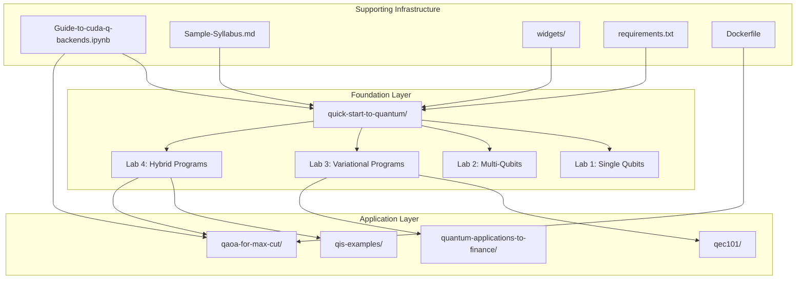
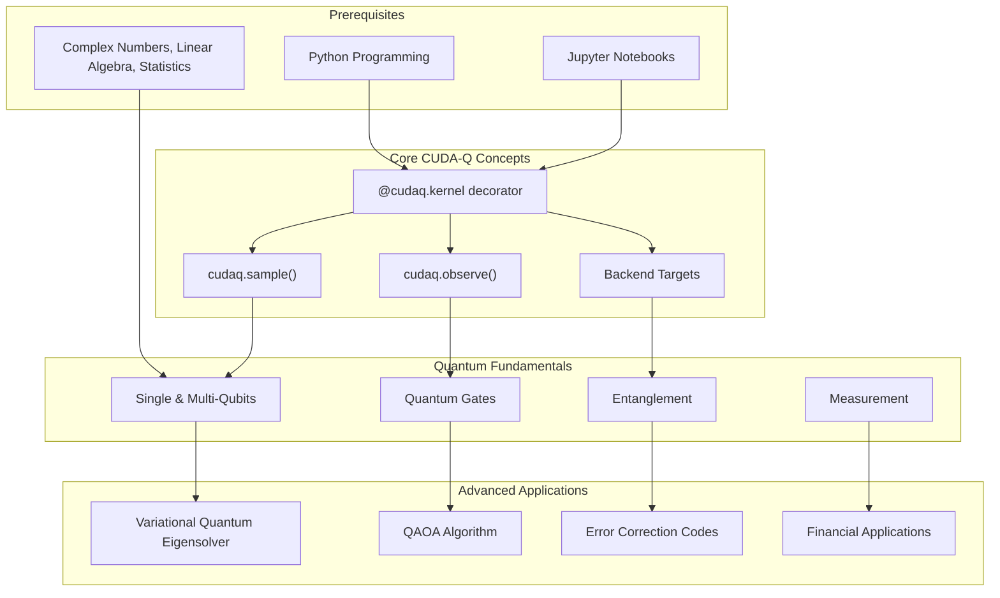
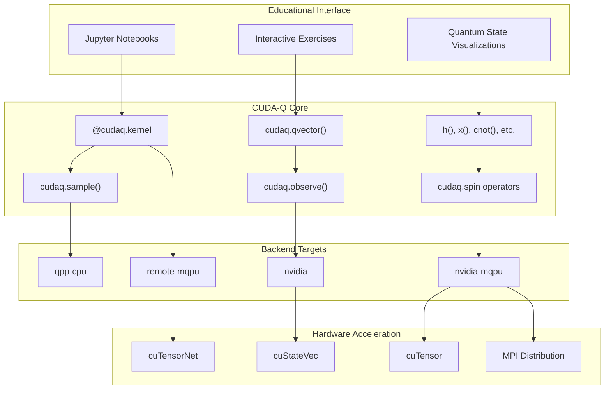
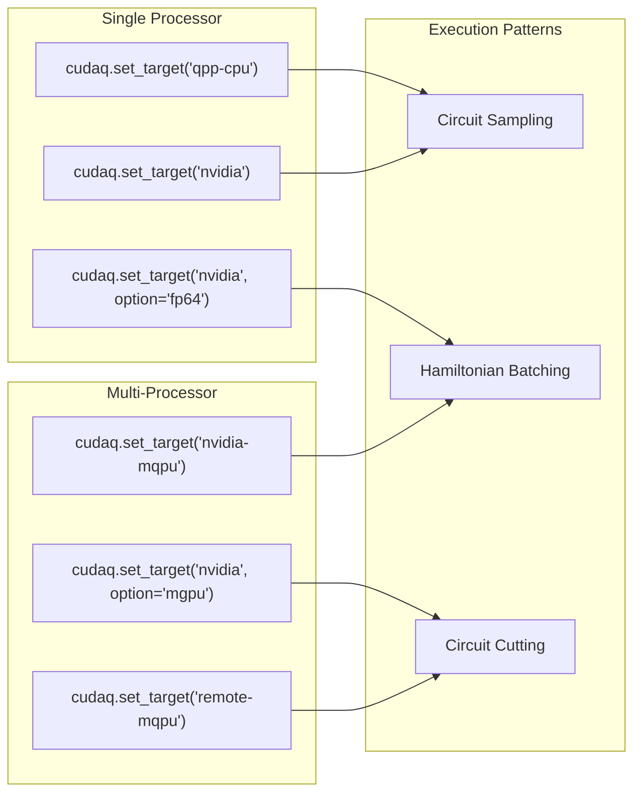
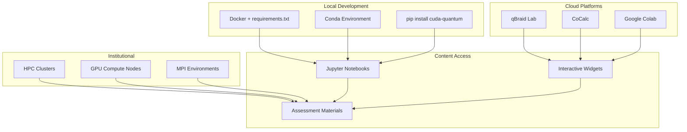
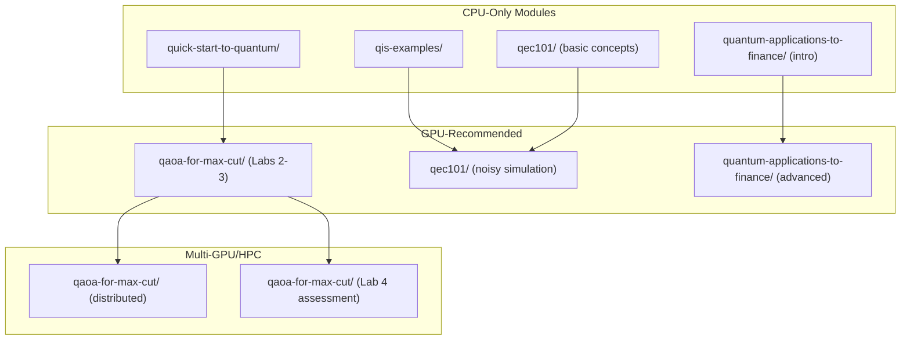
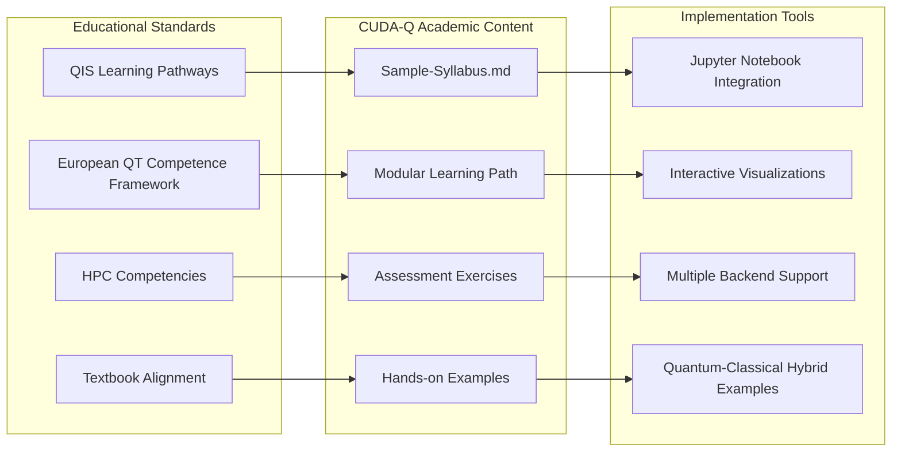

<!-- source: DeepWiki mcp.deepwiki.com · repo NVIDIA/cuda-q-academic · page 1 Overview · fetched 2026-10-26 -->

# Overview

Relevant source files

The following files were used as context for generating this wiki page:

- [Guide-to-cuda-q-backends.ipynb](Guide-to-cuda-q-backends.ipynb)
- [README.md](README.md)
- [Sample-Syllabus.md](Sample-Syllabus.md)
- [qaoa-for-max-cut/00_StartHere.ipynb](qaoa-for-max-cut/00_StartHere.ipynb)

This document provides a comprehensive overview of the CUDA-Q Academic repository, which serves as NVIDIA's educational platform for quantum computing training. The repository contains interactive Jupyter notebooks and supporting materials designed to prepare quantum computing professionals by combining high-performance computing with quantum computing skills, developed in collaboration with universities and tested in real classroom settings.

For specific implementation details of individual modules, see [Quick Start to Quantum Computing](#2), [Quantum Algorithms](#3), [QAOA](#4), [Quantum Error Correction](#5), and [Quantum Applications to Finance](#6). For technical documentation of the underlying CUDA-Q framework, see [CUDA-Q Programming Framework](#7).

## Repository Architecture

CUDA-Q Academic follows a modular educational architecture with clear progression paths and technical infrastructure supporting multiple deployment options.

### Educational Module Structure

Sources: [README.md:1-51](), [Sample-Syllabus.md:1-67]()

### Learning Progression Flow

Sources: [README.md:20-21](), [README.md:26-28](), [README.md:35-37](), [README.md:49-50]()

## Technical Framework Integration

The repository leverages the CUDA-Q programming model to provide a unified interface from educational concepts to high-performance quantum computing backends.

### CUDA-Q Programming Model

Sources: [Guide-to-cuda-q-backends.ipynb:88-129](), [Guide-to-cuda-q-backends.ipynb:200-235]()

## Core Educational Modules

### Module Classification by Complexity

| Module | Prerequisites | Hardware Requirements | Key CUDA-Q Features |
|--------|--------------|----------------------|-------------------|
| `quick-start-to-quantum/` | Python, Math basics | CPU | `@cudaq.kernel`, `cudaq.sample()` |
| `qis-examples/` | Quick Start completion | CPU | `cudaq.observe()`, Hamiltonian construction |
| `qaoa-for-max-cut/` | Quick Start, NetworkX | GPU recommended | `cudaq.vqe()`, optimization |
| `qec101/` | Quick Start completion | CPU | Noise models, error mitigation |
| `quantum-applications-to-finance/` | Quick Start completion | CPU | Quantum walks, financial modeling |

Sources: [README.md:17-51](), [qaoa-for-max-cut/00_StartHere.ipynb:60-62]()

### Backend Configuration Options

Sources: [Guide-to-cuda-q-backends.ipynb:242-257](), [Guide-to-cuda-q-backends.ipynb:328-370]()

## Deployment Architecture

The repository supports multiple deployment strategies to accommodate different educational environments and resource constraints.

### Platform Integration Options

Sources: [README.md:6-7](), [qaoa-for-max-cut/00_StartHere.ipynb:85-87](), [qaoa-for-max-cut/00_StartHere.ipynb:134-135]()

### Resource Requirements by Module

Sources: [qaoa-for-max-cut/00_StartHere.ipynb:124-135](), [README.md:31-51]()

## Educational Standards Alignment

CUDA-Q Academic aligns with established quantum computing educational frameworks and competency standards.

### Curriculum Integration Framework

Sources: [Sample-Syllabus.md:14-18](), [Sample-Syllabus.md:21-67]()

This overview establishes the foundation for understanding CUDA-Q Academic's role as a comprehensive quantum computing education platform. For detailed information about specific modules and their implementations, refer to the respective sections listed at the beginning of this document.

---

