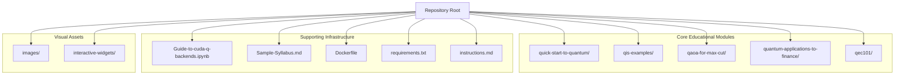
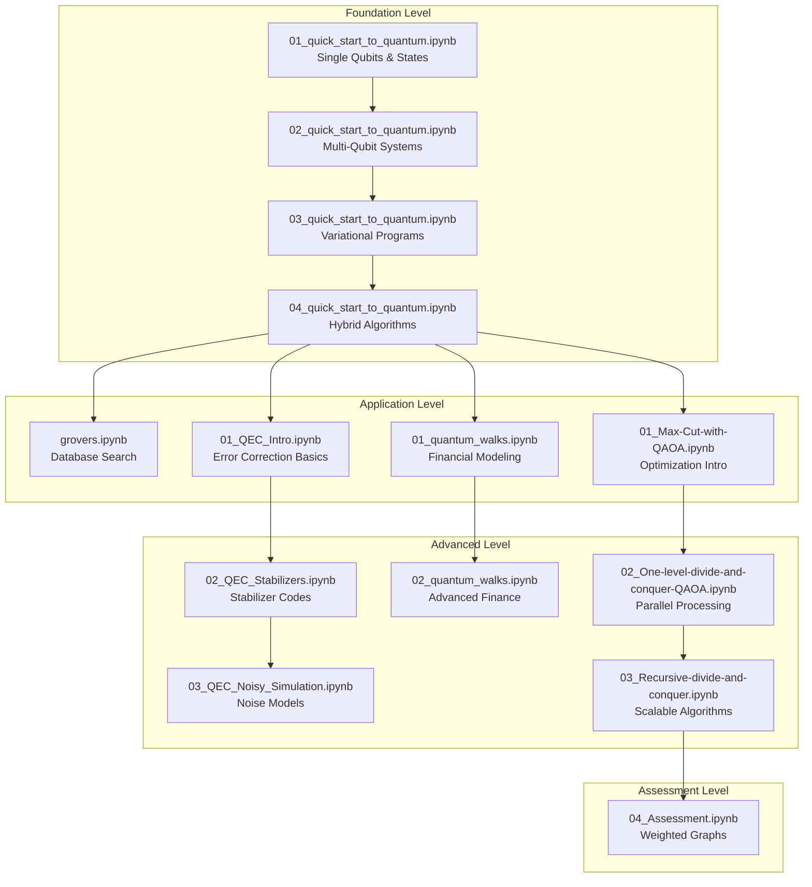
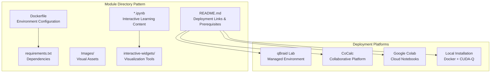
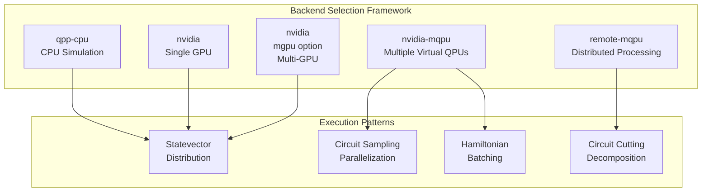

<!-- source: DeepWiki mcp.deepwiki.com · repo NVIDIA/cuda-q-academic · page 1.1 Repository Structure · fetched 2026-10-26 -->

# Repository Structure

Relevant source files

The following files were used as context for generating this wiki page:

- [Guide-to-cuda-q-backends.ipynb](Guide-to-cuda-q-backends.ipynb)
- [README.md](README.md)
- [qaoa-for-max-cut/00_StartHere.ipynb](qaoa-for-max-cut/00_StartHere.ipynb)
- [qaoa-for-max-cut/README.md](qaoa-for-max-cut/README.md)
- [qec101/README.md](qec101/README.md)
- [qis-examples/README.md](qis-examples/README.md)
- [quantum-applications-to-finance/README.md](quantum-applications-to-finance/README.md)
- [quick-start-to-quantum/README.md](quick-start-to-quantum/README.md)

This document provides an overview of the main educational modules and their organizational structure within the CUDA-Q Academic repository, showing the learning pathway from basic quantum computing concepts to advanced applications.

For information about installation and environment setup, see [Installation and Setup](#1.2). For detailed programming framework documentation, see [CUDA-Q Programming Framework](#7).

## Purpose and Scope

The repository is organized into five main educational modules that form a comprehensive quantum computing curriculum using CUDA-Q. Each module contains Jupyter notebooks, supporting materials, and deployment configurations designed for different learning objectives and technical prerequisites.

## Overall Repository Organization

The repository follows a modular structure where each educational topic forms a self-contained learning unit with its own prerequisites, objectives, and supporting materials.

**Repository Structure Overview**

Sources: [README.md:1-51]()

## Learning Progression and Dependencies

The modules are designed with a clear prerequisite structure that guides learners from foundational concepts through specialized applications.

**Learning Path Dependencies**

Sources: [README.md:17-51](), [quick-start-to-quantum/README.md:1-36](), [qec101/README.md:1-35](), [qaoa-for-max-cut/README.md:1-25](), [quantum-applications-to-finance/README.md:1-25]()

## Module Internal Structure

Each educational module follows a consistent organizational pattern with notebooks, supporting materials, and deployment configurations.

**Standard Module Organization**

Sources: [quick-start-to-quantum/README.md:18-36](), [qec101/README.md:17-35](), [qaoa-for-max-cut/README.md:3-25]()

## Educational Module Details

### Quick Start to Quantum Computing (`quick-start-to-quantum/`)

The foundational module containing four progressive laboratories that introduce quantum computing concepts and CUDA-Q programming.

| Notebook | Focus | Technical Requirements |
|----------|-------|----------------------|
| `01_quick_start_to_quantum.ipynb` | Single qubits, quantum states, basic gates | CPU simulation |
| `02_quick_start_to_quantum.ipynb` | Multi-qubit systems, entanglement | CPU simulation |
| `03_quick_start_to_quantum.ipynb` | Parameterized circuits, variational methods | CPU simulation |
| `04_quick_start_to_quantum.ipynb` | Hybrid quantum-classical optimization | CPU simulation |

**Prerequisites**: Python programming, complex numbers, linear algebra, statistics
**Learning Objectives**: CUDA-Q kernel programming, quantum state manipulation, variational algorithms

Sources: [README.md:17-22](), [quick-start-to-quantum/README.md:1-36]()

### Quantum Information Science Examples (`qis-examples/`)

Complementary implementations of fundamental quantum algorithms for academic courses.

- `grovers.ipynb` - Database search algorithm implementation
- Designed to complement textbooks rather than standalone learning
- Requires completion of Quick Start module

Sources: [README.md:23-29](), [qis-examples/README.md:1-25]()

### QAOA for Max Cut (`qaoa-for-max-cut/`)

Advanced optimization module implementing divide-and-conquer strategies for large-scale problems.

| Notebook | Content | GPU Requirements |
|----------|---------|------------------|
| `00_StartHere.ipynb` | Introduction and setup | None |
| `01_Max-Cut-with-QAOA.ipynb` | Basic QAOA implementation | CPU only |
| `02_One-level-divide-and-conquer-QAOA.ipynb` | Parallel processing introduction | GPU required for final section |
| `03_Recursive-divide-and-conquer.ipynb` | Scalable recursive algorithms | GPU required |
| `04_Assessment.ipynb` | Weighted graph problems | GPU required |

**Prerequisites**: NetworkX package familiarity, Quick Start completion or equivalent VQE/QAOA experience

Sources: [README.md:31-38](), [qaoa-for-max-cut/README.md:1-25](), [qaoa-for-max-cut/00_StartHere.ipynb:44-64]()

### Quantum Error Correction (`qec101/`)

Comprehensive error correction curriculum from basic concepts to advanced stabilizer codes.

| Laboratory | Focus | Implementation |
|------------|-------|----------------|
| `01_QEC_Intro.ipynb` | Classical and quantum error correction fundamentals | Basic theory |
| `02_QEC_Stabilizers.ipynb` | Shor code, Steane code implementations | Stabilizer formalism |
| `03_QEC_Noisy_Simulation.ipynb` | Noise models and error mitigation | Realistic simulations |
| `04_Magic_State_Distillation.ipynb` | Fault-tolerant state preparation | Coming soon |

**Prerequisites**: CUDA-Q programming, quantum circuits, measurement concepts

Sources: [README.md:46-51](), [qec101/README.md:1-35]()

### Quantum Applications to Finance (`quantum-applications-to-finance/`)

Financial modeling applications using quantum walks and optimization algorithms.

- `01_quantum_walks.ipynb` - Discrete-time quantum walks (DTQW) foundations
- `02_quantum_walks.ipynb` - Multi-state quantum walks (mSSQW) for finance
- `Portfolio_Optimization.ipynb` - Investment optimization (coming soon)

**Prerequisites**: CUDA-Q programming, quantum computing fundamentals from Quick Start

Sources: [README.md:40-44](), [quantum-applications-to-finance/README.md:1-25]()

## Supporting Infrastructure

### Backend Configuration System

The `Guide-to-cuda-q-backends.ipynb` provides comprehensive backend selection and configuration guidance.

**Backend Architecture Overview**

Sources: [Guide-to-cuda-q-backends.ipynb:241-370]()

### Deployment Configurations

Each module includes standardized deployment options through README.md tables linking to external platforms.

**Platform Integration Pattern**:
- qBraid Lab with Environment Manager and Compute Manager
- CoCalc with project-based execution
- Google Colab with `pip install cudaq` requirement
- Local installation via Docker and requirements.txt

Sources: [quick-start-to-quantum/README.md:23-36](), [qec101/README.md:20-35]()

### Visual Assets and Interactive Components

- `images/` directory containing educational diagrams and animations
- `interactive-widgets/` directory with Bloch sphere and circuit visualization tools
- Module-specific Images/ subdirectories for specialized content

Sources: [quick-start-to-quantum/README.md:19-20](), [qec101/README.md:34]()

---

