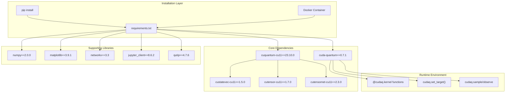
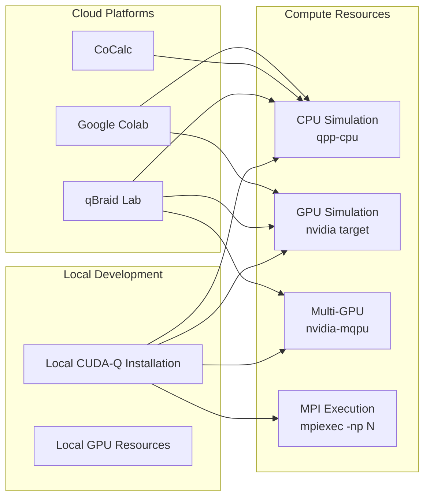
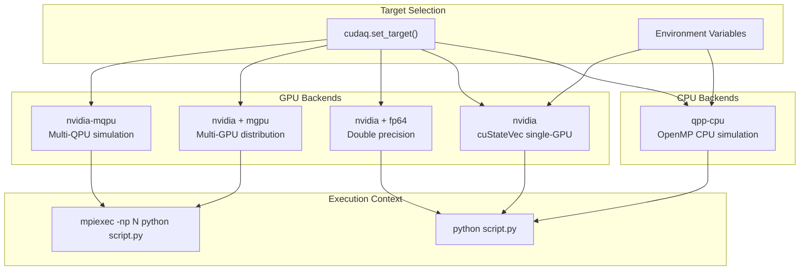
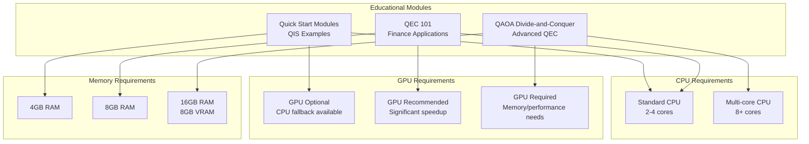

<!-- source: DeepWiki mcp.deepwiki.com · repo NVIDIA/cuda-q-academic · page 1.2 Installation and Setup · fetched 2026-10-26 -->

# Installation and Setup

<details>
<summary>Relevant source files</summary>

The following files were used as context for generating this wiki page:

- [Guide-to-cuda-q-backends.ipynb](Guide-to-cuda-q-backends.ipynb)
- [README.md](README.md)
- [qaoa-for-max-cut/00_StartHere.ipynb](qaoa-for-max-cut/00_StartHere.ipynb)
- [requirements.txt](requirements.txt)

</details>


This document covers the installation, configuration, and deployment of CUDA-Q Academic educational modules. It provides technical guidance for setting up the quantum computing development environment, configuring backends, and deploying across different platforms.

For information about the educational content structure, see [Repository Structure](#1.1). For backend-specific programming techniques, see [CUDA-Q Programming Framework](#7).

## Installation Methods

CUDA-Q Academic supports multiple installation approaches depending on your deployment requirements and available infrastructure.

### Local Installation

The primary installation method uses Python package management with the core dependencies specified in [requirements.txt:1-73](). The essential components include:

| Component | Version | Purpose |
|-----------|---------|---------|
| `cuda-quantum` | 0.7.1 | Core CUDA-Q framework |
| `cuquantum-cu11` | 23.10.0 | NVIDIA cuQuantum library suite |
| `custatevec-cu11` | 1.5.0 | State vector simulation |
| `cutensor-cu11` | 1.7.0 | Tensor operations |
| `cutensornet-cu11` | 2.3.0 | Tensor network simulation |

```bash
pip install -r requirements.txt
```

**Installation Architecture**



**Sources:** [requirements.txt:1-73](), [qaoa-for-max-cut/00_StartHere.ipynb:85-87]()

### Container-Based Installation

Docker containers provide isolated environments with pre-configured dependencies. Each educational module includes Dockerfile specifications for containerized deployment.

```bash
docker build -t cuda-q-academic .
docker run -it --gpus all cuda-q-academic
```

**Sources:** [qaoa-for-max-cut/00_StartHere.ipynb:85-87]()

## Cloud Platform Deployment

CUDA-Q Academic modules support execution on multiple cloud platforms without local installation requirements.

### Platform Options

| Platform | Access Method | GPU Support | MPI Support |
|----------|---------------|-------------|-------------|
| qBraid Lab | Direct notebook import | Yes (with credits) | Yes |
| CoCalc | Project-based deployment | Limited | No |
| Google Colab | Notebook upload | Yes (with credits) | Limited |

**Platform Integration Architecture**



**Sources:** [README.md:6](), [qaoa-for-max-cut/00_StartHere.ipynb:134-135]()

## Backend Configuration

CUDA-Q supports multiple simulation backends configured through the `cudaq.set_target()` function and environment variables.

### Target Backend Selection

```python
# CPU-only simulation
cudaq.set_target("qpp-cpu")

# Single GPU simulation (default precision)
cudaq.set_target("nvidia")

# Double precision GPU simulation
cudaq.set_target("nvidia", option="fp64")

# Multi-GPU simulation
cudaq.set_target("nvidia", option="mgpu,fp64")

# Multi-QPU simulation
cudaq.set_target("nvidia-mqpu")
```

**Backend Configuration Mapping**



**Sources:** [Guide-to-cuda-q-backends.ipynb:92-93](), [Guide-to-cuda-q-backends.ipynb:250-254](), [Guide-to-cuda-q-backends.ipynb:337-340]()

### Environment Variables

| Variable | Purpose | Default | Example |
|----------|---------|---------|---------|
| `CUDAQ_DEFAULT_SIMULATOR` | Override default simulator | `nvidia` or `qpp-cpu` | `export CUDAQ_DEFAULT_SIMULATOR=tensornet` |
| `CUDAQ_MGPU_NQUBITS_THRESH` | Multi-GPU threshold | 25 | `export CUDAQ_MGPU_NQUBITS_THRESH=20` |

**Sources:** [Guide-to-cuda-q-backends.ipynb:280-281](), [Guide-to-cuda-q-backends.ipynb:810-811]()

## Hardware Requirements

Different educational modules have varying computational requirements based on their complexity and simulation scale.

### Computational Requirements by Module

| Module | CPU Requirements | GPU Requirements | Memory Requirements |
|--------|------------------|------------------|-------------------|
| Quick Start to Quantum | Standard CPU | Optional | 4GB RAM |
| QIS Examples | Standard CPU | Optional | 4GB RAM |
| QEC 101 | Standard CPU | Recommended | 8GB RAM |
| QAOA Basic | Standard CPU | Optional | 8GB RAM |
| QAOA Divide-and-Conquer | Multi-core CPU | Required | 16GB RAM + 8GB VRAM |
| Finance Applications | Standard CPU | Recommended | 8GB RAM |

**Hardware Architecture Requirements**



**Sources:** [qaoa-for-max-cut/00_StartHere.ipynb:134-135](), [README.md:20](), [README.md:35-37]()

### MPI and Parallel Execution

Advanced modules requiring parallel execution use MPI for distributed computing across multiple GPUs or compute nodes.

```bash
# Multi-GPU execution
mpiexec -np 4 python qaoa_distributed.py

# Override subscription limits for testing
mpiexec -np 4 --oversubscribe --allow-run-as-root python script.py
```

**Sources:** [Guide-to-cuda-q-backends.ipynb:254](), [Guide-to-cuda-q-backends.ipynb:787-788]()

## Verification and Testing

After installation, verify the environment using the provided test kernels and backend selection examples.

### Basic Verification

```python
import cudaq
from cudaq import spin

# Test kernel definition
@cudaq.kernel
def test_kernel():
    qubit = cudaq.qubit()
    h(qubit)
    mz(qubit)

# Test backend selection
cudaq.set_target("qpp-cpu")
result = cudaq.sample(test_kernel, shots_count=1000)
print(result)
```

### Backend Availability Check

```python
# Check available targets
target = cudaq.get_target()
print(f"Current target: {target}")

# For multi-QPU targets
if hasattr(target, 'num_qpus'):
    print(f"Number of QPUs: {target.num_qpus()}")
```

**Sources:** [Guide-to-cuda-q-backends.ipynb:88-129](), [Guide-to-cuda-q-backends.ipynb:337-341]()

---

