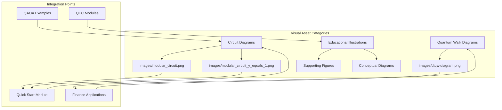
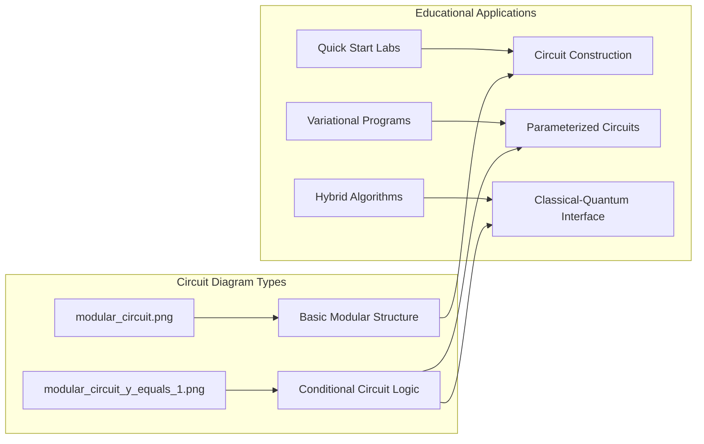
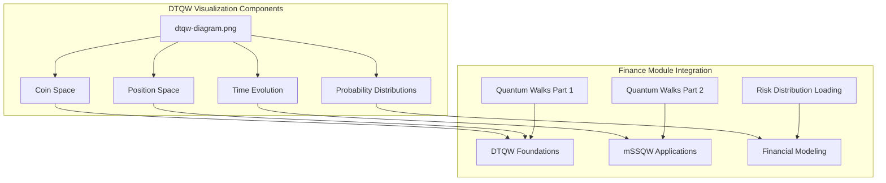
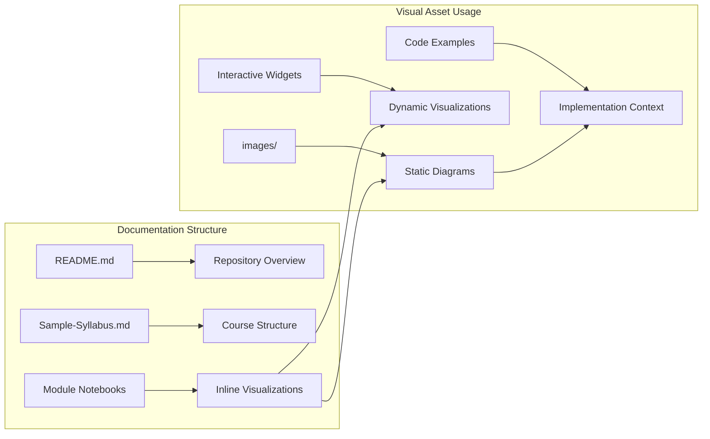
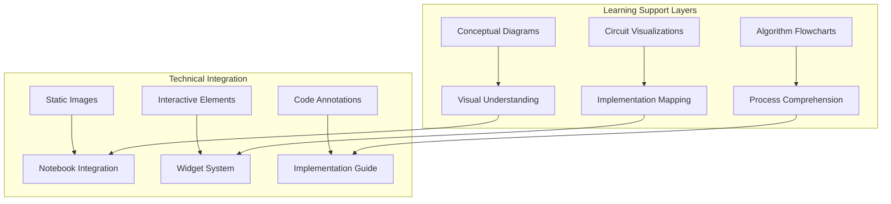

<!-- source: DeepWiki mcp.deepwiki.com · repo NVIDIA/cuda-q-academic · page 10 Visual Assets and Documentation · fetched 2026-10-26 -->

# Visual Assets and Documentation

Relevant source files

The following files were used as context for generating this wiki page:

- [images/bell0.png](images/bell0.png)
- [images/bell1.png](images/bell1.png)
- [images/dtqw-diagram.png](images/dtqw-diagram.png)
- [images/modular_circuit.png](images/modular_circuit.png)
- [images/modular_circuit_y_equals_1.png](images/modular_circuit_y_equals_1.png)

This document covers the visual materials, diagrams, and documentation assets used throughout the CUDA-Q Academic educational modules to enhance quantum computing education and provide clear visual representations of complex quantum concepts.

The visual assets serve as essential learning aids that bridge theoretical quantum concepts with their practical implementations in CUDA-Q. For information about the interactive visualization tools and widgets, see [Interactive Visualization Tools](#2.1). For details about the overall educational framework and curriculum integration, see [Educational Integration](#8).

## Asset Organization and Structure

The visual assets in CUDA-Q Academic are organized in a centralized `images/` directory that contains diagrams, circuit visualizations, and educational illustrations used across multiple modules.

**Asset Distribution by Module**

| Asset Type | Primary Module | File Examples | Purpose |
|------------|---------------|---------------|---------|
| Circuit Diagrams | Quick Start to Quantum | `modular_circuit.png` | Illustrate quantum circuit construction |
| DTQW Diagrams | Quantum Finance | `dtqw-diagram.png` | Visualize discrete-time quantum walks |
| Modular Circuits | Variational Algorithms | `modular_circuit_y_equals_1.png` | Show conditional circuit execution |

Sources: [images/modular_circuit.png:1-100](), [images/dtqw-diagram.png:1-100](), [images/modular_circuit_y_equals_1.png:1-100]()

## Circuit Visualization Assets

The circuit diagrams provide visual representations of quantum circuits used in educational examples, particularly in the foundational modules and variational algorithm implementations.

### Modular Circuit Representations

The modular circuit diagrams illustrate key concepts in quantum circuit design and implementation:

- **Base Circuit Structure**: Shows fundamental quantum gate arrangements and qubit connectivity
- **Conditional Execution**: Demonstrates how classical control variables influence quantum circuit behavior  
- **Parameterization**: Illustrates how circuit parameters are integrated into the quantum program flow

These visualizations directly support the `@cudaq.kernel` programming model by showing how quantum circuits map to CUDA-Q code structures.

Sources: [images/modular_circuit.png:1-100](), [images/modular_circuit_y_equals_1.png:1-100]()

## Quantum Walk Diagrams

The discrete-time quantum walk (DTQW) diagrams provide essential visual context for understanding quantum finance applications and quantum walk algorithms.

### DTQW Educational Context

The quantum walk diagrams serve multiple educational purposes:

1. **Conceptual Foundation**: Illustrate the mathematical structure of discrete-time quantum walks
2. **Algorithm Visualization**: Show how quantum walks evolve over time steps
3. **Finance Applications**: Demonstrate practical applications in risk modeling and portfolio optimization

The diagrams complement the quantum finance module implementations and provide visual context for understanding the quantum walk algorithms used in financial applications.

Sources: [images/dtqw-diagram.png:1-100]()

## Documentation Integration Framework

The visual assets are integrated throughout the educational modules to support different learning objectives and technical concepts.

### Asset-Code Relationship Mapping

The visual assets maintain close relationships with the corresponding code implementations:

| Visual Asset | Related Code Entities | Educational Context |
|-------------|---------------------|-------------------|
| `modular_circuit.png` | `@cudaq.kernel` decorators, quantum gates | Circuit construction patterns |
| `modular_circuit_y_equals_1.png` | Conditional execution, parameter passing | Hybrid algorithm design |
| `dtqw-diagram.png` | Quantum walk implementations, probability amplitudes | Financial modeling algorithms |

Sources: [images/modular_circuit.png:1-100](), [images/dtqw-diagram.png:1-100](), [images/modular_circuit_y_equals_1.png:1-100]()

## Educational Enhancement Strategy

The visual documentation serves as a bridge between abstract quantum concepts and concrete CUDA-Q implementations, supporting multiple learning modalities and technical backgrounds.

The visual assets complement the interactive widget system and provide persistent reference materials that enhance the overall educational experience across different deployment platforms and learning environments.

Sources: [images/modular_circuit.png:1-100](), [images/dtqw-diagram.png:1-100](), [images/modular_circuit_y_equals_1.png:1-100]()