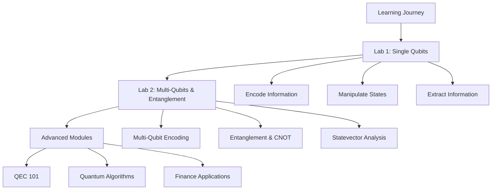
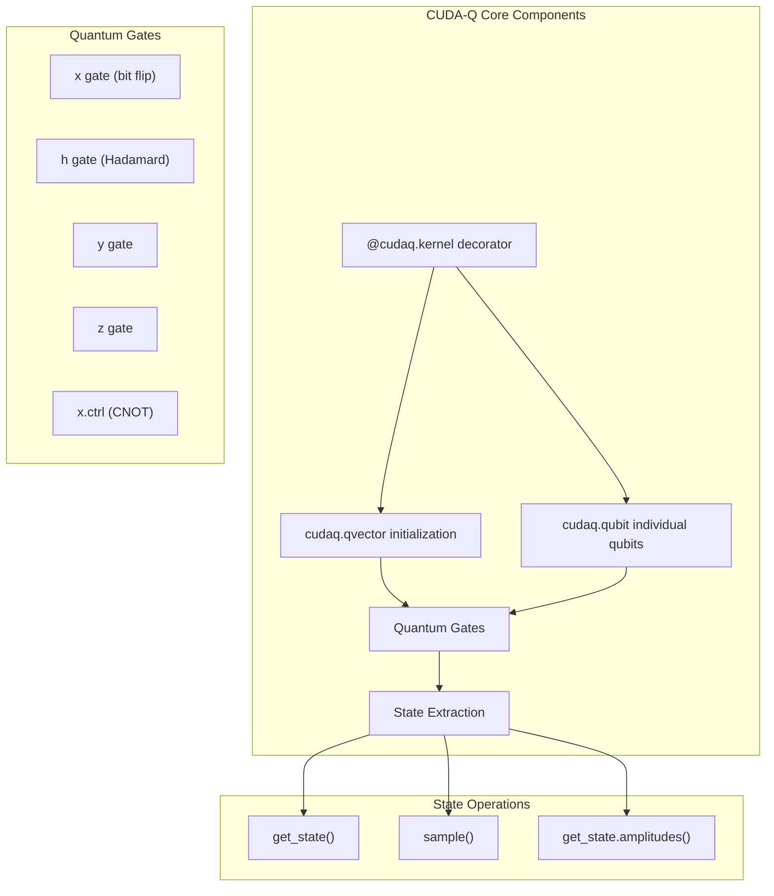
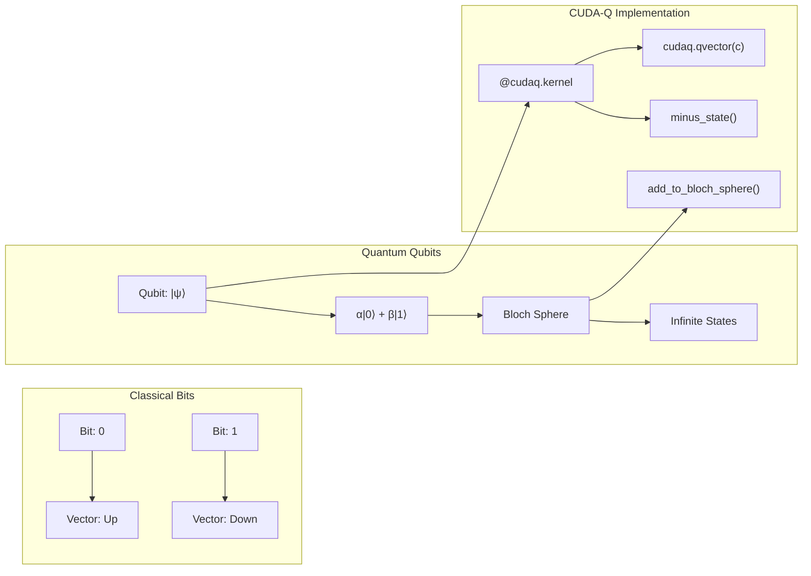
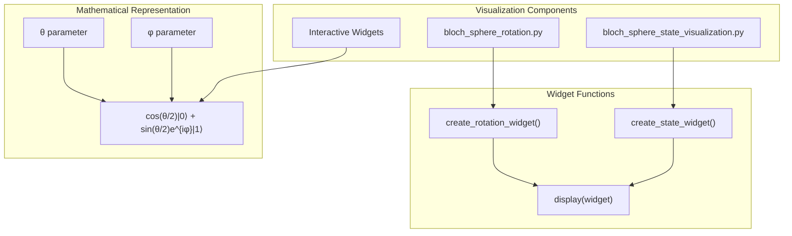
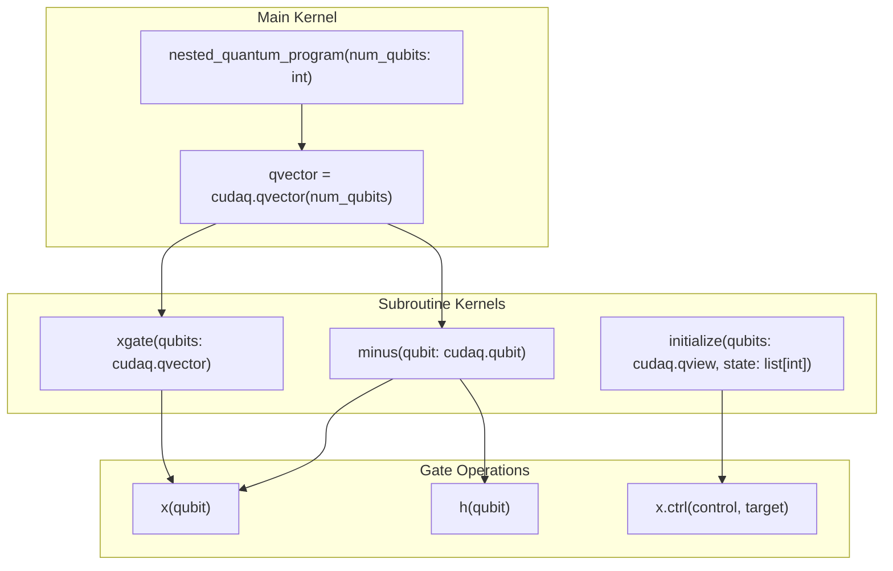
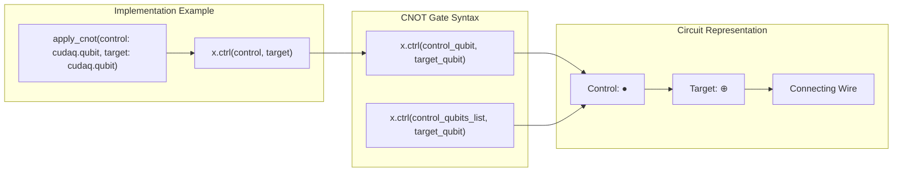
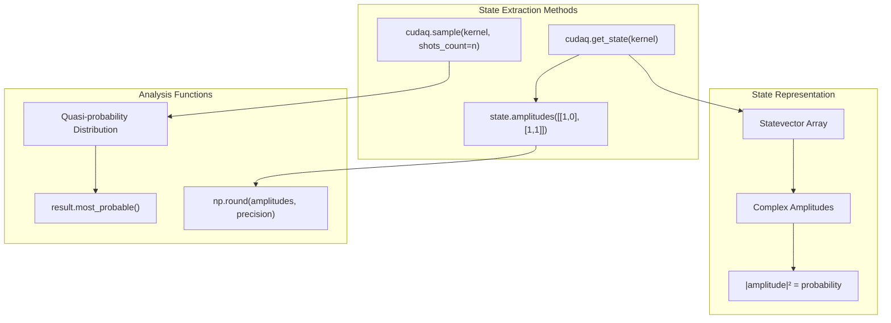
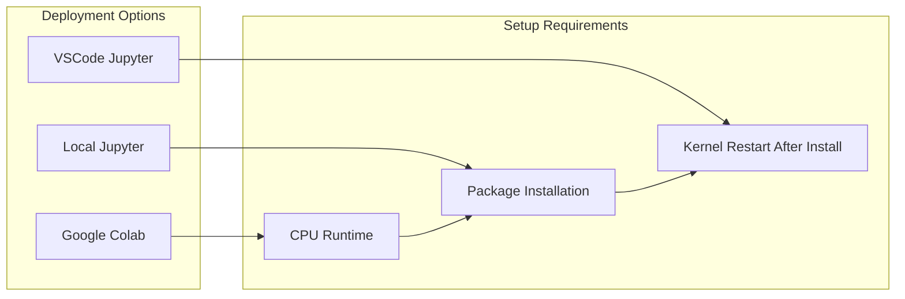

<!-- source: DeepWiki mcp.deepwiki.com · repo NVIDIA/cuda-q-academic · page 2 Quick Start to Quantum Computing · fetched 2026-10-26 -->

# Quick Start to Quantum Computing

Relevant source files

The following files were used as context for generating this wiki page:

- [qec101/01_QEC_Intro.ipynb](qec101/01_QEC_Intro.ipynb)
- [quick-start-to-quantum/01_quick_start_to_quantum.ipynb](quick-start-to-quantum/01_quick_start_to_quantum.ipynb)
- [quick-start-to-quantum/02_quick_start_to_quantum.ipynb](quick-start-to-quantum/02_quick_start_to_quantum.ipynb)

## Purpose and Scope

This document covers the foundational quantum computing module within CUDA-Q Academic, designed to introduce learners to quantum programming concepts using NVIDIA's CUDA-Q platform. The module provides hands-on experience with quantum circuits, single and multi-qubit operations, and the CUDA-Q programming framework through interactive Jupyter notebooks.

For quantum error correction concepts, see [Quantum Error Correction](#5). For advanced quantum algorithms, see [Quantum Algorithms](#3) and [QAOA](#4). For quantum applications in finance, see [Quantum Applications to Finance](#6).

## Module Structure and Learning Progression

The Quick Start module follows a structured three-step quantum programming template across two comprehensive labs:

**Diagram: Quick Start Module Learning Progression**

Sources: [quick-start-to-quantum/01_quick_start_to_quantum.ipynb:40-68](), [quick-start-to-quantum/02_quick_start_to_quantum.ipynb:40-80]()

## CUDA-Q Programming Framework

### Core Programming Constructs

The module introduces essential CUDA-Q programming patterns through practical implementation:

**Diagram: CUDA-Q Programming Framework Architecture**

Sources: [quick-start-to-quantum/01_quick_start_to_quantum.ipynb:60-67](), [quick-start-to-quantum/02_quick_start_to_quantum.ipynb:74-79]()

### Kernel Definition and Usage

The foundational programming pattern uses the `@cudaq.kernel` decorator:

| Component | Syntax | Purpose |
|-----------|--------|---------|
| Kernel Declaration | `@cudaq.kernel` | Defines quantum program entry point |
| Qubit Allocation | `cudaq.qvector(n)` | Creates n-qubit register |
| Single Qubit | `cudaq.qubit` | Individual qubit parameter |
| Gate Application | `x(qubit)`, `h(qubit)` | Applies quantum operations |
| State Extraction | `cudaq.get_state(kernel)` | Retrieves quantum state |
| Measurement | `cudaq.sample(kernel, shots_count=n)` | Performs measurements |

Sources: [quick-start-to-quantum/01_quick_start_to_quantum.ipynb:324-327](), [quick-start-to-quantum/02_quick_start_to_quantum.ipynb:263-281]()

## Lab 1: Single Qubit Operations

### Quantum State Representation

Lab 1 establishes the fundamental concepts of quantum state representation using the Bloch sphere visualization and mathematical notation:

**Diagram: Classical vs Quantum State Representation in CUDA-Q**

Sources: [quick-start-to-quantum/01_quick_start_to_quantum.ipynb:163-198](), [quick-start-to-quantum/01_quick_start_to_quantum.ipynb:315-327]()

### Interactive Visualization System

The module incorporates interactive widgets for enhanced learning:

**Diagram: Interactive Visualization System Architecture**

Sources: [quick-start-to-quantum/01_quick_start_to_quantum.ipynb:210-217](), [quick-start-to-quantum/01_quick_start_to_quantum.ipynb:257-265]()

## Lab 2: Multi-Qubit Systems and Entanglement

### Computational Basis States

Lab 2 introduces multi-qubit systems using computational basis state notation:

| System Size | Basis States | Notation | CUDA-Q Implementation |
|-------------|-------------|----------|----------------------|
| 1 qubit | 2 states | \|0⟩, \|1⟩ | `cudaq.qvector(1)` |
| 2 qubits | 4 states | \|00⟩, \|01⟩, \|10⟩, \|11⟩ | `cudaq.qvector(2)` |
| n qubits | 2^n states | \|b_{n-1}...b_1b_0⟩ | `cudaq.qvector(n)` |

Sources: [quick-start-to-quantum/02_quick_start_to_quantum.ipynb:163-182]()

### Kernel Composition and Subroutines

The module demonstrates advanced programming patterns using kernel composition:

**Diagram: Kernel Composition Architecture**

Sources: [quick-start-to-quantum/02_quick_start_to_quantum.ipynb:396-441](), [quick-start-to-quantum/02_quick_start_to_quantum.ipynb:709-731]()

### CNOT Gate Implementation

Multi-qubit entangling operations use the controlled-X (CNOT) gate:

**Diagram: CNOT Gate Implementation and Syntax**

Sources: [quick-start-to-quantum/02_quick_start_to_quantum.ipynb:680-713](), [quick-start-to-quantum/02_quick_start_to_quantum.ipynb:709-737]()

## State Extraction and Analysis

### Statevector Operations

The module provides comprehensive state analysis capabilities:

**Diagram: State Extraction and Analysis Framework**

Sources: [quick-start-to-quantum/01_quick_start_to_quantum.ipynb:312-322](), [quick-start-to-quantum/02_quick_start_to_quantum.ipynb:294-322]()

## Installation and Environment Setup

### Required Dependencies

The module requires several Python packages for full functionality:

| Package | Purpose | Installation |
|---------|---------|--------------|
| `cudaq` | CUDA-Q quantum programming | `pip install cudaq` |
| `qutip` | Quantum toolbox utilities | `pip install qutip>=5` |
| `ipywidgets` | Interactive notebook widgets | `pip install ipywidgets` |
| `matplotlib` | Plotting and visualization | `pip install matplotlib>=3.5` |
| `numpy` | Numerical computing | Standard with most Python distributions |

Sources: [quick-start-to-quantum/01_quick_start_to_quantum.ipynb:99-119](), [quick-start-to-quantum/02_quick_start_to_quantum.ipynb:107-113]()

### Platform Compatibility

The notebooks support multiple deployment platforms:

**Diagram: Platform Deployment Options**

Sources: [quick-start-to-quantum/01_quick_start_to_quantum.ipynb:86-90](), [quick-start-to-quantum/02_quick_start_to_quantum.ipynb:107-114]()

## Key Learning Outcomes

### Terminology and Concepts

Students completing this module will understand:

- **Quantum State**: Superposition of computational basis states
- **Probability Amplitudes**: Complex coefficients in quantum states  
- **Measurement**: Probabilistic collapse to classical outcomes
- **Entanglement**: Non-separable multi-qubit correlations
- **Kernel**: CUDA-Q quantum program definition
- **Statevector**: Complete quantum state representation

### Programming Competencies

- Defining quantum programs using `@cudaq.kernel`
- Implementing single and multi-qubit operations
- Creating reusable quantum subroutines
- Extracting and analyzing quantum states
- Using interactive visualization tools
- Understanding circuit diagram representations

Sources: [quick-start-to-quantum/01_quick_start_to_quantum.ipynb:49-67](), [quick-start-to-quantum/02_quick_start_to_quantum.ipynb:64-79]()

## Integration with Advanced Topics

The Quick Start module serves as the foundation for more specialized quantum computing topics covered in other CUDA-Q Academic modules, providing essential programming skills and conceptual understanding required for quantum algorithms, error correction, and domain-specific applications.

Sources: [quick-start-to-quantum/01_quick_start_to_quantum.ipynb:1-68](), [quick-start-to-quantum/02_quick_start_to_quantum.ipynb:1-133]()

---

