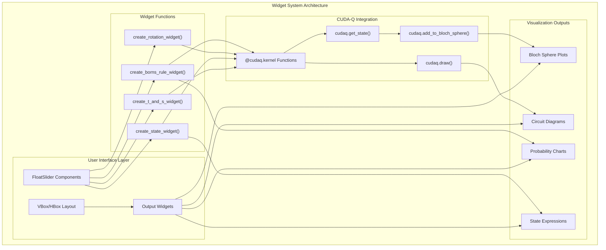
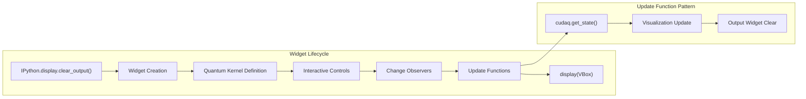
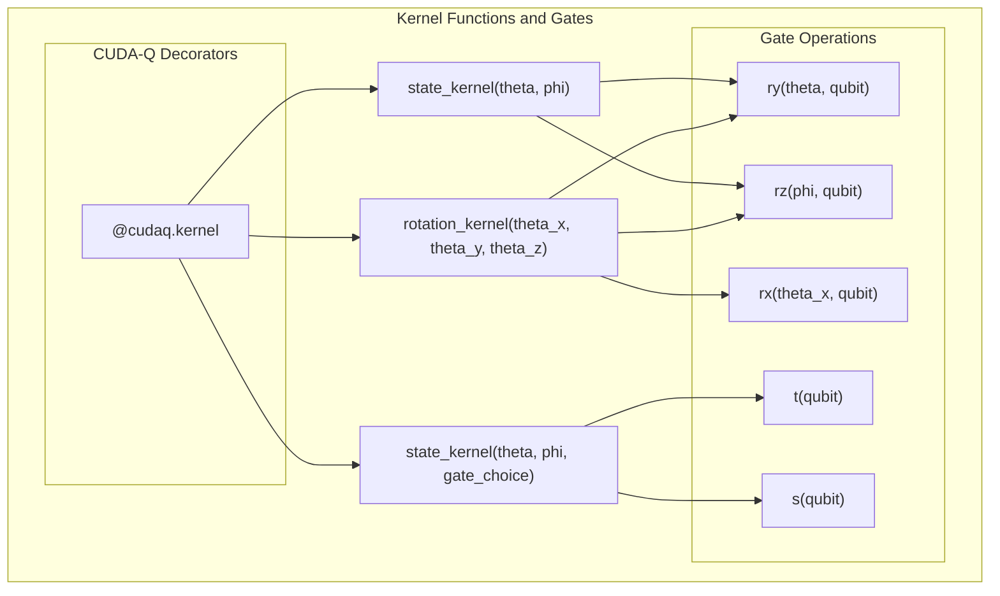
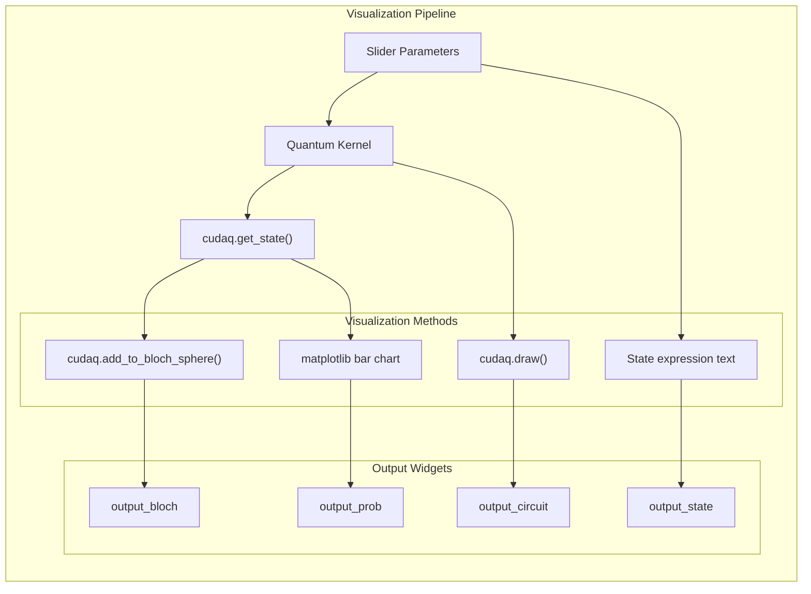
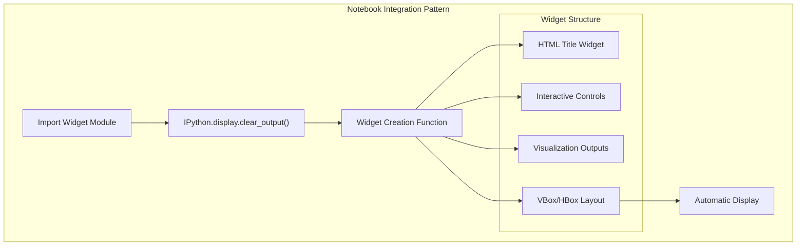

<!-- source: DeepWiki mcp.deepwiki.com · repo NVIDIA/cuda-q-academic · page 2.1 Interactive Visualization Tools · fetched 2026-10-26 -->

# Interactive Visualization Tools

Relevant source files

The following files were used as context for generating this wiki page:

- [quick-start-to-quantum/interactive_widget/bloch_sphere_rotation.py](quick-start-to-quantum/interactive_widget/bloch_sphere_rotation.py)
- [quick-start-to-quantum/interactive_widget/bloch_sphere_state_visualization.py](quick-start-to-quantum/interactive_widget/bloch_sphere_state_visualization.py)
- [quick-start-to-quantum/interactive_widget/borns_rule.py](quick-start-to-quantum/interactive_widget/borns_rule.py)
- [quick-start-to-quantum/interactive_widget/t_and_s_gate.py](quick-start-to-quantum/interactive_widget/t_and_s_gate.py)

## Purpose and Scope

The Interactive Visualization Tools system provides a collection of Jupyter notebook widgets designed to enhance quantum computing education through real-time visual feedback. These tools are primarily used within the Quick Start to Quantum Computing module to help students understand fundamental quantum concepts including state preparation, quantum gates, and measurement probabilities. The widgets leverage CUDA-Q's visualization capabilities combined with interactive controls to create an engaging learning environment.

For information about the broader Quick Start module structure and learning progression, see [Quick Start to Quantum Computing](#2). For advanced visualization techniques used in specific applications, see [Quantum Applications to Finance](#6) and [Quantum Error Correction](#5).

## Widget System Architecture

The interactive visualization system is built on a modular architecture that combines CUDA-Q quantum kernels with Jupyter widget components for real-time parameter manipulation and visual output.

**Sources:** [quick-start-to-quantum/interactive_widget/borns_rule.py:1-92](), [quick-start-to-quantum/interactive_widget/bloch_sphere_rotation.py:1-76](), [quick-start-to-quantum/interactive_widget/bloch_sphere_state_visualization.py:1-77](), [quick-start-to-quantum/interactive_widget/t_and_s_gate.py:1-96]()

## Widget Components and Functions

### Core Widget Types

The visualization system includes four primary widget types, each targeting specific educational objectives:

| Widget Type | Function Name | Primary Purpose | Key Features |
|-------------|---------------|-----------------|--------------|
| Born's Rule Visualization | `create_borns_rule_widget()` | Demonstrate measurement probabilities | Bloch sphere + probability bar chart |
| Rotation Visualization | `create_rotation_widget()` | Show effects of rotation gates | Multi-axis rotation controls |
| State Visualization | `create_state_widget()` | General quantum state exploration | State expression + circuit diagram |
| Gate Comparison | `create_t_and_s_widget()` | Compare phase gate effects | Side-by-side Bloch spheres |

### Widget Implementation Pattern

All widgets follow a consistent implementation pattern using shared architectural components:

**Sources:** [quick-start-to-quantum/interactive_widget/borns_rule.py:1-4](), [quick-start-to-quantum/interactive_widget/bloch_sphere_rotation.py:4-6](), [quick-start-to-quantum/interactive_widget/bloch_sphere_state_visualization.py:4-6]()

## Quantum Kernel Integration

### State Preparation Kernels

The widgets use standardized quantum kernels for state preparation, following the parameterized form |ψ⟩ = cos(θ/2)|0⟩ + sin(θ/2)e^{iφ}|1⟩:

**Sources:** [quick-start-to-quantum/interactive_widget/bloch_sphere_state_visualization.py:15-20](), [quick-start-to-quantum/interactive_widget/bloch_sphere_rotation.py:15-20](), [quick-start-to-quantum/interactive_widget/t_and_s_gate.py:13-22]()

### Visualization Pipeline

Each widget implements a consistent visualization pipeline that transforms quantum states into educational graphics:

**Sources:** [quick-start-to-quantum/interactive_widget/borns_rule.py:21-26](), [quick-start-to-quantum/interactive_widget/borns_rule.py:28-40](), [quick-start-to-quantum/interactive_widget/bloch_sphere_state_visualization.py:22-34]()

## Specialized Widget Features

### Born's Rule Visualization

The `create_borns_rule_widget()` function provides the most comprehensive educational experience by combining multiple visualization modes:

- **Bloch Sphere Representation**: Shows the quantum state vector on the 3D Bloch sphere
- **Probability Bar Chart**: Displays |α|² and |β|² measurement probabilities using matplotlib
- **State Expression**: Shows both general and numerical forms of the quantum state
- **Interactive Parameter Control**: Real-time θ and φ angle adjustment

**Sources:** [quick-start-to-quantum/interactive_widget/borns_rule.py:21-88]()

### Multi-Axis Rotation Widget

The `create_rotation_widget()` allows students to explore the effects of sequential rotations around different axes:

- **Three-Parameter Control**: Independent sliders for θx, θy, θz rotations
- **Circuit Diagram Integration**: Shows the actual quantum circuit being executed
- **Real-time Bloch Sphere Updates**: Immediate visual feedback for rotation effects

**Sources:** [quick-start-to-quantum/interactive_widget/bloch_sphere_rotation.py:14-69]()

### Gate Comparison Visualization

The `create_t_and_s_widget()` provides side-by-side comparison of phase gate effects:

- **Multi-Sphere Display**: Shows initial state, T gate result, and S gate result simultaneously
- **Synchronized Parameter Control**: Single set of controls affects all three visualizations
- **Comparative Analysis**: Enables direct visual comparison of phase gate effects

**Sources:** [quick-start-to-quantum/interactive_widget/t_and_s_gate.py:24-43]()

## Integration with Educational Framework

### Jupyter Notebook Integration

The widgets are designed for seamless integration into Jupyter notebook environments using standardized import and display patterns:

**Sources:** [quick-start-to-quantum/interactive_widget/borns_rule.py:89-92](), [quick-start-to-quantum/interactive_widget/bloch_sphere_rotation.py:72-75]()

### Educational Workflow Support

The widgets support progressive learning through consistent interface design and educational scaffolding:

| Educational Stage | Widget Progression | Learning Objectives |
|------------------|-------------------|-------------------|
| Basic States | `create_state_widget()` | Understand qubit representation |
| State Dynamics | `create_rotation_widget()` | Explore gate effects |
| Measurement | `create_borns_rule_widget()` | Connect states to probabilities |
| Gate Analysis | `create_t_and_s_widget()` | Compare specific operations |

**Sources:** All widget files demonstrate this progressive complexity through their parameter ranges and visualization sophistication.

---

