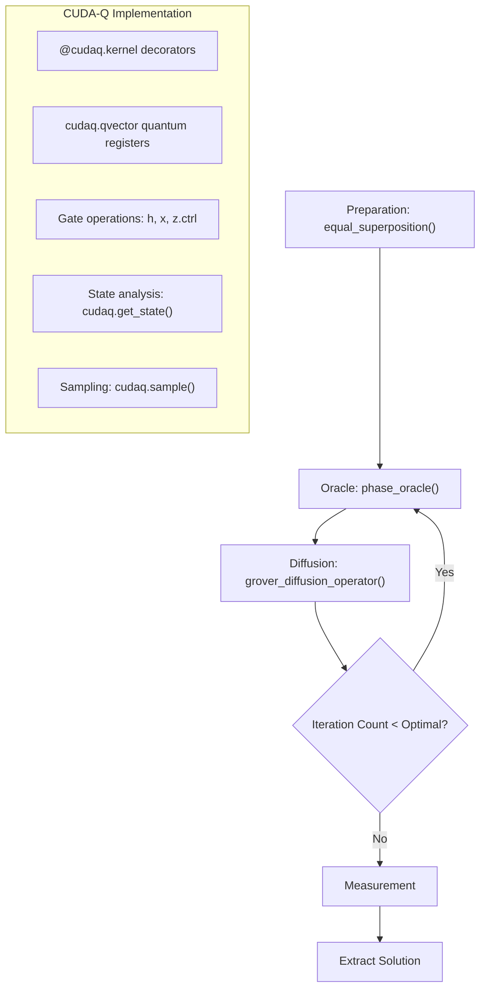
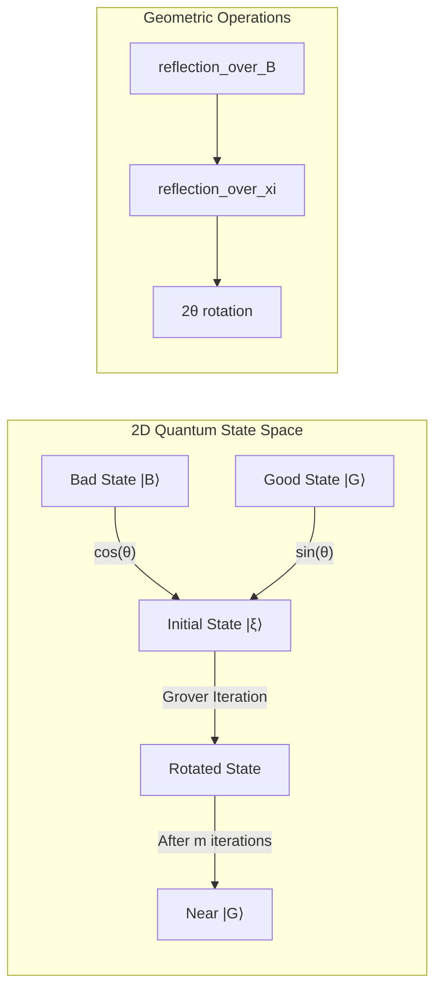
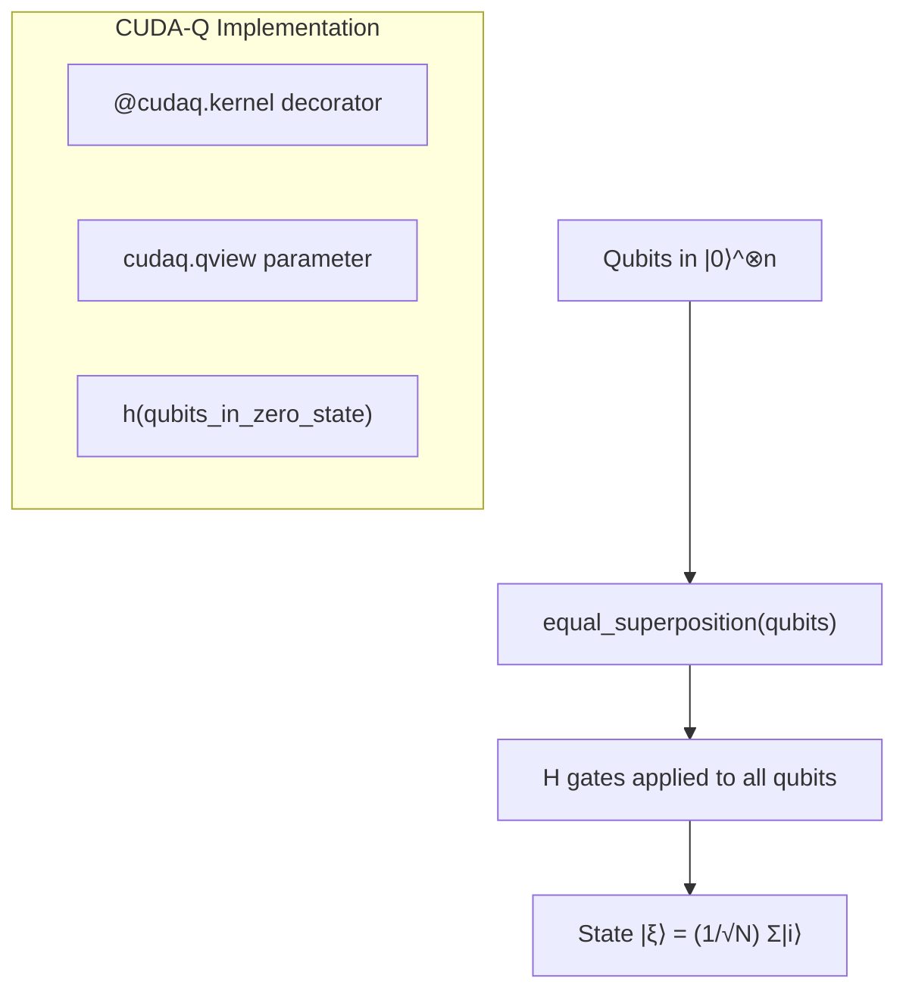
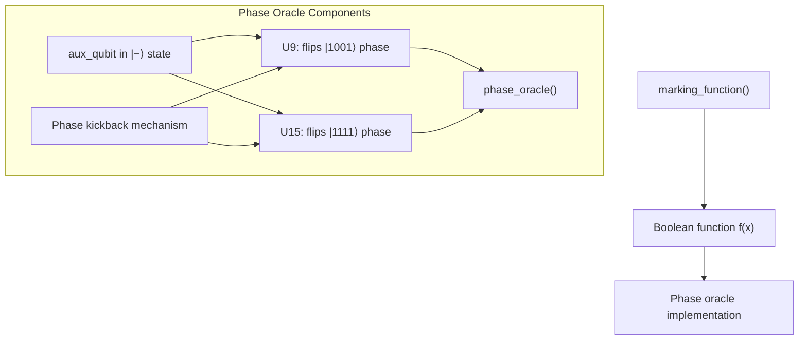
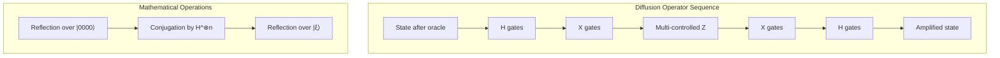
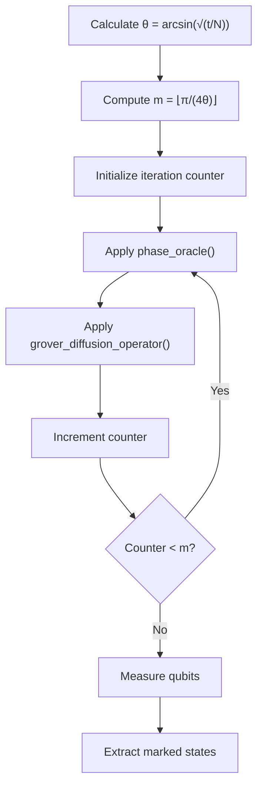
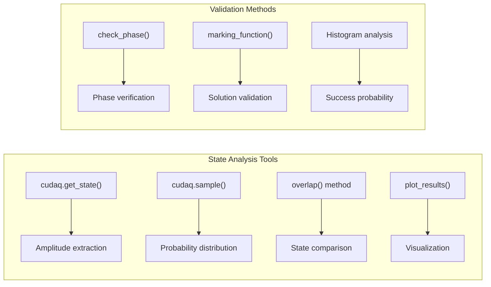

<!-- source: DeepWiki mcp.deepwiki.com · repo NVIDIA/cuda-q-academic · page 3 Quantum Algorithms · fetched 2026-10-26 -->

# Quantum Algorithms

Relevant source files

The following files were used as context for generating this wiki page:

- [qis-examples/grovers.ipynb](qis-examples/grovers.ipynb)
- [qis-examples/solutions/grovers-solution.ipynb](qis-examples/solutions/grovers-solution.ipynb)

This page covers the implementation and theory of quantum algorithms within the CUDA-Q Academic framework, with primary focus on Grover's algorithm for quantum database search. The material demonstrates fundamental quantum algorithmic concepts including superposition preparation, oracle construction, amplitude amplification, and measurement-based solution extraction using CUDA-Q programming constructs.

For quantum error correction algorithms, see [Quantum Error Correction](#5). For variational quantum algorithms and optimization approaches, see [Quantum Approximate Optimization Algorithm (QAOA)](#4).

## Overview

Quantum algorithms leverage quantum mechanical phenomena like superposition and interference to solve computational problems with potential speedup over classical approaches. The implementation focuses on Grover's algorithm, which provides quadratic speedup for unstructured search problems, reducing the search complexity from O(N) to O(√N) oracle queries.

**Algorithm Structure**

Sources: [qis-examples/grovers.ipynb:196-211]()

## Theoretical Foundation

### Good and Bad State Decomposition

The algorithm operates on a decomposition of the computational space into marked ("good") and unmarked ("bad") states:

- **Good State**: |G⟩ = (1/√t) Σ_{i:f(i)=1} |i⟩ 
- **Bad State**: |B⟩ = (1/√(N-t)) Σ_{i:f(i)=0} |i⟩
- **Initial Superposition**: |ξ⟩ = sin(θ)|G⟩ + cos(θ)|B⟩

Where θ = arcsin(√(t/N)), t is the number of marked states, and N = 2^n is the total number of states.

Sources: [qis-examples/grovers.ipynb:364-384](), [qis-examples/grovers.ipynb:478-522]()

## Implementation Components

### Preparation Phase

The `equal_superposition()` function initializes n qubits in uniform superposition:

Sources: [qis-examples/grovers.ipynb:240-244]()

### Oracle Construction

Phase oracles implement the marking function f(x) by flipping phases of marked states:

| Oracle Function | Target State | Implementation |
|----------------|--------------|----------------|
| `U9()` | \|1001⟩ | Uses controlled-Z with auxiliary qubit |
| `U15()` | \|1111⟩ | Multi-controlled Z gate |
| `phase_oracle()` | Both marked states | Composition of U9 and U15 |

**Oracle Architecture**

Sources: [qis-examples/grovers.ipynb:656-720](), [qis-examples/grovers.ipynb:752-787]()

### Amplitude Amplification

The Grover diffusion operator performs amplitude amplification through reflection operations:

**Diffusion Operator Components**

Sources: [qis-examples/grovers.ipynb:820-900]()

## Algorithm Execution Flow

### Iteration Control

The optimal number of Grover iterations is m = ⌊π/(4θ)⌋, where the algorithm rotates the state vector by 2θ per iteration:

Sources: [qis-examples/grovers.ipynb:196-211]()

### State Analysis and Verification

**Measurement and Validation Framework**

Sources: [qis-examples/grovers.ipynb:288-346](), [qis-examples/grovers.ipynb:700-720]()

## Example Implementation

For a 4-qubit system with marked states `1001` and `1111`:

| Parameter | Value | Description |
|-----------|--------|-------------|
| n | 4 | Number of qubits |
| N | 16 | Total states (2^n) |
| t | 2 | Marked states |
| θ | arcsin(√(2/16)) = π/12 | Rotation angle |
| m | ⌊π/(4×π/12)⌋ = 3 | Optimal iterations |

The implementation demonstrates ~94% success probability after optimal iterations, with marked states showing significantly higher measurement frequencies compared to unmarked states.

Sources: [qis-examples/grovers.ipynb:130-184](), [qis-examples/grovers.ipynb:395-402]()

## Integration with CUDA-Q Framework

The quantum algorithm implementations utilize core CUDA-Q programming constructs:

- `@cudaq.kernel` decorators for quantum function definitions
- `cudaq.qvector` and `cudaq.qubit` for quantum register management  
- Gate operations (`h`, `x`, `z.ctrl`) for quantum transformations
- `cudaq.sample()` and `cudaq.get_state()` for result extraction
- Auxiliary qubit management for phase oracle implementation

Sources: [qis-examples/grovers.ipynb:88-92](), [qis-examples/grovers.ipynb:240-244]()

---

