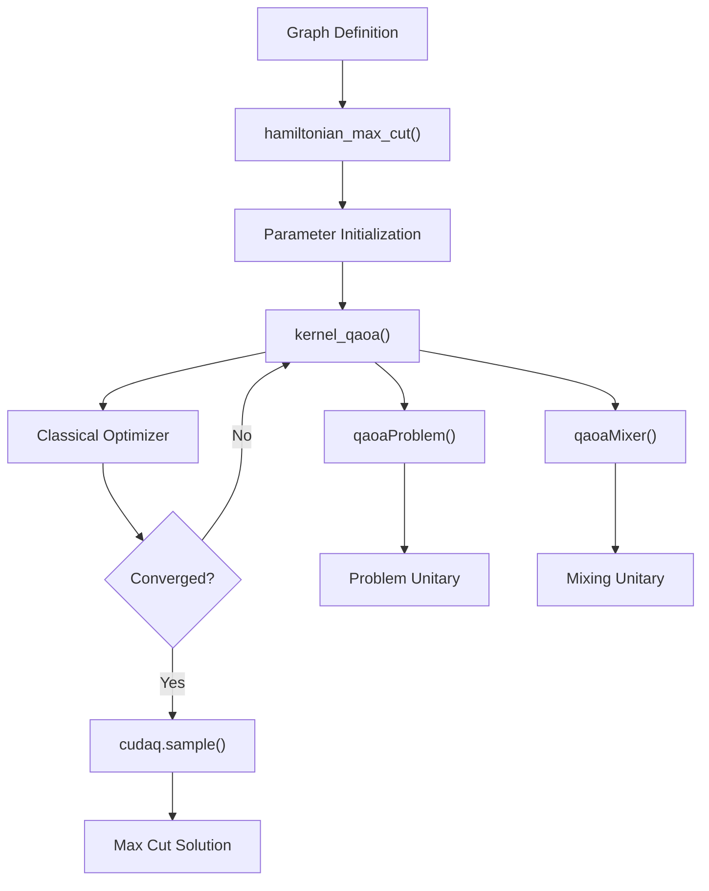
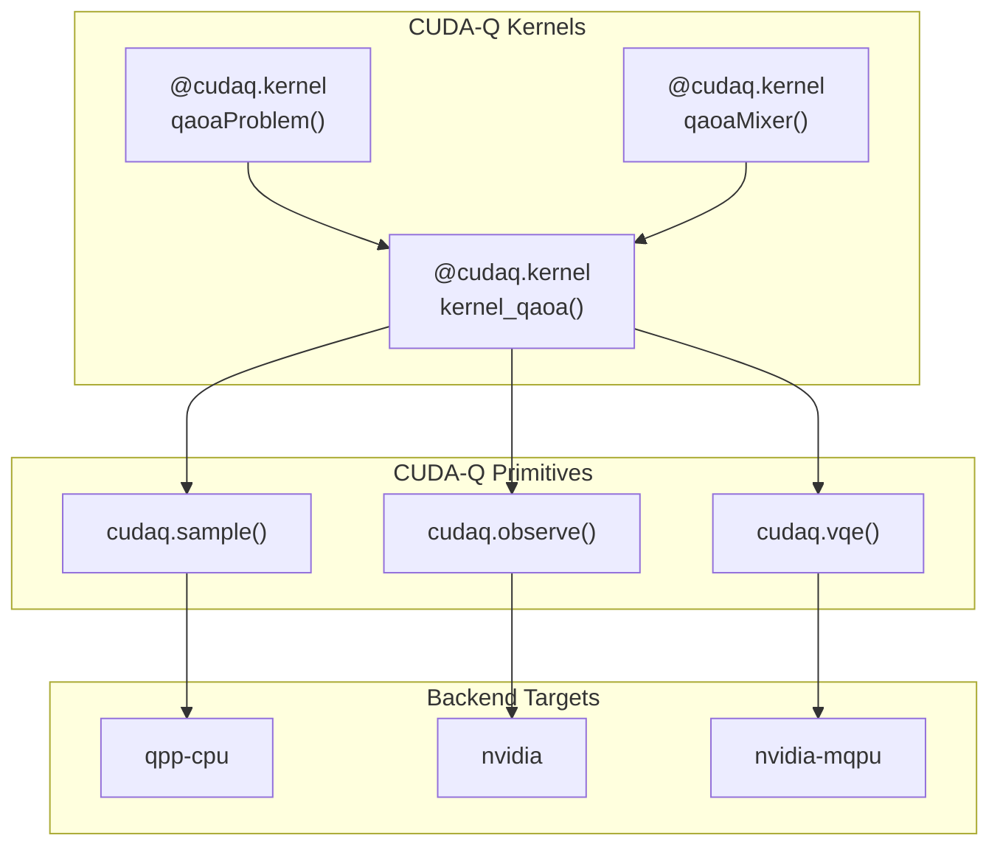
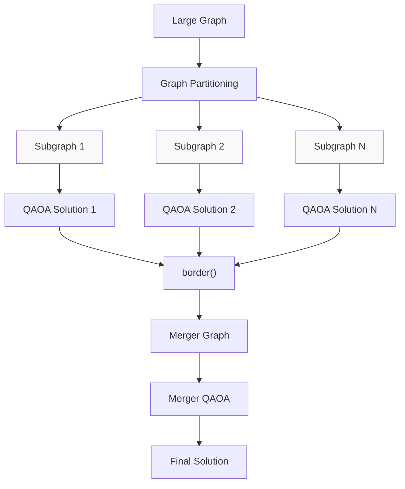
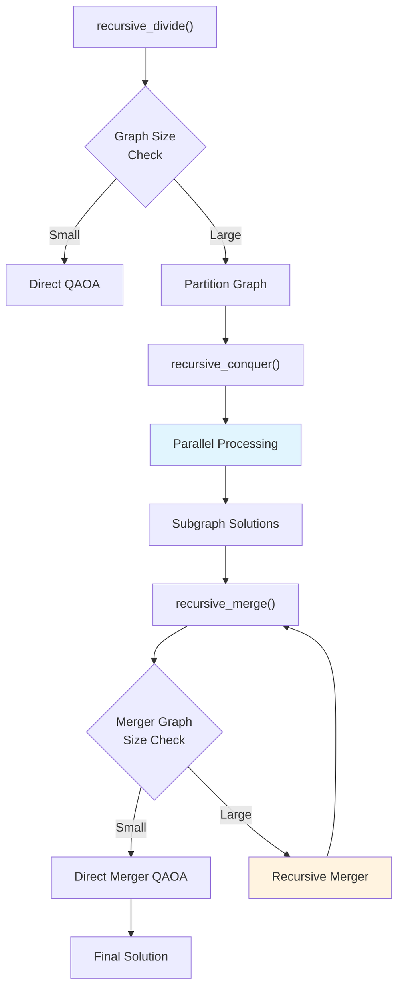
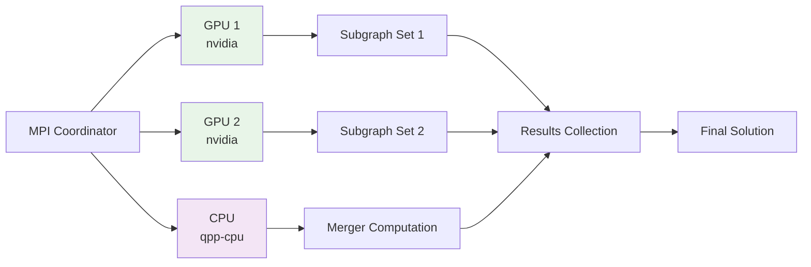

<!-- source: DeepWiki mcp.deepwiki.com · repo NVIDIA/cuda-q-academic · page 4 Quantum Approximate Optimization Algorithm (QAOA) · fetched 2026-10-26 -->

# Quantum Approximate Optimization Algorithm (QAOA)

<details>
<summary>Relevant source files</summary>

The following files were used as context for generating this wiki page:

- [qaoa-for-max-cut/01_Max-Cut-with-QAOA.ipynb](qaoa-for-max-cut/01_Max-Cut-with-QAOA.ipynb)
- [qaoa-for-max-cut/02_One-level-divide-and-conquer-QAOA.ipynb](qaoa-for-max-cut/02_One-level-divide-and-conquer-QAOA.ipynb)
- [qaoa-for-max-cut/03_Recursive-divide-and-conquer.ipynb](qaoa-for-max-cut/03_Recursive-divide-and-conquer.ipynb)

</details>


This document covers the implementation of the Quantum Approximate Optimization Algorithm (QAOA) for solving Maximum Cut (Max-Cut) optimization problems using the CUDA-Q quantum computing framework. The material includes basic QAOA implementations, advanced divide-and-conquer strategies for scaling to larger problem instances, and distributed computing approaches for parallel execution.

For general quantum computing foundations, see [Quick Start to Quantum Computing](#2). For error correction concepts, see [Quantum Error Correction](#5). For broader quantum applications beyond optimization, see [Quantum Applications to Finance](#6).

## Algorithm Overview and Implementation

QAOA is a variational quantum algorithm that approximates solutions to combinatorial optimization problems by alternating between problem-specific and mixing unitaries. The implementation focuses on the Maximum Cut problem, where the goal is to partition graph vertices into two sets that maximize the number of edges between the sets.

### QAOA Algorithm Flow



**QAOA Implementation Workflow**

The algorithm transforms the Max-Cut problem into a Quantum Unconstrained Binary Optimization (QUBO) formulation using the Hamiltonian:

$$H = \frac{1}{2}\sum_{(u,v) \in E} (Z_u Z_v - I_u I_v)$$

where $E$ represents the graph edges and $Z_u$ denotes the Pauli-Z operator on qubit $u$.

Sources: [qaoa-for-max-cut/01_Max-Cut-with-QAOA.ipynb:458-470]()

## CUDA-Q Framework Integration

The implementation leverages CUDA-Q's quantum kernel decorators and primitives to create parameterized quantum circuits. The framework provides seamless integration between classical optimization routines and quantum circuit execution.

### Core CUDA-Q Components



**CUDA-Q Architecture for QAOA**

The `qaoaProblem` kernel implements the problem-specific unitary using controlled-X and rotation gates:

```python
@cudaq.kernel
def qaoaProblem(qubit_0: cudaq.qubit, qubit_1: cudaq.qubit, alpha: float):
    x.ctrl(qubit_0, qubit_1)
    rz(2.0*alpha, qubit_1)
    x.ctrl(qubit_0, qubit_1)
```

The `qaoaMixer` kernel applies X-rotations for the mixing unitary, while `kernel_qaoa` orchestrates the complete QAOA circuit with multiple layers.

Sources: [qaoa-for-max-cut/01_Max-Cut-with-QAOA.ipynb:227-257](), [qaoa-for-max-cut/01_Max-Cut-with-QAOA.ipynb:265-298]()

## Basic QAOA Implementation

The core implementation begins with graph definition and Hamiltonian construction, followed by parameterized circuit optimization using classical optimizers.

| Component | Function | Purpose |
|-----------|----------|---------|
| Hamiltonian | `hamiltonian_max_cut()` | Constructs problem Hamiltonian from graph edges |
| Circuit | `kernel_qaoa()` | Implements parameterized QAOA circuit |
| Optimization | `find_optimal_parameters()` | Uses COBYLA optimizer with VQE |
| Sampling | `cudaq.sample()` | Extracts measurement results |

The `find_optimal_parameters` function encapsulates the variational optimization loop:

```python
optimal_expectation, optimal_parameters = cudaq.vqe(
    kernel=kernel_qaoa,
    spin_operator=hamiltonian_max_cut(qubit_src, qubit_tgt),
    argument_mapper=lambda parameter_vector: (qubit_count, layer_count, qubit_src, qubit_tgt, parameter_vector),
    optimizer=optimizer,
    parameter_count=parameter_count)
```

Sources: [qaoa-for-max-cut/01_Max-Cut-with-QAOA.ipynb:309-354](), [qaoa-for-max-cut/02_One-level-divide-and-conquer-QAOA.ipynb:198-224]()

## Divide-and-Conquer Scaling

For larger graph instances, the implementation provides divide-and-conquer strategies that partition graphs into smaller subgraphs, solve subproblems independently, and merge solutions. This approach enables scaling beyond the limitations of direct QAOA application.

### Divide-and-Conquer Workflow



**Three-Stage Divide-and-Conquer Process**

The algorithm implements three distinct stages:

1. **Divide**: Graph partitioning using NetworkX community detection algorithms
2. **Conquer**: Independent QAOA execution on each subgraph
3. **Merge**: Border graph construction and merger optimization

The `border()` function identifies edges connecting different subgraphs, creating a merger graph where vertices represent subgraphs and edges represent inter-subgraph connections.

Sources: [qaoa-for-max-cut/02_One-level-divide-and-conquer-QAOA.ipynb:385-411](), [qaoa-for-max-cut/03_Recursive-divide-and-conquer.ipynb:108-112]()

## Recursive Implementation

The recursive divide-and-conquer implementation extends the basic approach to handle arbitrarily large graphs through recursive subdivision and parallel processing.

### Recursive Function Architecture



**Recursive Algorithm Structure**

Key functions include:
- `recursive_divide()`: Handles graph partitioning logic
- `recursive_conquer()`: Manages parallel subproblem solving  
- `recursive_merge()`: Orchestrates solution combination

The implementation supports both depth-first and breadth-first recursion strategies, with configurable thresholds for direct QAOA application versus further subdivision.

Sources: [qaoa-for-max-cut/03_Recursive-divide-and-conquer.ipynb:95-121]()

## Distributed Computing Support

The implementation includes MPI-based parallel execution capabilities for distributed quantum computing across multiple processing units or quantum devices.

### MPI Integration



**Distributed QAOA Execution**

The parallel implementation allows:
- Target device selection (`cudaq.set_target()`)
- Multi-GPU quantum circuit execution
- Asynchronous subproblem processing
- Result aggregation and synchronization

Different target backends support various execution modes:
- `qpp-cpu`: CPU-based quantum simulation
- `nvidia`: Single GPU acceleration  
- `nvidia-mqpu`: Multi-GPU distributed execution

Sources: [qaoa-for-max-cut/02_One-level-divide-and-conquer-QAOA.ipynb:169-175](), [qaoa-for-max-cut/03_Recursive-divide-and-conquer.ipynb:169-175]()

## Code Architecture and Key Functions

The codebase organizes QAOA functionality into modular components supporting both educational exploration and production-scale optimization.

### Function Hierarchy

| Category | Functions | Purpose |
|----------|-----------|---------|
| Graph Processing | `hamiltonian_max_cut()`, `border()`, `subgraph_of_vertex()` | Graph analysis and Hamiltonian construction |
| Quantum Kernels | `qaoaProblem()`, `qaoaMixer()`, `kernel_qaoa()` | CUDA-Q quantum circuit definitions |
| Optimization | `find_optimal_parameters()`, `qaoa_for_graph()` | Parameter optimization and solution extraction |
| Scaling | `recursive_divide()`, `recursive_conquer()`, `recursive_merge()` | Divide-and-conquer algorithm implementation |

The implementation maintains separation between quantum circuit definitions (kernels), classical optimization routines, and graph processing utilities, enabling flexible experimentation with different algorithmic approaches and backend targets.

Sources: [qaoa-for-max-cut/01_Max-Cut-with-QAOA.ipynb:198-224](), [qaoa-for-max-cut/03_Recursive-divide-and-conquer.ipynb:198-347]()

---

