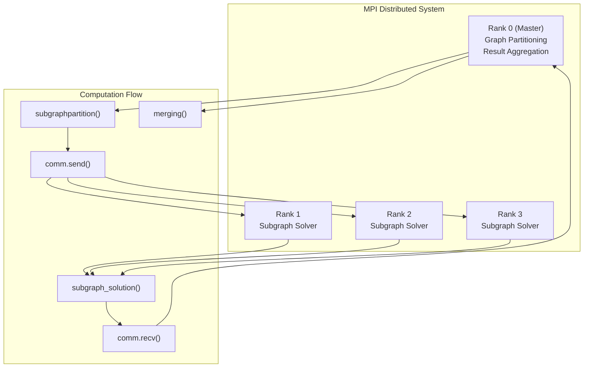
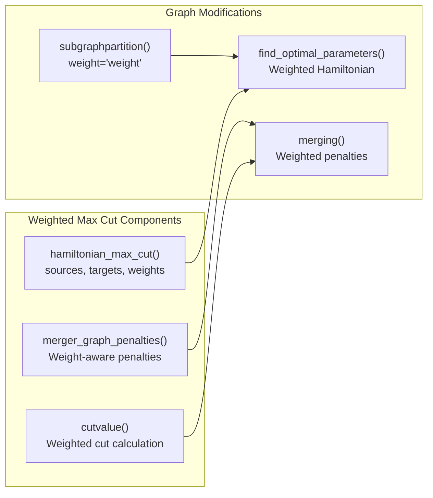
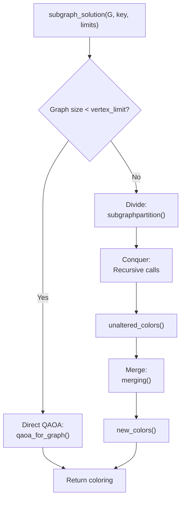
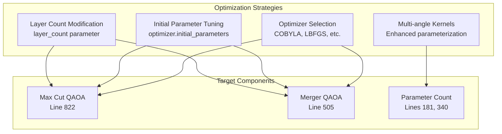
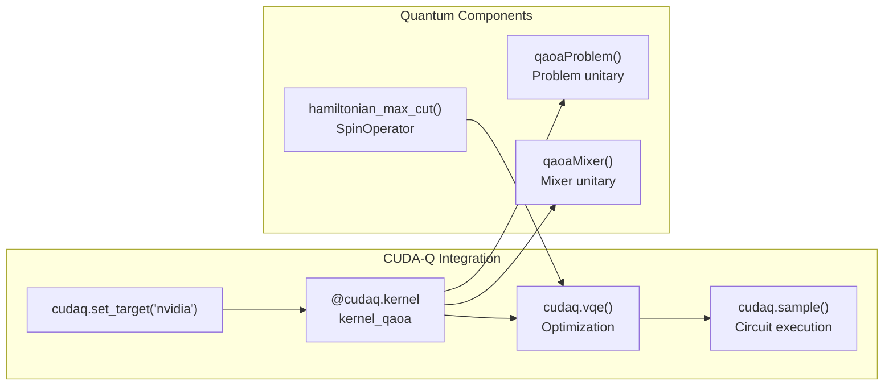

<!-- source: DeepWiki mcp.deepwiki.com · repo NVIDIA/cuda-q-academic · page 4.1 Advanced QAOA Implementation · fetched 2026-10-26 -->

# Advanced QAOA Implementation

<details>
<summary>Relevant source files</summary>

The following files were used as context for generating this wiki page:

- [qaoa-for-max-cut/04_Assessment-Solution.ipynb](qaoa-for-max-cut/04_Assessment-Solution.ipynb)
- [qaoa-for-max-cut/04_Assessment.ipynb](qaoa-for-max-cut/04_Assessment.ipynb)
- [qaoa-for-max-cut/Example-02-step-2-Solution.py](qaoa-for-max-cut/Example-02-step-2-Solution.py)
- [qaoa-for-max-cut/Example-02-step-2.py](qaoa-for-max-cut/Example-02-step-2.py)
- [qaoa-for-max-cut/Example-02-step-3-Solution.py](qaoa-for-max-cut/Example-02-step-3-Solution.py)
- [qaoa-for-max-cut/Example-03.py](qaoa-for-max-cut/Example-03.py)
- [qaoa-for-max-cut/Example-04-Solution.py](qaoa-for-max-cut/Example-04-Solution.py)
- [qaoa-for-max-cut/Example-04.py](qaoa-for-max-cut/Example-04.py)

</details>


This document covers the advanced implementation of the Quantum Approximate Optimization Algorithm (QAOA) for large-scale max-cut problems, including distributed computing with MPI, weighted graph extensions, and performance optimization strategies. For basic QAOA concepts and foundational implementations, see [Quantum Approximate Optimization Algorithm (QAOA)](#4).

## Purpose and Scope

The advanced QAOA implementation extends the basic algorithm to handle larger, more complex optimization problems through divide-and-conquer strategies, GPU parallelization, and weighted graph support. This system demonstrates how quantum algorithms can be scaled using classical decomposition techniques combined with high-performance computing infrastructure.

## System Architecture

### MPI-Based Distributed Computing

The advanced implementation uses MPI (Message Passing Interface) to distribute QAOA computations across multiple GPUs, enabling the solution of larger graph problems than would be feasible on a single processor.



Sources: [qaoa-for-max-cut/Example-04-Solution.py:31-34](), [qaoa-for-max-cut/Example-02-step-3-Solution.py:32-35]()

### Weighted Graph Extension

The system extends the basic max-cut problem to handle weighted graphs, where edges have associated weights that influence the optimization objective.



Sources: [qaoa-for-max-cut/04_Assessment.ipynb:202-228](), [qaoa-for-max-cut/04_Assessment-Solution.ipynb:244-271]()

## Core Implementation Components

### Weighted Hamiltonian Construction

The `hamiltonian_max_cut` function constructs the problem Hamiltonian for weighted graphs:

| Parameter | Type | Description |
|-----------|------|-------------|
| `sources` | `List[int]` | Source vertices for graph edges |
| `targets` | `List[int]` | Target vertices for graph edges |
| `weights` | `List[float]` | Edge weights |

The weighted Hamiltonian incorporates edge weights into the optimization objective:
```
hamiltonian += 0.5*edge_weight*(spin.z(qubitu)*spin.z(qubitv)-spin.i(qubitu)*spin.i(qubitv))
```

Sources: [qaoa-for-max-cut/Example-04-Solution.py:37-63](), [qaoa-for-max-cut/04_Assessment-Solution.ipynb:268]()

### Recursive Divide-and-Conquer Algorithm

The `subgraph_solution` function implements the recursive divide-and-conquer strategy:



Sources: [qaoa-for-max-cut/Example-04-Solution.py:615-692](), [qaoa-for-max-cut/Example-03.py:615-703]()

### MPI Communication Patterns

The distributed implementation follows a master-worker pattern:

| Operation | Function | Purpose |
|-----------|----------|---------|
| Task Distribution | `comm.send()` | Send subgraph assignments to workers |
| Result Collection | `comm.recv()` | Collect subgraph solutions from workers |
| Synchronization | `comm.Get_rank()` | Coordinate processor roles |

Sources: [qaoa-for-max-cut/Example-02-step-2-Solution.py:103-116](), [qaoa-for-max-cut/Example-04-Solution.py:790-802]()

## Assessment and Optimization Strategies

### Performance Optimization Options

The assessment component provides several optimization strategies:



Sources: [qaoa-for-max-cut/04_Assessment.ipynb:399-406](), [qaoa-for-max-cut/04_Assessment-Solution.ipynb:522-529]()

### Weighted Graph Adaptations

Three key functions require modification for weighted graphs:

| Function | Modification | Purpose |
|----------|--------------|---------|
| `hamiltonian_max_cut` | Add `weights` parameter | Weight-aware Hamiltonian construction |
| `merger_graph_penalties` | Weight-based penalties | Account for edge weights in merging |
| `cutvalue` | Weighted sum calculation | Evaluate weighted cut quality |

Sources: [qaoa-for-max-cut/04_Assessment.ipynb:184-190](), [qaoa-for-max-cut/04_Assessment.ipynb:302-349](), [qaoa-for-max-cut/04_Assessment.ipynb:357-387]()

## Runtime Requirements and Execution

### GPU Requirements

The advanced implementation requires GPU access for practical execution:
- CUDA-Q installation with GPU backend
- Multi-GPU setup for MPI distribution
- Minimum 4 MPI processes recommended

### Execution Command Pattern

```bash
mpiexec -np 4 --oversubscribe --allow-run-as-root python Example-04.py
```

Sources: [qaoa-for-max-cut/04_Assessment.ipynb:477](), [qaoa-for-max-cut/04_Assessment-Solution.ipynb:679]()

### Graph Configuration Options

The system supports various graph types and configurations:

| Graph Type | Implementation | Use Case |
|------------|----------------|----------|
| Random Regular | `nx.random_regular_graph(d,n,seed)` | Benchmarking |
| Newman-Watts-Strogatz | `nx.newman_watts_strogatz_graph()` | Small-world networks |
| Random Graphs | `nx.gnm_random_graph(n,m,seed)` | General testing |

Sources: [qaoa-for-max-cut/Example-04.py:709-750](), [qaoa-for-max-cut/Example-04-Solution.py:709-750]()

## Integration with CUDA-Q Framework

The implementation leverages CUDA-Q's quantum computing capabilities:



Sources: [qaoa-for-max-cut/Example-04-Solution.py:28-29](), [qaoa-for-max-cut/Example-04-Solution.py:67-138](), [qaoa-for-max-cut/Example-04-Solution.py:181-186]()

---

