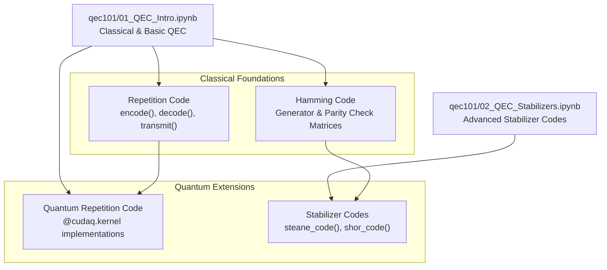
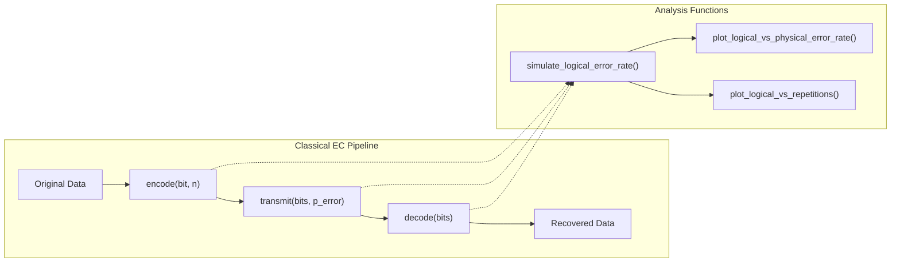
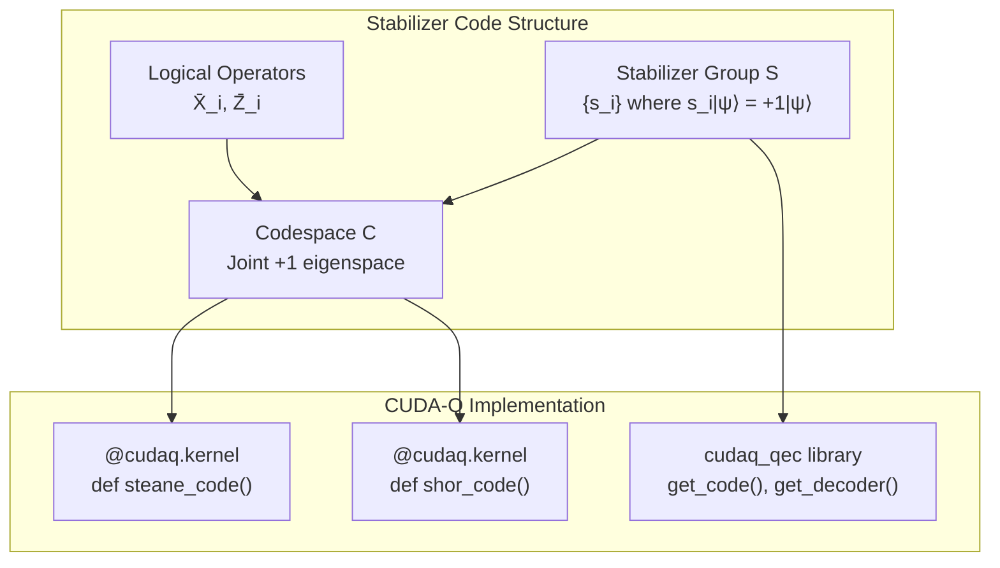
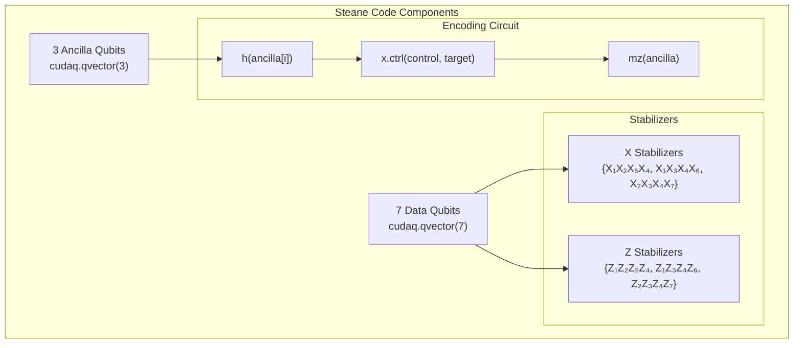
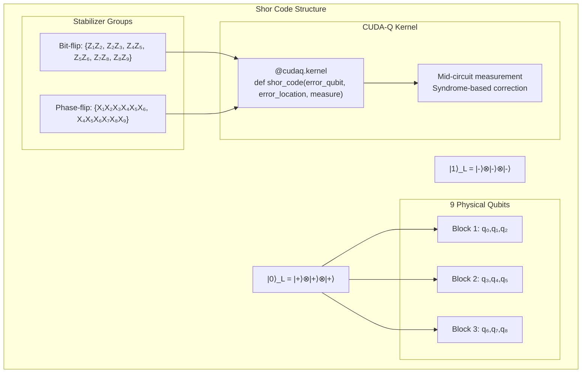

<!-- source: DeepWiki mcp.deepwiki.com · repo NVIDIA/cuda-q-academic · page 5 Quantum Error Correction · fetched 2026-10-26 -->

# Quantum Error Correction

<details>
<summary>Relevant source files</summary>

The following files were used as context for generating this wiki page:

- [qec101/01_QEC_Intro.ipynb](qec101/01_QEC_Intro.ipynb)
- [qec101/02_QEC_Stabilizers.ipynb](qec101/02_QEC_Stabilizers.ipynb)
- [quick-start-to-quantum/01_quick_start_to_quantum.ipynb](quick-start-to-quantum/01_quick_start_to_quantum.ipynb)
- [quick-start-to-quantum/02_quick_start_to_quantum.ipynb](quick-start-to-quantum/02_quick_start_to_quantum.ipynb)

</details>


This document covers the quantum error correction (QEC) educational modules in the CUDA-Q Academic repository. These modules provide comprehensive hands-on learning experiences for understanding both classical and quantum error correction techniques, from basic repetition codes to advanced stabilizer codes like the Steane and Shor codes.

For information about noisy quantum simulation and error mitigation techniques, see [Noisy Quantum Simulation](#5.1). For foundational quantum computing concepts, see [Quick Start to Quantum Computing](#2).

## Educational Module Structure

The quantum error correction content is organized into a progressive learning sequence implemented as Jupyter notebooks that combine theoretical foundations with practical CUDA-Q implementations.



**Sources:** [qec101/01_QEC_Intro.ipynb:47-61](), [qec101/02_QEC_Stabilizers.ipynb:47-61]()

## Classical Error Correction Foundations

The educational modules begin with classical error correction to establish fundamental concepts before transitioning to quantum systems. Students implement core classical algorithms that demonstrate encoding, error introduction, and decoding procedures.

### Core Functions and Implementation



**Sources:** [qec101/01_QEC_Intro.ipynb:220-354]()

Key implementation components include:
- `encode(bit, n)`: Implements n-bit repetition encoding
- `decode(bits)`: Majority voting decoder for error correction  
- `transmit(bits, p_error)`: Simulates noisy channel with bit-flip probability
- `simulate_logical_error_rate(n, p_error, trials)`: Benchmarks code performance

| Code Type | Parameters | Error Correction Capability |
|-----------|------------|----------------------------|
| Repetition Code | [n,1,n] | t = floor[(n-1)/2] errors |
| Hamming Code | [2^r-1, 2^r-r-1, 3] | Single error correction |

**Sources:** [qec101/01_QEC_Intro.ipynb:166-211](), [qec101/01_QEC_Intro.ipynb:364-602]()

## Quantum Error Correction Framework

Quantum error correction extends classical concepts while addressing unique quantum mechanical challenges including continuous errors, the no-cloning theorem, and measurement-induced state collapse.

### Stabilizer Formalism

The modules implement stabilizer codes using the mathematical framework where the codespace is defined by stabilizer operators rather than explicit codewords.



**Sources:** [qec101/02_QEC_Stabilizers.ipynb:95-169]()

Key stabilizer properties implemented in the modules:
1. **Pauli Group Elements**: Stabilizers are Pauli products from group G_n
2. **Commutation Relations**: All stabilizers commute with each other
3. **Logical Operator Constraints**: X̄_i and Z̄_i anticommute for same qubit, commute with stabilizers

**Sources:** [qec101/02_QEC_Stabilizers.ipynb:138-167]()

## Steane Code Implementation

The Steane code represents a [[7,1,3]] CSS (Calderbank-Shor-Steane) code that enables independent correction of X and Z errors. The implementation demonstrates the connection between classical Hamming codes and quantum error correction.

### Code Structure and Kernels



**Sources:** [qec101/02_QEC_Stabilizers.ipynb:176-315]()

The logical codewords are superpositions over classical Hamming code states:
- |0⟩_L: Superposition over even parity Hamming codewords  
- |1⟩_L: Superposition over odd parity Hamming codewords

Logical operators:
- X̄ = X₁X₂X₃X₄X₅X₆X₇ (bit-flip on logical state)
- Z̄ = Z₁Z₂Z₃Z₄Z₅Z₆Z₇ (phase-flip on logical state)

**Sources:** [qec101/02_QEC_Stabilizers.ipynb:246-256]()

### CUDA-Q QEC Library Integration

The modules demonstrate integration with the CUDA-Q QEC library for advanced analysis:

```python
import cudaq_qec as qec
steane = qec.get_code("steane")
decoder = qec.get_decoder("single_error_lut", Hz)
syndromes, data = qec.sample_code_capacity(Hz, nShots, p)
```

**Sources:** [qec101/02_QEC_Stabilizers.ipynb:387-483]()

## Shor Code Implementation  

The Shor code implements a [[9,1,3]] code that concatenates two repetition codes to handle both bit-flip and phase-flip errors independently.

### Code Architecture



**Sources:** [qec101/02_QEC_Stabilizers.ipynb:503-608]()

### Logical Operators and Error Correction

The Shor code's logical operators demonstrate the concatenated structure:
- X̄ = Z₁Z₄Z₇ (or other choices like Z₂Z₅Z₈)
- Z̄ = X₁X₂X₃X₄X₅X₆X₇X₈X₉

Error correction capabilities:
- Single X error per block (up to 3 total X errors)
- Single Z error affecting block phases
- Syndrome measurement determines error location and type

**Sources:** [qec101/02_QEC_Stabilizers.ipynb:550-608]()

## Educational Implementation Patterns

The modules follow consistent patterns for implementing quantum error correction codes in CUDA-Q:

### Kernel Structure Pattern

```python
@cudaq.kernel  
def error_correction_code(parameters):
    # 1. Qubit allocation
    data_qubits = cudaq.qvector(n)
    ancilla_qubits = cudaq.qvector(m)
    
    # 2. Encoding circuit
    # State preparation and encoding gates
    
    # 3. Error introduction (for testing)
    # Optional error application
    
    # 4. Syndrome measurement  
    # Stabilizer measurements using ancilla
    
    # 5. Error correction
    # Conditional corrections based on syndromes
    
    # 6. Logical measurement
    # Final measurement in chosen basis
```

**Sources:** [qec101/02_QEC_Stabilizers.ipynb:274-296](), [qec101/02_QEC_Stabilizers.ipynb:614-676]()

### Analysis and Visualization Tools

The educational modules include comprehensive analysis tools:
- Syndrome visualization using plaquette diagrams
- Code capacity analysis with error rate plotting  
- Interactive widgets for exploring Hamming code parity checks
- Post-processing functions for logical error rate calculation

**Sources:** [qec101/01_QEC_Intro.ipynb:301-354](), [qec101/02_QEC_Stabilizers.ipynb:387-496]()

---

