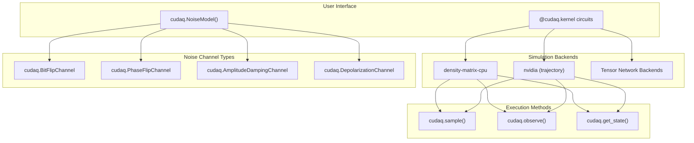
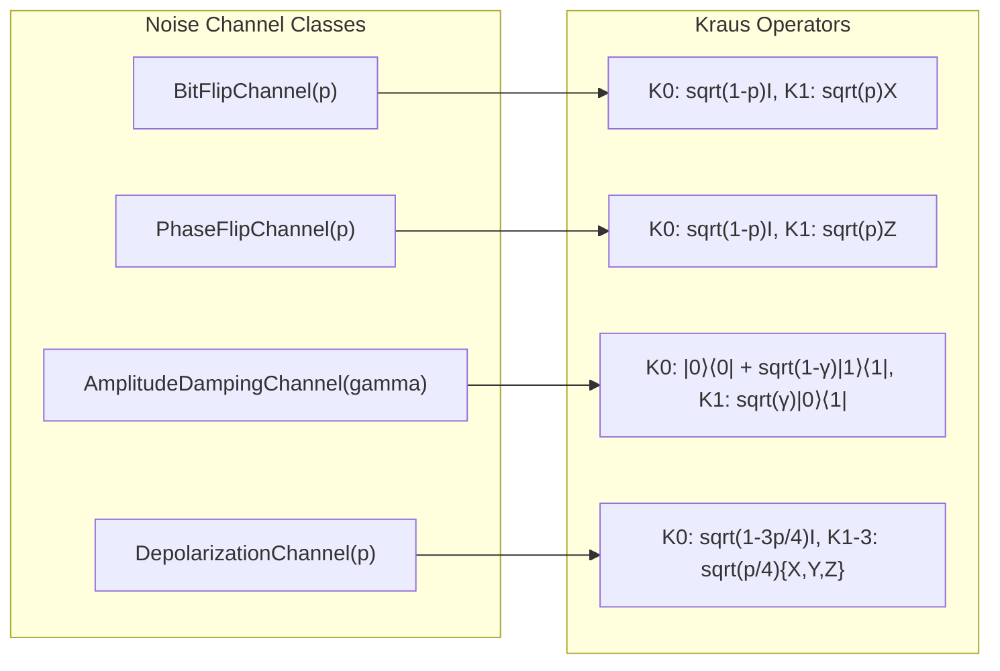
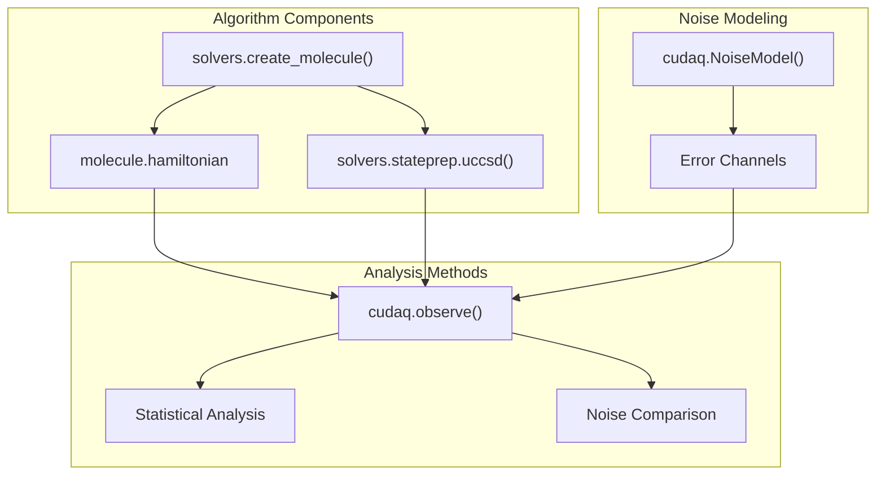

<!-- source: DeepWiki mcp.deepwiki.com · repo NVIDIA/cuda-q-academic · page 5.1 Noisy Quantum Simulation · fetched 2026-10-26 -->

# Noisy Quantum Simulation

<details>
<summary>Relevant source files</summary>

The following files were used as context for generating this wiki page:

- [qec101/03_QEC_Noisy_Simulation.ipynb](qec101/03_QEC_Noisy_Simulation.ipynb)
- [qec101/Images/noisy/zneplot.png](qec101/Images/noisy/zneplot.png)
- [qec101/Solutions/3.1_Solution.py](qec101/Solutions/3.1_Solution.py)
- [qec101/Solutions/3.2_Solution.py](qec101/Solutions/3.2_Solution.py)
- [qec101/Solutions/3.3_Solution.py](qec101/Solutions/3.3_Solution.py)
- [qec101/Solutions/3.4_Solution.py](qec101/Solutions/3.4_Solution.py)

</details>


This document covers CUDA-Q's noisy quantum simulation capabilities, which enable modeling realistic quantum devices with various error sources. The system provides comprehensive tools for studying noise effects on quantum algorithms, implementing error mitigation techniques, and conducting quantum error correction experiments. For foundational quantum error correction concepts, see [Quantum Error Correction](#5). For advanced error correction implementations, see other sections within the QEC module.

## System Architecture

The noisy simulation framework in CUDA-Q operates through a layered architecture that supports both exact density matrix simulation and scalable trajectory-based approaches.

### Simulation Backends



**Density Matrix Simulation Architecture**
- Backend: `density-matrix-cpu`
- Representation: Full $2^N \times 2^N$ density matrix
- Scalability: Limited to smaller qubit counts due to exponential memory requirements
- Accuracy: Exact simulation with precise noise modeling

**Trajectory-Based Simulation Architecture**  
- Backend: `nvidia` (GPU-accelerated)
- Representation: State vector trajectories with Markov process assumption
- Scalability: Supports large-scale circuits through sampling
- Integration: Compatible with tensor network simulators for enhanced scalability

Sources: [qec101/03_QEC_Noisy_Simulation.ipynb:222-409]()

## Noise Channel Framework

### Mathematical Foundation

The noise simulation system implements quantum channels through Kraus operators that evolve density matrices according to:

$$\epsilon(\rho) = \sum_i K_i\rho K_i^{\dagger}$$

where Kraus operators satisfy the completeness relation $\sum_i K_i K_i^{\dagger} = I$.

### Channel Implementation



**Channel Configuration System**
```python
noise = cudaq.NoiseModel()
noise.add_channel('gate_name', [qubit_indices], channel_object)
```

The `NoiseModel` class supports gate-specific and qubit-specific noise channel assignment, enabling realistic device modeling.

Sources: [qec101/03_QEC_Noisy_Simulation.ipynb:168-213]()

## Simulation Methods Comparison

| Aspect | Density Matrix (`density-matrix-cpu`) | Trajectory (`nvidia`) |
|--------|--------------------------------------|---------------------|
| **Memory Scaling** | $O(4^N)$ | $O(2^N)$ |
| **Computation** | Exact Kraus evolution | Stochastic sampling |
| **Output Consistency** | Deterministic density matrix | Stochastic state vectors |
| **Use Cases** | Small systems, exact results | Large systems, statistical sampling |
| **GPU Acceleration** | Limited | Full GPU utilization |

### Implementation Differences

**Density Matrix Approach**
- Maintains complete mixed state representation
- Applies all Kraus operators simultaneously with probabilities
- Returns identical density matrices across calls
- Limited by memory requirements for large systems

**Trajectory Approach**
- Assumes Markov process for independent error events
- Samples individual error trajectories
- Returns different state vectors per execution
- Scales to hundreds/thousands of qubits with tensor networks

Sources: [qec101/03_QEC_Noisy_Simulation.ipynb:220-409]()

## Application Integration

### Algorithm Impact Analysis

The framework integrates with CUDA-Q Solvers for studying noise effects on quantum algorithms:



**Integration Points**
- `cudaq.observe()` with `noise_model` parameter for expectation value calculations
- `shots_count` and `num_trajectories` parameters for trajectory sampling control
- Compatibility with variational algorithms and quantum chemistry applications

Sources: [qec101/03_QEC_Noisy_Simulation.ipynb:434-614]()

### Error Mitigation Integration

The system supports quantum error mitigation techniques through:

**Zero Noise Extrapolation Framework**
- Multiple noise levels simulation
- Polynomial/exponential extrapolation to zero noise limit
- Integration with optimization routines

**Circuit-Level Noise Experiments**
- QEC syndrome generation and analysis
- AI decoder training data generation  
- Stabilizer measurement simulation

Sources: [qec101/03_QEC_Noisy_Simulation.ipynb:29-41]()

## Performance and Scalability

### Trajectory Sampling Optimization

The trajectory-based simulator implements advanced sampling techniques:

**Clever Sampling Algorithms**
- Error trajectory filtering
- Focus sampling on most probable errors
- Exclusion of specific error types

**GPU Acceleration**
- Full utilization of NVIDIA GPU architectures
- Integration with cuQuantum libraries
- Massive parallel trajectory sampling

**Tensor Network Integration** 
- Matrix Product State (MPS) simulation support
- Exact tensor network simulation compatibility
- Scaling to thousands of qubits

### Performance Characteristics

| System Size | Density Matrix | Trajectory (GPU) | Tensor Network + Trajectory |
|-------------|---------------|------------------|---------------------------|
| **1-10 qubits** | Exact, fast | Overkill | Overkill |
| **10-20 qubits** | Possible, slow | Fast, approximate | Fast, exact/approximate |
| **20+ qubits** | Infeasible | Scalable | Highly scalable |

Sources: [qec101/03_QEC_Noisy_Simulation.ipynb:407-410]()

## Configuration and Usage Patterns

### Basic Noise Model Setup

```python
# Initialize empty noise model
noise = cudaq.NoiseModel()

# Add gate-specific noise channels
noise.add_channel('x', [qubit_id], cudaq.BitFlipChannel(probability))
noise.add_channel('h', [qubit_id], cudaq.DepolarizationChannel(probability))

# Apply to quantum kernel execution
result = cudaq.sample(kernel, noise_model=noise)
```

### Advanced Configuration Patterns

**Multi-Channel Noise Models**
- Different error rates per qubit
- Gate-dependent error characteristics  
- Time-dependent noise profiles

**Parameterized Noise Studies**
- Systematic noise parameter sweeps
- Error rate sensitivity analysis
- Comparative noise channel studies

Sources: [qec101/03_QEC_Noisy_Simulation.ipynb:193-213](), [qec101/Solutions/3.3_Solution.py:6-17]()

## Integration with QEC Framework

The noisy simulation system directly supports quantum error correction research through:

**Syndrome Generation**
- Realistic noise channel application to stabilizer circuits
- Statistical syndrome pattern analysis
- Training data generation for AI decoders

**Error Correction Protocol Testing**
- Performance evaluation under realistic noise
- Threshold determination studies
- Protocol optimization guidance

**Hardware Characterization**
- Device noise model development
- Calibration data analysis
- Error correlation studies

This integration enables comprehensive QEC research workflows from fundamental noise characterization through advanced error correction protocol development.

Sources: [qec101/03_QEC_Noisy_Simulation.ipynb:55-62]()

---

