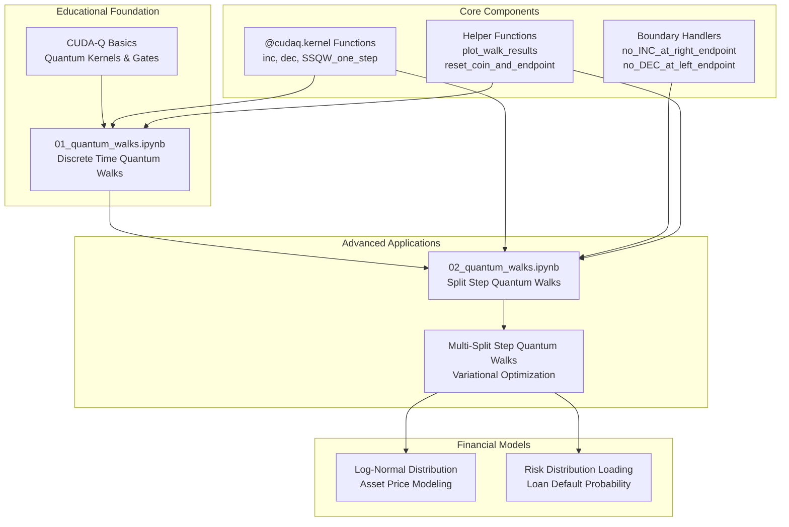
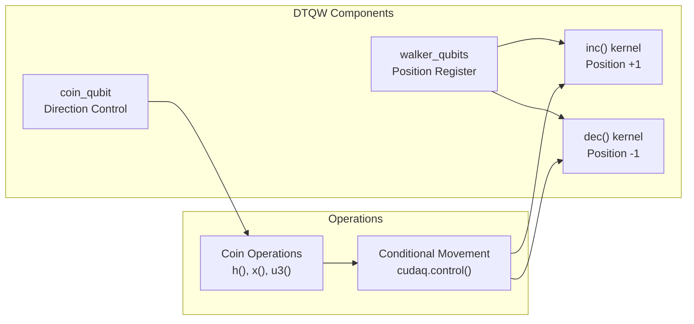
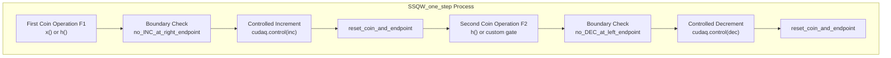
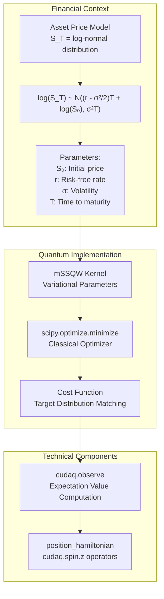
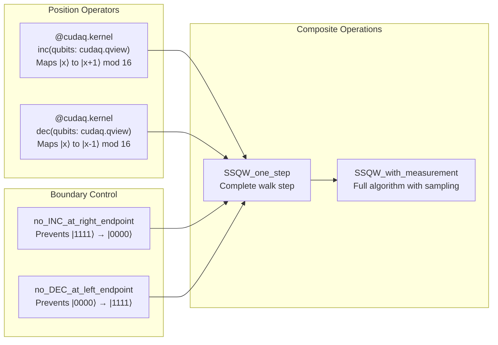
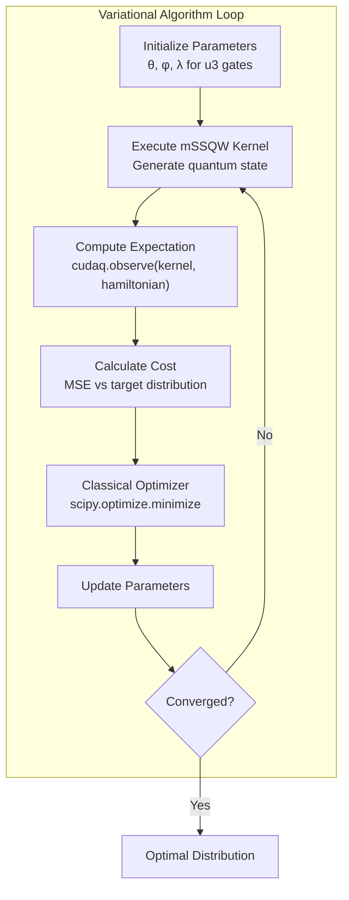

<!-- source: DeepWiki mcp.deepwiki.com · repo NVIDIA/cuda-q-academic · page 6 Quantum Applications to Finance · fetched 2026-10-26 -->

# Quantum Applications to Finance

<details>
<summary>Relevant source files</summary>

The following files were used as context for generating this wiki page:

- [quantum-applications-to-finance/01_quantum_walks.ipynb](quantum-applications-to-finance/01_quantum_walks.ipynb)
- [quantum-applications-to-finance/02_quantum_walks.ipynb](quantum-applications-to-finance/02_quantum_walks.ipynb)
- [quantum-applications-to-finance/solutions/02_solutions.ipynb](quantum-applications-to-finance/solutions/02_solutions.ipynb)
- [quick-start-to-quantum/03_quick_start_to_quantum.ipynb](quick-start-to-quantum/03_quick_start_to_quantum.ipynb)
- [quick-start-to-quantum/04_quick_start_to_quantum.ipynb](quick-start-to-quantum/04_quick_start_to_quantum.ipynb)

</details>


This document covers the quantum computing applications to financial modeling implemented in the CUDA-Q Academic repository. The system demonstrates how quantum walks can be used to generate and load probability distributions relevant to financial markets, with particular focus on discrete time quantum walks (DTQW), split step quantum walks (SSQW), and multi-split step quantum walks (mSSQW) for risk modeling and asset pricing.

For foundational quantum computing concepts, see [Quick Start to Quantum Computing](#2). For quantum algorithms beyond finance applications, see [Quantum Algorithms](#3).

## System Architecture

The quantum finance module is organized around progressive complexity levels of quantum walk implementations, from basic educational examples to sophisticated variational algorithms for probability distribution loading.



**Sources:** [quantum-applications-to-finance/01_quantum_walks.ipynb:1-223](), [quantum-applications-to-finance/02_quantum_walks.ipynb:1-133]()

## Quantum Walk Types and Implementations

### Discrete Time Quantum Walk (DTQW)

The basic quantum walk implementation uses a coin qubit to determine movement direction and walker qubits to track position on a line segment.



**Sources:** [quantum-applications-to-finance/01_quantum_walks.ipynb:94-165]()

### Split Step Quantum Walk (SSQW)

SSQW generalizes DTQW by applying two coin operations per step, allowing more flexible probability distribution generation.



**Sources:** [quantum-applications-to-finance/02_quantum_walks.ipynb:88-132]()

## Financial Applications

### Log-Normal Distribution Loading

The system addresses the challenge of loading classical probability distributions into quantum states for financial modeling. The log-normal distribution is particularly important for asset pricing models.



**Sources:** [quantum-applications-to-finance/02_quantum_walks.ipynb:235-259]()

### Risk Distribution Modeling

The framework enables modeling of individual loan risk distributions, accounting for uncertainties in modeling and macroeconomic factors.

| Application | Quantum Walk Type | Key Parameters | Financial Relevance |
|-------------|------------------|----------------|-------------------|
| Asset Pricing | mSSQW | θ, φ, λ (coin operations) | Log-normal spot price modeling |
| Loan Risk | mSSQW | Variational gates | Default/prepayment distributions |
| Market Data | SSQW/mSSQW | Multiple coin ops | Asymmetric return distributions |
| Extreme Events | Quantum interference | Amplitude amplitudes | Better tail risk representation |

**Sources:** [quantum-applications-to-finance/02_quantum_walks.ipynb:235-241]()

## Core Implementation Components

### Quantum Kernels

The system defines several key quantum kernels for different walk operations:



**Sources:** [quantum-applications-to-finance/02_quantum_walks.ipynb:143-165](), [quantum-applications-to-finance/01_quantum_walks.ipynb:106-126]()

### Variational Optimization Workflow

The multi-Split Step Quantum Walk uses classical optimization to find quantum parameters that generate target probability distributions.



**Sources:** [quantum-applications-to-finance/02_quantum_walks.ipynb:1-259]()

## Execution and Visualization

### Sampling and State Analysis

The system provides multiple methods for extracting information from quantum walk states:

| Method | Function | Purpose | Output |
|--------|----------|---------|---------|
| Sampling | `cudaq.sample()` | Statistical measurement | Histogram of outcomes |
| State Vector | `cudaq.get_state()` | Complete quantum state | Complex amplitudes |
| Expectation | `cudaq.observe()` | Average values | Real-valued expectation |
| Visualization | `plot_walk_results()` | Result analysis | Probability histograms |

**Sources:** [quantum-applications-to-finance/01_quantum_walks.ipynb:178-222](), [quantum-applications-to-finance/02_quantum_walks.ipynb:179-222]()

### Hamiltonian Construction

The system uses Pauli operators to construct Hamiltonians for expectation value computation:

```python
position_hamiltonian = 7.5*cudaq.spin.i(0) - 4*cudaq.spin.z(0) - 2*cudaq.spin.z(1) - cudaq.spin.z(2) - 0.5*cudaq.spin.z(3)
```

This Hamiltonian enables computation of position expectation values for 4-qubit walker states, where each computational basis state `|j⟩` has eigenvalue `j`.

**Sources:** [quick-start-to-quantum/04_quick_start_to_quantum.ipynb:250-256]()

## Educational Progression

The module follows a structured learning path from classical concepts to advanced quantum algorithms:

1. **Classical Random Walks** - Foundation understanding of stochastic processes
2. **CUDA-Q Basics** - Quantum kernel programming, gates, and measurement
3. **DTQW Implementation** - Basic quantum walk with coin and walker qubits
4. **SSQW Generalization** - Multiple coin operations per step
5. **mSSQW Optimization** - Variational algorithms for distribution loading
6. **Financial Applications** - Log-normal distributions and risk modeling

This progression enables learners to understand both the quantum computing foundations and practical financial applications.

**Sources:** [quantum-applications-to-finance/01_quantum_walks.ipynb:41-56](), [quantum-applications-to-finance/02_quantum_walks.ipynb:45-55]()

---

