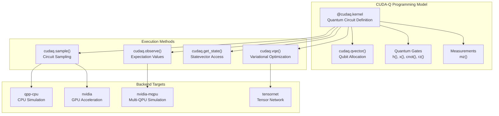
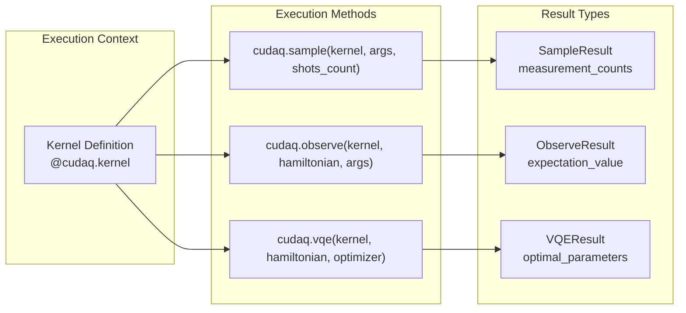
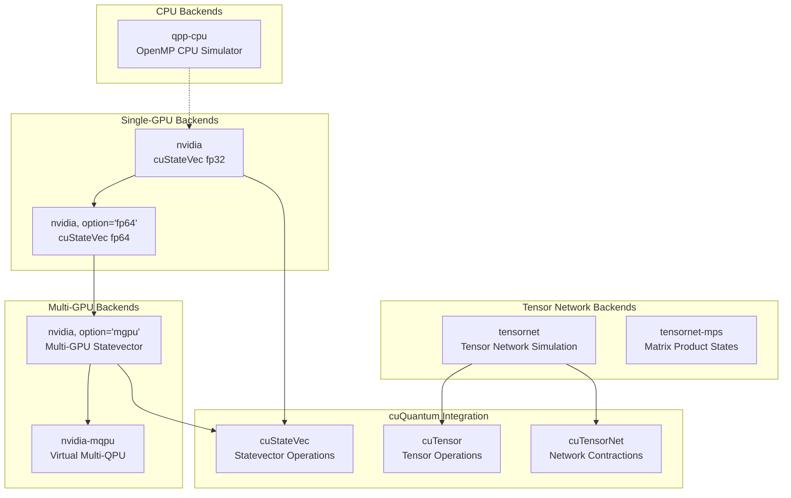

<!-- source: DeepWiki mcp.deepwiki.com · repo NVIDIA/cuda-q-academic · page 7 CUDA-Q Programming Framework · fetched 2026-10-26 -->

# CUDA-Q Programming Framework

<details>
<summary>Relevant source files</summary>

The following files were used as context for generating this wiki page:

- [Guide-to-cuda-q-backends.ipynb](Guide-to-cuda-q-backends.ipynb)
- [README.md](README.md)
- [qaoa-for-max-cut/00_StartHere.ipynb](qaoa-for-max-cut/00_StartHere.ipynb)

</details>


This document provides technical documentation of the CUDA-Q programming platform, covering the core programming model, backend architecture, execution patterns, and advanced features for quantum computing applications. The framework serves as the foundation for all quantum algorithm implementations across the educational modules.

For educational content using CUDA-Q, see [Quick Start to Quantum Computing](#2). For specific algorithm implementations, see [Quantum Algorithms](#3), [QAOA](#4), [Quantum Error Correction](#5), and [Quantum Applications to Finance](#6).

## Core Programming Model

The CUDA-Q framework centers around a kernel-based programming model where quantum circuits are defined as Python functions decorated with `@cudaq.kernel`. This approach provides a unified interface for quantum algorithm development across different execution backends.



**CUDA-Q Programming Model and Execution Flow**

Sources: [Guide-to-cuda-q-backends.ipynb:88-130](), [Guide-to-cuda-q-backends.ipynb:196-235]()

### Kernel Definition and Structure

Quantum circuits in CUDA-Q are defined using the `@cudaq.kernel` decorator, which enables compilation and optimization for various execution backends. The kernel function encapsulates the quantum circuit logic and can accept parameters for dynamic circuit construction.

**Basic Kernel Structure:**
- Qubit allocation using `cudaq.qvector()` or `cudaq.qubit()`
- Gate application through built-in gate functions
- Measurement operations via `mz()` for Z-basis measurements
- Parameter passing for variational algorithms

The framework supports both static circuit definitions and parameterized circuits for variational quantum algorithms. Kernels can be composed by calling other kernel functions, enabling modular circuit design.

Sources: [Guide-to-cuda-q-backends.ipynb:96-123](), [Guide-to-cuda-q-backends.ipynb:204-223]()

### Execution Methods and Data Flow

CUDA-Q provides several execution methods for quantum kernels, each optimized for different computational tasks:



**CUDA-Q Execution Methods and Result Processing**

The `cudaq.sample()` method performs circuit sampling and returns measurement statistics, while `cudaq.observe()` computes expectation values of Hamiltonians defined using `spin` operators. The `cudaq.vqe()` method integrates with classical optimizers for variational algorithm implementations.

Sources: [Guide-to-cuda-q-backends.ipynb:127-129](), [Guide-to-cuda-q-backends.ipynb:227-230](), [Guide-to-cuda-q-backends.ipynb:670-676]()

## Backend Architecture and Configuration

The CUDA-Q backend system provides a flexible architecture supporting various simulation strategies and hardware platforms. Backend selection is controlled through `cudaq.set_target()` with different configuration options.

### Simulation Backend Hierarchy



**CUDA-Q Backend Architecture and cuQuantum Integration**

The backend selection determines the simulation strategy and computational resources utilized. The `nvidia` target family leverages cuQuantum libraries for GPU-accelerated simulations, while specialized backends like `tensornet` enable large-scale quantum circuit simulation through tensor network methods.

Sources: [Guide-to-cuda-q-backends.ipynb:248-255](), [Guide-to-cuda-q-backends.ipynb:808-813]()

### Backend Configuration and Options

Backend configuration in CUDA-Q follows a pattern of target selection with optional parameters:

| Backend Target | Configuration | Use Case | Hardware Requirement |
|---|---|---|---|
| `qpp-cpu` | Default CPU backend | Development and small circuits | CPU only |
| `nvidia` | Single-precision GPU | Production simulations | 1 GPU |
| `nvidia, option='fp64'` | Double-precision GPU | High-precision simulations | 1 GPU |
| `nvidia, option='mgpu'` | Multi-GPU statevector | Large quantum systems | Multiple GPUs |
| `nvidia-mqpu` | Virtual multi-QPU | Parallel algorithm execution | Multiple GPUs |
| `tensornet` | Tensor network simulation | Memory-efficient simulation | GPU (optional) |

The multi-GPU backends automatically handle statevector distribution when the number of qubits exceeds configurable thresholds, controlled by the `CUDAQ_MGPU_NQUBITS_THRESH` environment variable.

Sources: [Guide-to-cuda-q-backends.ipynb:248-255](), [Guide-to-cuda-q-backends.ipynb:277-281]()

## Parallelization Patterns and Execution Models

CUDA-Q supports multiple parallelization strategies for scaling quantum simulations across different computational resources. These patterns enable efficient utilization of multi-GPU systems and distributed computing environments.

### Multi-QPU Execution Patterns

```mermaid
graph TD
    subgraph "Circuit Sampling Pattern"
        CIRCUIT["Single Quantum Circuit"]
        SPLIT_SAMPLING["Split Sampling Tasks"]
        GPU1_SAMPLE["GPU 1<br/>Samples 1-N"]
        GPU2_SAMPLE["GPU 2<br/>Samples N+1-2N"]
        MERGE_SAMPLES["Aggregate Sample Results"]
    end
    
    subgraph "Hamiltonian Batching Pattern"
        HAMILTONIAN["Multi-term Hamiltonian<br/>H = H1 + H2 + H3 + H4"]
        TERM_DISTRIBUTION["Distribute Hamiltonian Terms"]
        GPU1_HAM["GPU 1<br/>Compute ⟨H1⟩ + ⟨H2⟩"]
        GPU2_HAM["GPU 2<br/>Compute ⟨H3⟩ + ⟨H4⟩"]
        EXPECTATION["Final Expectation Value<br/>⟨H⟩ = ⟨H1⟩ + ⟨H2⟩ + ⟨H3⟩ + ⟨H4⟩"]
    end
    
    subgraph "Circuit Cutting Pattern"
        LARGE_CIRCUIT["Large Quantum Circuit"]
        GRAPH_PARTITION["Graph Partitioning"]
        SUBGRAPH1["Subgraph 1<br/>QAOA Circuit"]
        SUBGRAPH2["Subgraph 2<br/>QAOA Circuit"]
        MERGE_RESULTS["Merge Optimization Results"]
    end
    
    CIRCUIT --> SPLIT_SAMPLING
    SPLIT_SAMPLING --> GPU1_SAMPLE
    SPLIT_SAMPLING --> GPU2_SAMPLE
    GPU1_SAMPLE --> MERGE_SAMPLES
    GPU2_SAMPLE --> MERGE_SAMPLES
    
    HAMILTONIAN --> TERM_DISTRIBUTION
    TERM_DISTRIBUTION --> GPU1_HAM
    TERM_DISTRIBUTION --> GPU2_HAM
    GPU1_HAM --> EXPECTATION
    GPU2_HAM --> EXPECTATION
    
    LARGE_CIRCUIT --> GRAPH_PARTITION
    GRAPH_PARTITION --> SUBGRAPH1
    GRAPH_PARTITION --> SUBGRAPH2
    SUBGRAPH1 --> MERGE_RESULTS
    SUBGRAPH2 --> MERGE_RESULTS
```



**CUDA-Q Parallelization Patterns for Multi-GPU Execution**

Each parallelization pattern addresses different computational bottlenecks: circuit sampling distributes measurement tasks, Hamiltonian batching parallelizes expectation value calculations, and circuit cutting enables simulation of large quantum systems through decomposition.

Sources: [Guide-to-cuda-q-backends.ipynb:310-317](), [Guide-to-cuda-q-backends.ipynb:323-370](), [Guide-to-cuda-q-backends.ipynb:376-387]()

### MPI Integration and Distributed Computing

For large-scale quantum simulations, CUDA-Q integrates with MPI (Message Passing Interface) to coordinate execution across multiple nodes. This enables distributed variational quantum algorithms and parallel optimization strategies.

The MPI integration pattern involves:
- Process-based distribution of quantum computational tasks
- Automatic backend configuration for multi-GPU systems
- Synchronization of optimization results across processes

**MPI Execution Example:**
```bash
mpiexec -np 4 python3 quantum_program.py
```

This approach is demonstrated in the divide-and-conquer QAOA implementation, where graph partitioning problems are distributed across multiple MPI processes, each handling different subgraphs in parallel.

Sources: [Guide-to-cuda-q-backends.ipynb:754-788](), [qaoa-for-max-cut/00_StartHere.ipynb:58]()

## Advanced Programming Features

### Hamiltonian Construction and Spin Operators

CUDA-Q provides a comprehensive system for constructing quantum Hamiltonians using the `spin` module. Hamiltonians are built using Pauli operators and can be composed with arithmetic operations:

```python
hamiltonian = spin.z(0) + 2*spin.y(1) - spin.x(0) * spin.z(1)
```

The Hamiltonian construction supports:
- Pauli operators: `spin.x()`, `spin.y()`, `spin.z()`, `spin.i()`
- Tensor products and linear combinations
- Integration with `cudaq.observe()` for expectation value calculations

Sources: [Guide-to-cuda-q-backends.ipynb:224-226](), [Guide-to-cuda-q-backends.ipynb:352-354]()

### Variational Quantum Algorithm Integration

The framework provides built-in support for variational quantum algorithms through the `cudaq.vqe()` function, which integrates quantum kernels with classical optimizers:

**VQE Integration Components:**
- Quantum kernel definition with parameterized gates
- Classical optimizer selection (`cudaq.optimizers.COBYLA`, etc.)
- Automatic gradient computation and parameter optimization
- Argument mapping for kernel parameter passing

The `argument_mapper` function bridges between optimizer parameter vectors and kernel argument structures, enabling flexible parameterization strategies for different quantum algorithms.

Sources: [Guide-to-cuda-q-backends.ipynb:670-676]()

### Circuit Visualization and Debugging

CUDA-Q includes circuit visualization capabilities through the `cudaq.draw()` function, supporting both ASCII and LaTeX output formats:

```python
print(cudaq.draw(kernel, args))                    # ASCII format
print(cudaq.draw('latex', kernel, args))           # LaTeX format
```

This functionality enables circuit verification and educational visualization across all modules in the CUDA-Q Academic repository.

Sources: [Guide-to-cuda-q-backends.ipynb:231-232]()

## Hardware Requirements and Performance Considerations

### Computational Resource Requirements

Different CUDA-Q backends have varying hardware requirements and performance characteristics:

| Operation Type | CPU Backend | Single-GPU | Multi-GPU | Memory Scaling |
|---|---|---|---|---|
| Small circuits (< 20 qubits) | `qpp-cpu` | `nvidia` | Not needed | Linear |
| Medium circuits (20-25 qubits) | Limited | `nvidia, fp64` | `nvidia, mgpu` | Exponential |
| Large circuits (> 25 qubits) | Not feasible | Memory limited | `nvidia, mgpu` | Distributed |
| Variational algorithms | `qpp-cpu` | `nvidia-mqpu` | `nvidia-mqpu` | Algorithm dependent |

The framework automatically handles memory distribution for large statevectors when using multi-GPU backends, with configurable thresholds for triggering distributed simulation modes.

Sources: [Guide-to-cuda-q-backends.ipynb:277-281](), [qaoa-for-max-cut/00_StartHere.ipynb:132-135]()

### GPU Acceleration and cuQuantum Libraries

CUDA-Q leverages NVIDIA's cuQuantum library suite for high-performance quantum simulation:

- **cuStateVec**: Statevector simulation with GPU acceleration
- **cuTensor**: Tensor operation acceleration for quantum computations
- **cuTensorNet**: Tensor network contraction optimization

These libraries provide significant performance improvements for quantum simulations, particularly for circuits with high qubit counts or complex gate sequences.

Sources: [Guide-to-cuda-q-backends.ipynb:248-255]()

## Integration with Educational Modules

The CUDA-Q programming framework serves as the foundation for all educational content in the repository. Each module builds upon the core programming model while demonstrating specific quantum computing applications:

- **Quick Start Module**: Introduces basic `@cudaq.kernel` usage and `cudaq.sample()` operations
- **QAOA Module**: Demonstrates variational algorithms with `cudaq.vqe()` and multi-GPU execution
- **QEC Module**: Utilizes noise models and error simulation capabilities
- **Finance Module**: Applies quantum walks and Monte Carlo methods using CUDA-Q primitives

The consistent programming model across modules enables learners to focus on algorithmic concepts while building proficiency with the underlying quantum computing framework.

Sources: [README.md:12](), [README.md:17-51]()

---

