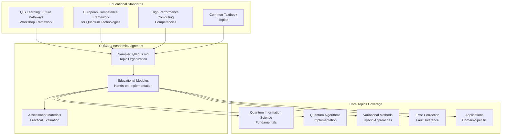
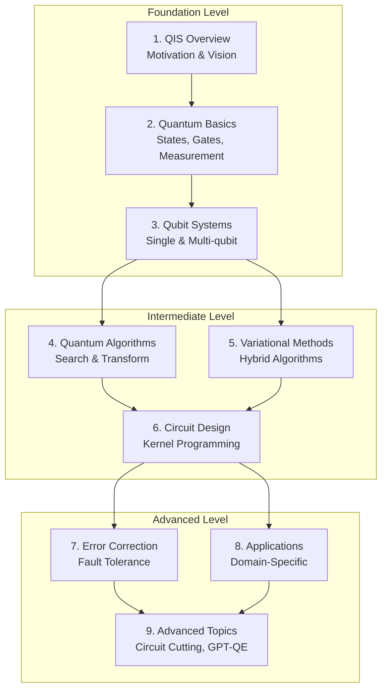
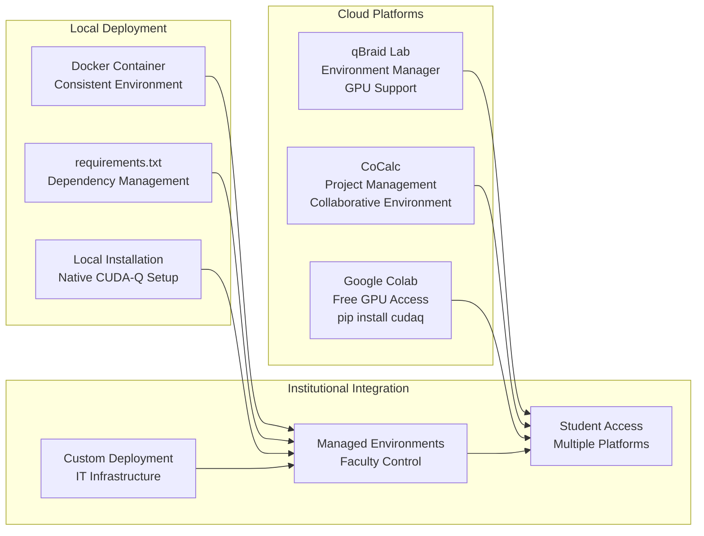
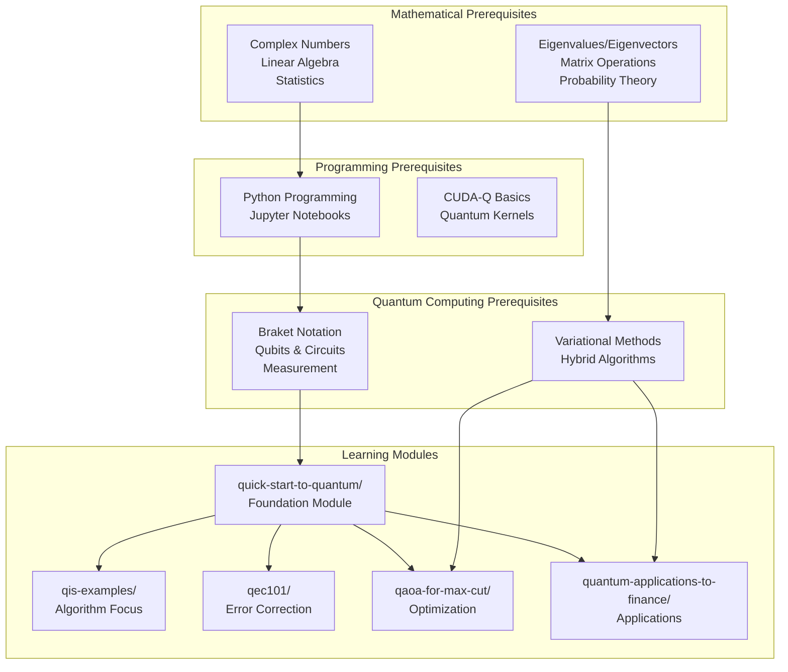
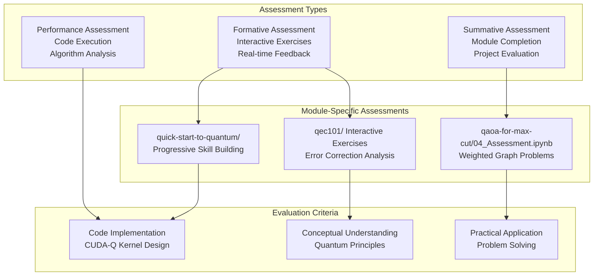
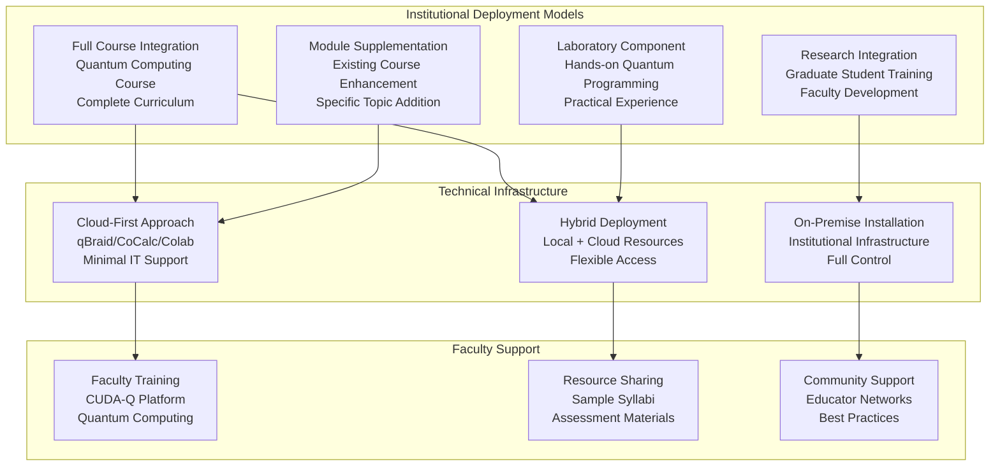

<!-- source: DeepWiki mcp.deepwiki.com · repo NVIDIA/cuda-q-academic · page 8 Educational Integration · fetched 2026-10-26 -->

# Educational Integration

Relevant source files

The following files were used as context for generating this wiki page:

- [Sample-Syllabus.md](Sample-Syllabus.md)
- [qaoa-for-max-cut/README.md](qaoa-for-max-cut/README.md)
- [qec101/README.md](qec101/README.md)
- [qis-examples/README.md](qis-examples/README.md)
- [quantum-applications-to-finance/README.md](quantum-applications-to-finance/README.md)
- [quick-start-to-quantum/README.md](quick-start-to-quantum/README.md)

This document provides guidance for educators on integrating CUDA-Q Academic materials into quantum computing and quantum information science curricula. It covers curriculum alignment with educational standards, sample syllabus structures, deployment options, and institutional integration strategies.

For technical details on the CUDA-Q programming framework, see [CUDA-Q Programming Framework](#7). For specific module content and implementation details, see the individual module pages: [Quick Start to Quantum Computing](#2), [Quantum Algorithms](#3), [QAOA](#4), [Quantum Error Correction](#5), and [Quantum Applications to Finance](#6).

## Curriculum Alignment and Educational Standards

The CUDA-Q Academic resources are designed to align with established quantum education frameworks and standards. The materials integrate concepts from multiple authoritative sources to ensure comprehensive coverage of quantum computing fundamentals.

**Curriculum Standards Integration**

Sources: [Sample-Syllabus.md:14-18]()

The curriculum framework integrates four key educational standards:
- **QIS Learning Future Pathways**: Research-based learning objectives for quantum information science
- **European Competence Framework**: Standardized competencies for quantum technology education
- **HPC Competencies**: High-performance computing skills relevant to quantum acceleration
- **Textbook Alignment**: Common topics found across quantum computing textbooks

## Sample Syllabus Structure

The sample syllabus provides a structured approach to incorporating CUDA-Q materials into existing courses, organized by topic complexity and learning objectives.

### Topic Organization and Resource Mapping

**Syllabus Topic Breakdown**

Sources: [Sample-Syllabus.md:21-67]()

| Topic Category | CUDA-Q Resources | Learning Objectives |
|---|---|---|
| **QIS Overview** | Blog posts, videos, quick-start materials | Understand quantum computing motivation and vision |
| **Quantum Fundamentals** | `quick-start-to-quantum/` notebooks | Master quantum states, gates, and measurement |
| **Quantum Algorithms** | `qis-examples/grovers.ipynb`, CUDA-Q examples | Implement search and transformation algorithms |
| **Variational Methods** | `qaoa-for-max-cut/` series | Develop hybrid quantum-classical programs |
| **Error Correction** | `qec101/` complete series | Understand fault-tolerant computation |
| **Applications** | `quantum-applications-to-finance/` | Apply quantum methods to real problems |

### Resource Integration Matrix

Sources: [Sample-Syllabus.md:32-54]()

The syllabus maps specific CUDA-Q resources to traditional quantum computing topics:

- **Quantum States and Gates**: Interactive visualization tools and basic kernel programming
- **Entanglement**: Multi-qubit programming exercises with measurement analysis
- **Quantum Circuits**: Kernel structure, sampling, and expectation value computation
- **Variational Algorithms**: Complete QAOA implementation with optimization
- **Error Mitigation**: Practical noise models and correction techniques

## Deployment and Platform Integration

CUDA-Q Academic materials support multiple deployment strategies to accommodate different institutional needs and technical constraints.

### Platform Ecosystem

**Platform-Specific Integration**

Sources: [quick-start-to-quantum/README.md:23-35](), [qec101/README.md:20-34](), [qaoa-for-max-cut/README.md:6-24]()

Each educational module provides standardized deployment instructions:

| Platform | Setup Requirements | Special Considerations |
|---|---|---|
| **qBraid Lab** | Environment Manager for CUDA-Q installation | GPU access via Compute Manager |
| **CoCalc** | "Edit your own copy" workflow | Interactive widgets require file copying |
| **Google Colab** | `!pip install cudaq` in each notebook | Limited GPU access, temporary sessions |
| **Local Docker** | `Dockerfile` and `requirements.txt` | Consistent cross-platform deployment |

### Environment Management

Sources: [quick-start-to-quantum/README.md:19-21](), [qec101/README.md:18-19]()

The deployment system handles several technical requirements:

- **Interactive Widgets**: Require copying the `interactive-widgets/` folder to the working environment
- **GPU Dependencies**: Advanced modules need GPU access for practical execution
- **Package Management**: Consistent `requirements.txt` across all modules
- **Asset Management**: Images and visualization components must be accessible

## Prerequisites and Learning Pathways

The educational integration follows a structured prerequisite system to ensure appropriate knowledge building across modules.

### Learning Progression Framework

**Prerequisite Specification by Module**

Sources: [quick-start-to-quantum/README.md:7-8](), [qec101/README.md:6-7](), [quantum-applications-to-finance/README.md:5-6]()

Each module specifies clear prerequisites:

- **Quick Start to Quantum**: Complex numbers, linear algebra, statistics, Python familiarity
- **QEC 101**: Requires Quick Start completion, braket notation, quantum circuit concepts
- **Quantum Finance**: Assumes quantum computing background from Quick Start module
- **QAOA Max Cut**: Advanced optimization requires variational algorithm understanding

### Competency Development

The learning pathway develops specific competencies aligned with educational standards:

| Competency Level | Skills Developed | Assessment Methods |
|---|---|---|
| **Foundation** | Quantum state representation, basic gates, measurement | Interactive exercises, visualization tools |
| **Intermediate** | Algorithm implementation, circuit design, hybrid programming | Notebook completion, code analysis |
| **Advanced** | Error correction, optimization, domain applications | Assessment exercises, project implementation |
| **Expert** | Distributed computing, advanced applications, research methods | Open-ended projects, performance analysis |

## Assessment and Evaluation

The educational materials include structured assessment components to evaluate student learning and provide feedback on quantum computing competencies.

### Assessment Framework

**Assessment Implementation**

Sources: [qaoa-for-max-cut/README.md:17-24]()

The assessment system provides multiple evaluation mechanisms:

- **Hands-on Coding**: Students implement quantum algorithms using CUDA-Q kernels
- **Conceptual Analysis**: Understanding of quantum principles through practical application
- **Performance Evaluation**: Code execution and optimization analysis
- **Progressive Complexity**: Assessments scale from basic concepts to advanced applications

### GPU-Dependent Assessments

Sources: [qaoa-for-max-cut/README.md:22-24]()

Advanced assessments require computational resources:
- **QAOA Assessment**: Requires GPU for weighted graph optimization problems
- **Divide-and-Conquer Labs**: GPU acceleration needed for parallel execution
- **Alternative Evaluation**: Code analysis available when GPU access is unavailable

## Institutional Integration Strategies

Educational institutions can implement CUDA-Q Academic materials through various integration approaches depending on their technical infrastructure and pedagogical objectives.

### Integration Models

**Implementation Considerations**

Sources: [Sample-Syllabus.md:3-5](), [Sample-Syllabus.md:14-19]()

Institutions should consider several factors when integrating CUDA-Q Academic materials:

### Course Integration Levels

| Integration Level | Implementation | Resource Requirements |
|---|---|---|
| **Complete Course** | Full quantum computing curriculum using CUDA-Q | Dedicated course slot, faculty expertise |
| **Module Addition** | Specific topics added to existing courses | Flexible scheduling, basic quantum knowledge |
| **Laboratory Sessions** | Hands-on programming component | Computer lab access, technical support |
| **Research Enhancement** | Graduate research and faculty development | Advanced infrastructure, research focus |

### Technical Infrastructure Planning

The deployment strategy should align with institutional capabilities:

- **Cloud-First**: Minimal IT overhead, immediate access, platform dependencies
- **Hybrid Approach**: Combines local resources with cloud flexibility
- **On-Premise**: Maximum control, requires significant IT investment

### Faculty Development Requirements

Successful integration requires faculty preparation:
- **Platform Training**: CUDA-Q programming and quantum computing concepts
- **Curriculum Planning**: Syllabus integration and assessment design
- **Technical Support**: Understanding deployment options and troubleshooting

Sources: [Sample-Syllabus.md:1-19](), [quick-start-to-quantum/README.md:1-36](), [qec101/README.md:1-35](), [qaoa-for-max-cut/README.md:1-25](), [quantum-applications-to-finance/README.md:1-25](), [qis-examples/README.md:1-25]()

---

