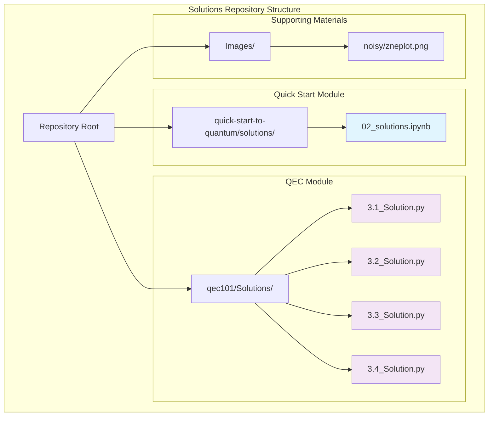
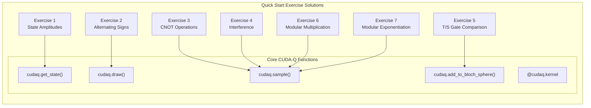
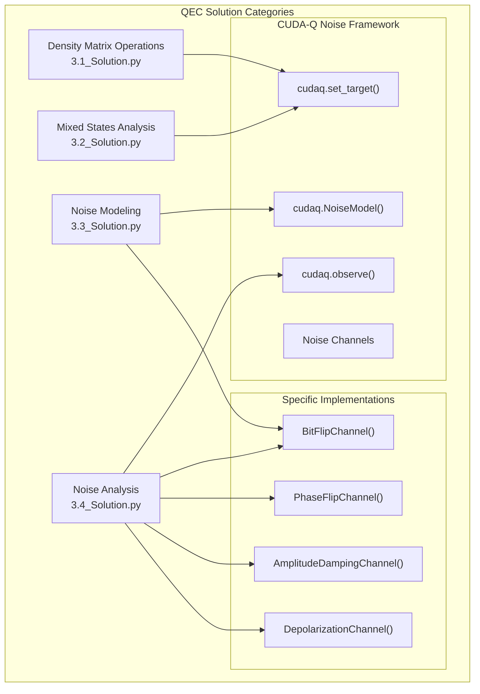
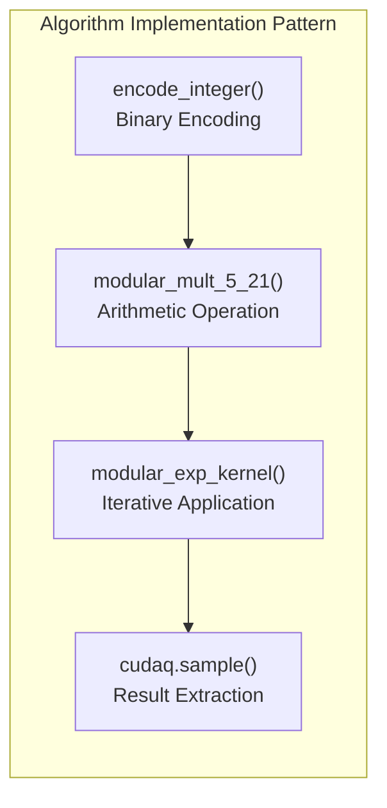

<!-- source: DeepWiki mcp.deepwiki.com · repo NVIDIA/cuda-q-academic · page 9 Solutions and Examples · fetched 2026-10-26 -->

# Solutions and Examples

<details>
<summary>Relevant source files</summary>

The following files were used as context for generating this wiki page:

- [qec101/Images/noisy/zneplot.png](qec101/Images/noisy/zneplot.png)
- [qec101/Solutions/3.1_Solution.py](qec101/Solutions/3.1_Solution.py)
- [qec101/Solutions/3.2_Solution.py](qec101/Solutions/3.2_Solution.py)
- [qec101/Solutions/3.3_Solution.py](qec101/Solutions/3.3_Solution.py)
- [qec101/Solutions/3.4_Solution.py](qec101/Solutions/3.4_Solution.py)
- [quick-start-to-quantum/solutions/02_solutions.ipynb](quick-start-to-quantum/solutions/02_solutions.ipynb)

</details>


This document provides a comprehensive guide to the worked solutions, code examples, and assessment materials available across all educational modules in the CUDA-Q Academic repository. The solutions serve as reference implementations for exercises, demonstrations of key concepts, and evaluation tools for educators and students.

For information about the specific educational modules themselves, see [Quick Start to Quantum Computing](#2), [Quantum Error Correction](#5), [QAOA](#4), and other module-specific pages.

## Purpose and Scope

The solutions and examples collection encompasses:

- **Worked Exercise Solutions**: Step-by-step implementations for hands-on exercises across all modules
- **Code Demonstrations**: Practical examples showcasing CUDA-Q programming techniques
- **Assessment Materials**: Evaluation tools and reference implementations for educational assessment
- **Visualization Examples**: Interactive demonstrations using the widget framework
- **Research Examples**: Advanced implementations for algorithm development and experimentation

## Solution Organization Structure

### Module-Based Organization



**Solution File Types and Conventions**

| Module | File Format | Naming Pattern | Purpose |
|--------|-------------|----------------|---------|
| Quick Start | Jupyter Notebooks | `XX_solutions.ipynb` | Interactive exercise solutions |
| QEC101 | Python Scripts | `X.Y_Solution.py` | Standalone implementation examples |
| QAOA | Mixed | Module-specific | Algorithm demonstrations |
| Finance | Mixed | Module-specific | Application examples |

Sources: [quick-start-to-quantum/solutions/02_solutions.ipynb:1-360](), [qec101/Solutions/3.1_Solution.py:1-26](), [qec101/Solutions/3.2_Solution.py:1-41](), [qec101/Solutions/3.3_Solution.py:1-17](), [qec101/Solutions/3.4_Solution.py:1-113]()

## Quick Start Solutions Overview

### Exercise Categories and Implementations



### Key Solution Components

**Exercise 1: State Amplitude Extraction**
- Demonstrates `cudaq.get_state()` for specific basis states
- Shows amplitude extraction with precision control
- Uses `nested_quantum_program` function calls

**Exercise 2: Multi-Qubit State Preparation**
- Implements alternating qubit initialization patterns
- Combines X gates with Hadamard operations
- Demonstrates statevector verification techniques

**Exercise 3: CNOT Gate Sequences**
- Advanced CNOT operations with alternating control/target
- Bell state preparation and measurement
- Quantum state distribution analysis

Sources: [quick-start-to-quantum/solutions/02_solutions.ipynb:32-37](), [quick-start-to-quantum/solutions/02_solutions.ipynb:51-68](), [quick-start-to-quantum/solutions/02_solutions.ipynb:80-111]()

## Quantum Error Correction Solutions

### Density Matrix and Noise Analysis



### Implementation Details

**3.1_Solution.py: Density Matrix Foundations**
- Density matrix computation using `density-matrix-cpu` target
- Trace, Hermitian, and positive semi-definite property verification
- Eigenvalue analysis for quantum state validation

**3.2_Solution.py: Mixed State Analysis**
- Statistical mixture construction from pure states
- Bell state density matrix operations
- Purity calculations using trace of squared density matrix

**3.3_Solution.py: Basic Noise Modeling**
- `BitFlipChannel` implementation with different error rates
- Multi-qubit noise application
- Sampling with noise model integration

**3.4_Solution.py: Advanced Noise Analysis**
- Comprehensive noise type comparison (bit flip, phase flip, amplitude damping, depolarization)
- Error mitigation through trajectory sampling
- Statistical analysis of noisy quantum computations

Sources: [qec101/Solutions/3.1_Solution.py:4-26](), [qec101/Solutions/3.2_Solution.py:15-41](), [qec101/Solutions/3.3_Solution.py:6-17](), [qec101/Solutions/3.4_Solution.py:6-113]()

## Advanced Algorithm Solutions

### Modular Arithmetic and Shor's Algorithm Components

The Quick Start solutions include sophisticated implementations related to quantum algorithms:

**Modular Multiplication Circuit (Exercise 6)**
- Implements `modular_mult_5_21()` kernel for modular arithmetic
- Demonstrates `encode_integer()` function for binary state preparation
- Shows quantum circuit construction for mathematical operations

**Modular Exponentiation (Exercise 7)**
- Iterative application of modular multiplication
- Quantum implementation of classical mathematical functions
- Integration with measurement and result extraction



Sources: [quick-start-to-quantum/solutions/02_solutions.ipynb:243-287](), [quick-start-to-quantum/solutions/02_solutions.ipynb:298-335]()

## Visualization and Interactive Examples

### Bloch Sphere Integration

**T and S Gate Comparison (Exercise 5)**
- Demonstrates `cudaq.add_to_bloch_sphere()` for state visualization
- Shows quantum gate effect comparison through visual representation
- Integrates with interactive widget framework

The solution implements:
```python
sphere = cudaq.add_to_bloch_sphere(cudaq.get_state(compare_t_s, t_or_s))
cudaq.show(sphere)
```

This pattern provides a foundation for interactive educational demonstrations across all modules.

Sources: [quick-start-to-quantum/solutions/02_solutions.ipynb:212-216]()

## Assessment and Evaluation Tools

### Noise Analysis and Error Mitigation

The QEC solutions provide comprehensive tools for evaluating quantum algorithm performance under realistic conditions:

**Error Rate Analysis**
- Systematic comparison of different noise channels on algorithm performance
- Statistical evaluation using multiple trajectory sampling
- Performance impact assessment across different error probabilities

**Mitigation Strategy Evaluation**
- Zero-noise extrapolation techniques
- Trajectory-based error analysis
- Comparative studies of error correction effectiveness

Sources: [qec101/Solutions/3.4_Solution.py:26-113](), [qec101/Images/noisy/zneplot.png:1-4]()

## Usage Guidelines for Educators and Students

### For Educators
- Solutions provide reference implementations for exercise verification
- Assessment materials enable objective evaluation of student progress
- Noise analysis tools demonstrate realistic quantum computing challenges

### For Students
- Step-by-step implementations guide learning progression
- Interactive examples support hands-on exploration
- Advanced solutions demonstrate scalable programming techniques

### For Researchers
- Modular components enable algorithm development and testing
- Noise modeling framework supports realistic simulation studies
- Visualization tools facilitate result interpretation and presentation

The solutions collection serves as both a learning resource and a foundation for advanced quantum computing education and research using the CUDA-Q platform.

---

