# Page: Overview

# Overview

<details>
<summary>Relevant source files</summary>

The following files were used as context for generating this wiki page:

- [Guide-to-cuda-q-backends.ipynb](Guide-to-cuda-q-backends.ipynb)
- [README.md](README.md)
- [Sample-Syllabus.md](Sample-Syllabus.md)
- [qaoa-for-max-cut/00_StartHere.ipynb](qaoa-for-max-cut/00_StartHere.ipynb)

</details>


This document provides a comprehensive overview of the CUDA-Q Academic repository, which serves as NVIDIA's educational platform for quantum computing training. The repository contains interactive Jupyter notebooks and supporting materials designed to prepare quantum computing professionals by combining high-performance computing with quantum computing skills, developed in collaboration with universities and tested in real classroom settings.

For specific implementation details of individual modules, see [Quick Start to Quantum Computing](#2), [Quantum Algorithms](#3), [QAOA](#4), [Quantum Error Correction](#5), and [Quantum Applications to Finance](#6). For technical documentation of the underlying CUDA-Q framework, see [CUDA-Q Programming Framework](#7).

## Repository Architecture

CUDA-Q Academic follows a modular educational architecture with clear progression paths and technical infrastructure supporting multiple deployment options.

### Educational Module Structure

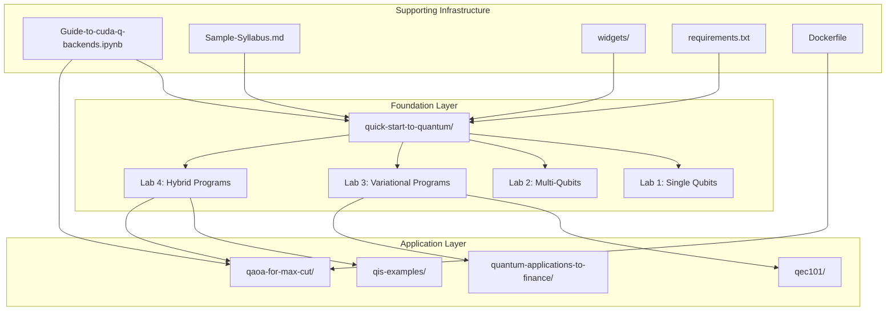

Sources: [README.md:1-51](), [Sample-Syllabus.md:1-67]()

### Learning Progression Flow

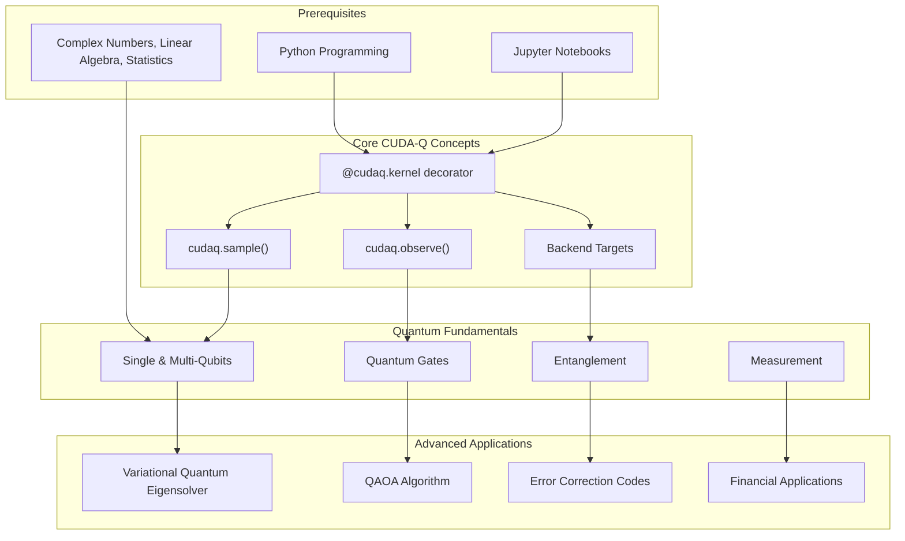

Sources: [README.md:20-21](), [README.md:26-28](), [README.md:35-37](), [README.md:49-50]()

## Technical Framework Integration

The repository leverages the CUDA-Q programming model to provide a unified interface from educational concepts to high-performance quantum computing backends.

### CUDA-Q Programming Model

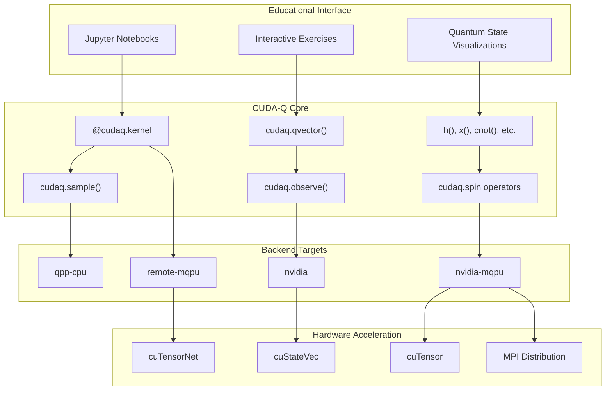

Sources: [Guide-to-cuda-q-backends.ipynb:88-129](), [Guide-to-cuda-q-backends.ipynb:200-235]()

## Core Educational Modules

### Module Classification by Complexity

| Module | Prerequisites | Hardware Requirements | Key CUDA-Q Features |
|--------|--------------|----------------------|-------------------|
| `quick-start-to-quantum/` | Python, Math basics | CPU | `@cudaq.kernel`, `cudaq.sample()` |
| `qis-examples/` | Quick Start completion | CPU | `cudaq.observe()`, Hamiltonian construction |
| `qaoa-for-max-cut/` | Quick Start, NetworkX | GPU recommended | `cudaq.vqe()`, optimization |
| `qec101/` | Quick Start completion | CPU | Noise models, error mitigation |
| `quantum-applications-to-finance/` | Quick Start completion | CPU | Quantum walks, financial modeling |

Sources: [README.md:17-51](), [qaoa-for-max-cut/00_StartHere.ipynb:60-62]()

### Backend Configuration Options

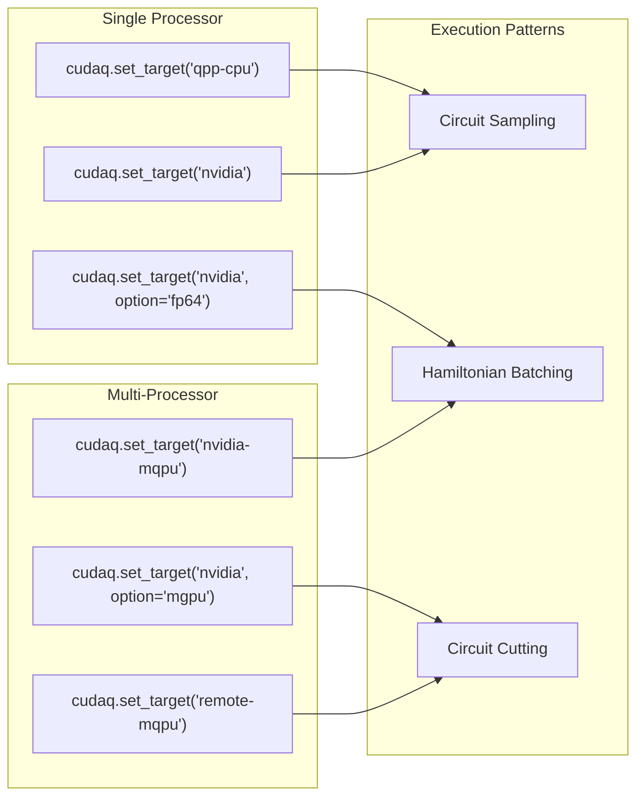

Sources: [Guide-to-cuda-q-backends.ipynb:242-257](), [Guide-to-cuda-q-backends.ipynb:328-370]()

## Deployment Architecture

The repository supports multiple deployment strategies to accommodate different educational environments and resource constraints.

### Platform Integration Options

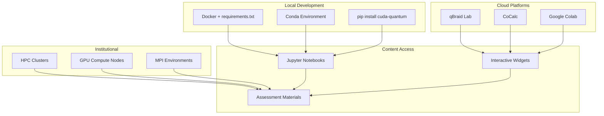

Sources: [README.md:6-7](), [qaoa-for-max-cut/00_StartHere.ipynb:85-87](), [qaoa-for-max-cut/00_StartHere.ipynb:134-135]()

### Resource Requirements by Module

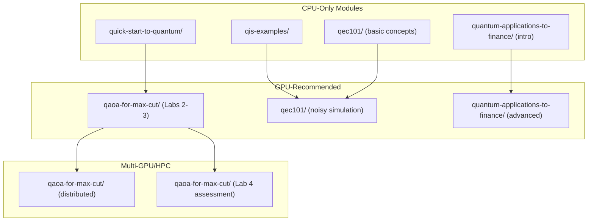

Sources: [qaoa-for-max-cut/00_StartHere.ipynb:124-135](), [README.md:31-51]()

## Educational Standards Alignment

CUDA-Q Academic aligns with established quantum computing educational frameworks and competency standards.

### Curriculum Integration Framework

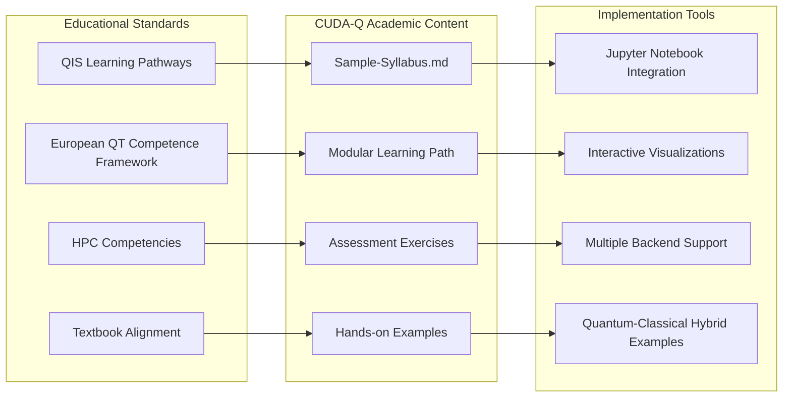

Sources: [Sample-Syllabus.md:14-18](), [Sample-Syllabus.md:21-67]()

This overview establishes the foundation for understanding CUDA-Q Academic's role as a comprehensive quantum computing education platform. For detailed information about specific modules and their implementations, refer to the respective sections listed at the beginning of this document.

---

# Page: Repository Structure

# Repository Structure

<details>
<summary>Relevant source files</summary>

The following files were used as context for generating this wiki page:

- [Guide-to-cuda-q-backends.ipynb](Guide-to-cuda-q-backends.ipynb)
- [README.md](README.md)
- [qaoa-for-max-cut/00_StartHere.ipynb](qaoa-for-max-cut/00_StartHere.ipynb)
- [qaoa-for-max-cut/README.md](qaoa-for-max-cut/README.md)
- [qec101/README.md](qec101/README.md)
- [qis-examples/README.md](qis-examples/README.md)
- [quantum-applications-to-finance/README.md](quantum-applications-to-finance/README.md)
- [quick-start-to-quantum/README.md](quick-start-to-quantum/README.md)

</details>


This document provides an overview of the main educational modules and their organizational structure within the CUDA-Q Academic repository, showing the learning pathway from basic quantum computing concepts to advanced applications.

For information about installation and environment setup, see [Installation and Setup](#1.2). For detailed programming framework documentation, see [CUDA-Q Programming Framework](#7).

## Purpose and Scope

The repository is organized into five main educational modules that form a comprehensive quantum computing curriculum using CUDA-Q. Each module contains Jupyter notebooks, supporting materials, and deployment configurations designed for different learning objectives and technical prerequisites.

## Overall Repository Organization

The repository follows a modular structure where each educational topic forms a self-contained learning unit with its own prerequisites, objectives, and supporting materials.

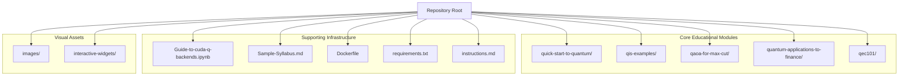

**Repository Structure Overview**

Sources: [README.md:1-51]()

## Learning Progression and Dependencies

The modules are designed with a clear prerequisite structure that guides learners from foundational concepts through specialized applications.

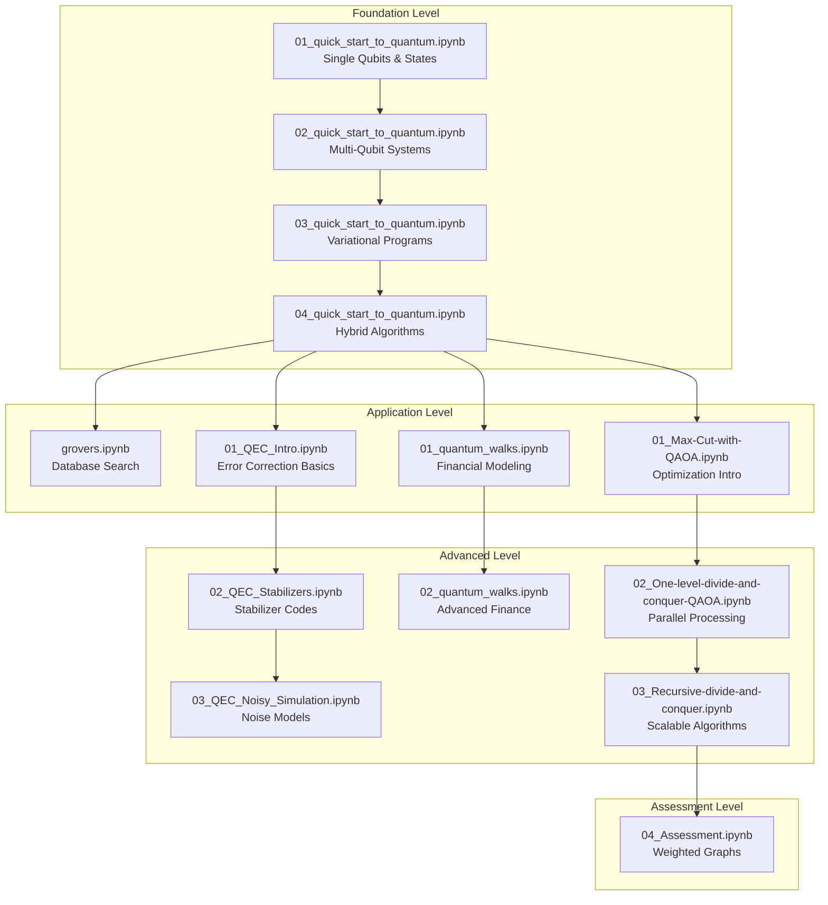

**Learning Path Dependencies**

Sources: [README.md:17-51](), [quick-start-to-quantum/README.md:1-36](), [qec101/README.md:1-35](), [qaoa-for-max-cut/README.md:1-25](), [quantum-applications-to-finance/README.md:1-25]()

## Module Internal Structure

Each educational module follows a consistent organizational pattern with notebooks, supporting materials, and deployment configurations.

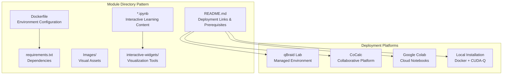

**Standard Module Organization**

Sources: [quick-start-to-quantum/README.md:18-36](), [qec101/README.md:17-35](), [qaoa-for-max-cut/README.md:3-25]()

## Educational Module Details

### Quick Start to Quantum Computing (`quick-start-to-quantum/`)

The foundational module containing four progressive laboratories that introduce quantum computing concepts and CUDA-Q programming.

| Notebook | Focus | Technical Requirements |
|----------|-------|----------------------|
| `01_quick_start_to_quantum.ipynb` | Single qubits, quantum states, basic gates | CPU simulation |
| `02_quick_start_to_quantum.ipynb` | Multi-qubit systems, entanglement | CPU simulation |
| `03_quick_start_to_quantum.ipynb` | Parameterized circuits, variational methods | CPU simulation |
| `04_quick_start_to_quantum.ipynb` | Hybrid quantum-classical optimization | CPU simulation |

**Prerequisites**: Python programming, complex numbers, linear algebra, statistics
**Learning Objectives**: CUDA-Q kernel programming, quantum state manipulation, variational algorithms

Sources: [README.md:17-22](), [quick-start-to-quantum/README.md:1-36]()

### Quantum Information Science Examples (`qis-examples/`)

Complementary implementations of fundamental quantum algorithms for academic courses.

- `grovers.ipynb` - Database search algorithm implementation
- Designed to complement textbooks rather than standalone learning
- Requires completion of Quick Start module

Sources: [README.md:23-29](), [qis-examples/README.md:1-25]()

### QAOA for Max Cut (`qaoa-for-max-cut/`)

Advanced optimization module implementing divide-and-conquer strategies for large-scale problems.

| Notebook | Content | GPU Requirements |
|----------|---------|------------------|
| `00_StartHere.ipynb` | Introduction and setup | None |
| `01_Max-Cut-with-QAOA.ipynb` | Basic QAOA implementation | CPU only |
| `02_One-level-divide-and-conquer-QAOA.ipynb` | Parallel processing introduction | GPU required for final section |
| `03_Recursive-divide-and-conquer.ipynb` | Scalable recursive algorithms | GPU required |
| `04_Assessment.ipynb` | Weighted graph problems | GPU required |

**Prerequisites**: NetworkX package familiarity, Quick Start completion or equivalent VQE/QAOA experience

Sources: [README.md:31-38](), [qaoa-for-max-cut/README.md:1-25](), [qaoa-for-max-cut/00_StartHere.ipynb:44-64]()

### Quantum Error Correction (`qec101/`)

Comprehensive error correction curriculum from basic concepts to advanced stabilizer codes.

| Laboratory | Focus | Implementation |
|------------|-------|----------------|
| `01_QEC_Intro.ipynb` | Classical and quantum error correction fundamentals | Basic theory |
| `02_QEC_Stabilizers.ipynb` | Shor code, Steane code implementations | Stabilizer formalism |
| `03_QEC_Noisy_Simulation.ipynb` | Noise models and error mitigation | Realistic simulations |
| `04_Magic_State_Distillation.ipynb` | Fault-tolerant state preparation | Coming soon |

**Prerequisites**: CUDA-Q programming, quantum circuits, measurement concepts

Sources: [README.md:46-51](), [qec101/README.md:1-35]()

### Quantum Applications to Finance (`quantum-applications-to-finance/`)

Financial modeling applications using quantum walks and optimization algorithms.

- `01_quantum_walks.ipynb` - Discrete-time quantum walks (DTQW) foundations
- `02_quantum_walks.ipynb` - Multi-state quantum walks (mSSQW) for finance
- `Portfolio_Optimization.ipynb` - Investment optimization (coming soon)

**Prerequisites**: CUDA-Q programming, quantum computing fundamentals from Quick Start

Sources: [README.md:40-44](), [quantum-applications-to-finance/README.md:1-25]()

## Supporting Infrastructure

### Backend Configuration System

The `Guide-to-cuda-q-backends.ipynb` provides comprehensive backend selection and configuration guidance.

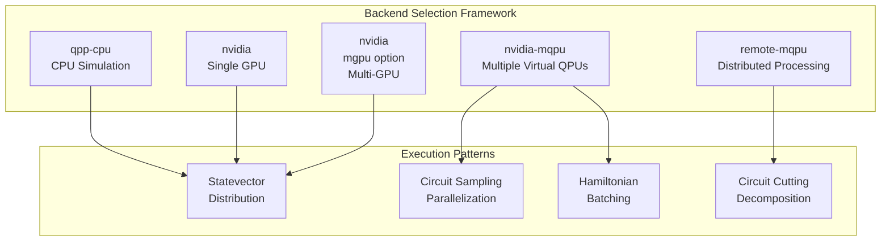

**Backend Architecture Overview**

Sources: [Guide-to-cuda-q-backends.ipynb:241-370]()

### Deployment Configurations

Each module includes standardized deployment options through README.md tables linking to external platforms.

**Platform Integration Pattern**:
- qBraid Lab with Environment Manager and Compute Manager
- CoCalc with project-based execution
- Google Colab with `pip install cudaq` requirement
- Local installation via Docker and requirements.txt

Sources: [quick-start-to-quantum/README.md:23-36](), [qec101/README.md:20-35]()

### Visual Assets and Interactive Components

- `images/` directory containing educational diagrams and animations
- `interactive-widgets/` directory with Bloch sphere and circuit visualization tools
- Module-specific Images/ subdirectories for specialized content

Sources: [quick-start-to-quantum/README.md:19-20](), [qec101/README.md:34]()

---

# Page: Installation and Setup

# Installation and Setup

<details>
<summary>Relevant source files</summary>

The following files were used as context for generating this wiki page:

- [Guide-to-cuda-q-backends.ipynb](Guide-to-cuda-q-backends.ipynb)
- [README.md](README.md)
- [qaoa-for-max-cut/00_StartHere.ipynb](qaoa-for-max-cut/00_StartHere.ipynb)
- [requirements.txt](requirements.txt)

</details>


This document covers the installation, configuration, and deployment of CUDA-Q Academic educational modules. It provides technical guidance for setting up the quantum computing development environment, configuring backends, and deploying across different platforms.

For information about the educational content structure, see [Repository Structure](#1.1). For backend-specific programming techniques, see [CUDA-Q Programming Framework](#7).

## Installation Methods

CUDA-Q Academic supports multiple installation approaches depending on your deployment requirements and available infrastructure.

### Local Installation

The primary installation method uses Python package management with the core dependencies specified in [requirements.txt:1-73](). The essential components include:

| Component | Version | Purpose |
|-----------|---------|---------|
| `cuda-quantum` | 0.7.1 | Core CUDA-Q framework |
| `cuquantum-cu11` | 23.10.0 | NVIDIA cuQuantum library suite |
| `custatevec-cu11` | 1.5.0 | State vector simulation |
| `cutensor-cu11` | 1.7.0 | Tensor operations |
| `cutensornet-cu11` | 2.3.0 | Tensor network simulation |

```bash
pip install -r requirements.txt
```

**Installation Architecture**

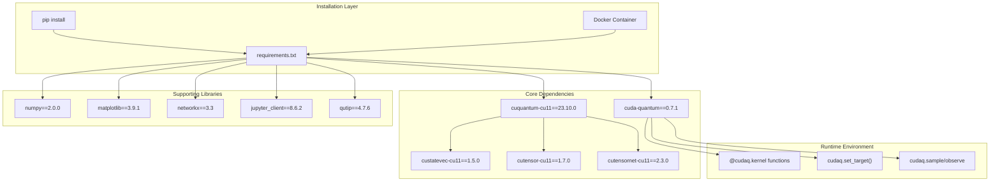

**Sources:** [requirements.txt:1-73](), [qaoa-for-max-cut/00_StartHere.ipynb:85-87]()

### Container-Based Installation

Docker containers provide isolated environments with pre-configured dependencies. Each educational module includes Dockerfile specifications for containerized deployment.

```bash
docker build -t cuda-q-academic .
docker run -it --gpus all cuda-q-academic
```

**Sources:** [qaoa-for-max-cut/00_StartHere.ipynb:85-87]()

## Cloud Platform Deployment

CUDA-Q Academic modules support execution on multiple cloud platforms without local installation requirements.

### Platform Options

| Platform | Access Method | GPU Support | MPI Support |
|----------|---------------|-------------|-------------|
| qBraid Lab | Direct notebook import | Yes (with credits) | Yes |
| CoCalc | Project-based deployment | Limited | No |
| Google Colab | Notebook upload | Yes (with credits) | Limited |

**Platform Integration Architecture**

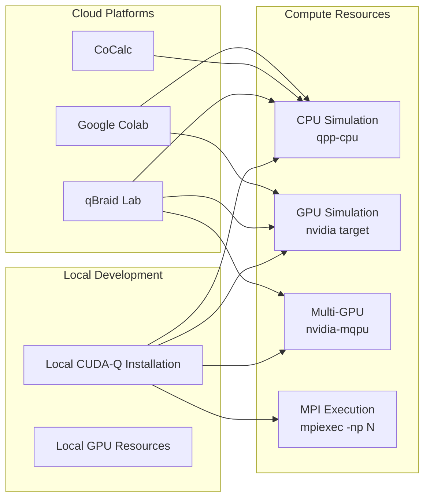

**Sources:** [README.md:6](), [qaoa-for-max-cut/00_StartHere.ipynb:134-135]()

## Backend Configuration

CUDA-Q supports multiple simulation backends configured through the `cudaq.set_target()` function and environment variables.

### Target Backend Selection

```python
# CPU-only simulation
cudaq.set_target("qpp-cpu")

# Single GPU simulation (default precision)
cudaq.set_target("nvidia")

# Double precision GPU simulation
cudaq.set_target("nvidia", option="fp64")

# Multi-GPU simulation
cudaq.set_target("nvidia", option="mgpu,fp64")

# Multi-QPU simulation
cudaq.set_target("nvidia-mqpu")
```

**Backend Configuration Mapping**

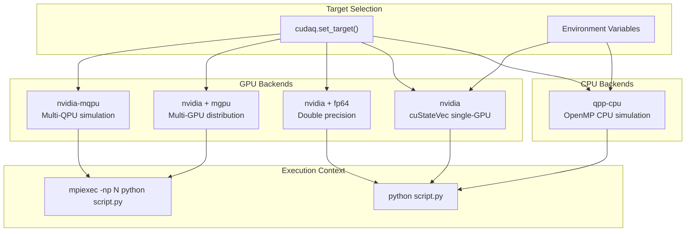

**Sources:** [Guide-to-cuda-q-backends.ipynb:92-93](), [Guide-to-cuda-q-backends.ipynb:250-254](), [Guide-to-cuda-q-backends.ipynb:337-340]()

### Environment Variables

| Variable | Purpose | Default | Example |
|----------|---------|---------|---------|
| `CUDAQ_DEFAULT_SIMULATOR` | Override default simulator | `nvidia` or `qpp-cpu` | `export CUDAQ_DEFAULT_SIMULATOR=tensornet` |
| `CUDAQ_MGPU_NQUBITS_THRESH` | Multi-GPU threshold | 25 | `export CUDAQ_MGPU_NQUBITS_THRESH=20` |

**Sources:** [Guide-to-cuda-q-backends.ipynb:280-281](), [Guide-to-cuda-q-backends.ipynb:810-811]()

## Hardware Requirements

Different educational modules have varying computational requirements based on their complexity and simulation scale.

### Computational Requirements by Module

| Module | CPU Requirements | GPU Requirements | Memory Requirements |
|--------|------------------|------------------|-------------------|
| Quick Start to Quantum | Standard CPU | Optional | 4GB RAM |
| QIS Examples | Standard CPU | Optional | 4GB RAM |
| QEC 101 | Standard CPU | Recommended | 8GB RAM |
| QAOA Basic | Standard CPU | Optional | 8GB RAM |
| QAOA Divide-and-Conquer | Multi-core CPU | Required | 16GB RAM + 8GB VRAM |
| Finance Applications | Standard CPU | Recommended | 8GB RAM |

**Hardware Architecture Requirements**

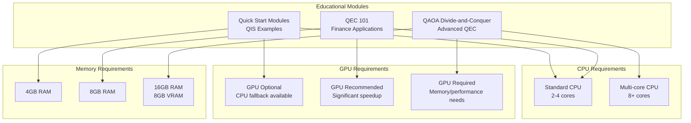

**Sources:** [qaoa-for-max-cut/00_StartHere.ipynb:134-135](), [README.md:20](), [README.md:35-37]()

### MPI and Parallel Execution

Advanced modules requiring parallel execution use MPI for distributed computing across multiple GPUs or compute nodes.

```bash
# Multi-GPU execution
mpiexec -np 4 python qaoa_distributed.py

# Override subscription limits for testing
mpiexec -np 4 --oversubscribe --allow-run-as-root python script.py
```

**Sources:** [Guide-to-cuda-q-backends.ipynb:254](), [Guide-to-cuda-q-backends.ipynb:787-788]()

## Verification and Testing

After installation, verify the environment using the provided test kernels and backend selection examples.

### Basic Verification

```python
import cudaq
from cudaq import spin

# Test kernel definition
@cudaq.kernel
def test_kernel():
    qubit = cudaq.qubit()
    h(qubit)
    mz(qubit)

# Test backend selection
cudaq.set_target("qpp-cpu")
result = cudaq.sample(test_kernel, shots_count=1000)
print(result)
```

### Backend Availability Check

```python
# Check available targets
target = cudaq.get_target()
print(f"Current target: {target}")

# For multi-QPU targets
if hasattr(target, 'num_qpus'):
    print(f"Number of QPUs: {target.num_qpus()}")
```

**Sources:** [Guide-to-cuda-q-backends.ipynb:88-129](), [Guide-to-cuda-q-backends.ipynb:337-341]()

---

# Page: Quick Start to Quantum Computing

# Quick Start to Quantum Computing

<details>
<summary>Relevant source files</summary>

The following files were used as context for generating this wiki page:

- [qec101/01_QEC_Intro.ipynb](qec101/01_QEC_Intro.ipynb)
- [quick-start-to-quantum/01_quick_start_to_quantum.ipynb](quick-start-to-quantum/01_quick_start_to_quantum.ipynb)
- [quick-start-to-quantum/02_quick_start_to_quantum.ipynb](quick-start-to-quantum/02_quick_start_to_quantum.ipynb)

</details>


## Purpose and Scope

This document covers the foundational quantum computing module within CUDA-Q Academic, designed to introduce learners to quantum programming concepts using NVIDIA's CUDA-Q platform. The module provides hands-on experience with quantum circuits, single and multi-qubit operations, and the CUDA-Q programming framework through interactive Jupyter notebooks.

For quantum error correction concepts, see [Quantum Error Correction](#5). For advanced quantum algorithms, see [Quantum Algorithms](#3) and [QAOA](#4). For quantum applications in finance, see [Quantum Applications to Finance](#6).

## Module Structure and Learning Progression

The Quick Start module follows a structured three-step quantum programming template across two comprehensive labs:

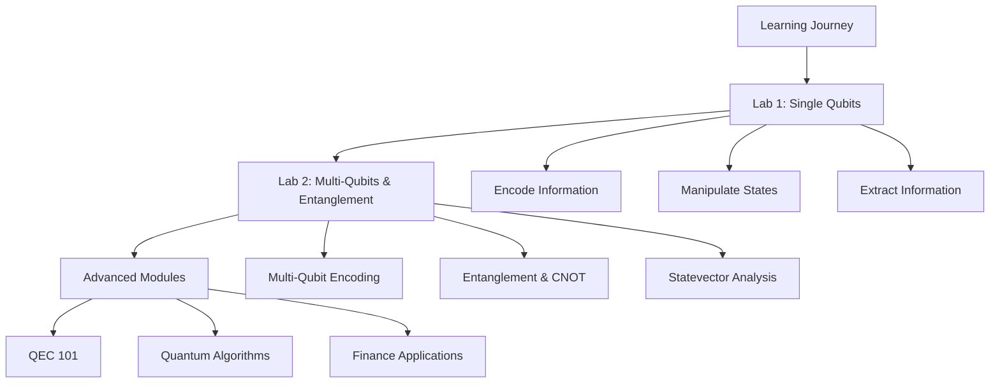

**Diagram: Quick Start Module Learning Progression**

Sources: [quick-start-to-quantum/01_quick_start_to_quantum.ipynb:40-68](), [quick-start-to-quantum/02_quick_start_to_quantum.ipynb:40-80]()

## CUDA-Q Programming Framework

### Core Programming Constructs

The module introduces essential CUDA-Q programming patterns through practical implementation:

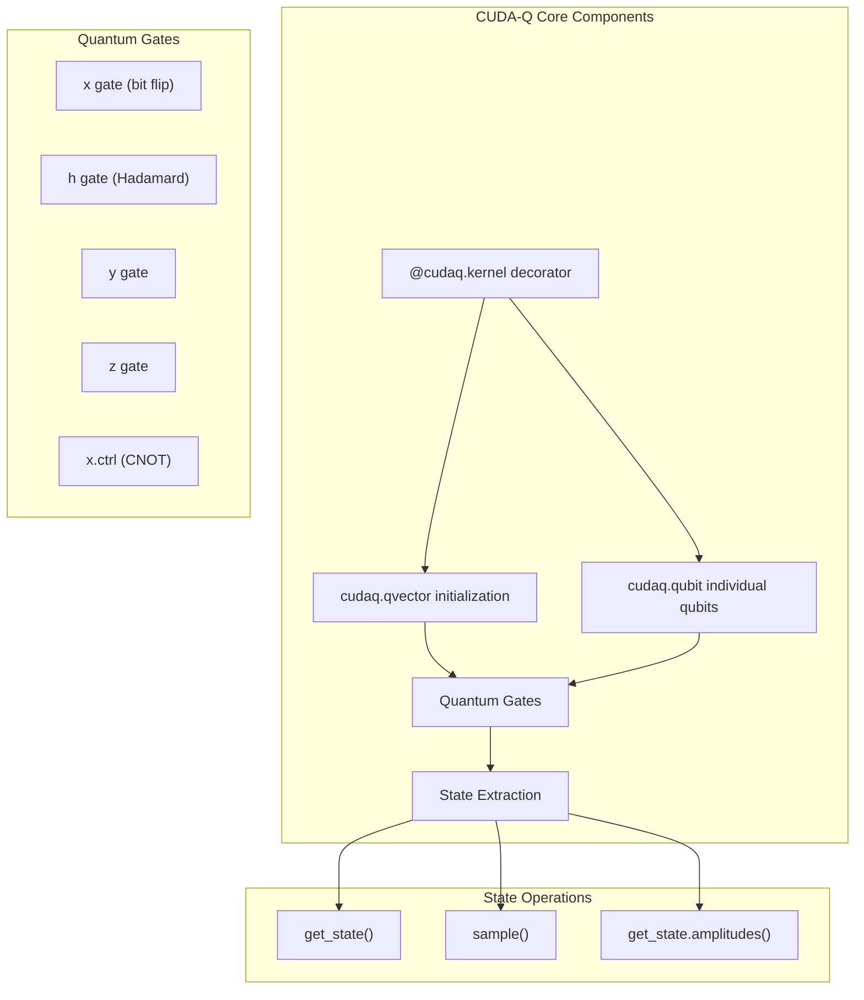

**Diagram: CUDA-Q Programming Framework Architecture**

Sources: [quick-start-to-quantum/01_quick_start_to_quantum.ipynb:60-67](), [quick-start-to-quantum/02_quick_start_to_quantum.ipynb:74-79]()

### Kernel Definition and Usage

The foundational programming pattern uses the `@cudaq.kernel` decorator:

| Component | Syntax | Purpose |
|-----------|--------|---------|
| Kernel Declaration | `@cudaq.kernel` | Defines quantum program entry point |
| Qubit Allocation | `cudaq.qvector(n)` | Creates n-qubit register |
| Single Qubit | `cudaq.qubit` | Individual qubit parameter |
| Gate Application | `x(qubit)`, `h(qubit)` | Applies quantum operations |
| State Extraction | `cudaq.get_state(kernel)` | Retrieves quantum state |
| Measurement | `cudaq.sample(kernel, shots_count=n)` | Performs measurements |

Sources: [quick-start-to-quantum/01_quick_start_to_quantum.ipynb:324-327](), [quick-start-to-quantum/02_quick_start_to_quantum.ipynb:263-281]()

## Lab 1: Single Qubit Operations

### Quantum State Representation

Lab 1 establishes the fundamental concepts of quantum state representation using the Bloch sphere visualization and mathematical notation:

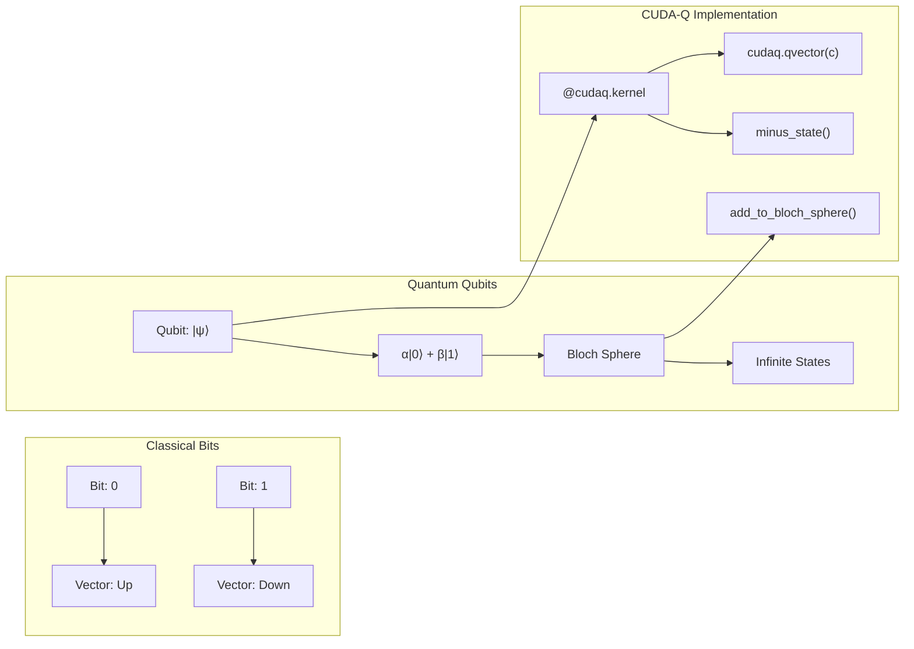

**Diagram: Classical vs Quantum State Representation in CUDA-Q**

Sources: [quick-start-to-quantum/01_quick_start_to_quantum.ipynb:163-198](), [quick-start-to-quantum/01_quick_start_to_quantum.ipynb:315-327]()

### Interactive Visualization System

The module incorporates interactive widgets for enhanced learning:

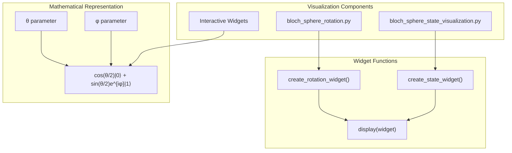

**Diagram: Interactive Visualization System Architecture**

Sources: [quick-start-to-quantum/01_quick_start_to_quantum.ipynb:210-217](), [quick-start-to-quantum/01_quick_start_to_quantum.ipynb:257-265]()

## Lab 2: Multi-Qubit Systems and Entanglement

### Computational Basis States

Lab 2 introduces multi-qubit systems using computational basis state notation:

| System Size | Basis States | Notation | CUDA-Q Implementation |
|-------------|-------------|----------|----------------------|
| 1 qubit | 2 states | \|0⟩, \|1⟩ | `cudaq.qvector(1)` |
| 2 qubits | 4 states | \|00⟩, \|01⟩, \|10⟩, \|11⟩ | `cudaq.qvector(2)` |
| n qubits | 2^n states | \|b_{n-1}...b_1b_0⟩ | `cudaq.qvector(n)` |

Sources: [quick-start-to-quantum/02_quick_start_to_quantum.ipynb:163-182]()

### Kernel Composition and Subroutines

The module demonstrates advanced programming patterns using kernel composition:

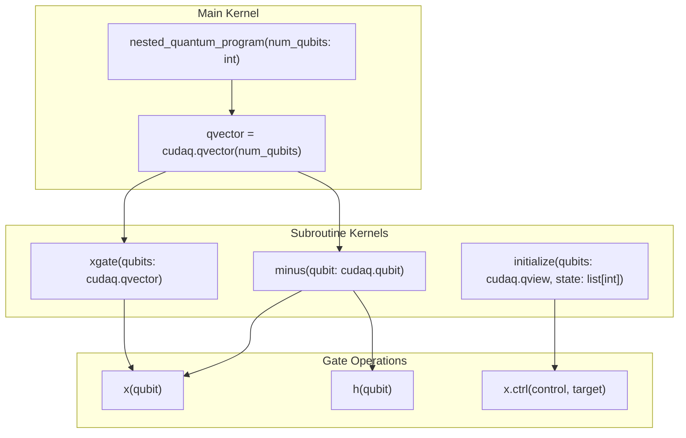

**Diagram: Kernel Composition Architecture**

Sources: [quick-start-to-quantum/02_quick_start_to_quantum.ipynb:396-441](), [quick-start-to-quantum/02_quick_start_to_quantum.ipynb:709-731]()

### CNOT Gate Implementation

Multi-qubit entangling operations use the controlled-X (CNOT) gate:

```mermaid
graph LR
    subgraph "CNOT Gate Syntax"
        SingleCtrl["x.ctrl(control_qubit, target_qubit)"]
        MultiCtrl["x.ctrl(control_qubits_list, target_qubit)"]
    end
    
    subgraph "Circuit Representation"
        ControlQubit["Control: ●"]
        TargetQubit["Target: ⊕"]
        Wire["Connecting Wire"]
    end
    
    subgraph "Implementation Example"
        ApplyCNOT["apply_cnot(control: cudaq.qubit, target: cudaq.qubit)"]
        XCtrl["x.ctrl(control, target)"]
    end
    
    SingleCtrl --> ControlQubit
    MultiCtrl --> ControlQubit
    ControlQubit --> TargetQubit
    TargetQubit --> Wire
    
    ApplyCNOT --> XCtrl
    XCtrl --> SingleCtrl
```

**Diagram: CNOT Gate Implementation and Syntax**

Sources: [quick-start-to-quantum/02_quick_start_to_quantum.ipynb:680-713](), [quick-start-to-quantum/02_quick_start_to_quantum.ipynb:709-737]()

## State Extraction and Analysis

### Statevector Operations

The module provides comprehensive state analysis capabilities:

```mermaid
graph TD
    subgraph "State Extraction Methods"
        GetState["cudaq.get_state(kernel)"]
        Sample["cudaq.sample(kernel, shots_count=n)"]
        Amplitudes["state.amplitudes([[1,0], [1,1]])"]
    end
    
    subgraph "State Representation"
        Vector["Statevector Array"]
        Coefficients["Complex Amplitudes"]
        Probabilities["|amplitude|² = probability"]
    end
    
    subgraph "Analysis Functions"
        MostProbable["result.most_probable()"]
        Distribution["Quasi-probability Distribution"]
        Precision["np.round(amplitudes, precision)"]
    end
    
    GetState --> Vector
    Vector --> Coefficients
    Coefficients --> Probabilities
    
    Sample --> Distribution
    Distribution --> MostProbable
    
    GetState --> Amplitudes
    Amplitudes --> Precision
```

**Diagram: State Extraction and Analysis Framework**

Sources: [quick-start-to-quantum/01_quick_start_to_quantum.ipynb:312-322](), [quick-start-to-quantum/02_quick_start_to_quantum.ipynb:294-322]()

## Installation and Environment Setup

### Required Dependencies

The module requires several Python packages for full functionality:

| Package | Purpose | Installation |
|---------|---------|--------------|
| `cudaq` | CUDA-Q quantum programming | `pip install cudaq` |
| `qutip` | Quantum toolbox utilities | `pip install qutip>=5` |
| `ipywidgets` | Interactive notebook widgets | `pip install ipywidgets` |
| `matplotlib` | Plotting and visualization | `pip install matplotlib>=3.5` |
| `numpy` | Numerical computing | Standard with most Python distributions |

Sources: [quick-start-to-quantum/01_quick_start_to_quantum.ipynb:99-119](), [quick-start-to-quantum/02_quick_start_to_quantum.ipynb:107-113]()

### Platform Compatibility

The notebooks support multiple deployment platforms:

```mermaid
graph LR
    subgraph "Deployment Options"
        GoogleColab["Google Colab"]
        JupyterLocal["Local Jupyter"]
        VSCode["VSCode Jupyter"]
    end
    
    subgraph "Setup Requirements"
        CPURuntime["CPU Runtime"]
        KernelRestart["Kernel Restart After Install"]
        PackageInstall["Package Installation"]
    end
    
    GoogleColab --> CPURuntime
    JupyterLocal --> PackageInstall
    VSCode --> KernelRestart
    CPURuntime --> PackageInstall
    PackageInstall --> KernelRestart
```

**Diagram: Platform Deployment Options**

Sources: [quick-start-to-quantum/01_quick_start_to_quantum.ipynb:86-90](), [quick-start-to-quantum/02_quick_start_to_quantum.ipynb:107-114]()

## Key Learning Outcomes

### Terminology and Concepts

Students completing this module will understand:

- **Quantum State**: Superposition of computational basis states
- **Probability Amplitudes**: Complex coefficients in quantum states  
- **Measurement**: Probabilistic collapse to classical outcomes
- **Entanglement**: Non-separable multi-qubit correlations
- **Kernel**: CUDA-Q quantum program definition
- **Statevector**: Complete quantum state representation

### Programming Competencies

- Defining quantum programs using `@cudaq.kernel`
- Implementing single and multi-qubit operations
- Creating reusable quantum subroutines
- Extracting and analyzing quantum states
- Using interactive visualization tools
- Understanding circuit diagram representations

Sources: [quick-start-to-quantum/01_quick_start_to_quantum.ipynb:49-67](), [quick-start-to-quantum/02_quick_start_to_quantum.ipynb:64-79]()

## Integration with Advanced Topics

The Quick Start module serves as the foundation for more specialized quantum computing topics covered in other CUDA-Q Academic modules, providing essential programming skills and conceptual understanding required for quantum algorithms, error correction, and domain-specific applications.

Sources: [quick-start-to-quantum/01_quick_start_to_quantum.ipynb:1-68](), [quick-start-to-quantum/02_quick_start_to_quantum.ipynb:1-133]()

---

# Page: Interactive Visualization Tools

# Interactive Visualization Tools

<details>
<summary>Relevant source files</summary>

The following files were used as context for generating this wiki page:

- [quick-start-to-quantum/interactive_widget/bloch_sphere_rotation.py](quick-start-to-quantum/interactive_widget/bloch_sphere_rotation.py)
- [quick-start-to-quantum/interactive_widget/bloch_sphere_state_visualization.py](quick-start-to-quantum/interactive_widget/bloch_sphere_state_visualization.py)
- [quick-start-to-quantum/interactive_widget/borns_rule.py](quick-start-to-quantum/interactive_widget/borns_rule.py)
- [quick-start-to-quantum/interactive_widget/t_and_s_gate.py](quick-start-to-quantum/interactive_widget/t_and_s_gate.py)

</details>


## Purpose and Scope

The Interactive Visualization Tools system provides a collection of Jupyter notebook widgets designed to enhance quantum computing education through real-time visual feedback. These tools are primarily used within the Quick Start to Quantum Computing module to help students understand fundamental quantum concepts including state preparation, quantum gates, and measurement probabilities. The widgets leverage CUDA-Q's visualization capabilities combined with interactive controls to create an engaging learning environment.

For information about the broader Quick Start module structure and learning progression, see [Quick Start to Quantum Computing](#2). For advanced visualization techniques used in specific applications, see [Quantum Applications to Finance](#6) and [Quantum Error Correction](#5).

## Widget System Architecture

The interactive visualization system is built on a modular architecture that combines CUDA-Q quantum kernels with Jupyter widget components for real-time parameter manipulation and visual output.

```mermaid
graph TB
    subgraph "Widget System Architecture"
        subgraph "User Interface Layer"
            SLIDERS["FloatSlider Components"]
            OUTPUTS["Output Widgets"]
            LAYOUT["VBox/HBox Layout"]
        end
        
        subgraph "Widget Functions"
            BORNS["create_borns_rule_widget()"]
            ROTATION["create_rotation_widget()"] 
            STATE["create_state_widget()"]
            GATES["create_t_and_s_widget()"]
        end
        
        subgraph "CUDA-Q Integration"
            KERNELS["@cudaq.kernel Functions"]
            BLOCH["cudaq.add_to_bloch_sphere()"]
            DRAW["cudaq.draw()"]
            GETSTATE["cudaq.get_state()"]
        end
        
        subgraph "Visualization Outputs"
            SPHERE["Bloch Sphere Plots"]
            CIRCUIT["Circuit Diagrams"]
            PROBS["Probability Charts"]
            TEXT["State Expressions"]
        end
    end
    
    SLIDERS --> BORNS
    SLIDERS --> ROTATION
    SLIDERS --> STATE
    SLIDERS --> GATES
    
    BORNS --> KERNELS
    ROTATION --> KERNELS
    STATE --> KERNELS
    GATES --> KERNELS
    
    KERNELS --> GETSTATE
    GETSTATE --> BLOCH
    KERNELS --> DRAW
    
    BLOCH --> SPHERE
    DRAW --> CIRCUIT
    BORNS --> PROBS
    STATE --> TEXT
    
    OUTPUTS --> SPHERE
    OUTPUTS --> CIRCUIT
    OUTPUTS --> PROBS
    OUTPUTS --> TEXT
    
    LAYOUT --> OUTPUTS
```

**Sources:** [quick-start-to-quantum/interactive_widget/borns_rule.py:1-92](), [quick-start-to-quantum/interactive_widget/bloch_sphere_rotation.py:1-76](), [quick-start-to-quantum/interactive_widget/bloch_sphere_state_visualization.py:1-77](), [quick-start-to-quantum/interactive_widget/t_and_s_gate.py:1-96]()

## Widget Components and Functions

### Core Widget Types

The visualization system includes four primary widget types, each targeting specific educational objectives:

| Widget Type | Function Name | Primary Purpose | Key Features |
|-------------|---------------|-----------------|--------------|
| Born's Rule Visualization | `create_borns_rule_widget()` | Demonstrate measurement probabilities | Bloch sphere + probability bar chart |
| Rotation Visualization | `create_rotation_widget()` | Show effects of rotation gates | Multi-axis rotation controls |
| State Visualization | `create_state_widget()` | General quantum state exploration | State expression + circuit diagram |
| Gate Comparison | `create_t_and_s_widget()` | Compare phase gate effects | Side-by-side Bloch spheres |

### Widget Implementation Pattern

All widgets follow a consistent implementation pattern using shared architectural components:

```mermaid
graph LR
    subgraph "Widget Lifecycle"
        CLEAR["IPython.display.clear_output()"]
        CREATE["Widget Creation"]
        KERNEL["Quantum Kernel Definition"]
        CONTROLS["Interactive Controls"]
        OBSERVE["Change Observers"]
        UPDATE["Update Functions"]
        DISPLAY["display(VBox)"]
    end
    
    CLEAR --> CREATE
    CREATE --> KERNEL
    KERNEL --> CONTROLS
    CONTROLS --> OBSERVE
    OBSERVE --> UPDATE
    UPDATE --> DISPLAY
    
    subgraph "Update Function Pattern"
        GETSTATE["cudaq.get_state()"]
        VISUAL["Visualization Update"]
        OUTPUT["Output Widget Clear"]
    end
    
    UPDATE --> GETSTATE
    GETSTATE --> VISUAL
    VISUAL --> OUTPUT
```

**Sources:** [quick-start-to-quantum/interactive_widget/borns_rule.py:1-4](), [quick-start-to-quantum/interactive_widget/bloch_sphere_rotation.py:4-6](), [quick-start-to-quantum/interactive_widget/bloch_sphere_state_visualization.py:4-6]()

## Quantum Kernel Integration

### State Preparation Kernels

The widgets use standardized quantum kernels for state preparation, following the parameterized form |ψ⟩ = cos(θ/2)|0⟩ + sin(θ/2)e^{iφ}|1⟩:

```mermaid
graph TB
    subgraph "Kernel Functions and Gates"
        STATEKERNEL["state_kernel(theta, phi)"]
        ROTKERNEL["rotation_kernel(theta_x, theta_y, theta_z)"]
        GATEKERNEL["state_kernel(theta, phi, gate_choice)"]
        
        subgraph "Gate Operations"
            RY["ry(theta, qubit)"]
            RZ["rz(phi, qubit)"]
            RX["rx(theta_x, qubit)"]
            TGATE["t(qubit)"]
            SGATE["s(qubit)"]
        end
        
        subgraph "CUDA-Q Decorators"
            DECORATOR["@cudaq.kernel"]
        end
    end
    
    DECORATOR --> STATEKERNEL
    DECORATOR --> ROTKERNEL
    DECORATOR --> GATEKERNEL
    
    STATEKERNEL --> RY
    STATEKERNEL --> RZ
    ROTKERNEL --> RX
    ROTKERNEL --> RY
    ROTKERNEL --> RZ
    GATEKERNEL --> TGATE
    GATEKERNEL --> SGATE
```

**Sources:** [quick-start-to-quantum/interactive_widget/bloch_sphere_state_visualization.py:15-20](), [quick-start-to-quantum/interactive_widget/bloch_sphere_rotation.py:15-20](), [quick-start-to-quantum/interactive_widget/t_and_s_gate.py:13-22]()

### Visualization Pipeline

Each widget implements a consistent visualization pipeline that transforms quantum states into educational graphics:

```mermaid
graph LR
    subgraph "Visualization Pipeline"
        PARAMS["Slider Parameters"]
        KERNEL["Quantum Kernel"]
        STATE["cudaq.get_state()"]
        
        subgraph "Visualization Methods"
            BLOCHSPHERE["cudaq.add_to_bloch_sphere()"]
            CIRCUITDRAW["cudaq.draw()"]
            PROBCHART["matplotlib bar chart"]
            TEXTOUT["State expression text"]
        end
        
        subgraph "Output Widgets"
            BLOCHOUT["output_bloch"]
            CIRCUITOUT["output_circuit"] 
            PROBOUT["output_prob"]
            STATEOUT["output_state"]
        end
    end
    
    PARAMS --> KERNEL
    KERNEL --> STATE
    
    STATE --> BLOCHSPHERE
    KERNEL --> CIRCUITDRAW
    STATE --> PROBCHART
    PARAMS --> TEXTOUT
    
    BLOCHSPHERE --> BLOCHOUT
    CIRCUITDRAW --> CIRCUITOUT
    PROBCHART --> PROBOUT
    TEXTOUT --> STATEOUT
```

**Sources:** [quick-start-to-quantum/interactive_widget/borns_rule.py:21-26](), [quick-start-to-quantum/interactive_widget/borns_rule.py:28-40](), [quick-start-to-quantum/interactive_widget/bloch_sphere_state_visualization.py:22-34]()

## Specialized Widget Features

### Born's Rule Visualization

The `create_borns_rule_widget()` function provides the most comprehensive educational experience by combining multiple visualization modes:

- **Bloch Sphere Representation**: Shows the quantum state vector on the 3D Bloch sphere
- **Probability Bar Chart**: Displays |α|² and |β|² measurement probabilities using matplotlib
- **State Expression**: Shows both general and numerical forms of the quantum state
- **Interactive Parameter Control**: Real-time θ and φ angle adjustment

**Sources:** [quick-start-to-quantum/interactive_widget/borns_rule.py:21-88]()

### Multi-Axis Rotation Widget

The `create_rotation_widget()` allows students to explore the effects of sequential rotations around different axes:

- **Three-Parameter Control**: Independent sliders for θx, θy, θz rotations
- **Circuit Diagram Integration**: Shows the actual quantum circuit being executed
- **Real-time Bloch Sphere Updates**: Immediate visual feedback for rotation effects

**Sources:** [quick-start-to-quantum/interactive_widget/bloch_sphere_rotation.py:14-69]()

### Gate Comparison Visualization

The `create_t_and_s_widget()` provides side-by-side comparison of phase gate effects:

- **Multi-Sphere Display**: Shows initial state, T gate result, and S gate result simultaneously
- **Synchronized Parameter Control**: Single set of controls affects all three visualizations
- **Comparative Analysis**: Enables direct visual comparison of phase gate effects

**Sources:** [quick-start-to-quantum/interactive_widget/t_and_s_gate.py:24-43]()

## Integration with Educational Framework

### Jupyter Notebook Integration

The widgets are designed for seamless integration into Jupyter notebook environments using standardized import and display patterns:

```mermaid
graph TB
    subgraph "Notebook Integration Pattern"
        IMPORT["Import Widget Module"]
        CLEAR["IPython.display.clear_output()"]
        CREATE["Widget Creation Function"]
        DISPLAY["Automatic Display"]
        
        subgraph "Widget Structure"
            TITLE["HTML Title Widget"]
            CONTROLS["Interactive Controls"]
            OUTPUTS["Visualization Outputs"]
            LAYOUT["VBox/HBox Layout"]
        end
    end
    
    IMPORT --> CLEAR
    CLEAR --> CREATE
    CREATE --> TITLE
    CREATE --> CONTROLS
    CREATE --> OUTPUTS
    CREATE --> LAYOUT
    LAYOUT --> DISPLAY
```

**Sources:** [quick-start-to-quantum/interactive_widget/borns_rule.py:89-92](), [quick-start-to-quantum/interactive_widget/bloch_sphere_rotation.py:72-75]()

### Educational Workflow Support

The widgets support progressive learning through consistent interface design and educational scaffolding:

| Educational Stage | Widget Progression | Learning Objectives |
|------------------|-------------------|-------------------|
| Basic States | `create_state_widget()` | Understand qubit representation |
| State Dynamics | `create_rotation_widget()` | Explore gate effects |
| Measurement | `create_borns_rule_widget()` | Connect states to probabilities |
| Gate Analysis | `create_t_and_s_widget()` | Compare specific operations |

**Sources:** All widget files demonstrate this progressive complexity through their parameter ranges and visualization sophistication.

---

# Page: Quantum Algorithms

# Quantum Algorithms

<details>
<summary>Relevant source files</summary>

The following files were used as context for generating this wiki page:

- [qis-examples/grovers.ipynb](qis-examples/grovers.ipynb)
- [qis-examples/solutions/grovers-solution.ipynb](qis-examples/solutions/grovers-solution.ipynb)

</details>


This page covers the implementation and theory of quantum algorithms within the CUDA-Q Academic framework, with primary focus on Grover's algorithm for quantum database search. The material demonstrates fundamental quantum algorithmic concepts including superposition preparation, oracle construction, amplitude amplification, and measurement-based solution extraction using CUDA-Q programming constructs.

For quantum error correction algorithms, see [Quantum Error Correction](#5). For variational quantum algorithms and optimization approaches, see [Quantum Approximate Optimization Algorithm (QAOA)](#4).

## Overview

Quantum algorithms leverage quantum mechanical phenomena like superposition and interference to solve computational problems with potential speedup over classical approaches. The implementation focuses on Grover's algorithm, which provides quadratic speedup for unstructured search problems, reducing the search complexity from O(N) to O(√N) oracle queries.

**Algorithm Structure**

```mermaid
graph TD
    A["Preparation: equal_superposition()"] --> B["Oracle: phase_oracle()"]
    B --> C["Diffusion: grover_diffusion_operator()"]
    C --> D{"Iteration Count < Optimal?"}
    D -->|Yes| B
    D -->|No| E["Measurement"]
    E --> F["Extract Solution"]
    
    subgraph "CUDA-Q Implementation"
        G["@cudaq.kernel decorators"]
        H["cudaq.qvector quantum registers"]
        I["Gate operations: h, x, z.ctrl"]
        J["State analysis: cudaq.get_state()"]
        K["Sampling: cudaq.sample()"]
    end
```

Sources: [qis-examples/grovers.ipynb:196-211]()

## Theoretical Foundation

### Good and Bad State Decomposition

The algorithm operates on a decomposition of the computational space into marked ("good") and unmarked ("bad") states:

- **Good State**: |G⟩ = (1/√t) Σ_{i:f(i)=1} |i⟩ 
- **Bad State**: |B⟩ = (1/√(N-t)) Σ_{i:f(i)=0} |i⟩
- **Initial Superposition**: |ξ⟩ = sin(θ)|G⟩ + cos(θ)|B⟩

Where θ = arcsin(√(t/N)), t is the number of marked states, and N = 2^n is the total number of states.

```mermaid
graph LR
    subgraph "2D Quantum State Space"
        A["Bad State |B⟩"] -->|"cos(θ)"| C["Initial State |ξ⟩"]
        B["Good State |G⟩"] -->|"sin(θ)"| C
        C -->|"Grover Iteration"| D["Rotated State"]
        D -->|"After m iterations"| E["Near |G⟩"]
    end
    
    subgraph "Geometric Operations"
        F["reflection_over_B"]
        G["reflection_over_xi"] 
        F --> G
        G --> H["2θ rotation"]
    end
```

Sources: [qis-examples/grovers.ipynb:364-384](), [qis-examples/grovers.ipynb:478-522]()

## Implementation Components

### Preparation Phase

The `equal_superposition()` function initializes n qubits in uniform superposition:

```mermaid
graph TD
    A["Qubits in |0⟩^⊗n"] --> B["equal_superposition(qubits)"]
    B --> C["H gates applied to all qubits"]
    C --> D["State |ξ⟩ = (1/√N) Σ|i⟩"]
    
    subgraph "CUDA-Q Implementation"
        E["@cudaq.kernel decorator"]
        F["cudaq.qview parameter"]
        G["h(qubits_in_zero_state)"]
    end
```

Sources: [qis-examples/grovers.ipynb:240-244]()

### Oracle Construction

Phase oracles implement the marking function f(x) by flipping phases of marked states:

| Oracle Function | Target State | Implementation |
|----------------|--------------|----------------|
| `U9()` | \|1001⟩ | Uses controlled-Z with auxiliary qubit |
| `U15()` | \|1111⟩ | Multi-controlled Z gate |
| `phase_oracle()` | Both marked states | Composition of U9 and U15 |

**Oracle Architecture**

```mermaid
graph TD
    A["marking_function()"] --> B["Boolean function f(x)"]
    B --> C["Phase oracle implementation"]
    
    subgraph "Phase Oracle Components"
        D["U9: flips |1001⟩ phase"]
        E["U15: flips |1111⟩ phase"] 
        F["aux_qubit in |−⟩ state"]
        G["Phase kickback mechanism"]
        
        D --> H["phase_oracle()"]
        E --> H
        F --> D
        F --> E
        G --> D
        G --> E
    end
```

Sources: [qis-examples/grovers.ipynb:656-720](), [qis-examples/grovers.ipynb:752-787]()

### Amplitude Amplification

The Grover diffusion operator performs amplitude amplification through reflection operations:

**Diffusion Operator Components**

```mermaid
graph TD
    subgraph "Diffusion Operator Sequence"
        A["State after oracle"] --> B["H gates"]
        B --> C["X gates"] 
        C --> D["Multi-controlled Z"]
        D --> E["X gates"]
        E --> F["H gates"]
        F --> G["Amplified state"]
    end
    
    subgraph "Mathematical Operations"
        H["Reflection over |0000⟩"]
        I["Conjugation by H^⊗n"]
        J["Reflection over |ξ⟩"]
        
        H --> I
        I --> J
    end
```

Sources: [qis-examples/grovers.ipynb:820-900]()

## Algorithm Execution Flow

### Iteration Control

The optimal number of Grover iterations is m = ⌊π/(4θ)⌋, where the algorithm rotates the state vector by 2θ per iteration:

```mermaid
graph TD
    A["Calculate θ = arcsin(√(t/N))"] --> B["Compute m = ⌊π/(4θ)⌋"]
    B --> C["Initialize iteration counter"]
    C --> D["Apply phase_oracle()"]
    D --> E["Apply grover_diffusion_operator()"]
    E --> F["Increment counter"]
    F --> G{"Counter < m?"}
    G -->|Yes| D
    G -->|No| H["Measure qubits"]
    H --> I["Extract marked states"]
```

Sources: [qis-examples/grovers.ipynb:196-211]()

### State Analysis and Verification

**Measurement and Validation Framework**

```mermaid
graph LR
    subgraph "State Analysis Tools"
        A["cudaq.get_state()"] --> B["Amplitude extraction"]
        C["cudaq.sample()"] --> D["Probability distribution"]
        E["overlap() method"] --> F["State comparison"]
        G["plot_results()"] --> H["Visualization"]
    end
    
    subgraph "Validation Methods"
        I["check_phase()"] --> J["Phase verification"]
        K["marking_function()"] --> L["Solution validation"]
        M["Histogram analysis"] --> N["Success probability"]
    end
```

Sources: [qis-examples/grovers.ipynb:288-346](), [qis-examples/grovers.ipynb:700-720]()

## Example Implementation

For a 4-qubit system with marked states `1001` and `1111`:

| Parameter | Value | Description |
|-----------|--------|-------------|
| n | 4 | Number of qubits |
| N | 16 | Total states (2^n) |
| t | 2 | Marked states |
| θ | arcsin(√(2/16)) = π/12 | Rotation angle |
| m | ⌊π/(4×π/12)⌋ = 3 | Optimal iterations |

The implementation demonstrates ~94% success probability after optimal iterations, with marked states showing significantly higher measurement frequencies compared to unmarked states.

Sources: [qis-examples/grovers.ipynb:130-184](), [qis-examples/grovers.ipynb:395-402]()

## Integration with CUDA-Q Framework

The quantum algorithm implementations utilize core CUDA-Q programming constructs:

- `@cudaq.kernel` decorators for quantum function definitions
- `cudaq.qvector` and `cudaq.qubit` for quantum register management  
- Gate operations (`h`, `x`, `z.ctrl`) for quantum transformations
- `cudaq.sample()` and `cudaq.get_state()` for result extraction
- Auxiliary qubit management for phase oracle implementation

Sources: [qis-examples/grovers.ipynb:88-92](), [qis-examples/grovers.ipynb:240-244]()

---

# Page: Quantum Approximate Optimization Algorithm (QAOA)

# Quantum Approximate Optimization Algorithm (QAOA)

<details>
<summary>Relevant source files</summary>

The following files were used as context for generating this wiki page:

- [qaoa-for-max-cut/01_Max-Cut-with-QAOA.ipynb](qaoa-for-max-cut/01_Max-Cut-with-QAOA.ipynb)
- [qaoa-for-max-cut/02_One-level-divide-and-conquer-QAOA.ipynb](qaoa-for-max-cut/02_One-level-divide-and-conquer-QAOA.ipynb)
- [qaoa-for-max-cut/03_Recursive-divide-and-conquer.ipynb](qaoa-for-max-cut/03_Recursive-divide-and-conquer.ipynb)

</details>


This document covers the implementation of the Quantum Approximate Optimization Algorithm (QAOA) for solving Maximum Cut (Max-Cut) optimization problems using the CUDA-Q quantum computing framework. The material includes basic QAOA implementations, advanced divide-and-conquer strategies for scaling to larger problem instances, and distributed computing approaches for parallel execution.

For general quantum computing foundations, see [Quick Start to Quantum Computing](#2). For error correction concepts, see [Quantum Error Correction](#5). For broader quantum applications beyond optimization, see [Quantum Applications to Finance](#6).

## Algorithm Overview and Implementation

QAOA is a variational quantum algorithm that approximates solutions to combinatorial optimization problems by alternating between problem-specific and mixing unitaries. The implementation focuses on the Maximum Cut problem, where the goal is to partition graph vertices into two sets that maximize the number of edges between the sets.

### QAOA Algorithm Flow

```mermaid
graph TD
    A["Graph Definition"] --> B["hamiltonian_max_cut()"]
    B --> C["Parameter Initialization"]
    C --> D["kernel_qaoa()"]
    D --> E["Classical Optimizer"]
    E --> F{"Converged?"}
    F -->|No| D
    F -->|Yes| G["cudaq.sample()"]
    G --> H["Max Cut Solution"]
    
    D --> I["qaoaProblem()"]
    D --> J["qaoaMixer()"]
    
    I --> K["Problem Unitary"]
    J --> L["Mixing Unitary"]
```

**QAOA Implementation Workflow**

The algorithm transforms the Max-Cut problem into a Quantum Unconstrained Binary Optimization (QUBO) formulation using the Hamiltonian:

$$H = \frac{1}{2}\sum_{(u,v) \in E} (Z_u Z_v - I_u I_v)$$

where $E$ represents the graph edges and $Z_u$ denotes the Pauli-Z operator on qubit $u$.

Sources: [qaoa-for-max-cut/01_Max-Cut-with-QAOA.ipynb:458-470]()

## CUDA-Q Framework Integration

The implementation leverages CUDA-Q's quantum kernel decorators and primitives to create parameterized quantum circuits. The framework provides seamless integration between classical optimization routines and quantum circuit execution.

### Core CUDA-Q Components

```mermaid
graph TB
    subgraph "CUDA-Q Kernels"
        A["@cudaq.kernel<br/>qaoaProblem()"] 
        B["@cudaq.kernel<br/>qaoaMixer()"]
        C["@cudaq.kernel<br/>kernel_qaoa()"]
    end
    
    subgraph "CUDA-Q Primitives"
        D["cudaq.sample()"]
        E["cudaq.observe()"] 
        F["cudaq.vqe()"]
    end
    
    subgraph "Backend Targets"
        G["qpp-cpu"]
        H["nvidia"]
        I["nvidia-mqpu"]
    end
    
    C --> D
    C --> E
    C --> F
    
    D --> G
    E --> H
    F --> I
    
    A --> C
    B --> C
```

**CUDA-Q Architecture for QAOA**

The `qaoaProblem` kernel implements the problem-specific unitary using controlled-X and rotation gates:

```python
@cudaq.kernel
def qaoaProblem(qubit_0: cudaq.qubit, qubit_1: cudaq.qubit, alpha: float):
    x.ctrl(qubit_0, qubit_1)
    rz(2.0*alpha, qubit_1)
    x.ctrl(qubit_0, qubit_1)
```

The `qaoaMixer` kernel applies X-rotations for the mixing unitary, while `kernel_qaoa` orchestrates the complete QAOA circuit with multiple layers.

Sources: [qaoa-for-max-cut/01_Max-Cut-with-QAOA.ipynb:227-257](), [qaoa-for-max-cut/01_Max-Cut-with-QAOA.ipynb:265-298]()

## Basic QAOA Implementation

The core implementation begins with graph definition and Hamiltonian construction, followed by parameterized circuit optimization using classical optimizers.

| Component | Function | Purpose |
|-----------|----------|---------|
| Hamiltonian | `hamiltonian_max_cut()` | Constructs problem Hamiltonian from graph edges |
| Circuit | `kernel_qaoa()` | Implements parameterized QAOA circuit |
| Optimization | `find_optimal_parameters()` | Uses COBYLA optimizer with VQE |
| Sampling | `cudaq.sample()` | Extracts measurement results |

The `find_optimal_parameters` function encapsulates the variational optimization loop:

```python
optimal_expectation, optimal_parameters = cudaq.vqe(
    kernel=kernel_qaoa,
    spin_operator=hamiltonian_max_cut(qubit_src, qubit_tgt),
    argument_mapper=lambda parameter_vector: (qubit_count, layer_count, qubit_src, qubit_tgt, parameter_vector),
    optimizer=optimizer,
    parameter_count=parameter_count)
```

Sources: [qaoa-for-max-cut/01_Max-Cut-with-QAOA.ipynb:309-354](), [qaoa-for-max-cut/02_One-level-divide-and-conquer-QAOA.ipynb:198-224]()

## Divide-and-Conquer Scaling

For larger graph instances, the implementation provides divide-and-conquer strategies that partition graphs into smaller subgraphs, solve subproblems independently, and merge solutions. This approach enables scaling beyond the limitations of direct QAOA application.

### Divide-and-Conquer Workflow

```mermaid
graph TD
    A["Large Graph"] --> B["Graph Partitioning"]
    B --> C["Subgraph 1"]
    B --> D["Subgraph 2"] 
    B --> E["Subgraph N"]
    
    C --> F["QAOA Solution 1"]
    D --> G["QAOA Solution 2"]
    E --> H["QAOA Solution N"]
    
    F --> I["border()"]
    G --> I
    H --> I
    
    I --> J["Merger Graph"]
    J --> K["Merger QAOA"]
    K --> L["Final Solution"]
    
    style C fill:#f9f9f9
    style D fill:#f9f9f9  
    style E fill:#f9f9f9
```

**Three-Stage Divide-and-Conquer Process**

The algorithm implements three distinct stages:

1. **Divide**: Graph partitioning using NetworkX community detection algorithms
2. **Conquer**: Independent QAOA execution on each subgraph
3. **Merge**: Border graph construction and merger optimization

The `border()` function identifies edges connecting different subgraphs, creating a merger graph where vertices represent subgraphs and edges represent inter-subgraph connections.

Sources: [qaoa-for-max-cut/02_One-level-divide-and-conquer-QAOA.ipynb:385-411](), [qaoa-for-max-cut/03_Recursive-divide-and-conquer.ipynb:108-112]()

## Recursive Implementation

The recursive divide-and-conquer implementation extends the basic approach to handle arbitrarily large graphs through recursive subdivision and parallel processing.

### Recursive Function Architecture

```mermaid
graph TB
    A["recursive_divide()"] --> B{"Graph Size<br/>Check"}
    B -->|Small| C["Direct QAOA"]
    B -->|Large| D["Partition Graph"]
    
    D --> E["recursive_conquer()"]
    E --> F["Parallel Processing"]
    F --> G["Subgraph Solutions"]
    
    G --> H["recursive_merge()"]
    H --> I{"Merger Graph<br/>Size Check"}
    I -->|Small| J["Direct Merger QAOA"]
    I -->|Large| K["Recursive Merger"]
    
    K --> H
    J --> L["Final Solution"]
    
    style F fill:#e1f5fe
    style K fill:#fff3e0
```

**Recursive Algorithm Structure**

Key functions include:
- `recursive_divide()`: Handles graph partitioning logic
- `recursive_conquer()`: Manages parallel subproblem solving  
- `recursive_merge()`: Orchestrates solution combination

The implementation supports both depth-first and breadth-first recursion strategies, with configurable thresholds for direct QAOA application versus further subdivision.

Sources: [qaoa-for-max-cut/03_Recursive-divide-and-conquer.ipynb:95-121]()

## Distributed Computing Support

The implementation includes MPI-based parallel execution capabilities for distributed quantum computing across multiple processing units or quantum devices.

### MPI Integration

```mermaid
graph LR
    A["MPI Coordinator"] --> B["GPU 1<br/>nvidia"]
    A --> C["GPU 2<br/>nvidia"] 
    A --> D["CPU<br/>qpp-cpu"]
    
    B --> E["Subgraph Set 1"]
    C --> F["Subgraph Set 2"]
    D --> G["Merger Computation"]
    
    E --> H["Results Collection"]
    F --> H
    G --> H
    
    H --> I["Final Solution"]
    
    style B fill:#e8f5e8
    style C fill:#e8f5e8
    style D fill:#f3e5f5
```

**Distributed QAOA Execution**

The parallel implementation allows:
- Target device selection (`cudaq.set_target()`)
- Multi-GPU quantum circuit execution
- Asynchronous subproblem processing
- Result aggregation and synchronization

Different target backends support various execution modes:
- `qpp-cpu`: CPU-based quantum simulation
- `nvidia`: Single GPU acceleration  
- `nvidia-mqpu`: Multi-GPU distributed execution

Sources: [qaoa-for-max-cut/02_One-level-divide-and-conquer-QAOA.ipynb:169-175](), [qaoa-for-max-cut/03_Recursive-divide-and-conquer.ipynb:169-175]()

## Code Architecture and Key Functions

The codebase organizes QAOA functionality into modular components supporting both educational exploration and production-scale optimization.

### Function Hierarchy

| Category | Functions | Purpose |
|----------|-----------|---------|
| Graph Processing | `hamiltonian_max_cut()`, `border()`, `subgraph_of_vertex()` | Graph analysis and Hamiltonian construction |
| Quantum Kernels | `qaoaProblem()`, `qaoaMixer()`, `kernel_qaoa()` | CUDA-Q quantum circuit definitions |
| Optimization | `find_optimal_parameters()`, `qaoa_for_graph()` | Parameter optimization and solution extraction |
| Scaling | `recursive_divide()`, `recursive_conquer()`, `recursive_merge()` | Divide-and-conquer algorithm implementation |

The implementation maintains separation between quantum circuit definitions (kernels), classical optimization routines, and graph processing utilities, enabling flexible experimentation with different algorithmic approaches and backend targets.

Sources: [qaoa-for-max-cut/01_Max-Cut-with-QAOA.ipynb:198-224](), [qaoa-for-max-cut/03_Recursive-divide-and-conquer.ipynb:198-347]()

---

# Page: Advanced QAOA Implementation

# Advanced QAOA Implementation

<details>
<summary>Relevant source files</summary>

The following files were used as context for generating this wiki page:

- [qaoa-for-max-cut/04_Assessment-Solution.ipynb](qaoa-for-max-cut/04_Assessment-Solution.ipynb)
- [qaoa-for-max-cut/04_Assessment.ipynb](qaoa-for-max-cut/04_Assessment.ipynb)
- [qaoa-for-max-cut/Example-02-step-2-Solution.py](qaoa-for-max-cut/Example-02-step-2-Solution.py)
- [qaoa-for-max-cut/Example-02-step-2.py](qaoa-for-max-cut/Example-02-step-2.py)
- [qaoa-for-max-cut/Example-02-step-3-Solution.py](qaoa-for-max-cut/Example-02-step-3-Solution.py)
- [qaoa-for-max-cut/Example-03.py](qaoa-for-max-cut/Example-03.py)
- [qaoa-for-max-cut/Example-04-Solution.py](qaoa-for-max-cut/Example-04-Solution.py)
- [qaoa-for-max-cut/Example-04.py](qaoa-for-max-cut/Example-04.py)

</details>


This document covers the advanced implementation of the Quantum Approximate Optimization Algorithm (QAOA) for large-scale max-cut problems, including distributed computing with MPI, weighted graph extensions, and performance optimization strategies. For basic QAOA concepts and foundational implementations, see [Quantum Approximate Optimization Algorithm (QAOA)](#4).

## Purpose and Scope

The advanced QAOA implementation extends the basic algorithm to handle larger, more complex optimization problems through divide-and-conquer strategies, GPU parallelization, and weighted graph support. This system demonstrates how quantum algorithms can be scaled using classical decomposition techniques combined with high-performance computing infrastructure.

## System Architecture

### MPI-Based Distributed Computing

The advanced implementation uses MPI (Message Passing Interface) to distribute QAOA computations across multiple GPUs, enabling the solution of larger graph problems than would be feasible on a single processor.

```mermaid
graph TB
    subgraph "MPI Distributed System"
        RANK0["Rank 0 (Master)<br/>Graph Partitioning<br/>Result Aggregation"]
        RANK1["Rank 1<br/>Subgraph Solver"]
        RANK2["Rank 2<br/>Subgraph Solver"]
        RANK3["Rank 3<br/>Subgraph Solver"]
    end
    
    subgraph "Computation Flow"
        PARTITION["subgraphpartition()"]
        DISTRIBUTE["comm.send()"]
        SOLVE["subgraph_solution()"]
        COLLECT["comm.recv()"]
        MERGE["merging()"]
    end
    
    RANK0 --> PARTITION
    PARTITION --> DISTRIBUTE
    DISTRIBUTE --> RANK1
    DISTRIBUTE --> RANK2
    DISTRIBUTE --> RANK3
    
    RANK1 --> SOLVE
    RANK2 --> SOLVE
    RANK3 --> SOLVE
    
    SOLVE --> COLLECT
    COLLECT --> RANK0
    RANK0 --> MERGE
```

Sources: [qaoa-for-max-cut/Example-04-Solution.py:31-34](), [qaoa-for-max-cut/Example-02-step-3-Solution.py:32-35]()

### Weighted Graph Extension

The system extends the basic max-cut problem to handle weighted graphs, where edges have associated weights that influence the optimization objective.

```mermaid
graph LR
    subgraph "Weighted Max Cut Components"
        HAM["hamiltonian_max_cut()<br/>sources, targets, weights"]
        PENALTY["merger_graph_penalties()<br/>Weight-aware penalties"]
        CUT["cutvalue()<br/>Weighted cut calculation"]
    end
    
    subgraph "Graph Modifications"
        DIVIDE["subgraphpartition()<br/>weight='weight'"]
        CONQUER["find_optimal_parameters()<br/>Weighted Hamiltonian"]
        MERGE["merging()<br/>Weighted penalties"]
    end
    
    HAM --> CONQUER
    PENALTY --> MERGE
    CUT --> MERGE
    DIVIDE --> CONQUER
```

Sources: [qaoa-for-max-cut/04_Assessment.ipynb:202-228](), [qaoa-for-max-cut/04_Assessment-Solution.ipynb:244-271]()

## Core Implementation Components

### Weighted Hamiltonian Construction

The `hamiltonian_max_cut` function constructs the problem Hamiltonian for weighted graphs:

| Parameter | Type | Description |
|-----------|------|-------------|
| `sources` | `List[int]` | Source vertices for graph edges |
| `targets` | `List[int]` | Target vertices for graph edges |
| `weights` | `List[float]` | Edge weights |

The weighted Hamiltonian incorporates edge weights into the optimization objective:
```
hamiltonian += 0.5*edge_weight*(spin.z(qubitu)*spin.z(qubitv)-spin.i(qubitu)*spin.i(qubitv))
```

Sources: [qaoa-for-max-cut/Example-04-Solution.py:37-63](), [qaoa-for-max-cut/04_Assessment-Solution.ipynb:268]()

### Recursive Divide-and-Conquer Algorithm

The `subgraph_solution` function implements the recursive divide-and-conquer strategy:

```mermaid
flowchart TD
    START["subgraph_solution(G, key, limits)"]
    CHECK{"Graph size < vertex_limit?"}
    DIRECT["Direct QAOA:<br/>qaoa_for_graph()"]
    PARTITION["Divide:<br/>subgraphpartition()"]
    RECURSE["Conquer:<br/>Recursive calls"]
    COLOR["unaltered_colors()"]
    MERGE_STEP["Merge:<br/>merging()"]
    FINAL["new_colors()"]
    
    START --> CHECK
    CHECK -->|Yes| DIRECT
    CHECK -->|No| PARTITION
    PARTITION --> RECURSE
    RECURSE --> COLOR
    COLOR --> MERGE_STEP
    MERGE_STEP --> FINAL
    DIRECT --> END["Return coloring"]
    FINAL --> END
```

Sources: [qaoa-for-max-cut/Example-04-Solution.py:615-692](), [qaoa-for-max-cut/Example-03.py:615-703]()

### MPI Communication Patterns

The distributed implementation follows a master-worker pattern:

| Operation | Function | Purpose |
|-----------|----------|---------|
| Task Distribution | `comm.send()` | Send subgraph assignments to workers |
| Result Collection | `comm.recv()` | Collect subgraph solutions from workers |
| Synchronization | `comm.Get_rank()` | Coordinate processor roles |

Sources: [qaoa-for-max-cut/Example-02-step-2-Solution.py:103-116](), [qaoa-for-max-cut/Example-04-Solution.py:790-802]()

## Assessment and Optimization Strategies

### Performance Optimization Options

The assessment component provides several optimization strategies:

```mermaid
graph TB
    subgraph "Optimization Strategies"
        LAYERS["Layer Count Modification<br/>layer_count parameter"]
        SEEDS["Initial Parameter Tuning<br/>optimizer.initial_parameters"]
        OPT["Optimizer Selection<br/>COBYLA, LBFGS, etc."]
        KERNEL["Multi-angle Kernels<br/>Enhanced parameterization"]
    end
    
    subgraph "Target Components"
        MAXCUT["Max Cut QAOA<br/>Line 822"]
        MERGER["Merger QAOA<br/>Line 505"]
        PARAMS["Parameter Count<br/>Lines 181, 340"]
    end
    
    LAYERS --> MAXCUT
    LAYERS --> MERGER
    SEEDS --> MAXCUT
    SEEDS --> MERGER
    OPT --> MAXCUT
    OPT --> MERGER
    KERNEL --> PARAMS
```

Sources: [qaoa-for-max-cut/04_Assessment.ipynb:399-406](), [qaoa-for-max-cut/04_Assessment-Solution.ipynb:522-529]()

### Weighted Graph Adaptations

Three key functions require modification for weighted graphs:

| Function | Modification | Purpose |
|----------|--------------|---------|
| `hamiltonian_max_cut` | Add `weights` parameter | Weight-aware Hamiltonian construction |
| `merger_graph_penalties` | Weight-based penalties | Account for edge weights in merging |
| `cutvalue` | Weighted sum calculation | Evaluate weighted cut quality |

Sources: [qaoa-for-max-cut/04_Assessment.ipynb:184-190](), [qaoa-for-max-cut/04_Assessment.ipynb:302-349](), [qaoa-for-max-cut/04_Assessment.ipynb:357-387]()

## Runtime Requirements and Execution

### GPU Requirements

The advanced implementation requires GPU access for practical execution:
- CUDA-Q installation with GPU backend
- Multi-GPU setup for MPI distribution
- Minimum 4 MPI processes recommended

### Execution Command Pattern

```bash
mpiexec -np 4 --oversubscribe --allow-run-as-root python Example-04.py
```

Sources: [qaoa-for-max-cut/04_Assessment.ipynb:477](), [qaoa-for-max-cut/04_Assessment-Solution.ipynb:679]()

### Graph Configuration Options

The system supports various graph types and configurations:

| Graph Type | Implementation | Use Case |
|------------|----------------|----------|
| Random Regular | `nx.random_regular_graph(d,n,seed)` | Benchmarking |
| Newman-Watts-Strogatz | `nx.newman_watts_strogatz_graph()` | Small-world networks |
| Random Graphs | `nx.gnm_random_graph(n,m,seed)` | General testing |

Sources: [qaoa-for-max-cut/Example-04.py:709-750](), [qaoa-for-max-cut/Example-04-Solution.py:709-750]()

## Integration with CUDA-Q Framework

The implementation leverages CUDA-Q's quantum computing capabilities:

```mermaid
graph LR
    subgraph "CUDA-Q Integration"
        TARGET["cudaq.set_target('nvidia')"]
        KERNEL["@cudaq.kernel<br/>kernel_qaoa"]
        VQE["cudaq.vqe()<br/>Optimization"]
        SAMPLE["cudaq.sample()<br/>Circuit execution"]
    end
    
    subgraph "Quantum Components"
        PROB["qaoaProblem()<br/>Problem unitary"]
        MIX["qaoaMixer()<br/>Mixer unitary"]
        HAM["hamiltonian_max_cut()<br/>SpinOperator"]
    end
    
    TARGET --> KERNEL
    KERNEL --> PROB
    KERNEL --> MIX
    HAM --> VQE
    KERNEL --> VQE
    VQE --> SAMPLE
```

Sources: [qaoa-for-max-cut/Example-04-Solution.py:28-29](), [qaoa-for-max-cut/Example-04-Solution.py:67-138](), [qaoa-for-max-cut/Example-04-Solution.py:181-186]()

---

# Page: Quantum Error Correction

# Quantum Error Correction

<details>
<summary>Relevant source files</summary>

The following files were used as context for generating this wiki page:

- [qec101/01_QEC_Intro.ipynb](qec101/01_QEC_Intro.ipynb)
- [qec101/02_QEC_Stabilizers.ipynb](qec101/02_QEC_Stabilizers.ipynb)
- [quick-start-to-quantum/01_quick_start_to_quantum.ipynb](quick-start-to-quantum/01_quick_start_to_quantum.ipynb)
- [quick-start-to-quantum/02_quick_start_to_quantum.ipynb](quick-start-to-quantum/02_quick_start_to_quantum.ipynb)

</details>


This document covers the quantum error correction (QEC) educational modules in the CUDA-Q Academic repository. These modules provide comprehensive hands-on learning experiences for understanding both classical and quantum error correction techniques, from basic repetition codes to advanced stabilizer codes like the Steane and Shor codes.

For information about noisy quantum simulation and error mitigation techniques, see [Noisy Quantum Simulation](#5.1). For foundational quantum computing concepts, see [Quick Start to Quantum Computing](#2).

## Educational Module Structure

The quantum error correction content is organized into a progressive learning sequence implemented as Jupyter notebooks that combine theoretical foundations with practical CUDA-Q implementations.

```mermaid
graph TD
    QEC_Intro["qec101/01_QEC_Intro.ipynb<br/>Classical & Basic QEC"]
    QEC_Stab["qec101/02_QEC_Stabilizers.ipynb<br/>Advanced Stabilizer Codes"]
    
    subgraph "Classical Foundations"
        RepCode["Repetition Code<br/>encode(), decode(), transmit()"]
        HamCode["Hamming Code<br/>Generator & Parity Check Matrices"]
    end
    
    subgraph "Quantum Extensions"
        QRepCode["Quantum Repetition Code<br/>@cudaq.kernel implementations"]
        StabCodes["Stabilizer Codes<br/>steane_code(), shor_code()"]
    end
    
    QEC_Intro --> RepCode
    QEC_Intro --> HamCode
    QEC_Intro --> QRepCode
    QEC_Stab --> StabCodes
    
    RepCode --> QRepCode
    HamCode --> StabCodes
```

**Sources:** [qec101/01_QEC_Intro.ipynb:47-61](), [qec101/02_QEC_Stabilizers.ipynb:47-61]()

## Classical Error Correction Foundations

The educational modules begin with classical error correction to establish fundamental concepts before transitioning to quantum systems. Students implement core classical algorithms that demonstrate encoding, error introduction, and decoding procedures.

### Core Functions and Implementation

```mermaid
graph LR
    subgraph "Classical EC Pipeline"
        Input["Original Data"]
        Encode["encode(bit, n)"]
        Channel["transmit(bits, p_error)"]
        Decode["decode(bits)"]
        Output["Recovered Data"]
    end
    
    subgraph "Analysis Functions"
        Simulate["simulate_logical_error_rate()"]
        Plot1["plot_logical_vs_physical_error_rate()"]
        Plot2["plot_logical_vs_repetitions()"]
    end
    
    Input --> Encode
    Encode --> Channel
    Channel --> Decode
    Decode --> Output
    
    Encode -.-> Simulate
    Channel -.-> Simulate
    Decode -.-> Simulate
    Simulate --> Plot1
    Simulate --> Plot2
```

**Sources:** [qec101/01_QEC_Intro.ipynb:220-354]()

Key implementation components include:
- `encode(bit, n)`: Implements n-bit repetition encoding
- `decode(bits)`: Majority voting decoder for error correction  
- `transmit(bits, p_error)`: Simulates noisy channel with bit-flip probability
- `simulate_logical_error_rate(n, p_error, trials)`: Benchmarks code performance

| Code Type | Parameters | Error Correction Capability |
|-----------|------------|----------------------------|
| Repetition Code | [n,1,n] | t = floor[(n-1)/2] errors |
| Hamming Code | [2^r-1, 2^r-r-1, 3] | Single error correction |

**Sources:** [qec101/01_QEC_Intro.ipynb:166-211](), [qec101/01_QEC_Intro.ipynb:364-602]()

## Quantum Error Correction Framework

Quantum error correction extends classical concepts while addressing unique quantum mechanical challenges including continuous errors, the no-cloning theorem, and measurement-induced state collapse.

### Stabilizer Formalism

The modules implement stabilizer codes using the mathematical framework where the codespace is defined by stabilizer operators rather than explicit codewords.

```mermaid
graph TD
    subgraph "Stabilizer Code Structure"
        CodeSpace["Codespace C<br/>Joint +1 eigenspace"]
        StabGroup["Stabilizer Group S<br/>{s_i} where s_i|ψ⟩ = +1|ψ⟩"]
        LogOps["Logical Operators<br/>X̄_i, Z̄_i"]
    end
    
    subgraph "CUDA-Q Implementation"
        SteaneKernel["@cudaq.kernel<br/>def steane_code()"]
        ShorKernel["@cudaq.kernel<br/>def shor_code()"]
        CudaqQEC["cudaq_qec library<br/>get_code(), get_decoder()"]
    end
    
    StabGroup --> CodeSpace
    LogOps --> CodeSpace
    CodeSpace --> SteaneKernel
    CodeSpace --> ShorKernel
    StabGroup --> CudaqQEC
```

**Sources:** [qec101/02_QEC_Stabilizers.ipynb:95-169]()

Key stabilizer properties implemented in the modules:
1. **Pauli Group Elements**: Stabilizers are Pauli products from group G_n
2. **Commutation Relations**: All stabilizers commute with each other
3. **Logical Operator Constraints**: X̄_i and Z̄_i anticommute for same qubit, commute with stabilizers

**Sources:** [qec101/02_QEC_Stabilizers.ipynb:138-167]()

## Steane Code Implementation

The Steane code represents a [[7,1,3]] CSS (Calderbank-Shor-Steane) code that enables independent correction of X and Z errors. The implementation demonstrates the connection between classical Hamming codes and quantum error correction.

### Code Structure and Kernels

```mermaid
graph TB
    subgraph "Steane Code Components"
        DataQubits["7 Data Qubits<br/>cudaq.qvector(7)"]
        AncillaQubits["3 Ancilla Qubits<br/>cudaq.qvector(3)"]
        
        subgraph "Stabilizers"
            XStabs["X Stabilizers<br/>{X₁X₂X₅X₄, X₁X₃X₄X₆, X₂X₃X₄X₇}"]
            ZStabs["Z Stabilizers<br/>{Z₁Z₂Z₅Z₄, Z₁Z₃Z₄Z₆, Z₂Z₃Z₄Z₇}"]
        end
        
        subgraph "Encoding Circuit"
            HGates["h(ancilla[i])"]
            CNOTs["x.ctrl(control, target)"]
            Measure["mz(ancilla)"]
        end
    end
    
    DataQubits --> XStabs
    DataQubits --> ZStabs
    AncillaQubits --> HGates
    HGates --> CNOTs
    CNOTs --> Measure
```

**Sources:** [qec101/02_QEC_Stabilizers.ipynb:176-315]()

The logical codewords are superpositions over classical Hamming code states:
- |0⟩_L: Superposition over even parity Hamming codewords  
- |1⟩_L: Superposition over odd parity Hamming codewords

Logical operators:
- X̄ = X₁X₂X₃X₄X₅X₆X₇ (bit-flip on logical state)
- Z̄ = Z₁Z₂Z₃Z₄Z₅Z₆Z₇ (phase-flip on logical state)

**Sources:** [qec101/02_QEC_Stabilizers.ipynb:246-256]()

### CUDA-Q QEC Library Integration

The modules demonstrate integration with the CUDA-Q QEC library for advanced analysis:

```python
import cudaq_qec as qec
steane = qec.get_code("steane")
decoder = qec.get_decoder("single_error_lut", Hz)
syndromes, data = qec.sample_code_capacity(Hz, nShots, p)
```

**Sources:** [qec101/02_QEC_Stabilizers.ipynb:387-483]()

## Shor Code Implementation  

The Shor code implements a [[9,1,3]] code that concatenates two repetition codes to handle both bit-flip and phase-flip errors independently.

### Code Architecture

```mermaid
graph TD
    subgraph "Shor Code Structure"
        LogZero["|0⟩_L = |+⟩⊗|+⟩⊗|+⟩"]
        LogOne["|1⟩_L = |-⟩⊗|-⟩⊗|-⟩"]
        
        subgraph "9 Physical Qubits"
            Block1["Block 1: q₀,q₁,q₂"]
            Block2["Block 2: q₃,q₄,q₅"] 
            Block3["Block 3: q₆,q₇,q₈"]
        end
        
        subgraph "Stabilizer Groups"
            BitFlip["Bit-flip: {Z₁Z₂, Z₂Z₃, Z₄Z₅, Z₅Z₆, Z₇Z₈, Z₈Z₉}"]
            PhaseFlip["Phase-flip: {X₁X₂X₃X₄X₅X₆, X₄X₅X₆X₇X₈X₉}"]
        end
        
        subgraph "CUDA-Q Kernel"
            ShorKernel["@cudaq.kernel<br/>def shor_code(error_qubit, error_location, measure)"]
            ErrorCorrection["Mid-circuit measurement<br/>Syndrome-based correction"]
        end
    end
    
    LogZero --> Block1
    LogZero --> Block2  
    LogZero --> Block3
    BitFlip --> ShorKernel
    PhaseFlip --> ShorKernel
    ShorKernel --> ErrorCorrection
```

**Sources:** [qec101/02_QEC_Stabilizers.ipynb:503-608]()

### Logical Operators and Error Correction

The Shor code's logical operators demonstrate the concatenated structure:
- X̄ = Z₁Z₄Z₇ (or other choices like Z₂Z₅Z₈)
- Z̄ = X₁X₂X₃X₄X₅X₆X₇X₈X₉

Error correction capabilities:
- Single X error per block (up to 3 total X errors)
- Single Z error affecting block phases
- Syndrome measurement determines error location and type

**Sources:** [qec101/02_QEC_Stabilizers.ipynb:550-608]()

## Educational Implementation Patterns

The modules follow consistent patterns for implementing quantum error correction codes in CUDA-Q:

### Kernel Structure Pattern

```python
@cudaq.kernel  
def error_correction_code(parameters):
    # 1. Qubit allocation
    data_qubits = cudaq.qvector(n)
    ancilla_qubits = cudaq.qvector(m)
    
    # 2. Encoding circuit
    # State preparation and encoding gates
    
    # 3. Error introduction (for testing)
    # Optional error application
    
    # 4. Syndrome measurement  
    # Stabilizer measurements using ancilla
    
    # 5. Error correction
    # Conditional corrections based on syndromes
    
    # 6. Logical measurement
    # Final measurement in chosen basis
```

**Sources:** [qec101/02_QEC_Stabilizers.ipynb:274-296](), [qec101/02_QEC_Stabilizers.ipynb:614-676]()

### Analysis and Visualization Tools

The educational modules include comprehensive analysis tools:
- Syndrome visualization using plaquette diagrams
- Code capacity analysis with error rate plotting  
- Interactive widgets for exploring Hamming code parity checks
- Post-processing functions for logical error rate calculation

**Sources:** [qec101/01_QEC_Intro.ipynb:301-354](), [qec101/02_QEC_Stabilizers.ipynb:387-496]()

---

# Page: Noisy Quantum Simulation

# Noisy Quantum Simulation

<details>
<summary>Relevant source files</summary>

The following files were used as context for generating this wiki page:

- [qec101/03_QEC_Noisy_Simulation.ipynb](qec101/03_QEC_Noisy_Simulation.ipynb)
- [qec101/Images/noisy/zneplot.png](qec101/Images/noisy/zneplot.png)
- [qec101/Solutions/3.1_Solution.py](qec101/Solutions/3.1_Solution.py)
- [qec101/Solutions/3.2_Solution.py](qec101/Solutions/3.2_Solution.py)
- [qec101/Solutions/3.3_Solution.py](qec101/Solutions/3.3_Solution.py)
- [qec101/Solutions/3.4_Solution.py](qec101/Solutions/3.4_Solution.py)

</details>


This document covers CUDA-Q's noisy quantum simulation capabilities, which enable modeling realistic quantum devices with various error sources. The system provides comprehensive tools for studying noise effects on quantum algorithms, implementing error mitigation techniques, and conducting quantum error correction experiments. For foundational quantum error correction concepts, see [Quantum Error Correction](#5). For advanced error correction implementations, see other sections within the QEC module.

## System Architecture

The noisy simulation framework in CUDA-Q operates through a layered architecture that supports both exact density matrix simulation and scalable trajectory-based approaches.

### Simulation Backends

```mermaid
graph TB
    subgraph "User Interface"
        NM["cudaq.NoiseModel()"]
        KC["@cudaq.kernel circuits"]
    end
    
    subgraph "Simulation Backends"
        DM["density-matrix-cpu"]
        TJ["nvidia (trajectory)"]
        TN["Tensor Network Backends"]
    end
    
    subgraph "Noise Channel Types"
        BF["cudaq.BitFlipChannel"]
        PF["cudaq.PhaseFlipChannel"] 
        AD["cudaq.AmplitudeDampingChannel"]
        DP["cudaq.DepolarizationChannel"]
    end
    
    subgraph "Execution Methods"
        SAMPLE["cudaq.sample()"]
        OBS["cudaq.observe()"]
        STATE["cudaq.get_state()"]
    end
    
    NM --> BF
    NM --> PF
    NM --> AD
    NM --> DP
    
    KC --> DM
    KC --> TJ
    KC --> TN
    
    DM --> SAMPLE
    TJ --> SAMPLE
    DM --> OBS
    TJ --> OBS
    DM --> STATE
    TJ --> STATE
```

**Density Matrix Simulation Architecture**
- Backend: `density-matrix-cpu`
- Representation: Full $2^N \times 2^N$ density matrix
- Scalability: Limited to smaller qubit counts due to exponential memory requirements
- Accuracy: Exact simulation with precise noise modeling

**Trajectory-Based Simulation Architecture**  
- Backend: `nvidia` (GPU-accelerated)
- Representation: State vector trajectories with Markov process assumption
- Scalability: Supports large-scale circuits through sampling
- Integration: Compatible with tensor network simulators for enhanced scalability

Sources: [qec101/03_QEC_Noisy_Simulation.ipynb:222-409]()

## Noise Channel Framework

### Mathematical Foundation

The noise simulation system implements quantum channels through Kraus operators that evolve density matrices according to:

$$\epsilon(\rho) = \sum_i K_i\rho K_i^{\dagger}$$

where Kraus operators satisfy the completeness relation $\sum_i K_i K_i^{\dagger} = I$.

### Channel Implementation

```mermaid
graph LR
    subgraph "Noise Channel Classes"
        BFC["BitFlipChannel(p)"]
        PFC["PhaseFlipChannel(p)"] 
        ADC["AmplitudeDampingChannel(gamma)"]
        DPC["DepolarizationChannel(p)"]
    end
    
    subgraph "Kraus Operators"
        BFK["K0: sqrt(1-p)I, K1: sqrt(p)X"]
        PFK["K0: sqrt(1-p)I, K1: sqrt(p)Z"]
        ADK["K0: |0⟩⟨0| + sqrt(1-γ)|1⟩⟨1|, K1: sqrt(γ)|0⟩⟨1|"]
        DPK["K0: sqrt(1-3p/4)I, K1-3: sqrt(p/4){X,Y,Z}"]
    end
    
    BFC --> BFK
    PFC --> PFK  
    ADC --> ADK
    DPC --> DPK
```

**Channel Configuration System**
```python
noise = cudaq.NoiseModel()
noise.add_channel('gate_name', [qubit_indices], channel_object)
```

The `NoiseModel` class supports gate-specific and qubit-specific noise channel assignment, enabling realistic device modeling.

Sources: [qec101/03_QEC_Noisy_Simulation.ipynb:168-213]()

## Simulation Methods Comparison

| Aspect | Density Matrix (`density-matrix-cpu`) | Trajectory (`nvidia`) |
|--------|--------------------------------------|---------------------|
| **Memory Scaling** | $O(4^N)$ | $O(2^N)$ |
| **Computation** | Exact Kraus evolution | Stochastic sampling |
| **Output Consistency** | Deterministic density matrix | Stochastic state vectors |
| **Use Cases** | Small systems, exact results | Large systems, statistical sampling |
| **GPU Acceleration** | Limited | Full GPU utilization |

### Implementation Differences

**Density Matrix Approach**
- Maintains complete mixed state representation
- Applies all Kraus operators simultaneously with probabilities
- Returns identical density matrices across calls
- Limited by memory requirements for large systems

**Trajectory Approach**
- Assumes Markov process for independent error events
- Samples individual error trajectories
- Returns different state vectors per execution
- Scales to hundreds/thousands of qubits with tensor networks

Sources: [qec101/03_QEC_Noisy_Simulation.ipynb:220-409]()

## Application Integration

### Algorithm Impact Analysis

The framework integrates with CUDA-Q Solvers for studying noise effects on quantum algorithms:

```mermaid
graph TB
    subgraph "Algorithm Components"
        MOL["solvers.create_molecule()"]
        HAM["molecule.hamiltonian"]
        UCCSD["solvers.stateprep.uccsd()"]
    end
    
    subgraph "Noise Modeling"
        NM["cudaq.NoiseModel()"]
        CHAN["Error Channels"]
    end
    
    subgraph "Analysis Methods"
        OBS["cudaq.observe()"]
        STATS["Statistical Analysis"]
        COMP["Noise Comparison"]
    end
    
    MOL --> HAM
    MOL --> UCCSD
    HAM --> OBS
    UCCSD --> OBS
    NM --> CHAN
    CHAN --> OBS
    OBS --> STATS
    OBS --> COMP
```

**Integration Points**
- `cudaq.observe()` with `noise_model` parameter for expectation value calculations
- `shots_count` and `num_trajectories` parameters for trajectory sampling control
- Compatibility with variational algorithms and quantum chemistry applications

Sources: [qec101/03_QEC_Noisy_Simulation.ipynb:434-614]()

### Error Mitigation Integration

The system supports quantum error mitigation techniques through:

**Zero Noise Extrapolation Framework**
- Multiple noise levels simulation
- Polynomial/exponential extrapolation to zero noise limit
- Integration with optimization routines

**Circuit-Level Noise Experiments**
- QEC syndrome generation and analysis
- AI decoder training data generation  
- Stabilizer measurement simulation

Sources: [qec101/03_QEC_Noisy_Simulation.ipynb:29-41]()

## Performance and Scalability

### Trajectory Sampling Optimization

The trajectory-based simulator implements advanced sampling techniques:

**Clever Sampling Algorithms**
- Error trajectory filtering
- Focus sampling on most probable errors
- Exclusion of specific error types

**GPU Acceleration**
- Full utilization of NVIDIA GPU architectures
- Integration with cuQuantum libraries
- Massive parallel trajectory sampling

**Tensor Network Integration** 
- Matrix Product State (MPS) simulation support
- Exact tensor network simulation compatibility
- Scaling to thousands of qubits

### Performance Characteristics

| System Size | Density Matrix | Trajectory (GPU) | Tensor Network + Trajectory |
|-------------|---------------|------------------|---------------------------|
| **1-10 qubits** | Exact, fast | Overkill | Overkill |
| **10-20 qubits** | Possible, slow | Fast, approximate | Fast, exact/approximate |
| **20+ qubits** | Infeasible | Scalable | Highly scalable |

Sources: [qec101/03_QEC_Noisy_Simulation.ipynb:407-410]()

## Configuration and Usage Patterns

### Basic Noise Model Setup

```python
# Initialize empty noise model
noise = cudaq.NoiseModel()

# Add gate-specific noise channels
noise.add_channel('x', [qubit_id], cudaq.BitFlipChannel(probability))
noise.add_channel('h', [qubit_id], cudaq.DepolarizationChannel(probability))

# Apply to quantum kernel execution
result = cudaq.sample(kernel, noise_model=noise)
```

### Advanced Configuration Patterns

**Multi-Channel Noise Models**
- Different error rates per qubit
- Gate-dependent error characteristics  
- Time-dependent noise profiles

**Parameterized Noise Studies**
- Systematic noise parameter sweeps
- Error rate sensitivity analysis
- Comparative noise channel studies

Sources: [qec101/03_QEC_Noisy_Simulation.ipynb:193-213](), [qec101/Solutions/3.3_Solution.py:6-17]()

## Integration with QEC Framework

The noisy simulation system directly supports quantum error correction research through:

**Syndrome Generation**
- Realistic noise channel application to stabilizer circuits
- Statistical syndrome pattern analysis
- Training data generation for AI decoders

**Error Correction Protocol Testing**
- Performance evaluation under realistic noise
- Threshold determination studies
- Protocol optimization guidance

**Hardware Characterization**
- Device noise model development
- Calibration data analysis
- Error correlation studies

This integration enables comprehensive QEC research workflows from fundamental noise characterization through advanced error correction protocol development.

Sources: [qec101/03_QEC_Noisy_Simulation.ipynb:55-62]()

---

# Page: Quantum Applications to Finance

# Quantum Applications to Finance

<details>
<summary>Relevant source files</summary>

The following files were used as context for generating this wiki page:

- [quantum-applications-to-finance/01_quantum_walks.ipynb](quantum-applications-to-finance/01_quantum_walks.ipynb)
- [quantum-applications-to-finance/02_quantum_walks.ipynb](quantum-applications-to-finance/02_quantum_walks.ipynb)
- [quantum-applications-to-finance/solutions/02_solutions.ipynb](quantum-applications-to-finance/solutions/02_solutions.ipynb)
- [quick-start-to-quantum/03_quick_start_to_quantum.ipynb](quick-start-to-quantum/03_quick_start_to_quantum.ipynb)
- [quick-start-to-quantum/04_quick_start_to_quantum.ipynb](quick-start-to-quantum/04_quick_start_to_quantum.ipynb)

</details>


This document covers the quantum computing applications to financial modeling implemented in the CUDA-Q Academic repository. The system demonstrates how quantum walks can be used to generate and load probability distributions relevant to financial markets, with particular focus on discrete time quantum walks (DTQW), split step quantum walks (SSQW), and multi-split step quantum walks (mSSQW) for risk modeling and asset pricing.

For foundational quantum computing concepts, see [Quick Start to Quantum Computing](#2). For quantum algorithms beyond finance applications, see [Quantum Algorithms](#3).

## System Architecture

The quantum finance module is organized around progressive complexity levels of quantum walk implementations, from basic educational examples to sophisticated variational algorithms for probability distribution loading.

```mermaid
graph TB
    subgraph "Educational Foundation"
        DTQW["01_quantum_walks.ipynb<br/>Discrete Time Quantum Walks"]
        BASICS["CUDA-Q Basics<br/>Quantum Kernels & Gates"]
    end
    
    subgraph "Advanced Applications"
        SSQW["02_quantum_walks.ipynb<br/>Split Step Quantum Walks"]
        mSSQW["Multi-Split Step Quantum Walks<br/>Variational Optimization"]
    end
    
    subgraph "Core Components"
        KERNELS["@cudaq.kernel Functions<br/>inc, dec, SSQW_one_step"]
        BOUNDARY["Boundary Handlers<br/>no_INC_at_right_endpoint<br/>no_DEC_at_left_endpoint"]
        HELPERS["Helper Functions<br/>plot_walk_results<br/>reset_coin_and_endpoint"]
    end
    
    subgraph "Financial Models"
        LOGNORMAL["Log-Normal Distribution<br/>Asset Price Modeling"]
        RISK["Risk Distribution Loading<br/>Loan Default Probability"]
    end
    
    DTQW --> SSQW
    BASICS --> DTQW
    SSQW --> mSSQW
    KERNELS --> DTQW
    KERNELS --> SSQW
    BOUNDARY --> SSQW
    HELPERS --> DTQW
    HELPERS --> SSQW
    mSSQW --> LOGNORMAL
    mSSQW --> RISK
```

**Sources:** [quantum-applications-to-finance/01_quantum_walks.ipynb:1-223](), [quantum-applications-to-finance/02_quantum_walks.ipynb:1-133]()

## Quantum Walk Types and Implementations

### Discrete Time Quantum Walk (DTQW)

The basic quantum walk implementation uses a coin qubit to determine movement direction and walker qubits to track position on a line segment.

```mermaid
graph LR
    subgraph "DTQW Components"
        COIN["coin_qubit<br/>Direction Control"]
        WALKER["walker_qubits<br/>Position Register"]
        INC["inc() kernel<br/>Position +1"]
        DEC["dec() kernel<br/>Position -1"]
    end
    
    subgraph "Operations"
        COINFLIP["Coin Operations<br/>h(), x(), u3()"]
        CONDITIONAL["Conditional Movement<br/>cudaq.control()"]
    end
    
    COIN --> COINFLIP
    WALKER --> INC
    WALKER --> DEC
    COINFLIP --> CONDITIONAL
    CONDITIONAL --> INC
    CONDITIONAL --> DEC
```

**Sources:** [quantum-applications-to-finance/01_quantum_walks.ipynb:94-165]()

### Split Step Quantum Walk (SSQW)

SSQW generalizes DTQW by applying two coin operations per step, allowing more flexible probability distribution generation.

```mermaid
graph TD
    subgraph "SSQW_one_step Process"
        F1["First Coin Operation F1<br/>x() or h()"]
        BOUND1["Boundary Check<br/>no_INC_at_right_endpoint"]
        INCR["Controlled Increment<br/>cudaq.control(inc)"]
        RESET1["reset_coin_and_endpoint"]
        F2["Second Coin Operation F2<br/>h() or custom gate"]
        BOUND2["Boundary Check<br/>no_DEC_at_left_endpoint"]
        DECR["Controlled Decrement<br/>cudaq.control(dec)"]
        RESET2["reset_coin_and_endpoint"]
    end
    
    F1 --> BOUND1
    BOUND1 --> INCR
    INCR --> RESET1
    RESET1 --> F2
    F2 --> BOUND2
    BOUND2 --> DECR
    DECR --> RESET2
```

**Sources:** [quantum-applications-to-finance/02_quantum_walks.ipynb:88-132]()

## Financial Applications

### Log-Normal Distribution Loading

The system addresses the challenge of loading classical probability distributions into quantum states for financial modeling. The log-normal distribution is particularly important for asset pricing models.

```mermaid
graph TB
    subgraph "Financial Context"
        ASSET["Asset Price Model<br/>S_T = log-normal distribution"]
        FORMULA["log(S_T) ~ N((r - σ²/2)T + log(S₀), σ²T)"]
        PARAMS["Parameters:<br/>S₀: Initial price<br/>r: Risk-free rate<br/>σ: Volatility<br/>T: Time to maturity"]
    end
    
    subgraph "Quantum Implementation"
        mSSQW_KERNEL["mSSQW Kernel<br/>Variational Parameters"]
        OPTIMIZATION["scipy.optimize.minimize<br/>Classical Optimizer"]
        COST["Cost Function<br/>Target Distribution Matching"]
    end
    
    subgraph "Technical Components"
        OBSERVE["cudaq.observe<br/>Expectation Value Computation"]
        HAMILTONIAN["position_hamiltonian<br/>cudaq.spin.z operators"]
    end
    
    ASSET --> FORMULA
    FORMULA --> PARAMS
    PARAMS --> mSSQW_KERNEL
    mSSQW_KERNEL --> OPTIMIZATION
    OPTIMIZATION --> COST
    COST --> OBSERVE
    OBSERVE --> HAMILTONIAN
```

**Sources:** [quantum-applications-to-finance/02_quantum_walks.ipynb:235-259]()

### Risk Distribution Modeling

The framework enables modeling of individual loan risk distributions, accounting for uncertainties in modeling and macroeconomic factors.

| Application | Quantum Walk Type | Key Parameters | Financial Relevance |
|-------------|------------------|----------------|-------------------|
| Asset Pricing | mSSQW | θ, φ, λ (coin operations) | Log-normal spot price modeling |
| Loan Risk | mSSQW | Variational gates | Default/prepayment distributions |
| Market Data | SSQW/mSSQW | Multiple coin ops | Asymmetric return distributions |
| Extreme Events | Quantum interference | Amplitude amplitudes | Better tail risk representation |

**Sources:** [quantum-applications-to-finance/02_quantum_walks.ipynb:235-241]()

## Core Implementation Components

### Quantum Kernels

The system defines several key quantum kernels for different walk operations:

```mermaid
graph LR
    subgraph "Position Operators"
        INC_KERNEL["@cudaq.kernel<br/>inc(qubits: cudaq.qview)<br/>Maps |x⟩ to |x+1⟩ mod 16"]
        DEC_KERNEL["@cudaq.kernel<br/>dec(qubits: cudaq.qview)<br/>Maps |x⟩ to |x-1⟩ mod 16"]
    end
    
    subgraph "Boundary Control"
        NO_INC["no_INC_at_right_endpoint<br/>Prevents |1111⟩ → |0000⟩"]
        NO_DEC["no_DEC_at_left_endpoint<br/>Prevents |0000⟩ → |1111⟩"]
    end
    
    subgraph "Composite Operations"
        SSQW_STEP["SSQW_one_step<br/>Complete walk step"]
        MEASUREMENT["SSQW_with_measurement<br/>Full algorithm with sampling"]
    end
    
    INC_KERNEL --> SSQW_STEP
    DEC_KERNEL --> SSQW_STEP
    NO_INC --> SSQW_STEP
    NO_DEC --> SSQW_STEP
    SSQW_STEP --> MEASUREMENT
```

**Sources:** [quantum-applications-to-finance/02_quantum_walks.ipynb:143-165](), [quantum-applications-to-finance/01_quantum_walks.ipynb:106-126]()

### Variational Optimization Workflow

The multi-Split Step Quantum Walk uses classical optimization to find quantum parameters that generate target probability distributions.

```mermaid
graph TD
    subgraph "Variational Algorithm Loop"
        INIT["Initialize Parameters<br/>θ, φ, λ for u3 gates"]
        EXECUTE["Execute mSSQW Kernel<br/>Generate quantum state"]
        MEASURE["Compute Expectation<br/>cudaq.observe(kernel, hamiltonian)"]
        COST_CALC["Calculate Cost<br/>MSE vs target distribution"]
        OPTIMIZE["Classical Optimizer<br/>scipy.optimize.minimize"]
        UPDATE["Update Parameters"]
        CONVERGE{"Converged?"}
    end
    
    INIT --> EXECUTE
    EXECUTE --> MEASURE
    MEASURE --> COST_CALC
    COST_CALC --> OPTIMIZE
    OPTIMIZE --> UPDATE
    UPDATE --> CONVERGE
    CONVERGE -->|No| EXECUTE
    CONVERGE -->|Yes| RESULT["Optimal Distribution"]
```

**Sources:** [quantum-applications-to-finance/02_quantum_walks.ipynb:1-259]()

## Execution and Visualization

### Sampling and State Analysis

The system provides multiple methods for extracting information from quantum walk states:

| Method | Function | Purpose | Output |
|--------|----------|---------|---------|
| Sampling | `cudaq.sample()` | Statistical measurement | Histogram of outcomes |
| State Vector | `cudaq.get_state()` | Complete quantum state | Complex amplitudes |
| Expectation | `cudaq.observe()` | Average values | Real-valued expectation |
| Visualization | `plot_walk_results()` | Result analysis | Probability histograms |

**Sources:** [quantum-applications-to-finance/01_quantum_walks.ipynb:178-222](), [quantum-applications-to-finance/02_quantum_walks.ipynb:179-222]()

### Hamiltonian Construction

The system uses Pauli operators to construct Hamiltonians for expectation value computation:

```python
position_hamiltonian = 7.5*cudaq.spin.i(0) - 4*cudaq.spin.z(0) - 2*cudaq.spin.z(1) - cudaq.spin.z(2) - 0.5*cudaq.spin.z(3)
```

This Hamiltonian enables computation of position expectation values for 4-qubit walker states, where each computational basis state `|j⟩` has eigenvalue `j`.

**Sources:** [quick-start-to-quantum/04_quick_start_to_quantum.ipynb:250-256]()

## Educational Progression

The module follows a structured learning path from classical concepts to advanced quantum algorithms:

1. **Classical Random Walks** - Foundation understanding of stochastic processes
2. **CUDA-Q Basics** - Quantum kernel programming, gates, and measurement
3. **DTQW Implementation** - Basic quantum walk with coin and walker qubits
4. **SSQW Generalization** - Multiple coin operations per step
5. **mSSQW Optimization** - Variational algorithms for distribution loading
6. **Financial Applications** - Log-normal distributions and risk modeling

This progression enables learners to understand both the quantum computing foundations and practical financial applications.

**Sources:** [quantum-applications-to-finance/01_quantum_walks.ipynb:41-56](), [quantum-applications-to-finance/02_quantum_walks.ipynb:45-55]()

---

# Page: CUDA-Q Programming Framework

# CUDA-Q Programming Framework

<details>
<summary>Relevant source files</summary>

The following files were used as context for generating this wiki page:

- [Guide-to-cuda-q-backends.ipynb](Guide-to-cuda-q-backends.ipynb)
- [README.md](README.md)
- [qaoa-for-max-cut/00_StartHere.ipynb](qaoa-for-max-cut/00_StartHere.ipynb)

</details>


This document provides technical documentation of the CUDA-Q programming platform, covering the core programming model, backend architecture, execution patterns, and advanced features for quantum computing applications. The framework serves as the foundation for all quantum algorithm implementations across the educational modules.

For educational content using CUDA-Q, see [Quick Start to Quantum Computing](#2). For specific algorithm implementations, see [Quantum Algorithms](#3), [QAOA](#4), [Quantum Error Correction](#5), and [Quantum Applications to Finance](#6).

## Core Programming Model

The CUDA-Q framework centers around a kernel-based programming model where quantum circuits are defined as Python functions decorated with `@cudaq.kernel`. This approach provides a unified interface for quantum algorithm development across different execution backends.

```mermaid
graph TD
    subgraph "CUDA-Q Programming Model"
        KERNEL["@cudaq.kernel<br/>Quantum Circuit Definition"]
        QVECTOR["cudaq.qvector()<br/>Qubit Allocation"]
        GATES["Quantum Gates<br/>h(), x(), cnot(), rz()"]
        MEASURE["Measurements<br/>mz()"]
    end
    
    subgraph "Execution Methods"
        SAMPLE["cudaq.sample()<br/>Circuit Sampling"]
        OBSERVE["cudaq.observe()<br/>Expectation Values"]
        STATE["cudaq.get_state()<br/>Statevector Access"]
        VQE["cudaq.vqe()<br/>Variational Optimization"]
    end
    
    subgraph "Backend Targets"
        CPU["qpp-cpu<br/>CPU Simulation"]
        GPU["nvidia<br/>GPU Acceleration"]
        MQPU["nvidia-mqpu<br/>Multi-QPU Simulation"]
        TENSOR["tensornet<br/>Tensor Network"]
    end
    
    KERNEL --> QVECTOR
    KERNEL --> GATES
    KERNEL --> MEASURE
    
    KERNEL --> SAMPLE
    KERNEL --> OBSERVE
    KERNEL --> STATE
    KERNEL --> VQE
    
    SAMPLE --> CPU
    SAMPLE --> GPU
    OBSERVE --> MQPU
    VQE --> TENSOR
```

**CUDA-Q Programming Model and Execution Flow**

Sources: [Guide-to-cuda-q-backends.ipynb:88-130](), [Guide-to-cuda-q-backends.ipynb:196-235]()

### Kernel Definition and Structure

Quantum circuits in CUDA-Q are defined using the `@cudaq.kernel` decorator, which enables compilation and optimization for various execution backends. The kernel function encapsulates the quantum circuit logic and can accept parameters for dynamic circuit construction.

**Basic Kernel Structure:**
- Qubit allocation using `cudaq.qvector()` or `cudaq.qubit()`
- Gate application through built-in gate functions
- Measurement operations via `mz()` for Z-basis measurements
- Parameter passing for variational algorithms

The framework supports both static circuit definitions and parameterized circuits for variational quantum algorithms. Kernels can be composed by calling other kernel functions, enabling modular circuit design.

Sources: [Guide-to-cuda-q-backends.ipynb:96-123](), [Guide-to-cuda-q-backends.ipynb:204-223]()

### Execution Methods and Data Flow

CUDA-Q provides several execution methods for quantum kernels, each optimized for different computational tasks:

```mermaid
graph LR
    subgraph "Execution Context"
        KERNEL_DEF["Kernel Definition<br/>@cudaq.kernel"]
    end
    
    subgraph "Execution Methods"
        SAMPLE_METHOD["cudaq.sample(kernel, args, shots_count)"]
        OBSERVE_METHOD["cudaq.observe(kernel, hamiltonian, args)"]
        VQE_METHOD["cudaq.vqe(kernel, hamiltonian, optimizer)"]
    end
    
    subgraph "Result Types"
        SAMPLE_RESULT["SampleResult<br/>measurement_counts"]
        OBSERVE_RESULT["ObserveResult<br/>expectation_value"]
        VQE_RESULT["VQEResult<br/>optimal_parameters"]
    end
    
    KERNEL_DEF --> SAMPLE_METHOD
    KERNEL_DEF --> OBSERVE_METHOD  
    KERNEL_DEF --> VQE_METHOD
    
    SAMPLE_METHOD --> SAMPLE_RESULT
    OBSERVE_METHOD --> OBSERVE_RESULT
    VQE_METHOD --> VQE_RESULT
```

**CUDA-Q Execution Methods and Result Processing**

The `cudaq.sample()` method performs circuit sampling and returns measurement statistics, while `cudaq.observe()` computes expectation values of Hamiltonians defined using `spin` operators. The `cudaq.vqe()` method integrates with classical optimizers for variational algorithm implementations.

Sources: [Guide-to-cuda-q-backends.ipynb:127-129](), [Guide-to-cuda-q-backends.ipynb:227-230](), [Guide-to-cuda-q-backends.ipynb:670-676]()

## Backend Architecture and Configuration

The CUDA-Q backend system provides a flexible architecture supporting various simulation strategies and hardware platforms. Backend selection is controlled through `cudaq.set_target()` with different configuration options.

### Simulation Backend Hierarchy

```mermaid
graph TD
    subgraph "CPU Backends"
        QPP["qpp-cpu<br/>OpenMP CPU Simulator"]
    end
    
    subgraph "Single-GPU Backends"
        NVIDIA_FP32["nvidia<br/>cuStateVec fp32"]
        NVIDIA_FP64["nvidia, option='fp64'<br/>cuStateVec fp64"]
    end
    
    subgraph "Multi-GPU Backends"
        NVIDIA_MGPU["nvidia, option='mgpu'<br/>Multi-GPU Statevector"]
        NVIDIA_MQPU["nvidia-mqpu<br/>Virtual Multi-QPU"]
    end
    
    subgraph "Tensor Network Backends"
        TENSORNET["tensornet<br/>Tensor Network Simulation"]
        TENSORNET_MPS["tensornet-mps<br/>Matrix Product States"]
    end
    
    subgraph "cuQuantum Integration"
        CUSTATEVEC["cuStateVec<br/>Statevector Operations"]
        CUTENSOR["cuTensor<br/>Tensor Operations"]
        CUTENSORNET["cuTensorNet<br/>Network Contractions"]
    end
    
    QPP -.-> NVIDIA_FP32
    NVIDIA_FP32 --> NVIDIA_FP64
    NVIDIA_FP64 --> NVIDIA_MGPU
    NVIDIA_MGPU --> NVIDIA_MQPU
    
    NVIDIA_FP32 --> CUSTATEVEC
    NVIDIA_MGPU --> CUSTATEVEC
    TENSORNET --> CUTENSOR
    TENSORNET --> CUTENSORNET
```

**CUDA-Q Backend Architecture and cuQuantum Integration**

The backend selection determines the simulation strategy and computational resources utilized. The `nvidia` target family leverages cuQuantum libraries for GPU-accelerated simulations, while specialized backends like `tensornet` enable large-scale quantum circuit simulation through tensor network methods.

Sources: [Guide-to-cuda-q-backends.ipynb:248-255](), [Guide-to-cuda-q-backends.ipynb:808-813]()

### Backend Configuration and Options

Backend configuration in CUDA-Q follows a pattern of target selection with optional parameters:

| Backend Target | Configuration | Use Case | Hardware Requirement |
|---|---|---|---|
| `qpp-cpu` | Default CPU backend | Development and small circuits | CPU only |
| `nvidia` | Single-precision GPU | Production simulations | 1 GPU |
| `nvidia, option='fp64'` | Double-precision GPU | High-precision simulations | 1 GPU |
| `nvidia, option='mgpu'` | Multi-GPU statevector | Large quantum systems | Multiple GPUs |
| `nvidia-mqpu` | Virtual multi-QPU | Parallel algorithm execution | Multiple GPUs |
| `tensornet` | Tensor network simulation | Memory-efficient simulation | GPU (optional) |

The multi-GPU backends automatically handle statevector distribution when the number of qubits exceeds configurable thresholds, controlled by the `CUDAQ_MGPU_NQUBITS_THRESH` environment variable.

Sources: [Guide-to-cuda-q-backends.ipynb:248-255](), [Guide-to-cuda-q-backends.ipynb:277-281]()

## Parallelization Patterns and Execution Models

CUDA-Q supports multiple parallelization strategies for scaling quantum simulations across different computational resources. These patterns enable efficient utilization of multi-GPU systems and distributed computing environments.

### Multi-QPU Execution Patterns

```mermaid
graph TD
    subgraph "Circuit Sampling Pattern"
        CIRCUIT["Single Quantum Circuit"]
        SPLIT_SAMPLING["Split Sampling Tasks"]
        GPU1_SAMPLE["GPU 1<br/>Samples 1-N"]
        GPU2_SAMPLE["GPU 2<br/>Samples N+1-2N"]
        MERGE_SAMPLES["Aggregate Sample Results"]
    end
    
    subgraph "Hamiltonian Batching Pattern"
        HAMILTONIAN["Multi-term Hamiltonian<br/>H = H1 + H2 + H3 + H4"]
        TERM_DISTRIBUTION["Distribute Hamiltonian Terms"]
        GPU1_HAM["GPU 1<br/>Compute ⟨H1⟩ + ⟨H2⟩"]
        GPU2_HAM["GPU 2<br/>Compute ⟨H3⟩ + ⟨H4⟩"]
        EXPECTATION["Final Expectation Value<br/>⟨H⟩ = ⟨H1⟩ + ⟨H2⟩ + ⟨H3⟩ + ⟨H4⟩"]
    end
    
    subgraph "Circuit Cutting Pattern"
        LARGE_CIRCUIT["Large Quantum Circuit"]
        GRAPH_PARTITION["Graph Partitioning"]
        SUBGRAPH1["Subgraph 1<br/>QAOA Circuit"]
        SUBGRAPH2["Subgraph 2<br/>QAOA Circuit"]
        MERGE_RESULTS["Merge Optimization Results"]
    end
    
    CIRCUIT --> SPLIT_SAMPLING
    SPLIT_SAMPLING --> GPU1_SAMPLE
    SPLIT_SAMPLING --> GPU2_SAMPLE
    GPU1_SAMPLE --> MERGE_SAMPLES
    GPU2_SAMPLE --> MERGE_SAMPLES
    
    HAMILTONIAN --> TERM_DISTRIBUTION
    TERM_DISTRIBUTION --> GPU1_HAM
    TERM_DISTRIBUTION --> GPU2_HAM
    GPU1_HAM --> EXPECTATION
    GPU2_HAM --> EXPECTATION
    
    LARGE_CIRCUIT --> GRAPH_PARTITION
    GRAPH_PARTITION --> SUBGRAPH1
    GRAPH_PARTITION --> SUBGRAPH2
    SUBGRAPH1 --> MERGE_RESULTS
    SUBGRAPH2 --> MERGE_RESULTS
```

**CUDA-Q Parallelization Patterns for Multi-GPU Execution**

Each parallelization pattern addresses different computational bottlenecks: circuit sampling distributes measurement tasks, Hamiltonian batching parallelizes expectation value calculations, and circuit cutting enables simulation of large quantum systems through decomposition.

Sources: [Guide-to-cuda-q-backends.ipynb:310-317](), [Guide-to-cuda-q-backends.ipynb:323-370](), [Guide-to-cuda-q-backends.ipynb:376-387]()

### MPI Integration and Distributed Computing

For large-scale quantum simulations, CUDA-Q integrates with MPI (Message Passing Interface) to coordinate execution across multiple nodes. This enables distributed variational quantum algorithms and parallel optimization strategies.

The MPI integration pattern involves:
- Process-based distribution of quantum computational tasks
- Automatic backend configuration for multi-GPU systems
- Synchronization of optimization results across processes

**MPI Execution Example:**
```bash
mpiexec -np 4 python3 quantum_program.py
```

This approach is demonstrated in the divide-and-conquer QAOA implementation, where graph partitioning problems are distributed across multiple MPI processes, each handling different subgraphs in parallel.

Sources: [Guide-to-cuda-q-backends.ipynb:754-788](), [qaoa-for-max-cut/00_StartHere.ipynb:58]()

## Advanced Programming Features

### Hamiltonian Construction and Spin Operators

CUDA-Q provides a comprehensive system for constructing quantum Hamiltonians using the `spin` module. Hamiltonians are built using Pauli operators and can be composed with arithmetic operations:

```python
hamiltonian = spin.z(0) + 2*spin.y(1) - spin.x(0) * spin.z(1)
```

The Hamiltonian construction supports:
- Pauli operators: `spin.x()`, `spin.y()`, `spin.z()`, `spin.i()`
- Tensor products and linear combinations
- Integration with `cudaq.observe()` for expectation value calculations

Sources: [Guide-to-cuda-q-backends.ipynb:224-226](), [Guide-to-cuda-q-backends.ipynb:352-354]()

### Variational Quantum Algorithm Integration

The framework provides built-in support for variational quantum algorithms through the `cudaq.vqe()` function, which integrates quantum kernels with classical optimizers:

**VQE Integration Components:**
- Quantum kernel definition with parameterized gates
- Classical optimizer selection (`cudaq.optimizers.COBYLA`, etc.)
- Automatic gradient computation and parameter optimization
- Argument mapping for kernel parameter passing

The `argument_mapper` function bridges between optimizer parameter vectors and kernel argument structures, enabling flexible parameterization strategies for different quantum algorithms.

Sources: [Guide-to-cuda-q-backends.ipynb:670-676]()

### Circuit Visualization and Debugging

CUDA-Q includes circuit visualization capabilities through the `cudaq.draw()` function, supporting both ASCII and LaTeX output formats:

```python
print(cudaq.draw(kernel, args))                    # ASCII format
print(cudaq.draw('latex', kernel, args))           # LaTeX format
```

This functionality enables circuit verification and educational visualization across all modules in the CUDA-Q Academic repository.

Sources: [Guide-to-cuda-q-backends.ipynb:231-232]()

## Hardware Requirements and Performance Considerations

### Computational Resource Requirements

Different CUDA-Q backends have varying hardware requirements and performance characteristics:

| Operation Type | CPU Backend | Single-GPU | Multi-GPU | Memory Scaling |
|---|---|---|---|---|
| Small circuits (< 20 qubits) | `qpp-cpu` | `nvidia` | Not needed | Linear |
| Medium circuits (20-25 qubits) | Limited | `nvidia, fp64` | `nvidia, mgpu` | Exponential |
| Large circuits (> 25 qubits) | Not feasible | Memory limited | `nvidia, mgpu` | Distributed |
| Variational algorithms | `qpp-cpu` | `nvidia-mqpu` | `nvidia-mqpu` | Algorithm dependent |

The framework automatically handles memory distribution for large statevectors when using multi-GPU backends, with configurable thresholds for triggering distributed simulation modes.

Sources: [Guide-to-cuda-q-backends.ipynb:277-281](), [qaoa-for-max-cut/00_StartHere.ipynb:132-135]()

### GPU Acceleration and cuQuantum Libraries

CUDA-Q leverages NVIDIA's cuQuantum library suite for high-performance quantum simulation:

- **cuStateVec**: Statevector simulation with GPU acceleration
- **cuTensor**: Tensor operation acceleration for quantum computations
- **cuTensorNet**: Tensor network contraction optimization

These libraries provide significant performance improvements for quantum simulations, particularly for circuits with high qubit counts or complex gate sequences.

Sources: [Guide-to-cuda-q-backends.ipynb:248-255]()

## Integration with Educational Modules

The CUDA-Q programming framework serves as the foundation for all educational content in the repository. Each module builds upon the core programming model while demonstrating specific quantum computing applications:

- **Quick Start Module**: Introduces basic `@cudaq.kernel` usage and `cudaq.sample()` operations
- **QAOA Module**: Demonstrates variational algorithms with `cudaq.vqe()` and multi-GPU execution
- **QEC Module**: Utilizes noise models and error simulation capabilities
- **Finance Module**: Applies quantum walks and Monte Carlo methods using CUDA-Q primitives

The consistent programming model across modules enables learners to focus on algorithmic concepts while building proficiency with the underlying quantum computing framework.

Sources: [README.md:12](), [README.md:17-51]()

---

# Page: Educational Integration

# Educational Integration

<details>
<summary>Relevant source files</summary>

The following files were used as context for generating this wiki page:

- [Sample-Syllabus.md](Sample-Syllabus.md)
- [qaoa-for-max-cut/README.md](qaoa-for-max-cut/README.md)
- [qec101/README.md](qec101/README.md)
- [qis-examples/README.md](qis-examples/README.md)
- [quantum-applications-to-finance/README.md](quantum-applications-to-finance/README.md)
- [quick-start-to-quantum/README.md](quick-start-to-quantum/README.md)

</details>


This document provides guidance for educators on integrating CUDA-Q Academic materials into quantum computing and quantum information science curricula. It covers curriculum alignment with educational standards, sample syllabus structures, deployment options, and institutional integration strategies.

For technical details on the CUDA-Q programming framework, see [CUDA-Q Programming Framework](#7). For specific module content and implementation details, see the individual module pages: [Quick Start to Quantum Computing](#2), [Quantum Algorithms](#3), [QAOA](#4), [Quantum Error Correction](#5), and [Quantum Applications to Finance](#6).

## Curriculum Alignment and Educational Standards

The CUDA-Q Academic resources are designed to align with established quantum education frameworks and standards. The materials integrate concepts from multiple authoritative sources to ensure comprehensive coverage of quantum computing fundamentals.

```mermaid
graph TB
    subgraph "Educational Standards"
        QIS_WS["QIS Learning: Future Pathways<br/>Workshop Framework"]
        EU_COMP["European Competence Framework<br/>for Quantum Technologies"]
        HPC_COMP["High Performance Computing<br/>Competencies"]
        TEXTBOOK["Common Textbook<br/>Topics"]
    end
    
    subgraph "CUDA-Q Academic Alignment"
        SYLLABUS["Sample-Syllabus.md<br/>Topic Organization"]
        MODULES["Educational Modules<br/>Hands-on Implementation"]
        ASSESS["Assessment Materials<br/>Practical Evaluation"]
    end
    
    subgraph "Core Topics Coverage"
        QIS_BASIC["Quantum Information Science<br/>Fundamentals"]
        ALGORITHMS["Quantum Algorithms<br/>Implementation"]
        VARIATIONAL["Variational Methods<br/>Hybrid Approaches"]
        ERROR_CORR["Error Correction<br/>Fault Tolerance"]
        APPLICATIONS["Applications<br/>Domain-Specific"]
    end
    
    QIS_WS --> SYLLABUS
    EU_COMP --> SYLLABUS
    HPC_COMP --> SYLLABUS
    TEXTBOOK --> SYLLABUS
    
    SYLLABUS --> MODULES
    MODULES --> ASSESS
    
    MODULES --> QIS_BASIC
    MODULES --> ALGORITHMS
    MODULES --> VARIATIONAL
    MODULES --> ERROR_CORR
    MODULES --> APPLICATIONS
```

**Curriculum Standards Integration**

Sources: [Sample-Syllabus.md:14-18]()

The curriculum framework integrates four key educational standards:
- **QIS Learning Future Pathways**: Research-based learning objectives for quantum information science
- **European Competence Framework**: Standardized competencies for quantum technology education
- **HPC Competencies**: High-performance computing skills relevant to quantum acceleration
- **Textbook Alignment**: Common topics found across quantum computing textbooks

## Sample Syllabus Structure

The sample syllabus provides a structured approach to incorporating CUDA-Q materials into existing courses, organized by topic complexity and learning objectives.

### Topic Organization and Resource Mapping

```mermaid
graph TD
    subgraph "Foundation Level"
        OVERVIEW["1. QIS Overview<br/>Motivation & Vision"]
        BASICS["2. Quantum Basics<br/>States, Gates, Measurement"]
        QUBITS["3. Qubit Systems<br/>Single & Multi-qubit"]
    end
    
    subgraph "Intermediate Level"
        ALGORITHMS["4. Quantum Algorithms<br/>Search & Transform"]
        VARIATIONAL["5. Variational Methods<br/>Hybrid Algorithms"]
        CIRCUITS["6. Circuit Design<br/>Kernel Programming"]
    end
    
    subgraph "Advanced Level"
        ERROR_CORRECTION["7. Error Correction<br/>Fault Tolerance"]
        APPLICATIONS["8. Applications<br/>Domain-Specific"]
        ADVANCED_TOPICS["9. Advanced Topics<br/>Circuit Cutting, GPT-QE"]
    end
    
    OVERVIEW --> BASICS
    BASICS --> QUBITS
    QUBITS --> ALGORITHMS
    QUBITS --> VARIATIONAL
    ALGORITHMS --> CIRCUITS
    VARIATIONAL --> CIRCUITS
    CIRCUITS --> ERROR_CORRECTION
    CIRCUITS --> APPLICATIONS
    ERROR_CORRECTION --> ADVANCED_TOPICS
    APPLICATIONS --> ADVANCED_TOPICS
```

**Syllabus Topic Breakdown**

Sources: [Sample-Syllabus.md:21-67]()

| Topic Category | CUDA-Q Resources | Learning Objectives |
|---|---|---|
| **QIS Overview** | Blog posts, videos, quick-start materials | Understand quantum computing motivation and vision |
| **Quantum Fundamentals** | `quick-start-to-quantum/` notebooks | Master quantum states, gates, and measurement |
| **Quantum Algorithms** | `qis-examples/grovers.ipynb`, CUDA-Q examples | Implement search and transformation algorithms |
| **Variational Methods** | `qaoa-for-max-cut/` series | Develop hybrid quantum-classical programs |
| **Error Correction** | `qec101/` complete series | Understand fault-tolerant computation |
| **Applications** | `quantum-applications-to-finance/` | Apply quantum methods to real problems |

### Resource Integration Matrix

Sources: [Sample-Syllabus.md:32-54]()

The syllabus maps specific CUDA-Q resources to traditional quantum computing topics:

- **Quantum States and Gates**: Interactive visualization tools and basic kernel programming
- **Entanglement**: Multi-qubit programming exercises with measurement analysis
- **Quantum Circuits**: Kernel structure, sampling, and expectation value computation
- **Variational Algorithms**: Complete QAOA implementation with optimization
- **Error Mitigation**: Practical noise models and correction techniques

## Deployment and Platform Integration

CUDA-Q Academic materials support multiple deployment strategies to accommodate different institutional needs and technical constraints.

### Platform Ecosystem

```mermaid
graph LR
    subgraph "Cloud Platforms"
        QBRAID["qBraid Lab<br/>Environment Manager<br/>GPU Support"]
        COCALC["CoCalc<br/>Project Management<br/>Collaborative Environment"]
        COLAB["Google Colab<br/>Free GPU Access<br/>pip install cudaq"]
    end
    
    subgraph "Local Deployment"
        DOCKER["Docker Container<br/>Consistent Environment"]
        REQUIREMENTS["requirements.txt<br/>Dependency Management"]
        LOCAL_INSTALL["Local Installation<br/>Native CUDA-Q Setup"]
    end
    
    subgraph "Institutional Integration"
        CUSTOM_DEPLOY["Custom Deployment<br/>IT Infrastructure"]
        MANAGED_ENV["Managed Environments<br/>Faculty Control"]
        STUDENT_ACCESS["Student Access<br/>Multiple Platforms"]
    end
    
    QBRAID --> STUDENT_ACCESS
    COCALC --> STUDENT_ACCESS
    COLAB --> STUDENT_ACCESS
    
    DOCKER --> MANAGED_ENV
    REQUIREMENTS --> MANAGED_ENV
    LOCAL_INSTALL --> MANAGED_ENV
    
    CUSTOM_DEPLOY --> MANAGED_ENV
    MANAGED_ENV --> STUDENT_ACCESS
```

**Platform-Specific Integration**

Sources: [quick-start-to-quantum/README.md:23-35](), [qec101/README.md:20-34](), [qaoa-for-max-cut/README.md:6-24]()

Each educational module provides standardized deployment instructions:

| Platform | Setup Requirements | Special Considerations |
|---|---|---|
| **qBraid Lab** | Environment Manager for CUDA-Q installation | GPU access via Compute Manager |
| **CoCalc** | "Edit your own copy" workflow | Interactive widgets require file copying |
| **Google Colab** | `!pip install cudaq` in each notebook | Limited GPU access, temporary sessions |
| **Local Docker** | `Dockerfile` and `requirements.txt` | Consistent cross-platform deployment |

### Environment Management

Sources: [quick-start-to-quantum/README.md:19-21](), [qec101/README.md:18-19]()

The deployment system handles several technical requirements:

- **Interactive Widgets**: Require copying the `interactive-widgets/` folder to the working environment
- **GPU Dependencies**: Advanced modules need GPU access for practical execution
- **Package Management**: Consistent `requirements.txt` across all modules
- **Asset Management**: Images and visualization components must be accessible

## Prerequisites and Learning Pathways

The educational integration follows a structured prerequisite system to ensure appropriate knowledge building across modules.

### Learning Progression Framework

```mermaid
graph TD
    subgraph "Mathematical Prerequisites"
        MATH_BASIC["Complex Numbers<br/>Linear Algebra<br/>Statistics"]
        MATH_ADV["Eigenvalues/Eigenvectors<br/>Matrix Operations<br/>Probability Theory"]
    end
    
    subgraph "Programming Prerequisites"
        PROG_BASIC["Python Programming<br/>Jupyter Notebooks"]
        PROG_QC["CUDA-Q Basics<br/>Quantum Kernels"]
    end
    
    subgraph "Quantum Computing Prerequisites"
        QC_CONCEPTS["Braket Notation<br/>Qubits & Circuits<br/>Measurement"]
        QC_ADVANCED["Variational Methods<br/>Hybrid Algorithms"]
    end
    
    subgraph "Learning Modules"
        QUICK_START["quick-start-to-quantum/<br/>Foundation Module"]
        QIS_EXAMPLES["qis-examples/<br/>Algorithm Focus"]
        QEC_101["qec101/<br/>Error Correction"]
        QAOA_MODULE["qaoa-for-max-cut/<br/>Optimization"]
        FINANCE_MODULE["quantum-applications-to-finance/<br/>Applications"]
    end
    
    MATH_BASIC --> PROG_BASIC
    PROG_BASIC --> QC_CONCEPTS
    MATH_ADV --> QC_ADVANCED
    QC_CONCEPTS --> QUICK_START
    
    QUICK_START --> QIS_EXAMPLES
    QUICK_START --> QEC_101
    QUICK_START --> QAOA_MODULE
    QUICK_START --> FINANCE_MODULE
    
    QC_ADVANCED --> QAOA_MODULE
    QC_ADVANCED --> FINANCE_MODULE
```

**Prerequisite Specification by Module**

Sources: [quick-start-to-quantum/README.md:7-8](), [qec101/README.md:6-7](), [quantum-applications-to-finance/README.md:5-6]()

Each module specifies clear prerequisites:

- **Quick Start to Quantum**: Complex numbers, linear algebra, statistics, Python familiarity
- **QEC 101**: Requires Quick Start completion, braket notation, quantum circuit concepts
- **Quantum Finance**: Assumes quantum computing background from Quick Start module
- **QAOA Max Cut**: Advanced optimization requires variational algorithm understanding

### Competency Development

The learning pathway develops specific competencies aligned with educational standards:

| Competency Level | Skills Developed | Assessment Methods |
|---|---|---|
| **Foundation** | Quantum state representation, basic gates, measurement | Interactive exercises, visualization tools |
| **Intermediate** | Algorithm implementation, circuit design, hybrid programming | Notebook completion, code analysis |
| **Advanced** | Error correction, optimization, domain applications | Assessment exercises, project implementation |
| **Expert** | Distributed computing, advanced applications, research methods | Open-ended projects, performance analysis |

## Assessment and Evaluation

The educational materials include structured assessment components to evaluate student learning and provide feedback on quantum computing competencies.

### Assessment Framework

```mermaid
graph TB
    subgraph "Assessment Types"
        FORMATIVE["Formative Assessment<br/>Interactive Exercises<br/>Real-time Feedback"]
        SUMMATIVE["Summative Assessment<br/>Module Completion<br/>Project Evaluation"]
        PERFORMANCE["Performance Assessment<br/>Code Execution<br/>Algorithm Analysis"]
    end
    
    subgraph "Module-Specific Assessments"
        QAOA_ASSESS["qaoa-for-max-cut/04_Assessment.ipynb<br/>Weighted Graph Problems"]
        QEC_EXERCISES["qec101/ Interactive Exercises<br/>Error Correction Analysis"]
        QUICK_START_EVAL["quick-start-to-quantum/<br/>Progressive Skill Building"]
    end
    
    subgraph "Evaluation Criteria"
        CODE_QUALITY["Code Implementation<br/>CUDA-Q Kernel Design"]
        CONCEPTUAL["Conceptual Understanding<br/>Quantum Principles"]
        PRACTICAL["Practical Application<br/>Problem Solving"]
    end
    
    FORMATIVE --> QEC_EXERCISES
    FORMATIVE --> QUICK_START_EVAL
    SUMMATIVE --> QAOA_ASSESS
    PERFORMANCE --> CODE_QUALITY
    
    QAOA_ASSESS --> PRACTICAL
    QEC_EXERCISES --> CONCEPTUAL
    QUICK_START_EVAL --> CODE_QUALITY
```

**Assessment Implementation**

Sources: [qaoa-for-max-cut/README.md:17-24]()

The assessment system provides multiple evaluation mechanisms:

- **Hands-on Coding**: Students implement quantum algorithms using CUDA-Q kernels
- **Conceptual Analysis**: Understanding of quantum principles through practical application
- **Performance Evaluation**: Code execution and optimization analysis
- **Progressive Complexity**: Assessments scale from basic concepts to advanced applications

### GPU-Dependent Assessments

Sources: [qaoa-for-max-cut/README.md:22-24]()

Advanced assessments require computational resources:
- **QAOA Assessment**: Requires GPU for weighted graph optimization problems
- **Divide-and-Conquer Labs**: GPU acceleration needed for parallel execution
- **Alternative Evaluation**: Code analysis available when GPU access is unavailable

## Institutional Integration Strategies

Educational institutions can implement CUDA-Q Academic materials through various integration approaches depending on their technical infrastructure and pedagogical objectives.

### Integration Models

```mermaid
graph TD
    subgraph "Institutional Deployment Models"
        FULL_INTEGRATION["Full Course Integration<br/>Quantum Computing Course<br/>Complete Curriculum"]
        MODULE_SUPPLEMENT["Module Supplementation<br/>Existing Course Enhancement<br/>Specific Topic Addition"]
        LAB_COMPONENT["Laboratory Component<br/>Hands-on Quantum Programming<br/>Practical Experience"]
        RESEARCH_SUPPORT["Research Integration<br/>Graduate Student Training<br/>Faculty Development"]
    end
    
    subgraph "Technical Infrastructure"
        CLOUD_FIRST["Cloud-First Approach<br/>qBraid/CoCalc/Colab<br/>Minimal IT Support"]
        HYBRID_DEPLOY["Hybrid Deployment<br/>Local + Cloud Resources<br/>Flexible Access"]
        ON_PREMISE["On-Premise Installation<br/>Institutional Infrastructure<br/>Full Control"]
    end
    
    subgraph "Faculty Support"
        TRAINING["Faculty Training<br/>CUDA-Q Platform<br/>Quantum Computing"]
        RESOURCES["Resource Sharing<br/>Sample Syllabi<br/>Assessment Materials"]
        COMMUNITY["Community Support<br/>Educator Networks<br/>Best Practices"]
    end
    
    FULL_INTEGRATION --> CLOUD_FIRST
    FULL_INTEGRATION --> HYBRID_DEPLOY
    MODULE_SUPPLEMENT --> CLOUD_FIRST
    LAB_COMPONENT --> HYBRID_DEPLOY
    RESEARCH_SUPPORT --> ON_PREMISE
    
    CLOUD_FIRST --> TRAINING
    HYBRID_DEPLOY --> RESOURCES
    ON_PREMISE --> COMMUNITY
```

**Implementation Considerations**

Sources: [Sample-Syllabus.md:3-5](), [Sample-Syllabus.md:14-19]()

Institutions should consider several factors when integrating CUDA-Q Academic materials:

### Course Integration Levels

| Integration Level | Implementation | Resource Requirements |
|---|---|---|
| **Complete Course** | Full quantum computing curriculum using CUDA-Q | Dedicated course slot, faculty expertise |
| **Module Addition** | Specific topics added to existing courses | Flexible scheduling, basic quantum knowledge |
| **Laboratory Sessions** | Hands-on programming component | Computer lab access, technical support |
| **Research Enhancement** | Graduate research and faculty development | Advanced infrastructure, research focus |

### Technical Infrastructure Planning

The deployment strategy should align with institutional capabilities:

- **Cloud-First**: Minimal IT overhead, immediate access, platform dependencies
- **Hybrid Approach**: Combines local resources with cloud flexibility
- **On-Premise**: Maximum control, requires significant IT investment

### Faculty Development Requirements

Successful integration requires faculty preparation:
- **Platform Training**: CUDA-Q programming and quantum computing concepts
- **Curriculum Planning**: Syllabus integration and assessment design
- **Technical Support**: Understanding deployment options and troubleshooting

Sources: [Sample-Syllabus.md:1-19](), [quick-start-to-quantum/README.md:1-36](), [qec101/README.md:1-35](), [qaoa-for-max-cut/README.md:1-25](), [quantum-applications-to-finance/README.md:1-25](), [qis-examples/README.md:1-25]()

---

# Page: Solutions and Examples

# Solutions and Examples

<details>
<summary>Relevant source files</summary>

The following files were used as context for generating this wiki page:

- [qec101/Images/noisy/zneplot.png](qec101/Images/noisy/zneplot.png)
- [qec101/Solutions/3.1_Solution.py](qec101/Solutions/3.1_Solution.py)
- [qec101/Solutions/3.2_Solution.py](qec101/Solutions/3.2_Solution.py)
- [qec101/Solutions/3.3_Solution.py](qec101/Solutions/3.3_Solution.py)
- [qec101/Solutions/3.4_Solution.py](qec101/Solutions/3.4_Solution.py)
- [quick-start-to-quantum/solutions/02_solutions.ipynb](quick-start-to-quantum/solutions/02_solutions.ipynb)

</details>


This document provides a comprehensive guide to the worked solutions, code examples, and assessment materials available across all educational modules in the CUDA-Q Academic repository. The solutions serve as reference implementations for exercises, demonstrations of key concepts, and evaluation tools for educators and students.

For information about the specific educational modules themselves, see [Quick Start to Quantum Computing](#2), [Quantum Error Correction](#5), [QAOA](#4), and other module-specific pages.

## Purpose and Scope

The solutions and examples collection encompasses:

- **Worked Exercise Solutions**: Step-by-step implementations for hands-on exercises across all modules
- **Code Demonstrations**: Practical examples showcasing CUDA-Q programming techniques
- **Assessment Materials**: Evaluation tools and reference implementations for educational assessment
- **Visualization Examples**: Interactive demonstrations using the widget framework
- **Research Examples**: Advanced implementations for algorithm development and experimentation

## Solution Organization Structure

### Module-Based Organization

```mermaid
graph TB
    subgraph "Solutions Repository Structure"
        ROOT["Repository Root"]
        
        subgraph "Quick Start Module"
            QS_SOL["quick-start-to-quantum/solutions/"]
            QS_NB["02_solutions.ipynb"]
            QS_SOL --> QS_NB
        end
        
        subgraph "QEC Module"
            QEC_SOL["qec101/Solutions/"]
            QEC_31["3.1_Solution.py"]
            QEC_32["3.2_Solution.py"] 
            QEC_33["3.3_Solution.py"]
            QEC_34["3.4_Solution.py"]
            QEC_SOL --> QEC_31
            QEC_SOL --> QEC_32
            QEC_SOL --> QEC_33
            QEC_SOL --> QEC_34
        end
        
        subgraph "Supporting Materials"
            IMGS["Images/"]
            PLOTS["noisy/zneplot.png"]
            IMGS --> PLOTS
        end
        
        ROOT --> QS_SOL
        ROOT --> QEC_SOL
        ROOT --> IMGS
    end
    
    style QS_NB fill:#e1f5fe
    style QEC_31 fill:#f3e5f5
    style QEC_32 fill:#f3e5f5
    style QEC_33 fill:#f3e5f5
    style QEC_34 fill:#f3e5f5
```

**Solution File Types and Conventions**

| Module | File Format | Naming Pattern | Purpose |
|--------|-------------|----------------|---------|
| Quick Start | Jupyter Notebooks | `XX_solutions.ipynb` | Interactive exercise solutions |
| QEC101 | Python Scripts | `X.Y_Solution.py` | Standalone implementation examples |
| QAOA | Mixed | Module-specific | Algorithm demonstrations |
| Finance | Mixed | Module-specific | Application examples |

Sources: [quick-start-to-quantum/solutions/02_solutions.ipynb:1-360](), [qec101/Solutions/3.1_Solution.py:1-26](), [qec101/Solutions/3.2_Solution.py:1-41](), [qec101/Solutions/3.3_Solution.py:1-17](), [qec101/Solutions/3.4_Solution.py:1-113]()

## Quick Start Solutions Overview

### Exercise Categories and Implementations

```mermaid
graph LR
    subgraph "Quick Start Exercise Solutions"
        EX1["Exercise 1<br/>State Amplitudes"]
        EX2["Exercise 2<br/>Alternating Signs"]
        EX3["Exercise 3<br/>CNOT Operations"]
        EX4["Exercise 4<br/>Interference"]
        EX5["Exercise 5<br/>T/S Gate Comparison"]
        EX6["Exercise 6<br/>Modular Multiplication"]
        EX7["Exercise 7<br/>Modular Exponentiation"]
        
        subgraph "Core CUDA-Q Functions"
            GET_STATE["cudaq.get_state()"]
            SAMPLE["cudaq.sample()"]
            KERNEL["@cudaq.kernel"]
            DRAW["cudaq.draw()"]
            BLOCH["cudaq.add_to_bloch_sphere()"]
        end
        
        EX1 --> GET_STATE
        EX2 --> DRAW
        EX3 --> SAMPLE
        EX4 --> SAMPLE
        EX5 --> BLOCH
        EX6 --> SAMPLE
        EX7 --> SAMPLE
    end
```

### Key Solution Components

**Exercise 1: State Amplitude Extraction**
- Demonstrates `cudaq.get_state()` for specific basis states
- Shows amplitude extraction with precision control
- Uses `nested_quantum_program` function calls

**Exercise 2: Multi-Qubit State Preparation**
- Implements alternating qubit initialization patterns
- Combines X gates with Hadamard operations
- Demonstrates statevector verification techniques

**Exercise 3: CNOT Gate Sequences**
- Advanced CNOT operations with alternating control/target
- Bell state preparation and measurement
- Quantum state distribution analysis

Sources: [quick-start-to-quantum/solutions/02_solutions.ipynb:32-37](), [quick-start-to-quantum/solutions/02_solutions.ipynb:51-68](), [quick-start-to-quantum/solutions/02_solutions.ipynb:80-111]()

## Quantum Error Correction Solutions

### Density Matrix and Noise Analysis

```mermaid
graph TB
    subgraph "QEC Solution Categories"
        DM["Density Matrix Operations<br/>3.1_Solution.py"]
        MS["Mixed States Analysis<br/>3.2_Solution.py"]
        NM["Noise Modeling<br/>3.3_Solution.py"]
        NA["Noise Analysis<br/>3.4_Solution.py"]
        
        subgraph "CUDA-Q Noise Framework"
            TARGET["cudaq.set_target()"]
            NOISE["cudaq.NoiseModel()"]
            CHANNELS["Noise Channels"]
            OBSERVE["cudaq.observe()"]
        end
        
        subgraph "Specific Implementations"
            BITFLIP["BitFlipChannel()"]
            PHASEFLIP["PhaseFlipChannel()"]
            AMPLITUDE["AmplitudeDampingChannel()"]
            DEPOLAR["DepolarizationChannel()"]
        end
        
        DM --> TARGET
        MS --> TARGET
        NM --> NOISE
        NA --> OBSERVE
        
        NM --> BITFLIP
        NA --> BITFLIP
        NA --> PHASEFLIP
        NA --> AMPLITUDE
        NA --> DEPOLAR
    end
```

### Implementation Details

**3.1_Solution.py: Density Matrix Foundations**
- Density matrix computation using `density-matrix-cpu` target
- Trace, Hermitian, and positive semi-definite property verification
- Eigenvalue analysis for quantum state validation

**3.2_Solution.py: Mixed State Analysis**
- Statistical mixture construction from pure states
- Bell state density matrix operations
- Purity calculations using trace of squared density matrix

**3.3_Solution.py: Basic Noise Modeling**
- `BitFlipChannel` implementation with different error rates
- Multi-qubit noise application
- Sampling with noise model integration

**3.4_Solution.py: Advanced Noise Analysis**
- Comprehensive noise type comparison (bit flip, phase flip, amplitude damping, depolarization)
- Error mitigation through trajectory sampling
- Statistical analysis of noisy quantum computations

Sources: [qec101/Solutions/3.1_Solution.py:4-26](), [qec101/Solutions/3.2_Solution.py:15-41](), [qec101/Solutions/3.3_Solution.py:6-17](), [qec101/Solutions/3.4_Solution.py:6-113]()

## Advanced Algorithm Solutions

### Modular Arithmetic and Shor's Algorithm Components

The Quick Start solutions include sophisticated implementations related to quantum algorithms:

**Modular Multiplication Circuit (Exercise 6)**
- Implements `modular_mult_5_21()` kernel for modular arithmetic
- Demonstrates `encode_integer()` function for binary state preparation
- Shows quantum circuit construction for mathematical operations

**Modular Exponentiation (Exercise 7)**
- Iterative application of modular multiplication
- Quantum implementation of classical mathematical functions
- Integration with measurement and result extraction

```mermaid
graph LR
    subgraph "Algorithm Implementation Pattern"
        ENCODE["encode_integer()<br/>Binary Encoding"]
        MULT["modular_mult_5_21()<br/>Arithmetic Operation"]
        EXP["modular_exp_kernel()<br/>Iterative Application"]
        MEASURE["cudaq.sample()<br/>Result Extraction"]
        
        ENCODE --> MULT
        MULT --> EXP
        EXP --> MEASURE
    end
```

Sources: [quick-start-to-quantum/solutions/02_solutions.ipynb:243-287](), [quick-start-to-quantum/solutions/02_solutions.ipynb:298-335]()

## Visualization and Interactive Examples

### Bloch Sphere Integration

**T and S Gate Comparison (Exercise 5)**
- Demonstrates `cudaq.add_to_bloch_sphere()` for state visualization
- Shows quantum gate effect comparison through visual representation
- Integrates with interactive widget framework

The solution implements:
```python
sphere = cudaq.add_to_bloch_sphere(cudaq.get_state(compare_t_s, t_or_s))
cudaq.show(sphere)
```

This pattern provides a foundation for interactive educational demonstrations across all modules.

Sources: [quick-start-to-quantum/solutions/02_solutions.ipynb:212-216]()

## Assessment and Evaluation Tools

### Noise Analysis and Error Mitigation

The QEC solutions provide comprehensive tools for evaluating quantum algorithm performance under realistic conditions:

**Error Rate Analysis**
- Systematic comparison of different noise channels on algorithm performance
- Statistical evaluation using multiple trajectory sampling
- Performance impact assessment across different error probabilities

**Mitigation Strategy Evaluation**
- Zero-noise extrapolation techniques
- Trajectory-based error analysis
- Comparative studies of error correction effectiveness

Sources: [qec101/Solutions/3.4_Solution.py:26-113](), [qec101/Images/noisy/zneplot.png:1-4]()

## Usage Guidelines for Educators and Students

### For Educators
- Solutions provide reference implementations for exercise verification
- Assessment materials enable objective evaluation of student progress
- Noise analysis tools demonstrate realistic quantum computing challenges

### For Students
- Step-by-step implementations guide learning progression
- Interactive examples support hands-on exploration
- Advanced solutions demonstrate scalable programming techniques

### For Researchers
- Modular components enable algorithm development and testing
- Noise modeling framework supports realistic simulation studies
- Visualization tools facilitate result interpretation and presentation

The solutions collection serves as both a learning resource and a foundation for advanced quantum computing education and research using the CUDA-Q platform.

---

# Page: Visual Assets and Documentation

# Visual Assets and Documentation

<details>
<summary>Relevant source files</summary>

The following files were used as context for generating this wiki page:

- [images/bell0.png](images/bell0.png)
- [images/bell1.png](images/bell1.png)
- [images/dtqw-diagram.png](images/dtqw-diagram.png)
- [images/modular_circuit.png](images/modular_circuit.png)
- [images/modular_circuit_y_equals_1.png](images/modular_circuit_y_equals_1.png)

</details>


This document covers the visual materials, diagrams, and documentation assets used throughout the CUDA-Q Academic educational modules to enhance quantum computing education and provide clear visual representations of complex quantum concepts.

The visual assets serve as essential learning aids that bridge theoretical quantum concepts with their practical implementations in CUDA-Q. For information about the interactive visualization tools and widgets, see [Interactive Visualization Tools](#2.1). For details about the overall educational framework and curriculum integration, see [Educational Integration](#8).

## Asset Organization and Structure

The visual assets in CUDA-Q Academic are organized in a centralized `images/` directory that contains diagrams, circuit visualizations, and educational illustrations used across multiple modules.

```mermaid
graph TB
    subgraph "Visual Asset Categories"
        A["Circuit Diagrams"] --> B["images/modular_circuit.png"]
        A --> C["images/modular_circuit_y_equals_1.png"]
        
        D["Quantum Walk Diagrams"] --> E["images/dtqw-diagram.png"]
        
        F["Educational Illustrations"] --> G["Supporting Figures"]
        F --> H["Conceptual Diagrams"]
    end
    
    subgraph "Integration Points"
        I["Quick Start Module"] --> A
        J["Finance Applications"] --> D
        K["QEC Modules"] --> F
        L["QAOA Examples"] --> A
    end
    
    B --> I
    C --> I
    E --> J
```

**Asset Distribution by Module**

| Asset Type | Primary Module | File Examples | Purpose |
|------------|---------------|---------------|---------|
| Circuit Diagrams | Quick Start to Quantum | `modular_circuit.png` | Illustrate quantum circuit construction |
| DTQW Diagrams | Quantum Finance | `dtqw-diagram.png` | Visualize discrete-time quantum walks |
| Modular Circuits | Variational Algorithms | `modular_circuit_y_equals_1.png` | Show conditional circuit execution |

Sources: [images/modular_circuit.png:1-100](), [images/dtqw-diagram.png:1-100](), [images/modular_circuit_y_equals_1.png:1-100]()

## Circuit Visualization Assets

The circuit diagrams provide visual representations of quantum circuits used in educational examples, particularly in the foundational modules and variational algorithm implementations.

```mermaid
graph LR
    subgraph "Circuit Diagram Types"
        A["modular_circuit.png"] --> B["Basic Modular Structure"]
        C["modular_circuit_y_equals_1.png"] --> D["Conditional Circuit Logic"]
    end
    
    subgraph "Educational Applications"
        E["Quick Start Labs"] --> F["Circuit Construction"]
        G["Variational Programs"] --> H["Parameterized Circuits"]
        I["Hybrid Algorithms"] --> J["Classical-Quantum Interface"]
    end
    
    B --> F
    D --> H
    D --> J
```

### Modular Circuit Representations

The modular circuit diagrams illustrate key concepts in quantum circuit design and implementation:

- **Base Circuit Structure**: Shows fundamental quantum gate arrangements and qubit connectivity
- **Conditional Execution**: Demonstrates how classical control variables influence quantum circuit behavior  
- **Parameterization**: Illustrates how circuit parameters are integrated into the quantum program flow

These visualizations directly support the `@cudaq.kernel` programming model by showing how quantum circuits map to CUDA-Q code structures.

Sources: [images/modular_circuit.png:1-100](), [images/modular_circuit_y_equals_1.png:1-100]()

## Quantum Walk Diagrams

The discrete-time quantum walk (DTQW) diagrams provide essential visual context for understanding quantum finance applications and quantum walk algorithms.

```mermaid
graph TB
    subgraph "DTQW Visualization Components"
        A["dtqw-diagram.png"] --> B["Position Space"]
        A --> C["Coin Space"]
        A --> D["Time Evolution"]
        A --> E["Probability Distributions"]
    end
    
    subgraph "Finance Module Integration"
        F["Quantum Walks Part 1"] --> G["DTQW Foundations"]
        H["Quantum Walks Part 2"] --> I["mSSQW Applications"]
        J["Risk Distribution Loading"] --> K["Financial Modeling"]
    end
    
    B --> G
    C --> G
    D --> I
    E --> K
```

### DTQW Educational Context

The quantum walk diagrams serve multiple educational purposes:

1. **Conceptual Foundation**: Illustrate the mathematical structure of discrete-time quantum walks
2. **Algorithm Visualization**: Show how quantum walks evolve over time steps
3. **Finance Applications**: Demonstrate practical applications in risk modeling and portfolio optimization

The diagrams complement the quantum finance module implementations and provide visual context for understanding the quantum walk algorithms used in financial applications.

Sources: [images/dtqw-diagram.png:1-100]()

## Documentation Integration Framework

The visual assets are integrated throughout the educational modules to support different learning objectives and technical concepts.

```mermaid
graph LR
    subgraph "Documentation Structure"
        A["README.md"] --> B["Repository Overview"]
        C["Sample-Syllabus.md"] --> D["Course Structure"]
        E["Module Notebooks"] --> F["Inline Visualizations"]
    end
    
    subgraph "Visual Asset Usage"
        G["images/"] --> H["Static Diagrams"]
        I["Interactive Widgets"] --> J["Dynamic Visualizations"]
        K["Code Examples"] --> L["Implementation Context"]
    end
    
    F --> H
    F --> J
    H --> L
```

### Asset-Code Relationship Mapping

The visual assets maintain close relationships with the corresponding code implementations:

| Visual Asset | Related Code Entities | Educational Context |
|-------------|---------------------|-------------------|
| `modular_circuit.png` | `@cudaq.kernel` decorators, quantum gates | Circuit construction patterns |
| `modular_circuit_y_equals_1.png` | Conditional execution, parameter passing | Hybrid algorithm design |
| `dtqw-diagram.png` | Quantum walk implementations, probability amplitudes | Financial modeling algorithms |

Sources: [images/modular_circuit.png:1-100](), [images/dtqw-diagram.png:1-100](), [images/modular_circuit_y_equals_1.png:1-100]()

## Educational Enhancement Strategy

The visual documentation serves as a bridge between abstract quantum concepts and concrete CUDA-Q implementations, supporting multiple learning modalities and technical backgrounds.

```mermaid
graph TB
    subgraph "Learning Support Layers"
        A["Conceptual Diagrams"] --> B["Visual Understanding"]
        C["Circuit Visualizations"] --> D["Implementation Mapping"]
        E["Algorithm Flowcharts"] --> F["Process Comprehension"]
    end
    
    subgraph "Technical Integration"
        G["Static Images"] --> H["Notebook Integration"]
        I["Interactive Elements"] --> J["Widget System"]
        K["Code Annotations"] --> L["Implementation Guide"]
    end
    
    B --> H
    D --> J
    F --> L
```

The visual assets complement the interactive widget system and provide persistent reference materials that enhance the overall educational experience across different deployment platforms and learning environments.

Sources: [images/modular_circuit.png:1-100](), [images/dtqw-diagram.png:1-100](), [images/modular_circuit_y_equals_1.png:1-100]()