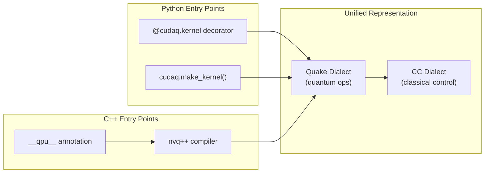
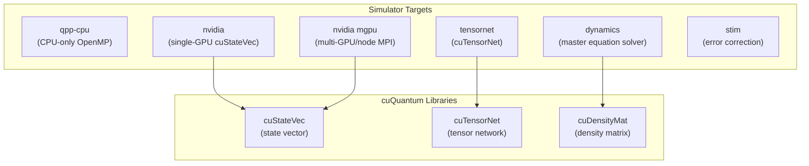
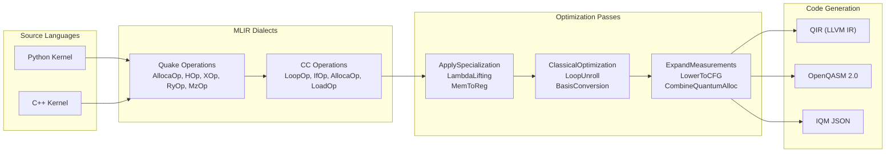
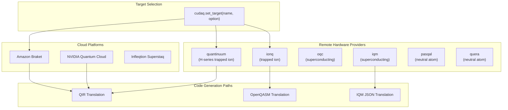
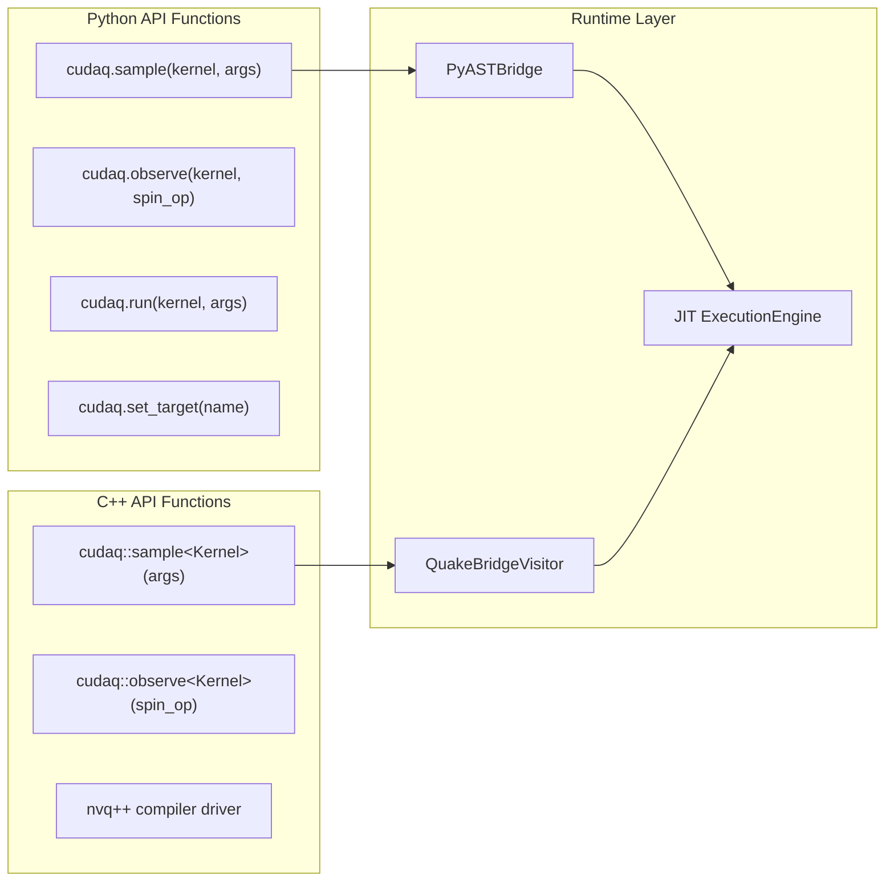
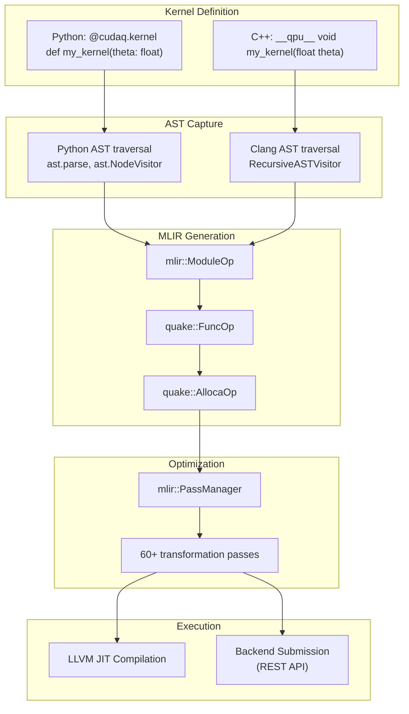
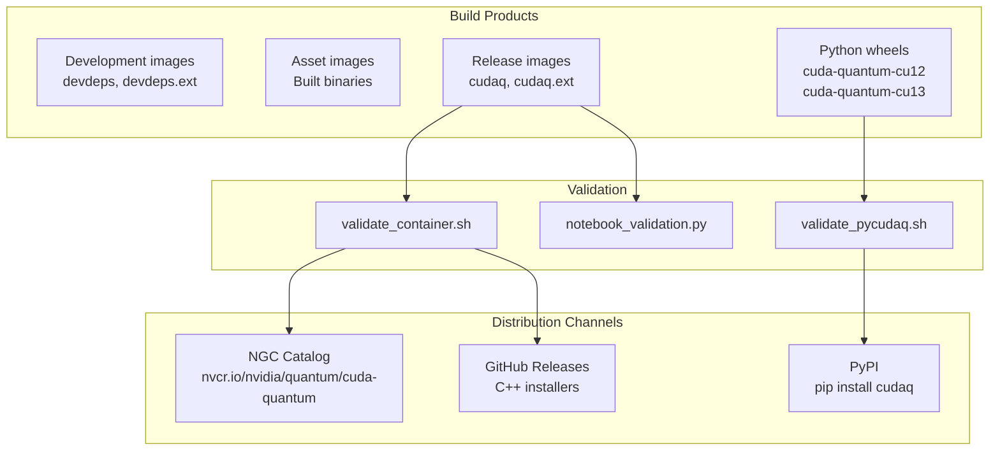

<!-- source: DeepWiki mcp.deepwiki.com · repo NVIDIA/cuda-quantum · page 1 CUDA-Q Overview · fetched 2026-10-26 -->

# CUDA-Q Overview

<details>
<summary>Relevant source files</summary>

The following files were used as context for generating this wiki page:

- [.github/workflows/command_dispatch.yml](.github/workflows/command_dispatch.yml)
- [.github/workflows/config/gitlab_commits.txt](.github/workflows/config/gitlab_commits.txt)
- [.github/workflows/config/spellcheck_config.yml](.github/workflows/config/spellcheck_config.yml)
- [.github/workflows/config/spelling_allowlist.txt](.github/workflows/config/spelling_allowlist.txt)
- [.github/workflows/python_metapackages.yml](.github/workflows/python_metapackages.yml)
- [.github/workflows/repo_checks.yml](.github/workflows/repo_checks.yml)
- [SECURITY.md](SECURITY.md)
- [docs/notebook_validation.py](docs/notebook_validation.py)
- [docs/sphinx/applications/python/hybrid_quantum_neural_networks.ipynb](docs/sphinx/applications/python/hybrid_quantum_neural_networks.ipynb)
- [docs/sphinx/applications/python/quantum_pagerank.ipynb](docs/sphinx/applications/python/quantum_pagerank.ipynb)
- [docs/sphinx/applications/python/unitary_compilation_diffusion_models.ipynb](docs/sphinx/applications/python/unitary_compilation_diffusion_models.ipynb)
- [docs/sphinx/examples/python/dynamics/dynamics_intro_2.ipynb](docs/sphinx/examples/python/dynamics/dynamics_intro_2.ipynb)
- [docs/sphinx/releases.rst](docs/sphinx/releases.rst)
- [docs/sphinx/using/backends/circuitsimulators.png](docs/sphinx/using/backends/circuitsimulators.png)
- [docs/sphinx/using/backends/cloud.rst](docs/sphinx/using/backends/cloud.rst)
- [docs/sphinx/using/backends/sims/svsims.rst](docs/sphinx/using/backends/sims/svsims.rst)
- [pyproject.toml.cu12](pyproject.toml.cu12)
- [pyproject.toml.cu13](pyproject.toml.cu13)
- [python/metapackages/setup.py](python/metapackages/setup.py)
- [scripts/validate_pycudaq.sh](scripts/validate_pycudaq.sh)

</details>


## Purpose and Scope

This document provides a comprehensive introduction to CUDA-Q, NVIDIA's quantum computing platform. It covers the platform's core capabilities, architectural design, and distribution model. For detailed information about specific subsystems, see:
- Core programming concepts: [Core Concepts](#1.1)
- System architecture details: [System Architecture](#2)
- Python programming guide: [Python Interface](#3)
- C++ programming guide: [C++ Interface](#4)
- Simulator backends: [Simulator Backends](#5)
- Hardware connectivity: [Remote Execution](#6)

---

## What is CUDA-Q?

CUDA-Q is a heterogeneous quantum-classical computing platform that enables developers to write quantum programs in Python or C++, optimize them through an MLIR-based compilation pipeline, and execute them on CPU/GPU simulators or quantum hardware. The platform emphasizes performance through GPU acceleration and provides a unified programming model for both simulation and hardware execution.

**Sources:** [docs/sphinx/releases.rst:1-251]()

---

## Key Capabilities

### Dual Language Support

CUDA-Q provides first-class support for both Python and C++ quantum programming:

- **Python**: Uses the `@cudaq.kernel` decorator for declarative kernel definition and `cudaq.make_kernel()` for programmatic construction
- **C++**: Uses the `__qpu__` annotation for kernel functions compiled with the `nvq++` compiler

Both language frontends converge on a unified MLIR representation, ensuring consistent semantics and optimization opportunities.



**CUDA-Q Language Frontend Architecture**

**Sources:** [.github/workflows/config/spelling_allowlist.txt:1-383](), [docs/sphinx/releases.rst:1-251]()

### GPU-Accelerated Simulation

The platform leverages NVIDIA GPUs through cuQuantum libraries for high-performance quantum simulation:



**CUDA-Q Simulator Stack**

The `nvidia` backend supports both single-precision (`fp32`) and double-precision (`fp64`) simulation modes, configurable via `cudaq.set_target('nvidia', option='fp64')`. For multi-GPU configurations, the `mgpu` option enables distributed state vector simulation across multiple GPUs and nodes using MPI.

**Sources:** [docs/sphinx/using/backends/sims/svsims.rst:1-333](), [pyproject.toml.cu12:1-84](), [pyproject.toml.cu13:1-85]()

### MLIR-Based Compilation Pipeline

CUDA-Q employs a sophisticated compilation infrastructure built on MLIR (Multi-Level Intermediate Representation):



**MLIR Compilation Pipeline with Code-Level Operations**

The Quake dialect defines quantum-specific operations including `quake.alloca` (qubit allocation), `quake.h` (Hadamard gate), `quake.x` (Pauli-X), `quake.ry` (rotation), and `quake.mz` (measurement in Z basis). The CC dialect handles classical control flow with operations like `cc.loop`, `cc.if`, `cc.alloca`, and `cc.load`.

**Sources:** [.github/workflows/config/spelling_allowlist.txt:62-129]()

### Hardware Integration

CUDA-Q provides connectivity to quantum hardware through backend-specific code generation:



**Backend Integration Architecture**

Backend configuration is managed through YAML files (e.g., `quantinuum.yml`, `ionq.yml`) that specify custom MLIR pass pipelines and code generation targets. Each backend can define environment-specific settings and authentication requirements.

**Sources:** [docs/sphinx/releases.rst:1-251](), [.github/workflows/config/spelling_allowlist.txt:1-383](), [scripts/validate_pycudaq.sh:1-293]()

---

## Platform Architecture

### User Interfaces Layer



**User-Facing API Surface**

The Python API provides three primary execution functions:
- `cudaq.sample()`: Execute quantum kernel and return measurement counts
- `cudaq.observe()`: Compute expectation value of a spin operator
- `cudaq.run()`: Execute kernel and return computed values

Target configuration is managed via `cudaq.set_target()` which accepts backend names like `'nvidia'`, `'qpp-cpu'`, `'quantinuum'`, etc., along with optional configuration strings.

**Sources:** [docs/sphinx/applications/python/hybrid_quantum_neural_networks.ipynb:1-785](), [scripts/validate_pycudaq.sh:109-115]()

### Compilation and Execution Flow



**Kernel Compilation Flow with MLIR Entities**

The compilation process transforms high-level quantum programs into executable code:
1. Python kernels undergo AST capture and conversion via `PyASTBridge`
2. C++ kernels are processed by `nvq++` using Clang's AST infrastructure
3. Both paths generate MLIR modules containing Quake and CC operations
4. The `mlir::PassManager` applies optimization passes
5. Code generation produces either JIT-executable LLVM IR or backend-specific formats

**Sources:** [docs/sphinx/using/backends/sims/svsims.rst:1-333]()

### MLIR Type System

CUDA-Q's MLIR dialects define specialized types for quantum and classical data:

| Category | MLIR Type | Description | Code Reference |
|----------|-----------|-------------|----------------|
| Quantum | `quake::RefType` | Single qubit reference | Quake dialect |
| Quantum | `quake::VeqType` | Quantum register (vector of qubits) | Quake dialect |
| Quantum | `quake::StruqType` | Structured quantum type | Quake dialect |
| Classical | `cc::PointerType` | Memory pointer | CC dialect |
| Classical | `cc::ArrayType` | Fixed-size array | CC dialect |
| Classical | `cc::CallableType` | Function pointer/callable | CC dialect |
| Classical | `cc::StructType` | Composite data structure | CC dialect |

These types enable precise representation of quantum programs while maintaining compatibility with classical control flow and data structures.

**Sources:** [.github/workflows/config/spelling_allowlist.txt:1-383]()

---

## Backend Configuration

### Simulator Environment Variables

The `nvidia` backend exposes extensive runtime configuration through environment variables:

| Variable | Purpose | Example Values |
|----------|---------|----------------|
| `CUDAQ_FUSION_MAX_QUBITS` | Gate fusion size | `4`, `5`, `6` (GPU-dependent) |
| `CUDAQ_FUSION_DIAGONAL_GATE_MAX_QUBITS` | Diagonal gate fusion | `-1` (auto), `0` (disabled) |
| `CUDAQ_MAX_CPU_MEMORY_GB` | Host memory limit | `0` (disabled), `64`, `NONE` |
| `CUDAQ_MAX_GPU_MEMORY_GB` | Device memory limit | `NONE` (unlimited), `32` |
| `CUDAQ_ENABLE_MEMPOOL` | CUDA memory pool | `TRUE`, `FALSE` |
| `CUDAQ_MGPU_FUSE` | Multi-GPU fusion level | `5`, `6` |
| `CUDAQ_MGPU_NQUBITS_THRESH` | Distribution threshold | `25` |
| `CUDAQ_MGPU_P2P_DEVICE_BITS` | P2P GPU count | `0` (disabled), `3` |
| `CUDAQ_GPU_FABRIC` | NVLink topology | `MNNVL`, `NVL`, `NONE` |

These variables must be set before importing `cudaq` in Python or before kernel compilation in C++.

**Sources:** [docs/sphinx/using/backends/sims/svsims.rst:100-333]()

### Multi-GPU Configuration

For distributed simulation across multiple GPUs and nodes:

```bash
# Single precision, 2 GPUs
mpiexec -np 2 python3 program.py --target nvidia --target-option fp32,mgpu

# Double precision, 4 nodes with 8 GPUs each
CUDAQ_MGPU_FUSE=5 CUDAQ_GPU_FABRIC=MNNVL \
  mpiexec -np 32 python3 program.py --target nvidia --target-option fp64,mgpu
```

The number of MPI processes must be a power of 2. Host-device migration is supported for state vectors exceeding GPU memory by setting `CUDAQ_MAX_CPU_MEMORY_GB`.

**Sources:** [docs/sphinx/using/backends/sims/svsims.rst:146-333]()

---

## Distribution and Installation

### Package Ecosystem

CUDA-Q is distributed through multiple channels:



**CUDA-Q Distribution Pipeline**

**Sources:** [python/metapackages/setup.py:1-256](), [.github/workflows/python_metapackages.yml:1-202]()

### Python Package Installation

CUDA-Q Python packages are version-specific to CUDA runtime:

```python
# Metapackage (auto-detects CUDA version)
pip install cudaq

# Explicit CUDA 12.x
pip install cuda-quantum-cu12

# Explicit CUDA 13.x  
pip install cuda-quantum-cu13
```

The `cudaq` metapackage automatically detects the installed CUDA version and installs the appropriate binary package. Dependencies include:
- `custatevec-cu12` or `custatevec-cu13` (state vector simulation)
- `cutensornet-cu12` or `cutensornet-cu13` (tensor network simulation)
- `cudensitymat-cu12` or `cudensitymat-cu13` (density matrix simulation)
- `numpy >= 1.24`, `scipy >= 1.10.1`, `requests >= 2.31`

**Sources:** [pyproject.toml.cu12:1-84](), [pyproject.toml.cu13:1-85](), [python/metapackages/setup.py:182-218]()

### Validation Infrastructure

The platform includes comprehensive validation scripts:

- **`validate_container.sh`**: Tests C++, Python, and Jupyter notebooks in Docker containers
- **`validate_pycudaq.sh`**: Validates Python wheels with GPU targets, MPI support, and examples
- **`notebook_validation.py`**: Executes Jupyter notebooks and validates backend availability

Example validation command:
```bash
source validate_pycudaq.sh -v 0.13.0 -i /tmp/packages -f /tmp -p 3.11 -c 12.6.0
```

These scripts verify:
- Core functionality across all targets (`nvidia`, `nvidia-mgpu`, `tensornet`)
- Backend-specific tests for remote hardware providers
- Platform tests for multi-GPU and MPI configurations
- Example code and documentation notebooks

**Sources:** [scripts/validate_pycudaq.sh:1-293](), [docs/notebook_validation.py:1-162]()

---

## Getting Started

### Basic Python Example

```python
import cudaq

# Define quantum kernel using decorator
@cudaq.kernel
def bell_pair():
    qubits = cudaq.qvector(2)
    h(qubits[0])
    cx(qubits[0], qubits[1])
    mz(qubits)

# Execute on CPU simulator
cudaq.set_target("qpp-cpu")
counts = cudaq.sample(bell_pair)
print(counts)

# Execute on GPU simulator
cudaq.set_target("nvidia")
counts = cudaq.sample(bell_pair)
print(counts)
```

### Basic C++ Example

```cpp
#include <cudaq.h>

__qpu__ void bell_pair() {
    cudaq::qvector qubits(2);
    h(qubits[0]);
    x<cudaq::ctrl>(qubits[0], qubits[1]);
    mz(qubits);
}

int main() {
    auto counts = cudaq::sample(bell_pair);
    counts.dump();
}
```

Compile and execute:
```bash
nvq++ --target nvidia bell_pair.cpp -o bell_pair.x
./bell_pair.x
```

**Sources:** [docs/sphinx/applications/python/hybrid_quantum_neural_networks.ipynb:1-785]()

---

## Release History and Support

CUDA-Q follows semantic versioning with regular releases. Recent major versions:

| Version | Key Features | Python Support | CUDA Support |
|---------|--------------|----------------|--------------|
| 0.13.0 | QEC libraries, QCI backends | 3.11, 3.12, 3.13 | 12.x, 13.x |
| 0.12.0 | Dynamics simulation, `run()` API | 3.11, 3.12, 3.13 | 12.x |
| 0.11.0 | Operator framework, state initialization | 3.10, 3.11, 3.12 | 11.x, 12.x |
| 0.10.0 | Noisy simulation, Pasqal/QuEra | 3.10, 3.11, 3.12 | 11.x, 12.x |
| 0.9.0 | Dynamics API, Anyon/QuEra backends | 3.10, 3.11, 3.12 | 11.x, 12.x |

Note: CUDA 11 support was removed in version 0.13.0. Python 3.10 support was removed in version 0.13.0.

**Sources:** [docs/sphinx/releases.rst:1-251]()

---

## Additional Resources

- Platform documentation: `https://nvidia.github.io/cuda-quantum`
- Source repository: `https://github.com/NVIDIA/cuda-quantum`
- PyPI package: `https://pypi.org/project/cudaq`
- NGC container catalog: `https://catalog.ngc.nvidia.com/orgs/nvidia/teams/quantum/containers/cuda-quantum`
- Developer portal: `https://developer.nvidia.com/cuda-q`

For system-specific documentation:
- Core programming concepts: [Core Concepts](#1.1)
- Compilation pipeline details: [Compilation Pipeline](#2.1)
- Backend simulator options: [Simulator Backends](#5)
- Hardware provider integration: [Remote Execution](#6)
- Build and development setup: [Building and Distribution](#7)

**Sources:** [pyproject.toml.cu12:50-54](), [pyproject.toml.cu13:50-54](), [docs/sphinx/releases.rst:1-251]()

---

