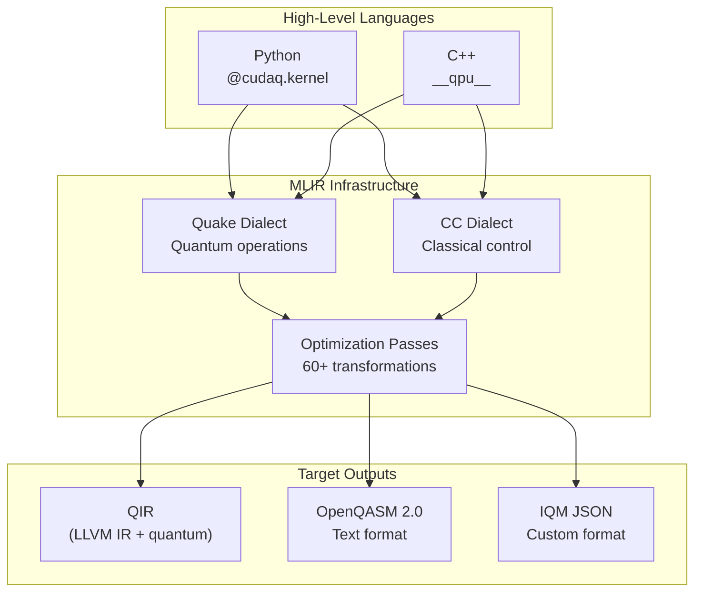
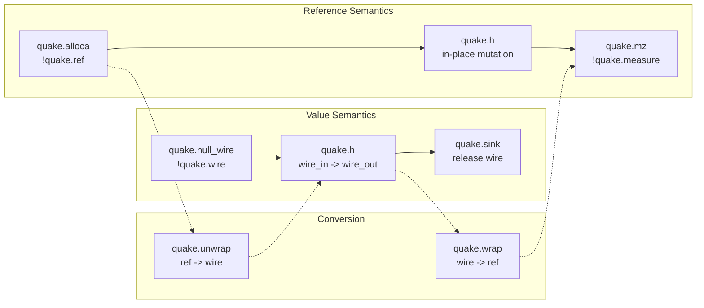
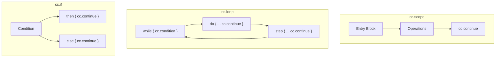
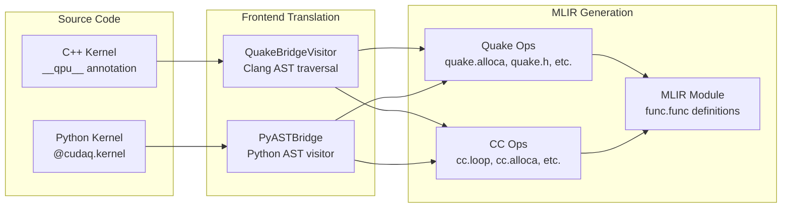
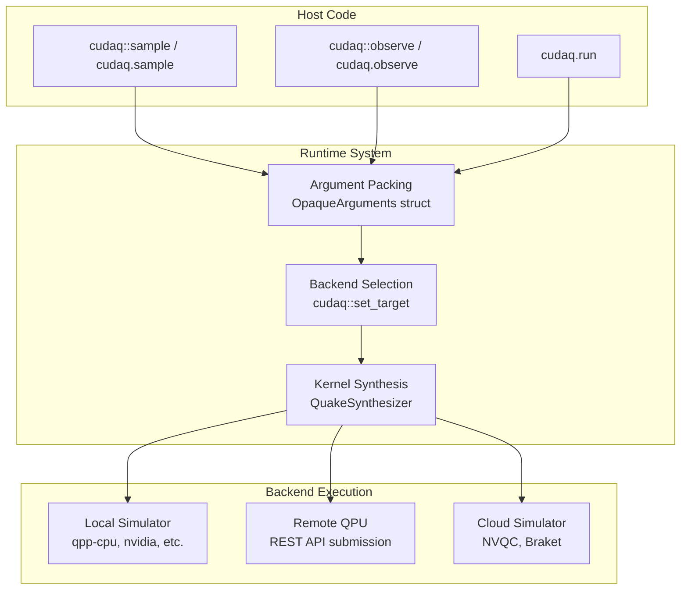

<!-- source: DeepWiki mcp.deepwiki.com · repo NVIDIA/cuda-quantum · page 1.1 Core Concepts · fetched 2026-10-26 -->

# Core Concepts

<details>
<summary>Relevant source files</summary>

The following files were used as context for generating this wiki page:

- [.github/workflows/command_dispatch.yml](.github/workflows/command_dispatch.yml)
- [.github/workflows/config/spellcheck_config.yml](.github/workflows/config/spellcheck_config.yml)
- [.github/workflows/config/spelling_allowlist.txt](.github/workflows/config/spelling_allowlist.txt)
- [.github/workflows/repo_checks.yml](.github/workflows/repo_checks.yml)
- [SECURITY.md](SECURITY.md)
- [docs/sphinx/releases.rst](docs/sphinx/releases.rst)
- [docs/sphinx/using/backends/cloud.rst](docs/sphinx/using/backends/cloud.rst)
- [include/cudaq/Optimizer/Dialect/CC/CCOps.h](include/cudaq/Optimizer/Dialect/CC/CCOps.h)
- [include/cudaq/Optimizer/Dialect/CC/CCOps.td](include/cudaq/Optimizer/Dialect/CC/CCOps.td)
- [include/cudaq/Optimizer/Dialect/Quake/QuakeOps.h](include/cudaq/Optimizer/Dialect/Quake/QuakeOps.h)
- [include/cudaq/Optimizer/Dialect/Quake/QuakeOps.td](include/cudaq/Optimizer/Dialect/Quake/QuakeOps.td)
- [lib/Optimizer/Dialect/CC/CCOps.cpp](lib/Optimizer/Dialect/CC/CCOps.cpp)
- [lib/Optimizer/Dialect/Quake/QuakeOps.cpp](lib/Optimizer/Dialect/Quake/QuakeOps.cpp)
- [lib/Optimizer/Transforms/QuakeSynthesizer.cpp](lib/Optimizer/Transforms/QuakeSynthesizer.cpp)
- [test/AST-Quake/adjoint-3.cpp](test/AST-Quake/adjoint-3.cpp)
- [test/AST-Quake/loop_unroll-1.cpp](test/AST-Quake/loop_unroll-1.cpp)
- [test/AST-Quake/qpe.cpp](test/AST-Quake/qpe.cpp)
- [test/Translate/ghz.qke](test/Translate/ghz.qke)

</details>


## Purpose and Scope

This page introduces the fundamental concepts underlying CUDA-Q's architecture. It explains quantum kernels, the MLIR-based internal representation, the Quake and CC dialects, backend systems, and the distinction between compilation and execution phases. These concepts form the foundation for understanding how CUDA-Q translates high-level quantum programs into executable code across diverse simulation and hardware targets.

For information about specific language frontends, see [Python Interface](#3) and [C++ Interface](#4). For details on the compilation pipeline stages, see [Compilation Pipeline](#2.1). For backend-specific configurations, see [Simulator Backends](#5) and [Remote Execution](#6).

---

## Quantum Kernels

A **quantum kernel** is a user-defined function containing quantum operations that executes on a quantum processor (QPU) or simulator. Quantum kernels are the primary abstraction for expressing quantum algorithms in CUDA-Q.

### Kernel Definition

In **C++**, quantum kernels are annotated with the `__qpu__` attribute:

```cpp
__qpu__ void my_kernel(cudaq::qubit &q) {
  h(q);
  mz(q);
}
```

In **Python**, kernels are defined using the `@cudaq.kernel` decorator or the kernel builder API:

```python
@cudaq.kernel
def my_kernel():
    q = cudaq.qubit()
    h(q)
    mz(q)
```

### Kernel Properties

Quantum kernels in CUDA-Q have specific characteristics:

| Property | Description |
|----------|-------------|
| **Pure device code** | Kernels execute on quantum hardware or simulators, not on the classical CPU |
| **Type restrictions** | Arguments must be supported quantum or classical types (`qubit`, `qvector`, numeric types, `std::vector`) |
| **No side effects** | Cannot perform arbitrary I/O or memory allocation visible to the host |
| **Callable abstraction** | Can be passed as arguments to other kernels using `cudaq::control`, `cudaq::adjoint`, or template parameters |

### Kernel Representation

Both C++ and Python quantum kernels are transformed into MLIR during compilation. The C++ compiler driver `nvq++` processes kernels through the Clang AST, while Python kernels are captured via AST inspection at runtime.

**Sources:** [test/AST-Quake/qpe.cpp:22-88](), [include/cudaq/Optimizer/Dialect/Quake/QuakeOps.td:39-109]()

---

## MLIR Representation

CUDA-Q uses **Multi-Level Intermediate Representation (MLIR)** as its internal compiler infrastructure. MLIR provides a flexible, extensible framework for representing quantum programs and applying transformations.

### Why MLIR?



**MLIR Benefits:**

1. **Unified representation** - Both Python and C++ converge to the same IR
2. **Progressive lowering** - High-level abstractions lower through multiple dialects to target code
3. **Reusable passes** - Transformations work across all source languages
4. **Extensibility** - Custom dialects (Quake, CC) model domain-specific semantics
5. **Type safety** - Strong typing catches errors during compilation

### MLIR Module Structure

A compiled quantum kernel produces an MLIR module containing `func.func` operations:

```mlir
module {
  func.func @__nvqpp__mlirgen__my_kernel() attributes {"cudaq-kernel"} {
    %0 = quake.alloca !quake.ref
    quake.h %0 : (!quake.ref) -> ()
    %1 = quake.mz %0 : (!quake.ref) -> !quake.measure
    return
  }
}
```

The module represents functions, global constants, and type definitions in a structured, analyzable format.

**Sources:** [lib/Optimizer/Dialect/CC/CCOps.cpp:1-27](), [lib/Optimizer/Dialect/Quake/QuakeOps.cpp:1-27]()

---

## Quake Dialect

The **Quake dialect** defines operations, types, and semantics for quantum computations. It represents quantum circuits using either **reference semantics** or **value semantics**.

### Quake Types

| Type | Description | Example |
|------|-------------|---------|
| `!quake.ref` | Reference to a single qubit | `%q = quake.alloca !quake.ref` |
| `!quake.veq<N>` | Vector of N qubits (fixed size) | `%v = quake.alloca !quake.veq<4>` |
| `!quake.veq<?>` | Vector of qubits (dynamic size) | `%v = quake.alloca !quake.veq<?>` |
| `!quake.wire` | Single qubit in value semantics | `%w = quake.null_wire` |
| `!quake.cable<N>` | Bundle of N wires | `%c = quake.null_cable !quake.cable<4>` |
| `!quake.measure` | Measurement result | `%m = quake.mz %q` |

### Quake Operations

The Quake dialect provides operations for quantum gates, measurements, and structural manipulation:

#### Quantum Gates

```mlir
quake.h %q : (!quake.ref) -> ()                          // Hadamard
quake.x %q : (!quake.ref) -> ()                          // Pauli X
quake.ry(%angle) %q : (f64, !quake.ref) -> ()           // Parametric rotation
quake.x [%ctrl] %target : (!quake.ref, !quake.ref) -> () // Controlled-X
```

#### Allocation and Measurement

```mlir
%q = quake.alloca !quake.ref                             // Allocate single qubit
%v = quake.alloca !quake.veq<4>                          // Allocate 4 qubits
%m = quake.mz %q : (!quake.ref) -> !quake.measure        // Measure qubit
quake.dealloc %q : !quake.ref                            // Deallocate qubit
```

#### Qubit Manipulation

```mlir
%r = quake.extract_ref %veq[%idx] : (!quake.veq<?>, i64) -> !quake.ref
%sub = quake.subveq %veq, %low, %high : (!quake.veq<?>, i64, i64) -> !quake.veq<?>
%concat = quake.concat %ref1, %veq, %ref2 : ... -> !quake.veq<?>
```

### Reference vs Value Semantics



- **Reference semantics**: Qubits are references that exist throughout the kernel. Gates mutate qubit state in-place.
- **Value semantics**: Each gate operation produces a new wire value. Enables functional-style transformations and explicit data flow.

The `quake.unwrap` and `quake.wrap` operations convert between the two representations during lowering passes.

**Sources:** [include/cudaq/Optimizer/Dialect/Quake/QuakeOps.td:39-367](), [lib/Optimizer/Dialect/Quake/QuakeOps.cpp:28-104]()

---

## CC Dialect

The **CC (Classical Control) dialect** represents classical computations, control flow, and data structures that accompany quantum operations. It provides C++-like semantics in MLIR form.

### CC Types

| Type | Description | Example |
|------|-------------|---------|
| `!cc.ptr<T>` | Pointer to type T | `!cc.ptr<f64>` |
| `!cc.array<T x N>` | Array of N elements of type T | `!cc.array<i32 x 10>` |
| `!cc.struct<{T1, T2, ...}>` | Struct with members | `!cc.struct<{i32, f64}>` |
| `!cc.stdvec<T>` | Dynamic vector (std::vector) | `!cc.stdvec<f64>` |
| `!cc.callable<(Args) -> Result>` | Callable function object | `!cc.callable<(i32) -> f64>` |

### CC Operations

#### Memory Operations

```mlir
%ptr = cc.alloca i32                               // Stack allocation
cc.store %val, %ptr : !cc.ptr<i32>                 // Store value
%val = cc.load %ptr : !cc.ptr<i32>                 // Load value
%elem_ptr = cc.compute_ptr %arr[%idx] : ... -> ... // Compute element address
```

#### Control Flow

```mlir
cc.scope {
  %local = cc.alloca i32
  // ... operations in local scope
  cc.continue
}

cc.if (%cond) {
  // then branch
  cc.continue
} else {
  // else branch
  cc.continue
}

cc.loop while {
  // while condition block
  cc.condition %cond
} do {
  // loop body
  cc.continue
}
```

#### Type Conversions

```mlir
%f = cc.cast %i : (i32) -> f64                     // Integer to float
%p = cc.cast %arr : (!cc.array<T x N>) -> !cc.ptr<T> // Array to pointer
```

### Structured Control Flow

The CC dialect models structured control flow using region-based operations. Unlike LLVM's CFG (control flow graph) with basic blocks and branches, CC operations encapsulate control flow in nested regions:



- **`cc.scope`**: Defines a local variable scope, similar to C++ `{ }` blocks
- **`cc.loop`**: Generalized loop with while/do/step/else regions, supporting C-style for loops, while loops, and Python for-else
- **`cc.if`**: Conditional branching with optional else clause

### Unwind Operations

CC provides non-local control flow operations for break/continue/return from nested contexts:

| Operation | Purpose |
|-----------|---------|
| `cc.unwind_break` | Break from innermost enclosing loop, potentially across multiple scopes |
| `cc.unwind_continue` | Continue to next iteration of innermost loop |
| `cc.unwind_return` | Return from function, potentially across multiple scopes |

These operations model the stack unwinding semantics required when exiting nested scopes, ensuring proper cleanup (deallocation, destructor calls) occurs.

**Sources:** [include/cudaq/Optimizer/Dialect/CC/CCOps.td:42-763](), [lib/Optimizer/Dialect/CC/CCOps.cpp:36-560]()

---

## Compilation vs Execution

CUDA-Q separates **compilation** (transformation of source code to MLIR and target formats) from **execution** (running the compiled kernel on a backend).

### Compilation Phase



**Compilation steps:**

1. **Source parsing**: C++ via Clang, Python via `ast` module
2. **AST traversal**: Extract quantum operations and classical control flow
3. **MLIR generation**: Create Quake and CC operations in an MLIR module
4. **Optimization**: Apply transformation passes (see [MLIR Optimization Passes](#2.3))
5. **Lowering**: Convert to target format (QIR, OpenQASM, etc.)

For C++, compilation occurs ahead-of-time via the `nvq++` compiler:

```bash
nvq++ my_kernel.cpp -o my_kernel
```

For Python, compilation occurs just-in-time (JIT) when a kernel is first invoked or explicitly via `cudaq.kernel`:

```python
kernel = cudaq.make_kernel()
# ... build kernel
compiled = cudaq.compile(kernel)  # Explicit compilation
```

### Execution Phase



**Execution steps:**

1. **Argument packing**: Runtime arguments are packed into an `OpaqueArguments` structure
2. **Target selection**: Backend is chosen via `cudaq::set_target()` or command-line flags
3. **Kernel synthesis**: Runtime argument values are synthesized into the MLIR as constants (see [lib/Optimizer/Transforms/QuakeSynthesizer.cpp:378-793]())
4. **Code generation**: MLIR is lowered to backend-specific format
5. **Backend dispatch**: Compiled code is executed on the selected backend
6. **Result retrieval**: Measurement outcomes are collected and returned as `cudaq::sample_result` or `cudaq::observe_result`

### Synthesis Example

The `QuakeSynthesizer` pass replaces runtime argument placeholders with concrete constant values:

**Before synthesis:**
```mlir
func.func @kernel(%arg0: f64) {
  %q = quake.alloca !quake.ref
  quake.ry(%arg0) %q : (f64, !quake.ref) -> ()
  // ...
}
```

**After synthesis (with arg0 = 1.57):**
```mlir
func.func @kernel() {
  %angle = arith.constant 1.570000e+00 : f64
  %q = quake.alloca !quake.ref
  quake.ry(%angle) %q : (f64, !quake.ref) -> ()
  // ...
}
```

This enables backends to operate on fully concrete circuits without requiring dynamic parameter handling.

**Sources:** [lib/Optimizer/Transforms/QuakeSynthesizer.cpp:377-454](), [lib/Optimizer/Transforms/QuakeSynthesizer.cpp:56-83]()

---

## Backends

A **backend** is an execution target that runs compiled quantum kernels. CUDA-Q supports three categories of backends:

### Backend Categories

| Category | Examples | Target Selection |
|----------|----------|------------------|
| **Local Simulators** | `qpp-cpu`, `nvidia`, `nvidia-mgpu`, `tensornet`, `stim` | Execution in same process, GPU/CPU simulation |
| **Remote Hardware** | `quantinuum`, `ionq`, `oqc`, `iqm`, `anyon`, `orca` | Quantum hardware via REST API |
| **Cloud Platforms** | `nvqc`, `braket`, `superstaq` | Cloud-hosted simulators and hardware access |

### Backend Selection

Backends are selected at runtime:

**C++:**
```cpp
auto& platform = cudaq::get_platform();
platform.set_target_backend("nvidia");
```

**Python:**
```python
cudaq.set_target("nvidia")
```

**Command line:**
```bash
nvq++ --target nvidia my_kernel.cpp
```

### Backend Configuration

Each backend has a YAML configuration file specifying:

- **Code generation pipeline**: Which MLIR passes to apply
- **Output format**: QIR, OpenQASM, IQM JSON, etc.
- **Runtime parameters**: Environment variables, connection settings

Example backend configuration structure:

```yaml
name: nvidia
passes:
  - unrolling-pipeline
  - kernel-execution
  - convert-to-qir
target-pass: qir-base
```

Configuration files are located in backend-specific directories and loaded by the platform at initialization.

**Sources:** [docs/sphinx/releases.rst:1-236](), system architecture diagrams

---

## Type Systems and Conversions

CUDA-Q maintains multiple type systems that interact during compilation:

### Python to MLIR Type Mapping

| Python Type | MLIR CC Type | Quake Type |
|-------------|--------------|------------|
| `int` | `i64`, `i32`, `i8` | - |
| `float` | `f64` | - |
| `complex` | `complex<f64>` | - |
| `list[T]` | `!cc.stdvec<T>` | - |
| `cudaq.qubit` | - | `!quake.ref` |
| `cudaq.qvector` | - | `!quake.veq<N>` or `!quake.veq<?>` |

### C++ to MLIR Type Mapping

| C++ Type | MLIR Type |
|----------|-----------|
| `int`, `long`, `bool` | `i32`, `i64`, `i1` |
| `float`, `double` | `f32`, `f64` |
| `std::vector<T>` | `!cc.stdvec<T>` |
| `std::complex<T>` | `complex<T>` |
| `cudaq::qubit` | `!quake.ref` |
| `cudaq::qvector<N>` | `!quake.veq<N>` |
| `cudaq::qview<>` | `!quake.veq<?>` |

### Runtime Argument Handling

When quantum kernels are invoked with runtime arguments, the system:

1. **Packs arguments** into an `OpaqueArguments` buffer following the target's data layout
2. **Invokes synthesis pass** (`QuakeSynthesizer`) to replace MLIR block arguments with constants
3. **Type-specific synthesis** for each argument type (see [lib/Optimizer/Transforms/QuakeSynthesizer.cpp:280-375]())

Example for `std::vector<double>`:

```mlir
// Before synthesis (function signature)
func.func @kernel(%vec: !cc.stdvec<f64>)

// After synthesis (with vec = {1.0, 2.0, 3.0})
func.func @kernel() {
  %arr = cc.const_array [1.0, 2.0, 3.0] : !cc.array<f64 x 3>
  %buf = cc.alloca !cc.array<f64 x 3>
  cc.store %arr, %buf
  %vec = cc.stdvec_init %buf, %size : (!cc.ptr<...>, i64) -> !cc.stdvec<f64>
  // ... rest of kernel uses %vec
}
```

**Sources:** [lib/Optimizer/Transforms/QuakeSynthesizer.cpp:118-375](), [include/cudaq/Optimizer/Dialect/CC/CCOps.td:796-831]()

---

## Summary

The core concepts of CUDA-Q provide a robust foundation for hybrid quantum-classical programming:

- **Quantum kernels** abstract quantum algorithms across languages
- **MLIR representation** unifies compilation and enables powerful transformations
- **Quake dialect** models quantum operations with multiple semantic styles
- **CC dialect** represents classical control flow and data structures
- **Compilation** transforms source code into optimized MLIR modules
- **Execution** dispatches synthesized kernels to diverse backends
- **Backends** provide pluggable targets for simulation and hardware

Understanding these concepts enables effective use of CUDA-Q's features and facilitates contributions to the platform.

---

