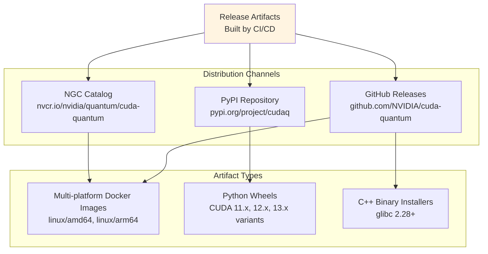
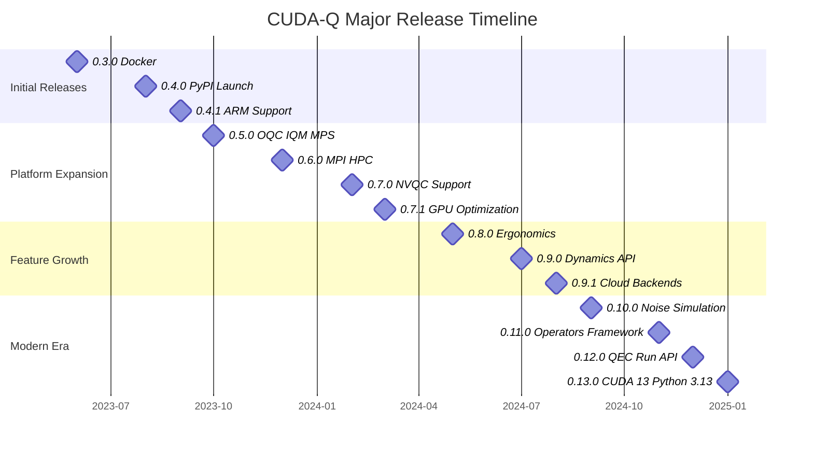
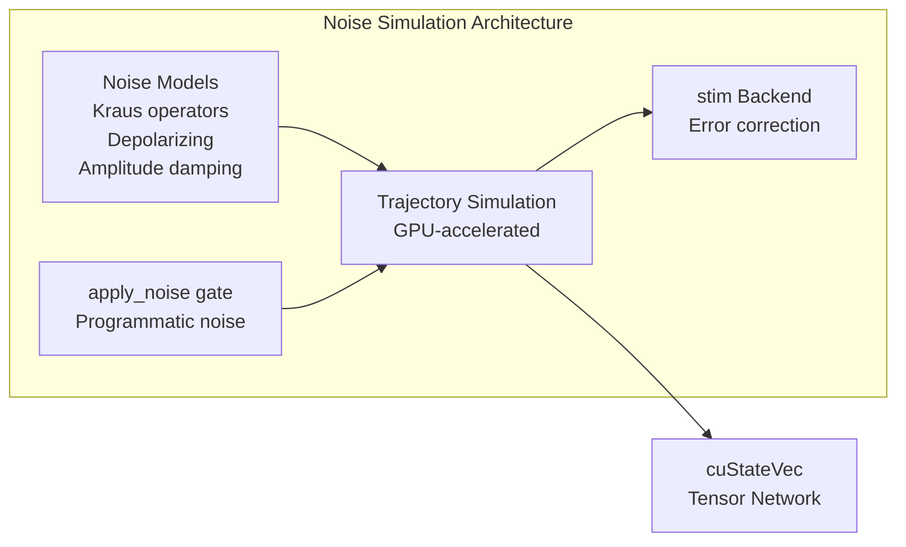
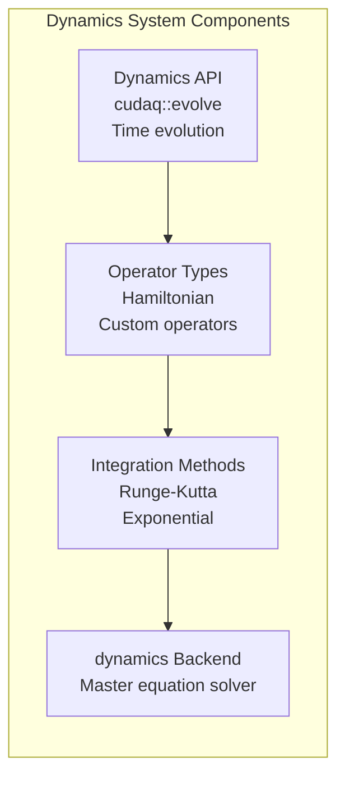
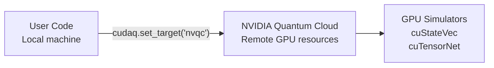
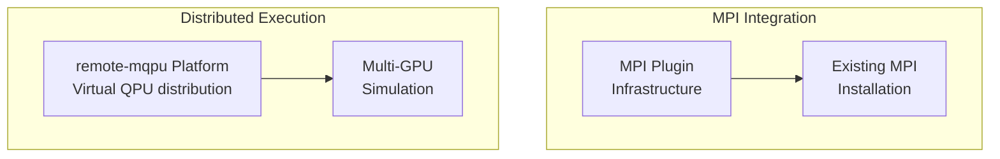
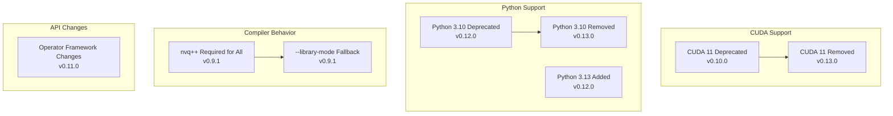
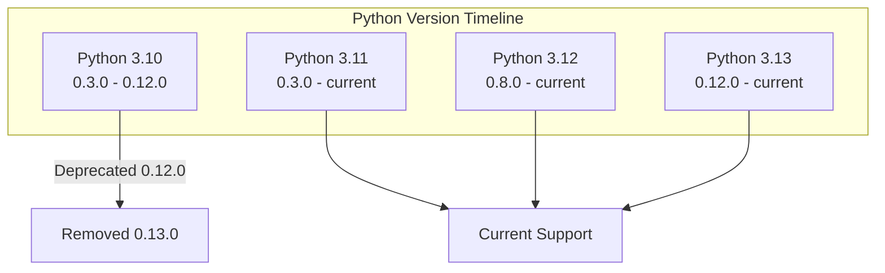
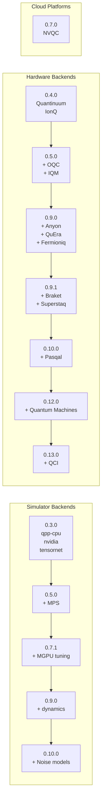
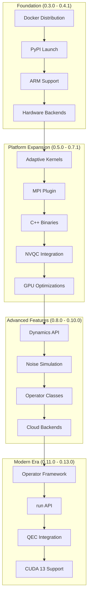

<!-- source: DeepWiki mcp.deepwiki.com · repo NVIDIA/cuda-quantum · page 10 Release History · fetched 2026-10-26 -->

# Release History

<details>
<summary>Relevant source files</summary>

The following files were used as context for generating this wiki page:

- [.github/workflows/command_dispatch.yml](.github/workflows/command_dispatch.yml)
- [.github/workflows/config/spellcheck_config.yml](.github/workflows/config/spellcheck_config.yml)
- [.github/workflows/config/spelling_allowlist.txt](.github/workflows/config/spelling_allowlist.txt)
- [.github/workflows/repo_checks.yml](.github/workflows/repo_checks.yml)
- [SECURITY.md](SECURITY.md)
- [docs/sphinx/releases.rst](docs/sphinx/releases.rst)
- [docs/sphinx/using/backends/cloud.rst](docs/sphinx/using/backends/cloud.rst)

</details>


## Purpose and Scope

This document provides a comprehensive chronicle of CUDA-Q releases, detailing version numbers, release dates, new features, breaking changes, platform support evolution, and distribution channels. It serves as a reference for understanding the project's development trajectory and for planning upgrades between versions.

For information about installation methods and current distribution channels, see [Installation Methods](#7.4). For details about the CI/CD infrastructure that produces releases, see [Release and Publishing Process](#8.4).

**Sources:** [docs/sphinx/releases.rst]()

---

## Release Versioning Strategy

CUDA-Q follows semantic versioning with the format `MAJOR.MINOR.PATCH`:

- **MAJOR** version increments indicate significant architectural changes or breaking API modifications
- **MINOR** version increments introduce new features while maintaining backward compatibility (though breaking changes are documented)
- **PATCH** version increments contain bug fixes and minor improvements

### Version Channels

| Channel | Description | Stability | Access |
|---------|-------------|-----------|--------|
| **latest** (nightly) | Main branch builds | Experimental | NGC nightly container |
| **MAJOR.MINOR.PATCH** | Stable releases | Production-ready | PyPI, NGC, GitHub releases |

**Sources:** [docs/sphinx/releases.rst:1-13]()

---

## Distribution Channels

CUDA-Q releases are published through three primary channels, each serving different use cases:



### Channel Characteristics

| Channel | Content | Update Frequency | Target Users |
|---------|---------|------------------|--------------|
| **NGC** | Docker images (CPU + GPU) | Nightly + Releases | Container users, HPC environments |
| **PyPI** | Python wheels (CUDA-specific) | Releases only | Python developers, pip users |
| **GitHub** | C++ installers, source code | Releases only | C++ developers, custom builds |

**Sources:** [docs/sphinx/releases.rst:11-29]()

---

## Release Timeline

The following diagram illustrates the major milestones in CUDA-Q's release history:



**Sources:** [docs/sphinx/releases.rst:15-251]()

---

## Major Release Details

### 0.13.0 (Latest Stable)

**Release Date:** January 2025

**Key Features:**
- CUDA 13.0 support added
- Python 3.13 support added
- CUDA-Q QEC libraries integration with Quantinuum backends for real-time decoding
- QCI backend submission support

**Breaking Changes:**
- CUDA 11.x support removed
- Python 3.10 support removed

**Distribution:**
- Docker: `nvcr.io/nvidia/quantum/cuda-quantum:0.13.0`
- PyPI: `cudaq==0.13.0`
- GitHub: Binary installers for glibc 2.28+

**Platform Support:**

| Component | Version |
|-----------|---------|
| CUDA | 12.x, 13.x |
| Python | 3.11, 3.12, 3.13 |
| Architecture | x86_64, aarch64 |

**Sources:** [docs/sphinx/releases.rst:15-30]()

---

### 0.12.0

**Release Date:** December 2024

**Key Features:**
- New `cudaq.run()` API for kernels returning values
- Dynamics simulation performance improvements
- Enhanced error correction tools
- Quantum Machines backend integration
- Python 3.13 support introduced
- unitaryHACK community contributions

**Deprecation Notice:**
- Python 3.10 support marked for removal in future releases

**API Additions:**

```python
# New run API for value-returning kernels
result = cudaq.run(kernel, args)  # Returns kernel-computed values
```

**Sources:** [docs/sphinx/releases.rst:31-48]()

---

### 0.11.0

**Release Date:** November 2024

**Key Features:**
- Qubit state initialization support for quantum hardware backends
- Expanded simulator backend configuration options
- Operator framework performance improvements

**Breaking Changes:**
- Operator framework API modifications for performance
- Refer to [release notes](https://github.com/NVIDIA/cuda-quantum/releases/0.11.0) for migration details

**Performance Impact:**
- Resolved initial operator framework performance issues from earlier releases

**Sources:** [docs/sphinx/releases.rst:50-66]()

---

### 0.10.0

**Release Date:** September 2024

**Key Features:**
- Trajectory-based noise simulation for GPU-accelerated statevector and tensor network simulators
- Enhanced noise models and `apply_noise` gate
- C++ support for `dynamics` backend (master equation solver)
- Operator classes: fermionic, bosonic, and custom operators
- Pasqal backend support
- C++ support for QuEra backend

**Deprecation Notice:**
- CUDA 11 support marked for future removal (migration to CUDA 12 recommended)

**Noise Simulation Features:**



**Sources:** [docs/sphinx/releases.rst:67-90](), [.github/workflows/config/spelling_allowlist.txt:125-126]()

---

### 0.9.1

**Release Date:** August 2024

**Key Features:**
- Amazon Braket backend integration
- Infleqtion Superstaq backend support

**Compiler Behavior Change:**
All C++ quantum kernels now processed by `nvq++` compiler regardless of backend:
- Previously: Simulator-only code could use unsupported language constructs
- Now: All code must conform to supported quantum kernel syntax
- Workaround: `--library-mode` flag restores previous behavior (simulator-only)

**Migration Impact:**

| Scenario | Before 0.9.1 | After 0.9.1 |
|----------|--------------|-------------|
| Simulator execution | Unsupported syntax allowed | Compilation error |
| Hardware execution | Must use supported syntax | Must use supported syntax |
| Library mode | N/A | `--library-mode` flag enables old behavior |

**Sources:** [docs/sphinx/releases.rst:91-111]()

---

### 0.9.0

**Release Date:** July 2024

**Key Features:**
- Time evolution and dynamics modeling API
- Arbitrary operator time evolution support
- New backend integrations:
  - Anyon Technologies
  - Fermioniq
  - QuEra Computing
- ORCA Computing backend updates
- OQC backend updates

**Dynamics API Introduction:**



**Sources:** [docs/sphinx/releases.rst:112-132](), [.github/workflows/config/spelling_allowlist.txt:8,119-120]()

---

### 0.8.0

**Release Date:** May 2024

**Key Features:**
- Significant ease-of-use improvements
- Performance enhancements across the platform
- Community contributions from external developers

**Focus Areas:**
- API ergonomics
- Documentation updates
- Performance optimization

**Sources:** [docs/sphinx/releases.rst:133-147]()

---

### 0.7.1

**Release Date:** March 2024

**Key Features:**
- Simulator performance optimizations
- `nvidia-mgpu` backend customization via `CUDAQ_MGPU_FUSE` environment variable
- Bug fixes

**Configuration Addition:**

| Environment Variable | Purpose | Impact |
|---------------------|---------|--------|
| `CUDAQ_MGPU_FUSE` | Gate fusion level control | Performance tuning for multi-GPU simulation |

**Distribution Change:**
- Python wheel installation instructions updated

**Sources:** [docs/sphinx/releases.rst:148-163]()

---

### 0.7.0

**Release Date:** February 2024

**Key Features:**
- NVIDIA Quantum Cloud (NVQC) integration
- Access to GPU-accelerated simulators without local GPU
- Greatly expanded Python and C++ language frontend expressiveness

**Language Support Expansion:**
- Enhanced Python syntax support in quantum kernels
- Improved C++ language constructs

**Cloud Access Model:**



**Sources:** [docs/sphinx/releases.rst:164-180]()

---

### 0.6.0

**Release Date:** December 2023

**Key Features:**
- MPI plugin infrastructure for HPC environments
- `remote-mqpu` platform target for distributed workloads
- Pre-built C++ binary distribution (glibc 2.28+)
- Multi-QPU simulation across GPUs

**HPC Enhancements:**



**Sources:** [docs/sphinx/releases.rst:181-201]()

---

### 0.5.0

**Release Date:** October 2023

**Key Features:**
- OQC backend support
- IQM backend support
- Adaptive quantum kernel execution on compatible hardware
- Tensor network simulation improvements
- Matrix Product State (MPS) simulator
- Experimental Python language support images

**Backend Expansion:**

| Backend | Type | Key Feature |
|---------|------|-------------|
| OQC | Hardware | Superconducting qubits |
| IQM | Hardware | Superconducting qubits |

**Simulator Addition:**
- MPS simulator for efficient simulation of certain circuit classes

**Sources:** [docs/sphinx/releases.rst:202-217](), [.github/workflows/config/spelling_allowlist.txt:69,79]()

---

### 0.4.1

**Release Date:** September 2023

**Key Features:**
- ARM processor support (aarch64)
- Multi-platform Docker images: `linux/amd64`, `linux/arm64`
- All GPU backends included in Python wheels
- Complete GPU backend support in Docker images

**Platform Support Expansion:**

| Platform | Before 0.4.1 | After 0.4.1 |
|----------|--------------|-------------|
| x86_64 | Full support | Full support |
| aarch64 | Not supported | Full support |
| GPU backends in wheels | Partial | Complete |

**Sources:** [docs/sphinx/releases.rst:218-228]()

---

### 0.4.0

**Release Date:** August 2023

**Key Features:**
- **PyPI launch**: First release on Python Package Index
- Quantinuum backend support
- IonQ backend support

**Distribution Milestone:**
First availability of `pip install cuda-quantum`

**Limitations:**
- PyPI wheels did not include all GPU backends initially
- Full-featured version available via Docker for `linux/amd64`

**Quantum Hardware Support:**

| Provider | Access Method | Qubit Technology |
|----------|---------------|------------------|
| Quantinuum | REST API | Trapped ion |
| IonQ | REST API | Trapped ion |

**Sources:** [docs/sphinx/releases.rst:229-243]()

---

### 0.3.0

**Release Date:** June 2023

**Key Features:**
- Initial public release
- Docker image distribution via NGC
- Platform: `linux/amd64` only

**Distribution:**
- NGC Catalog: `nvcr.io/nvidia/quantum/cuda-quantum:0.3.0`

**Sources:** [docs/sphinx/releases.rst:244-251]()

---

## Breaking Changes and Deprecations

The following table tracks major breaking changes and deprecations across releases:

### Breaking Changes Timeline



### Detailed Breaking Changes

| Version | Component | Change | Migration Path |
|---------|-----------|--------|----------------|
| **0.13.0** | CUDA | CUDA 11 support removed | Upgrade to CUDA 12 or 13 |
| **0.13.0** | Python | Python 3.10 support removed | Upgrade to Python 3.11+ |
| **0.11.0** | API | Operator framework performance improvements | Review [release notes](https://github.com/NVIDIA/cuda-quantum/releases/0.11.0) |
| **0.9.1** | Compiler | All C++ kernels require `nvq++` compilation | Use `--library-mode` for unsupported syntax (simulator-only) |
| **0.9.1** | Syntax | Unsupported language constructs now errors | Refactor to supported syntax or use `--library-mode` |

**Sources:** [docs/sphinx/releases.rst:17-18,40,81-82,97-102]()

---

## Platform Support Evolution

### CUDA Version Support

The following table shows CUDA version support across releases:

| Release | CUDA 11.x | CUDA 12.x | CUDA 13.x |
|---------|-----------|-----------|-----------|
| 0.3.0 - 0.12.0 | ✓ | ✓ | ✗ |
| 0.13.0+ | ✗ | ✓ | ✓ |

**Deprecation Timeline:**
- **0.10.0**: CUDA 11 deprecation notice issued
- **0.13.0**: CUDA 11 support removed

### Python Version Support



| Release | Python 3.10 | Python 3.11 | Python 3.12 | Python 3.13 |
|---------|-------------|-------------|-------------|-------------|
| 0.3.0 - 0.11.0 | ✓ | ✓ | ✗ | ✗ |
| 0.12.0 | ✓ (deprecated) | ✓ | ✓ | ✓ |
| 0.13.0+ | ✗ | ✓ | ✓ | ✓ |

### Architecture Support

| Release | x86_64 | aarch64 |
|---------|--------|---------|
| 0.3.0 - 0.4.0 | ✓ | ✗ |
| 0.4.1+ | ✓ | ✓ |

**Milestone:** ARM support added in 0.4.1 with multi-platform Docker images and aarch64 wheels

**Sources:** [docs/sphinx/releases.rst:17-18,38,81,220]()

---

## Backend Support Evolution

The following diagram shows the progressive addition of quantum backends across releases:



### Backend Support Matrix

| Backend | Type | Added | Technology |
|---------|------|-------|------------|
| **qpp-cpu** | Simulator | 0.3.0 | CPU statevector |
| **nvidia** | Simulator | 0.3.0 | GPU cuStateVec |
| **tensornet** | Simulator | 0.3.0 | GPU cuTensorNet |
| **MPS** | Simulator | 0.5.0 | Matrix Product State |
| **dynamics** | Simulator | 0.9.0 | Master equation |
| **Quantinuum** | Hardware | 0.4.0 | Trapped ion |
| **IonQ** | Hardware | 0.4.0 | Trapped ion |
| **OQC** | Hardware | 0.5.0 | Superconducting |
| **IQM** | Hardware | 0.5.0 | Superconducting |
| **Anyon** | Hardware | 0.9.0 | Various |
| **QuEra** | Hardware | 0.9.0 | Neutral atom |
| **Fermioniq** | Hardware | 0.9.0 | Various |
| **Braket** | Cloud | 0.9.1 | Multi-backend |
| **Superstaq** | Cloud | 0.9.1 | Multi-backend |
| **Pasqal** | Hardware | 0.10.0 | Neutral atom |
| **NVQC** | Cloud | 0.7.0 | GPU simulation |
| **Quantum Machines** | Hardware | 0.12.0 | Superconducting |
| **QCI** | Hardware | 0.13.0 | Various |

**Sources:** [docs/sphinx/releases.rst:31-251](), [.github/workflows/config/spelling_allowlist.txt:8,51,54,79,90,114,126]()

---

## Feature Introduction Timeline

### Major Feature Additions by Release



### Feature Categories by Release

| Category | Features Introduced |
|----------|---------------------|
| **Distribution** | Docker (0.3.0), PyPI (0.4.0), C++ binaries (0.6.0), ARM support (0.4.1) |
| **Language** | Python enhancements (0.7.0), nvq++ requirement (0.9.1), `run` API (0.12.0) |
| **Simulation** | MPS (0.5.0), NVQC (0.7.0), dynamics (0.9.0), noise models (0.10.0) |
| **Hardware** | Quantinuum/IonQ (0.4.0), OQC/IQM (0.5.0), cloud platforms (0.9.1) |
| **HPC** | MPI plugin (0.6.0), remote-mqpu (0.6.0), MGPU tuning (0.7.1) |
| **Operators** | Classes (0.10.0), framework improvements (0.11.0) |
| **Error Correction** | QEC tools (0.12.0), Quantinuum integration (0.13.0) |

**Sources:** [docs/sphinx/releases.rst:15-251]()

---

## Migration Guides

### Upgrading to 0.13.0

**Prerequisites:**
- CUDA 12.x or 13.x (CUDA 11 no longer supported)
- Python 3.11, 3.12, or 3.13 (Python 3.10 no longer supported)

**Steps:**

1. **Update CUDA Installation:**
   ```bash
   # Verify CUDA version
   nvcc --version
   # Should show CUDA 12.x or 13.x
   ```

2. **Update Python Environment:**
   ```bash
   # If using Python 3.10, upgrade to 3.11+
   python3 --version
   # Reinstall CUDA-Q
   pip install cudaq==0.13.0
   ```

3. **Docker Migration:**
   ```bash
   # Update image tag
   docker pull nvcr.io/nvidia/quantum/cuda-quantum:0.13.0
   ```

**Sources:** [docs/sphinx/releases.rst:15-30]()

---

### Upgrading to 0.9.1 (Compiler Behavior Change)

**Breaking Change:** All C++ quantum kernels now require valid quantum kernel syntax.

**Migration Options:**

**Option 1: Refactor to Supported Syntax (Recommended)**
```cpp
// Before 0.9.1 (simulator-only, unsupported syntax)
__qpu__ void kernel() {
    std::vector<int> v;  // Unsupported in quantum kernels
    // ...
}

// After 0.9.1 (correct approach)
__qpu__ void kernel(std::vector<int>& v) {
    // Pass data as parameters instead
}
```

**Option 2: Use Library Mode (Simulator-Only)**
```bash
# Compile with library mode flag
nvq++ --library-mode my_kernel.cpp -o my_program
```

**Implications of Library Mode:**
- Code will **only** work with simulators
- Cannot be executed on quantum hardware
- May not be supported in future releases

**Sources:** [docs/sphinx/releases.rst:97-102]()

---

### Upgrading to 0.7.0 (NVQC Integration)

**New Capability:** Access to NVIDIA Quantum Cloud for GPU simulation without local GPUs.

**Setup:**

1. **Obtain API Credentials:**
   - Sign up at NVIDIA Quantum Cloud portal
   - Generate API key

2. **Configure Target:**
   ```python
   import cudaq
   
   # Set NVQC target
   cudaq.set_target('nvqc')
   
   # Specify backend on NVQC
   cudaq.set_target('nvqc', backend='nvidia-mgpu')
   ```

3. **Authentication:**
   ```bash
   export NVQC_API_KEY="your-api-key"
   ```

**Sources:** [docs/sphinx/releases.rst:164-180]()

---

### Upgrading to 0.6.0 (MPI Support)

**New Capability:** Integration with existing MPI installations via plugin infrastructure.

**Configuration:**

1. **Build with MPI Plugin:**
   ```bash
   # Configure with MPI support
   cmake -DCUDAQ_ENABLE_MPI=ON ..
   make
   ```

2. **Runtime Usage:**
   ```bash
   # Launch with MPI
   mpirun -np 4 ./my_cuda_program
   ```

3. **Remote MQPU Platform:**
   ```python
   import cudaq
   
   # Distribute across virtual QPUs
   cudaq.set_target('remote-mqpu')
   ```

**Sources:** [docs/sphinx/releases.rst:181-201]()

---

## Current Development

### Nightly Builds (latest)

The `latest` channel provides access to the most recent development version from the main branch:

**Access:**
```bash
# Docker
docker pull nvcr.io/nvidia/nightly/cuda-quantum:latest

# Documentation
# https://nvidia.github.io/cuda-quantum/latest
```

**Stability:** Experimental - not recommended for production use

**Update Frequency:** Nightly

**Use Cases:**
- Testing upcoming features
- Contributing to development
- Previewing next release

**Sources:** [docs/sphinx/releases.rst:5-13]()

---

## Release Artifacts Reference

### Docker Image Naming Convention

```
nvcr.io/nvidia/<team>/cuda-quantum:<tag>
```

**Team Values:**
- `quantum` - Stable releases
- `nightly` - Development builds

**Tag Format:**
- Version tags: `0.13.0`, `0.12.0`, etc.
- `latest` - Most recent nightly build

### Python Package Naming

PyPI packages are CUDA-version-specific:

```
cudaq==0.13.0  # Metapackage, installs appropriate CUDA variant
cudaq-cu12==0.13.0  # CUDA 12.x specific
cudaq-cu13==0.13.0  # CUDA 13.x specific
```

### GitHub Release Assets

Each release includes:
- `cuda-quantum-<version>-x86_64.tar.gz` - C++ installer
- `cuda-quantum-<version>-aarch64.tar.gz` - ARM C++ installer
- Source code archives (auto-generated)

**Sources:** [docs/sphinx/releases.rst:23-29]()

---

## Related Documentation

- For installation procedures, see [Installation Methods](#7.4)
- For CI/CD details, see [Release and Publishing Process](#8.4)
- For backend configuration, see [Backend Configuration](#3.4)
- For building from source, see [Build Scripts and Dependencies](#7.3)