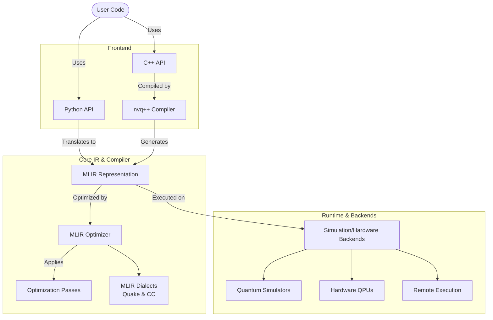
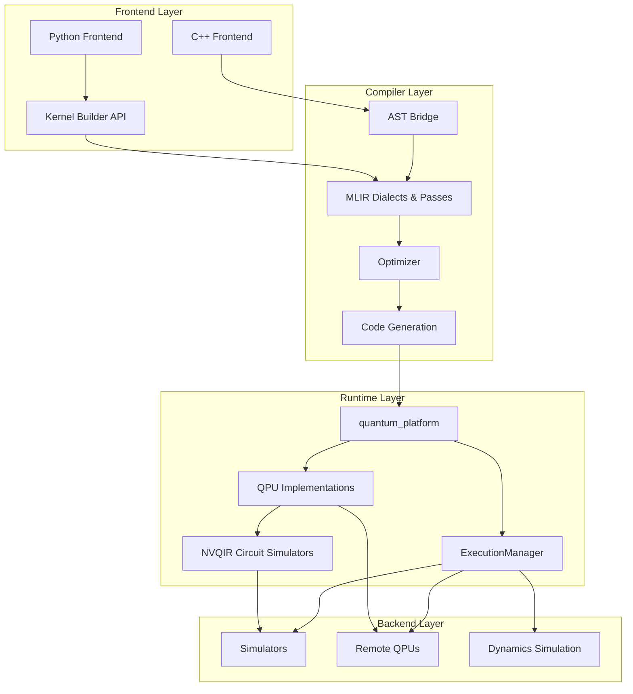
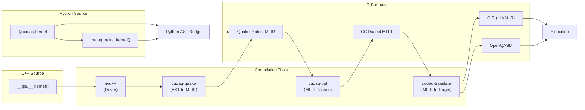
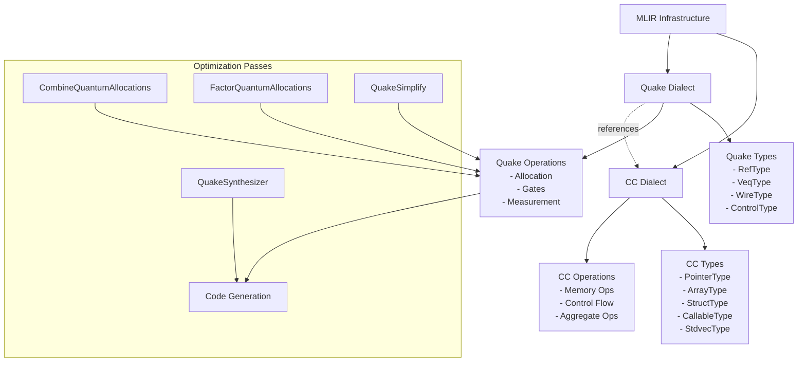
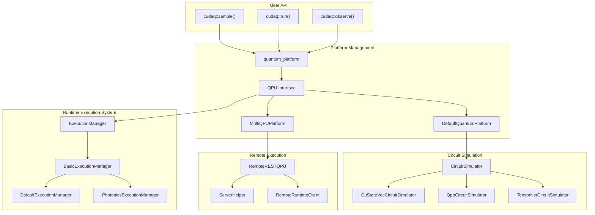
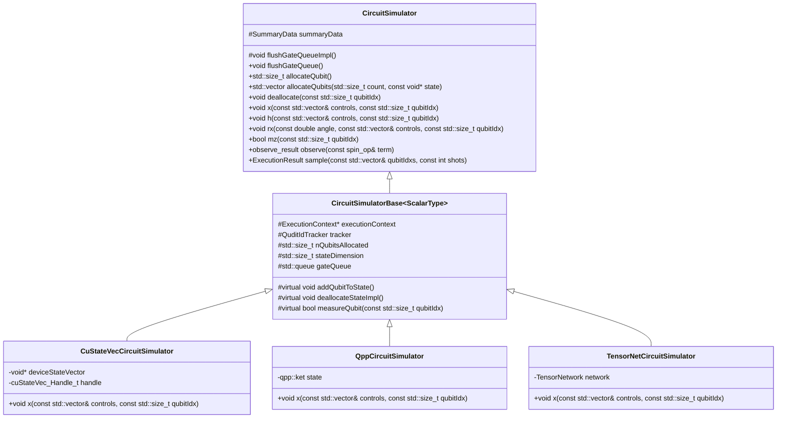

<!-- source: DeepWiki mcp.deepwiki.com · repo NVIDIA/cuda-quantum · page 2 System Architecture · fetched 2026-10-26 -->

# System Architecture

<details>
<summary>Relevant source files</summary>

The following files were used as context for generating this wiki page:

- [include/cudaq/Optimizer/CodeGen/Passes.h](include/cudaq/Optimizer/CodeGen/Passes.h)
- [include/cudaq/Optimizer/CodeGen/Passes.td](include/cudaq/Optimizer/CodeGen/Passes.td)
- [include/cudaq/Optimizer/Dialect/CC/CCOps.h](include/cudaq/Optimizer/Dialect/CC/CCOps.h)
- [include/cudaq/Optimizer/Dialect/CC/CCOps.td](include/cudaq/Optimizer/Dialect/CC/CCOps.td)
- [include/cudaq/Optimizer/Dialect/Quake/QuakeOps.h](include/cudaq/Optimizer/Dialect/Quake/QuakeOps.h)
- [include/cudaq/Optimizer/Dialect/Quake/QuakeOps.td](include/cudaq/Optimizer/Dialect/Quake/QuakeOps.td)
- [include/cudaq/Optimizer/InitAllDialects.h](include/cudaq/Optimizer/InitAllDialects.h)
- [include/cudaq/Optimizer/Transforms/Passes.h](include/cudaq/Optimizer/Transforms/Passes.h)
- [include/cudaq/Optimizer/Transforms/Passes.td](include/cudaq/Optimizer/Transforms/Passes.td)
- [lib/Optimizer/CodeGen/CMakeLists.txt](lib/Optimizer/CodeGen/CMakeLists.txt)
- [lib/Optimizer/CodeGen/ConvertCCToLLVM.cpp](lib/Optimizer/CodeGen/ConvertCCToLLVM.cpp)
- [lib/Optimizer/CodeGen/ConvertToQIR.cpp](lib/Optimizer/CodeGen/ConvertToQIR.cpp)
- [lib/Optimizer/CodeGen/ConvertToQIRProfile.cpp](lib/Optimizer/CodeGen/ConvertToQIRProfile.cpp)
- [lib/Optimizer/CodeGen/Pipelines.cpp](lib/Optimizer/CodeGen/Pipelines.cpp)
- [lib/Optimizer/Dialect/CC/CCOps.cpp](lib/Optimizer/Dialect/CC/CCOps.cpp)
- [lib/Optimizer/Dialect/Quake/QuakeOps.cpp](lib/Optimizer/Dialect/Quake/QuakeOps.cpp)
- [lib/Optimizer/Transforms/CMakeLists.txt](lib/Optimizer/Transforms/CMakeLists.txt)
- [lib/Optimizer/Transforms/ClassicalOptimization.cpp](lib/Optimizer/Transforms/ClassicalOptimization.cpp)
- [lib/Optimizer/Transforms/Pipelines.cpp](lib/Optimizer/Transforms/Pipelines.cpp)
- [lib/Optimizer/Transforms/QuakeSynthesizer.cpp](lib/Optimizer/Transforms/QuakeSynthesizer.cpp)
- [python/runtime/cudaq/platform/py_alt_launch_kernel.cpp](python/runtime/cudaq/platform/py_alt_launch_kernel.cpp)
- [python/utils/OpaqueArguments.h](python/utils/OpaqueArguments.h)
- [runtime/common/BaseRemoteRESTQPU.h](runtime/common/BaseRemoteRESTQPU.h)
- [runtime/common/RuntimeMLIR.cpp](runtime/common/RuntimeMLIR.cpp)
- [runtime/common/RuntimeMLIRCommonImpl.h](runtime/common/RuntimeMLIRCommonImpl.h)
- [runtime/cudaq/platform/default/rest/RemoteRESTQPU.cpp](runtime/cudaq/platform/default/rest/RemoteRESTQPU.cpp)
- [runtime/cudaq/platform/default/rest/helpers/quantinuum/quantinuum.yml](runtime/cudaq/platform/default/rest/helpers/quantinuum/quantinuum.yml)
- [test/AST-Quake/adjoint-3.cpp](test/AST-Quake/adjoint-3.cpp)
- [test/AST-Quake/loop_unroll-1.cpp](test/AST-Quake/loop_unroll-1.cpp)
- [test/AST-Quake/qpe.cpp](test/AST-Quake/qpe.cpp)
- [test/Translate/ghz.qke](test/Translate/ghz.qke)
- [tools/cudaq-opt/cudaq-opt.cpp](tools/cudaq-opt/cudaq-opt.cpp)
- [tools/cudaq-quake/CMakeLists.txt](tools/cudaq-quake/CMakeLists.txt)
- [tools/cudaq-quake/cudaq-quake.cpp](tools/cudaq-quake/cudaq-quake.cpp)
- [tools/cudaq-translate/cudaq-translate.cpp](tools/cudaq-translate/cudaq-translate.cpp)
- [tools/nvqpp/nvq++.in](tools/nvqpp/nvq++.in)

</details>


This page provides a comprehensive overview of the CUDA Quantum (CUDA-Q) system architecture, explaining how the different components interact to provide a unified programming model for quantum-classical computing. For information about building and installing CUDA-Q, see [Building and Installing](#8).

## Core Architecture Overview

CUDA-Q is a quantum computing framework that enables developers to write quantum programs in familiar languages (Python and C++) and execute them on both simulators and quantum hardware. The architecture consists of several key layers that facilitate the translation from high-level code to quantum execution.

### High-Level Architecture



### Detailed System Components



Sources:
- [runtime/cudaq/builder/kernel_builder.cpp:1-50](runtime/cudaq/builder/kernel_builder.cpp:1-50)
- [runtime/nvqir/CircuitSimulator.h:80-120](runtime/nvqir/CircuitSimulator.h:80-120)
- [runtime/cudaq/platform/quantum_platform.h:50-100](runtime/cudaq/platform/quantum_platform.h:50-100)
- [runtime/cudaq/platform/qpu.h:30-50](runtime/cudaq/platform/qpu.h:30-50)

## Compilation Pipeline

CUDA-Q uses a sophisticated compilation pipeline that transforms quantum code from Python or C++ into an optimized representation that can be executed on various backends. The diagram below illustrates this pipeline from source code to execution:



### Python Frontend

The Python frontend provides two main approaches for defining quantum kernels:

1. The `@cudaq.kernel` decorator that marks functions as quantum kernels
2. The `cudaq.make_kernel()` builder API for programmatic kernel construction

When a quantum function is decorated with `@cudaq.kernel`, its abstract syntax tree (AST) is processed by the `PyASTBridge` class, which transforms it into MLIR representation.

Example Python kernel:
```python
@cudaq.kernel
def bell_state():
    q = cudaq.qvector(2)
    h(q[0])
    x.ctrl(q[0], q[1])
    mz(q)
```

The `PyASTBridge` walks through this AST and generates corresponding MLIR operations, handling quantum operations (like `h`, `x.ctrl`), classical control flow, and memory management.

Alternatively, using the builder API:
```python
kernel, qubits = cudaq.make_kernel(cudaq.qvector)
kernel.h(qubits[0])
kernel.x.ctrl(qubits[0], qubits[1])
kernel.mz(qubits)
```

Sources:
- [runtime/cudaq/builder/kernel_builder.cpp:1-50](runtime/cudaq/builder/kernel_builder.cpp:1-50)
- [unittests/integration/builder_tester.cpp:15-50](unittests/integration/builder_tester.cpp:15-50)

### C++ Frontend

The C++ frontend uses the `__qpu__` attribute to mark functions as quantum kernels. The Clang-based `ASTBridge` processes the AST and generates MLIR code. C++ also supports the kernel builder API.

Example C++ kernel:
```cpp
__qpu__ void bell_state() {
    auto q = cudaq::qvector(2);
    h(q[0]);
    x.ctrl(q[0], q[1]);
    mz(q);
}
```

The `ASTBridge` in the C++ frontend performs similar tasks to the Python version, translating C++ AST nodes to MLIR operations.

Using the C++ builder API:
```cpp
auto [kernel, qubits] = cudaq::make_kernel<cudaq::qvector<>>();
kernel.h(qubits[0]);
kernel.x<cudaq::ctrl>(qubits[0], qubits[1]);
kernel.mz(qubits);
```

Sources:
- [runtime/cudaq/builder/kernel_builder.h:380-450](runtime/cudaq/builder/kernel_builder.h:380-450)
- [lib/Optimizer/Transforms/QuakeSynthesizer.cpp:50-100](lib/Optimizer/Transforms/QuakeSynthesizer.cpp:50-100)

## MLIR Dialect System

CUDA-Q uses two primary MLIR dialects for representing quantum and classical operations: the Quake dialect for quantum operations and the CC (Classical Computing) dialect for classical operations.



### Quake Dialect

The Quake dialect provides operations for quantum computing, including:

- **Quantum Types**: 
  - `RefType`: A reference to a qubit
  - `VeqType`: A vector of qubits
  - `WireType`: Linear representation of qubit state

- **Quantum Operations**:
  - Gate operations: `h`, `x`, `rx`, etc.
  - Allocation/deallocation: `alloca`, `dealloc`
  - Measurement: `mz`

Here's an example of Quake MLIR code:
```mlir
%q = quake.alloca !quake.ref
quake.h %q : (!quake.ref) -> ()
%result = quake.mz %q : (!quake.ref) -> i1
```

Sources:
- [lib/Optimizer/Transforms/QuakeSynthesizer.cpp:50-100](lib/Optimizer/Transforms/QuakeSynthesizer.cpp:50-100)
- [unittests/Optimizer/QuakeSynthTester.cpp:50-100](unittests/Optimizer/QuakeSynthTester.cpp:50-100)

### CC Dialect

The CC (Classical Computing) dialect represents classical operations:

- **Classical Types**:
  - `PointerType`: Pointer to memory
  - `ArrayType`: Fixed-size array
  - `StructType`: Aggregate type
  - `StdvecType`: Standard vector type

- **Classical Operations**:
  - Control flow: `if`, `loop`, `scope`
  - Memory operations: `alloca`, `store`, `load`
  - Function operations: `call`, `return`

Here's an example of CC MLIR code:
```mlir
%i = arith.constant 0 : i32
%ptr = cc.alloca i32
cc.store %i, %ptr : !cc.ptr<i32>
%val = cc.load %ptr : !cc.ptr<i32>
```

### Argument Synthesis

The `QuakeSynthesizer` pass is a critical component that handles the conversion of runtime arguments into constant values in the MLIR representation. This enables the specialization of quantum kernels based on runtime parameters.

```cpp
// Example of synthesizing a runtime argument
template <typename ConcreteType>
void synthesizeRuntimeArgument(
    OpBuilder &builder, BlockArgument argument, const void *args,
    std::size_t offset, std::size_t typeSize,
    std::function<Value(OpBuilder &, ConcreteType *)> &&opGenerator) {
  // Create concrete instance from void* data
  ConcreteType concrete;
  std::memcpy(&concrete, ((const char *)args) + offset, typeSize);
  
  // Generate MLIR Value
  auto runtimeArg = opGenerator(builder, &concrete);
  
  // Replace uses of the argument with the concrete value
  argument.replaceAllUsesWith(runtimeArg);
}
```

Sources:
- [lib/Optimizer/Transforms/QuakeSynthesizer.cpp:57-83](lib/Optimizer/Transforms/QuakeSynthesizer.cpp:57-83)
- [unittests/Optimizer/QuakeSynthTester.cpp:118-159](unittests/Optimizer/QuakeSynthTester.cpp:118-159)

## Kernel Execution Model

The kernel execution model in CUDA-Q transforms the internal MLIR representation into executable code and manages the execution of quantum kernels. This involves several components working together:



### Platform and QPU System

The `quantum_platform` class serves as the central coordination point for quantum execution. It manages one or more `QPU` instances, which represent quantum processing units (either simulated or hardware).

```cpp
class quantum_platform {
protected:
  // QPUs managed by this platform
  std::vector<std::unique_ptr<QPU>> platformQPUs;
  std::size_t platformNumQPUs = 0;
  std::size_t platformCurrentQPU = 0;
  
public:
  // Launch a kernel on the current QPU
  KernelThunkResultType launchKernel(std::string kernelName, 
                                    KernelThunkType kernelFunc, 
                                    void *args, std::uint64_t voidStarSize,
                                    std::uint64_t resultOffset,
                                    const std::vector<void *> &rawArgs);
  
  // Set execution context for a QPU
  void set_exec_ctx(ExecutionContext *ctx, std::size_t qid = 0);
  
  // Reset execution context
  void reset_exec_ctx(std::size_t qid = 0);
};
```

The `QPU` interface defines the contract for quantum processing units:

```cpp
class QPU {
protected:
  // Execution queue for asynchronous tasks
  std::unique_ptr<QuantumExecutionQueue> execution_queue;
  
  // Current execution context
  ExecutionContext *executionContext = nullptr;
  
public:
  // Enqueue a quantum task for execution
  virtual void enqueue(QuantumTask &task) = 0;
  
  // Launch a quantum kernel
  virtual KernelThunkResultType launchKernel(const std::string &name,
                                           KernelThunkType kernelFunc,
                                           void *args, std::uint64_t argsSize,
                                           std::uint64_t resultOffset,
                                           const std::vector<void *> &rawArgs) = 0;
};
```

Sources:
- [runtime/cudaq/platform/quantum_platform.cpp:50-100](runtime/cudaq/platform/quantum_platform.cpp:50-100)
- [runtime/cudaq/platform/quantum_platform.h:50-100](runtime/cudaq/platform/quantum_platform.h:50-100)
- [runtime/cudaq/platform/qpu.h:30-50](runtime/cudaq/platform/qpu.h:30-50)
- [runtime/cudaq/platform/default/DefaultQuantumPlatform.cpp:25-50](runtime/cudaq/platform/default/DefaultQuantumPlatform.cpp:25-50)

### Execution Flow

The execution flow involves several steps:

1. User calls a sampling or observation function (e.g., `cudaq::sample()`)
2. The kernel is compiled if not already compiled
3. Arguments are packed into a message buffer
4. The kernel is executed through the platform's `launchKernel` method
5. The platform delegates to the appropriate QPU
6. The QPU executes the kernel using the current `ExecutionManager`
7. Results are collected and returned

For example, when sampling a circuit:

```cpp
// Sample a quantum circuit
auto result = cudaq::sample(bell_state);
```

This triggers the following process:
- The `sample` function creates an `ExecutionContext` with type "sample"
- The platform sets this context on the current QPU
- The kernel is executed through the platform's `launchKernel` method
- The `ExecutionManager` collects measurement results
- Results are returned as a `sample_result` object

Sources:
- [runtime/cudaq/platform/quantum_platform.cpp:175-191](runtime/cudaq/platform/quantum_platform.cpp:175-191)
- [runtime/cudaq/qis/managers/default/DefaultExecutionManager.cpp:25-50](runtime/cudaq/qis/managers/default/DefaultExecutionManager.cpp:25-50)
- [runtime/cudaq/platform/mqpu/MultiQPUPlatform.cpp:25-75](runtime/cudaq/platform/mqpu/MultiQPUPlatform.cpp:25-75)

## Simulator System

The simulator system in CUDA-Q is based on the `CircuitSimulator` interface, which defines methods for quantum operations, qubit management, and measurement. This interface allows CUDA-Q to support multiple simulation backends.

### CircuitSimulator Interface

The `CircuitSimulator` class serves as the base class for all simulator implementations:



The `CircuitSimulator` interface defines the core operations that all simulators must implement:

```cpp
class CircuitSimulator {
protected:
  virtual void flushGateQueueImpl() = 0;
  SummaryData summaryData;

public:
  // Qubit management
  virtual std::size_t allocateQubit() = 0;
  virtual std::vector<std::size_t> allocateQubits(std::size_t count, const void *state = nullptr,
                                                 cudaq::simulation_precision precision = 
                                                 cudaq::simulation_precision::fp32) = 0;
  virtual void deallocate(const std::size_t qubitIdx) = 0;
  
  // Quantum operations
  virtual void x(const std::vector<std::size_t> &controls, const std::size_t qubitIdx) = 0;
  virtual void h(const std::vector<std::size_t> &controls, const std::size_t qubitIdx) = 0;
  virtual void rx(const double angle, const std::vector<std::size_t> &controls, const std::size_t qubitIdx) = 0;
  // ... other quantum gates ...
  
  // Measurement
  virtual bool mz(const std::size_t qubitIdx) = 0;
  virtual bool mz(const std::size_t qubitIdx, const std::string &registerName) = 0;
  
  // Sampling and observation
  virtual cudaq::ExecutionResult sample(const std::vector<std::size_t> &qubitIdxs, const int shots) = 0;
  virtual cudaq::observe_result observe(const cudaq::spin_op &term) = 0;
  
  // State management
  virtual std::unique_ptr<cudaq::SimulationState> createStateFromData(const cudaq::state_data &) = 0;
  virtual void setNoiseModel(cudaq::noise_model &noise) = 0;
};
```

Sources:
- [runtime/nvqir/CircuitSimulator.h:80-120](runtime/nvqir/CircuitSimulator.h:80-120)
- [runtime/nvqir/CircuitSimulator.h:260-310](runtime/nvqir/CircuitSimulator.h:260-310)
- [runtime/nvqir/CircuitSimulator.h:385-450](runtime/nvqir/CircuitSimulator.h:385-450)

### Simulator Implementations

CUDA-Q provides several simulator backends:

1. **CuStateVecCircuitSimulator**: GPU-accelerated state vector simulator using NVIDIA's cuStateVec library
   - Provides high-performance simulation on NVIDIA GPUs
   - Supports large qubit counts
   - Implements both single and double precision

2. **QppCircuitSimulator**: CPU-based simulator
   - Based on the Quantum++ library
   - Suitable for systems without GPUs

3. **TensorNetCircuitSimulator**: Tensor network-based simulator
   - Uses cuTensorNet for efficient tensor contractions
   - Can simulate certain quantum circuits with more qubits than state vector approaches

Example implementation from CuStateVecCircuitSimulator:

```cpp
// Kronecker product implementation for state initialization
template <typename CudaDataType>
__global__ void cudaKronprod(size_t tsize1, const CudaDataType *arr1, 
                             size_t tsize2, const CudaDataType *arr2, 
                             CudaDataType *arr0) {
  __shared__ CudaDataType lbuf[THRDS_ARRAY_PRODUCT + 1], rbuf[THRDS_ARRAY_PRODUCT];
  size_t _ib, _in, _jb, _jn, _tx, _jc, _ja;

  _tx = (size_t)threadIdx.x;
  for (_jb = blockIdx.y * THRDS_ARRAY_PRODUCT; _jb < tsize2;
       _jb += gridDim.y * THRDS_ARRAY_PRODUCT) {
    // ... implementation details ...
  }
  return;
}
```

Sources:
- [runtime/nvqir/custatevec/CuStateVecCircuitSimulator.cu:25-100](runtime/nvqir/custatevec/CuStateVecCircuitSimulator.cu:25-100)
- [runtime/nvqir/qpp/QppCircuitSimulator.cpp:122-150](runtime/nvqir/qpp/QppCircuitSimulator.cpp:122-150)

### Gate Application and Measurement

The `CircuitSimulatorBase` template class provides common functionality for simulator implementations:

```cpp
template <typename ScalarType>
class CircuitSimulatorBase : public CircuitSimulator {
protected:
  // Execution context and state management
  cudaq::ExecutionContext *executionContext = nullptr;
  cudaq::QuditIdTracker tracker;
  std::size_t nQubitsAllocated = 0;
  std::size_t stateDimension = 0;
  
  // Gate queue for batched operations
  struct GateApplicationTask {
    const std::string operationName;
    const std::vector<std::complex<ScalarType>> matrix;
    const std::vector<std::size_t> controls;
    const std::vector<std::size_t> targets;
    const std::vector<ScalarType> parameters;
  };
  std::queue<GateApplicationTask> gateQueue;
  
  // Abstract methods for state manipulation
  virtual void addQubitToState() = 0;
  virtual void deallocateStateImpl() = 0;
  virtual bool measureQubit(const std::size_t qubitIdx) = 0;
};
```

The gate application process typically involves:
1. Creating a gate matrix representation
2. Queueing the gate operation
3. Applying the operation to the state vector when `flushGateQueue()` is called

Measurement involves:
1. Calculating probabilities based on the state vector
2. Randomly selecting an outcome based on these probabilities
3. Collapsing the state vector according to the measurement result
4. Returning the measurement outcome

Sources:
- [runtime/nvqir/CircuitSimulator.h:407-542](runtime/nvqir/CircuitSimulator.h:407-542)
- [runtime/nvqir/qpp/QppCircuitSimulator.cpp:450-500](runtime/nvqir/qpp/QppCircuitSimulator.cpp:450-500)

## Remote Execution

CUDA-Q supports execution on remote quantum hardware through various providers. This is handled through a plugin system that allows seamless switching between simulation and hardware execution.

The remote execution model handles:
- Job submission
- Result retrieval
- Error handling

Sources:
- [runtime/cudaq/qis/managers/default/DefaultExecutionManager.cpp:1-20](runtime/cudaq/qis/managers/default/DefaultExecutionManager.cpp:1-20)

## Summary

The CUDA-Q system architecture provides a comprehensive framework for quantum-classical computing:

1. **Frontend Layer**: Python and C++ interfaces for defining quantum kernels
2. **Compiler Layer**: AST processing and MLIR generation with quantum-specific dialects
3. **Optimization Layer**: Passes for optimizing quantum circuits
4. **Runtime Layer**: Execution management and simulator interfaces
5. **Backend Layer**: Simulators and hardware interfaces

This layered approach allows CUDA-Q to support multiple programming languages, various optimization techniques, and different execution targets, providing a flexible and powerful platform for quantum computing.

---

