<!-- source: DeepWiki mcp.deepwiki.com · repo NVIDIA/cuda-quantum · page 2.1 Compilation Pipeline · fetched 2026-10-26 -->

# Compilation Pipeline

Relevant source files

The following files were used as context for generating this wiki page:

- [include/cudaq/Frontend/nvqpp/ASTBridge.h](include/cudaq/Frontend/nvqpp/ASTBridge.h)
- [include/cudaq/Optimizer/CodeGen/Passes.h](include/cudaq/Optimizer/CodeGen/Passes.h)
- [include/cudaq/Optimizer/CodeGen/Passes.td](include/cudaq/Optimizer/CodeGen/Passes.td)
- [include/cudaq/Optimizer/Dialect/CC/CCTypes.h](include/cudaq/Optimizer/Dialect/CC/CCTypes.h)
- [include/cudaq/Optimizer/Dialect/CC/CCTypes.td](include/cudaq/Optimizer/Dialect/CC/CCTypes.td)
- [include/cudaq/Optimizer/InitAllDialects.h](include/cudaq/Optimizer/InitAllDialects.h)
- [lib/Frontend/nvqpp/ASTBridge.cpp](lib/Frontend/nvqpp/ASTBridge.cpp)
- [lib/Frontend/nvqpp/ConvertDecl.cpp](lib/Frontend/nvqpp/ConvertDecl.cpp)
- [lib/Frontend/nvqpp/ConvertExpr.cpp](lib/Frontend/nvqpp/ConvertExpr.cpp)
- [lib/Frontend/nvqpp/ConvertType.cpp](lib/Frontend/nvqpp/ConvertType.cpp)
- [lib/Optimizer/CodeGen/CMakeLists.txt](lib/Optimizer/CodeGen/CMakeLists.txt)
- [lib/Optimizer/CodeGen/ConvertCCToLLVM.cpp](lib/Optimizer/CodeGen/ConvertCCToLLVM.cpp)
- [lib/Optimizer/CodeGen/ConvertToQIR.cpp](lib/Optimizer/CodeGen/ConvertToQIR.cpp)
- [lib/Optimizer/CodeGen/ConvertToQIRProfile.cpp](lib/Optimizer/CodeGen/ConvertToQIRProfile.cpp)
- [lib/Optimizer/Dialect/CC/CCTypes.cpp](lib/Optimizer/Dialect/CC/CCTypes.cpp)
- [python/cudaq/kernel/ast_bridge.py](python/cudaq/kernel/ast_bridge.py)
- [python/cudaq/kernel/kernel_builder.py](python/cudaq/kernel/kernel_builder.py)
- [python/cudaq/kernel/kernel_decorator.py](python/cudaq/kernel/kernel_decorator.py)
- [python/cudaq/kernel/utils.py](python/cudaq/kernel/utils.py)
- [python/cudaq/runtime/sample.py](python/cudaq/runtime/sample.py)
- [python/tests/builder/test_kernel_builder.py](python/tests/builder/test_kernel_builder.py)
- [python/tests/kernel/test_control_negations.py](python/tests/kernel/test_control_negations.py)
- [python/tests/kernel/test_direct_call_return_kernel.py](python/tests/kernel/test_direct_call_return_kernel.py)
- [python/tests/kernel/test_kernel_call_return.py](python/tests/kernel/test_kernel_call_return.py)
- [python/tests/kernel/test_kernel_features.py](python/tests/kernel/test_kernel_features.py)
- [python/tests/kernel/test_run_kernel.py](python/tests/kernel/test_run_kernel.py)
- [python/tests/mlir/ast_attributes.py](python/tests/mlir/ast_attributes.py)
- [runtime/common/RuntimeMLIR.cpp](runtime/common/RuntimeMLIR.cpp)
- [runtime/cudaq/platform/default/rest/RemoteRESTQPU.cpp](runtime/cudaq/platform/default/rest/RemoteRESTQPU.cpp)
- [test/AST-Quake/array.cpp](test/AST-Quake/array.cpp)
- [test/AST-Quake/ctor-1.cpp](test/AST-Quake/ctor-1.cpp)
- [test/AST-Quake/ctor-2.cpp](test/AST-Quake/ctor-2.cpp)
- [test/AST-Quake/struct-1.cpp](test/AST-Quake/struct-1.cpp)
- [test/AST-Quake/struct-2.cpp](test/AST-Quake/struct-2.cpp)
- [tools/cudaq-opt/cudaq-opt.cpp](tools/cudaq-opt/cudaq-opt.cpp)
- [tools/cudaq-quake/CMakeLists.txt](tools/cudaq-quake/CMakeLists.txt)
- [tools/cudaq-quake/cudaq-quake.cpp](tools/cudaq-quake/cudaq-quake.cpp)
- [tools/cudaq-translate/cudaq-translate.cpp](tools/cudaq-translate/cudaq-translate.cpp)
- [tools/nvqpp/nvq++.in](tools/nvqpp/nvq++.in)

## Purpose and Scope

This document describes CUDA-Q's end-to-end compilation pipeline, which transforms quantum kernel source code (Python or C++) into executable representations. The pipeline consists of frontend translation, MLIR dialect generation, optimization, and code generation stages. 

For details about the MLIR dialects produced by this pipeline, see [MLIR Dialects](#2.2). For information about optimization passes applied during compilation, see [MLIR Optimization Passes](#2.3). For code generation to target formats, see [Code Generation and Target Translation](#2.4). For kernel execution mechanisms, see [Kernel Execution Model](#2.5).

## Compilation Pipeline Overview

CUDA-Q supports two distinct frontend languages that converge on a unified MLIR representation. The Python path uses JIT compilation at runtime, while the C++ path uses ahead-of-time compilation through the `nvq++` driver.

### End-to-End Compilation Flow

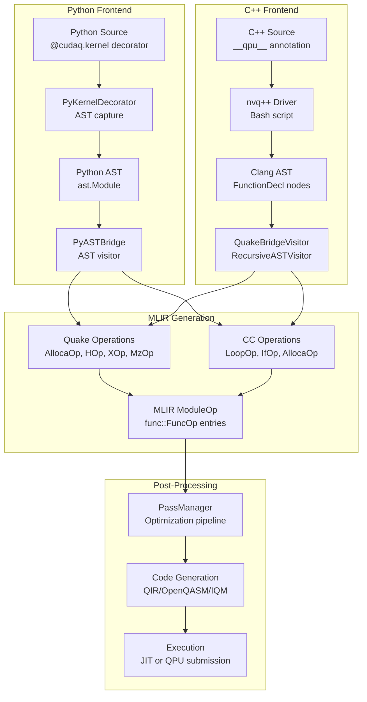

Sources: [python/cudaq/kernel/kernel_decorator.py:33-170](), [python/cudaq/kernel/ast_bridge.py:197-278](), [tools/nvqpp/nvq++.in:1-873](), [lib/Frontend/nvqpp/ASTBridge.cpp:1-58](), [include/cudaq/Frontend/nvqpp/ASTBridge.h:141-160]()

## Python Compilation Path

### Decorator-Based Compilation

Python quantum kernels are defined using the `@cudaq.kernel` decorator, which captures the function's AST at definition time and compiles it to MLIR on first execution.

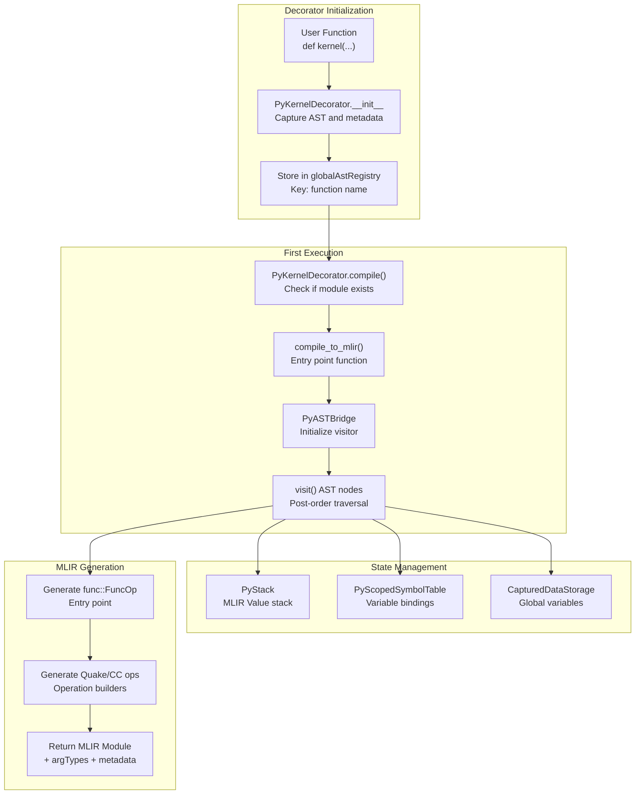

Sources: [python/cudaq/kernel/kernel_decorator.py:43-228](), [python/cudaq/kernel/ast_bridge.py:197-278]()

#### PyKernelDecorator Workflow

The `PyKernelDecorator` class orchestrates Python kernel compilation:

| Phase | Component | Responsibility |
|-------|-----------|----------------|
| **Capture** | `PyKernelDecorator.__init__` | Capture function source, parse AST, extract signature |
| **Storage** | `globalAstRegistry` | Store AST keyed by function name for dependency resolution |
| **Compilation** | `PyKernelDecorator.compile()` | Check if recompilation needed, invoke `compile_to_mlir()` |
| **Recompilation** | Dependency checking | Track captured variables, recompile if values change |

Sources: [python/cudaq/kernel/kernel_decorator.py:43-228]()

### PyASTBridge: AST-to-MLIR Translation

The `PyASTBridge` class implements `ast.NodeVisitor` to traverse Python AST nodes and generate MLIR operations.

#### Bridge Architecture

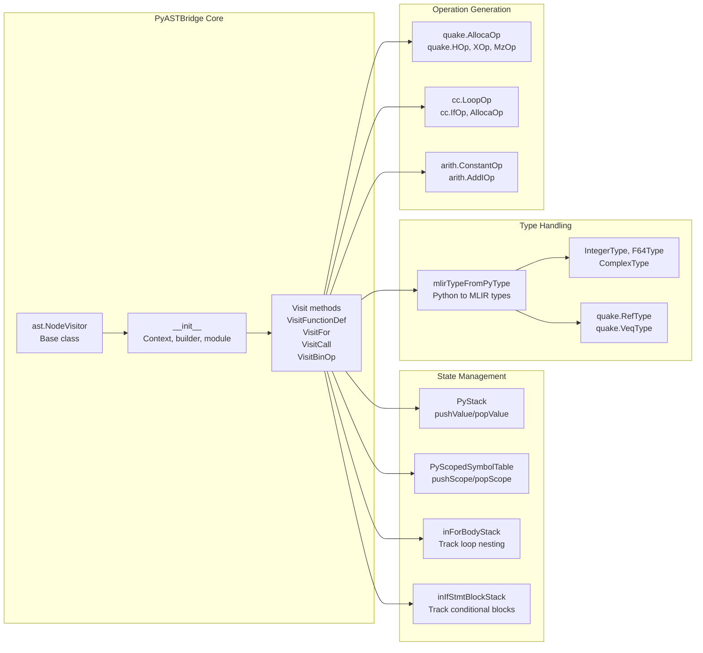

Sources: [python/cudaq/kernel/ast_bridge.py:197-278](), [python/cudaq/kernel/ast_bridge.py:53-196]()

#### Key Visit Methods

The `PyASTBridge` implements visitor methods for each Python AST node type:

| AST Node Type | Visit Method | Generated MLIR |
|---------------|--------------|----------------|
| `FunctionDef` | `visit_FunctionDef` | `func::FuncOp` with entry block |
| `For` | `visit_For` | `cc.LoopOp` or unrolled operations |
| `If` | `visit_If` | `cc.IfOp` with then/else blocks |
| `Call` | `visit_Call` | Quantum gate ops or `func::CallOp` |
| `BinOp` | `visit_BinOp` | `arith.AddIOp`, `arith.MulIOp`, etc. |
| `Subscript` | `visit_Subscript` | `quake.ExtractRefOp` for qubit access |

Sources: [python/cudaq/kernel/ast_bridge.py:1140-2827]()

#### Value Stack Management

The `PyStack` class manages MLIR values during AST traversal using a frame-based approach:

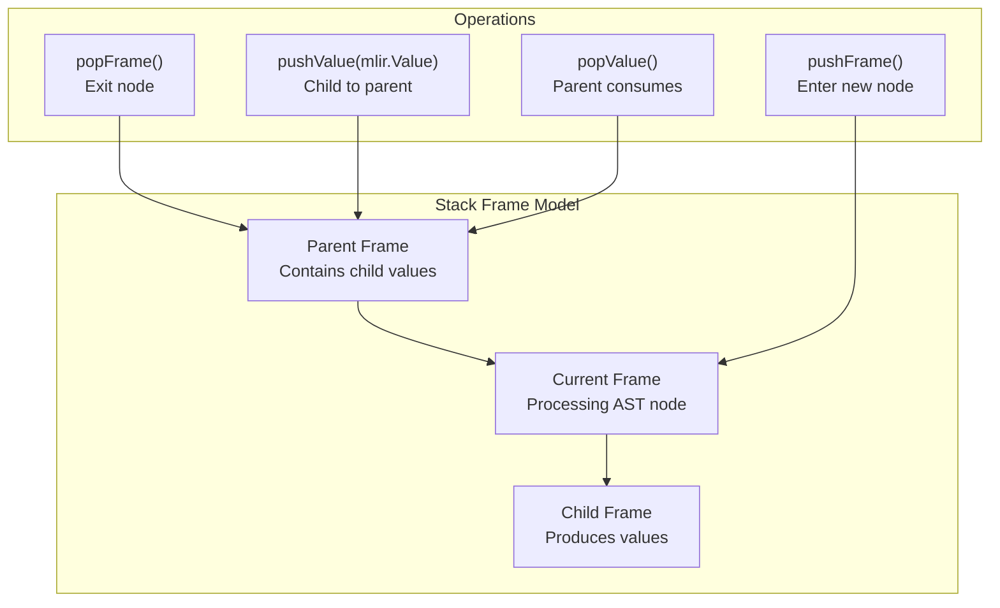

Sources: [python/cudaq/kernel/ast_bridge.py:108-195]()

## C++ Compilation Path

### nvq++ Driver Architecture

The `nvq++` driver is a Bash script that orchestrates C++ quantum kernel compilation through multiple tools.

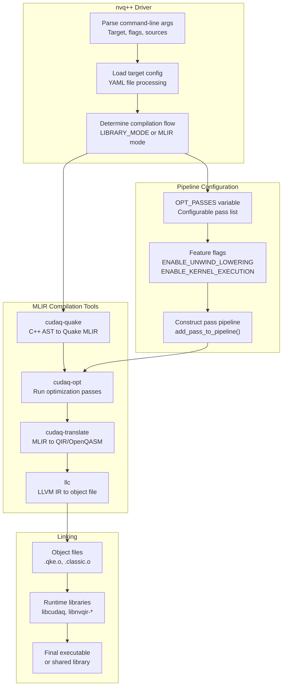

Sources: [tools/nvqpp/nvq++.in:1-873](), [tools/nvqpp/nvq++.in:706-774]()

#### nvq++ Compilation Stages

The `nvq++` driver executes these stages:

1. **Quake Generation** (line 798): `cudaq-quake` converts C++ AST to `.qke` file
2. **Optimization** (line 804-808): `cudaq-opt` applies pass pipeline to `.qke` file
3. **Translation** (line 814): `cudaq-translate` converts to target format (QIR/OpenQASM)
4. **Classical Compilation** (line 831): `llc` compiles classical code to object file
5. **Linking** (line 838): Merge quantum and classical object files with runtime

Sources: [tools/nvqpp/nvq++.in:782-872]()

### QuakeBridgeVisitor: C++ AST Traversal

The `QuakeBridgeVisitor` class extends `clang::RecursiveASTVisitor` to traverse C++ AST and generate Quake MLIR.

#### C++ Bridge Architecture

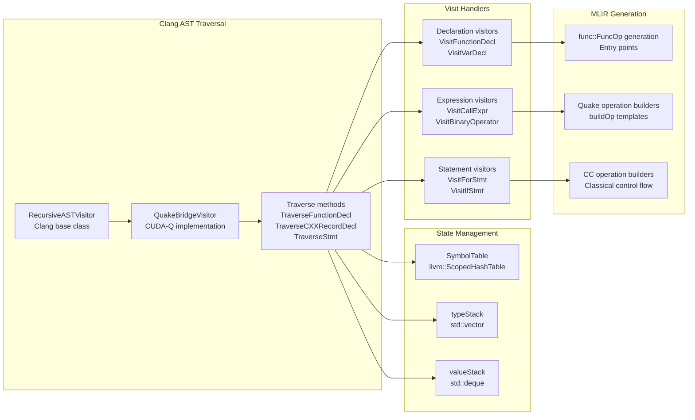

Sources: [include/cudaq/Frontend/nvqpp/ASTBridge.h:141-160](), [lib/Frontend/nvqpp/ASTBridge.cpp:1-58]()

#### Type Conversion System

C++ types are converted to MLIR types through several specialized handlers:

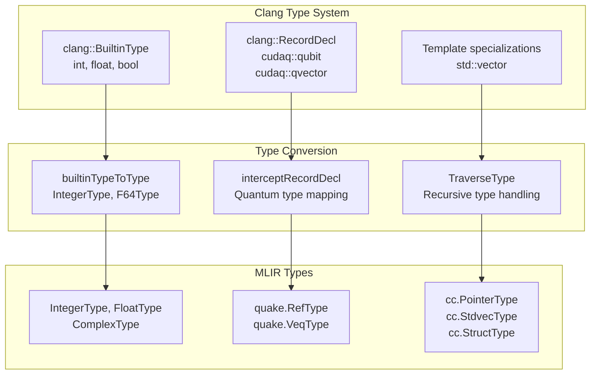

Sources: [lib/Frontend/nvqpp/ConvertType.cpp:1-304](), [lib/Frontend/nvqpp/ConvertDecl.cpp:124-317]()

#### Expression Conversion

C++ expressions are converted to MLIR operations through visitor pattern:

| C++ Construct | Visitor Method | Generated Operations |
|---------------|----------------|----------------------|
| Function call | `VisitCallExpr` | `func::CallOp` or quantum gate op |
| Binary operator | `VisitBinaryOperator` | `arith` dialect operations |
| Array subscript | `VisitArraySubscriptExpr` | `cc.ComputePtrOp` |
| Cast expression | `VisitCastExpr` | `cc.CastOp` with type coercion |
| For loop | `VisitForStmt` | `cc.LoopOp` with condition and body |

Sources: [lib/Frontend/nvqpp/ConvertExpr.cpp:1-630]()

### cudaq-quake Tool

The `cudaq-quake` tool is the C++ frontend driver that invokes Clang and the `QuakeBridgeVisitor`:

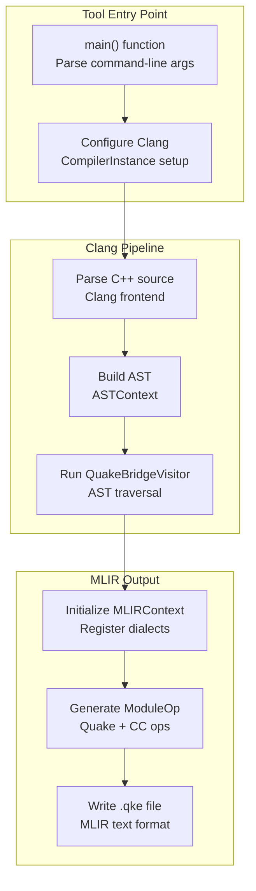

Sources: [tools/cudaq-quake/cudaq-quake.cpp:1-227]()

## Unified MLIR Representation

Both Python and C++ compilation paths converge on a common MLIR module structure containing Quake and CC dialect operations.

### MLIR Module Structure

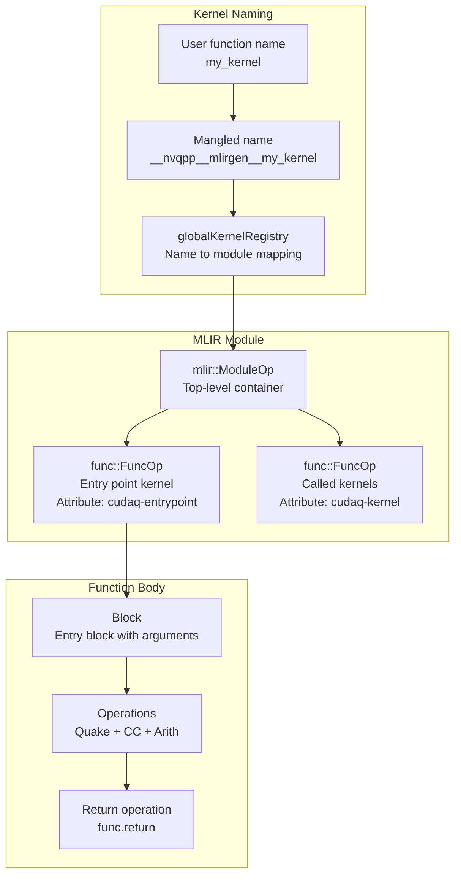

Sources: [runtime/common/RuntimeMLIR.cpp:115-125](), [python/cudaq/kernel/utils.py:29-50]()

### Dialect Integration

The generated MLIR modules use multiple dialects that interact:

| Dialect | Purpose | Key Operations |
|---------|---------|----------------|
| **quake** | Quantum operations | `AllocaOp`, `HOp`, `XOp`, `MzOp`, `ApplyOp` |
| **cc** | Classical control | `LoopOp`, `IfOp`, `AllocaOp`, `LoadOp`, `StoreOp` |
| **arith** | Arithmetic | `ConstantOp`, `AddIOp`, `MulIOp`, `CmpIOp` |
| **complex** | Complex numbers | `CreateOp`, `ReOp`, `ImOp` |
| **math** | Math functions | `SqrtOp`, `ExpOp`, `SinOp`, `CosOp` |
| **func** | Functions | `FuncOp`, `CallOp`, `ReturnOp` |

Sources: [python/cudaq/kernel/ast_bridge.py:19-28](), [include/cudaq/Frontend/nvqpp/ASTBridge.h:10-29]()

## Pass Pipeline Organization

After MLIR generation, the module undergoes optimization through a configurable pass pipeline.

### Pipeline Configuration

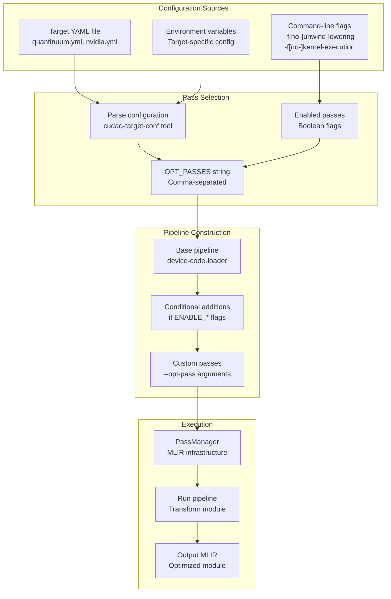

Sources: [tools/nvqpp/nvq++.in:704-774](), [tools/cudaq-translate/cudaq-translate.cpp:1-227]()

### Pass Pipeline Stages in nvq++

The `nvq++` driver constructs the pass pipeline in stages:

1. **Variable Coalesce** (line 708-710): Merge redundant stack allocations
2. **Unwind Lowering** (line 711-714): Lower high-level control flow
3. **Lambda Lifting** (line 715-718): Hoist lambda functions to top-level
4. **Apply Specialization** (line 719-722): Specialize `quake.apply` operations
5. **Kernel Execution** (line 723-736): Generate runtime execution stubs
6. **Aggressive Inlining** (line 737-744): Inline kernel calls
7. **Array Conversion** (line 745-748): Convert arrays to concrete values
8. **Custom Passes** (line 749-752): User-specified passes via `--opt-pass`
9. **Device Code Loader** (line 753-757): Prepare for code generation
10. **Lower to CFG** (line 758-761): Convert to control flow graph

Sources: [tools/nvqpp/nvq++.in:706-774]()

### Runtime MLIR Infrastructure

The runtime provides infrastructure for initializing MLIR contexts and running JIT compilation:

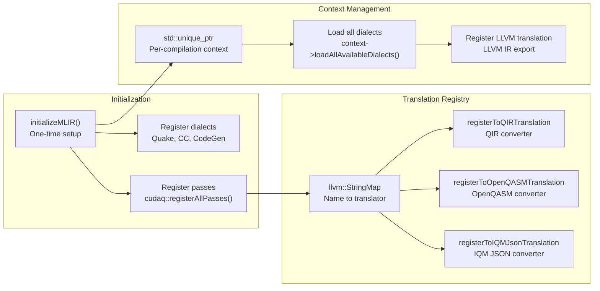

Sources: [runtime/common/RuntimeMLIR.cpp:92-113]()

## Integration Points

The compilation pipeline integrates with other CUDA-Q subsystems at specific interfaces.

### Frontend to MLIR Integration

| Component | Interface | Purpose |
|-----------|-----------|---------|
| `PyKernelDecorator` | `compile_to_mlir()` | Python AST to MLIR conversion entry point |
| `PyASTBridge` | `visit()` methods | AST node processing and MLIR generation |
| `QuakeBridgeVisitor` | `Traverse*()` methods | C++ AST traversal and MLIR generation |
| `cudaq-quake` tool | `main()` function | Command-line interface for C++ compilation |

Sources: [python/cudaq/kernel/kernel_decorator.py:171-228](), [python/cudaq/kernel/ast_bridge.py:197-278](), [tools/cudaq-quake/cudaq-quake.cpp:1-227]()

### MLIR to Execution Integration

| Component | Interface | Purpose |
|-----------|-----------|---------|
| `PassManager` | `run(module)` | Execute optimization passes on module |
| `cudaq::getTranslation()` | Get translator by name | Retrieve QIR/OpenQASM/IQM converter |
| `ExecutionEngine` | JIT compilation | Python runtime execution |
| `BaseRemoteRESTQPU` | `extractQuakeCodeAndContext()` | Remote execution preparation |

Sources: [runtime/common/RuntimeMLIR.cpp:40-88](), [runtime/cudaq/platform/default/rest/RemoteRESTQPU.cpp:31-44]()

### Module Naming and Registry

CUDA-Q maintains naming conventions to track compiled kernels:

- **Python**: Function name → `__nvqpp__mlirgen__<name>` in MLIR
- **C++**: Mangled name → `__nvqpp__mlirgen__<tag>` in MLIR
- **Registry**: `globalKernelRegistry` maps names to MLIR modules
- **AST Registry**: `globalAstRegistry` maps names to Python AST for dependencies

Sources: [python/cudaq/kernel/utils.py:29-50](), [include/cudaq/Frontend/nvqpp/ASTBridge.h:165-173]()

---

