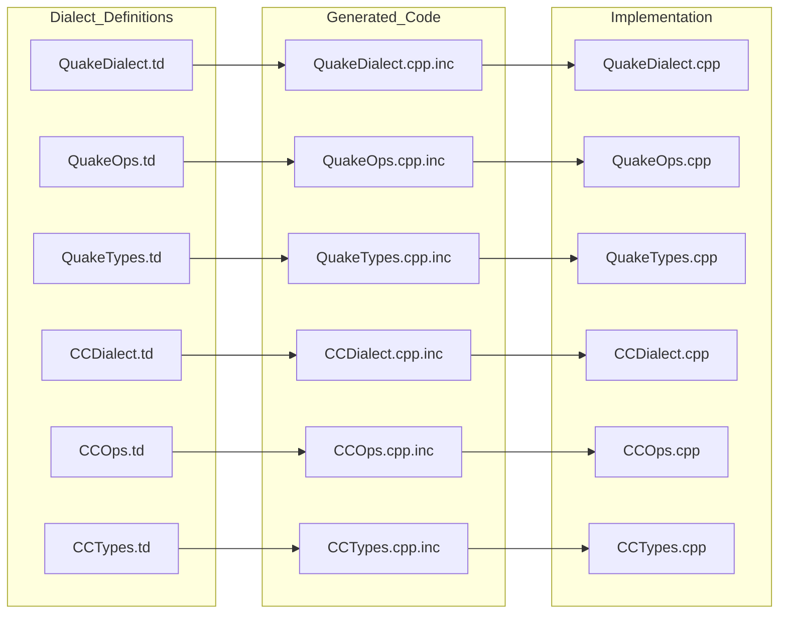
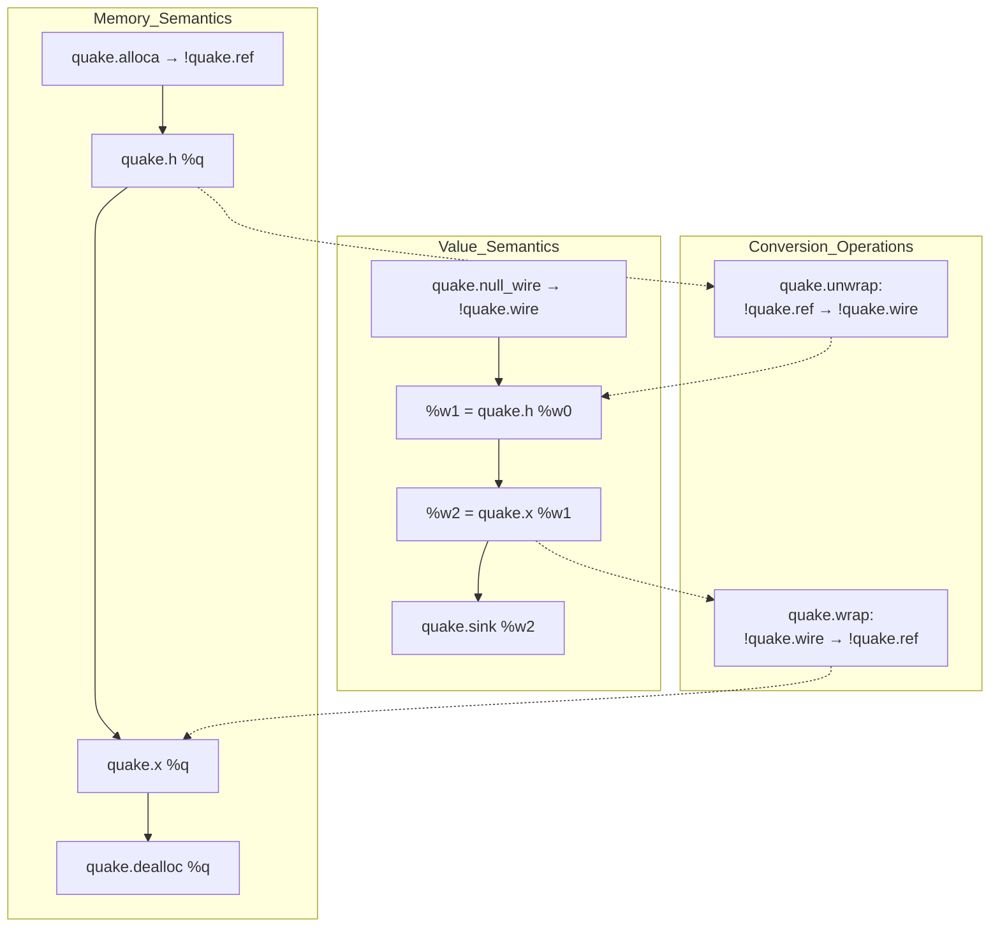
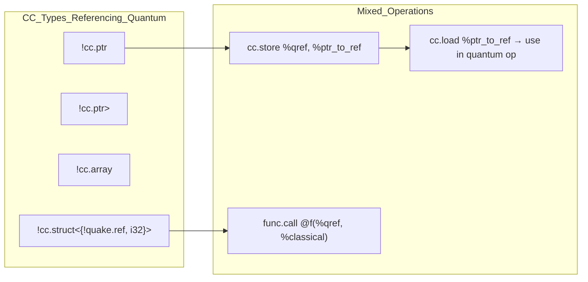
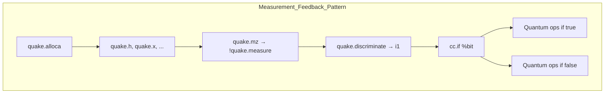
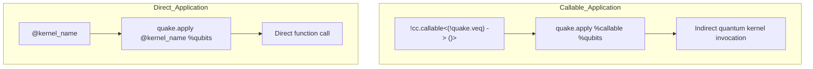
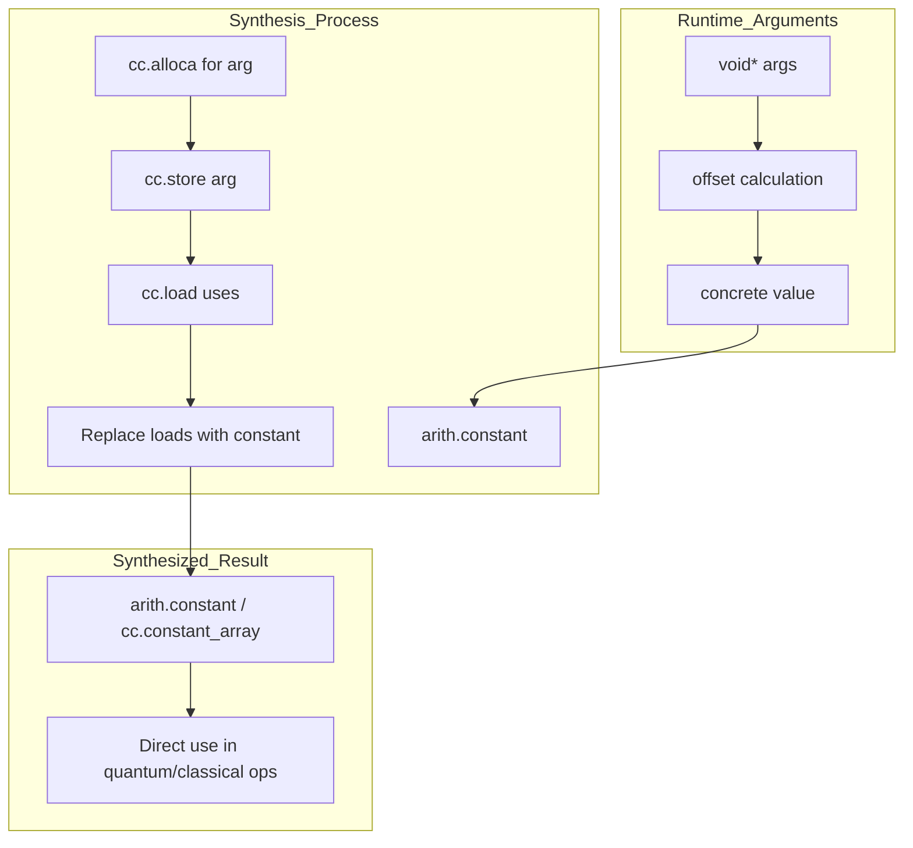
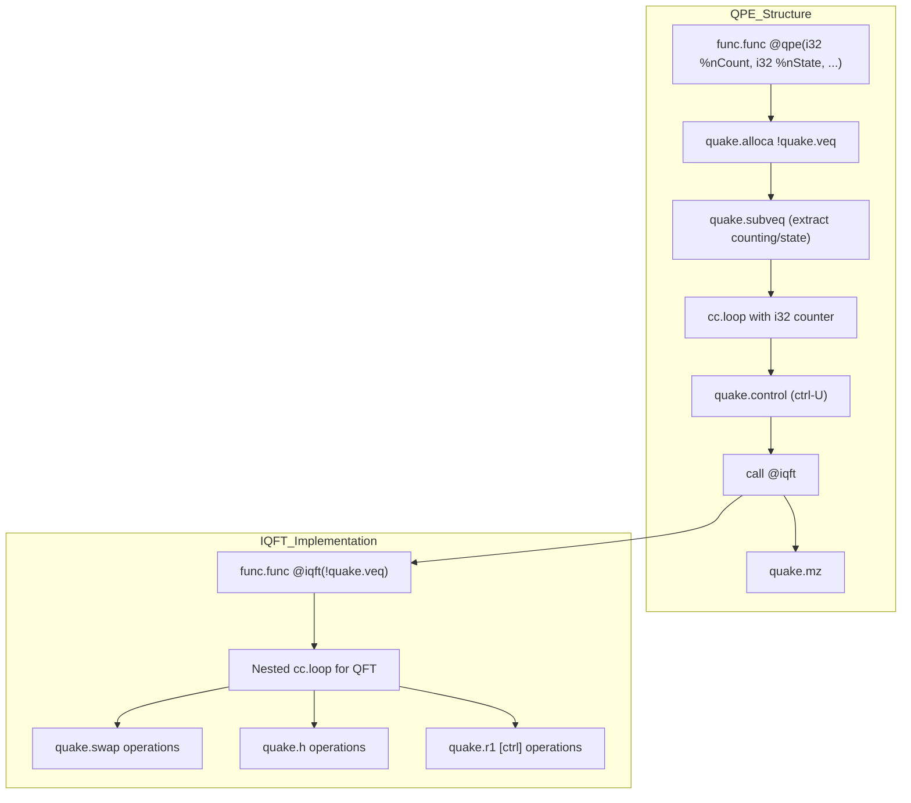
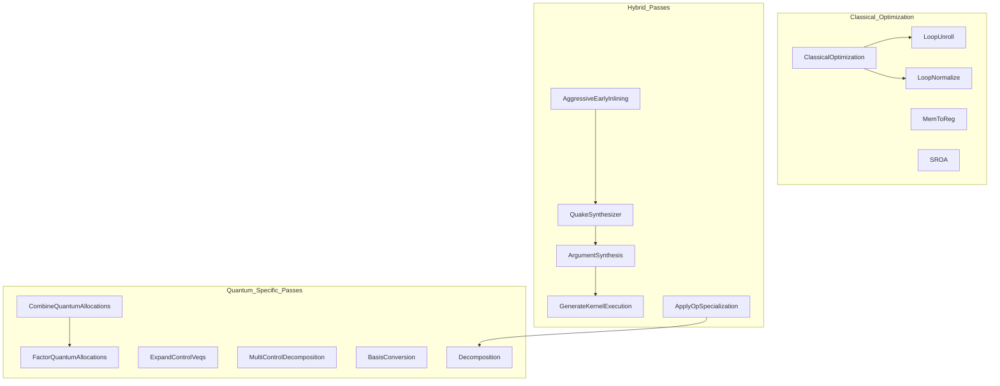
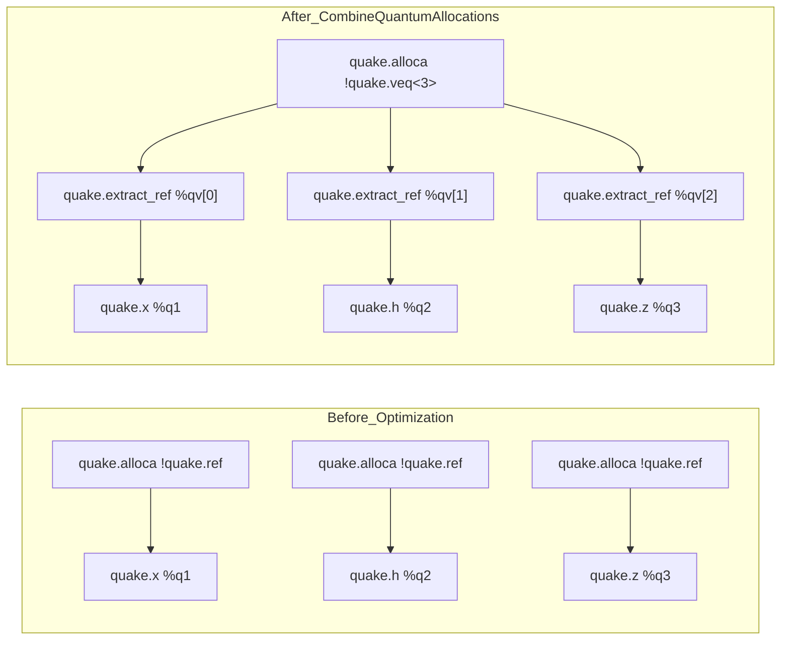
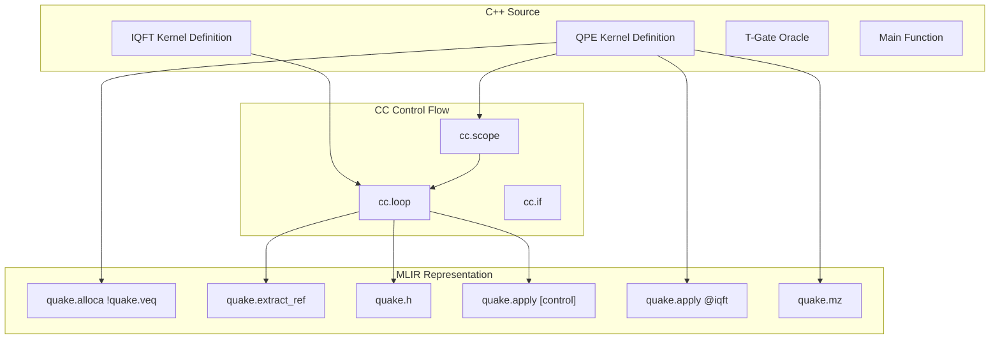

<!-- source: DeepWiki mcp.deepwiki.com · repo NVIDIA/cuda-quantum · page 2.2 MLIR Dialects · fetched 2026-10-26 -->

# MLIR Dialects

<details>
<summary>Relevant source files</summary>

The following files were used as context for generating this wiki page:

- [include/cudaq/Optimizer/Dialect/CC/CCOps.h](include/cudaq/Optimizer/Dialect/CC/CCOps.h)
- [include/cudaq/Optimizer/Dialect/CC/CCOps.td](include/cudaq/Optimizer/Dialect/CC/CCOps.td)
- [include/cudaq/Optimizer/Dialect/Quake/QuakeOps.h](include/cudaq/Optimizer/Dialect/Quake/QuakeOps.h)
- [include/cudaq/Optimizer/Dialect/Quake/QuakeOps.td](include/cudaq/Optimizer/Dialect/Quake/QuakeOps.td)
- [lib/Optimizer/Dialect/CC/CCOps.cpp](lib/Optimizer/Dialect/CC/CCOps.cpp)
- [lib/Optimizer/Dialect/Quake/QuakeOps.cpp](lib/Optimizer/Dialect/Quake/QuakeOps.cpp)
- [lib/Optimizer/Transforms/QuakeSynthesizer.cpp](lib/Optimizer/Transforms/QuakeSynthesizer.cpp)
- [test/AST-Quake/adjoint-3.cpp](test/AST-Quake/adjoint-3.cpp)
- [test/AST-Quake/loop_unroll-1.cpp](test/AST-Quake/loop_unroll-1.cpp)
- [test/AST-Quake/qpe.cpp](test/AST-Quake/qpe.cpp)
- [test/Translate/ghz.qke](test/Translate/ghz.qke)

</details>


This page documents the Quake and CC MLIR dialects used in CUDA-Q. The Quake dialect represents quantum operations (gates, measurements, qubit allocation), while the CC dialect represents classical control flow and data structures. Both dialects are defined using MLIR's TableGen (.td) format and implemented in C++.

## Overview

CUDA-Q defines two primary MLIR dialects:

- **Quake**: Quantum operations, types, and semantics
- **CC**: Classical compute operations, control flow, and memory management

These dialects are registered with MLIR in [lib/Optimizer/Dialect/Quake/QuakeDialect.cpp]() and [lib/Optimizer/Dialect/CC/CCDialect.cpp](). The dialect definitions follow MLIR conventions where operations are defined in TableGen (.td files) and implementations are in C++ (.cpp files).

### Dialect Architecture



Sources:
- [include/cudaq/Optimizer/Dialect/Quake/QuakeOps.td:9-33]()
- [include/cudaq/Optimizer/Dialect/CC/CCOps.td:9-36]()
- [lib/Optimizer/Dialect/Quake/QuakeOps.cpp:1-26]()
- [lib/Optimizer/Dialect/CC/CCOps.cpp:1-24]()

## Quake Dialect

The Quake dialect represents quantum operations. All Quake operations inherit from the `QuakeOp` base class defined at [include/cudaq/Optimizer/Dialect/Quake/QuakeOps.td:32-33]().

### Quake Type System

Quake types represent quantum resources and measurement results. Types are defined in TableGen at [include/cudaq/Optimizer/Dialect/Quake/QuakeTypes.td]() with C++ implementations in [lib/Optimizer/Dialect/Quake/QuakeTypes.cpp]().

| Type | MLIR Syntax | Description | Definition |
|------|-------------|-------------|------------|
| `RefType` | `!quake.ref` | Single qubit reference | Memory-semantics, mutable |
| `VeqType` | `!quake.veq<N>` or `!quake.veq<?>` | Vector of qubits | Static size `N` or dynamic size `?` |
| `WireType` | `!quake.wire` | Linear quantum value | Value-semantics, must be used exactly once |
| `ControlType` | `!quake.control` | Control qubit in operations | Marks qubits used as controls |
| `MeasureType` | `!quake.measure` | Measurement result | Opaque result from measurement operations |
| `StruqType` | `!quake.struq<...>` | Structured quantum type | Aggregate quantum type with named fields |

**Type Implementation Details:**

- `VeqType` can have specified size (`!quake.veq<4>`) or unspecified size (`!quake.veq<?>`). The helper method `hasSpecifiedSize()` distinguishes these cases.
- `StruqType` represents structured quantum data with named fields, similar to C++ structs but for quantum types.
- Type verification is implemented in [lib/Optimizer/Dialect/Quake/QuakeTypes.cpp]() using MLIR's type verification framework.

**Example MLIR:**
```mlir
%q = quake.alloca !quake.ref                    // Single qubit
%qv = quake.alloca !quake.veq<4>               // 4 qubits (static size)
%qv_dyn = quake.alloca !quake.veq<?>[%n : i32] // Dynamic size
%w = quake.null_wire : !quake.wire              // Wire value
```

### Quake Operations

Quake operations are organized into several categories. Operation definitions are in [include/cudaq/Optimizer/Dialect/Quake/QuakeOps.td:38-1200]() with implementations in [lib/Optimizer/Dialect/Quake/QuakeOps.cpp]().

#### Allocation Operations

| Operation | Syntax | Description | File Location |
|-----------|--------|-------------|---------------|
| `AllocaOp` | `quake.alloca` | Allocate qubits | [QuakeOps.td:39-109]() |
| `DeallocOp` | `quake.dealloc` | Deallocate qubits | [QuakeOps.td:137-165]() |
| `InitializeStateOp` | `quake.init_state` | Initialize to specific state | [QuakeOps.td:111-135]() |

**AllocaOp Examples:**
```mlir
%q = quake.alloca !quake.ref                    // Single qubit
%qv = quake.alloca !quake.veq<4>               // Static size
%qv_dyn = quake.alloca !quake.veq<?>[%n : i32] // Dynamic size
```

The `AllocaOp` has canonicalization patterns that fold constant sizes into the type, implemented in [lib/Optimizer/Dialect/Quake/QuakeOps.cpp:183-189]().

#### Vector Manipulation

| Operation | Syntax | Description | Verification |
|-----------|--------|-------------|--------------|
| `ConcatOp` | `quake.concat` | Concatenate quantum refs into vector | [QuakeOps.td:171-192]() |
| `ExtractRefOp` | `quake.extract_ref` | Extract single ref from vector | [QuakeOps.td:194-249]() |
| `SubVeqOp` | `quake.subveq` | Extract subvector | [QuakeOps.td:276-337]() |
| `RelaxSizeOp` | `quake.relax_size` | Convert static to dynamic size | [QuakeOps.td:251-274]() |
| `VeqSizeOp` | `quake.veq_size` | Get size of vector | [QuakeOps.td:339-366]() |

**ExtractRefOp:**
- Has both constant and dynamic indexing modes
- Constant index stored in `rawIndex` attribute
- Dynamic index provided as SSA value
- Defined with `kDynamicIndex` constant at [QuakeOps.td:243-244]()

**Example:**
```mlir
// Constant index
%q0 = quake.extract_ref %qv[0] : (!quake.veq<4>) -> !quake.ref

// Dynamic index
%q_idx = quake.extract_ref %qv[%i] : (!quake.veq<?>, i32) -> !quake.ref
```

#### Quantum Gate Operations

Gate operations implement the `OperatorInterface` defined at [include/cudaq/Optimizer/Dialect/Quake/QuakeInterfaces.td](). Common gates include:

| Operation | Parameters | Controls | Definition |
|-----------|------------|----------|------------|
| `HOp` | None | Optional | Hadamard gate |
| `XOp` | None | Optional | Pauli-X gate |
| `YOp` | None | Optional | Pauli-Y gate |
| `ZOp` | None | Optional | Pauli-Z gate |
| `SOp` | None | Optional | S gate |
| `TOp` | None | Optional | T gate |
| `RxOp` | 1 angle | Optional | Rotation around X |
| `RyOp` | 1 angle | Optional | Rotation around Y |
| `RzOp` | 1 angle | Optional | Rotation around Z |
| `R1Op` | 1 angle | Optional | Phase rotation |
| `SwapOp` | None | Optional | Swap two qubits |

**Gate Syntax:**
```mlir
// Simple gates
quake.h %q : (!quake.ref) -> ()
quake.x %q : (!quake.ref) -> ()

// Parametric gates
quake.rx(%angle) %q : (f64, !quake.ref) -> ()
quake.ry(%theta) %q : (f64, !quake.ref) -> ()

// Controlled gates
quake.x [%ctrl] %target : (!quake.ref, !quake.ref) -> ()
quake.rx(%angle) [%ctrl] %target : (f64, !quake.ref, !quake.ref) -> ()
```

#### Measurement Operations

Measurement operations implement the `MeasurementInterface` and produce `!quake.measure` results:

| Operation | Basis | Definition |
|-----------|-------|------------|
| `MzOp` | Z-basis | Standard computational basis |
| `MxOp` | X-basis | Measurement in X basis |
| `MyOp` | Y-basis | Measurement in Y basis |
| `DiscriminateOp` | N/A | Convert measure to boolean |

**Measurement Flow:**
```mlir
%m = quake.mz %q : (!quake.ref) -> !quake.measure
%bit = quake.discriminate %m : (!quake.measure) -> i1
```

#### Application and Control

| Operation | Purpose | Definition |
|-----------|---------|------------|
| `ApplyOp` | Apply user-defined kernel | [QuakeOps.td:372-451]() |
| `ComputeActionOp` | Compute-action-uncompute idiom | [QuakeOps.td:454-480]() |

The `ApplyOp` supports both direct calls (via symbol reference) and indirect calls (via callable value). It can apply operations with control qubits and in adjoint form using the `is_adj` attribute.

**ApplyOp Examples:**
```mlir
// Direct call
quake.apply @my_kernel %q : (!quake.ref) -> ()

// With controls
quake.apply @my_kernel [%ctrl] %q : (!quake.ref, !quake.ref) -> ()

// Adjoint
quake.apply<adj> @my_kernel %q : (!quake.ref) -> ()

// Indirect call
quake.apply %callable %q : (!cc.callable<(!quake.ref) -> ()>, !quake.ref) -> ()
```

The `ComputeActionOp` captures the compute-action-uncompute pattern at [QuakeOps.td:454-480](), where the uncompute step is automatically generated as the adjoint of the compute kernel.

### Memory vs. Value Semantics

Quake supports two semantic models for quantum operations:

1. **Memory Semantics**: Uses `!quake.ref` and `!quake.veq` types. Qubits are allocated, mutated in-place, and deallocated.
2. **Value Semantics**: Uses `!quake.wire` and `!quake.control` types. Quantum values are produced and consumed, following linear type discipline.



**Wire Operations:**

| Operation | Purpose | Definition |
|-----------|---------|------------|
| `NullWireOp` | Create initial wire state (&#124;0⟩) | [QuakeOps.td:594-614]() |
| `SinkOp` | Consume wire at end of circuit | [QuakeOps.td:616-638]() |
| `UnwrapOp` | Convert ref to wire | [QuakeOps.td:541-568]() |
| `WrapOp` | Convert wire to ref | [QuakeOps.td:570-588]() |

**Linear Type Verification:**

Wire values must be used exactly once, enforcing the no-cloning theorem. This is verified by `verifyWireResultsAreLinear` at [lib/Optimizer/Dialect/Quake/QuakeOps.cpp:28-46]():

```cpp
static LogicalResult verifyWireResultsAreLinear(Operation *op) {
  for (Value v : op->getOpResults())
    if (isa<quake::WireType>(v.getType())) {
      if (v.hasOneUse() || v.use_empty())
        continue;
      // Special case: cf.cond_br can use value twice (once per arm)
      std::unordered_set<Operation *> uniqs;
      for (auto *op : v.getUsers())
        uniqs.insert(op);
      if (uniqs.size() == 1 &&
          (*uniqs.begin())->hasTrait<OpTrait::IsTerminator>())
        continue;
      return op->emitOpError(
          "wires are a linear type and must have exactly one use");
    }
  return success();
}
```

**Wire Arity and Coarity:**

Operations in value form must have equal wire arity (input wires) and coarity (output wires). Verification is at [lib/Optimizer/Dialect/Quake/QuakeOps.cpp:51-71]():

```cpp
LogicalResult quake::verifyWireArityAndCoarity(Operation *op) {
  std::size_t arity = 0;
  std::size_t coarity = 0;
  // Count input wires (including controls) and output wires
  // ...
  if (arity == coarity)
    return success();
  return op->emitOpError("arity does not equal coarity of wires");
}
```

Sources:
- [lib/Optimizer/Dialect/Quake/QuakeOps.cpp:28-71]()
- [include/cudaq/Optimizer/Dialect/Quake/QuakeOps.td:541-638]()
- [include/cudaq/Optimizer/Dialect/Quake/QuakeTypes.td:47-64]()

## CC Dialect

The CC (Classical Compute) dialect provides classical operations, control flow, and data structures. All CC operations inherit from the `CCOp` base class at [include/cudaq/Optimizer/Dialect/CC/CCOps.td:35-36]().

### CC Type System

CC types represent classical data structures used in quantum-classical hybrid algorithms. Types are defined at [include/cudaq/Optimizer/Dialect/CC/CCTypes.td]() with implementations in [lib/Optimizer/Dialect/CC/CCTypes.cpp]().

| Type | MLIR Syntax | C++ Equivalent | Description |
|------|-------------|----------------|-------------|
| `PointerType` | `!cc.ptr<T>` | `T*`, `T&` | Memory pointer to type T |
| `ArrayType` | `!cc.array<T x N>` | `T[N]` | Fixed-size array of N elements |
| `StructType` | `!cc.struct<"name" {fields}>` | `struct name` | Aggregate type with fields |
| `StdvecType` | `!cc.stdvec<T>` | `std::vector<T>` | Dynamic array |
| `CallableType` | `!cc.callable<(Args) -> Ret>` | Lambda, function pointer | Callable with signature |
| `IndirectCallableType` | `!cc.indcallable<...>` | Indirect callable | Runtime-selected callable |
| `SpanLikeType` | `!cc.span<T>` | `std::span<T>` | Non-owning view |
| `CharspanType` | `!cc.charspan` | `std::string_view` | String view |

**PointerType Details:**

Pointers can be to any type including quantum types. Defined at [include/cudaq/Optimizer/Dialect/CC/CCTypes.td:66-81](). Example uses:
```mlir
!cc.ptr<i32>                  // int*
!cc.ptr<f64>                  // double*
!cc.ptr<!quake.ref>          // pointer to quantum ref
!cc.ptr<!cc.array<i32 x 10>> // pointer to array
```

**ArrayType Details:**

Arrays have a compile-time known size. Can be nested. Defined at [include/cudaq/Optimizer/Dialect/CC/CCTypes.td:96-115]().
```mlir
!cc.array<i32 x 10>              // int[10]
!cc.array<!cc.array<i32 x 3> x 4> // int[4][3]
!cc.array<i8 x ?>                // unknown size at type level
```

**StructType Details:**

Structures can be named or unnamed and support bit-level packing. Defined at [include/cudaq/Optimizer/Dialect/CC/CCTypes.td:117-185]().
```mlir
// Named struct
!cc.struct<"MyStruct" {i32, f64, !cc.ptr<i8>}>

// Packed struct
!cc.struct<{i32, i8} packed [8]>

// Anonymous struct
!cc.struct<{i32, i32}>
```

**CallableType Details:**

Represents functions and lambdas. Can capture values. Defined at [include/cudaq/Optimizer/Dialect/CC/CCTypes.td:203-222]().
```mlir
!cc.callable<() -> ()>              // void func()
!cc.callable<(i32, f64) -> i32>     // int func(int, double)
!cc.callable<(!quake.veq<?>) -> ()> // quantum kernel
```

**StdvecType and SpanLikeType:**

These types handle dynamic arrays and views:
```mlir
!cc.stdvec<f64>      // std::vector<double>
!cc.span<f64>        // std::span<double>
!cc.charspan         // std::string_view
```

Implementation details at [lib/Optimizer/Dialect/CC/CCTypes.cpp:19-114]().

### CC Operations

CC operations are organized into categories. Definitions at [include/cudaq/Optimizer/Dialect/CC/CCOps.td:39-1350]() with implementations at [lib/Optimizer/Dialect/CC/CCOps.cpp]().

#### Memory Operations

| Operation | Purpose | Signature | File Location |
|-----------|---------|-----------|---------------|
| `AllocaOp` | Allocate stack memory | `cc.alloca T` → `!cc.ptr<T>` | [CCOps.td:796-831]() |
| `LoadOp` | Load from memory | `cc.load %ptr` | [CCOps.td:833-856]() |
| `StoreOp` | Store to memory | `cc.store %val, %ptr` | [CCOps.td:858-881]() |
| `ComputePtrOp` | Pointer arithmetic | `cc.compute_ptr %base[indices]` | [CCOps.td:905-1042]() |
| `CastOp` | Type conversion | `cc.cast %val : T1 -> T2` | [CCOps.td:1044-1127]() |

**AllocaOp:**

Allocates memory on the stack. Can allocate single element or sequence:
```mlir
%p = cc.alloca i32                         // Allocate single i32
%arr = cc.alloca i32[%n : i32]            // Allocate n i32s
%result_type = !cc.ptr<!cc.array<i32>>    // Returns pointer to array
```

Custom assembly format at [lib/Optimizer/Dialect/CC/CCOps.cpp:134-162](). Has canonicalization pattern `FuseAllocLength` at [lib/Optimizer/Dialect/CC/CCOps.cpp:165-190]() that folds constant sizes into array type.

**ComputePtrOp:**

Computes pointer offsets with mixed constant/dynamic indices. This is the CC dialect equivalent of LLVM's GEP (GetElementPtr).

```mlir
// Index into array
%p1 = cc.compute_ptr %arr[0] : (!cc.ptr<!cc.array<i32 x 10>>) -> !cc.ptr<i32>

// Dynamic index
%p2 = cc.compute_ptr %arr[%i] : (!cc.ptr<!cc.array<i32 x 10>>, i32) -> !cc.ptr<i32>

// Nested access (struct member)
%p3 = cc.compute_ptr %s[0, 2] : (!cc.ptr<!cc.struct<{i32, i64, f32}>>) -> !cc.ptr<f32>
```

Verification at [lib/Optimizer/Dialect/CC/CCOps.cpp:612-645]() ensures indices match type structure. Has canonicalization patterns `FuseAddressArithmetic` at [lib/Optimizer/Dialect/CC/CCOps.cpp:775-886]() that combine chained `cc.compute_ptr` operations.

**CastOp:**

Type conversions with optional signed/unsigned modifiers:
```mlir
%i64 = cc.cast %i32 : (i32) -> i64                // Extension (needs sign)
%i64s = cc.cast signed %i32 : (i32) -> i64        // Sign extension
%i64u = cc.cast unsigned %i32 : (i32) -> i64      // Zero extension
%f = cc.cast signed %i : (i32) -> f64             // Int to float
%p = cc.cast %i : (i64) -> !cc.ptr<i8>            // Int to pointer
```

The `CastOp` has extensive constant folding at [lib/Optimizer/Dialect/CC/CCOps.cpp:202-326]() and verification logic at [lib/Optimizer/Dialect/CC/CCOps.cpp:328-437]().

#### Aggregate Operations

| Operation | Purpose | Definition |
|-----------|---------|------------|
| `AddressOfOp` | Get address of global | [CCOps.td:887-903]() |
| `ExtractValueOp` | Extract from aggregate | [CCOps.td:1129-1222]() |
| `InsertValueOp` | Insert into aggregate | [CCOps.td:1224-1290]() |
| `UndefOp` | Create undefined value | [CCOps.td:780-794]() |

**ExtractValueOp:**

Extracts element from struct, array, or complex value:
```mlir
// Extract from struct
%field = cc.extract_value %struct[1] : (!cc.struct<{i32, f64}>) -> f64

// Extract from array
%elem = cc.extract_value %arr[%idx] : (!cc.array<i32 x 10>, i64) -> i32
```

Similar to `ComputePtrOp` but produces a value, not a pointer.

#### Control Flow Operations

| Operation | Purpose | Regions | File Location |
|-----------|---------|---------|---------------|
| `ScopeOp` | Scoped allocations | 1 region | [CCOps.td:42-99]() |
| `LoopOp` | Generalized loop | while, do, step, else regions | [CCOps.td:105-340]() |
| `IfOp` | Conditional | then, else regions | [CCOps.td:346-429]() |

**LoopOp:**

Represents C-style for/while/do-while loops and Python for-else. Defined at [CCOps.td:105-340]().

```mlir
// While loop
cc.loop while {
  %cond = ...
  cc.condition %cond
} do {
  // body
  cc.continue
}

// For loop (with step)
cc.loop while {
  %cond = ...
  cc.condition %cond
} do {
  // body
  cc.continue
} step {
  // increment
  cc.continue
}

// Do-while (post-condition)
cc.loop do {
  // body
  cc.condition %cond
} while {
  cc.condition %cond
}
```

The loop structure supports:
- Pre-condition (C `while`, `for`)
- Post-condition (C `do-while`)
- Python `for-else` with else region

**IfOp:**

Conditional execution with optional else:
```mlir
cc.if (%cond) {
  // then branch
  cc.continue
} else {
  // else branch
  cc.continue
}

// With results
%result = cc.if (%cond) -> i32 {
  cc.continue %val1 : i32
} else {
  cc.continue %val2 : i32
}
```

#### Terminator Operations

| Operation | Purpose | Parent Constraints |
|-----------|---------|-------------------|
| `ConditionOp` | Loop condition exit | `LoopOp` while region |
| `ContinueOp` | Normal exit | `LoopOp`, `ScopeOp`, `IfOp` |
| `BreakOp` | Break from loop | `LoopOp` body |
| `UnwindBreakOp` | Non-local break with unwind | `IfOp`, `ScopeOp` |
| `UnwindContinueOp` | Non-local continue with unwind | `IfOp`, `ScopeOp` |
| `UnwindReturnOp` | Non-local return with unwind | `LoopOp`, `IfOp`, `ScopeOp` |

The unwind operations handle non-local control flow that crosses scope boundaries, ensuring proper cleanup of stack allocations. Defined at [CCOps.td:587-763]().

#### Helper Functions

The CC dialect provides utility functions in [lib/Optimizer/Dialect/CC/CCOps.cpp:50-114]():

- `getByteSizeOfType()`: Computes byte size of CC types, handling primitives, pointers, structs, and arrays. Used for memory layout calculations.
- `getIntIfConstant()`: Extracts integer constant from SSA value if available.
- `getDoubleIfConstant()`: Extracts floating-point constant from SSA value.

These are defined at [include/cudaq/Optimizer/Dialect/CC/CCOps.h:50-52]() and used throughout optimization passes.

Sources:
- [lib/Optimizer/Dialect/CC/CCOps.cpp:1-196]()
- [include/cudaq/Optimizer/Dialect/CC/CCOps.td:39-1350]()
- [include/cudaq/Optimizer/Dialect/CC/CCTypes.td:20-222]()
- [include/cudaq/Optimizer/Dialect/CC/CCOps.h:1-91]()

## Dialect Interaction

Quake and CC dialects work together to represent hybrid quantum-classical algorithms. This section describes how operations and types from both dialects interact.

### Type Interoperability

Quake quantum types can be referenced by CC pointer types, enabling classical manipulation of quantum resource handles:



**Example:**
```mlir
func.func @example() {
  %q = quake.alloca !quake.ref
  %ptr = cc.alloca !quake.ref
  cc.store %q, %ptr : !cc.ptr<!quake.ref>
  %q_loaded = cc.load %ptr : !cc.ptr<!quake.ref>
  quake.h %q_loaded : (!quake.ref) -> ()
}
```

### Quantum Operations in Classical Control Flow

CC control flow operations can contain quantum operations, enabling measurement-based feedback:



**Example from test suite:**
```mlir
// From test/AST-Quake/loop_unroll-1.cpp
func.func @example() {
  %qv = quake.alloca !quake.veq<2>
  %q = quake.alloca !quake.ref
  
  %m_single = quake.mz %q name "singleQubit" : (!quake.ref) -> !quake.measure
  
  // Measure register into array
  %results = cc.alloca !cc.array<i8 x 2>
  %q0 = quake.extract_ref %qv[0] : (!quake.veq<2>) -> !quake.ref
  %m0 = quake.mz %q0 name "myRegister%0" : (!quake.ref) -> !quake.measure
  %bit0 = quake.discriminate %m0 : (!quake.measure) -> i1
  %byte0 = cc.cast unsigned %bit0 : (i1) -> i8
  cc.store %byte0, %results : !cc.ptr<!cc.array<i8 x 2>>
  
  // ... repeat for remaining qubits
}
```

### Quantum Kernel Application

The `quake.apply` operation bridges callable CC types with quantum execution:



**Example from test/AST-Quake/qpe.cpp:**
```mlir
// Kernel accepting callable
func.func @qpe(%callable: !cc.callable<(!quake.veq<?>) -> ()>, 
               %state_prep: !cc.callable<(!quake.veq<?>) -> ()>) {
  %q = quake.alloca !quake.veq<?>
  
  // Apply callable kernels
  call @state_prep_kernel(%q)  // Direct call
  quake.apply %callable %q     // Indirect via callable
}
```

### Argument Synthesis

The `QuakeSynthesizer` pass at [lib/Optimizer/Transforms/QuakeSynthesizer.cpp]() demonstrates deep dialect interaction by replacing function arguments with constants. This requires coordinating CC and Quake operations:



The `synthesizeRuntimeArgument` function at [lib/Optimizer/Transforms/QuakeSynthesizer.cpp:58-83]() shows how values are copied from runtime and materialized:

```cpp
template <typename ConcreteType>
void synthesizeRuntimeArgument(
    OpBuilder &builder, BlockArgument argument, const void *args,
    std::size_t offset, std::size_t typeSize,
    std::function<Value(OpBuilder &, ConcreteType *)> &&opGenerator) {
  
  ConcreteType concrete;
  std::memcpy(&concrete, ((const char *)args) + offset, typeSize);
  
  auto runtimeArg = opGenerator(builder, &concrete);
  
  // Remove immediate stack allocations with stores
  if (!argument.getUsers().empty()) {
    auto firstUse = *argument.user_begin();
    if (dyn_cast<cudaq::cc::StoreOp>(firstUse)) {
      auto memrefValue = firstUse->getOperand(1);
      for (auto user : memrefValue.getUsers())
        if (auto load = dyn_cast<cudaq::cc::LoadOp>(user))
          load.getResult().replaceAllUsesWith(runtimeArg);
    }
  }
  argument.replaceAllUsesWith(runtimeArg);
}
```

For vector arguments, `synthesizeVectorArgument` at [lib/Optimizer/Transforms/QuakeSynthesizer.cpp:119-268]() handles `!cc.stdvec` types by:
1. Creating `cc.constant_array` with values
2. Replacing `cc.stdvec_size` with constants
3. Replacing `cc.stdvec_data` → `cc.compute_ptr` → `cc.load` chains
4. Materializing arrays in global memory for `quake.init_state` uses

### Example: QPE Algorithm

The Quantum Phase Estimation example at [test/AST-Quake/qpe.cpp]() demonstrates full dialect interaction:



Key patterns from the CHECK directives at [test/AST-Quake/qpe.cpp:104-208]():
- CC loops with `cc.loop while { cc.condition } do { } step { }`
- Quantum subvector extraction with `quake.subveq`
- Controlled quantum operations with `quake.control`
- Classical arithmetic with `arith.addi`, `arith.subi`, `arith.cmpi`
- Type conversions with `cc.cast`

Sources:
- [lib/Optimizer/Transforms/QuakeSynthesizer.cpp:58-268]()
- [test/AST-Quake/qpe.cpp:1-250]()
- [test/AST-Quake/loop_unroll-1.cpp:1-41]()
- [include/cudaq/Optimizer/Dialect/Quake/QuakeOps.td:372-451]()

## Optimization Passes

CUDA-Q provides a rich set of optimization passes that operate on the MLIR representation, transforming both quantum and classical operations for better performance. These passes work on both Quake and CC dialects, often in coordination.

### Optimization Pass Categories



### Memory Optimization Example: CombineQuantumAllocations

The `CombineQuantumAllocations` pass demonstrates how optimization passes work with the Quake dialect. This pass combines multiple `quake.alloca` operations into a single allocation, reducing the overhead of qubit management:



The implementation of this pass is in [lib/Optimizer/Transforms/CombineQuantumAlloc.cpp](lib/Optimizer/Transforms/CombineQuantumAlloc.cpp), with a complementary pass `FactorQuantumAllocations` in [lib/Optimizer/Transforms/FactorQuantumAlloc.cpp](lib/Optimizer/Transforms/FactorQuantumAlloc.cpp) that performs the inverse transformation when beneficial.

### Key Optimization Passes

| Pass | Purpose | Description |
|------|---------|-------------|
| `CombineQuantumAllocations` | Optimize memory | Combines multiple `quake.alloca` operations into a single allocation |
| `FactorQuantumAllocations` | Optimize memory | Factors a single allocation into individual qubit allocations |
| `BasisConversion` | Gate conversion | Converts quantum operations to a specified set of basis gates |
| `Decomposition` | Gate decomposition | Breaks down complex quantum operations into simpler ones |
| `ClassicalOptimization` | Classical optimizations | Applies various classical optimizations until fixed point |
| `LoopUnroll` | Loop optimization | Unrolls loops with constant bounds, as shown in [test/AST-Quake/loop_unroll-1.cpp](test/AST-Quake/loop_unroll-1.cpp) |
| `ApplyOpSpecialization` | Function specialization | Specializes quantum functions with control qubits, as demonstrated in [test/AST-Quake/adjoint-3.cpp](test/AST-Quake/adjoint-3.cpp) |
| `ArgumentSynthesis` | Parameter specialization | Replaces function arguments with constants |
| `WriteAfterWriteElimination` | Memory optimization | Eliminates redundant writes to the same location |

The canonicalization patterns for both dialects are also important for optimization. The Quake dialect's canonicalization patterns are defined in [lib/Optimizer/Dialect/Quake/QuakeOps.cpp:26-27](lib/Optimizer/Dialect/Quake/QuakeOps.cpp:26-27) and included from `CanonicalPatterns.inc`. The CC dialect's canonicalization patterns are defined in various operation implementations, such as [lib/Optimizer/Dialect/CC/CCOps.cpp:165-196](lib/Optimizer/Dialect/CC/CCOps.cpp:165-196) for `AllocaOp`.

Sources:
- [include/cudaq/Optimizer/Transforms/Passes.td:14-45](include/cudaq/Optimizer/Transforms/Passes.td:14-45)
- [include/cudaq/Optimizer/Transforms/Passes.td:196-214](include/cudaq/Optimizer/Transforms/Passes.td:196-214)
- [include/cudaq/Optimizer/Transforms/Passes.td:365-379](include/cudaq/Optimizer/Transforms/Passes.td:365-379)
- [lib/Optimizer/Transforms/CombineQuantumAlloc.cpp:27-41](lib/Optimizer/Transforms/CombineQuantumAlloc.cpp:27-41)
- [lib/Optimizer/Transforms/FactorQuantumAlloc.cpp:27-40](lib/Optimizer/Transforms/FactorQuantumAlloc.cpp:27-40)
- [test/Quake/combine.qke:12-27](test/Quake/combine.qke:12-27)
- [test/AST-Quake/adjoint-3.cpp:46-62](test/AST-Quake/adjoint-3.cpp:46-62)

## Example: QPE Implementation

The Quantum Phase Estimation (QPE) algorithm demonstrates how the Quake and CC dialects work together to represent a complex quantum algorithm. This example shows the flow from C++ code to MLIR representation:



Sources:
- [test/AST-Quake/qpe.cpp:17-97](test/AST-Quake/qpe.cpp:17-97)

## Conclusion

The MLIR dialects in CUDA-Q provide a powerful framework for representing and optimizing quantum-classical hybrid algorithms. The Quake dialect handles quantum operations, while the CC dialect handles classical operations, both working together through a series of optimization passes to generate efficient code for quantum simulators and hardware.

Understanding these dialects is essential for developing, debugging, and optimizing CUDA-Q programs, as they form the backbone of the compilation process from high-level quantum code to executable quantum circuits.

---

