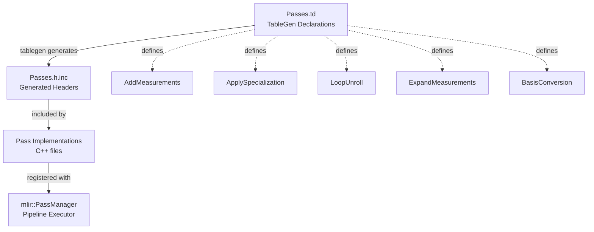
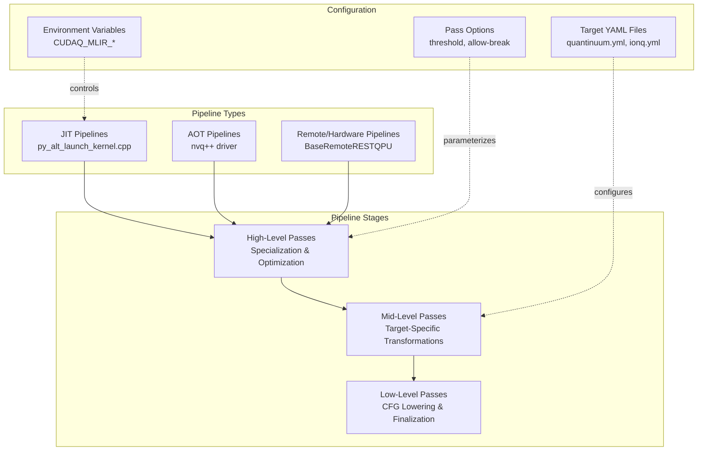
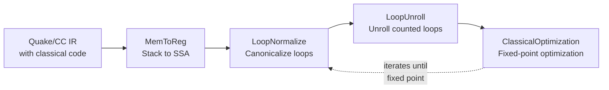
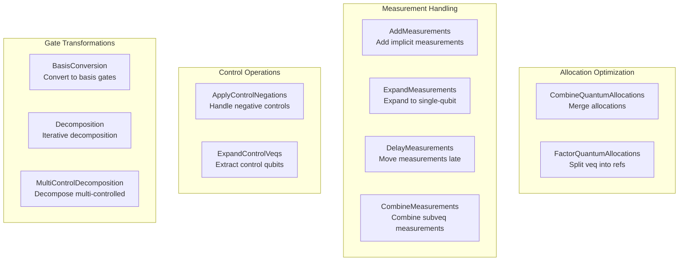
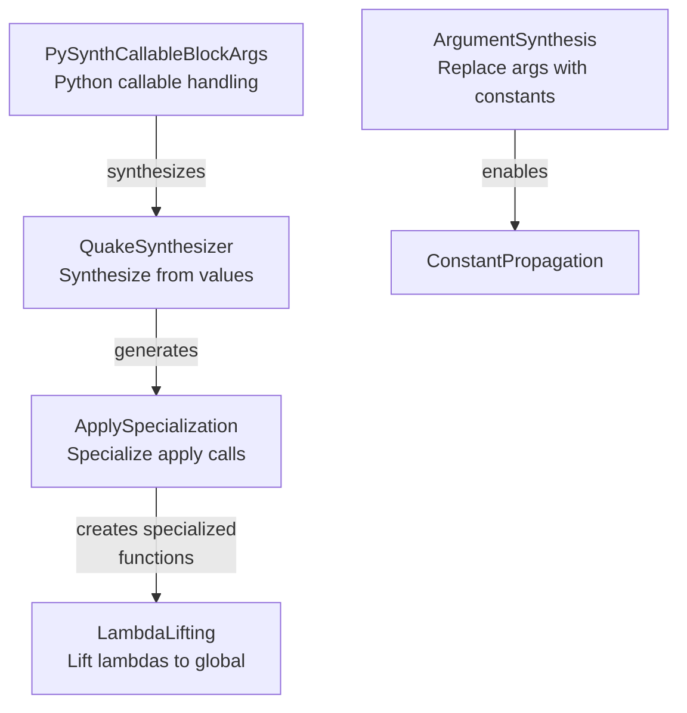
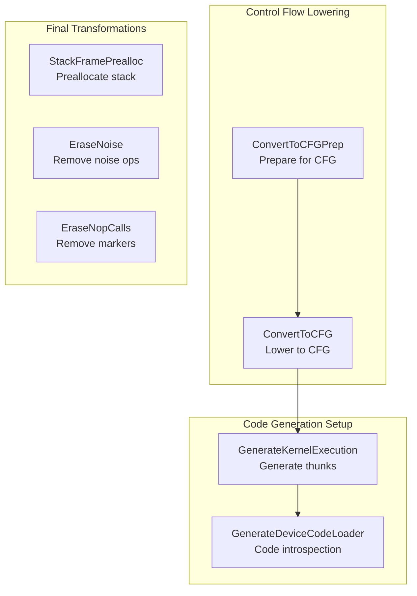
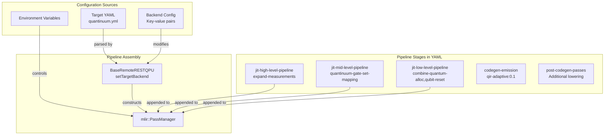
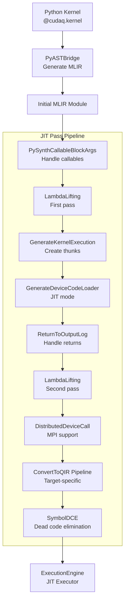

<!-- source: DeepWiki mcp.deepwiki.com · repo NVIDIA/cuda-quantum · page 2.3 MLIR Optimization Passes · fetched 2026-10-26 -->

# MLIR Optimization Passes

<details>
<summary>Relevant source files</summary>

The following files were used as context for generating this wiki page:

- [include/cudaq/Optimizer/Transforms/Passes.h](include/cudaq/Optimizer/Transforms/Passes.h)
- [include/cudaq/Optimizer/Transforms/Passes.td](include/cudaq/Optimizer/Transforms/Passes.td)
- [lib/Optimizer/CodeGen/Pipelines.cpp](lib/Optimizer/CodeGen/Pipelines.cpp)
- [lib/Optimizer/Transforms/CMakeLists.txt](lib/Optimizer/Transforms/CMakeLists.txt)
- [lib/Optimizer/Transforms/ClassicalOptimization.cpp](lib/Optimizer/Transforms/ClassicalOptimization.cpp)
- [lib/Optimizer/Transforms/Pipelines.cpp](lib/Optimizer/Transforms/Pipelines.cpp)
- [python/runtime/cudaq/platform/py_alt_launch_kernel.cpp](python/runtime/cudaq/platform/py_alt_launch_kernel.cpp)
- [python/utils/OpaqueArguments.h](python/utils/OpaqueArguments.h)
- [runtime/common/BaseRemoteRESTQPU.h](runtime/common/BaseRemoteRESTQPU.h)
- [runtime/common/RuntimeMLIRCommonImpl.h](runtime/common/RuntimeMLIRCommonImpl.h)
- [runtime/cudaq/platform/default/rest/helpers/quantinuum/quantinuum.yml](runtime/cudaq/platform/default/rest/helpers/quantinuum/quantinuum.yml)

</details>


## Purpose and Scope

This document details the 60+ MLIR optimization passes that transform quantum programs represented in CUDA-Q's Quake and CC dialects. These passes operate on the MLIR intermediate representation between source code parsing and final code generation, performing optimizations, specializations, and lowering transformations to prepare quantum programs for execution on various backends.

For information about the overall compilation flow, see [Compilation Pipeline](#2.1). For details on the MLIR dialect types and operations being transformed, see [MLIR Dialects](#2.2). For information about the final code generation step after passes complete, see [Code Generation and Target Translation](#2.4).

## Pass Organization and Declaration

CUDA-Q's optimization passes are declared using MLIR's TableGen declarative system in [include/cudaq/Optimizer/Transforms/Passes.td:1-1935]() and implemented in corresponding C++ files in [lib/Optimizer/Transforms/]().

### Pass Declaration Structure



**Sources:** [include/cudaq/Optimizer/Transforms/Passes.td:1-100](), [lib/Optimizer/Transforms/CMakeLists.txt:13-88]()

Each pass declaration in `Passes.td` specifies:
- **Pass name**: Used for command-line invocation and programmatic access
- **Summary**: Brief description of the pass's purpose
- **Description**: Detailed explanation with examples
- **Options**: Configurable parameters (e.g., loop unroll threshold)
- **Dependent dialects**: MLIR dialects the pass operates on

For example, the `LoopUnroll` pass is declared at [include/cudaq/Optimizer/Transforms/Passes.td:838-863]():

```
def LoopUnroll : Pass<"cc-loop-unroll"> {
  let summary = "Unroll classical compute (C++) loops.";
  let options = [
    Option<"threshold", "maximum-iterations", "unsigned", "50",
      "Maximum iterations to unroll.">,
    Option<"signalFailure", 
      "signal-failure-if-any-loop-cannot-be-completely-unrolled", "bool",
      "false", "Signal failure if pass can't unroll all loops.">,
    Option<"allowBreak", "allow-early-exit", "bool", "false",
      "Allow unrolling of loop with early exit (i.e. break statement).">
  ];
}
```

## Pass Pipeline Architecture

CUDA-Q organizes passes into staged pipelines that progressively transform and lower the IR. The pipeline architecture supports both Ahead-Of-Time (AOT) and Just-In-Time (JIT) compilation with target-specific customization.



**Sources:** [lib/Optimizer/Transforms/Pipelines.cpp:1-210](), [lib/Optimizer/CodeGen/Pipelines.cpp:1-154](), [runtime/common/BaseRemoteRESTQPU.h:235-404]()

### Pipeline Stage Breakdown

| Stage | Purpose | Key Passes | Configuration Source |
|-------|---------|------------|---------------------|
| **High-Level** | Specialization, inlining, classical optimization | `ApplySpecialization`, `LambdaLifting`, `ClassicalOptimization` | Target YAML `jit-high-level-pipeline` |
| **Mid-Level** | Gate decomposition, basis conversion, target-specific | `BasisConversion`, `Decomposition`, gate set mappings | Target YAML `jit-mid-level-pipeline` |
| **Low-Level** | CFG lowering, allocation combining, final cleanup | `LowerToCFG`, `CombineQuantumAllocations`, `ExpandMeasurements` | Target YAML `jit-low-level-pipeline` |

**Sources:** [runtime/cudaq/platform/default/rest/helpers/quantinuum/quantinuum.yml:21-26]()

### Standard Pipeline Definitions

CUDA-Q defines reusable pipeline templates registered with the MLIR pass infrastructure:

**Hardware Target Preparation Pipeline** (`hw-jit-prep-pipeline`):
[lib/Optimizer/Transforms/Pipelines.cpp:69-86]()
- Removes noise operations
- Performs specialization and inlining
- Optimizes classical control flow

**Emulation Target Preparation Pipeline** (`emul-jit-prep-pipeline`):
[lib/Optimizer/Transforms/Pipelines.cpp:88-103]()
- Optionally preserves noise operations
- Otherwise identical to hardware pipeline

**Deployment Pipeline** (`jit-deploy-pipeline`):
[lib/Optimizer/Transforms/Pipelines.cpp:117-132]()
- Classical optimization
- Gate decomposition (U3 → rotations)
- Multi-control decomposition

**Finalization Pipeline** (`jit-finalize-pipeline`):
[lib/Optimizer/Transforms/Pipelines.cpp:140-154]()
- Final canonicalization
- Common subexpression elimination
- Dead code elimination

## Pass Categories

### Classical Optimization Passes

These passes optimize classical control flow and memory operations:



**Sources:** [lib/Optimizer/Transforms/ClassicalOptimization.cpp:1-160]()

**`MemToReg`** [include/cudaq/Optimizer/Transforms/Passes.h:94-106]():
- Converts stack-allocated classical variables to SSA values
- Separate modes for classical-only (`createClassicalMemToReg`) and quantum wires (`createQuantumMemToReg`)
- Enables further optimization by eliminating memory dependencies

**`LoopNormalize`** [include/cudaq/Optimizer/Transforms/Passes.td:796-811]():
- Transforms loops into canonical form with constant steps
- Identifies loop bounds for unrolling
- Handles both open and closed interval loops

**`LoopUnroll`** [include/cudaq/Optimizer/Transforms/Passes.td:838-863]():
- Fully unrolls constant-count loops
- Required for generating quantum circuits (QIR base profile)
- Configurable threshold (default 50 iterations)
- Optional support for loops with early exit (`break`)

**`ClassicalOptimization`** [include/cudaq/Optimizer/Transforms/Passes.td:169-194]():
- Meta-pass that iterates multiple optimizations to fixed point:
  - Canonicalization
  - Region simplification  
  - Write-after-write elimination
  - Array allocation lifting
  - Loop normalization and unrolling

**`LiftArrayAlloc`** [include/cudaq/Optimizer/Transforms/Passes.td:718-762]():
- Converts inline array construction into constant array values
- Example transformation:
```mlir
// Before:
%0 = cc.alloca !cc.array<f64 x 4>
%1 = cc.compute_ptr %0[0] : (!cc.ptr<!cc.array<f64 x 4>>) -> !cc.ptr<f64>
cc.store %cst_0, %1 : !cc.ptr<f64>
// ... repeated stores ...

// After:
%0 = cc.const_array [5.0, 6.0, 7.0, 8.0] : !cc.array<f64 x 4>
```

**Sources:** [include/cudaq/Optimizer/Transforms/Passes.td:718-762]()

### Quantum-Specific Passes

These passes operate on quantum operations and allocations:



**Sources:** [include/cudaq/Optimizer/Transforms/Passes.td:14-560]()

**`CombineQuantumAllocations`** [include/cudaq/Optimizer/Transforms/Passes.td:221-238]():
- Merges multiple `quake.alloca` operations into a single `!quake.veq` allocation
- Places combined allocation in entry block (dominates all uses)
- Inserts `quake.extract_ref` operations for individual qubit access
- Combines corresponding deallocations in exit blocks

**`ExpandMeasurements`** [include/cudaq:529-544]():
- Expands measurements on qubit lists/vectors into loops over individual qubits
- Required for backends that only support single-qubit measurements
- Collects results into `std::vector<bool>`

**`AddMeasurements`** [include/cudaq/Optimizer/Transforms/Passes.td:14-28]():
- Adds implicit measurements to kernels with no explicit measurements
- Implements CUDA-Q specification: "If no measurements appear in the kernel, then the `__global__` register is formed with implicit measurements being added for all qubits defined in the kernel"
- Measurements occur at kernel end in sampling context

**`BasisConversion`** [include/cudaq/Optimizer/Transforms/Passes.td:119-157]():
- Converts quantum operations to a specified basis gate set
- Uses dialect conversion driver with rewrite patterns
- Basis specification format: `<op-name>([<num-controls> | n])?`
- Examples: `x`, `x(1)` (CX), `x(n)` (unbounded controls)

**`Decomposition`** [include/cudaq/Optimizer/Transforms/Passes.td:318-361]():
- Iteratively applies decomposition patterns until fixpoint
- Automatic pattern selection based on basis
- Conservative with respect to global phase
- Test mode to detect cyclic patterns

**Sources:** [include/cudaq/Optimizer/Transforms/Passes.td:119-361]()

### Specialization and Synthesis Passes

These passes handle code specialization, lambda lifting, and argument synthesis:



**Sources:** [include/cudaq/Optimizer/Transforms/Passes.td:62-117](), [include/cudaq/Optimizer/Transforms/Passes.h:64-80]()

**`ApplySpecialization`** [include/cudaq/Optimizer/Transforms/Passes.td:62-82]():
- Replaces `quake.apply` operations with specialized function calls
- Creates new functions with control qubits threaded through
- Example: `apply<ctrl>(kernel, qubits)` becomes specialized `kernel_ctrl` with control qubits added to each gate
- Optional compute-action optimization
- Optional constant propagation from call sites

**`LambdaLifting`** [include/cudaq/Optimizer/Transforms/Passes.td:705-716]():
- Classical lambda lifting transformation
- Eliminates free SSA values by adding function arguments
- Moves functions to global scope (`ModuleOp`)
- Converts uses to `CallOp` operations

**`ArgumentSynthesis`** [include/cudaq/Optimizer/Transforms/Passes.td:84-117]():
- Replaces function arguments with computed constants
- Supports partial argument substitution
- Command-line usage: `--argument-synthesis=functions="kernel1:subst1.qke"`
- Programmatic usage with inline substitutions: `kernel1:*"cc.arg_subst [0] { ... }"`

**`QuakeSynthesizer`** [include/cudaq/Optimizer/Transforms/Passes.h:69-73]():
- Synthesizes Quake IR from runtime argument values
- Used by Python JIT compilation
- Supports same address space optimization for remote execution

**`PySynthCallableBlockArgs`** [include/cudaq/Optimizer/Transforms/Passes.h:75-80]():
- Handles Python callable (lambda) arguments
- Synthesizes block arguments away during JIT compilation
- Used in Python kernel execution path

**Sources:** [python/runtime/cudaq/platform/py_alt_launch_kernel.cpp:175-179]()

### Lowering and Code Generation Preparation Passes

These passes lower high-level constructs to forms suitable for code generation:



**Sources:** [include/cudaq/Optimizer/Transforms/Passes.td:865-900](), [include/cudaq/Optimizer/Transforms/Passes.td:562-636]()

**`ConvertToCFG`** [include/cudaq/Optimizer/Transforms/Passes.td:865-900]():
- Lowers high-level control flow ops to basic CFG structure
- Converts `quake.loop` to `cf.cond_br` and `cf.br`
- Example transformation:
```mlir
// Before:
quake.loop while {
  // while code
  quake.condition %cond
} do {
  // loop body
} step {
  // step body
}

// After:
^bb23:
  // while code
  cf.cond_br %cond, ^bb24, ^bb26
^bb24:
  // loop body
  cf.br ^bb25
^bb25:
  // step body
  cf.br ^bb23
^bb26:
  // exit loop
```

**`GenerateKernelExecution`** [include/cudaq/Optimizer/Transforms/Passes.td:581-636]():
- Generates kernel launch thunks for runtime integration
- Three codegen modes (0=hybrid, 1=client-server, 2=streamlined JIT)
- Optional `generate-run-stack` for `cudaq::run` support
- Creates `argsCreator` and `returnOffset` helper functions

**`GenerateDeviceCodeLoader`** [include/cudaq/Optimizer/Transforms/Passes.td:562-579]():
- Generates stubs for runtime code introspection
- Used by `cudaq-translate` and runtime system
- Optional Quake output for JIT compilation

**`EraseNoise`** [include/cudaq/Optimizer/Transforms/Passes.td:483-490]():
- Removes Kraus channel noise operations
- Required when targeting quantum hardware (noise not supported)
- Preserved when emulating locally with noise models

**Sources:** [lib/Optimizer/Transforms/Pipelines.cpp:72]()

## Target-Specific Pass Configuration

Backends specify custom pass pipelines in YAML configuration files:



**Sources:** [runtime/common/BaseRemoteRESTQPU.h:235-404](), [runtime/cudaq/platform/default/rest/helpers/quantinuum/quantinuum.yml:1-91]()

### Example: Quantinuum Target Configuration

[runtime/cudaq/platform/default/rest/helpers/quantinuum/quantinuum.yml:21-26]():

```yaml
jit-high-level-pipeline: "expand-measurements"
jit-mid-level-pipeline: "quantinuum-gate-set-mapping"
jit-low-level-pipeline: "func.func(combine-quantum-alloc,qubit-reset-before-reuse)"
codegen-emission: qir-adaptive:0.1:int_computations
```

The `BaseRemoteRESTQPU` class constructs the full pipeline at [runtime/common/BaseRemoteRESTQPU.h:311-358]():

1. **Target-agnostic high-level passes** (`hw-jit-prep-pipeline` or `emul-jit-prep-pipeline`)
2. **Target-specific high-level passes** from YAML `jit-high-level-pipeline`
3. **Standard deployment passes** (`jit-deploy-pipeline`)
4. **Target-specific mid-level passes** from YAML `jit-mid-level-pipeline`
5. **Standard finalization passes** (`jit-finalize-pipeline`)
6. **Target-specific low-level passes** from YAML `jit-low-level-pipeline`
7. **Post-codegen passes** from YAML `post-codegen-passes` (if specified)

### Backend Configuration Options

Backends can be configured with key-value pairs appended to the target name:

```
quantinuum;emulate=true;disable_qubit_mapping=true
```

These options modify pass behavior:
- `emulate=true`: Uses emulation pipeline, preserves noise operations
- `disable_qubit_mapping=true`: Disables qubit mapping pass via regex replacement

**Sources:** [runtime/common/BaseRemoteRESTQPU.h:238-375]()

### Environment Variable Controls

| Variable | Purpose | Effect |
|----------|---------|--------|
| `CUDAQ_DUMP_JIT_IR` | Print IR after passes | Outputs MLIR to stderr |
| `CUDAQ_MLIR_DISABLE_THREADING` | Single-threaded passes | Useful for debugging |
| `CUDAQ_MLIR_PRINT_EACH_PASS` | Print before/after each pass | Like `cudaq-opt -mlir-print-ir-*` |
| `CUDAQ_MLIR_PASS_STATISTICS` | Enable pass statistics | Performance profiling |

**Sources:** [runtime/common/BaseRemoteRESTQPU.h:272-286]()

## JIT Compilation Pass Flow

Python kernel execution applies passes during JIT compilation:



**Sources:** [python/runtime/cudaq/platform/py_alt_launch_kernel.cpp:168-228]()

The `jitKernel` function at [python/runtime/cudaq/platform/py_alt_launch_kernel.cpp:146-268]() constructs and runs the pass manager:

```cpp
PassManager pm(context);
pm.addNestedPass<func::FuncOp>(cudaq::opt::createPySynthCallableBlockArgs(
    SmallVector<StringRef>(names.begin(), names.end())));
pm.addPass(cudaq::opt::createLambdaLiftingPass());
pm.addPass(cudaq::opt::createGenerateKernelExecution(
    {.startingArgIdx = startingArgIdx}));
pm.addPass(cudaq::opt::createGenerateDeviceCodeLoader({.jitTime = true}));
pm.addPass(cudaq::opt::createReturnToOutputLog());
pm.addPass(cudaq::opt::createLambdaLiftingPass());
pm.addPass(cudaq::opt::createDistributedDeviceCall());
std::string tl = getTransportLayer();
cudaq::opt::addAOTPipelineConvertToQIR(pm, tl);
pm.addPass(createSymbolDCEPass());
```

Pass execution is timed and optionally prints IR at [python/runtime/cudaq/platform/py_alt_launch_kernel.cpp:197-227]().

## Advanced Pass Features

### Dependency Analysis and Qubit Mapping

**`DependencyAnalysis`** [include/cudaq/Optimizer/Transforms/Passes.td:363-405]():
- Constructs Directed Acyclic Graph (DAG) of operation dependencies
- Schedules operations into virtual cycles
- Calculates qubit lifetimes for allocation optimization
- Maps virtual qubits to physical qubits based on non-overlapping lifetimes
- Reports statistics: virtual qubits, physical qubits, cycle count

**Sources:** [lib/Optimizer/Transforms/DependencyAnalysis.cpp]()

### State Preparation and Unitary Synthesis

**`StatePreparation`** [lib/Optimizer/Transforms/StatePreparation.cpp]():
- Optimizes initialization of quantum states from classical data
- Converts `quake.init_state` operations into efficient gate sequences

**`UnitarySynthesis`** [lib/Optimizer/Transforms/UnitarySynthesis.cpp]():
- Synthesizes unitary matrices into gate sequences
- Used for custom gate decomposition

**`GetConcreteMatrix`** [include/cudaq/Optimizer/Transforms/Passes.td:638-679]():
- Replaces unitary generator functions with constant matrices
- Extracts global constant from generator function (after `LiftArrayAlloc`)
- Updates `quake.custom_op` to directly reference the matrix

### Resource Counting Optimization

**`ResourceCountPreprocess`** [include/cudaq/Optimizer/Transforms/Passes.td:258-297]():
- Optimizes code for the resource counter simulator
- Pre-counts and removes invariant gates at compile time
- Reduces program size and runtime counting overhead
- Example: Counts `h(q[0])` once and removes it, but preserves measurement-conditional `x(q[i])`

**Sources:** [include/cudaq/Optimizer/Transforms/Passes.td:258-297]()

### Observe and Ansatz Optimization

**`ObserveAnsatz`** [lib/Optimizer/Transforms/ObserveAnsatz.cpp]():
- Specializes kernels for VQE/QAOA-style algorithms
- Optimizes ansatz evaluation with different Hamiltonians

## Pass Implementation Files

The complete set of optimization pass implementations:

| Category | Implementation Files |
|----------|---------------------|
| **Classical Optimization** | `MemToReg.cpp`, `LoopNormalize.cpp`, `LoopUnroll.cpp`, `LoopPeeling.cpp`, `ClassicalOptimization.cpp` |
| **Quantum Operations** | `CombineQuantumAlloc.cpp`, `FactorQuantumAlloc.cpp`, `ExpandMeasurements.cpp`, `AddMeasurements.cpp`, `DelayMeasurements.cpp`, `CombineMeasurements.cpp` |
| **Specialization** | `ApplyOpSpecialization.cpp`, `LambdaLifting.cpp`, `ArgumentSynthesis.cpp`, `QuakeSynthesizer.cpp` |
| **Decomposition** | `BasisConversion.cpp`, `Decomposition.cpp`, `DecompositionPatterns.cpp`, `MultiControlDecomposition.cpp` |
| **Lowering** | `LowerToCFG.cpp`, `LowerUnwind.cpp`, `ExpandControlVeqs.cpp` |
| **Code Generation** | `GenKernelExecution.cpp`, `GenDeviceCodeLoader.cpp` |
| **Memory/State** | `LiftArrayAlloc.cpp`, `GlobalizeArrayValues.cpp`, `StatePreparation.cpp`, `UnitarySynthesis.cpp` |
| **Analysis** | `DependencyAnalysis.cpp`, `Mapping.cpp` |
| **Cleanup** | `EraseNoise.cpp`, `EraseNopCalls.cpp`, `DeadStoreRemoval.cpp`, `WriteAfterWriteElimination.cpp` |

**Sources:** [lib/Optimizer/Transforms/CMakeLists.txt:13-77]()

## Pass Registration and Discovery

All passes are registered with MLIR's pass infrastructure via generated code from `Passes.td`:

```cpp
#define GEN_PASS_REGISTRATION
#include "cudaq/Optimizer/Transforms/Passes.h.inc"
```

Pipeline registration occurs in:
- [lib/Optimizer/Transforms/Pipelines.cpp:152-209]() - AOT and JIT pipelines
- [lib/Optimizer/CodeGen/Pipelines.cpp]() - Code generation pipelines

Passes can be invoked via:
- **Command-line**: `cudaq-opt -pass-name input.qke`
- **Programmatically**: `pm.addPass(cudaq::opt::createPassName())`
- **Pipelines**: `cudaq::opt::addPipelineName(pm)`

**Sources:** [include/cudaq/Optimizer/Transforms/Passes.h:90-92](), [lib/Optimizer/Transforms/Pipelines.cpp:1-210]()

---

