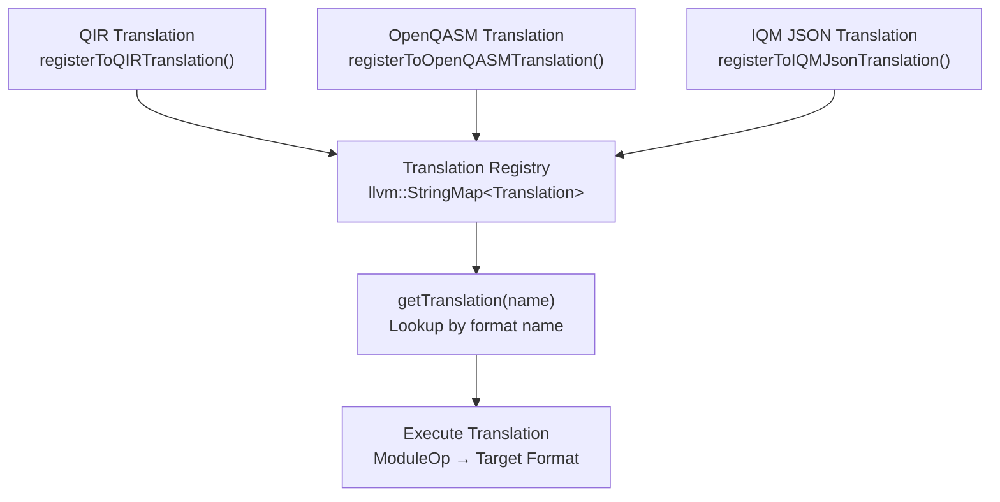
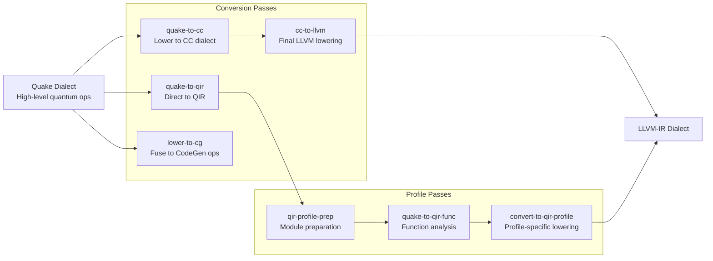
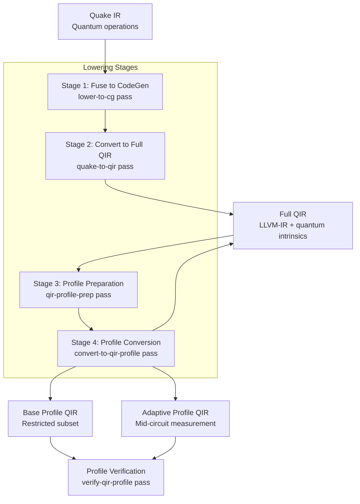
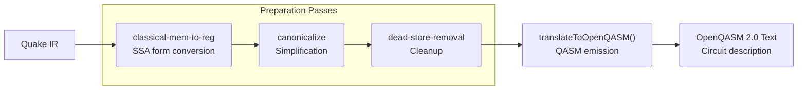
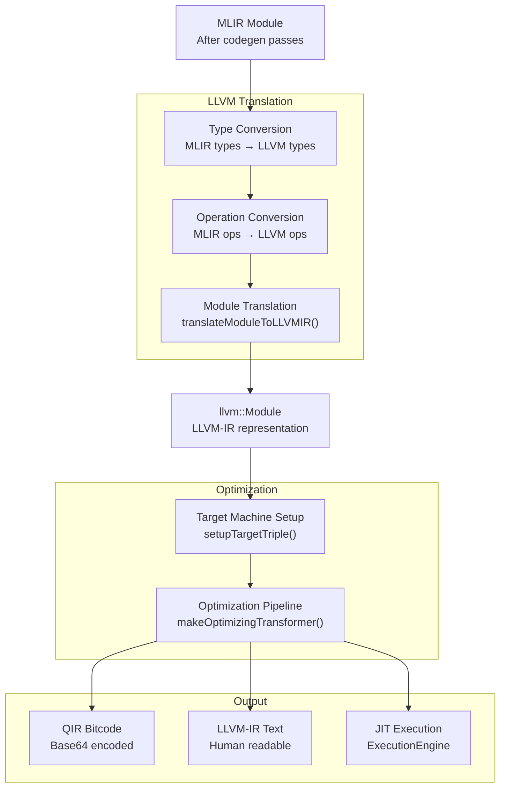
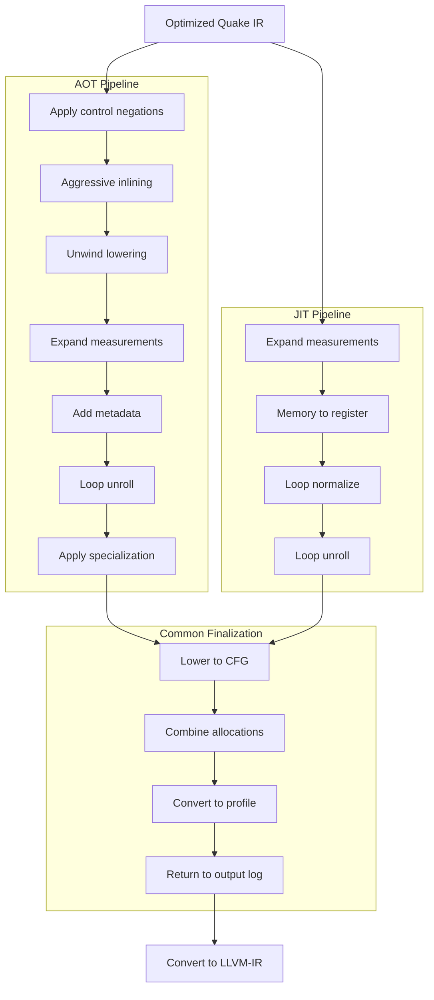
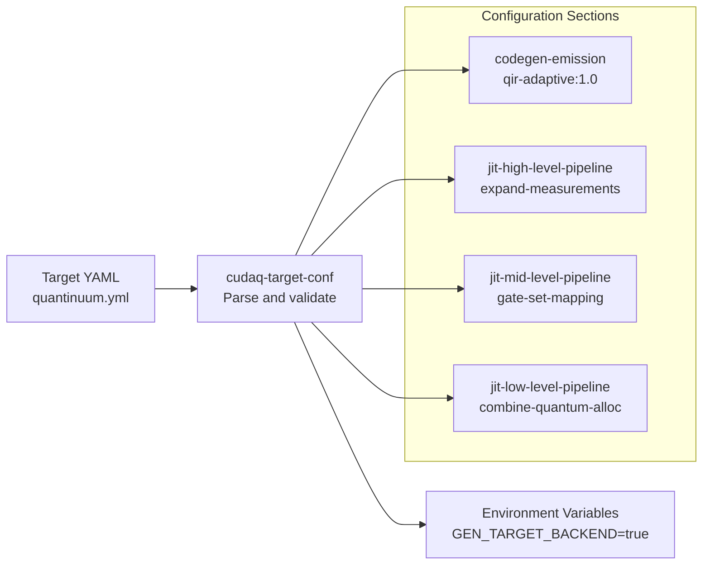
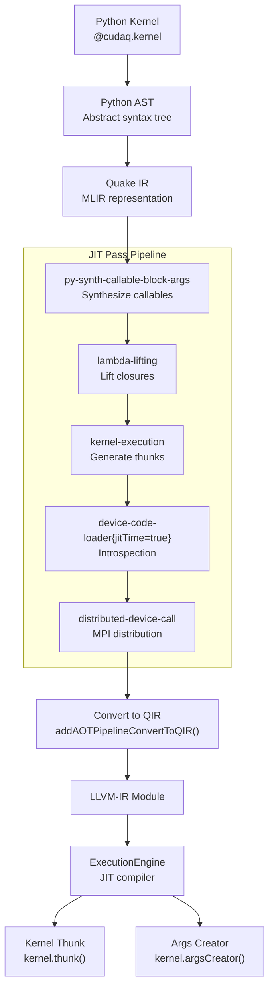
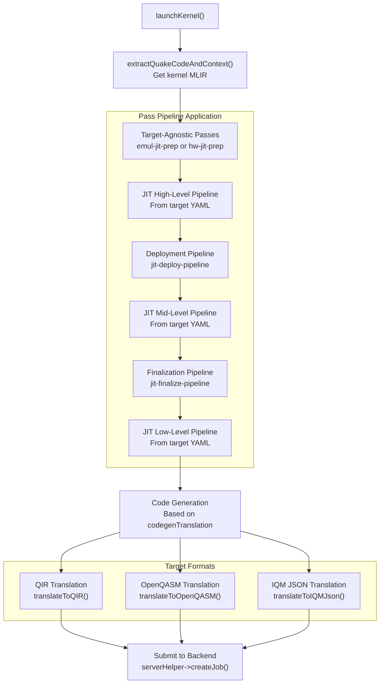

<!-- source: DeepWiki mcp.deepwiki.com · repo NVIDIA/cuda-quantum · page 2.4 Code Generation and Target Translation · fetched 2026-10-26 -->

# Code Generation and Target Translation

<details>
<summary>Relevant source files</summary>

The following files were used as context for generating this wiki page:

- [include/cudaq/Optimizer/CodeGen/Passes.h](include/cudaq/Optimizer/CodeGen/Passes.h)
- [include/cudaq/Optimizer/CodeGen/Passes.td](include/cudaq/Optimizer/CodeGen/Passes.td)
- [include/cudaq/Optimizer/InitAllDialects.h](include/cudaq/Optimizer/InitAllDialects.h)
- [include/cudaq/Optimizer/Transforms/Passes.h](include/cudaq/Optimizer/Transforms/Passes.h)
- [include/cudaq/Optimizer/Transforms/Passes.td](include/cudaq/Optimizer/Transforms/Passes.td)
- [lib/Optimizer/CodeGen/CMakeLists.txt](lib/Optimizer/CodeGen/CMakeLists.txt)
- [lib/Optimizer/CodeGen/ConvertCCToLLVM.cpp](lib/Optimizer/CodeGen/ConvertCCToLLVM.cpp)
- [lib/Optimizer/CodeGen/ConvertToQIR.cpp](lib/Optimizer/CodeGen/ConvertToQIR.cpp)
- [lib/Optimizer/CodeGen/ConvertToQIRProfile.cpp](lib/Optimizer/CodeGen/ConvertToQIRProfile.cpp)
- [lib/Optimizer/CodeGen/Pipelines.cpp](lib/Optimizer/CodeGen/Pipelines.cpp)
- [lib/Optimizer/Transforms/CMakeLists.txt](lib/Optimizer/Transforms/CMakeLists.txt)
- [lib/Optimizer/Transforms/ClassicalOptimization.cpp](lib/Optimizer/Transforms/ClassicalOptimization.cpp)
- [lib/Optimizer/Transforms/Pipelines.cpp](lib/Optimizer/Transforms/Pipelines.cpp)
- [python/runtime/cudaq/platform/py_alt_launch_kernel.cpp](python/runtime/cudaq/platform/py_alt_launch_kernel.cpp)
- [python/utils/OpaqueArguments.h](python/utils/OpaqueArguments.h)
- [runtime/common/BaseRemoteRESTQPU.h](runtime/common/BaseRemoteRESTQPU.h)
- [runtime/common/RuntimeMLIR.cpp](runtime/common/RuntimeMLIR.cpp)
- [runtime/common/RuntimeMLIRCommonImpl.h](runtime/common/RuntimeMLIRCommonImpl.h)
- [runtime/cudaq/platform/default/rest/RemoteRESTQPU.cpp](runtime/cudaq/platform/default/rest/RemoteRESTQPU.cpp)
- [runtime/cudaq/platform/default/rest/helpers/quantinuum/quantinuum.yml](runtime/cudaq/platform/default/rest/helpers/quantinuum/quantinuum.yml)
- [tools/cudaq-opt/cudaq-opt.cpp](tools/cudaq-opt/cudaq-opt.cpp)
- [tools/cudaq-quake/CMakeLists.txt](tools/cudaq-quake/CMakeLists.txt)
- [tools/cudaq-quake/cudaq-quake.cpp](tools/cudaq-quake/cudaq-quake.cpp)
- [tools/cudaq-translate/cudaq-translate.cpp](tools/cudaq-translate/cudaq-translate.cpp)
- [tools/nvqpp/nvq++.in](tools/nvqpp/nvq++.in)

</details>


## Purpose and Scope

This page describes how CUDA-Q lowers optimized MLIR representations to target-specific formats for execution. After quantum programs pass through the optimization pipeline (see [MLIR Optimization Passes](#2.3)), they must be translated into executable code formats that backends can consume. This includes QIR (Quantum Intermediate Representation) with multiple profiles, OpenQASM 2.0 for QASM-based backends, IQM JSON for IQM hardware, and LLVM IR for local simulation.

For information about the optimization passes that precede code generation, see [MLIR Optimization Passes](#2.3). For details about kernel execution after code generation, see [Kernel Execution Model](#2.5).

---

## Translation Infrastructure

### Translation Registry

CUDA-Q maintains a registry of translation functions that convert MLIR modules to different target formats. The registry maps format names to translation implementations:



**Sources:**
- [runtime/common/RuntimeMLIR.cpp:40-76]()
- [runtime/common/RuntimeMLIR.cpp:94-113]()

### Translation Function Types

The system supports two types of translation functions:

| Type | Signature | Use Case |
|------|-----------|----------|
| `TranslateFromMLIRFunction` | `LogicalResult(Operation*, raw_ostream&)` | Simple translations to text formats |
| `TranslateFromMLIRFunctionExtended` | `LogicalResult(Operation*, raw_ostream&, StringRef)` | Translations with version/profile parameters |

Both function types are registered in the translation registry during initialization via `registerTranslation()`.

**Sources:**
- [runtime/common/RuntimeMLIR.cpp:55-76]()

### Initialization and Registration

Translation infrastructure is initialized once per process:

```cpp
std::unique_ptr<MLIRContext> cudaq::initializeMLIR() {
  std::call_once(mlir_init_flag, []() {
    llvm::InitializeNativeTarget();
    llvm::InitializeNativeTargetAsmPrinter();
    cudaq::registerAllPasses();
    registerToQIRTranslation();
    registerToOpenQASMTranslation();
    registerToIQMJsonTranslation();
  });
  // ... context initialization
}
```

**Sources:**
- [runtime/common/RuntimeMLIR.cpp:92-113]()

---

## Code Generation Passes

### Core Conversion Passes

The code generation library defines several key passes for lowering to target formats:



**Pass Descriptions:**

- **`quake-to-cc`**: Lowers Quake dialect to CC (classical computation) dialect with calls to execution manager runtime
- **`quake-to-qir`**: Directly converts Quake operations to full QIR (LLVM-IR with quantum intrinsics)
- **`lower-to-cg`**: Fuses small DAGs of operations into CodeGen dialect macros for efficient conversion
- **`cc-to-llvm`**: Final conversion from CC dialect to LLVM-IR dialect
- **`qir-profile-prep`**: Prepares module for profile conversion (creates function declarations)
- **`quake-to-qir-func`**: Analyzes functions for qubit allocations and measurements
- **`convert-to-qir-profile`**: Lowers full QIR to Base or Adaptive profile constraints

**Sources:**
- [include/cudaq/Optimizer/CodeGen/Passes.td:14-63]()
- [include/cudaq/Optimizer/CodeGen/Passes.td:76-132]()
- [include/cudaq/Optimizer/CodeGen/Passes.h:29-55]()

### Code Generation Library Structure

The code generation library (`OptCodeGen`) contains implementations for all conversion passes:

| Source File | Purpose |
|-------------|---------|
| `ConvertToQIR.cpp` | Full QIR conversion from Quake |
| `ConvertToQIRProfile.cpp` | Base/Adaptive profile conversion |
| `ConvertToQIRAPI.cpp` | QIR API pipeline |
| `CCToLLVM.cpp` | CC dialect to LLVM-IR conversion |
| `QuakeToLLVM.cpp` | Direct Quake to LLVM conversion |
| `QuakeToCodegen.cpp` | Quake to CodeGen dialect patterns |
| `TranslateToOpenQASM.cpp` | OpenQASM 2.0 translation |
| `TranslateToIQMJson.cpp` | IQM JSON translation |
| `Pipelines.cpp` | Pipeline builders for targets |
| `VerifyQIRProfile.cpp` | Profile compliance verification |

**Sources:**
- [lib/Optimizer/CodeGen/CMakeLists.txt:13-36]()

---

## QIR Code Generation

### QIR Format Overview

QIR (Quantum Intermediate Representation) is LLVM-IR extended with quantum-specific intrinsics. CUDA-Q supports three QIR profiles:

| Profile | Description | Control Flow | Measurements | Use Case |
|---------|-------------|--------------|--------------|----------|
| **Full QIR** | Complete QIR specification | Unrestricted | Dynamic | General quantum programs |
| **Base Profile** | Restricted subset | Static only | End of circuit | Simple quantum circuits |
| **Adaptive Profile** | Mid-circuit measurement support | Conditional on measurements | Mid-circuit | Adaptive algorithms |

**Sources:**
- [lib/Optimizer/CodeGen/ConvertToQIRProfile.cpp:26-37]()
- [include/cudaq/Optimizer/CodeGen/Passes.td:114-124]()

### QIR Translation Process



**Sources:**
- [lib/Optimizer/CodeGen/ConvertToQIR.cpp:58-68]()
- [lib/Optimizer/CodeGen/ConvertToQIRProfile.cpp:1-37]()

### Full QIR Generation

The `ConvertToQIR` pass transforms Quake operations into QIR function calls:

**Key Transformations:**
- `quake.alloca` → `__quantum__rt__qubit_allocate_array()`
- `quake.h` → `__quantum__qis__h__body()`
- `quake.x` → `__quantum__qis__x__body()`
- `quake.mz` → `__quantum__qis__mz__body()`

The conversion process includes:
1. **Subgraph Fusion**: Match patterns in IR and replace with CodeGen ops via `fuseSubgraphPatterns()`
2. **Type Conversion**: Convert Quake types to QIR types using `LLVMTypeConverter`
3. **Operation Lowering**: Replace Quake operations with QIR function calls
4. **Constant Array Handling**: Expand constant arrays into scalar stores

**Sources:**
- [lib/Optimizer/CodeGen/ConvertToQIR.cpp:40-68]()
- [lib/Optimizer/CodeGen/ConvertToQIR.cpp:72-155]()

### Base Profile Conversion

Base Profile QIR enforces strict constraints:
- All measurements at circuit end (enforced by `delay-measurements` pass)
- Static qubit allocation only
- No control flow dependent on measurements
- No dynamic memory allocation

The `ConvertToQIRFuncPass` analyzes each function to:
- Count total qubit allocations
- Count measurement results
- Add `required_num_qubits` and `required_num_results` attributes
- Insert result recording calls at exit blocks

**Profile-Specific Code Generation:**
```cpp
// Base profile specification format:
"base-profile:<version>:<suboptions>"

// Example: "base-profile:0.1"
```

**Sources:**
- [lib/Optimizer/CodeGen/ConvertToQIRProfile.cpp:72-97]()
- [lib/Optimizer/CodeGen/Pipelines.cpp:40-41]()

### Adaptive Profile Conversion

Adaptive Profile QIR supports mid-circuit measurements with conditional control:
- Measurements can occur anywhere in the circuit
- Control flow can depend on measurement results
- Integer and floating-point computations supported (version-dependent)
- Output recording for intermediate results

**Supported Instruction Sets by Version:**

| Feature | v0.1 | v1.0 |
|---------|------|------|
| Mid-circuit measurement | ✓ | ✓ |
| Integer arithmetic | ✓ | ✓ |
| Floating-point arithmetic | ✗ | ✓ |
| Output recording | ✗ | ✓ |

**Validation Functions:**
- `isValidIntegerArithmeticInstruction()`: Checks binary ops, comparisons, casts
- `isValidFloatingArithmeticInstruction()`: Validates FP operations (v1.0+)
- `isValidOutputCallInstruction()`: Validates result recording calls

**Sources:**
- [runtime/common/RuntimeMLIRCommonImpl.h:119-175]()
- [lib/Optimizer/CodeGen/ConvertToQIRProfile.cpp:26-37]()

---

## OpenQASM Translation

### OpenQASM 2.0 Format

OpenQASM (Open Quantum Assembly Language) is a text-based quantum circuit description format. CUDA-Q translates Quake IR to OpenQASM 2.0 for backends requiring this format.

**OpenQASM Translation Pipeline:**



**Pipeline Configuration:**
```cpp
void addPipelineTranslateToOpenQASM(PassManager &pm) {
  pm.addNestedPass<func::FuncOp>(createClassicalMemToReg());
  pm.addNestedPass<func::FuncOp>(createCanonicalizerPass());
  pm.addNestedPass<func::FuncOp>(createDeadStoreRemoval());
  pm.addPass(createSymbolDCEPass());
}
```

**Translation Process:**
1. Convert classical memory operations to SSA form
2. Canonicalize and optimize the IR
3. Remove dead stores and unused symbols
4. Emit OpenQASM text via `translateToOpenQASM()`

**Sources:**
- [lib/Optimizer/CodeGen/Pipelines.cpp:134-139]()
- [tools/cudaq-translate/cudaq-translate.cpp:158-163]()

### OpenQASM Output Metadata

For OpenQASM translation, measurement output names are preserved via module attributes:

```cpp
// Extract output_names from module attributes
for (auto &op : moduleOp) {
  if (op.hasAttr("output_names")) {
    auto strAttr = op.getAttr("output_names")
                      .dyn_cast_or_null<mlir::StringAttr>();
    output_names = nlohmann::json::parse(strAttr.getValue());
  }
}
```

**Sources:**
- [runtime/common/BaseRemoteRESTQPU.h:435-446]()

---

## IQM JSON Translation

### IQM Format

IQM (Integrated Quantum Machines) backends accept quantum programs as JSON payloads. The IQM translation process converts Quake IR to this JSON format.

**IQM Translation Pipeline:**

```mermaid
graph LR
    Quake["Quake IR"]
    
    subgraph "Preparation Passes"
        ExpandMeas["expand-measurements<br/>Single-qubit measurements"]
        CSE["cse<br/>Common subexpression"]
        LoopNorm["loop-normalize<br/>Normalize loops"]
        LoopUnroll["loop-unroll<br/>Fully unroll loops"]
        Canon["canonicalize<br/>Simplify"]
    end
    
    subgraph "Finalization"
        LowerCFG["lower-to-cfg<br/>Control flow graph"]
        StackPrealloc["stack-frame-prealloc<br/>Preallocate frame"]
        CombineAlloc["combine-quantum-alloc<br/>Merge allocations"]
    end
    
    Translate["translateToIQMJson()<br/>JSON emission"]
    
    IQMJson["IQM JSON<br/>Hardware-specific format"]
    
    Quake --> ExpandMeas
    ExpandMeas --> CSE
    CSE --> LoopNorm
    LoopNorm --> LoopUnroll
    LoopUnroll --> Canon
    Canon --> LowerCFG
    
    LowerCFG --> StackPrealloc
    StackPrealloc --> CombineAlloc
    CombineAlloc --> Translate
    
    Translate --> IQMJson
```



**Pipeline Configuration:**
```cpp
void addPipelineTranslateToIQMJson(PassManager &pm) {
  pm.addNestedPass<func::FuncOp>(createExpandMeasurementsPass());
  pm.addNestedPass<func::FuncOp>(createCSEPass());
  pm.addNestedPass<func::FuncOp>(createLoopNormalize());
  pm.addNestedPass<func::FuncOp>(createLoopUnroll());
  pm.addNestedPass<func::FuncOp>(createCanonicalizerPass());
  addLowerToCFG(pm);
  pm.addNestedPass<func::FuncOp>(createStackFramePrealloc());
  pm.addNestedPass<func::FuncOp>(createCombineQuantumAllocations());
  pm.addNestedPass<func::FuncOp>(createCanonicalizerPass());
  pm.addPass(createSymbolDCEPass());
}
```

**Key Requirements:**
- All loops must be fully unrolled (static circuits only)
- Measurements expanded to single-qubit operations
- Quantum allocations combined into single allocation
- Control flow lowered to basic blocks

**Sources:**
- [lib/Optimizer/CodeGen/Pipelines.cpp:141-153]()

---

## LLVM IR Generation

### Final Lowering to LLVM

After target-specific passes, MLIR modules are translated to LLVM-IR for execution or further compilation:



**Translation Process:**

1. **Type Conversion**: Convert MLIR types to LLVM types using `LLVMTypeConverter`
2. **Operation Translation**: Map MLIR operations to LLVM instructions
3. **Module Generation**: Create `llvm::Module` via `translateModuleToLLVMIR()`
4. **Target Setup**: Configure target triple and data layout
5. **Optimization**: Apply LLVM optimization passes at specified level

**Sources:**
- [tools/cudaq-translate/cudaq-translate.cpp:208-230]()
- [runtime/common/RuntimeMLIRCommonImpl.h:51-77]()

### Optimization Levels

LLVM optimization is configurable via optimization level and size level:

```cpp
// Create optimizing transformer with opt level 3, size level 0
auto optPipeline = cudaq::makeOptimizingTransformer(
    /*optLevel=*/3, 
    /*sizeLevel=*/0,
    /*targetMachine=*/nullptr);

if (auto err = optPipeline(llvmModule.get())) {
  throw std::runtime_error("Failed to optimize LLVM IR");
}
```

**Default Settings:**
- AOT compilation: opt-level=3, size-level=0
- JIT compilation: opt-level=0 (fast compilation)

**Sources:**
- [runtime/common/RuntimeMLIRCommonImpl.h:79-92]()
- [tools/cudaq-translate/cudaq-translate.cpp:51-60]()

---

## Code Generation Pipelines

### AOT vs JIT Pipelines

CUDA-Q defines distinct pipelines for ahead-of-time (AOT) and just-in-time (JIT) compilation:



**Pipeline Builders:**

```cpp
// JIT pipeline for runtime compilation
void addJITPipelineConvertToQIR(PassManager &pm, StringRef convertTo);

// AOT pipeline for ahead-of-time compilation
void addAOTPipelineConvertToQIR(PassManager &pm, StringRef convertTo = {});
```

**Key Differences:**

| Stage | AOT Pipeline | JIT Pipeline |
|-------|--------------|--------------|
| Inlining | Full aggressive inlining | Minimal |
| Unwind lowering | Yes | No |
| Metadata | Add deallocs, metadata | Minimal metadata |
| Optimization | Maximum | Fast compilation |
| Specialization | Multiple rounds | Single round |

**Sources:**
- [lib/Optimizer/CodeGen/Pipelines.cpp:54-109]()
- [include/cudaq/Optimizer/CodeGen/Passes.h:88-103]()

### Pipeline Configuration

Pipelines are configured via options structures:

```cpp
struct TargetCodegenPipelineOptions 
    : public PassPipelineOptions<TargetCodegenPipelineOptions> {
  PassOptions::Option<bool> allowBreaksInLoops{
      *this, "loops-may-have-break",
      llvm::cl::desc("Enable break statements in loops."),
      llvm::cl::init(true)};
      
  PassOptions::Option<std::string> target{
      *this, "convert-to", 
      llvm::cl::desc("Conversion target specifier."),
      llvm::cl::init("")};
};
```

**Pipeline Execution:**
```cpp
createTargetCodegenPipeline</*isJIT=*/true>(pm, "qir-adaptive:1.0");
```

**Sources:**
- [lib/Optimizer/CodeGen/Pipelines.cpp:19-32]()
- [lib/Optimizer/CodeGen/Pipelines.cpp:111-132]()

---

## Target Configuration

### YAML Configuration Files

Each backend target is configured via a YAML file that specifies code generation settings:



**Example Configuration (Quantinuum):**

```yaml
name: quantinuum
config:
  platform-qpu: remote_rest
  gen-target-backend: true
  
  # Code generation target
  codegen-emission: qir-adaptive:0.1:int_computations
  
  # Pass pipelines
  jit-high-level-pipeline: "expand-measurements"
  jit-mid-level-pipeline: "quantinuum-gate-set-mapping"
  jit-low-level-pipeline: "func.func(combine-quantum-alloc,qubit-reset-before-reuse)"
  
  link-libs: ["-lcudaq-rest-qpu"]
  library-mode: false
```

**Sources:**
- [runtime/cudaq/platform/default/rest/helpers/quantinuum/quantinuum.yml:1-28]()

### Code Generation Specification

The `codegen-emission` field specifies the target format and version:

**Format:** `<name>:<version>:<suboptions>`

**Supported Specifications:**

| Name | Description | Suboptions |
|------|-------------|------------|
| `qir` | Full QIR | version (e.g., `0.1`, `1.0`) |
| `qir-base` | Base Profile QIR | version |
| `qir-adaptive` | Adaptive Profile QIR | `int_computations`, `float_computations`, `output_log` |
| `openqasm2` | OpenQASM 2.0 | none |
| `iqm` | IQM JSON | none |

**Parsing:**
```cpp
auto convertPair = convertTo.split(':');
if (convertPair.first == "qir-adaptive") {
  // Parse version and suboptions
  auto versionPair = convertPair.second.split(':');
  std::string version = versionPair.first;
  std::string suboptions = versionPair.second;
}
```

**Sources:**
- [runtime/common/BaseRemoteRESTQPU.h:88-93]()
- [runtime/common/CodeGenConfig.h]() (parseCodeGenTranslation)

### Pass Pipeline Construction

Target backends construct custom pass pipelines from YAML configuration:

```cpp
// 1. Target-agnostic high-level passes
if (emulate)
  passPipelineConfig += ",emul-jit-prep-pipeline{erase-noise=true}";
else
  passPipelineConfig += ",hw-jit-prep-pipeline";

// 2. Target-specific high-level passes (from YAML)
if (!config.BackendConfig->JITHighLevelPipeline.empty()) {
  passPipelineConfig += "," + config.BackendConfig->JITHighLevelPipeline;
}

// 3. Target-agnostic deployment passes
passPipelineConfig += ",jit-deploy-pipeline";

// 4. Target-specific mid-level passes (from YAML)
if (!config.BackendConfig->JITMidLevelPipeline.empty()) {
  passPipelineConfig += "," + config.BackendConfig->JITMidLevelPipeline;
}

// 5. Target-agnostic finalization passes
passPipelineConfig += ",jit-finalize-pipeline";

// 6. Target-specific low-level passes (from YAML)
if (!config.BackendConfig->JITLowLevelPipeline.empty()) {
  passPipelineConfig += "," + config.BackendConfig->JITLowLevelPipeline;
}
```

**Sources:**
- [runtime/common/BaseRemoteRESTQPU.h:311-359]()

### nvq++ Driver Integration

The `nvq++` compiler driver reads target configuration and constructs compilation pipelines:

```bash
# Set target via command line
nvq++ --target quantinuum my_kernel.cpp

# Target configuration loaded from:
# ${CUDA_QUANTUM_PATH}/targets/quantinuum.yml
```

**Driver Pipeline Construction:**

```bash
# Configure pass pipeline from target
OPT_PASSES="builtin.module(${PIPELINE_STRING})"

# Run cudaq-opt with configured passes
${TOOLBIN}cudaq-opt ${CUDAQ_OPT_ARGS} \
  --pass-pipeline="${OPT_PASSES}" \
  ${QUAKE_IN} -o ${DCL_FILE}

# Translate to target format
${TOOLBIN}cudaq-translate ${CUDAQ_TRANSLATE_ARGS} \
  --convert-to=${PLATFORM_TRANSPORT_LAYER} \
  ${QUAKE_IN} -o ${QUAKELL_FILE}
```

**Sources:**
- [tools/nvqpp/nvq++.in:648-674]()
- [tools/nvqpp/nvq++.in:704-773]()
- [tools/nvqpp/nvq++.in:813-814]()

---

## Tools and Commands

### cudaq-translate

The `cudaq-translate` tool converts Quake IR to various target formats:

**Command Line:**
```bash
cudaq-translate input.qke \
  --convert-to=qir-adaptive:1.0 \
  --emit-llvm \
  -o output.ll
```

**Supported Targets:**
- `qir`, `qir-full`: Full QIR specification
- `qir-base`: Base Profile QIR
- `qir-adaptive`: Adaptive Profile QIR
- `openqasm2`: OpenQASM 2.0 text
- `iqm`: IQM JSON format

**Options:**
- `--convert-to=<target>`: Specify target format and version
- `--emit-llvm`: Output LLVM-IR (default: true)
- `--opt-level=<N>`: LLVM optimization level (0-3, default: 3)
- `--size-level=<N>`: Size optimization level (default: 0)
- `-o <file>`: Output file path

**Sources:**
- [tools/cudaq-translate/cudaq-translate.cpp:42-70]()
- [tools/cudaq-translate/cudaq-translate.cpp:165-192]()

### cudaq-opt

The `cudaq-opt` tool applies MLIR passes for optimization and transformation:

**Command Line:**
```bash
cudaq-opt input.qke \
  --pass-pipeline="builtin.module(lower-to-cg,quake-to-qir)" \
  -o output.qke
```

**Useful Pass Pipelines:**
```bash
# JIT preparation
--pass-pipeline="emul-jit-prep-pipeline"

# AOT QIR conversion  
--pass-pipeline="hw-jit-prep-pipeline,convert-to-qir-api{api=qir-adaptive:1.0}"

# OpenQASM preparation
--pass-pipeline="func.func(classical-mem-to-reg),canonicalize"
```

**Sources:**
- [tools/cudaq-opt/cudaq-opt.cpp:54-69]()

### cudaq-quake

The `cudaq-quake` tool translates C++ source to Quake IR:

**Command Line:**
```bash
cudaq-quake input.cpp \
  --emit-llvm-file \
  -o output.qke
```

**Options:**
- `--emit-llvm-file`: Also emit LLVM IR for classical code
- `--filter=<name>`: Only convert specified kernel functions
- `-I<dir>`: Add include directory
- `-D<macro>`: Define preprocessor macro
- `--std=<standard>`: C++ standard (c++20, c++23)

**Sources:**
- [tools/cudaq-quake/cudaq-quake.cpp:43-112]()

---

## Python JIT Code Generation

### Python Kernel Compilation

Python kernels undergo JIT compilation with dynamic code generation:



**JIT Pipeline Configuration:**

```cpp
PassManager pm(context);
pm.addNestedPass<func::FuncOp>(
    cudaq::opt::createPySynthCallableBlockArgs(names));
pm.addPass(cudaq::opt::createLambdaLiftingPass());
pm.addPass(cudaq::opt::createGenerateKernelExecution({.startingArgIdx = 0}));
pm.addPass(cudaq::opt::createGenerateDeviceCodeLoader({.jitTime = true}));
pm.addPass(cudaq::opt::createReturnToOutputLog());
pm.addPass(cudaq::opt::createLambdaLiftingPass());
pm.addPass(cudaq::opt::createDistributedDeviceCall());

std::string tl = getTransportLayer(); // e.g., "qir:0.1"
cudaq::opt::addAOTPipelineConvertToQIR(pm, tl);
pm.addPass(createSymbolDCEPass());
```

**Sources:**
- [python/runtime/cudaq/platform/py_alt_launch_kernel.cpp:169-196]()

### JIT Execution Engine

The JIT execution engine compiles and caches MLIR modules:

```cpp
ExecutionEngine *jitKernel(const std::string &name, 
                           MlirModule module,
                           const std::vector<std::string> &names) {
  // Check JIT cache
  auto hash = computeModuleHash(module);
  if (jitCache->hasJITEngine(hash))
    return jitCache->getJITEngine(hash);
  
  // Apply passes
  PassManager pm(context);
  // ... configure pipeline ...
  if (failed(pm.run(cloned)))
    throw std::runtime_error("JIT compilation failed");
  
  // Create execution engine
  ExecutionEngineOptions opts;
  opts.jitCodeGenOptLevel = llvm::CodeGenOpt::None;
  opts.transformer = [](llvm::Module *m) { return llvm::ErrorSuccess(); };
  
  auto jitOrError = ExecutionEngine::create(cloned, opts);
  auto *jit = jitOrError.get().release();
  
  // Cache for reuse
  jitCache->cache(hash, jit);
  return jit;
}
```

**Sources:**
- [python/runtime/cudaq/platform/py_alt_launch_kernel.cpp:146-268]()

---

## Remote Execution Code Generation

### Remote QPU Pipeline

Remote quantum backends require specialized code generation:



**Sources:**
- [runtime/common/BaseRemoteRESTQPU.h:311-359]()
- [runtime/common/BaseRemoteRESTQPU.h:465-593]()

### QIR Bitcode Encoding

QIR is encoded as Base64 bitcode for transmission to remote backends:

```cpp
// Write LLVM module to bitcode
std::string bitcodeStr;
llvm::raw_string_ostream os(bitcodeStr);
llvm::WriteBitcodeToFile(*llvmModule, os);
os.flush();

// Encode as Base64
std::string encodedQIR = llvm::encodeBase64(bitcodeStr);

// Include in JSON payload
nlohmann::json payload;
payload["qir"] = encodedQIR;
payload["count"] = nShots;
```

**Decoding and Validation:**
```cpp
// Decode Base64 to get bitcode
std::vector<char> bitcode;
if (llvm::decodeBase64(codeStr, bitcode))
  throw std::runtime_error("Failed to decode QIR");

// Parse bitcode to LLVM module
llvm::LLVMContext context;
auto buffer = llvm::MemoryBuffer::getMemBufferCopy(
    llvm::StringRef(bitcode.data(), bitcode.size()));
auto moduleOrError = llvm::parseBitcodeFile(buffer->getMemBufferRef(), context);
```

**Sources:**
- [runtime/common/BaseRemoteRESTQPU.h:412-434]()

---

This page documented the code generation and target translation systems in CUDA-Q, covering translation infrastructure, QIR profiles, OpenQASM and IQM formats, LLVM IR generation, pipeline architecture, and target configuration mechanisms.

---

