<!-- source: DeepWiki mcp.deepwiki.com · repo NVIDIA/cuda-quantum · page 2.5 Kernel Execution Model · fetched 2026-10-26 -->

# Kernel Execution Model

<details>
<summary>Relevant source files</summary>

The following files were used as context for generating this wiki page:

- [include/cudaq/Optimizer/Transforms/Passes.h](include/cudaq/Optimizer/Transforms/Passes.h)
- [include/cudaq/Optimizer/Transforms/Passes.td](include/cudaq/Optimizer/Transforms/Passes.td)
- [lib/Optimizer/CodeGen/Pipelines.cpp](lib/Optimizer/CodeGen/Pipelines.cpp)
- [lib/Optimizer/Transforms/CMakeLists.txt](lib/Optimizer/Transforms/CMakeLists.txt)
- [lib/Optimizer/Transforms/ClassicalOptimization.cpp](lib/Optimizer/Transforms/ClassicalOptimization.cpp)
- [lib/Optimizer/Transforms/Pipelines.cpp](lib/Optimizer/Transforms/Pipelines.cpp)
- [python/cudaq/kernel/ast_bridge.py](python/cudaq/kernel/ast_bridge.py)
- [python/cudaq/kernel/kernel_builder.py](python/cudaq/kernel/kernel_builder.py)
- [python/cudaq/kernel/kernel_decorator.py](python/cudaq/kernel/kernel_decorator.py)
- [python/cudaq/kernel/utils.py](python/cudaq/kernel/utils.py)
- [python/cudaq/runtime/sample.py](python/cudaq/runtime/sample.py)
- [python/runtime/cudaq/platform/py_alt_launch_kernel.cpp](python/runtime/cudaq/platform/py_alt_launch_kernel.cpp)
- [python/tests/builder/test_kernel_builder.py](python/tests/builder/test_kernel_builder.py)
- [python/tests/kernel/test_control_negations.py](python/tests/kernel/test_control_negations.py)
- [python/tests/kernel/test_direct_call_return_kernel.py](python/tests/kernel/test_direct_call_return_kernel.py)
- [python/tests/kernel/test_kernel_call_return.py](python/tests/kernel/test_kernel_call_return.py)
- [python/tests/kernel/test_kernel_features.py](python/tests/kernel/test_kernel_features.py)
- [python/tests/kernel/test_run_kernel.py](python/tests/kernel/test_run_kernel.py)
- [python/tests/mlir/ast_attributes.py](python/tests/mlir/ast_attributes.py)
- [python/utils/OpaqueArguments.h](python/utils/OpaqueArguments.h)
- [runtime/common/BaseRemoteRESTQPU.h](runtime/common/BaseRemoteRESTQPU.h)
- [runtime/common/RuntimeMLIRCommonImpl.h](runtime/common/RuntimeMLIRCommonImpl.h)
- [runtime/cudaq/platform/default/rest/helpers/quantinuum/quantinuum.yml](runtime/cudaq/platform/default/rest/helpers/quantinuum/quantinuum.yml)

</details>


This page explains how quantum kernels in CUDA-Q are executed, including the process from compilation to execution on simulators or hardware backends. The document covers the underlying mechanisms that transform kernel code into executable forms and how arguments and return values are handled during execution.

For information about defining quantum kernels, see [Core Concepts](1.1) and [Kernel Definition](3.1).
For details about the compilation pipeline before kernel execution, see [Compilation Pipeline](2.1).

## Overview of the Execution Model

CUDA-Q's kernel execution model bridges the gap between high-level quantum kernel code and its execution on target devices. The process involves several key steps: compilation, argument handling, kernel execution, and result processing.

```mermaid
flowchart TD
    subgraph "Compilation Phase"
        Kernel["Quantum Kernel\n(MLIR IR)"] --> CompilePhase["Kernel Compilation"]
        CompilePhase --> Thunk["Thunk Function\nGeneration"]
        CompilePhase --> ArgsCreator["Args Creator\nFunction"]
    end

    subgraph "Argument Handling"
        RuntimeArgs["Runtime Arguments"] --> Synthesis["Argument Synthesis"]
        ArgsCreator --> |"Create message buffer"| ArgBuf["Structured Arguments Buffer"]
        Synthesis --> ArgBuf
    end

    subgraph "Execution"
        Thunk --> LaunchKernel["Launch Kernel"]
        ArgBuf --> LaunchKernel
        LaunchKernel --> |"Local"| SimExec["Circuit Simulator"]
        LaunchKernel --> |"Remote"| QPUExec["QPU Hardware Execution"]
    end

    subgraph "Results"
        SimExec --> Results["Execution Results"]
        QPUExec --> Results
        Results --> ReturnValues["Return Values to Host"]
    end
```

Sources: [lib/Optimizer/Transforms/GenKernelExecution.cpp:130-389](), [runtime/nvqir/NVQIR.cpp:62-284](), [python/runtime/cudaq/algorithms/py_run.cpp:62-94]()

## Compilation Phase

During the compilation phase, CUDA-Q transforms quantum kernels into executable code and generates supporting functions for kernel execution.

### Key Components Generated During Compilation

1. **Kernel Function**: The actual quantum kernel code that will be executed.

2. **Thunk Function**: Acts as an intermediary between the runtime and the kernel, handling argument unpacking and return value processing.

3. **Args Creator Function**: Creates a structured message buffer containing all kernel arguments.

4. **Kernel Registration**: Functions for registering the kernel with the runtime system are generated.

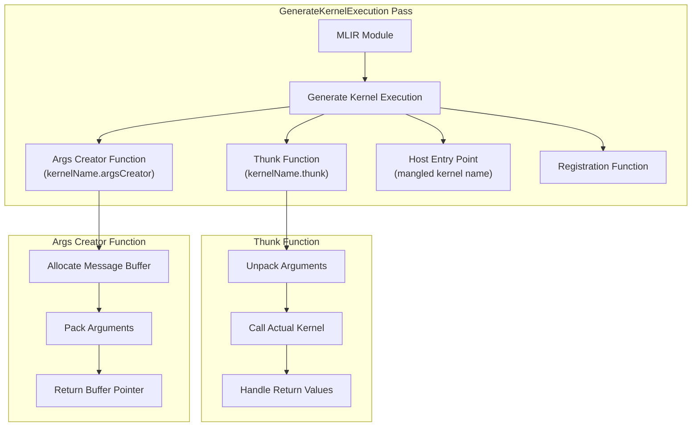

Sources: [lib/Optimizer/Transforms/GenKernelExecution.cpp:156-268](), [lib/Optimizer/Transforms/GenKernelExecution.cpp:279-389]()

## Argument Handling

Runtime arguments for quantum kernels must be prepared and passed correctly to ensure proper execution. This involves creating a structured message buffer and handling different argument types.

### Message Buffer Creation

Arguments are packed into a structured message buffer that can be passed to the kernel:

1. **Args Creator Function**: Generates a contiguous block of memory containing all arguments in a format expected by the kernel.

2. **Structured Layout**: For arguments of fixed size, values are directly embedded in the message buffer. For dynamic size arguments (like vectors), the buffer includes size information and the actual data is appended after the fixed portion.

```mermaid
classDiagram
    class MessageBuffer {
        +struct {
            +arg1: Type1
            +arg2: Type2
            +...
            +returnValue: ReturnType
        }
        +dynamicData: [byte array]
    }
    
    class ThunkFunction {
        +Execute(void* args, bool isClientServer) dynamic_buffer*
    }
    
    class ArgsCreatorFunction {
        +Create(void** args, void** buffer) size_t
    }
    
    MessageBuffer <-- ArgsCreatorFunction : creates
    MessageBuffer --> ThunkFunction : consumed by
```

Sources: [lib/Optimizer/Transforms/GenKernelExecution.cpp:156-268](), [lib/Optimizer/Builder/Intrinsics.cpp:229-267]()

### Argument Processing

The `zipArgumentsWithDeviceTypes` function is responsible for processing arguments and preparing them for kernel execution:

1. **Type Conversion**: Host-side argument types are converted to device-side types.

2. **Dynamic Arguments**: Special handling for dynamic types like vectors, which require heap allocation.

3. **Heap Tracking**: A heap tracker is used to manage any temporary allocations needed during argument processing.

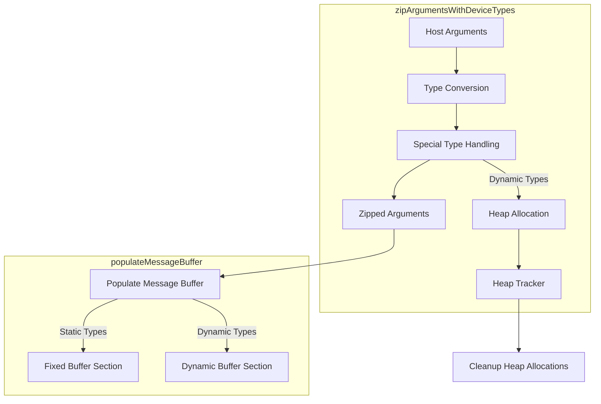

Sources: [lib/Optimizer/Transforms/GenKernelExecution.cpp:43-128](), [lib/Optimizer/Transforms/GenKernelExecution.cpp:220-258]()

## Kernel Execution Mechanism

Once the kernel is compiled and arguments are prepared, the kernel is executed using one of several execution paths.

### Execution Paths

CUDA-Q supports multiple execution paths depending on the target and codegen mode:

1. **Standard Mode (codegen=1)**: Uses a message buffer and thunk function, optimized for performance.

2. **Hybrid Mode (codegen=0)**: Uses both a vector of pointers to arguments and a thunk function, providing flexibility.

3. **Streamlined Mode (codegen=2)**: Simplified execution that directly passes arguments, used for hardware backends.

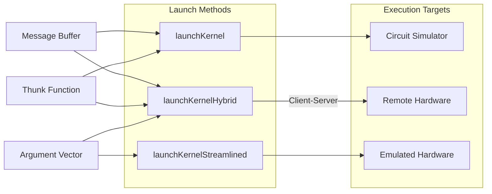

Sources: [lib/Optimizer/Transforms/GenKernelExecution.cpp:594-631](), [runtime/nvqir/NVQIR.cpp:224-284]()

### The Thunk Function

The thunk function is the bridge between the host-side kernel invocation and the device-side kernel execution:

1. **Argument Unpacking**: The thunk unpacks arguments from the message buffer and passes them to the actual kernel.

2. **Kernel Invocation**: The thunk calls the quantum kernel with the unpacked arguments.

3. **Result Handling**: After execution, the thunk captures return values and stores them back in the message buffer.

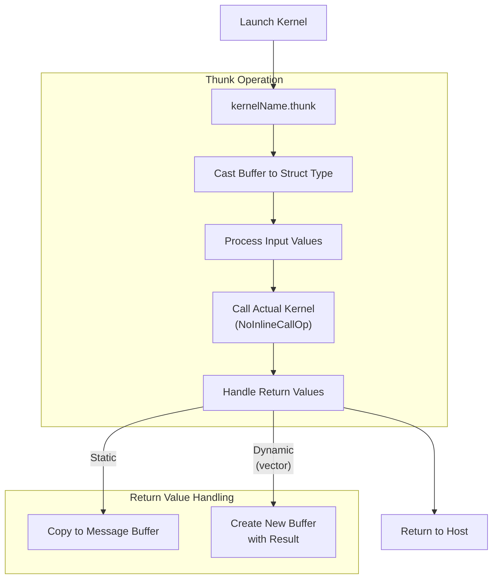

Sources: [lib/Optimizer/Transforms/GenKernelExecution.cpp:279-388]()

## Return Value Handling

After kernel execution, any return values must be processed and returned to the host:

### Types of Return Values

1. **Static Returns**: Simple scalar values (integers, floats, booleans) are directly stored in the message buffer.

2. **Dynamic Returns**: For variable-sized returns like vectors, special handling is required:
   - In local execution, the returned vector is stored in memory and a pointer is returned.
   - In client-server mode, a new message buffer is created to hold both the input arguments and the dynamic result.

### Result Extraction

The kernel execution system extracts return values from the appropriate location:

1. **Fixed-size results**: Retrieved directly from the message buffer at a specified offset.

2. **Dynamic results**: Retrieved via pointers to dynamically allocated memory.

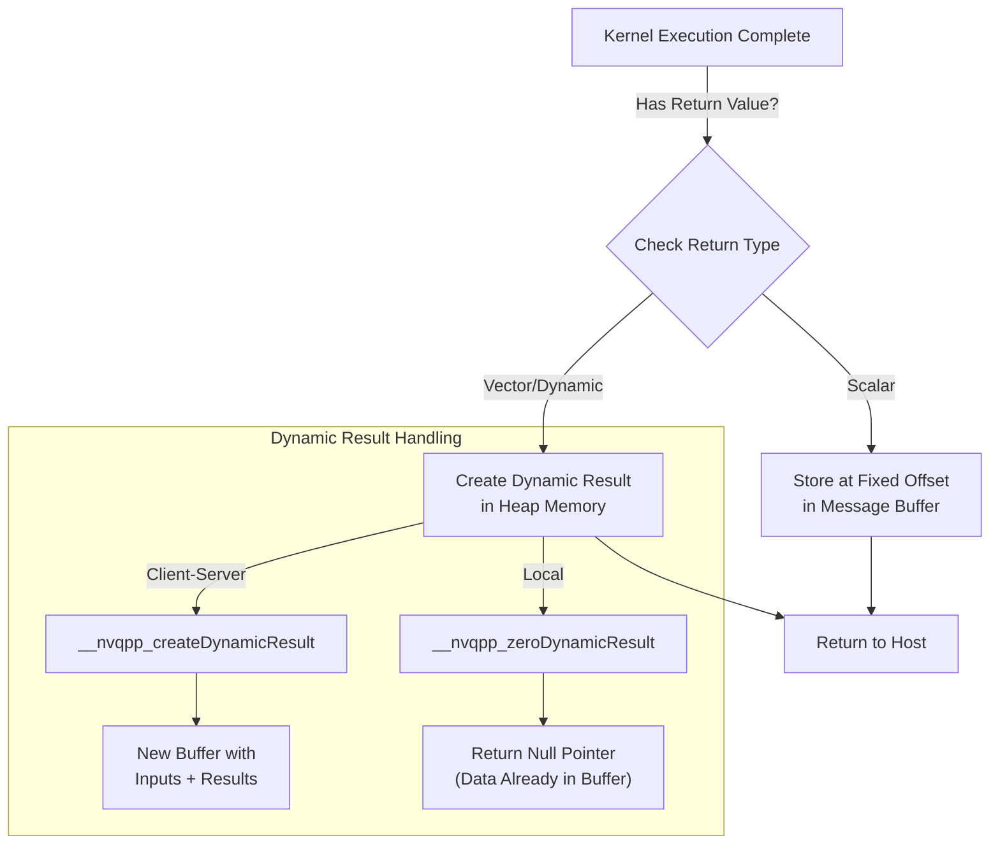

Sources: [lib/Optimizer/Transforms/GenKernelExecution.cpp:352-387](), [lib/Optimizer/Builder/Intrinsics.cpp:238-266](), [python/tests/kernel/test_run_kernel.py:42-68]()

## Memory Management

Memory management is a critical aspect of the kernel execution model, especially for dynamic data:

1. **Message Buffer Allocation**: Created during argument preparation and freed after execution.

2. **Dynamic Return Values**: Heap-allocated and managed according to execution context:
   - In local execution, the host code is responsible for freeing the memory.
   - In client-server mode, the server allocates memory and the client must free it.

3. **Heap Tracker**: During argument synthesis, a heap tracker is used to keep track of any heap allocations that need to be freed.

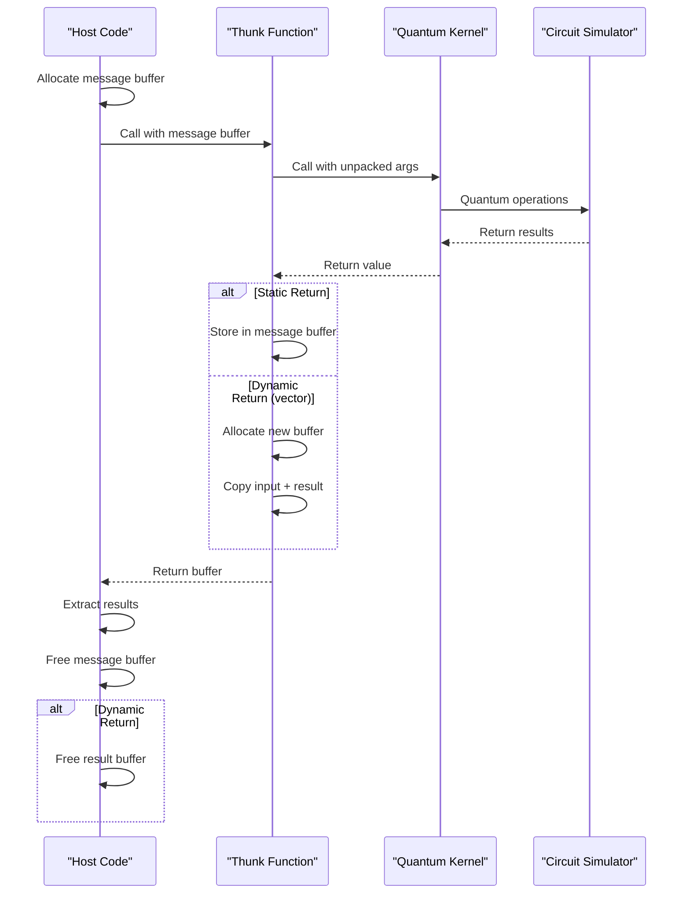

Sources: [lib/Optimizer/Transforms/GenKernelExecution.cpp:257-267](), [lib/Optimizer/Transforms/GenKernelExecution.cpp:352-387](), [python/runtime/cudaq/algorithms/py_run.cpp:62-94]()

## Circuit Simulator Integration

The execution of quantum operations in a kernel is handled by the `CircuitSimulator` interface, which provides a common API for different simulation backends.

### CircuitSimulator Interface

The `CircuitSimulator` class defines the interface for all quantum simulators in CUDA-Q:

1. **Qubit Management**: Methods for allocating and deallocating qubits.

2. **Gate Operations**: Methods for applying quantum gates to qubits.

3. **Measurement**: Methods for measuring qubits and collecting results.

4. **Execution Context**: Manages the context in which a kernel is executed (e.g., sampling, observation).

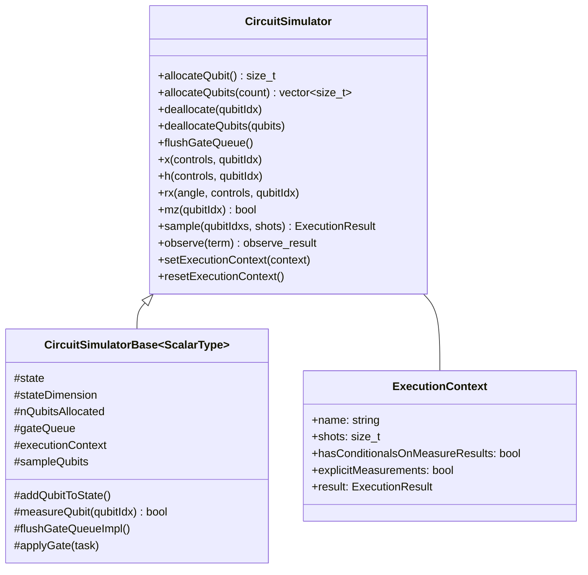

Sources: [runtime/nvqir/CircuitSimulator.h:80-401](), [runtime/nvqir/CircuitSimulator.h:407-902]()

### Execution Flow

When a quantum kernel is executed, the following sequence occurs:

1. **Context Setup**: An execution context is set up based on the execution mode (e.g., run, sample).

2. **Qubit Allocation**: Qubits are allocated through the circuit simulator.

3. **Gate Application**: Quantum gates are applied to qubits, often queued for batch processing.

4. **Measurement**: Qubits are measured, and results are collected.

5. **Context Reset**: The execution context is reset, triggering any deferred operations.

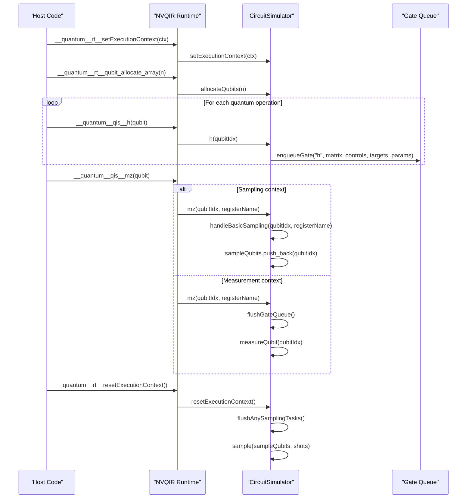

Sources: [runtime/nvqir/NVQIR.cpp:267-284](), [runtime/nvqir/CircuitSimulator.h:546-785]()

## Python Integration

CUDA-Q provides Python bindings for executing quantum kernels, with special handling for argument passing and result retrieval.

### Python Run Function

The `cudaq.run()` function allows executing quantum kernels that return values:

1. **Kernel Compilation**: Ensures the kernel is compiled before execution.

2. **Argument Processing**: Converts Python arguments to a format suitable for the kernel.

3. **Execution**: Launches the kernel with the processed arguments.

4. **Result Processing**: Converts the raw results back to Python objects.

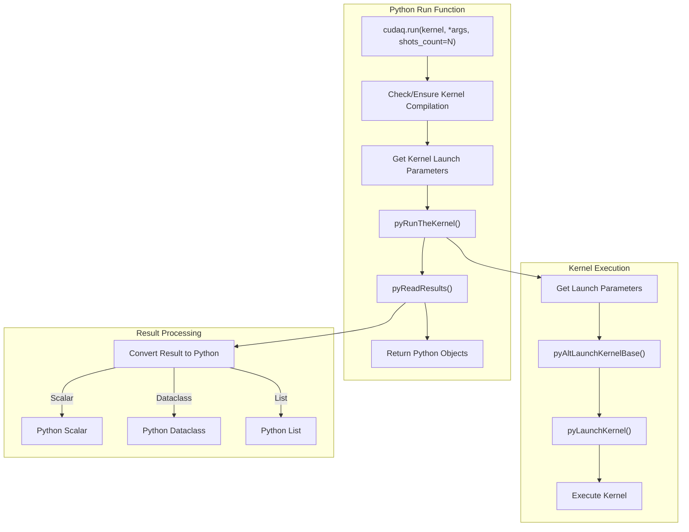

Sources: [python/runtime/cudaq/algorithms/py_run.cpp:26-94](), [python/tests/kernel/test_run_kernel.py:42-68](), [python/tests/kernel/test_direct_call_return_kernel.py:35-192]()

### Supported Return Types

CUDA-Q supports various return types from quantum kernels:

1. **Scalar Types**: Integers, floats, booleans.

2. **Dataclasses**: Python dataclasses with scalar fields.

3. **Lists**: Lists of scalar values (with some limitations).

The following table shows the supported return types and their handling:

| Return Type | Python Support | Notes |
|-------------|----------------|-------|
| `bool` | ✓ | Directly returned |
| `int`, `np.int8/16/32/64` | ✓ | Directly returned |
| `float`, `np.float32/64` | ✓ | Directly returned |
| `list[bool/int/float]` | ✓ | Supported in direct calls, not in `run()` |
| `dataclass` | ✓ | Fields must be scalar types |
| `tuple` | ✗ | Not supported in kernels |

Sources: [python/tests/kernel/test_run_kernel.py:91-526](), [python/tests/kernel/test_direct_call_return_kernel.py:35-192]()

## Execution Contexts

CUDA-Q uses execution contexts to control how kernels are executed and how results are collected.

### Types of Execution Contexts

1. **Sample Context**: Used for sampling measurement results over multiple shots.

2. **Sample-Conditional Context**: Used when the kernel contains conditional statements based on measurement results.

3. **Tracer Context**: Used to trace the execution of a kernel without actually executing it.

4. **Observe Context**: Used for computing expectation values of observables.

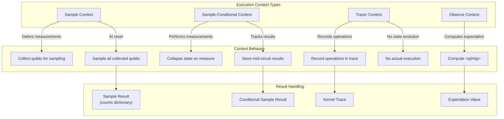

Sources: [runtime/nvqir/CircuitSimulator.h:546-637](), [runtime/nvqir/NVQIR.cpp:267-284]()

### Execution Context Flow

The execution context controls how measurements are handled during kernel execution:

1. **Context Setup**: Before kernel execution, an execution context is set.

2. **Measurement Handling**: During execution, measurements are handled according to the context type.

3. **Context Reset**: After execution, the context is reset, triggering any deferred operations.

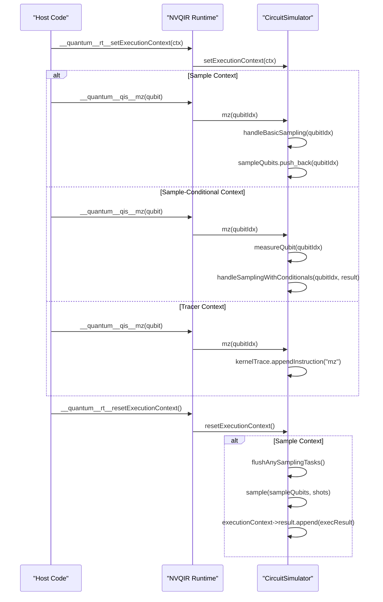

Sources: [runtime/nvqir/CircuitSimulator.h:546-785](), [runtime/nvqir/NVQIR.cpp:267-284]()

## Summary

The CUDA-Q kernel execution model provides a flexible and efficient framework for executing quantum kernels on various backends. By combining JIT compilation, argument synthesis, and specialized execution paths, it enables seamless execution of quantum code on both simulators and quantum hardware.

The model abstracts away the complexities of quantum programming, allowing users to focus on algorithm development while the execution system handles the details of compilation, optimization, and hardware targeting.

Sources: [runtime/cudaq/builder/kernel_builder.cpp:909-1106](), [lib/Optimizer/Transforms/GenKernelExecution.cpp:129-389](), [python/runtime/cudaq/platform/py_alt_launch_kernel.cpp:311-398]()

---

