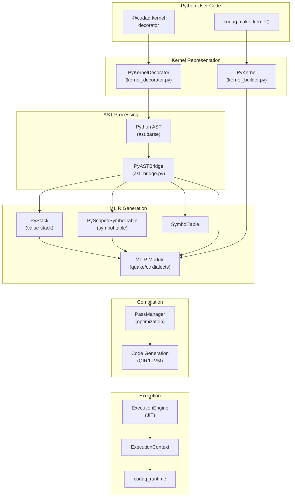
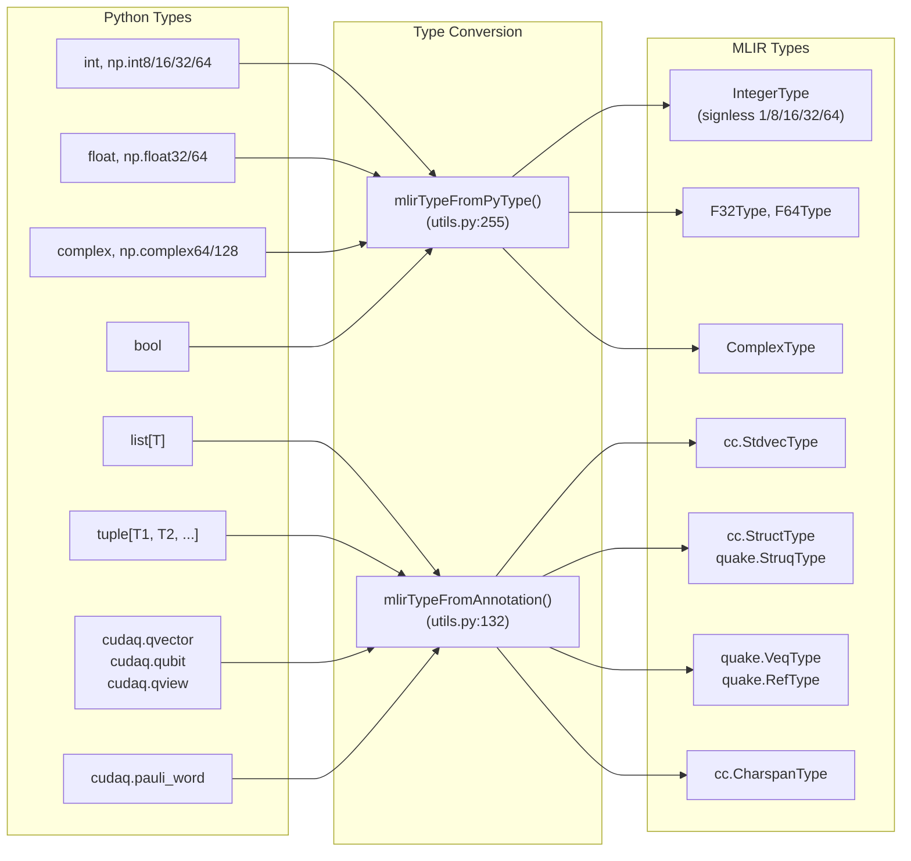
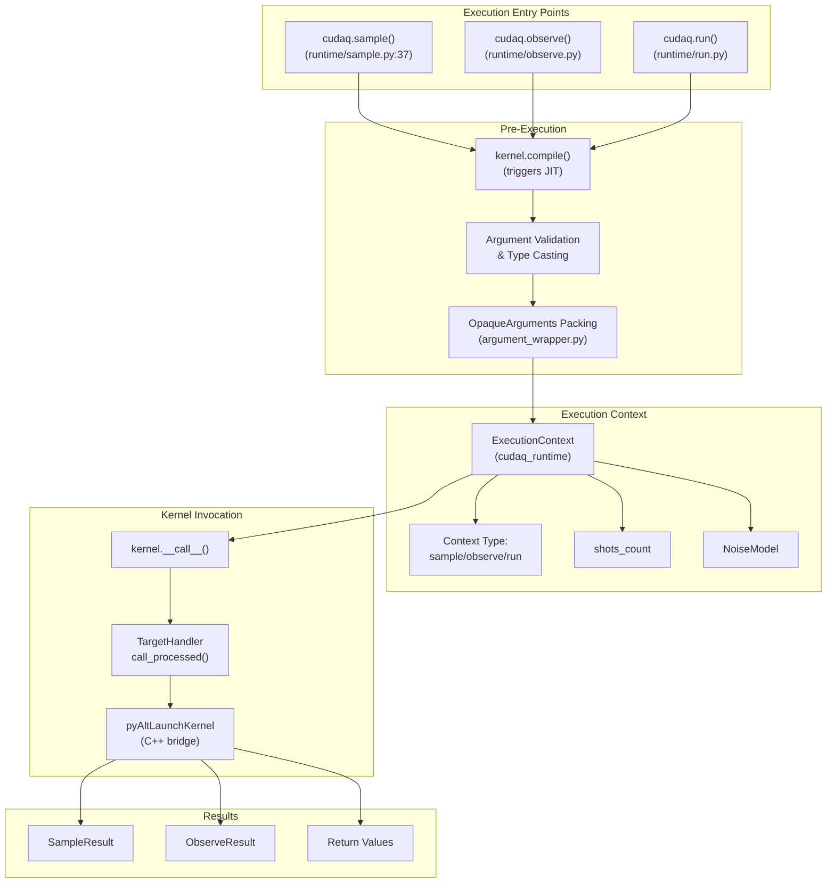

<!-- source: DeepWiki mcp.deepwiki.com · repo NVIDIA/cuda-quantum · page 3 Python Interface · fetched 2026-10-26 -->

# Python Interface

<details>
<summary>Relevant source files</summary>

The following files were used as context for generating this wiki page:

- [.github/workflows/config/gitlab_commits.txt](.github/workflows/config/gitlab_commits.txt)
- [.github/workflows/python_metapackages.yml](.github/workflows/python_metapackages.yml)
- [docs/notebook_validation.py](docs/notebook_validation.py)
- [docs/sphinx/applications/python/hybrid_quantum_neural_networks.ipynb](docs/sphinx/applications/python/hybrid_quantum_neural_networks.ipynb)
- [docs/sphinx/applications/python/quantum_pagerank.ipynb](docs/sphinx/applications/python/quantum_pagerank.ipynb)
- [docs/sphinx/applications/python/unitary_compilation_diffusion_models.ipynb](docs/sphinx/applications/python/unitary_compilation_diffusion_models.ipynb)
- [docs/sphinx/examples/python/dynamics/dynamics_intro_2.ipynb](docs/sphinx/examples/python/dynamics/dynamics_intro_2.ipynb)
- [docs/sphinx/using/backends/circuitsimulators.png](docs/sphinx/using/backends/circuitsimulators.png)
- [docs/sphinx/using/backends/sims/svsims.rst](docs/sphinx/using/backends/sims/svsims.rst)
- [pyproject.toml.cu12](pyproject.toml.cu12)
- [pyproject.toml.cu13](pyproject.toml.cu13)
- [python/cudaq/kernel/ast_bridge.py](python/cudaq/kernel/ast_bridge.py)
- [python/cudaq/kernel/kernel_builder.py](python/cudaq/kernel/kernel_builder.py)
- [python/cudaq/kernel/kernel_decorator.py](python/cudaq/kernel/kernel_decorator.py)
- [python/cudaq/kernel/utils.py](python/cudaq/kernel/utils.py)
- [python/cudaq/runtime/sample.py](python/cudaq/runtime/sample.py)
- [python/metapackages/setup.py](python/metapackages/setup.py)
- [python/tests/builder/test_kernel_builder.py](python/tests/builder/test_kernel_builder.py)
- [python/tests/kernel/test_control_negations.py](python/tests/kernel/test_control_negations.py)
- [python/tests/kernel/test_direct_call_return_kernel.py](python/tests/kernel/test_direct_call_return_kernel.py)
- [python/tests/kernel/test_kernel_call_return.py](python/tests/kernel/test_kernel_call_return.py)
- [python/tests/kernel/test_kernel_features.py](python/tests/kernel/test_kernel_features.py)
- [python/tests/kernel/test_run_kernel.py](python/tests/kernel/test_run_kernel.py)
- [python/tests/mlir/ast_attributes.py](python/tests/mlir/ast_attributes.py)
- [scripts/validate_pycudaq.sh](scripts/validate_pycudaq.sh)

</details>


## Purpose and Scope

This document provides a comprehensive overview of CUDA-Q's Python API, which enables quantum kernel definition, compilation, and execution through Python. The Python interface translates quantum circuits written in Python into executable code via an MLIR-based compilation pipeline.

This page covers the high-level architecture and core components of the Python interface. For detailed information on specific subsystems, see:
- Decorator-based kernel definition: [Kernel Definition with @cudaq.kernel](#3.1)
- Programmatic kernel construction: [Kernel Builder API](#3.2)
- Runtime execution functions: [Execution and Sampling](#3.3)
- Target backend selection: [Backend Configuration](#3.4)
- Type conversion mechanics: [Python Type System and Argument Handling](#3.5)

For the C++ interface, which provides an alternative frontend, see [C++ Interface](#4).

## Python API Entry Points

CUDA-Q provides two distinct approaches for defining quantum kernels in Python:

| Approach | Entry Point | Use Case | Code Reference |
|----------|-------------|----------|----------------|
| **Decorator** | `@cudaq.kernel` | Declarative kernel definition using Python syntax | [python/cudaq/kernel/kernel_decorator.py:33-170]() |
| **Builder** | `cudaq.make_kernel()` | Programmatic circuit construction at runtime | [python/cudaq/kernel/kernel_builder.py:255-338]() |

Both approaches converge on the same MLIR representation and compilation pipeline, differing only in how the initial quantum circuit description is captured.

### Decorator-Based Approach

```python
@cudaq.kernel
def bell_state():
    qubits = cudaq.qvector(2)
    h(qubits[0])
    cx(qubits[0], qubits[1])
```

The `@cudaq.kernel` decorator captures the function's Abstract Syntax Tree (AST) and converts it to MLIR via `PyASTBridge`. This approach provides a natural Python syntax for quantum programming.

### Builder-Based Approach

```python
kernel = cudaq.make_kernel()
qubits = kernel.qalloc(2)
kernel.h(qubits[0])
kernel.cx(qubits[0], qubits[1])
```

The `cudaq.make_kernel()` function returns a `PyKernel` instance that directly constructs MLIR operations through method calls. This approach enables dynamic circuit generation based on runtime conditions.

Sources: [python/cudaq/kernel/kernel_decorator.py:1-170](), [python/cudaq/kernel/kernel_builder.py:255-338]()

## Architecture Overview



**Python to Execution Flow**: The diagram illustrates how Python code is transformed into executable quantum circuits. The decorator path processes Python AST while the builder path directly generates MLIR, but both converge at the MLIR Module stage.

Sources: [python/cudaq/kernel/ast_bridge.py:197-278](), [python/cudaq/kernel/kernel_decorator.py:33-170](), [python/cudaq/kernel/kernel_builder.py:255-338]()

## Core Components

### PyKernelDecorator

The `PyKernelDecorator` class implements the `@cudaq.kernel` decorator functionality. It captures the decorated function's source code, parses it into a Python AST, and manages the JIT compilation lifecycle.

**Key responsibilities:**
- AST capture and storage: [python/cudaq/kernel/kernel_decorator.py:130-143]()
- Signature extraction and validation: [python/cudaq/kernel/kernel_decorator.py:147-162]()
- Captured variable tracking: [python/cudaq/kernel/kernel_decorator.py:83-98]()
- Lazy compilation triggering: [python/cudaq/kernel/kernel_decorator.py:171-228]()
- Argument type validation: [python/cudaq/kernel/kernel_decorator.py:476-550]()

**Global registries maintained:**
- `globalAstRegistry`: Maps kernel names to (AST module, location) tuples [python/cudaq/kernel/utils.py:41]()
- `globalKernelDecorators`: WeakSet of all active decorator instances [python/cudaq/kernel/utils.py:51]()

### PyASTBridge

The `PyASTBridge` class implements the `ast.NodeVisitor` pattern to traverse Python AST nodes and generate corresponding MLIR operations. This is the core translation layer from Python syntax to quantum IR.

**Key responsibilities:**
- AST node visitation for all supported Python constructs: [python/cudaq/kernel/ast_bridge.py:197-278]()
- Value stack management (`PyStack`): [python/cudaq/kernel/ast_bridge.py:108-195]()
- Symbol table management (`PyScopedSymbolTable`): [python/cudaq/kernel/ast_bridge.py:53-97]()
- Type conversion and validation: [python/cudaq/kernel/ast_bridge.py:506-609]()
- MLIR operation generation using Quake and CC dialects: [python/cudaq/kernel/ast_bridge.py:19-28]()

**Control flow handling:**
- For loops: tracks loop body context via `inForBodyStack` [python/cudaq/kernel/ast_bridge.py:654-682]()
- If statements: manages conditional blocks via `inIfStmtBlockStack` [python/cudaq/kernel/ast_bridge.py:666-689]()
- Return statements: flags with `walkingReturnNode` [python/cudaq/kernel/ast_bridge.py:272]()

### PyKernel

The `PyKernel` class provides a programmatic API for constructing quantum circuits without Python AST parsing. It directly creates MLIR operations through method calls.

**Key responsibilities:**
- MLIR module and function setup: [python/cudaq/kernel/kernel_builder.py:269-323]()
- Quantum gate operations: [python/cudaq/kernel/kernel_builder.py:111-192]()
- Qubit allocation: [python/cudaq/kernel/kernel_builder.py:585-666]()
- Classical control flow construction: [python/cudaq/kernel/kernel_builder.py:881-1033]()
- `QuakeValue` abstraction for SSA values: [python/cudaq/kernel/quake_value.py]()

**Architectural pattern:**
Each quantum operation (e.g., `h`, `x`, `rx`) is implemented as a utility function that constructs the corresponding MLIR operation. For example:
- `__singleTargetOperation`: [python/cudaq/kernel/kernel_builder.py:111-122]()
- `__singleTargetSingleParameterOperation`: [python/cudaq/kernel/kernel_builder.py:148-163]()

Sources: [python/cudaq/kernel/kernel_decorator.py:33-170](), [python/cudaq/kernel/ast_bridge.py:197-278](), [python/cudaq/kernel/kernel_builder.py:255-338]()

## Type System Overview



**Python to MLIR Type Mapping**: This diagram shows how Python types are converted to MLIR types during kernel compilation. The conversion functions handle both simple types and complex generic types.

The type system performs bidirectional conversion:
- **Python → MLIR**: `mlirTypeFromPyType()` and `mlirTypeFromAnnotation()` [python/cudaq/kernel/utils.py:255-413]()
- **MLIR → Python**: `mlirTypeToPyType()` [python/cudaq/kernel/utils.py:415-486]()

**Type validation** occurs at multiple stages:
1. Argument annotation parsing: [python/cudaq/kernel/kernel_decorator.py:147-154]()
2. Runtime argument validation: [python/cudaq/kernel/kernel_decorator.py:490-550]()
3. Type casting and promotion: [python/cudaq/kernel/ast_bridge.py:506-609]()

Sources: [python/cudaq/kernel/utils.py:132-486](), [python/cudaq/kernel/kernel_decorator.py:311-386]()

## Execution Model



**Execution Pipeline**: This diagram shows the complete flow from user-facing execution functions through compilation, context setup, and kernel invocation to result retrieval.

### Execution Context Setup

The `ExecutionContext` object configures execution parameters before kernel invocation:
- Context type: `"sample"`, `"observe"`, or `"sample"` (for `run`) [python/cudaq/runtime/sample.py:114-117]()
- Shot count: number of circuit executions [python/cudaq/runtime/sample.py:39]()
- Noise model: optional simulation noise [python/cudaq/runtime/sample.py:103-104]()
- Explicit measurements flag: controls measurement ordering [python/cudaq/runtime/sample.py:93-101]()

### Kernel Invocation Flow

1. **Compilation**: Lazy JIT compilation occurs on first execution [python/cudaq/kernel/kernel_decorator.py:171-228]()
2. **Argument Processing**: Arguments validated and packed into `OpaqueArguments` [python/cudaq/kernel/kernel_decorator.py:490-550]()
3. **Target Handler Check**: Custom handling for specific backends [python/cudaq/kernel/kernel_decorator.py:483-485]()
4. **Launch**: C++ bridge invokes the compiled kernel [python/cudaq/kernel/kernel_decorator.py:476-550]()

### Broadcasting Support

Both `sample()` and `observe()` support broadcasting when argument arrays are provided:
- Detection: `__isBroadcast()` checks for list/ndarray arguments [python/cudaq/runtime/utils.py]()
- Execution: `__broadcastSample()` iterates over argument sets [python/cudaq/runtime/sample.py:15-34]()
- Results: Returns list of results, one per argument set

Sources: [python/cudaq/runtime/sample.py:37-120](), [python/cudaq/kernel/kernel_decorator.py:476-550](), [python/cudaq/runtime/utils.py]()

## Captured Variables and Closures

CUDA-Q kernels can capture variables from the surrounding Python scope. The system tracks these captures to enable recompilation when values change.

**Capture mechanism:**
1. Decorator captures parent frame variables: [python/cudaq/kernel/kernel_decorator.py:83-98]()
2. Filters for supported types (int, float, bool, list): [python/cudaq/kernel/kernel_decorator.py:88-92]()
3. Tracks dependent captures after compilation: [python/cudaq/kernel/kernel_decorator.py:226-228]()
4. Recompiles if captured values change: [python/cudaq/kernel/kernel_decorator.py:185-208]()

**Example from tests:**
```python
n = 5
f = 0.0

@cudaq.kernel
def kernel():
    q = cudaq.qvector(n)
    for qb in q:
        rx(f, qb)

# First execution with n=5, f=0.0
cudaq.sample(kernel)

# Changing values triggers recompilation
n = 7
f = np.pi
cudaq.sample(kernel)  # Recompiles with new values
```

Test reference: [python/tests/kernel/test_kernel_features.py:1038-1118]()

**Storage mechanism:**
- `CapturedDataStorage`: Manages lifetime of captured constant data [python/cudaq/kernel/captured_data.py]()
- MLIR constants: Captured values embedded as MLIR attributes
- Global arrays: Larger data stored as LLVM global constants

Sources: [python/cudaq/kernel/kernel_decorator.py:83-228](), [python/cudaq/kernel/captured_data.py]()

## Error Handling and Diagnostics

The Python interface provides detailed error messages with source location information:

**Diagnostic functions:**
- `emitFatalError()`: Raises `RuntimeError` with source context [python/cudaq/kernel/ast_bridge.py:310-331]()
- `emitWarning()`: Prints warnings with source location [python/cudaq/kernel/ast_bridge.py:291-308]()

**Error examples:**
- Missing type annotations: [python/cudaq/kernel/utils.py:146-148]()
- Invalid argument types: [python/cudaq/kernel/kernel_decorator.py:490-493]()
- Unsupported Python syntax: [python/cudaq/kernel/ast_bridge.py:310-331]()
- Type conversion errors: [python/cudaq/kernel/ast_bridge.py:606-609]()

All errors include:
- Source file name and line number
- Offending code snippet (when available)
- Descriptive error message

Sources: [python/cudaq/kernel/ast_bridge.py:291-331](), [python/cudaq/kernel/utils.py:61-107]()

## Integration with MLIR Compilation Pipeline

The Python interface produces MLIR modules that enter the standard CUDA-Q compilation pipeline. See [Compilation Pipeline](#2.1) for the complete transformation sequence.

**Key integration points:**
- Quake dialect operations: quantum gates, measurements [python/cudaq/kernel/ast_bridge.py:19-28]()
- CC dialect operations: classical control flow [python/cudaq/kernel/ast_bridge.py:19-28]()
- Pass manager configuration: optimization passes applied to generated MLIR [python/cudaq/kernel/ast_bridge.py:29]()
- Code generation: QIR, OpenQASM, IQM JSON [python/cudaq/kernel/ast_bridge.py:19-21]()

The Python AST bridge and kernel builder both generate MLIR that is indistinguishable from C++-generated MLIR after the frontend phase, enabling shared optimization and code generation infrastructure.

Sources: [python/cudaq/kernel/ast_bridge.py:19-29](), [python/cudaq/kernel/kernel_builder.py:38-45]()

---

