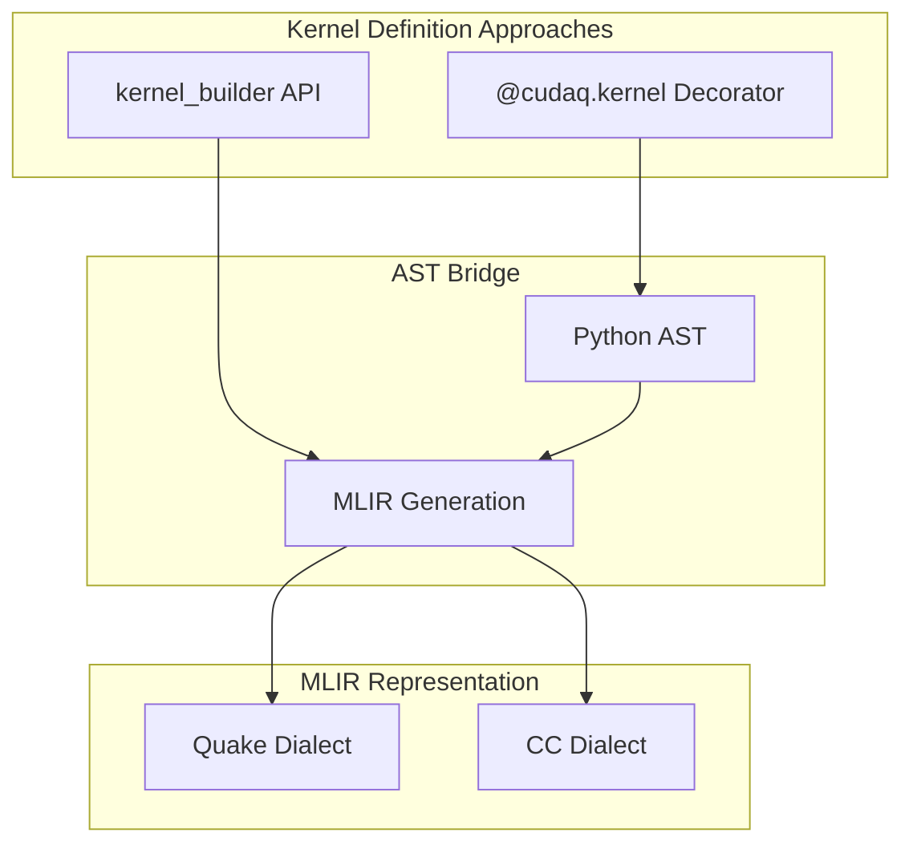
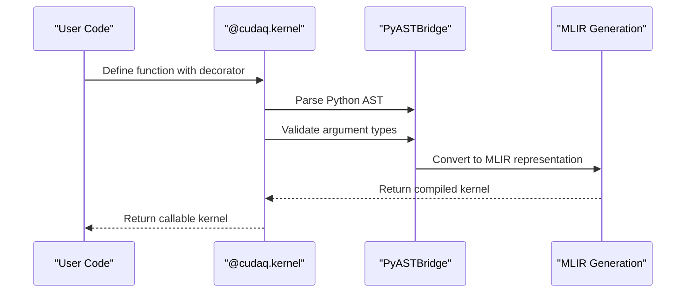
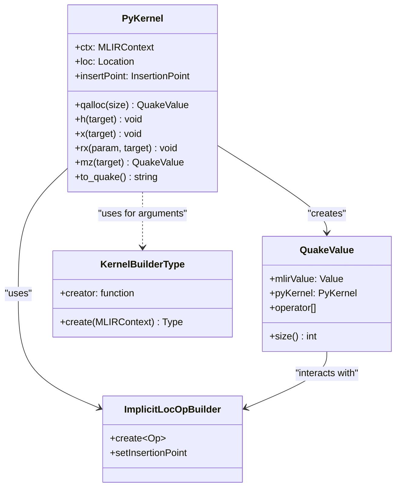
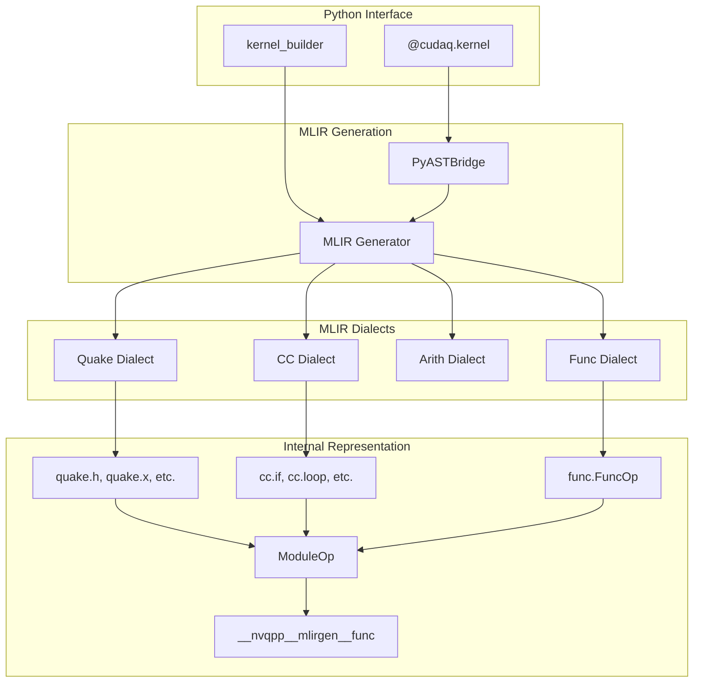

<!-- source: DeepWiki mcp.deepwiki.com · repo NVIDIA/cuda-quantum · page 3.1 Kernel Definition with @cudaq.kernel · fetched 2026-10-26 -->

# Kernel Definition

<details>
<summary>Relevant source files</summary>

The following files were used as context for generating this wiki page:

- [python/cudaq/kernel/ast_bridge.py](python/cudaq/kernel/ast_bridge.py)
- [python/cudaq/kernel/kernel_builder.py](python/cudaq/kernel/kernel_builder.py)
- [python/cudaq/kernel/kernel_decorator.py](python/cudaq/kernel/kernel_decorator.py)
- [python/cudaq/kernel/utils.py](python/cudaq/kernel/utils.py)
- [python/cudaq/runtime/sample.py](python/cudaq/runtime/sample.py)
- [python/tests/builder/test_kernel_builder.py](python/tests/builder/test_kernel_builder.py)
- [python/tests/kernel/test_control_negations.py](python/tests/kernel/test_control_negations.py)
- [python/tests/kernel/test_direct_call_return_kernel.py](python/tests/kernel/test_direct_call_return_kernel.py)
- [python/tests/kernel/test_kernel_call_return.py](python/tests/kernel/test_kernel_call_return.py)
- [python/tests/kernel/test_kernel_features.py](python/tests/kernel/test_kernel_features.py)
- [python/tests/kernel/test_run_kernel.py](python/tests/kernel/test_run_kernel.py)
- [python/tests/mlir/ast_attributes.py](python/tests/mlir/ast_attributes.py)

</details>


This page describes how quantum kernels are defined in CUDA Quantum. A quantum kernel is a function containing both classical and quantum operations that represents a quantum circuit or algorithm. CUDA Quantum provides two primary approaches for defining kernels: using a Python decorator syntax and using a builder API for programmatic construction. For information about executing quantum kernels after definition, see [Execution and Sampling](3.2).

## Overview of Kernel Definition

In CUDA Quantum, kernels encapsulate quantum circuit definitions along with classical pre-processing and control flow. They serve as the fundamental unit of quantum computation, analogous to functions in classical programming.



Sources: [python/cudaq/kernel/ast_bridge.py:112-125](), [python/cudaq/kernel/kernel_decorator.py:33-44](), [runtime/cudaq/builder/kernel_builder.h:25-32]()

## Decorator-based Kernel Definition

The `@cudaq.kernel` decorator provides a way to define quantum kernels directly using Python functions. This approach allows for a natural, imperative style of programming quantum algorithms.

### Basic Syntax

```python
@cudaq.kernel
def my_quantum_kernel(param1: type1, param2: type2):
    # Quantum operations
    q = cudaq.qvector(2)
    h(q[0])
    x.ctrl(q[0], q[1])
    # Return value (optional)
    return measurement_result
```

Key characteristics of decorator-based kernels:

1. Type annotations for parameters are **required**
2. Return type annotation is required if the kernel returns a value
3. Quantum operations are applied directly to qubits
4. Classical control flow like conditionals and loops can be used



Sources: [python/cudaq/kernel/kernel_decorator.py:33-44](), [python/cudaq/kernel/ast_bridge.py:110-125]()

### Type Annotations

All parameters in a quantum kernel must be type-annotated. CUDA Quantum supports various types:

| Type | Description | MLIR Type |
|------|-------------|-----------|
| `int`, `np.int32`, `np.int64` | Integer primitives | `IntegerType` |
| `float`, `np.float32`, `np.float64` | Floating point primitives | `F32Type`, `F64Type` |
| `bool` | Boolean values | `IntegerType(1)` |
| `List[type]`, `list[type]` | Lists of values (fixed at runtime) | `cc::StdvecType` |
| `cudaq.qubit` | Single-qubit reference | `quake::RefType` |
| `cudaq.qvector` | Vector of qubits | `quake::VeqType` |
| `cudaq.qview` | View into qubits (non-owning) | `quake::VeqType` |
| `Callable[[args], ret]` | Function type for higher-order functions | `cc::CallableType` |
| `cudaq.pauli_word` | Pauli operator string (e.g., "XYZI") | `cc::CharspanType` |
| `np.ndarray` | NumPy array | `cc::StdvecType` |

Example with type annotations:

```python
@cudaq.kernel
def ghz_state(num_qubits: int) -> bool:
    qubits = cudaq.qvector(num_qubits)
    h(qubits[0])
    for i in range(1, num_qubits):
        x.ctrl(qubits[i-1], qubits[i])
    result = mz(qubits[0])
    return result
```

Sources: [python/cudaq/kernel/utils.py:102-152](), [python/cudaq/kernel/ast_bridge.py:841-854]()

### Captured Variables

Kernels can capture variables from their enclosing scope:

```python
num_qubits = 5
angle = 0.5 * np.pi

@cudaq.kernel
def my_kernel():
    qubits = cudaq.qvector(num_qubits)  # Captures num_qubits
    h(qubits[0])
    rx(angle, qubits[1])                # Captures angle
```

When captured variables change, the kernel is recompiled automatically on the next execution.

Sources: [python/cudaq/kernel/kernel_decorator.py:166-205](), [python/tests/kernel/test_kernel_features.py:715-749]()

### Conditionals and Measurements

CUDA Quantum supports conditional execution based on measurement results:

```python
@cudaq.kernel
def teleport():
    q = cudaq.qvector(3)
    # Prepare entangled state
    h(q[1])
    x.ctrl(q[1], q[2])
    
    # Entangle with input
    x.ctrl(q[0], q[1])
    h(q[0])
    
    # Measure and conditionally operate
    b0 = mz(q[0])
    b1 = mz(q[1])
    
    if b1:
        x(q[2])
    if b0:
        z(q[2])
```

Sources: [python/tests/kernel/test_kernel_features.py:314-345](), [python/tests/mlir/ast_conditionals.py:18-94]()

### Control Flow

Kernels support standard Python control flow including:

1. `for` loops (including range-based loops)
2. `if/else` conditionals
3. Function calls (to other kernels)
4. Dynamic circuit execution (based on measurement results)

```python
@cudaq.kernel
def loop_example(count: int):
    qubits = cudaq.qvector(count)
    for i in range(count):
        h(qubits[i])
        for j in range(i+1, count):
            x.ctrl(qubits[i], qubits[j])
```

Sources: [python/tests/kernel/test_kernel_features.py:401-424](), [python/cudaq/kernel/ast_bridge.py:796-920]()

## Programmatic Kernel Building with kernel_builder

The `kernel_builder` provides a programmatic approach to creating quantum circuits, with an API that's similar to the decorator approach but allows for dynamic circuit construction.

### Creating Kernels with make_kernel

The `cudaq.make_kernel` function creates a new kernel builder:

```python
# Kernel with no parameters
kernel = cudaq.make_kernel()

# Kernel with parameters
kernel, theta, phi = cudaq.make_kernel<float, float>()
```

The kernel builder allows for incrementally building a quantum circuit:

```python
# Create a kernel with a parameter
kernel, angle = cudaq.make_kernel<float>()

# Allocate qubits
qubits = kernel.qalloc(2)

# Add quantum operations
kernel.h(qubits[0])
kernel.rx(angle, qubits[1]) 
kernel.cx(qubits[0], qubits[1])
```

Sources: [python/cudaq/kernel/kernel_builder.py:252-264](), [unittests/integration/builder_tester.cpp:17-40]()

### Kernel Builder Architecture



Sources: [python/cudaq/kernel/kernel_builder.py:252-468](), [python/cudaq/kernel/quake_value.py:18-35](), [runtime/cudaq/builder/kernel_builder.h:97-112](), [runtime/cudaq/builder/QuakeValue.h:25-35]()

### Allocating Qubits

The `qalloc` method allocates quantum registers:

```python
# Allocate a single qubit
q = kernel.qalloc()  

# Allocate a register of qubits
qreg = kernel.qalloc(n)
```

The `QuakeValue` objects returned by `qalloc` can be indexed to access individual qubits:

```python
# Access individual qubits from a register
q0 = qreg[0]
q1 = qreg[1]
```

Sources: [runtime/cudaq/builder/kernel_builder.cpp:472-486](), [python/cudaq/kernel/kernel_builder.py:254-1258]()

### Applying Quantum Operations

Kernel builders provide methods for all quantum operations supported by CUDA Quantum:

```python
# Single-qubit gates
kernel.h(q0)
kernel.x(q1)
kernel.ry(theta, q0)

# Two-qubit gates
kernel.cx(q0, q1)
kernel.swap(q0, q1)

# Multi-qubit operations
kernel.h(qreg)  # Apply to all qubits in register
```

Controlled operations are applied using template-like syntax:

```python
# Controlled operations
kernel.x.ctrl(q0, q1)  # q0 controls q1
kernel.rx.ctrl(theta, q0, q1)  # q0 controls rx(theta) on q1
```

Sources: [runtime/cudaq/builder/kernel_builder.cpp:684-765](), [python/cudaq/kernel/kernel_builder.py:99-191]()

### Measurements

Measurements return `QuakeValue` objects that represent classical measurement results:

```python
# Measure in Z basis
result = kernel.mz(q)

# Named registers for specific measurement results
result = kernel.mz(q, register_name="r1")
```

Sources: [runtime/cudaq/builder/kernel_builder.cpp:768-848](), [python/tests/kernel/test_explicit_measurements.py:28-75]()

### Control Flow with Kernel Builder

The kernel builder supports programmatic control flow:

```python
# For loops
def loop_body(idx):
    kernel.x(qreg[idx.getValue()])

kernel.for_loop(0, n, loop_body)
```

Conditional execution based on classical values is also supported:

```python
# Conditionals
def then_clause():
    kernel.x(q1)

kernel.c_if(classical_value, then_clause)
```

Sources: [runtime/cudaq/builder/kernel_builder.cpp:417-464](), [python/cudaq/kernel/kernel_builder.py:1050-1082]()

## Kernel Composition

CUDA Quantum supports kernel composition, allowing kernels to call other kernels:

```python
@cudaq.kernel
def subroutine(q: cudaq.qubit):
    h(q)
    t(q)

@cudaq.kernel
def main_kernel():
    q = cudaq.qvector(2)
    subroutine(q[0])
    x.ctrl(q[0], q[1])
```

For kernel builders, composition is achieved through the `call` method:

```python
# Define a kernel to be called
sub_kernel = cudaq.make_kernel()
sub_q = sub_kernel.qalloc()
sub_kernel.h(sub_q)

# Create main kernel and call the sub-kernel
main_kernel = cudaq.make_kernel()
q = main_kernel.qalloc(2)
main_kernel.call(sub_kernel, q[0])
main_kernel.cx(q[0], q[1])
```

Sources: [python/tests/kernel/test_kernel_features.py:347-397](), [runtime/cudaq/builder/kernel_builder.cpp:293-347]()

## Advanced Kernel Features

### Adjoint and Control Modifiers

CUDA Quantum supports applying the adjoint (inverse) of operations and kernels:

```python
@cudaq.kernel
def my_kernel(q: cudaq.qvector):
    # Apply operations
    h(q)
    t(q)
    
    # Apply adjoint of operations
    t.adj(q)
    h.adj(q)
    
    # Or apply adjoint of an entire kernel
    cudaq.adjoint(my_kernel, q)
```

With kernel builders:

```python
kernel.h(q)
kernel.t(q)
kernel.t.adj(q)
kernel.h.adj(q)
```

Control modifiers allow operations to be conditionally applied based on control qubits:

```python
@cudaq.kernel
def controlled_kernel():
    qubits = cudaq.qvector(2)
    h(qubits[0])
    # Control x on qubits[1] with qubits[0] as control
    x.ctrl(qubits[0], qubits[1])
    
    # Multiple controls
    x.ctrl([qubits[0], qubits[1]], qubits[2])
```

Sources: [python/tests/kernel/test_kernel_features.py:26-97](), [unittests/integration/builder_tester.cpp:228-326]()

### Parametric Gates

Both approaches support parametric gates that take numerical parameters:

```python
@cudaq.kernel
def rotation_kernel(theta: float, phi: float):
    q = cudaq.qvector(2)
    rx(theta, q[0])
    ry(phi, q[1])
    x.ctrl(q[0], q[1])
```

With kernel builders:

```python
kernel, theta, phi = cudaq.make_kernel<float, float>()
q = kernel.qalloc(2)
kernel.rx(theta, q[0])
kernel.ry(phi, q[1])
kernel.cx(q[0], q[1])
```

Sources: [python/tests/kernel/test_kernel_features.py:245-267](), [unittests/integration/builder_tester.cpp:40-78]()

### Pauli Evolution Gates

CUDA Quantum provides specialized support for Pauli evolution operators:

```python
@cudaq.kernel
def pauli_evolution(theta: float):
    q = cudaq.qvector(4)
    # Apply e^{-i * theta * XXXY}
    exp_pauli(theta, q, "XXXY")
```

With kernel builders:

```python
kernel, theta = cudaq.make_kernel<float>()
q = kernel.qalloc(4)
kernel.exp_pauli(theta, q, "XXXY")
```

Sources: [python/tests/kernel/test_kernel_features.py:248-268](), [runtime/cudaq/builder/kernel_builder.cpp:190-218]()

## Comparison of Approaches

| Feature | Decorator | Builder API |
|---------|-----------|-------------|
| Style | Declarative, imperative | Procedural, programmatic |
| Definition Time | At definition | Dynamic, incremental |
| Advantages | Natural syntax, Python-like | Dynamic construction, programmatic |
| Use Cases | Static circuits, algorithms | Dynamically generated circuits |
| Control Flow | Python native | Builder methods |
| Composition | Function calls | Explicit call method |

Both approaches compile to the same intermediate representation, and the choice between them depends on the specific use case and programmer preference.

Sources: [python/cudaq/kernel/ast_bridge.py:112-125](), [python/cudaq/kernel/kernel_builder.py:252-264]()

## Intermediate Representation

Both kernel definition approaches ultimately generate an MLIR representation using the Quake dialect for quantum operations and the CC dialect for classical control. This shared intermediate format allows kernels defined with either approach to be executed on the same backends.



Sources: [python/cudaq/kernel/ast_bridge.py:110-180](), [python/cudaq/kernel/ast_bridge.py:17-27](), [lib/Optimizer/Transforms/QuakeSynthesizer.cpp:377-646]()

## Summary

CUDA Quantum provides two complementary approaches to defining quantum kernels:

1. **Decorator-based kernels** use a Python-like syntax with the `@cudaq.kernel` decorator
2. **Builder-based kernels** use the `kernel_builder` API for programmatic construction

Both approaches support:
- Qubit allocation and manipulation
- Full suite of quantum gates and operations
- Classical control flow
- Measurement and conditional execution
- Kernel composition

The choice between approaches depends on the specific use case, with decorator-based kernels being more natural for static circuit definitions and builder-based kernels being more flexible for dynamic circuit generation.

---

