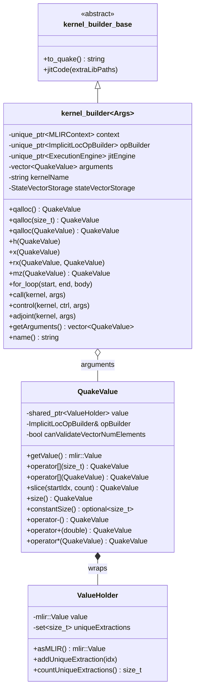
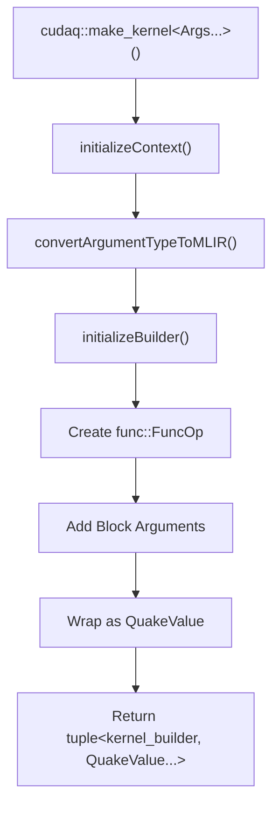
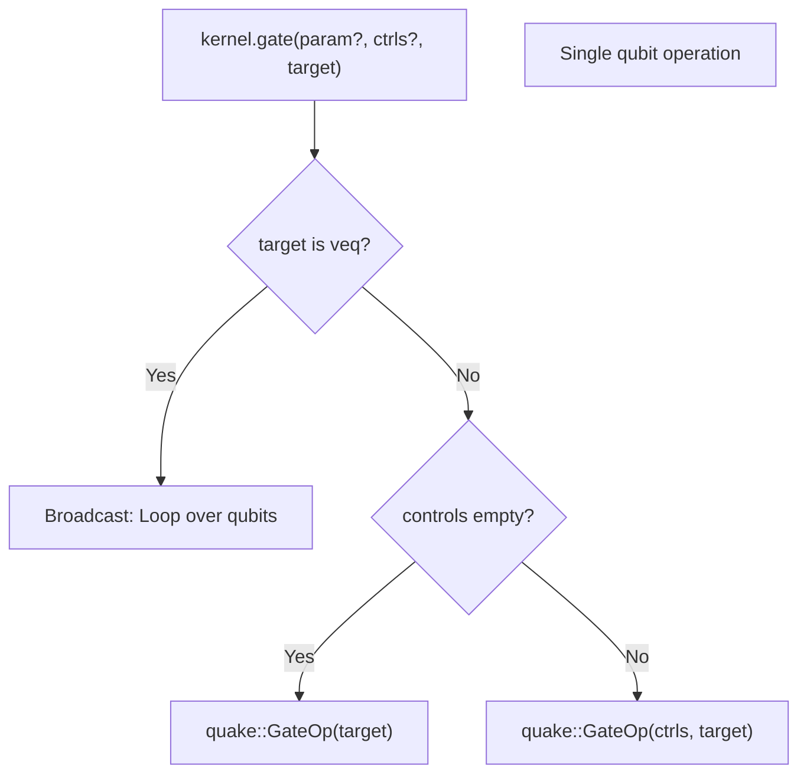
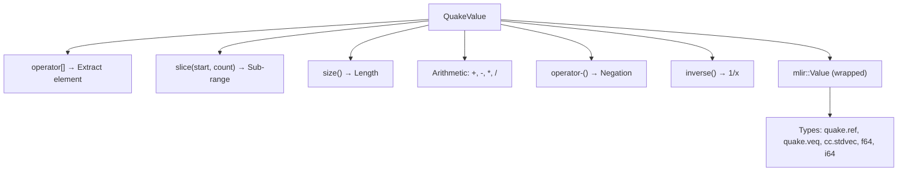
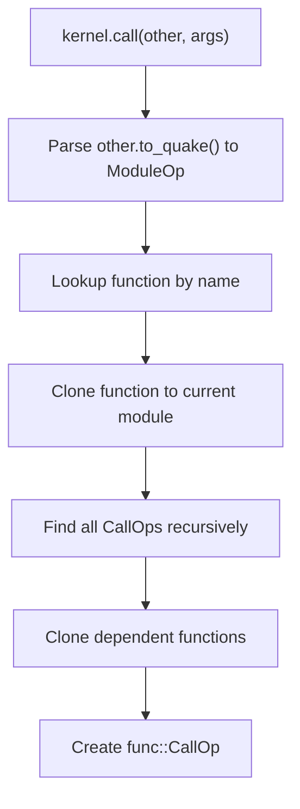
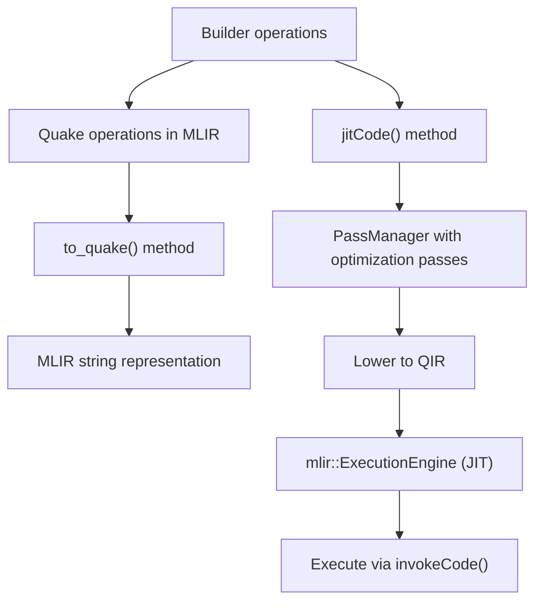

<!-- source: DeepWiki mcp.deepwiki.com · repo NVIDIA/cuda-quantum · page 3.2 Kernel Builder API · fetched 2026-10-26 -->

# Kernel Builder API

<details>
<summary>Relevant source files</summary>

The following files were used as context for generating this wiki page:

- [runtime/cudaq/builder/QuakeValue.cpp](runtime/cudaq/builder/QuakeValue.cpp)
- [runtime/cudaq/builder/QuakeValue.h](runtime/cudaq/builder/QuakeValue.h)
- [runtime/cudaq/builder/kernel_builder.cpp](runtime/cudaq/builder/kernel_builder.cpp)
- [runtime/cudaq/builder/kernel_builder.h](runtime/cudaq/builder/kernel_builder.h)
- [unittests/Optimizer/QuakeSynthTester.cpp](unittests/Optimizer/QuakeSynthTester.cpp)
- [unittests/integration/builder_tester.cpp](unittests/integration/builder_tester.cpp)

</details>


## Purpose and Scope

The Kernel Builder API provides a programmatic interface for constructing quantum kernels dynamically at runtime in C++. This API enables users to build quantum circuits imperatively using method calls rather than declaratively using the `@cudaq.kernel` decorator or `__qpu__` annotation. The builder generates MLIR Quake representation internally, which is then JIT-compiled for execution.

For declarative kernel definition in Python, see [Kernel Definition with @cudaq.kernel](#3.1). For C++ declarative kernels, see [C++ Kernel Definition](#4.1).

## Overview

The Kernel Builder API consists of two primary components:

1. **`kernel_builder`**: A template class representing a quantum kernel under construction, parameterized by its argument types
2. **`QuakeValue`**: An abstraction wrapping MLIR values that represent quantum states, classical parameters, and computation results

The API follows a fluent interface pattern where operations return `QuakeValue` instances that can be chained or stored for later use.

**Basic workflow:**
```
cudaq::make_kernel<Args...>() → kernel_builder<Args...> → 
  quantum operations → to_quake() → MLIR ModuleOp → 
  JIT compilation → execution via cudaq::sample/observe
```

Sources: [runtime/cudaq/builder/kernel_builder.h:1-100](), [runtime/cudaq/builder/kernel_builder.cpp:1-50]()

## Core Components

### kernel_builder Class Hierarchy



Sources: [runtime/cudaq/builder/kernel_builder.h:366-442](), [runtime/cudaq/builder/QuakeValue.h:25-142](), [runtime/cudaq/builder/QuakeValue.cpp:26-65]()

### Kernel Builder Type System

The builder enforces type constraints at compile-time through template metaprogramming:

| C++ Type | MLIR Type | Usage |
|----------|-----------|-------|
| `double` | `f64` | Rotation angles, classical parameters |
| `float` | `f32` | Rotation angles, classical parameters |
| `int` | `i32` | Integer parameters |
| `std::size_t` | `i64` | Sizes, indices |
| `std::vector<double>` | `!cc.stdvec<f64>` | Parameter arrays |
| `std::vector<int>` | `!cc.stdvec<i32>` | Integer arrays |
| `std::vector<std::complex<double>>` | `!cc.stdvec<complex<f64>>` | State vectors |
| `cudaq::qubit` | `!quake.ref` | Single qubit argument |
| `cudaq::qvector<>` | `!quake.veq<?>` | Quantum register argument |
| `cudaq::state*` | `!cc.ptr<!quake.state>` | State object pointer |

Sources: [runtime/cudaq/builder/kernel_builder.h:67-76](), [runtime/cudaq/builder/kernel_builder.cpp:48-131]()

## Creating Kernels with make_kernel

### Kernel Creation Flow



### Syntax Variants

**No-argument kernel:**
```cpp
auto kernel = cudaq::make_kernel();
```

**Single parameter kernel:**
```cpp
auto [kernel, theta] = cudaq::make_kernel<double>();
```

**Multiple parameter kernel:**
```cpp
auto [kernel, theta, phi, nQubits] = 
    cudaq::make_kernel<double, double, int>();
```

**Structured binding access:**
```cpp
auto ret = cudaq::make_kernel<double>();
auto& kernel = ret.get<0>();
auto& theta = ret.get<1>();
```

The `make_kernel()` function returns:
- A `kernel_builder<Args...>` instance
- `QuakeValue` handles for each argument (as tuple elements)

Sources: [runtime/cudaq/builder/kernel_builder.h:433-442](), [runtime/cudaq/builder/kernel_builder.cpp:133-183](), [unittests/integration/builder_tester.cpp:24-53]()

## Qubit Allocation

### Allocation Methods

The `qalloc()` method allocates quantum resources and returns `QuakeValue` handles:

| Method | Return Type | MLIR Operation |
|--------|-------------|----------------|
| `qalloc()` | Single qubit | `quake::AllocaOp` → `!quake.ref` |
| `qalloc(n)` | Fixed-size register | `quake::AllocaOp` → `!quake.veq<n>` |
| `qalloc(QuakeValue)` | Dynamic-size register | `quake::AllocaOp` → `!quake.veq<?>` |
| `qalloc(std::vector<complex<T>>&)` | State-initialized register | `quake::AllocaOp` + `quake::InitializeStateOp` |
| `qalloc(cudaq::state&)` | State object register | `quake::AllocaOp` + `quake::InitializeStateOp` |

**State initialization flow:**


**Implementation details:**

When allocating with state vectors, the builder:
1. Stores a pointer to the user's vector in `StateVectorStorage`
2. Generates runtime callbacks (`__nvqpp_getStateVectorLength_fp64`, `__nvqpp_getStateVectorData_fp64`)
3. Creates constant ops with storage pointer and index
4. Calls runtime to retrieve size → allocates qubits
5. Calls runtime to retrieve data pointer → initializes state

Sources: [runtime/cudaq/builder/kernel_builder.h:461-500](), [runtime/cudaq/builder/kernel_builder.cpp:482-669]()

## Quantum Operations

### Single-Qubit Gates

The builder provides methods for standard quantum gates:

**Non-parameterized gates:**
```cpp
kernel.h(qubit);    // Hadamard
kernel.x(qubit);    // Pauli-X
kernel.y(qubit);    // Pauli-Y
kernel.z(qubit);    // Pauli-Z
kernel.s(qubit);    // S gate
kernel.t(qubit);    // T gate
```

**Parameterized rotations:**
```cpp
kernel.rx(angle, qubit);    // Rotation around X
kernel.ry(angle, qubit);    // Rotation around Y
kernel.rz(angle, qubit);    // Rotation around Z
kernel.r1(angle, qubit);    // Phase rotation
```

**U3 gate (three parameters):**
```cpp
kernel.u3(theta, phi, lambda, qubit);
```

### Gate Operation Patterns



**Broadcasting over registers:**

When a gate is applied to a `veq` (quantum register), it broadcasts automatically:
```cpp
auto qubits = kernel.qalloc(5);
kernel.h(qubits);  // Applies H to all 5 qubits
```

Implementation uses `handleOneQubitBroadcast()` which creates an invariant loop.

Sources: [runtime/cudaq/builder/kernel_builder.h:511-634](), [runtime/cudaq/builder/kernel_builder.cpp:678-768]()

### Control Modifiers

**Single control:**
```cpp
kernel.x<cudaq::ctrl>(control, target);
```

**Multiple controls (vector):**
```cpp
std::vector<QuakeValue> ctrls{q0, q1, q2};
kernel.x<cudaq::ctrl>(ctrls, target);
```

**Multiple controls (variadic):**
```cpp
kernel.x<cudaq::ctrl>(q0, q1, q2, target);
```

**Adjoint modifier:**
```cpp
kernel.t<cudaq::adj>(qubit);        // T-dagger
kernel.rx<cudaq::adj>(angle, qubit); // Rx(-angle)
```

**Combined modifiers:**
```cpp
kernel.u3<cudaq::ctrl>(theta, phi, lambda, control, target);
kernel.u3<cudaq::adj>(theta, phi, lambda, qubit);
```

Sources: [runtime/cudaq/builder/kernel_builder.h:527-553](), [unittests/integration/builder_tester.cpp:148-224]()

## Measurements and Results

### Measurement Operations

| Method | Basis | Return Type |
|--------|-------|-------------|
| `mz(qubit)` | Z-basis | `QuakeValue` (single bit) |
| `mz(qvec)` | Z-basis | `QuakeValue` (bit vector) |
| `mx(qubit, regName?)` | X-basis | `QuakeValue` (single bit) |
| `my(qubit, regName?)` | Y-basis | `QuakeValue` (single bit) |

**Measurement flow:**


**Register naming:**

Measurements can optionally specify a register name for result organization:
```cpp
auto result = kernel.mz(qubit, "myRegister");
```

If no name is provided, the implementation auto-generates names like `"auto_register_0"`.

Sources: [runtime/cudaq/builder/kernel_builder.h:636-642](), [runtime/cudaq/builder/kernel_builder.cpp:770-818]()

### Reset Operation

```cpp
kernel.reset(qubit);     // Reset single qubit
kernel.reset(qvec);      // Reset all qubits in register
```

Generates `quake::ResetOp` which projects qubits to |0⟩.

Sources: [runtime/cudaq/builder/kernel_builder.cpp:820-822](), [unittests/integration/builder_tester.cpp:930-966]()

## QuakeValue Abstraction

### QuakeValue Operations and Type System



### Subscripting and Slicing

**Extract single elements:**
```cpp
auto qubits = kernel.qalloc(5);
auto q0 = qubits[0];           // Extract first qubit
auto q3 = qubits[3];           // Extract fourth qubit

auto [kernel, params] = cudaq::make_kernel<std::vector<double>>();
auto theta = params[0];        // Extract first parameter
auto phi = params[1];          // Extract second parameter
```

**Dynamic indexing:**
```cpp
kernel.for_loop(0, 5, [&](QuakeValue& i) {
    auto q_i = qubits[i];      // Extract qubit at index i
    kernel.h(q_i);
});
```

**Slicing:**
```cpp
auto qubits = kernel.qalloc(10);
auto subset = qubits.slice(2, 5);  // Elements [2, 3, 4, 5, 6]
kernel.h(subset);                  // Apply to sub-range
```

### QuakeValue Validation

For `std::vector<T>` arguments, the builder tracks unique extractions to validate input size:

```cpp
auto [kernel, params] = cudaq::make_kernel<std::vector<double>>();
auto theta = params[0];
auto phi = params[1];
// Builder records: minimum 2 elements required

kernel(std::vector<double>{1.0});        // Runtime error!
kernel(std::vector<double>{1.0, 2.0});   // OK
```

This validation uses `QuakeValue::ValueHolder::uniqueExtractions` set.

Sources: [runtime/cudaq/builder/QuakeValue.h:75-104](), [runtime/cudaq/builder/QuakeValue.cpp:102-262](), [unittests/integration/builder_tester.cpp:742-781]()

### Arithmetic on QuakeValues

QuakeValue supports algebraic operations for classical computation within kernels:

```cpp
auto [kernel, x] = cudaq::make_kernel<double>();
auto y = x * 2.0;              // Multiply by constant
auto z = x + y;                // Add two QuakeValues
auto w = -x;                   // Negate
auto inv = x.inverse();        // 1/x

kernel.rx(y, qubit);           // Use computed value
```

**Generated operations:**
- `operator+` → `arith::AddFOp` or `arith::AddIOp`
- `operator-` → `arith::SubFOp` or `arith::SubIOp`
- `operator*` → `arith::MulFOp`
- `operator/` → `arith::DivFOp`
- `operator-()` → `arith::NegFOp`

Sources: [runtime/cudaq/builder/QuakeValue.cpp:266-406](), [runtime/cudaq/builder/QuakeValue.h:106-168]()

## Classical Control Flow

### Conditional Execution

```cpp
auto result = kernel.mz(qubit);
kernel.c_if(result, [&]() {
    kernel.x(target);    // Execute if measurement is 1
});
```

**Generated MLIR structure:**
```
cc::IfOp (condition = result) {
  ^body:
    quake.x target
    cc.continue
}
```

The lambda body becomes the `then` region of `cc::IfOp`.

Sources: [runtime/cudaq/builder/kernel_builder.cpp:844-866](), [unittests/integration/builder_tester.cpp:660-701]()

### For Loops

The builder provides `for_loop()` with various overloads:

**Concrete bounds:**
```cpp
kernel.for_loop(0, 5, [&](QuakeValue& i) {
    kernel.h(qubits[i]);
});
```

**Mixed concrete/QuakeValue bounds:**
```cpp
auto [kernel, n] = cudaq::make_kernel<int>();
kernel.for_loop(0, n, [&](QuakeValue& i) {
    // Loop from 0 to n-1
});
```

**QuakeValue bounds:**
```cpp
auto size = qubits.size();
kernel.for_loop(0, size, [&](QuakeValue& i) {
    // Loop over all qubits
});
```

**Implementation:**

Uses `cudaq::opt::factory::createInvariantLoop()` which generates:
```
cc::LoopOp {
  ^body(%i: i64):
    // Loop body operations
    cc.continue
}
```

Sources: [runtime/cudaq/builder/kernel_builder.h:678-709](), [runtime/cudaq/builder/kernel_builder.cpp:427-474](), [unittests/integration/builder_tester.cpp:970-1044]()

## Kernel Composition

### Calling Other Kernels

```cpp
auto [sub_kernel, qubit] = cudaq::make_kernel<cudaq::qubit>();
sub_kernel.h(qubit);
sub_kernel.t(qubit);

auto main_kernel = cudaq::make_kernel();
auto q = main_kernel.qalloc();
main_kernel.call(sub_kernel, q);
```

**Implementation process:**



The `call()` implementation:
1. Parses the callee's Quake code to MLIR
2. Finds the function in the parsed module
3. Clones it into the current module
4. Recursively finds and clones all dependent functions
5. Creates a `func::CallOp` linking to the cloned function

Sources: [runtime/cudaq/builder/kernel_builder.h:711-720](), [runtime/cudaq/builder/kernel_builder.cpp:219-346]()

### Controlled Kernels

```cpp
auto [u_prep, q] = cudaq::make_kernel<cudaq::qubit>();
u_prep.h(q);
u_prep.s(q);

auto main = cudaq::make_kernel();
auto ctrl = main.qalloc();
auto tgt = main.qalloc();
main.x(ctrl);                        // Prepare control
main.control(u_prep, ctrl, tgt);     // Apply controlled-U
```

**Multiple controls:**
```cpp
std::vector<QuakeValue> controls{q0, q1, q2};
main.control(u_prep, controls, target);
```

Generates `quake::ApplyOp` with control qubits:
```
quake.apply @__nvqpp__mlirgen__u_prep [%ctrl] %tgt : (!quake.ref, !quake.ref) -> ()
```

Sources: [runtime/cudaq/builder/kernel_builder.h:722-738](), [runtime/cudaq/builder/kernel_builder.cpp:348-419](), [unittests/integration/builder_tester.cpp:794-874]()

### Adjoint Kernels

```cpp
auto [prep, qubit] = cudaq::make_kernel<cudaq::qubit>();
prep.h(qubit);
prep.t(qubit);
prep.s(qubit);

auto main = cudaq::make_kernel();
auto q = main.qalloc();
main.call(prep, q);
main.adjoint(prep, q);    // Apply prep†
```

Generates `quake::ApplyOp` with `is_adj` attribute:
```
quake.apply<adj> @__nvqpp__mlirgen__prep %q : (!quake.ref) -> ()
```

Sources: [runtime/cudaq/builder/kernel_builder.h:740-744](), [runtime/cudaq/builder/kernel_builder.cpp:421-425](), [unittests/integration/builder_tester.cpp:905-924]()

## MLIR Generation and Compilation

### MLIR Code Generation Flow



### Getting MLIR Representation

```cpp
auto kernel = cudaq::make_kernel();
auto q = kernel.qalloc(2);
kernel.h(q[0]);
kernel.x<cudaq::ctrl>(q[0], q[1]);

std::string quake = kernel.to_quake();
std::cout << quake << std::endl;
```

Output example:
```mlir
module {
  func.func @__nvqpp__mlirgen____nvqppBuilderKernel_123456() {
    %0 = quake.alloca !quake.veq<2>
    %1 = quake.extract_ref %0[0] : (!quake.veq<2>) -> !quake.ref
    quake.h %1 : (!quake.ref) -> ()
    %2 = quake.extract_ref %0[1] : (!quake.veq<2>) -> !quake.ref
    quake.x [%1] %2 : (!quake.ref, !quake.ref) -> ()
    return
  }
}
```

Sources: [runtime/cudaq/builder/kernel_builder.h:746-749](), [runtime/cudaq/builder/kernel_builder.cpp:1027-1035]()

### JIT Compilation Process

When a kernel is invoked via `cudaq::sample()` or `cudaq::observe()`:

1. **Hash calculation**: Compute hash of current MLIR module
2. **Cache check**: Reuse `ExecutionEngine` if hash matches
3. **Apply passes**: Run optimization and lowering passes
4. **Translate to LLVM**: Convert MLIR to LLVM IR
5. **JIT compile**: Create `mlir::ExecutionEngine`
6. **Cache result**: Store engine with hash

**Pass pipeline** (from `jitCode()`):
- `UnwindLoweringPass`
- `ExpandMeasurementsPass`
- `ClassicalMemToReg`
- `Canonicalizer`
- `LoopUnroll`
- `QuakeAddDeallocs`
- `LowerToCFG`
- `CombineQuantumAllocations`
- `ConvertToQIR`
- LLVM translation

Sources: [runtime/cudaq/builder/kernel_builder.cpp:913-1025](), [runtime/cudaq/builder/kernel_builder.h:400-410]()

### Argument Packing and Invocation

When calling `kernel(args...)`:


**Validation**: For `std::vector<T>` arguments, checks size against required elements
**Packing**: Creates array of void pointers to arguments
**Execution**: Calls `altLaunchKernel()` which dispatches to platform

Sources: [runtime/cudaq/builder/kernel_builder.h:761-835](), [runtime/cudaq/builder/kernel_builder.cpp:1037-1081](), [runtime/cudaq/builder/kernel_builder.h:320-353]()

## Advanced Features

### Multi-Controlled Operations

The builder supports arbitrary multi-controlled gates:

```cpp
auto kernel = cudaq::make_kernel();
auto ctrls = kernel.qalloc(5);
auto target = kernel.qalloc();

kernel.x(ctrls);  // Prepare controls in |1...1⟩

// C^5-X gate
kernel.x<cudaq::ctrl>(ctrls, target);
```

Can also use vectors of individual qubits:
```cpp
std::vector<QuakeValue> ctrl_vec{q0, q1, q2};
kernel.x<cudaq::ctrl>(ctrl_vec, target);
```

Sources: [unittests/integration/builder_tester.cpp:562-653]()

### Exponential Pauli Operations

```cpp
auto [kernel, theta] = cudaq::make_kernel<double>();
auto qubits = kernel.qalloc(3);
kernel.exp_pauli(theta, qubits, "XYZ");
```

Generates `quake::ExpPauliOp` which implements e^{-iθ P} where P is the Pauli word.

**Implementation**: Concatenates qubits if provided separately, validates types, creates operation.

Sources: [runtime/cudaq/builder/kernel_builder.cpp:190-217]()

### SWAP Operations

```cpp
kernel.swap(q0, q1);                      // Basic swap
kernel.swap<cudaq::ctrl>(ctrl, q0, q1);   // Controlled swap (Fredkin gate)
```

Multi-controlled SWAP:
```cpp
auto ctrls = kernel.qalloc(3);
kernel.x(ctrls);  // Prepare controls
kernel.swap<cudaq::ctrl>(ctrls, q0, q1);
```

Sources: [runtime/cudaq/builder/kernel_builder.cpp:824-834](), [unittests/integration/builder_tester.cpp:511-654]()

### State Vector Initialization

The builder supports initializing qubits from state vectors:

```cpp
auto [kernel, state_vec] = 
    cudaq::make_kernel<std::vector<std::complex<double>>>();
auto qubits = kernel.qalloc(state_vec);  // Size determined at runtime
kernel.h(qubits);
```

**Runtime mechanism:**
1. State vector stored in `StateVectorStorage` (vector of variant pointers)
2. Runtime callbacks retrieve size: `__nvqpp_getStateVectorLength_fp64()`
3. Runtime callbacks retrieve data: `__nvqpp_getStateVectorData_fp64()`
4. `quake::AllocaOp` uses computed size
5. `quake::InitializeStateOp` uses data pointer

Supports both `float` and `double` precision via separate callbacks.

Sources: [runtime/cudaq/builder/kernel_builder.cpp:544-669](), [runtime/cudaq/builder/kernel_builder.h:484-494]()

## Integration with CUDA-Q Algorithms

### Usage with cudaq::sample

```cpp
auto kernel = cudaq::make_kernel();
auto q = kernel.qalloc(3);
kernel.h(q[0]);
for (int i = 0; i < 2; i++)
    kernel.x<cudaq::ctrl>(q[i], q[i+1]);
kernel.mz(q);

auto counts = cudaq::sample(kernel);
counts.dump();  // Should see |000⟩ and |111⟩
```

Sources: [unittests/integration/builder_tester.cpp:114-132]()

### Usage with cudaq::observe

```cpp
auto [kernel, theta] = cudaq::make_kernel<double>();
auto q = kernel.qalloc(2);
kernel.x(q[0]);
kernel.ry(theta, q[1]);
kernel.x<cudaq::ctrl>(q[1], q[0]);

cudaq::spin_op h = 5.907 - 2.1433 * cudaq::spin_op::x(0) * cudaq::spin_op::x(1);
double energy = cudaq::observe(kernel, h, 0.59);
```

Sources: [unittests/integration/builder_tester.cpp:18-40]()

### Usage with VQE

```cpp
auto [ansatz, thetas] = cudaq::make_kernel<std::vector<double>>();
auto q = ansatz.qalloc(3);
ansatz.x(q[0]);
ansatz.ry(thetas[0], q[1]);
ansatz.ry(thetas[1], q[2]);
// ... build ansatz

cudaq::spin_op hamiltonian = /* ... */;
cudaq::gradients::central_difference gradient(ansatz);
cudaq::optimizers::lbfgs optimizer;
optimizer.initial_parameters = {0.359, 0.257};

auto [opt_val, opt_params] = 
    cudaq::vqe(ansatz, gradient, hamiltonian, optimizer, 2);
```

Sources: [unittests/integration/builder_tester.cpp:80-112]()

## Kernel Name Management

### Name Generation

Each kernel gets a unique name:
```
__nvqpp__mlirgen____nvqppBuilderKernel_<12-digit-random>
```

The random suffix ensures uniqueness when multiple kernels exist simultaneously.

**Accessing the name:**
```cpp
std::string name = kernel.name();  // Returns without prefix/suffix
```

The `name()` method strips the `__nvqpp__mlirgen__` prefix and any `.` suffix added during compilation.

Sources: [runtime/cudaq/builder/kernel_builder.cpp:157-166](), [runtime/cudaq/builder/kernel_builder.cpp:869-877]()

### Entry Point Tagging

The builder tags the generated function with attributes:
- `cudaq.kernel`: Marks it as a quantum kernel
- `cudaq.entrypoint`: Marks it as the entry point (if no qubit arguments)

This happens in `tagEntryPoint()` which walks the module and sets attributes.

Sources: [runtime/cudaq/builder/kernel_builder.cpp:897-911]()

## Memory and Lifetime Considerations

### State Vector Captures

When using `qalloc(state_vec)`, the builder captures by reference:

```cpp
std::vector<std::complex<double>> state = {1.0, 0.0, 0.0, 0.0};
auto kernel = cudaq::make_kernel();
auto qubits = kernel.qalloc(state);  // Captures &state
// state must remain valid until kernel execution!
```

**Important**: The state vector must remain in scope until the kernel executes. The builder does not copy the data.

Sources: [runtime/cudaq/builder/kernel_builder.h:476-494]()

### MLIR Context Lifecycle

The `kernel_builder` owns:
- `std::unique_ptr<mlir::MLIRContext>`: Created once per builder
- `std::unique_ptr<mlir::ImplicitLocOpBuilder>`: Builds MLIR operations
- `std::unique_ptr<mlir::ExecutionEngine>`: JIT compiled code (cached)

These are automatically cleaned up when the builder goes out of scope.

Sources: [runtime/cudaq/builder/kernel_builder.h:392-405]()

## Type Validation and Error Handling

### Compile-Time Type Checking

Template constraints enforce valid argument types:

```cpp
// CUDAQ_VALID_BUILDER_ARGS_FOLD ensures only supported types
auto [kernel, x] = cudaq::make_kernel<double>();           // OK
auto [kernel, x] = cudaq::make_kernel<std::string>();      // Compile error!
```

Supported types are defined in the fold expression macro.

Sources: [runtime/cudaq/builder/kernel_builder.h:62-76]()

### Runtime Validation

**Vector size validation:**
```cpp
auto [kernel, params] = cudaq::make_kernel<std::vector<double>>();
kernel.rx(params[0], q);
kernel.ry(params[1], q);
// Requires at least 2 elements

kernel(std::vector<double>{1.0});        // Throws runtime_error
kernel(std::vector<double>{1.0, 2.0});   // OK
kernel(std::vector<double>{1.0, 2.0, 3.0});  // OK (extra ignored)
```

**Type mismatch validation:**
```cpp
auto [k1, qubit_arg] = cudaq::make_kernel<cudaq::qubit>();
auto k2 = cudaq::make_kernel();
auto qvec = k2.qalloc(5);
k2.call(k1, qvec);  // Runtime error: veq<5> != ref
```

Sources: [runtime/cudaq/builder/kernel_builder.h:320-353](), [runtime/cudaq/builder/kernel_builder.cpp:318-342]()

## Summary

The Kernel Builder API provides a powerful C++ interface for programmatic quantum kernel construction with:

- **Type-safe API**: Template-based compile-time type checking
- **Fluent interface**: Natural method chaining with `QuakeValue`
- **Full quantum gate set**: All standard gates plus custom operations
- **Classical control**: Conditionals and loops
- **Kernel composition**: Call, control, and adjoint modifiers
- **MLIR integration**: Direct generation of Quake dialect
- **JIT compilation**: Efficient runtime compilation and caching
- **CUDA-Q integration**: Seamless use with sampling and VQE algorithms

Sources: [runtime/cudaq/builder/kernel_builder.h](), [runtime/cudaq/builder/kernel_builder.cpp](), [runtime/cudaq/builder/QuakeValue.h](), [runtime/cudaq/builder/QuakeValue.cpp]()

---

