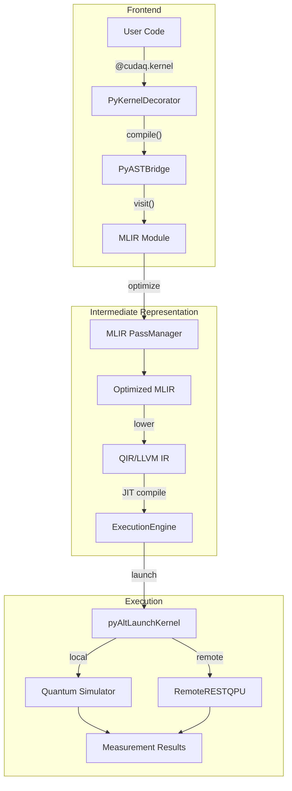
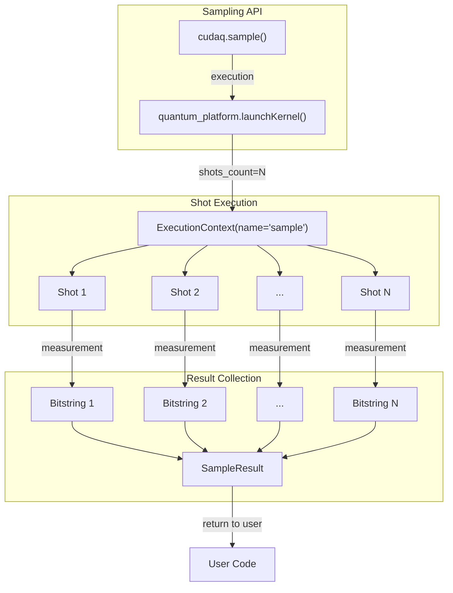
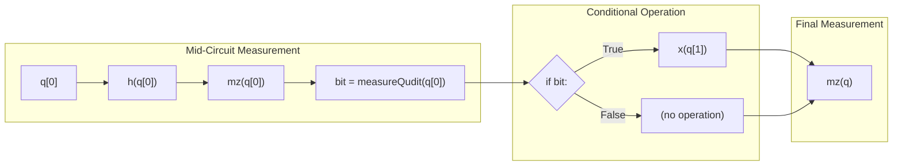
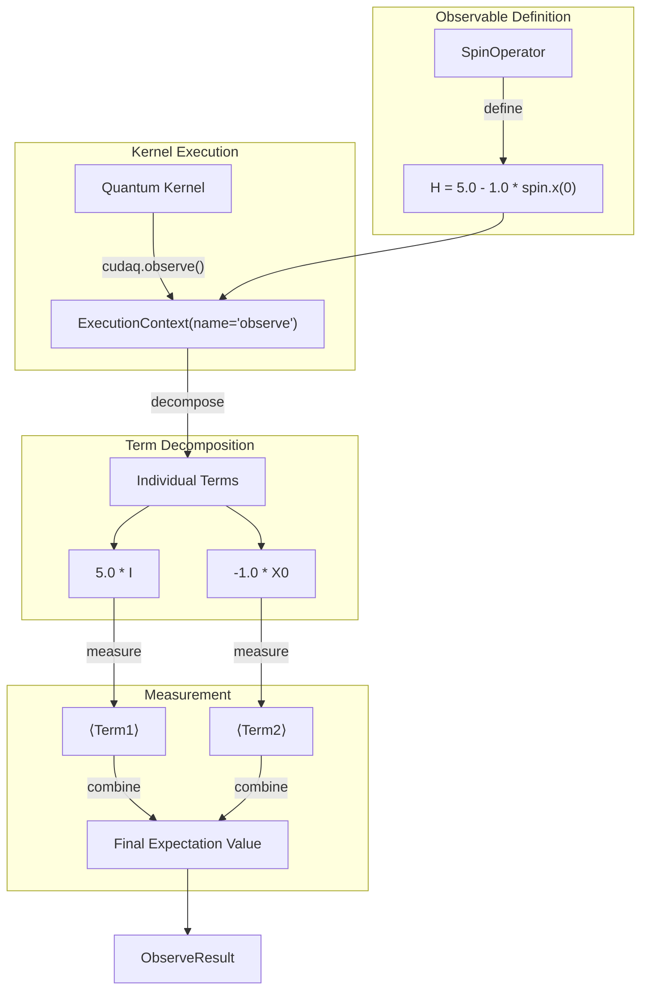
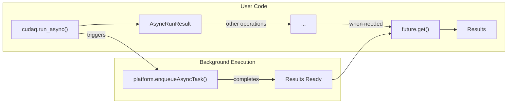
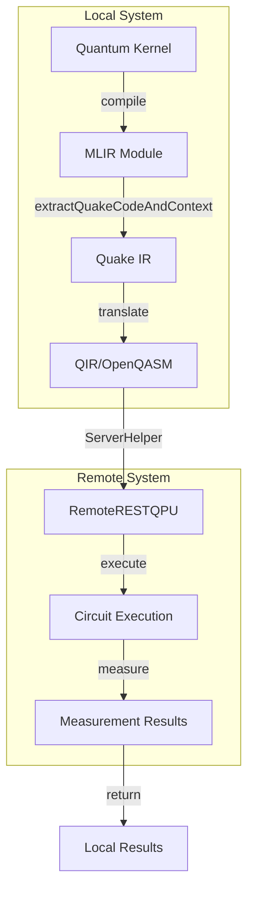
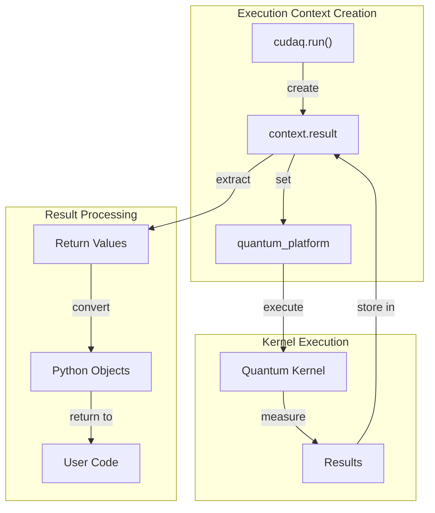

<!-- source: DeepWiki mcp.deepwiki.com · repo NVIDIA/cuda-quantum · page 3.3 Execution and Sampling · fetched 2026-10-26 -->

# Execution and Sampling

<details>
<summary>Relevant source files</summary>

The following files were used as context for generating this wiki page:

- [python/cudaq/kernel/ast_bridge.py](python/cudaq/kernel/ast_bridge.py)
- [python/cudaq/kernel/kernel_builder.py](python/cudaq/kernel/kernel_builder.py)
- [python/cudaq/kernel/kernel_decorator.py](python/cudaq/kernel/kernel_decorator.py)
- [python/cudaq/kernel/utils.py](python/cudaq/kernel/utils.py)
- [python/cudaq/runtime/sample.py](python/cudaq/runtime/sample.py)
- [python/tests/builder/test_kernel_builder.py](python/tests/builder/test_kernel_builder.py)
- [python/tests/kernel/test_control_negations.py](python/tests/kernel/test_control_negations.py)
- [python/tests/kernel/test_direct_call_return_kernel.py](python/tests/kernel/test_direct_call_return_kernel.py)
- [python/tests/kernel/test_kernel_call_return.py](python/tests/kernel/test_kernel_call_return.py)
- [python/tests/kernel/test_kernel_features.py](python/tests/kernel/test_kernel_features.py)
- [python/tests/kernel/test_run_kernel.py](python/tests/kernel/test_run_kernel.py)
- [python/tests/mlir/ast_attributes.py](python/tests/mlir/ast_attributes.py)

</details>


This page documents how quantum kernels are executed and how measurement results are sampled in CUDA-Q. It explains the internal mechanisms that transform a quantum kernel from its high-level representation to execution on quantum backends, and how measurement results are collected and processed.

For information about defining quantum kernels, see [Kernel Definition](#3.1).

## Execution Pipeline

When a quantum kernel is executed in CUDA-Q, it goes through a multi-stage pipeline that transforms it from its high-level representation (Python or C++) to a form that can be executed on quantum hardware or simulators.

### Kernel Execution Flow



Sources:
- [python/runtime/cudaq/algorithms/py_run.cpp:108-139]()
- [python/cudaq/platform/py_alt_launch_kernel.cpp:70-245]()
- [runtime/cudaq/platform/default/rest/RemoteRESTQPU.cpp:29-54]()

### Key Components

The execution pipeline consists of several key components that work together to transform and execute quantum kernels:

#### Frontend Components

| Component | Description | Key Functions |
|-----------|-------------|--------------|
| **PyKernelDecorator** | Implements the `@cudaq.kernel` decorator | Analyzes AST, compiles to MLIR, manages variables |
| **PyASTBridge** | Converts Python AST to MLIR | Translates to Quake dialect, handles control flow |
| **MLIR Module** | Intermediate representation | Represents quantum and classical operations |

#### Execution Components

| Component | Description | Key Functions |
|-----------|-------------|--------------|
| **pyAltLaunchKernel** | Kernel launcher | JIT-compiles MLIR, sets up arguments, executes kernel |
| **ExecutionManager** | Manages quantum execution | Applies quantum operations, handles measurements |
| **RemoteRESTQPU** | Remote execution interface | Enables execution on remote quantum hardware |
| **quantum_platform** | Platform abstraction | Provides unified interface to different backends |

The `pyRunTheKernel` function in [python/runtime/cudaq/algorithms/py_run.cpp:62-94]() is the central function that coordinates the execution of quantum kernels. It:

1. Validates the kernel's return type
2. Prepares the arguments and execution environment
3. Launches the kernel on the appropriate backend
4. Collects and processes the measurement results

Sources:
- [python/runtime/cudaq/algorithms/py_run.cpp:62-94]()
- [runtime/cudaq/platform/default/rest/RemoteRESTQPU.cpp:29-54]()
- [runtime/common/RuntimeMLIR.cpp:75-94]()

## Sampling Mechanism

Sampling in CUDA-Q involves executing a quantum kernel multiple times (shots) and collecting the measurement results to build a statistical distribution. The `cudaq.sample()` function is the primary API for this purpose.

### Sampling Flow



The sampling process is implemented in the `quantum_platform` class, which coordinates the execution of quantum kernels and collection of measurement results. The `ExecutionContext` is a key component that manages the state of the execution and stores the results.

Sources:
- [python/tests/kernel/test_run_kernel.py:55-67]()
- [runtime/cudaq/qis/managers/photonics/PhotonicsExecutionManager.cpp:173-197]()

### The `sample` Function

The `cudaq.sample()` function is the primary API for executing quantum kernels and collecting measurement results:

```python
result = cudaq.sample(kernel, *args, shots_count=1000, noise_model=None)
```

Key parameters:
- `kernel`: The quantum kernel to execute
- `*args`: Arguments to pass to the kernel
- `shots_count`: Number of shots (executions) to run (default: 1000)
- `noise_model`: Optional noise model to apply during simulation

The function returns a `SampleResult` object containing the measurement statistics. Internally, it creates an execution context with the name "sample" and configures it with the specified number of shots.

The implementation of `sample` involves:
1. Validating the kernel and its arguments
2. Setting up the execution context
3. Launching the kernel on the quantum platform
4. Processing the measurement results

Sources:
- [python/tests/kernel/test_run_kernel.py:55-67]()
- [python/tests/kernel/test_run_kernel.py:70-87]()

### The `SampleResult` Class

The `SampleResult` class represents the results of sampling a quantum kernel. It provides methods for accessing and analyzing measurement results:

| Method | Purpose |
|--------|---------|
| `__getitem__(bitstring)` | Access counts for a specific bitstring |
| `__len__()` | Get the number of unique bitstrings |
| `__iter__()` | Iterate over bitstrings |
| `dump()` | Print the results |
| `get_register_counts(register_name)` | Get counts for a specific register |
| `get_sequential_data()` | Get sequential measurement data |

Example usage:
```python
result = cudaq.sample(kernel)
print(result["00"])  # Print count for "00" bitstring
print(len(result))   # Print number of unique bitstrings
result.dump()        # Print all results
```

The `SampleResult` is populated by the execution manager, which collects measurement results during kernel execution. For example, in the `PhotonicsExecutionManager`, measurement results are collected in the `handleExecutionContextEnded` method and stored in the execution context's result field.

Sources:
- [python/tests/kernel/test_run_kernel.py:55-67]()
- [runtime/cudaq/qis/managers/photonics/PhotonicsExecutionManager.cpp:173-197]()

## Mid-Circuit Measurements and Conditional Operations

CUDA-Q supports mid-circuit measurements, which allow for measuring qubits during circuit execution and conditionally applying operations based on measurement results.

### Conditional Execution Flow



Example:
```python
@cudaq.kernel
def conditional_circuit():
    q = cudaq.qvector(2)
    h(q[0])
    bit = mz(q[0])
    if bit:
        x(q[1])
    mz(q)
```

Mid-circuit measurements are implemented in the execution manager through the `measureQudit` method, which performs the measurement operation and returns the result. This result can then be used in classical control flow within the kernel.

In the `PhotonicsExecutionManager`, for example, the `measureQudit` method performs a quantum measurement on the specified qudit and returns the measurement result as an integer:

```cpp
int measureQudit(const cudaq::QuditInfo &q, const std::string &registerName) override {
    // Implementation of measurement operation
    // Returns measurement result as an integer
}
```

Sources:
- [runtime/cudaq/qis/managers/photonics/PhotonicsExecutionManager.cpp:226-251]()
- [python/tests/kernel/test_kernel_call_return.py:28-46]()

## Observables and Expectation Values

CUDA-Q provides the `observe` function to measure expectation values of observables with respect to quantum states.

### Observable Measurement Flow



Example:
```python
@cudaq.kernel
def ansatz():
    q = cudaq.qvector(1)

molecule = 5.0 - 1.0 * spin.x(0)
result = cudaq.observe(ansatz, molecule, shots_count=10000)
expectation_value = result.expectation()
```

The `observe` function creates an execution context with the name "observe" and configures it with the specified observable. The execution manager then handles the measurement of the observable through its `measureSpinOp` method.

However, not all execution managers support observable measurements. For example, the `PhotonicsExecutionManager` throws an exception when `measureSpinOp` is called:

```cpp
void measureSpinOp(const cudaq::spin_op &) override {
    throw "spin_op observation (cudaq::observe()) is not supported for this photonics simulator";
}
```

Sources:
- [runtime/cudaq/qis/managers/photonics/PhotonicsExecutionManager.cpp:254-255]()
- [python/tests/kernel/test_kernel_call_return.py:28-46]()

## Asynchronous Execution

CUDA-Q provides asynchronous versions of `sample` and `observe` that return futures, allowing for non-blocking execution. The `run_async` function is the core implementation of this functionality.

### Asynchronous Execution Flow



Example:
```python
# Start asynchronous sampling
future = cudaq.run_async(kernel, *args, shots_count=100)

# Do other work while sampling happens in background
# ...

# Get results when needed
result = future.get()
```

The implementation of asynchronous execution involves:

1. Creating an `async_run_result` structure to hold the future and results
2. Releasing the Python GIL to allow C++ threads to execute
3. Creating a task that executes the kernel and sets the results
4. Enqueueing the task on the quantum platform
5. Setting up a future that will process the results when they are ready

The `AsyncRunResult` class provides a `get()` method that waits for the execution to complete and returns the results.

Sources:
- [python/runtime/cudaq/algorithms/py_run.cpp:143-244]()
- [python/tests/kernel/test_run_async_kernel.py:51-71]()

## Advanced Execution Features

### Parameter Broadcasting

CUDA-Q supports broadcasting kernel executions over multiple parameter sets:

```python
@cudaq.kernel
def circuit(theta: float):
    # ...

# Sample with multiple parameter values
thetas = [0.1, 0.2, 0.3, 0.4]
results = cudaq.sample(circuit, thetas)
```

This allows for efficient execution of the same kernel with different parameter values, which is particularly useful for variational algorithms.

### Remote Execution

CUDA-Q can execute kernels on remote quantum hardware through the `RemoteRESTQPU` class:



The `RemoteRESTQPU` class is a subtype of `QPU` that enables the execution of CUDA-Q kernels on remotely hosted quantum computing services via a REST Client/Server interaction. It handles:

1. Extracting Quake code from the kernel
2. Converting it to a format suitable for the remote backend
3. Sending the code to the remote backend for execution
4. Retrieving and processing the results

The `extractQuakeCodeAndContext` method is a key part of this process, as it extracts the Quake representation of the kernel and prepares it for translation to the target format.

Sources:
- [runtime/cudaq/platform/default/rest/RemoteRESTQPU.cpp:29-54]()
- [runtime/common/RuntimeMLIR.cpp:75-94]()

## Execution Contexts and Return Values

CUDA-Q uses execution contexts to manage the state of kernel execution and handle return values from quantum kernels.

### Execution Context Flow



The execution context is a key component in the CUDA-Q execution system. It:
- Contains configuration for the execution (shots, noise models, etc.)
- Stores intermediate results during execution
- Provides a mechanism for retrieving final results

### Return Value Processing

CUDA-Q supports returning various types of values from quantum kernels, including:
- Basic types (bool, int, float)
- NumPy types (np.int32, np.float64, etc.)
- Custom data structures (via dataclasses)

The `pyRunTheKernel` function in [python/runtime/cudaq/algorithms/py_run.cpp:62-94]() handles the execution of kernels with return values. It:
1. Validates that the kernel returns a value
2. Prepares the execution environment
3. Launches the kernel
4. Collects the return values

The `readRunResults` function in [python/runtime/cudaq/algorithms/py_run.cpp:26-37]() then converts these return values to Python objects that can be returned to the user.

Sources:
- [python/runtime/cudaq/algorithms/py_run.cpp:62-94]()
- [python/runtime/cudaq/algorithms/py_run.cpp:26-37]()
- [python/tests/kernel/test_run_kernel.py:91-142]()

## Summary

The execution and sampling system in CUDA-Q provides a flexible and powerful way to run quantum kernels and collect measurement results. Key components include:

1. **Compilation Pipeline**: Converts high-level quantum kernels to executable code
2. **Sampling API**: Provides methods for executing kernels and collecting statistics
3. **Observe API**: Supports measurement of quantum observables and expectation values
4. **Mid-Circuit Measurements**: Enables conditional quantum operations
5. **Asynchronous Execution**: Allows for non-blocking quantum computation
6. **Remote Execution**: Supports execution on remote quantum hardware

Understanding this system enables effective use of CUDA-Q for quantum algorithms and applications.

Sources:
- [python/cudaq/kernel/kernel_decorator.py]()
- [python/cudaq/kernel/ast_bridge.py]()
- [python/cudaq/runtime/sample.py]()
- [python/cudaq/platform/py_alt_launch_kernel.cpp]()
- [runtime/common/BaseRemoteRESTQPU.h]()

---

