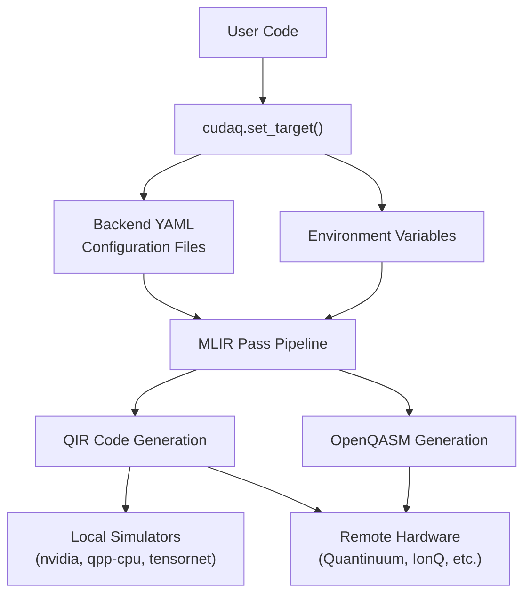
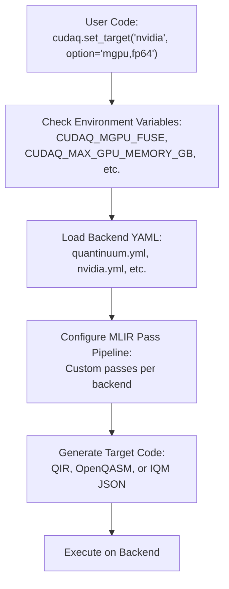
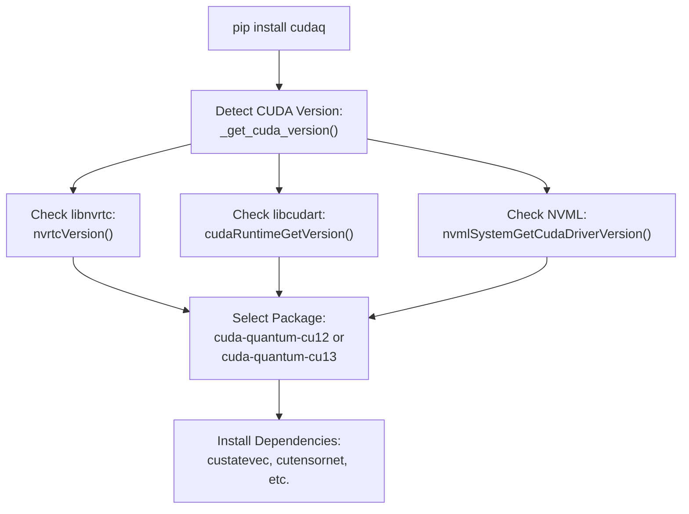

<!-- source: DeepWiki mcp.deepwiki.com · repo NVIDIA/cuda-quantum · page 3.4 Backend Configuration · fetched 2026-10-26 -->

# Backend Configuration

<details>
<summary>Relevant source files</summary>

The following files were used as context for generating this wiki page:

- [.github/workflows/config/gitlab_commits.txt](.github/workflows/config/gitlab_commits.txt)
- [.github/workflows/python_metapackages.yml](.github/workflows/python_metapackages.yml)
- [docs/notebook_validation.py](docs/notebook_validation.py)
- [docs/sphinx/applications/python/hybrid_quantum_neural_networks.ipynb](docs/sphinx/applications/python/hybrid_quantum_neural_networks.ipynb)
- [docs/sphinx/applications/python/quantum_pagerank.ipynb](docs/sphinx/applications/python/quantum_pagerank.ipynb)
- [docs/sphinx/applications/python/unitary_compilation_diffusion_models.ipynb](docs/sphinx/applications/python/unitary_compilation_diffusion_models.ipynb)
- [docs/sphinx/examples/python/dynamics/dynamics_intro_2.ipynb](docs/sphinx/examples/python/dynamics/dynamics_intro_2.ipynb)
- [docs/sphinx/using/backends/circuitsimulators.png](docs/sphinx/using/backends/circuitsimulators.png)
- [docs/sphinx/using/backends/sims/svsims.rst](docs/sphinx/using/backends/sims/svsims.rst)
- [pyproject.toml.cu12](pyproject.toml.cu12)
- [pyproject.toml.cu13](pyproject.toml.cu13)
- [python/metapackages/setup.py](python/metapackages/setup.py)
- [scripts/validate_pycudaq.sh](scripts/validate_pycudaq.sh)

</details>


## Purpose and Scope

This page documents how to configure execution backends in CUDA-Q, including selecting targets, setting backend-specific options, and controlling runtime behavior through environment variables. For information about the available simulator backends and their capabilities, see [Simulator Backends](#5). For remote hardware execution, see [Remote Execution](#6).

## Overview

Backend configuration in CUDA-Q determines where and how quantum programs execute. The system supports multiple execution targets ranging from CPU simulators to GPU-accelerated simulation and remote quantum hardware. Configuration occurs through the `cudaq.set_target()` API in Python and the `--target` flag in C++, supplemented by environment variables for fine-grained control.



**Sources:** [docs/sphinx/using/backends/sims/svsims.rst:1-333]()

## Setting the Target Backend

### Python API

The `cudaq.set_target()` function configures the execution backend. It accepts a target name and optional configuration parameters:

```python
import cudaq

# Set CPU simulator (default)
cudaq.set_target("qpp-cpu")

# Set single-GPU simulator with double precision
cudaq.set_target("nvidia", option="fp64")

# Set multi-GPU simulator
cudaq.set_target("nvidia", option="mgpu,fp64")
```

The function can also be called via command-line arguments:

```bash
python program.py --target nvidia --target-option fp64
```

When both are specified, the in-code `set_target()` call overrides command-line arguments.

**Sources:** [docs/sphinx/using/backends/sims/svsims.rst:14-76](), [docs/notebook_validation.py:29-59]()

### C++ API

In C++, target selection occurs at compile time through the `nvq++` compiler:

```bash
nvq++ --target nvidia --target-option fp64 program.cpp -o program.x
./program.x
```

**Sources:** [docs/sphinx/using/backends/sims/svsims.rst:79-92]()

### Target Validation

The system validates target availability before execution. The validation logic checks if the requested backend exists and is properly configured:


**Sources:** [docs/notebook_validation.py:44-59](), [scripts/validate_pycudaq.sh:108-115]()

## Backend Types

CUDA-Q supports three categories of backends:

| Category | Examples | Code Generation | Use Case |
|----------|----------|----------------|----------|
| CPU Simulators | `qpp-cpu` | QIR → LLVM | Small-scale testing |
| GPU Simulators | `nvidia`, `nvidia-mgpu`, `tensornet` | QIR → cuStateVec | High-performance simulation |
| Remote Hardware | `quantinuum`, `ionq`, `iqm`, `oqc` | OpenQASM, IQM JSON | Actual quantum hardware |

**Sources:** [docs/sphinx/using/backends/sims/svsims.rst:1-333]()

## Simulator Configuration

### Single-GPU Backend (`nvidia`)

The `nvidia` backend uses NVIDIA's cuStateVec library for GPU-accelerated simulation. It supports both single-precision (`fp32`) and double-precision (`fp64`) floating-point arithmetic:

```python
# Single precision (default)
cudaq.set_target("nvidia", option="fp32")

# Double precision
cudaq.set_target("nvidia", option="fp64")
```

Environment variables must be set **before** importing cudaq or calling `set_target()`:

| Variable | Values | Description |
|----------|--------|-------------|
| `CUDAQ_FUSION_MAX_QUBITS` | positive integer | Maximum qubits for gate fusion |
| `CUDAQ_FUSION_DIAGONAL_GATE_MAX_QUBITS` | integer ≥ -1 | Diagonal gate fusion size (-1 = auto) |
| `CUDAQ_FUSION_NUM_HOST_THREADS` | positive integer | CPU threads for circuit processing (default: 8) |
| `CUDAQ_MAX_CPU_MEMORY_GB` | non-negative or `NONE` | CPU memory for state vector migration (default: 0) |
| `CUDAQ_MAX_GPU_MEMORY_GB` | positive or `NONE` | GPU memory limit (default: `NONE` = unlimited) |
| `CUDAQ_ALLOW_FP32_EMULATED` | `TRUE`/`FALSE` | Enable FP32 emulation on Blackwell GPUs |
| `CUDAQ_ENABLE_MEMPOOL` | `TRUE`/`FALSE` | Enable CUDA memory pool (default: enabled) |

**Sources:** [docs/sphinx/using/backends/sims/svsims.rst:98-134]()

### Multi-GPU Backend (`nvidia-mgpu`)

The multi-GPU mode distributes state vectors across multiple GPUs using MPI:

```python
# Run with MPI (2 processes)
# mpiexec -np 2 python program.py --target nvidia --target-option mgpu,fp64
cudaq.set_target("nvidia", option="mgpu,fp64")
```

Additional environment variables for multi-GPU mode:

| Variable | Values | Description |
|----------|--------|-------------|
| `CUDAQ_MGPU_LIB_MPI` | string | MPI library name (default: `libmpi.so`) |
| `CUDAQ_MGPU_COMM_PLUGIN_TYPE` | `AUTO`, `EXTERNAL`, `OpenMPI`, `MPICH` | Communication plugin selection |
| `CUDAQ_MGPU_NQUBITS_THRESH` | positive integer | Qubit threshold for distribution (default: 25) |
| `CUDAQ_MGPU_FUSE` | positive integer | Gate fusion size for multi-GPU |
| `CUDAQ_MGPU_P2P_DEVICE_BITS` | positive integer | GPUs for P2P communication (default: 0) |
| `CUDAQ_GPU_FABRIC` | `MNNVL`, `NVL`, `NONE`, or integer | GPU fabric configuration |
| `CUDAQ_GLOBAL_INDEX_BITS` | comma-separated integers | Network topology structure |
| `CUDAQ_HOST_DEVICE_MIGRATION_LEVEL` | positive integer | Memory migration level |
| `CUDAQ_DATA_TRANSFER_BUFFER_BITS` | integer ≥ 24 | Inter-node transfer buffer size (default: 26 = 64 MB) |

The number of MPI processes must be a power of 2.

**Sources:** [docs/sphinx/using/backends/sims/svsims.rst:147-272](), [scripts/validate_pycudaq.sh:266-287]()

### Gate Fusion Configuration

Gate fusion improves performance by combining multiple gate operations. Default fusion sizes depend on GPU compute capability:

| Compute Capability | GPU Model | Default Fusion Size (fp32) | Default Fusion Size (fp64) |
|--------------------|-----------|---------------------------|---------------------------|
| 8.0 | NVIDIA A100 | 4 | 5 |
| 9.0 | NVIDIA H100, H200, GH200 | 5 | 6 |
| 10.0 | NVIDIA GB200, B200 | 5 | 4 |
| 10.3 | NVIDIA B300 | 5 | 1 |
| Others | - | 4 | 4 |

Example configuration:

```bash
CUDAQ_MGPU_FUSE=5 mpiexec -np 2 python program.py --target nvidia --target-option mgpu,fp64
```

**Sources:** [docs/sphinx/using/backends/sims/svsims.rst:277-327]()

## Configuration Flow

The complete configuration flow from user code to backend execution:



**Sources:** [docs/sphinx/using/backends/sims/svsims.rst:1-333](), [scripts/validate_pycudaq.sh:86-106]()

## Remote Hardware Configuration

Remote quantum hardware requires authentication credentials and backend-specific configuration. These are typically set through environment variables:

```python
import os

# Quantinuum
os.environ["QUANTINUUM_API_KEY"] = "your-api-key"
cudaq.set_target("quantinuum")

# IonQ
os.environ["IONQ_API_KEY"] = "your-api-key"
cudaq.set_target("ionq")

# Pasqal
os.environ["PASQAL_PASSWORD"] = "your-password"
cudaq.set_target("pasqal")
```

The validation scripts check for these environment variables before executing tests:

**Sources:** [scripts/validate_pycudaq.sh:193-242]()

## Package and CUDA Version Detection

The system automatically detects available CUDA versions and selects appropriate packages. The metapackage installation logic:



The detection logic handles version-specific requirements:

- CUDA 12.x → `cuda-quantum-cu12` package
- CUDA 13.x → `cuda-quantum-cu13` package
- No CUDA detected → defaults to `cuda-quantum-cu13`

**Sources:** [python/metapackages/setup.py:67-119](), [python/metapackages/setup.py:182-217]()

## Testing and Validation

The system includes comprehensive validation for backend configuration:

### Notebook Validation

Notebooks are validated to ensure they use available backends. The validation script:
1. Reads available backends from stdin
2. Extracts `set_target()` calls using regex pattern matching
3. Validates that specified backends are available
4. Executes notebooks with the specified backends

Pattern for matching `set_target()` calls:
```python
pattern = r"set_target\(\s*(\\?['\"])([^'\"]+)\1(?:\s*,\s*option\s*=\s*(\\?['\"])([^'\"]+)\3)?\)"
```

**Sources:** [docs/notebook_validation.py:22-161]()

### Python Package Validation

The validation script tests multiple scenarios:
1. Basic target functionality (nvidia, nvidia-fp64, nvidia-mgpu, tensornet)
2. Core tests without backend-specific tests
3. Backend tests with FastAPI/uvicorn dependencies
4. Platform tests including MPI
5. Remote multi-GPU platform tests with cudaq-qpud.py

Example validation for GPU targets:

```bash
for tgt in nvidia nvidia-fp64 nvidia-mgpu tensornet; do
    python3 -c "import cudaq; cudaq.set_target('${tgt}')"
done
```

**Sources:** [scripts/validate_pycudaq.sh:108-293]()

## Best Practices

1. **Set environment variables before importing cudaq**: Environment variables must be set before the cudaq module is imported or `set_target()` is called.

2. **Match MPI process count to available GPUs**: For multi-GPU mode, use power-of-2 MPI processes.

3. **Tune gate fusion for your workload**: Different fusion sizes can significantly impact performance. Start with defaults and experiment.

4. **Check backend availability**: Use validation patterns to verify backends are available before execution.

5. **Separate credentials from code**: Use environment variables for API keys and passwords rather than hardcoding them.

**Sources:** [docs/sphinx/using/backends/sims/svsims.rst:98-333](), [scripts/validate_pycudaq.sh:1-293]()

---

