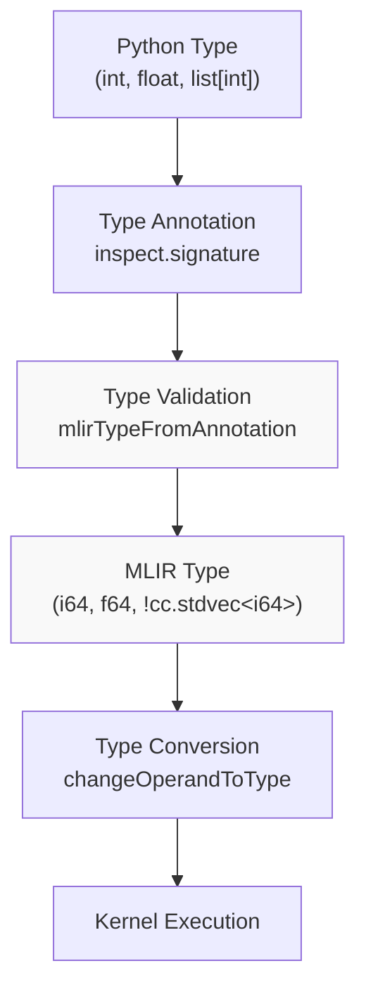
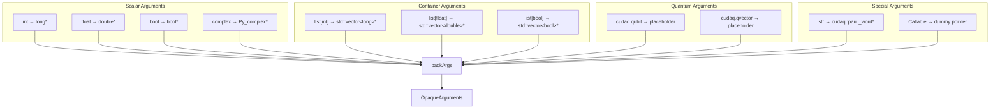
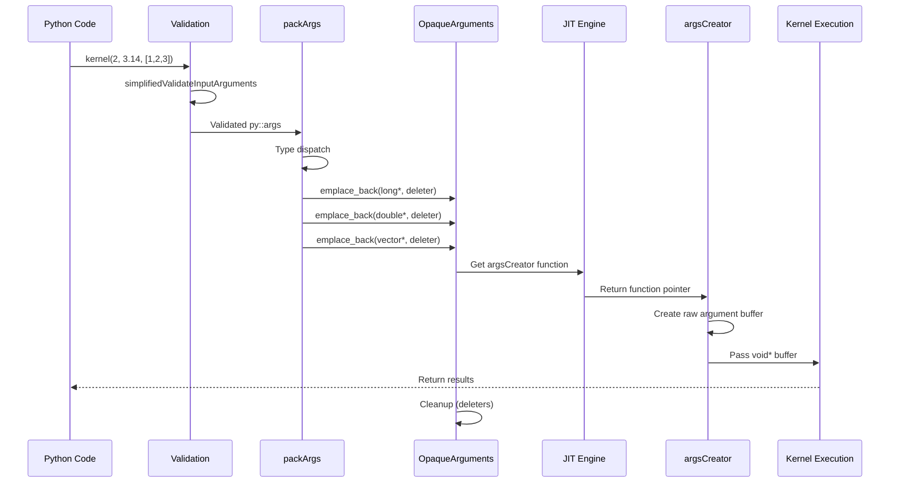
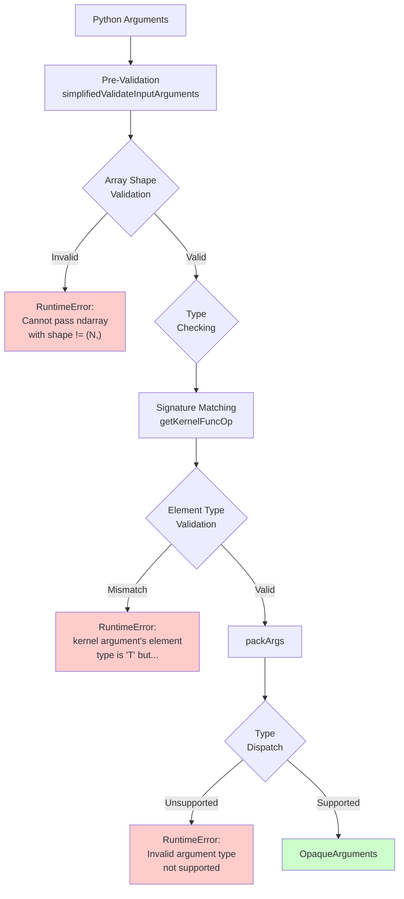

<!-- source: DeepWiki mcp.deepwiki.com · repo NVIDIA/cuda-quantum · page 3.5 Python Type System and Argument Handling · fetched 2026-10-26 -->

# Python Type System and Argument Handling

<details>
<summary>Relevant source files</summary>

The following files were used as context for generating this wiki page:

- [include/cudaq/Optimizer/Transforms/Passes.h](include/cudaq/Optimizer/Transforms/Passes.h)
- [include/cudaq/Optimizer/Transforms/Passes.td](include/cudaq/Optimizer/Transforms/Passes.td)
- [lib/Optimizer/CodeGen/Pipelines.cpp](lib/Optimizer/CodeGen/Pipelines.cpp)
- [lib/Optimizer/Transforms/CMakeLists.txt](lib/Optimizer/Transforms/CMakeLists.txt)
- [lib/Optimizer/Transforms/ClassicalOptimization.cpp](lib/Optimizer/Transforms/ClassicalOptimization.cpp)
- [lib/Optimizer/Transforms/Pipelines.cpp](lib/Optimizer/Transforms/Pipelines.cpp)
- [python/cudaq/kernel/ast_bridge.py](python/cudaq/kernel/ast_bridge.py)
- [python/cudaq/kernel/kernel_builder.py](python/cudaq/kernel/kernel_builder.py)
- [python/cudaq/kernel/kernel_decorator.py](python/cudaq/kernel/kernel_decorator.py)
- [python/cudaq/kernel/utils.py](python/cudaq/kernel/utils.py)
- [python/cudaq/runtime/sample.py](python/cudaq/runtime/sample.py)
- [python/runtime/cudaq/platform/py_alt_launch_kernel.cpp](python/runtime/cudaq/platform/py_alt_launch_kernel.cpp)
- [python/tests/builder/test_kernel_builder.py](python/tests/builder/test_kernel_builder.py)
- [python/tests/kernel/test_control_negations.py](python/tests/kernel/test_control_negations.py)
- [python/tests/kernel/test_direct_call_return_kernel.py](python/tests/kernel/test_direct_call_return_kernel.py)
- [python/tests/kernel/test_kernel_call_return.py](python/tests/kernel/test_kernel_call_return.py)
- [python/tests/kernel/test_kernel_features.py](python/tests/kernel/test_kernel_features.py)
- [python/tests/kernel/test_run_kernel.py](python/tests/kernel/test_run_kernel.py)
- [python/tests/mlir/ast_attributes.py](python/tests/mlir/ast_attributes.py)
- [python/utils/OpaqueArguments.h](python/utils/OpaqueArguments.h)
- [runtime/common/BaseRemoteRESTQPU.h](runtime/common/BaseRemoteRESTQPU.h)
- [runtime/common/RuntimeMLIRCommonImpl.h](runtime/common/RuntimeMLIRCommonImpl.h)
- [runtime/cudaq/platform/default/rest/helpers/quantinuum/quantinuum.yml](runtime/cudaq/platform/default/rest/helpers/quantinuum/quantinuum.yml)

</details>


## Purpose and Scope

This document describes how CUDA-Q handles Python types and arguments when defining and executing quantum kernels. It covers the type conversion system that maps Python types to MLIR types, the argument packing mechanism that prepares Python values for JIT execution, and the validation processes that ensure type safety at runtime.

For information about kernel definition and compilation, see [Kernel Definition with @cudaq.kernel](#3.1). For backend execution details, see [Kernel Execution Model](#2.5).

## Python to MLIR Type Mapping

CUDA-Q maps Python types to corresponding MLIR types during kernel compilation. This mapping occurs in the AST bridge when converting Python code to MLIR representation.

### Scalar Type Mappings

| Python Type | MLIR Type | Width | Notes |
|------------|-----------|-------|-------|
| `bool` | `i1` | 1 bit | Integer type with width 1 |
| `int` | `i64` | 64 bits | Signless integer |
| `np.int8` | `i8` | 8 bits | Signed integer |
| `np.int16` | `i16` | 16 bits | Signed integer |
| `np.int32` | `i32` | 32 bits | Signed integer |
| `np.int64` | `i64` | 64 bits | Signed integer |
| `float` | `f64` | 64 bits | IEEE 754 double precision |
| `np.float32` | `f32` | 32 bits | IEEE 754 single precision |
| `np.float64` | `f64` | 64 bits | IEEE 754 double precision |
| `complex` | `complex<f64>` | 128 bits | Complex with f64 real/imaginary |
| `np.complex64` | `complex<f32>` | 64 bits | Complex with f32 real/imaginary |
| `np.complex128` | `complex<f64>` | 128 bits | Complex with f64 real/imaginary |

### Quantum Type Mappings

| Python Type | MLIR Type | Description |
|------------|-----------|-------------|
| `cudaq.qubit` | `!quake.ref` | Single qubit reference |
| `cudaq.qvector` | `!quake.veq<?>` | Variable-sized qubit vector |
| `cudaq.qview` | `!quake.veq<?>` | View into qubit vector |

### Container Type Mappings

| Python Type | MLIR Type | Element Type |
|------------|-----------|--------------|
| `list[int]` | `!cc.stdvec<i64>` | Standard vector of integers |
| `list[float]` | `!cc.stdvec<f64>` | Standard vector of floats |
| `list[bool]` | `!cc.stdvec<i1>` | Standard vector of booleans |
| `list[complex]` | `!cc.stdvec<complex<f64>>` | Standard vector of complex |
| `tuple` | `!cc.struct` | Heterogeneous structure |
| `dataclass` | `!cc.struct` or `!quake.struq` | Named structure |

### Type Conversion Functions

The type conversion system is implemented through several key functions:

**`mlirTypeFromPyType(pyType, ctx)`** [python/cudaq/kernel/utils.py:132-246]()  
Converts a Python type annotation to an MLIR type. Handles scalars, containers, quantum types, and user-defined dataclasses.

**`mlirTypeFromAnnotation(annotation, ctx)`** [python/cudaq/kernel/utils.py:132-246]()  
Extracts type information from Python type hints and converts to MLIR types. Supports generic types like `List[T]` and `Callable`.

**`mlirTypeToPyType(mlirType)`** [python/cudaq/kernel/utils.py:248-320]()  
Converts an MLIR type back to its corresponding Python type for result handling.



**Diagram: Type Conversion Pipeline**

Sources: [python/cudaq/kernel/utils.py:132-320](), [python/cudaq/kernel/ast_bridge.py:506-610]()

## Argument Packing System

When a Python kernel is invoked, arguments must be converted from Python objects to a format suitable for JIT-compiled code. This is handled by the `OpaqueArguments` system.

### OpaqueArguments Class

The `OpaqueArguments` class wraps function arguments as opaque pointers, allowing C++ code to pass Python values to JIT-compiled kernels without knowing their specific types.

```mermaid
graph LR
    PyArgs["Python Arguments<br/>py::args"]
    Validate["simplifiedValidateInputArguments<br/>Type validation"]
    Pack["packArgs<br/>Type-specific packing"]
    Opaque["OpaqueArguments<br/>void** + deleters"]
    Creator["argsCreator<br/>JIT function"]
    RawArgs["Raw Argument Buffer<br/>void*"]
    
    PyArgs --> Validate
    Validate --> Pack
    Pack --> Opaque
    Opaque --> Creator
    Creator --> RawArgs
    RawArgs --> Kernel["Kernel Execution"]
    
    style Pack fill:#f9f9f9
    style Opaque fill:#f9f9f9
```



**Diagram: Argument Packing Flow**

Sources: [python/utils/OpaqueArguments.h:36-77](), [python/runtime/cudaq/platform/py_alt_launch_kernel.cpp:129-144]()

### Key Components

**OpaqueArguments Structure** [python/utils/OpaqueArguments.h:43-77]()

The `OpaqueArguments` class maintains:
- `std::vector<void*> args`: Opaque pointers to argument data
- `std::vector<OpaqueArgDeleter> deleters`: Cleanup functions for each argument
- `emplace_back(pointer, deleter)`: Adds an argument with its deleter
- Destructor automatically cleans up all allocated memory

**simplifiedValidateInputArguments** [python/utils/OpaqueArguments.h:83-125]()

Pre-processes Python arguments before packing:
- Converts numpy arrays to Python lists via `tolist()`
- Validates array shapes (must be 1-dimensional)
- Converts string literals to `std::string`
- Handles lists of strings for Pauli words

**packArgs Function** [python/utils/OpaqueArguments.h:172-477]()

Type-dispatched packing for different argument types:
- Scalar types: Direct memory allocation and copy
- Lists: Convert to `std::vector` with element type conversion
- Quantum types: Handle `cudaq::qubit` and `cudaq::qvector`
- Pauli words: Convert strings to `cudaq::pauli_word`
- Callables: Placeholder packing (synthesized away during compilation)

### Argument Packing by Type



**Diagram: Type-Specific Argument Packing**

Sources: [python/utils/OpaqueArguments.h:172-477]()

## Type Conversion Process

The type conversion process involves multiple stages as arguments flow from Python through the compilation and execution pipeline.

### Compilation-Time Type Conversion

During kernel compilation, the `PyASTBridge` converts Python AST nodes with type annotations to MLIR operations with typed values.

**changeOperandToType** [python/cudaq/kernel/ast_bridge.py:506-610]()

Converts operands between MLIR types during compilation:
- **Type Promotion**: Integer → Float → Complex (allowed)
- **Type Demotion**: Float → Integer (only with `allowDemotion=True`)
- **Width Casting**: Changes bit width (e.g., i32 → i64)
- **Container Conversion**: Recursively converts element types in vectors and structs

**Type Promotion Rules**:
1. Complex types can accept float or integer operands
2. Float types can accept integer operands (via `cc.CastOp` with sign extension)
3. Integer types can be widened or narrowed
4. Boolean (i1) requires explicit comparison for non-boolean inputs

### Runtime Type Conversion

At runtime, arguments undergo additional conversions to match the JIT-compiled function signature.

**toOpaqueArgs** [python/runtime/cudaq/platform/py_alt_launch_kernel.cpp:131-144]()

Creates `OpaqueArguments` from Python arguments:
1. Retrieves kernel function signature from MLIR module
2. Validates argument count and types
3. Calls `packArgs` with optional backup handler for special types
4. Returns pointer to `OpaqueArguments` (caller must delete)

**marshalRuntimeArgs** [python/runtime/cudaq/platform/py_alt_launch_kernel.cpp:451-488]()

Handles special runtime conversions:
- `std::vector<bool>` → `std::vector<char>` (workaround for bool specialization)
- Nested container types (currently limited)
- Residual arguments for quantinuum local emulation



**Diagram: Runtime Argument Flow**

Sources: [python/runtime/cudaq/platform/py_alt_launch_kernel.cpp:131-144](), [python/runtime/cudaq/platform/py_alt_launch_kernel.cpp:270-384]()

## Supported Argument Types

CUDA-Q supports a rich set of Python types as kernel arguments. This section details supported types and any restrictions.

### Scalar Types

**Boolean** [python/tests/kernel/test_kernel_features.py:26-75]()
- Python: `bool`
- MLIR: `i1`
- Supported in arguments and return values
- Automatically converted to/from integer comparisons when needed

**Integer Types** [python/tests/kernel/test_kernel_features.py:26-75]()
- Python: `int`, `np.int8`, `np.int16`, `np.int32`, `np.int64`
- MLIR: `i8`, `i16`, `i32`, `i64`
- Default width for untyped `int` is 64 bits
- Sign extension applied automatically for narrower types

**Floating Point Types** [python/tests/kernel/test_run_kernel.py:222-286]()
- Python: `float`, `np.float32`, `np.float64`
- MLIR: `f32`, `f64`
- Default precision for untyped `float` is 64 bits
- Automatic promotion from integer types

**Complex Types** [python/cudaq/kernel/ast_bridge.py:435-473]()
- Python: `complex`, `np.complex64`, `np.complex128`
- MLIR: `complex<f32>`, `complex<f64>`
- Created via `complex.CreateOp(real, imag)`
- Element-wise operations supported

### Container Types

**Lists** [python/tests/kernel/test_kernel_features.py:645-690]()
- Python: `list[T]` where T is a supported type
- MLIR: `!cc.stdvec<T>`
- Element types must be uniform
- Cannot be dynamically modified within kernels
- Supports indexing, iteration, and `len()`

**Special List Handling for Booleans** [python/runtime/cudaq/platform/py_alt_launch_kernel.cpp:451-488]()
- `std::vector<bool>` uses bit-packing in C++
- Converted to `std::vector<char>` for compatibility
- Automatic marshaling via `marshalRuntimeArgs`

**Tuples** [python/tests/kernel/test_kernel_features.py:600-643]()
- Python: `tuple`
- MLIR: `!cc.struct<...>` (anonymous structure)
- Heterogeneous element types allowed
- Supports constant-index subscripting only
- No runtime indexing (must be compile-time constant)

**Dataclasses** [python/cudaq/kernel/ast_bridge.py:771-795]()
- Python: `@dataclass` decorated classes
- MLIR: `!cc.struct<name, ...>` or `!quake.struq<name, ...>`
- Must be registered via `globalRegisteredTypes`
- Supports attribute access (e.g., `obj.field`)
- Can contain quantum types (becomes `!quake.struq`)

### Quantum Types

**Qubits** [python/utils/OpaqueArguments.h:412-419]()
- Python: `cudaq.qubit`, `cudaq.qvector`, `cudaq.qview`
- MLIR: `!quake.ref`, `!quake.veq<?>`
- Allocated within kernels, not passed as arguments
- Used for kernel-to-kernel calls with quantum data

### Special Types

**Pauli Words** [python/tests/kernel/test_kernel_features.py:279-327]()
- Python: `str` or `cudaq.pauli_word`
- Runtime conversion to `cudaq::pauli_word`
- Used with `exp_pauli` operations
- Validated for valid Pauli characters (I, X, Y, Z)

**Callable Types** [python/runtime/cudaq/platform/py_alt_launch_kernel.cpp:112-127]()
- Python: `Callable[[...], ...]`
- Used for higher-order kernels (e.g., Grover's oracle)
- Synthesized away during compilation via `PySynthCallableBlockArgs` pass
- Dummy placeholder used during argument packing

## Runtime Argument Validation

Argument validation occurs at multiple stages to ensure type safety and catch errors early.

### Pre-Execution Validation

**simplifiedValidateInputArguments** [python/utils/OpaqueArguments.h:83-125]()

Validates and transforms arguments before packing:
1. Checks for `tolist` attribute (numpy arrays)
2. Validates array shapes (must be 1D)
3. Converts strings to appropriate types
4. Handles special cases (list of strings → Pauli words)

**Type Checking Functions** [python/utils/OpaqueArguments.h:148-168]()

Template functions validate argument types:
```cpp
template <typename T>
void checkArgumentType(py::handle arg, int index)
```
- Uses `py_ext::isConvertible<T>` to check compatibility
- Throws descriptive error with argument index and type
- Called for each argument during packing

**Element Type Checking** [python/utils/OpaqueArguments.h:159-168]()

For container types, validates element types:
```cpp
template <typename T>
void checkListElementType(py::handle arg, int index)
```
- Ensures all elements in a list are of the expected type
- Reports element type mismatches with context

### Signature Matching

**getKernelFuncOp** [python/utils/OpaqueArguments.h:128-145]()

Retrieves the MLIR function signature for validation:
1. Searches module for function with name `__nvqpp__mlirgen__<kernelName>`
2. Extracts function argument types
3. Compares against provided arguments

**packArgs with Type Dispatch** [python/utils/OpaqueArguments.h:172-477]()

Uses MLIR type information to dispatch to correct packing:
- Pattern matches on `mlir::TypeSwitch`
- Handles each MLIR type with appropriate C++ type
- Reports unsupported type combinations

### Error Handling

Validation errors are reported with detailed context:
```
kernel argument type is 'int' but argument provided is not 
(argument 2, value='hello', type=<class 'str'>).
```

**Error Sources**:
- Type mismatches between annotation and value [python/utils/OpaqueArguments.h:149-156]()
- Unsupported types [python/cudaq/kernel/utils.py:227-232]()
- Invalid container shapes [python/utils/OpaqueArguments.h:96-99]()
- Element type mismatches in lists [python/utils/OpaqueArguments.h:402-410]()



**Diagram: Argument Validation Pipeline**

Sources: [python/utils/OpaqueArguments.h:83-477]()

## Special Cases and Limitations

### Captured Variables

Kernels can capture variables from the enclosing Python scope. These are handled specially during compilation.

**Captured Data Storage** [python/cudaq/kernel/captured_data.py]() and [python/cudaq/kernel/ast_bridge.py:233-245]()

The `CapturedDataStorage` class manages captured data:
- Stores captured scalar values as global constants
- Stores captured arrays/states with unique hash identifiers
- Generates setter functions for runtime initialization
- Tracks dependencies for recompilation detection

**State Vector Capture** [python/runtime/cudaq/platform/py_alt_launch_kernel.cpp:395-447]()

Special handling for captured quantum states:
- `cudaq::state` objects stored in global storage
- Setter functions: `nvqpp.set.state.<hash>` and `nvqpp.set.cudaq.state.<hash>`
- Called before kernel execution to initialize globals
- Restricted on remote/emulated backends

### Callable Arguments

Callable arguments allow higher-order quantum kernels but require special compilation handling.

**Synthesis Pass** [lib/Optimizer/Transforms/PySynthCallableBlockArgs.cpp]() and [include/cudaq/Optimizer/Transforms/Passes.h:76-80]()

The `PySynthCallableBlockArgs` pass:
1. Identifies callable block arguments in functions
2. Replaces callable arguments with concrete function calls
3. Removes unused callable block arguments
4. Enables specialization of generic quantum algorithms

**Argument Packing for Callables** [python/runtime/cudaq/platform/py_alt_launch_kernel.cpp:112-127]()

During packing, callable arguments:
- Receive dummy placeholder data (long*)
- Not actually used at runtime (synthesized away)
- Validated by checking for `module` attribute

### Broadcasting

Broadcasting allows executing a kernel over multiple argument sets in a single call.

**Broadcast Detection** [python/cudaq/runtime/utils.py:20-48]()

Determines if arguments should be broadcast:
- Checks for list-of-lists patterns
- Validates all parameter lists have same length
- Creates argument sets for iteration

**Execution** [python/cudaq/runtime/sample.py:15-34]()

For broadcast execution:
1. Creates `ExecutionContext` for each iteration
2. Sets `totalIterations` and `batchIteration` fields
3. Collects results from each execution
4. Returns list of results

**Limitations**:
- Inner lists must not be nested (flat parameter lists only)
- All parameter lists must have equal length
- Complex broadcast patterns not supported [python/tests/kernel/test_kernel_features.py:728-743]()

### Type Conversion Restrictions

**No Pointer Types in Structs** [python/cudaq/kernel/utils.py:120-125]()
- Structs/tuples cannot contain pointer types
- Checked during struct creation

**No Dynamic List Modification** [python/tests/kernel/test_kernel_features.py:505-531]()
- Lists cannot be modified at runtime (no `append`, `insert`, etc.)
- List sizes must be compile-time constants or kernel arguments

**String Type Not Supported** [python/tests/kernel/test_kernel_features.py:692-726]()
- `str` not a valid kernel argument type (except for Pauli words)
- Lists of strings also not supported (except Pauli word lists)

**No Recursive Containers** [python/runtime/cudaq/platform/py_alt_launch_kernel.cpp:468-472]()
- Lists of lists only partially supported
- Current implementation cannot handle deeply nested structures

Sources: [python/cudaq/kernel/ast_bridge.py](), [python/cudaq/kernel/utils.py](), [python/utils/OpaqueArguments.h](), [python/runtime/cudaq/platform/py_alt_launch_kernel.cpp](), [python/tests/kernel/test_kernel_features.py](), [python/tests/kernel/test_run_kernel.py]()

---

