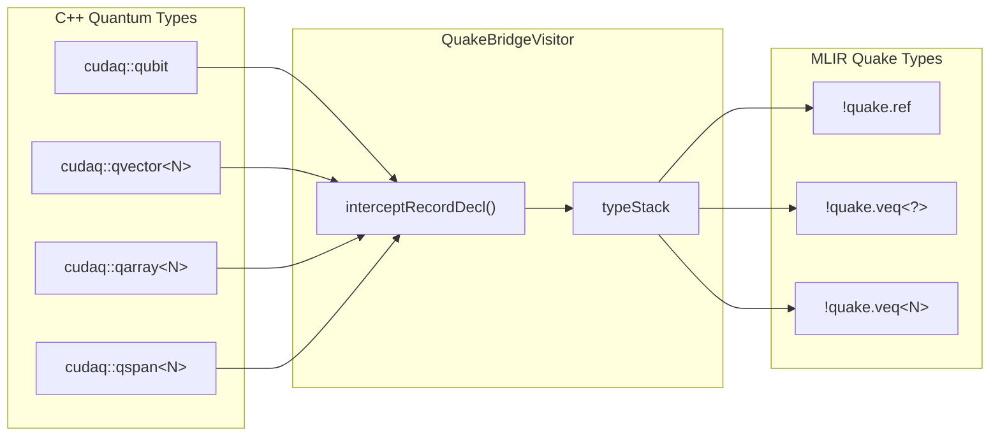
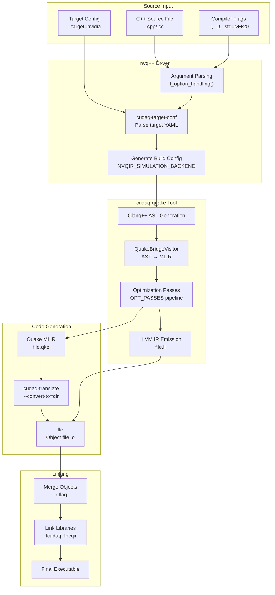
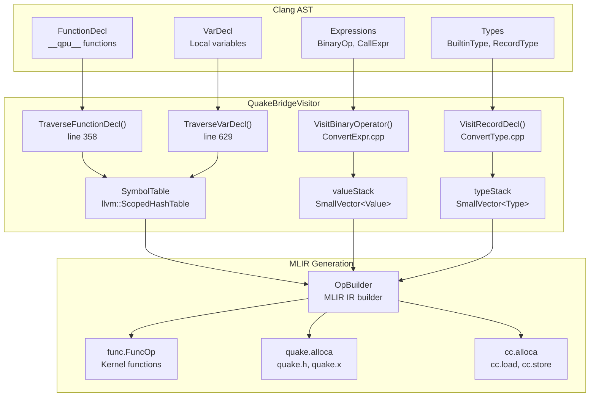
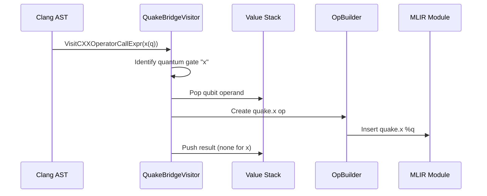
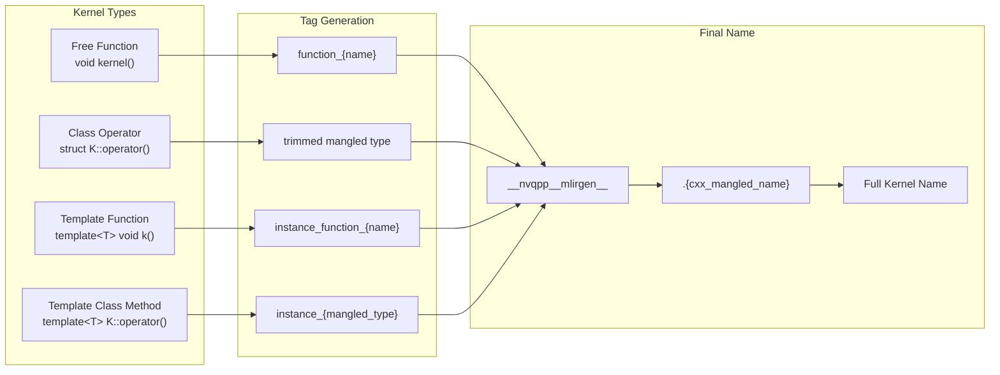
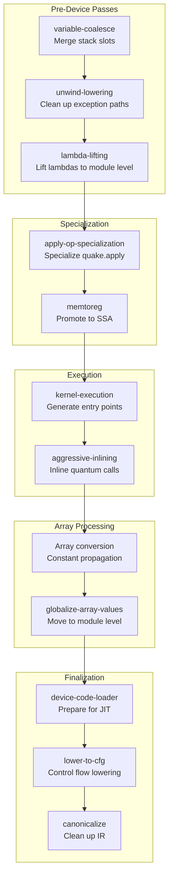

<!-- source: DeepWiki mcp.deepwiki.com · repo NVIDIA/cuda-quantum · page 4 C++ Interface · fetched 2026-10-26 -->

# C++ Interface

<details>
<summary>Relevant source files</summary>

The following files were used as context for generating this wiki page:

- [include/cudaq/Frontend/nvqpp/ASTBridge.h](include/cudaq/Frontend/nvqpp/ASTBridge.h)
- [include/cudaq/Optimizer/CodeGen/Passes.h](include/cudaq/Optimizer/CodeGen/Passes.h)
- [include/cudaq/Optimizer/CodeGen/Passes.td](include/cudaq/Optimizer/CodeGen/Passes.td)
- [include/cudaq/Optimizer/Dialect/CC/CCTypes.h](include/cudaq/Optimizer/Dialect/CC/CCTypes.h)
- [include/cudaq/Optimizer/Dialect/CC/CCTypes.td](include/cudaq/Optimizer/Dialect/CC/CCTypes.td)
- [include/cudaq/Optimizer/InitAllDialects.h](include/cudaq/Optimizer/InitAllDialects.h)
- [lib/Frontend/nvqpp/ASTBridge.cpp](lib/Frontend/nvqpp/ASTBridge.cpp)
- [lib/Frontend/nvqpp/ConvertDecl.cpp](lib/Frontend/nvqpp/ConvertDecl.cpp)
- [lib/Frontend/nvqpp/ConvertExpr.cpp](lib/Frontend/nvqpp/ConvertExpr.cpp)
- [lib/Frontend/nvqpp/ConvertType.cpp](lib/Frontend/nvqpp/ConvertType.cpp)
- [lib/Optimizer/CodeGen/CMakeLists.txt](lib/Optimizer/CodeGen/CMakeLists.txt)
- [lib/Optimizer/CodeGen/ConvertCCToLLVM.cpp](lib/Optimizer/CodeGen/ConvertCCToLLVM.cpp)
- [lib/Optimizer/CodeGen/ConvertToQIR.cpp](lib/Optimizer/CodeGen/ConvertToQIR.cpp)
- [lib/Optimizer/CodeGen/ConvertToQIRProfile.cpp](lib/Optimizer/CodeGen/ConvertToQIRProfile.cpp)
- [lib/Optimizer/Dialect/CC/CCTypes.cpp](lib/Optimizer/Dialect/CC/CCTypes.cpp)
- [runtime/common/RuntimeMLIR.cpp](runtime/common/RuntimeMLIR.cpp)
- [runtime/cudaq/platform/default/rest/RemoteRESTQPU.cpp](runtime/cudaq/platform/default/rest/RemoteRESTQPU.cpp)
- [test/AST-Quake/array.cpp](test/AST-Quake/array.cpp)
- [test/AST-Quake/ctor-1.cpp](test/AST-Quake/ctor-1.cpp)
- [test/AST-Quake/ctor-2.cpp](test/AST-Quake/ctor-2.cpp)
- [test/AST-Quake/struct-1.cpp](test/AST-Quake/struct-1.cpp)
- [test/AST-Quake/struct-2.cpp](test/AST-Quake/struct-2.cpp)
- [tools/cudaq-opt/cudaq-opt.cpp](tools/cudaq-opt/cudaq-opt.cpp)
- [tools/cudaq-quake/CMakeLists.txt](tools/cudaq-quake/CMakeLists.txt)
- [tools/cudaq-quake/cudaq-quake.cpp](tools/cudaq-quake/cudaq-quake.cpp)
- [tools/cudaq-translate/cudaq-translate.cpp](tools/cudaq-translate/cudaq-translate.cpp)
- [tools/nvqpp/nvq++.in](tools/nvqpp/nvq++.in)

</details>


## Purpose and Scope

This page provides a comprehensive overview of CUDA-Q's C++ interface, which enables quantum kernel development using standard C++ syntax augmented with the `__qpu__` annotation. This interface is designed for ahead-of-time (AOT) compilation via the `nvq++` compiler driver, which translates C++ quantum code into MLIR and subsequently into executable quantum circuits.

For detailed information about specific aspects of the C++ interface:
- Kernel definition syntax and quantum types: see [C++ Kernel Definition](#4.1)
- Compiler driver command-line options: see [nvq++ Compiler Driver](#4.2)  
- Internal AST translation mechanics: see [C++ AST to MLIR Translation](#4.3)
- Runtime execution APIs: see [C++ Execution and Sampling](#4.4)

For the Python interface, which uses JIT compilation instead of AOT, see [Python Interface](#3).

## C++ Quantum Kernel Model

### Kernel Annotation and Structure

CUDA-Q quantum kernels in C++ are identified by the `__qpu__` annotation attribute. This annotation marks functions or methods that contain quantum operations and should be compiled through the quantum compilation pipeline.

```cpp
// Free function kernel
void my_kernel() __qpu__ {
  cudaq::qubit q;
  h(q);
  mz(q);
}

// Class-based kernel
struct MyKernel {
  void operator()(int n) __qpu__ {
    cudaq::qvector qubits(n);
    h(qubits);
  }
};
```

The `__qpu__` attribute is defined in [runtime/cudaq/platform/quantum_platform.h:30-31]() as a Clang annotation attribute. The bridge identifies these functions during AST traversal and adds them to the compilation queue.

### Quantum Type System

C++ kernels use several quantum-specific types defined in the `cudaq` namespace:

| C++ Type | MLIR Type | Description |
|----------|-----------|-------------|
| `cudaq::qubit` | `quake.ref` | Single qubit reference |
| `cudaq::qvector<N>` | `quake.veq<N>` | Dynamic-sized qubit vector |
| `cudaq::qarray<N>` | `quake.veq<N>` | Fixed-size qubit array |
| `cudaq::qspan<N>` | `quake.veq<N>` | Non-owning qubit view |
| `cudaq::qview` | `quake.veq<?>` | Non-owning dynamic view |

The type mapping logic is implemented in [lib/Frontend/nvqpp/ConvertType.cpp:132-159](), where the `interceptRecordDecl` function recognizes these types and converts them to their MLIR equivalents.

**C++ to MLIR Type Translation**



Sources: [lib/Frontend/nvqpp/ConvertType.cpp:132-159](), [include/cudaq/Frontend/nvqpp/ASTBridge.h:141-160]()

## The nvq++ Compilation Pipeline

### Driver Architecture

The `nvq++` driver is a bash script wrapper around Clang++ that orchestrates the quantum compilation process. It is located at [tools/nvqpp/nvq++.in]() and provides a unified interface for compiling CUDA-Q programs.

**nvq++ Compilation Workflow**



Sources: [tools/nvqpp/nvq++.in:1-873](), [tools/cudaq-quake/cudaq-quake.cpp:1-413]()

### Key Compilation Flags

The driver accepts numerous flags that control compilation behavior:

**Target and Backend Selection**
- `--target=<name>`: Selects quantum backend (e.g., `nvidia`, `qpp-cpu`, `quantinuum`)
- `--platform=<lib>`: Specifies platform library for execution
- `--execution-manager=<mgr>`: Sets execution manager implementation

**MLIR Pass Control**
- `-f[no-]device-code-loading`: Enable/disable device code loading pass
- `-f[no-]kernel-execution`: Enable/disable kernel execution pass  
- `-f[no-]lambda-lifting`: Enable/disable lambda lifting transformation
- `-f[no-]apply-specialization`: Enable/disable quake.apply specialization
- `--opt-pass <name>`: Add custom optimization pass to pipeline

**Code Generation**
- `--emit-qir`: Generate QIR output and exit
- `--enable-mlir`: Force MLIR compilation mode (vs library mode)
- `--convert-to=<format>`: Specify output format (qir/openqasm2/iqm)

The pass pipeline construction is implemented in [tools/nvqpp/nvq++.in:706-774](), where various `ENABLE_*` flags determine which passes are added to `OPT_PASSES`.

Sources: [tools/nvqpp/nvq++.in:54-128](), [tools/nvqpp/nvq++.in:706-774]()

### Target Configuration System

Backend targets are configured via YAML files located in `targets/*.yml`. The `cudaq-target-conf` tool parses these files and generates shell variables that configure the compilation:

```bash
# Example from nvq++.in:652-659
TARGET_CONFIG_YML_FILE="${install_dir}/targets/${TARGET_CONFIG}.yml"
OUT_CONFIG_FILENAME=$(mktemp nvqppTargetBuildConfig.XXXXXX)
run ${TOOLBIN}cudaq-target-conf --arg="..." -o ${OUT_CONFIG_FILENAME} ${TARGET_CONFIG_YML_FILE}
. "${OUT_CONFIG_FILENAME}"  # Source generated config
```

Target configurations can specify:
- `NVQIR_SIMULATION_BACKEND`: Which simulator backend to link
- `TARGET_PASS_PIPELINE`: Custom MLIR pass pipeline for the target
- `PLATFORM_LIBRARY`: Platform plugin to use
- `GEN_TARGET_BACKEND`: Whether to generate backend initialization code

Sources: [tools/nvqpp/nvq++.in:648-674]()

## AST to MLIR Translation

### QuakeBridgeVisitor Architecture

The core of C++ to MLIR translation is the `QuakeBridgeVisitor` class, which extends Clang's `RecursiveASTVisitor` to traverse C++ AST nodes and generate corresponding MLIR operations.

**QuakeBridgeVisitor Component Architecture**



Sources: [include/cudaq/Frontend/nvqpp/ASTBridge.h:141-160](), [lib/Frontend/nvqpp/ASTBridge.cpp:147-497]()

### Translation Process

The bridge operates in post-order traversal mode, meaning child nodes are visited before parent nodes. This allows expressions to build up values on the value stack:

1. **Function Declaration**: `TraverseFunctionDecl()` creates a `func.FuncOp` and entry block
2. **Type Resolution**: Types are pushed onto `typeStack` during traversal
3. **Variable Allocation**: Local variables become `cc.alloca` operations with entries in `symbolTable`
4. **Expression Evaluation**: Expressions consume operands from `valueStack` and push results back
5. **Statement Generation**: Control flow creates `cc.if`, `cc.loop`, etc.

**Expression Translation Example**

For C++ code `x(q)` (apply X gate to qubit q):



The quantum gate recognition logic is in [lib/Frontend/nvqpp/ConvertExpr.cpp:1213-1484](), where `VisitCXXOperatorCallExpr()` checks function names against known quantum operations.

Sources: [lib/Frontend/nvqpp/ConvertExpr.cpp:1070-1200](), [include/cudaq/Frontend/nvqpp/ASTBridge.h:473]()

### Type Conversion Rules

The bridge implements sophisticated type conversion between C++ and MLIR:

| C++ Category | C++ Type | MLIR Type | Conversion Location |
|--------------|----------|-----------|---------------------|
| Quantum | `cudaq::qubit` | `!quake.ref` | ConvertType.cpp:135 |
| Quantum | `cudaq::qvector` | `!quake.veq<?>` | ConvertType.cpp:158 |
| Classical | `bool` | `i1` | ConvertType.cpp:360 |
| Classical | `int` | `i32` (arch dependent) | ConvertType.cpp:368-403 |
| Classical | `double` | `f64` | ConvertType.cpp:411 |
| Classical | `std::vector<T>` | `!cc.stdvec<T>` | ConvertType.cpp:178-191 |
| Classical | `std::complex<T>` | `complex<T>` | ConvertType.cpp:201-207 |
| Callable | Lambda | `!cc.callable<sig>` | ConvertType.cpp:323-330 |
| Struct | C++ struct | `!cc.struct<...>` | ConvertType.cpp:232-335 |

The type system enforces semantic rules:
- Quantum types cannot be mixed with classical struct members (line 255-259)
- Struqs (quantum structs) can only contain quantum references (line 247-254)
- User-defined methods are not allowed in kernel structs (line 312-332)

Sources: [lib/Frontend/nvqpp/ConvertType.cpp:1-465]()

## Kernel Entry Point Generation

### Name Mangling Scheme

CUDA-Q generates unique kernel names using a combination of user-provided tags and C++ mangled names. The scheme varies based on kernel type:

**Kernel Naming Convention**



The implementation is in [lib/Frontend/nvqpp/ASTBridge.cpp:100-145](), where `getTagNameOfFunctionDecl()` determines the appropriate naming scheme based on the function's declaration context.

Sources: [lib/Frontend/nvqpp/ASTBridge.cpp:100-145](), [include/cudaq/Frontend/nvqpp/ASTBridge.h:163-173]()

### Reachability Analysis

The bridge builds a call graph to determine which functions need to be lowered alongside kernel entry points. The `QPUCodeFinder` visitor:

1. Identifies all `__qpu__` annotated functions
2. Builds a Clang `CallGraph` from the translation unit
3. Extracts reachable functions from kernel entry points
4. Adds them to `functionsToEmit` collection

This ensures that helper functions called from kernels are also translated to MLIR, even if they lack the `__qpu__` annotation.

Sources: [lib/Frontend/nvqpp/ASTBridge.cpp:147-287](), [lib/Frontend/nvqpp/ASTBridge.cpp:39-51]()

## MLIR Optimization Pipeline

### Pass Configuration

After AST translation, the generated MLIR undergoes optimization through a configurable pass pipeline. The nvq++ driver constructs this pipeline based on enabled features:

**Default Pass Pipeline**



The pass pipeline is constructed in [tools/nvqpp/nvq++.in:706-774]() using the `add_pass_to_pipeline` helper function.

Sources: [tools/nvqpp/nvq++.in:706-774](), [tools/nvqpp/nvq++.in:45-51]()

### Target-Specific Pipelines

Some backends specify custom pass pipelines in their YAML configuration via the `TARGET_PASS_PIPELINE` variable. If set, this overrides the default pipeline entirely:

```bash
# From nvq++.in:768-772
if [ ! -z "$TARGET_PASS_PIPELINE" ]; then
  RUN_OPT=true
  OPT_PASSES="$TARGET_PASS_PIPELINE"
fi
```

This allows backends to optimize for their specific requirements (e.g., gate set restrictions, topology constraints).

Sources: [tools/nvqpp/nvq++.in:768-772]()

## Code Generation Targets

### QIR Generation

The primary code generation path produces QIR (Quantum Intermediate Representation) using the `cudaq-translate` tool with `--convert-to=qir`:

```bash
# From nvq++.in:814
run ${TOOLBIN}cudaq-translate --convert-to=${PLATFORM_TRANSPORT_LAYER} ${QUAKE_IN} -o ${QUAKELL_FILE}
```

QIR generation supports multiple profiles:
- **Full QIR** (`qir:0.1`): Complete QIR specification with dynamic features
- **Base Profile** (`qir-base`): Static allocation, limited control flow
- **Adaptive Profile** (`qir-adaptive`): Mid-execution measurements, feed-forward

The profile conversion pipeline is defined in [lib/Optimizer/CodeGen/ConvertToQIRProfile.cpp:1-737]() and applies profile-specific transformations.

Sources: [tools/nvqpp/nvq++.in:814](), [lib/Optimizer/CodeGen/ConvertToQIR.cpp:70-135](), [include/cudaq/Optimizer/CodeGen/Passes.td:52-63]()

### Alternative Target Formats

Beyond QIR, the compiler supports:

- **OpenQASM 2.0**: Text-based circuit description for QASM-based backends
- **IQM JSON**: IQM-specific JSON format for IQM quantum computers

These are specified via the `--convert-to` flag and use different translation passes registered in [runtime/common/RuntimeMLIR.cpp:40-88]().

Sources: [tools/cudaq-translate/cudaq-translate.cpp:62-70](), [runtime/common/RuntimeMLIR.cpp:40-88]()

## Integration with Classical C++

### Library Mode vs MLIR Mode

The nvq++ compiler supports two compilation modes:

**MLIR Mode** (default for quantum kernels):
- Kernels are translated to MLIR and optimized
- Quantum operations go through the full compilation pipeline
- Used when `--enable-mlir` flag is set or `__qpu__` annotation is present

**Library Mode**:
- Standard C++ compilation via Clang
- No MLIR translation
- Used for classical code or when `-library-mode` is explicitly set
- Preprocessor defines `CUDAQ_LIBRARY_MODE`

The mode selection logic is in [tools/nvqpp/nvq++.in:404-405]() and [tools/nvqpp/nvq++.in:786-793]().

Sources: [tools/nvqpp/nvq++.in:404-405](), [tools/nvqpp/nvq++.in:690-693]()

### Object File Merging

The compilation process generates separate object files for quantum and classical code:

1. **Classical Object** (`file.classic.o`): Classical C++ compiled by Clang
2. **Quantum Object** (`file.qke.o`): Quantum MLIR lowered to LLVM IR
3. **Merged Object** (`file.o`): Combined using `clang++ -r`

```bash
# From nvq++.in:838
run ${CXX} ${LINKER_PATH} ${LINKDIRS} -r ${QUAKE_OBJ} ${file}.classic.o ${OBJS_TO_MERGE} -o ${file}.o
```

This allows classical and quantum code to be linked together seamlessly.

Sources: [tools/nvqpp/nvq++.in:831-840]()

## Supported C++ Language Features

### Permitted Constructs

The bridge supports a substantial subset of C++20:

**Control Flow**:
- `if`/`else` statements → `cc.if` operations
- `for` loops → `cc.loop` operations
- `while`/`do-while` loops → `cc.loop` operations
- `break`/`continue` → `cc.break`/`cc.continue`
- Ternary operator `? :` → `cc.if` with results

**Data Types**:
- Integer types (all sizes) → `iN` types
- Floating point (`float`, `double`) → `f32`, `f64`
- `std::vector<T>` → `!cc.stdvec<T>`
- `std::complex<T>` → `complex<T>`
- Structs → `!cc.struct<...>`
- Lambda expressions → `!cc.callable<...>`

**Operations**:
- Arithmetic operators → `arith.*` operations
- Logical operators → `arith.cmpi`, boolean logic
- Function calls (including indirect) → `func.call`, `cc.call_callable`
- Quantum gate operations → `quake.*` operations

Sources: [lib/Frontend/nvqpp/ConvertStmt.cpp:1-1045](), [lib/Frontend/nvqpp/ConvertExpr.cpp:1-2771]()

### Restrictions and Limitations

**Not Supported**:
- Exception handling (`try`/`catch`/`throw`)
- Coroutines (`co_await`, `co_yield`, `co_return`)
- `goto` statements
- `switch` statements
- Inline assembly
- Virtual functions (in quantum kernels)
- Class inheritance for kernel classes
- Data members in kernel classes (not yet supported)
- Global variable access from kernels
- Dynamic memory allocation (`new`/`delete`)

These restrictions are enforced through error reporting during AST traversal, as seen in [lib/Frontend/nvqpp/ASTBridge.cpp:183-213]() for kernel class checks.

Sources: [lib/Frontend/nvqpp/ConvertStmt.cpp:39-83](), [lib/Frontend/nvqpp/ASTBridge.cpp:183-213]()

## Diagnostic and Error Reporting

### Clang Diagnostic Integration

The bridge integrates with Clang's diagnostic system to report errors at their source location in the C++ code:

```cpp
// From ASTBridge.h:36-45
template <typename T, unsigned N>
void reportClangError(T *astNode, clang::ItaniumMangleContext *mangler,
                      const char (&msg)[N]) {
  auto &de = mangler->getASTContext().getDiagnostics();
  auto id = de.getCustomDiagID(clang::DiagnosticsEngine::Error, msg);
  de.Report(astNode->getBeginLoc(), id);
}
```

This provides natural error messages pointing to the exact line in the source code where an unsupported construct appears.

Sources: [include/cudaq/Frontend/nvqpp/ASTBridge.h:32-45](), [lib/Frontend/nvqpp/ASTBridge.cpp:486-496]()

### Debug Modes

The driver supports verbose output for debugging:

- `-v`: Echo all commands executed
- `--clang-verbose`: Pass `-v` to Clang for verbose compilation
- `-save-temps`: Preserve intermediate files (`.qke`, `.ll`, temporary objects)
- `-g`: Include debug information in generated IR

Sources: [tools/nvqpp/nvq++.in:26-36](), [tools/nvqpp/nvq++.in:551-552]()

## Summary

The C++ interface provides a powerful AOT compilation path for CUDA-Q quantum programs. Key components include:

1. **`__qpu__` annotation**: Marks quantum kernels for special compilation
2. **nvq++ driver**: Orchestrates Clang, MLIR passes, and linking
3. **QuakeBridgeVisitor**: Translates C++ AST to MLIR dialects
4. **Target system**: Configurable backends via YAML files
5. **Pass pipeline**: Optimizes MLIR for specific quantum targets
6. **Code generation**: Produces QIR or other target formats

The compilation flow transforms standard C++20 code with quantum extensions into executable quantum circuits, maintaining source-level debugging and type safety throughout the process.

---

