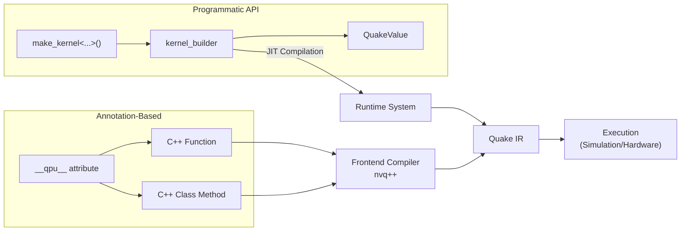
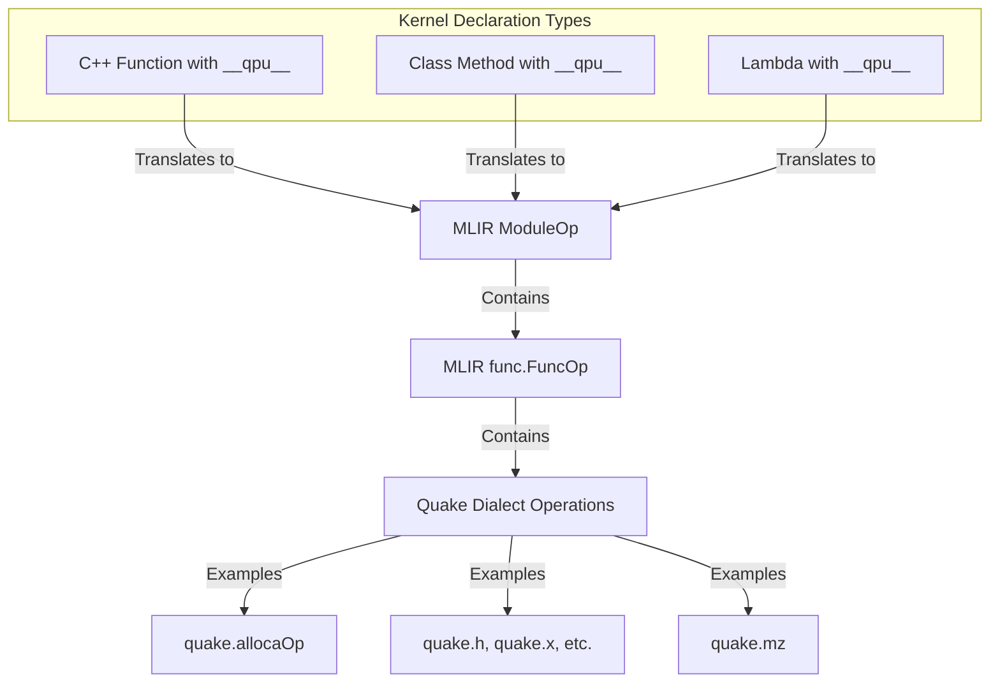
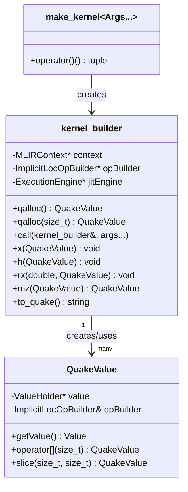
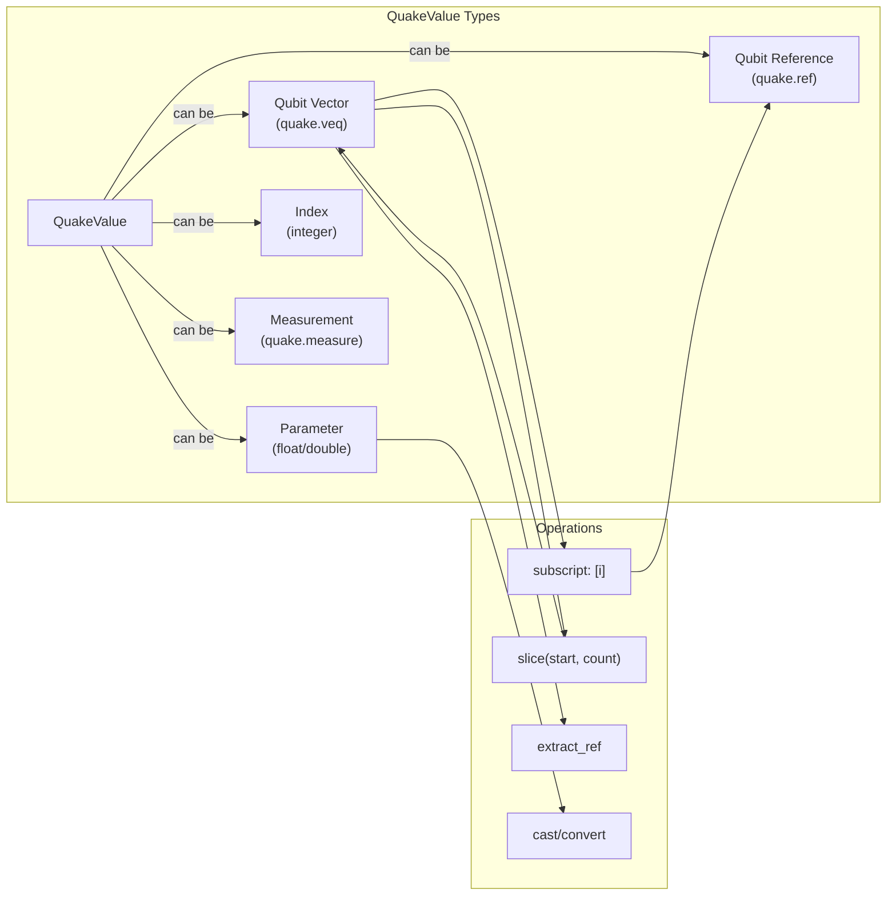
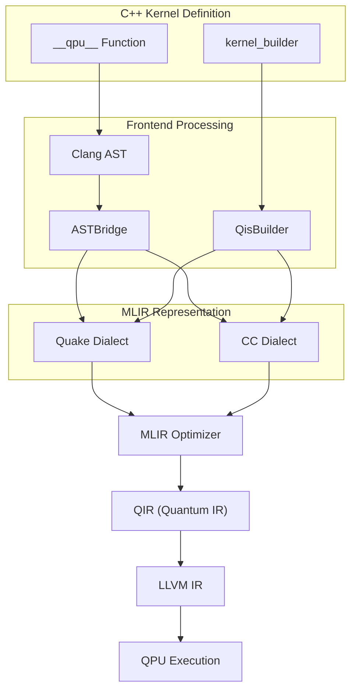
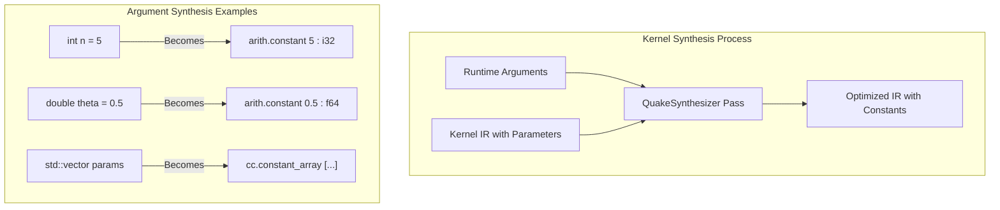

<!-- source: DeepWiki mcp.deepwiki.com · repo NVIDIA/cuda-quantum · page 4.1 C++ Kernel Definition · fetched 2026-10-26 -->

# Kernel Definition (C++)

<details>
<summary>Relevant source files</summary>

The following files were used as context for generating this wiki page:

- [include/cudaq/Frontend/nvqpp/ASTBridge.h](include/cudaq/Frontend/nvqpp/ASTBridge.h)
- [include/cudaq/Optimizer/Dialect/CC/CCTypes.h](include/cudaq/Optimizer/Dialect/CC/CCTypes.h)
- [include/cudaq/Optimizer/Dialect/CC/CCTypes.td](include/cudaq/Optimizer/Dialect/CC/CCTypes.td)
- [lib/Frontend/nvqpp/ASTBridge.cpp](lib/Frontend/nvqpp/ASTBridge.cpp)
- [lib/Frontend/nvqpp/ConvertDecl.cpp](lib/Frontend/nvqpp/ConvertDecl.cpp)
- [lib/Frontend/nvqpp/ConvertExpr.cpp](lib/Frontend/nvqpp/ConvertExpr.cpp)
- [lib/Frontend/nvqpp/ConvertType.cpp](lib/Frontend/nvqpp/ConvertType.cpp)
- [lib/Optimizer/Dialect/CC/CCTypes.cpp](lib/Optimizer/Dialect/CC/CCTypes.cpp)
- [test/AST-Quake/array.cpp](test/AST-Quake/array.cpp)
- [test/AST-Quake/ctor-1.cpp](test/AST-Quake/ctor-1.cpp)
- [test/AST-Quake/ctor-2.cpp](test/AST-Quake/ctor-2.cpp)
- [test/AST-Quake/struct-1.cpp](test/AST-Quake/struct-1.cpp)
- [test/AST-Quake/struct-2.cpp](test/AST-Quake/struct-2.cpp)

</details>


This page documents how to define quantum kernels in C++ using CUDA Quantum (CUDA-Q). Quantum kernels are functions that describe quantum operations and can be executed on quantum processing units (QPUs) or simulators. CUDA-Q provides two distinct approaches for defining quantum kernels in C++: using the `__qpu__` function attribute and using the programmatic `kernel_builder` API. For information about the Python interface for kernel definition, see [Kernel Definition (Python)](4.1).

## Kernel Definition Approaches

CUDA Quantum provides two complementary approaches for defining quantum kernels in C++:



Sources: [runtime/cudaq/builder/kernel_builder.h](runtime/cudaq/builder/kernel_builder.h), [lib/Frontend/nvqpp/ConvertDecl.cpp](lib/Frontend/nvqpp/ConvertDecl.cpp)

### 1. Annotation-Based Approach (`__qpu__`)

Functions or class methods annotated with the `__qpu__` attribute are recognized by the CUDA-Q compiler as quantum kernels:

```cpp
// Function-style kernel
__qpu__ void my_quantum_kernel(int param, cudaq::qubit& q) {
    // Quantum code using q
}

// Class-style kernel (callable object)
struct MyQuantumKernel {
    void operator()(int param, cudaq::qubit& q) __qpu__ {
        // Quantum code using q
    }
};
```

### 2. Programmatic Approach (`kernel_builder`)

Kernels can be built dynamically using the `kernel_builder` class, which is constructed via the `make_kernel` factory function:

```cpp
// Create a kernel with an integer parameter
auto [my_kernel, param] = cudaq::make_kernel<int>();
auto q = my_kernel.qalloc();  // Allocate a qubit
my_kernel.h(q);               // Apply Hadamard gate
if (param == 1)               // Conditional logic
    my_kernel.x(q);
```

Sources: [runtime/cudaq/builder/kernel_builder.h](runtime/cudaq/builder/kernel_builder.h), [runtime/cudaq/builder/kernel_builder.cpp](runtime/cudaq/builder/kernel_builder.cpp)

## Using the `__qpu__` Attribute

The `__qpu__` attribute marks a C++ function or class method as a quantum kernel, allowing the CUDA-Q compiler to process and compile it for execution on a quantum device or simulator.



Sources: [lib/Frontend/nvqpp/ASTBridge.cpp](lib/Frontend/nvqpp/ASTBridge.cpp), [lib/Frontend/nvqpp/ConvertDecl.cpp](lib/Frontend/nvqpp/ConvertDecl.cpp)

### Quantum Parameter Types

Functions with the `__qpu__` attribute can accept the following quantum-specific parameter types:

- `cudaq::qubit`: A single qubit reference
- `cudaq::qubit&`: A reference to a single qubit
- `cudaq::qvector<>`: A vector of qubits (dynamic size)
- `cudaq::qreg<N>`: A fixed-size register of N qubits
- `cudaq::qspan`: A non-owning view of qubits

### Classical Parameter Types

The following classical parameter types are supported:

- Integral types (`int`, `std::size_t`, etc.)
- Floating-point types (`float`, `double`)
- Complex numbers (`std::complex<float>`, `std::complex<double>`)
- Vectors of classical types (`std::vector<double>`, etc.)
- Function objects and `std::function` (for higher-order functions)

Sources: [lib/Frontend/nvqpp/ConvertType.cpp](lib/Frontend/nvqpp/ConvertType.cpp)

### Example: Function-style Kernel

```cpp
__qpu__ void circuit(int shots, double angle, cudaq::qvector<> q) {
    h(q[0]);
    rx(angle, q[1]);
    x<cudaq::ctrl>(q[0], q[1]);
    mz(q);
}
```

### Example: Class-style Kernel (Callable Object)

```cpp
struct GHZ {
    void operator()(int n_qubits) __qpu__ {
        cudaq::qvector q(n_qubits);
        h(q[0]);
        for (int i = 0; i < n_qubits - 1; i++) {
            x<cudaq::ctrl>(q[i], q[i + 1]);
        }
        mz(q);
    }
};
```

Sources: [test/AST-Quake/qpe.cpp](test/AST-Quake/qpe.cpp), [unittests/integration/builder_tester.cpp](unittests/integration/builder_tester.cpp)

### Kernel Restrictions and Limitations

When using the `__qpu__` attribute:

1. **Hybrid Quantum-Classical Struct Types**: Structs cannot contain both quantum and classical members
2. **External Libraries**: Limited support for calling external libraries
3. **Templates**: Only template instantiations (not the template itself) can have the `__qpu__` attribute
4. **Return Values**: Functions must return either void or a classical type

Sources: [lib/Frontend/nvqpp/ConvertType.cpp](lib/Frontend/nvqpp/ConvertType.cpp), [lib/Frontend/nvqpp/ConvertDecl.cpp](lib/Frontend/nvqpp/ConvertDecl.cpp)

## Using the `kernel_builder` API

The `kernel_builder` class provides a programmatic way to construct quantum kernels at runtime. This approach offers more flexibility for dynamic circuit construction.



Sources: [runtime/cudaq/builder/kernel_builder.h](runtime/cudaq/builder/kernel_builder.h), [runtime/cudaq/builder/QuakeValue.h](runtime/cudaq/builder/QuakeValue.h)

### Creating a Kernel Builder

Kernels are created using the `make_kernel` template function:

```cpp
// Kernel with no parameters
auto kernel = cudaq::make_kernel();

// Kernel with a double parameter
auto [kernel, theta] = cudaq::make_kernel<double>();

// Kernel with multiple parameters
auto [kernel, theta, phi] = cudaq::make_kernel<double, double>();

// Kernel with vector parameter
auto [kernel, params] = cudaq::make_kernel<std::vector<double>>();
```

The `make_kernel` function returns a tuple containing the `kernel_builder` instance and `QuakeValue` objects representing each parameter.

Sources: [runtime/cudaq/builder/kernel_builder.cpp](runtime/cudaq/builder/kernel_builder.cpp), [unittests/integration/builder_tester.cpp](unittests/integration/builder_tester.cpp)

### Qubit Allocation

Qubits are allocated using the `qalloc` method:

```cpp
// Allocate a single qubit
auto q = kernel.qalloc();

// Allocate a register of qubits
auto qreg = kernel.qalloc(n_qubits);

// Use a dynamic parameter for allocation
auto qreg = kernel.qalloc(size_param);
```

Sources: [runtime/cudaq/builder/kernel_builder.cpp](runtime/cudaq/builder/kernel_builder.cpp)

### Building Quantum Operations

Quantum operations are added to the kernel by calling methods on the `kernel_builder` instance:

#### Single-Qubit Gates

```cpp
// Basic gates
kernel.h(q);      // Hadamard
kernel.x(q);      // Pauli-X
kernel.y(q);      // Pauli-Y
kernel.z(q);      // Pauli-Z
kernel.s(q);      // S gate
kernel.t(q);      // T gate

// Parameterized gates
kernel.rx(theta, q);  // Rotation around X axis
kernel.ry(theta, q);  // Rotation around Y axis
kernel.rz(theta, q);  // Rotation around Z axis
kernel.r1(theta, q);  // Phase rotation
```

#### Multi-Qubit and Controlled Gates

```cpp
// Controlled operations
kernel.x<cudaq::ctrl>(control, target);
kernel.rx<cudaq::ctrl>(theta, control, target);

// Multi-controlled operations
std::vector<QuakeValue> controls = {q0, q1, q2};
kernel.x<cudaq::ctrl>(controls, target);
```

#### Applying Gates to Multiple Qubits

```cpp
// Apply H to all qubits in a register
kernel.h(qreg);

// Apply gates to specific qubits
kernel.x(qreg[0]);
kernel.h(qreg[1]);

// Apply controlled operation between qubits in a register
kernel.x<cudaq::ctrl>(qreg[0], qreg[1]);
```

Sources: [runtime/cudaq/builder/kernel_builder.cpp](runtime/cudaq/builder/kernel_builder.cpp), [unittests/integration/builder_tester.cpp](unittests/integration/builder_tester.cpp)

### Measurement Operations

```cpp
// Measure a qubit in Z basis
auto result = kernel.mz(q);

// Measure a qubit register
auto results = kernel.mz(qreg);

// Measure with a named register
auto results = kernel.mz(qreg, "measurements");
```

### Control Flow

The `kernel_builder` API supports conditional execution and loops:

```cpp
// Conditional execution based on measurement
auto mres = kernel.mz(q[0], "res0");
kernel.c_if(mres, [&]() { 
    kernel.x(q[1]); 
});

// For loops
kernel.forLoop(0, 10, [&](QuakeValue &idx) {
    kernel.h(qreg[idx]);
});

// For loops with dynamic range
kernel.forLoop(start, end, [&](QuakeValue &idx) {
    kernel.rx(theta, qreg[idx]);
});
```

Sources: [runtime/cudaq/builder/kernel_builder.cpp](runtime/cudaq/builder/kernel_builder.cpp), [unittests/integration/builder_tester.cpp](unittests/integration/builder_tester.cpp)

### Calling Other Kernels

The `kernel_builder` API allows calling other kernels:

```cpp
// Define a sub-kernel
auto [sub_kernel, sub_param] = cudaq::make_kernel<double>();
auto sub_q = sub_kernel.qalloc();
sub_kernel.rx(sub_param, sub_q);

// Call the sub-kernel from the main kernel
auto main_kernel = cudaq::make_kernel();
auto main_q = main_kernel.qalloc();
main_kernel.h(main_q);
main_kernel.call(sub_kernel, 0.5);
```

Sources: [runtime/cudaq/builder/kernel_builder.cpp](runtime/cudaq/builder/kernel_builder.cpp)

## QuakeValue Representation

The `QuakeValue` class is a central component in the `kernel_builder` API, representing both quantum and classical values in the kernel.



Sources: [runtime/cudaq/builder/QuakeValue.h](runtime/cudaq/builder/QuakeValue.h), [runtime/cudaq/builder/QuakeValue.cpp](runtime/cudaq/builder/QuakeValue.cpp)

### QuakeValue Operations

#### Subscripting and Slicing

```cpp
// Access a qubit in a register
auto q0 = qreg[0];

// Create a slice (subregister)
auto subregister = qreg.slice(start_idx, count);

// Access elements in a vector parameter
auto element = params[0];
```

#### Type Validation

The `QuakeValue` class tracks access to elements of vector parameters to validate their sizes at runtime:

```cpp
// Define a kernel with vector parameter
auto [kernel, params] = cudaq::make_kernel<std::vector<double>>();

// Use elements from the vector
kernel.rx(params[0], q);
kernel.ry(params[1], q);

// Will validate that params has at least 2 elements at runtime
kernel(std::vector<double>{0.1, 0.2});  // Valid
kernel(std::vector<double>{0.1});       // ERROR: Not enough elements
```

Sources: [runtime/cudaq/builder/QuakeValue.cpp](runtime/cudaq/builder/QuakeValue.cpp), [runtime/cudaq/builder/kernel_builder.h](runtime/cudaq/builder/kernel_builder.h)

## Internal Representation and Compilation

Quantum kernels, whether defined using the `__qpu__` attribute or the `kernel_builder` API, are ultimately represented in the Quake IR dialect within MLIR.



Sources: [lib/Frontend/nvqpp/ASTBridge.cpp](lib/Frontend/nvqpp/ASTBridge.cpp), [lib/Optimizer/Transforms/QuakeSynthesizer.cpp](lib/Optimizer/Transforms/QuakeSynthesizer.cpp)

### Kernel Synthesis

During compilation, quantum kernels undergo several transformation phases:

1. **AST Translation**: C++ code is parsed and translated to Quake IR
2. **Argument Synthesis**: Runtime arguments are converted to constants in the IR
3. **Optimization**: Quantum circuit optimizations are applied
4. **Lowering**: The IR is lowered to a form suitable for execution

The argument synthesis process is particularly important for `kernel_builder` kernels, as it replaces runtime parameter values with constants in the IR before execution.



Sources: [lib/Optimizer/Transforms/QuakeSynthesizer.cpp](lib/Optimizer/Transforms/QuakeSynthesizer.cpp), [unittests/Optimizer/QuakeSynthTester.cpp](unittests/Optimizer/QuakeSynthTester.cpp)

## Best Practices and Recommendations

1. **Choose the Appropriate Approach**:
   - Use `__qpu__` for static circuits with fixed structure
   - Use `kernel_builder` for dynamic circuits that need to be constructed at runtime

2. **Parameter Types**:
   - Use primitive types (`int`, `double`) for simple parameters
   - Use `std::vector<T>` for collections of parameters
   - Avoid complex custom types as parameters

3. **Kernel Structure**:
   - Keep kernels focused on quantum operations
   - Perform complex classical pre/post-processing outside the kernel
   - Use callable objects (`struct` with `operator()`) for organizing related kernels

4. **Performance Considerations**:
   - `__qpu__` kernels are compiled ahead-of-time and may offer better performance
   - `kernel_builder` kernels incur JIT compilation overhead but offer more flexibility

---

