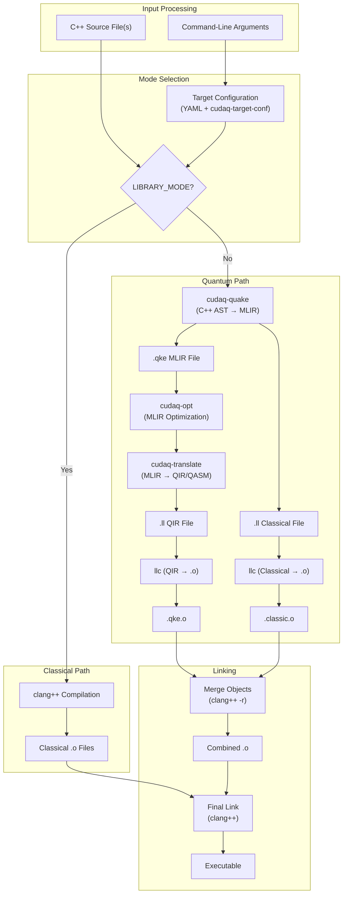
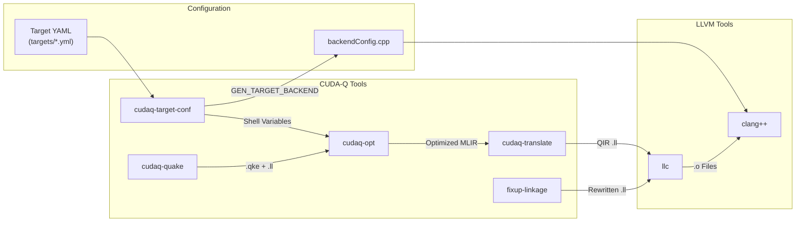
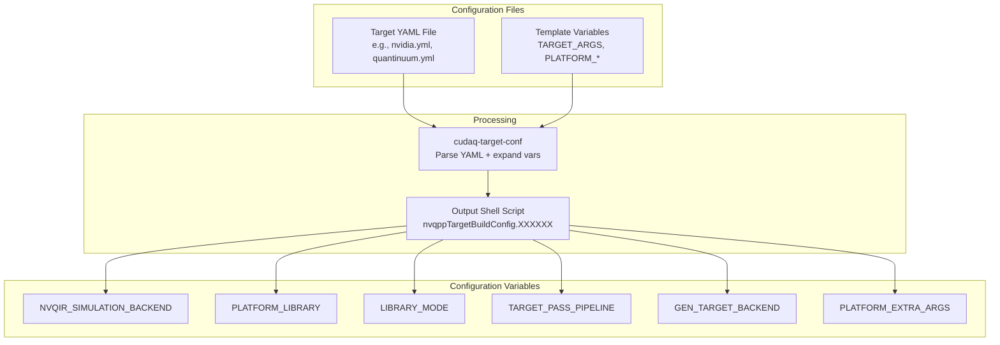
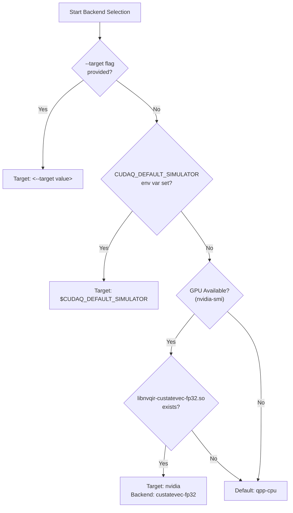
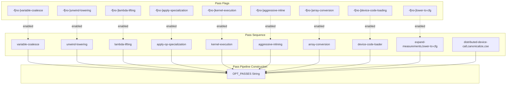
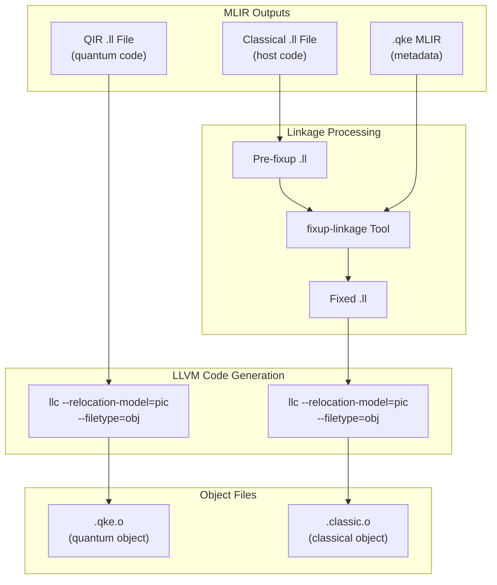
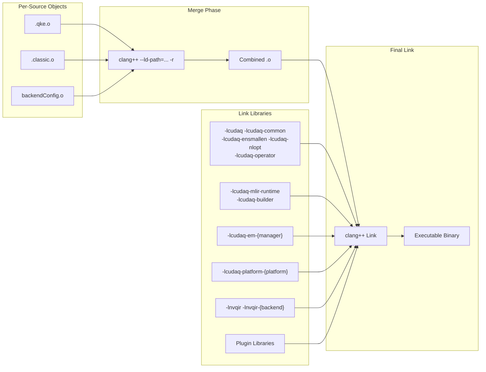

<!-- source: DeepWiki mcp.deepwiki.com · repo NVIDIA/cuda-quantum · page 4.2 nvq++ Compiler Driver · fetched 2026-10-26 -->

# nvq++ Compiler Driver

<details>
<summary>Relevant source files</summary>

The following files were used as context for generating this wiki page:

- [include/cudaq/Optimizer/CodeGen/Passes.h](include/cudaq/Optimizer/CodeGen/Passes.h)
- [include/cudaq/Optimizer/CodeGen/Passes.td](include/cudaq/Optimizer/CodeGen/Passes.td)
- [include/cudaq/Optimizer/InitAllDialects.h](include/cudaq/Optimizer/InitAllDialects.h)
- [lib/Optimizer/CodeGen/CMakeLists.txt](lib/Optimizer/CodeGen/CMakeLists.txt)
- [lib/Optimizer/CodeGen/ConvertCCToLLVM.cpp](lib/Optimizer/CodeGen/ConvertCCToLLVM.cpp)
- [lib/Optimizer/CodeGen/ConvertToQIR.cpp](lib/Optimizer/CodeGen/ConvertToQIR.cpp)
- [lib/Optimizer/CodeGen/ConvertToQIRProfile.cpp](lib/Optimizer/CodeGen/ConvertToQIRProfile.cpp)
- [runtime/common/RuntimeMLIR.cpp](runtime/common/RuntimeMLIR.cpp)
- [runtime/cudaq/platform/default/rest/RemoteRESTQPU.cpp](runtime/cudaq/platform/default/rest/RemoteRESTQPU.cpp)
- [tools/cudaq-opt/cudaq-opt.cpp](tools/cudaq-opt/cudaq-opt.cpp)
- [tools/cudaq-quake/CMakeLists.txt](tools/cudaq-quake/CMakeLists.txt)
- [tools/cudaq-quake/cudaq-quake.cpp](tools/cudaq-quake/cudaq-quake.cpp)
- [tools/cudaq-translate/cudaq-translate.cpp](tools/cudaq-translate/cudaq-translate.cpp)
- [tools/nvqpp/nvq++.in](tools/nvqpp/nvq++.in)

</details>


## Overview

The `nvq++` compiler driver is the primary command-line tool for compiling C++ CUDA-Q programs. Implemented as a bash script wrapper, it orchestrates the entire compilation pipeline from C++ source code to executable binaries, integrating clang++, MLIR tooling, and backend-specific code generation. The driver manages target selection, optimization pass configuration, and linking against CUDA-Q runtime libraries.

For information about defining quantum kernels in C++, see [C++ Kernel Definition](#4.1). For details on how C++ AST is translated to MLIR, see [C++ AST to MLIR Translation](#4.3). For execution APIs, see [C++ Execution and Sampling](#4.4).

Sources: [tools/nvqpp/nvq++.in:1-873]()

## Command-Line Interface

### Basic Usage

The `nvq++` driver accepts standard compiler flags plus CUDA-Q-specific options:

```bash
nvq++ [options] source.cpp -o output
```

| Flag Category | Examples | Description |
|---------------|----------|-------------|
| **Output Control** | `-o <file>`, `-c` | Specify output file, compile-only mode |
| **Target Selection** | `--target=<name>`, `--list-targets` | Select backend, list available targets |
| **Optimization** | `-f[no-]aggressive-inline`, `-f[no-]lambda-lifting` | Control MLIR optimization passes |
| **Code Generation** | `--emit-qir`, `--enable-mlir` | Control output format |
| **Debugging** | `-g`, `-v`, `-save-temps` | Enable debug info, verbose output |
| **Backend Config** | `--<target>-<key> <value>`, `--emulate` | Target-specific options |

Sources: [tools/nvqpp/nvq++.in:171-275]()

### Target Configuration Flags

Target-specific options follow the pattern `--<target-name>-<option-name>` or `--target-option`:

```bash
# Target selection
nvq++ --target=nvidia-mgpu code.cpp

# Target-specific configuration
nvq++ --target=quantinuum --quantinuum-machine H1-1E code.cpp

# Emulation mode for remote targets
nvq++ --target=ionq --emulate code.cpp
```

The driver base64-encodes parameter values to handle spaces and special characters, then passes them to `cudaq-target-conf` for processing.

Sources: [tools/nvqpp/nvq++.in:429-452](), [tools/nvqpp/nvq++.in:648-674]()

### Compilation Mode Control

```bash
# Library mode (classical C++ only, no quantum kernel compilation)
nvq++ --library-mode classical.cpp

# MLIR mode (default for quantum kernels)
nvq++ --enable-mlir quantum_kernel.cpp

# Disable specific passes
nvq++ -fno-kernel-execution -fno-lambda-lifting code.cpp

# Custom pass pipeline
nvq++ --opt-pass "func.func(custom-pass)" code.cpp
```

Sources: [tools/nvqpp/nvq++.in:54-128](), [tools/nvqpp/nvq++.in:531-550]()

## Compilation Pipeline Architecture

### High-Level Flow



**Diagram: nvq++ Compilation Pipeline Flow**

The driver determines compilation mode based on `LIBRARY_MODE` flag. In quantum mode, source files pass through `cudaq-quake` for MLIR generation, `cudaq-opt` for optimization, and `cudaq-translate` for code generation. Classical and quantum object files are merged before final linking.

Sources: [tools/nvqpp/nvq++.in:782-872]()

### Tool Invocation Chain



**Diagram: Tool Dependencies and Data Flow**

Each tool in the pipeline has a specific responsibility: `cudaq-target-conf` processes YAML configuration, `cudaq-quake` handles AST translation, `cudaq-opt` applies optimization passes, `cudaq-translate` generates target code, and standard LLVM tools complete the compilation.

Sources: [tools/nvqpp/nvq++.in:648-674](), [tools/nvqpp/nvq++.in:798-839]()

## Target Configuration System

### YAML Configuration Processing

Target configuration files located in `${install_dir}/targets/*.yml` define backend-specific settings:



**Diagram: Target Configuration Processing**

The `cudaq-target-conf` tool [tools/nvqpp/nvq++.in:652-653]() parses YAML files and generates shell variable assignments that configure the compilation pipeline. These variables control backend selection, pass pipelines, and library linking.

Sources: [tools/nvqpp/nvq++.in:648-674]()

### Backend Selection Logic

The driver implements a priority-based backend selection mechanism:



**Diagram: Backend Selection Priority**

Selection follows: command-line `--target` > `CUDAQ_DEFAULT_SIMULATOR` environment variable > GPU detection with cuStateVec library > default `qpp-cpu` backend.

Sources: [tools/nvqpp/nvq++.in:376-399]()

### Generated Backend Configuration

When `GEN_TARGET_BACKEND=true`, the driver generates a C++ file from a template:

```cpp
// Generated from backendConfig.cpp template
#define NVQPP_TARGET_BACKEND_CONFIG "<target>;emulate;<bool>;disable_qubit_mapping;<bool>;..."
```

This compiled object file is linked into the final binary, setting the runtime backend configuration via `__attribute__((constructor))` initialization.

Sources: [tools/nvqpp/nvq++.in:660-673]()

## Compilation Modes

### Library Mode

In `LIBRARY_MODE`, the driver invokes only classical compilation, skipping MLIR processing:


**Diagram: Library Mode Compilation Path**

Library mode is enabled when:
- `--library-mode` flag is provided
- Target configuration sets `LIBRARY_MODE=true`
- No `__qpu__` annotated functions exist

Preprocessor define `CUDAQ_LIBRARY_MODE` is automatically added.

Sources: [tools/nvqpp/nvq++.in:404](), [tools/nvqpp/nvq++.in:690-693](), [tools/nvqpp/nvq++.in:786-794]()

### MLIR Mode (Quantum Compilation)

MLIR mode is the default for quantum kernels. The driver orchestrates multi-stage processing:

| Stage | Tool | Input | Output |
|-------|------|-------|--------|
| **AST Translation** | `cudaq-quake` | C++ source | `.qke` MLIR + `.ll` classical |
| **Optimization** | `cudaq-opt` | `.qke` MLIR | Optimized MLIR |
| **Code Generation** | `cudaq-translate` | Optimized MLIR | QIR `.ll` |
| **Linkage Fixup** | `fixup-linkage` | Classical `.ll` | Rewritten `.ll` |
| **Object Generation** | `llc` | QIR + Classical `.ll` | `.qke.o` + `.classic.o` |
| **Merge** | `clang++ -r` | Object files | Combined `.o` |

Sources: [tools/nvqpp/nvq++.in:796-839]()

### QIR Emission Mode

The `--emit-qir` flag generates QIR output without compilation:

```bash
nvq++ --emit-qir kernel.cpp
# Produces: kernel.qir.ll
```

This mode runs the full MLIR pipeline but terminates after `cudaq-translate`, outputting the QIR representation for inspection or external processing.

Sources: [tools/nvqpp/nvq++.in:476-480](), [tools/nvqpp/nvq++.in:815-818]()

## MLIR Optimization Pipeline

### Pass Configuration

The driver constructs a pass pipeline string based on enabled optimization flags:



**Diagram: Pass Pipeline Assembly**

Passes are conditionally added to the pipeline string, which is then wrapped in `builtin.module(...)` and passed to `cudaq-opt` via `--pass-pipeline`.

Sources: [tools/nvqpp/nvq++.in:704-774]()

### Default Pass Pipeline

With default settings, the pipeline consists of:

```bash
builtin.module(
  func.func(variable-coalesce),
  func.func(unwind-lowering),
  canonicalize,
  lambda-lifting,
  func.func(memtoreg{quantum=0}),
  canonicalize,
  apply-op-specialization,
  kernel-execution{generate-run-stack=1},
  aggressive-inlining,
  func.func(quake-add-metadata,constant-propagation,lift-array-alloc),
  quake-propagate-metadata,
  globalize-array-values,
  canonicalize,
  get-concrete-matrix,
  device-code-loader,
  expand-measurements,
  lower-to-cfg,
  distributed-device-call,
  canonicalize,
  cse
)
```

Each pass transforms the MLIR representation for optimization and lowering. The JIT compiler resumes from the `device-code-loader` pass.

Sources: [tools/nvqpp/nvq++.in:704-774]()

### Custom Pass Injection

Users can inject custom passes via `--opt-pass`:

```bash
nvq++ --opt-pass "func.func(custom-transform)" \
      --opt-pass "my-module-pass" \
      code.cpp
```

Custom passes are appended to the pipeline after standard passes but before finalization passes.

Sources: [tools/nvqpp/nvq++.in:547-550](), [tools/nvqpp/nvq++.in:749-752]()

### Target-Specific Pass Overrides

Target YAML configurations can override the entire pass pipeline via `TARGET_PASS_PIPELINE`:

```yaml
# In target YAML
passes:
  - target_specific_pass1
  - target_specific_pass2
```

When set, `TARGET_PASS_PIPELINE` replaces the default pipeline entirely, though command-line `--opt-pass` additions are still appended.

Sources: [tools/nvqpp/nvq++.in:768-772]()

## Code Generation and Linking

### Translation to Target Format

The `cudaq-translate` tool converts optimized MLIR to target-specific representations:

| Target Format | `--convert-to` Value | Output |
|---------------|----------------------|--------|
| **Full QIR** | `qir:0.1` (default) | LLVM IR with full QIR runtime calls |
| **Base Profile QIR** | `qir-base:0.1` | Restricted QIR subset for base profile |
| **Adaptive Profile QIR** | `qir-adaptive:0.1` | QIR with mid-circuit measurement support |
| **OpenQASM 2.0** | `openqasm2` | Text format for OpenQASM backends |
| **IQM JSON** | `iqm` | IQM-specific JSON format |

The `PLATFORM_TRANSPORT_LAYER` variable from target configuration specifies the format [tools/nvqpp/nvq++.in:497-499]().

Sources: [tools/nvqpp/nvq++.in:814](), [tools/cudaq-translate/cudaq-translate.cpp:62-70]()

### Object File Generation



**Diagram: Object File Generation Process**

The `fixup-linkage` tool [tools/nvqpp/nvq++.in:823]() rewrites internal linkage in the classical LLVM IR to enable symbol override. Both quantum and classical object files are generated with position-independent code (`-relocation-model=pic`).

Sources: [tools/nvqpp/nvq++.in:820-832]()

### Merging and Linking



**Diagram: Object Merging and Final Linking**

The driver merges quantum, classical, and backend configuration object files using `clang++ -r` [tools/nvqpp/nvq++.in:838](), then performs final linking with CUDA-Q runtime libraries. The execution manager, platform, and NVQIR backend libraries are selected based on target configuration.

Sources: [tools/nvqpp/nvq++.in:323-336](), [tools/nvqpp/nvq++.in:676-687](), [tools/nvqpp/nvq++.in:838-856]()

### Linker Configuration

The driver configures the linker with:

```bash
# Linker path (can be overridden via NVQPP_LD_PATH)
--ld-path=${NVQPP_LD_PATH}

# Runtime library search paths
-Wl,-rpath,${install_dir}/lib
-Wl,-rpath,${install_dir}/lib/plugins
-Wl,-rpath,${PWD}

# Library search paths
-L${install_dir}/lib
-L${install_dir}/lib/plugins
```

RPATH entries ensure runtime libraries are found without `LD_LIBRARY_PATH` configuration.

Sources: [tools/nvqpp/nvq++.in:314-323]()

## Integration with Toolchain Components

### cudaq-quake Integration

The `cudaq-quake` tool translates C++ source to MLIR:

```bash
${TOOLBIN}cudaq-quake \
  ${CLANG_VERBOSE} \
  ${CLANG_RESOURCE_DIR} \
  ${PREPROCESSOR_DEFINES} \
  ${INCLUDES} \
  ${CUDAQ_QUAKE_ARGS} \
  --emit-llvm-file \
  $input.cpp \
  -o ${file}.qke
```

This invocation produces:
- `.qke`: MLIR representation of quantum kernels
- `.ll`: LLVM IR for classical code

The tool internally uses Clang's AST infrastructure via `cudaq::ASTBridgeAction`.

Sources: [tools/nvqpp/nvq++.in:798-799](), [tools/cudaq-quake/cudaq-quake.cpp:196-215]()

### cudaq-opt Integration

Optimization passes are applied via:

```bash
${TOOLBIN}cudaq-opt \
  ${CUDAQ_OPT_ARGS} \
  --pass-pipeline="${OPT_PASSES}" \
  ${QUAKE_IN} \
  -o ${DCL_FILE}
```

The `CUDAQ_OPT_ARGS` may include:
- `--mlir-print-debuginfo`: Preserve debug information
- `--load-cudaq-plugin <lib>`: Load custom pass plugins

Sources: [tools/nvqpp/nvq++.in:543-546](), [tools/nvqpp/nvq++.in:807]()

### cudaq-translate Integration

Code generation to target format:

```bash
${TOOLBIN}cudaq-translate \
  ${CUDAQ_TRANSLATE_ARGS} \
  --convert-to=${PLATFORM_TRANSPORT_LAYER} \
  ${QUAKE_IN} \
  -o ${QUAKELL_FILE}
```

The tool supports multiple translation backends registered via `cudaq::TranslateFromMLIRRegistration`:

```cpp
// Registered translations
registerToQIRTranslation();
registerToOpenQASMTranslation();
registerToIQMJsonTranslation();
```

Sources: [tools/nvqpp/nvq++.in:814](), [runtime/common/RuntimeMLIR.cpp:100-102]()

### Clang++ Integration

The driver delegates to `clang++` for:
- Classical compilation in library mode
- Object file merging with `-r` flag
- Final linking with runtime libraries

Clang resource directory is determined automatically or via `--resource-dir` flag.

Sources: [tools/nvqpp/nvq++.in:406-408](), [tools/nvqpp/nvq++.in:789](), [tools/nvqpp/nvq++.in:838](), [tools/nvqpp/nvq++.in:856]()

## Environment and Preprocessor Configuration

### Preprocessor Defines

The driver automatically adds:

| Define | Condition | Purpose |
|--------|-----------|---------|
| `CUDAQ_LIBRARY_MODE` | Library mode enabled | Disable quantum kernel compilation |
| `CUDAQ_SIMULATION_SCALAR_FP32` | Backend uses FP32 | Configure simulation precision |
| `CUDAQ_SIMULATION_SCALAR_FP64` | Backend uses FP64 | Configure simulation precision (default) |

User-defined macros via `-D<macro>` are passed to all tools.

Sources: [tools/nvqpp/nvq++.in:691-700]()

### Include Path Configuration

Standard include paths:

```bash
# CUDA-Q headers
-I${install_dir}/include

# Build-time fallback
-I${CMAKE_SOURCE_DIR}/runtime
-I${CMAKE_SOURCE_DIR}/tpls/fmt/include
```

User-specified includes via `-I<path>` are prepended to search paths.

Sources: [tools/nvqpp/nvq++.in:287-302](), [tools/nvqpp/nvq++.in:574-592]()

### Temporary File Management

The driver uses `mktemp` for intermediate files:

```bash
OUT_CONFIG_FILENAME=$(mktemp nvqppTargetBuildConfig.XXXXXX)
DCL_FILE=$(mktemp ${file}.qke.XXXXXX)
QUAKELL_FILE=$(mktemp ${file}.ll.XXXXXX)
```

Unless `-save-temps` is specified, these files are removed on exit via trap handler:

```bash
trap delete_temp_files EXIT
```

Sources: [tools/nvqpp/nvq++.in:551-552](), [tools/nvqpp/nvq++.in:632-640](), [tools/nvqpp/nvq++.in:805-811]()

## Advanced Features

### Plugin System

Custom MLIR passes can be loaded dynamically:

```bash
nvq++ --opt-plugin /path/to/libCustomPasses.so \
      --opt-pass "func.func(my-custom-pass)" \
      code.cpp
```

The plugin library is passed to `cudaq-opt` via `--load-cudaq-plugin`, which uses LLVM's plugin infrastructure.

Sources: [tools/nvqpp/nvq++.in:236-240](), [tools/nvqpp/nvq++.in:543-546]()

### Mapping File Support

For backends requiring qubit mapping:

```bash
nvq++ --mapping-file topology.json code.cpp
```

The mapping file path is base64-encoded and passed to the platform via `PLATFORM_EXTRA_ARGS`. The `--disable-qubit-mapping` flag bypasses this mechanism.

Sources: [tools/nvqpp/nvq++.in:216](), [tools/nvqpp/nvq++.in:489-494](), [tools/nvqpp/nvq++.in:665-667]()

### Kernel Execution Mode

The `kernel-execution` pass behavior is controlled via:

```bash
# Specify code generation strategy
nvq++ -fkernel-exec-kind=<strategy> code.cpp
```

This configures the `kernel-execution` pass options:
- `codegen=<value>`: Select code generation variant
- `generate-run-stack=1`: Automatic run stack generation (default)

Sources: [tools/nvqpp/nvq++.in:104-106](), [tools/nvqpp/nvq++.in:723-735]()

### Version Information

```bash
# Display version without compilation
nvq++ --version

# Version string format
nvq++ Version X.Y.Z (https://github.com/NVIDIA/cuda-quantum <commit-sha>)
```

When no source files are provided, the driver displays version information and exits.

Sources: [tools/nvqpp/nvq++.in:269-270](), [tools/nvqpp/nvq++.in:289](), [tools/nvqpp/nvq++.in:776-780]()

## Error Handling

The driver implements error handling via bash functions:

```bash
function error_exit {
  # Display error in red
  echo "${RED}${message_content}${NORMAL}" >&2
  exit 1
}

function run {
  # Execute command, exit on failure
  "$@"
  if [ $? -ne 0 ]; then
    echo "failed: \"$@\"" >&2
    exit 1
  fi
}
```

All tool invocations use the `run` function to ensure compilation terminates immediately on errors.

Sources: [tools/nvqpp/nvq++.in:14-36]()

---

