<!-- source: DeepWiki mcp.deepwiki.com · repo NVIDIA/cuda-quantum · page 4.3 C++ AST to MLIR Translation · fetched 2026-10-26 -->

# C++ AST to MLIR Translation

<details>
<summary>Relevant source files</summary>

The following files were used as context for generating this wiki page:

- [include/cudaq/Frontend/nvqpp/ASTBridge.h](include/cudaq/Frontend/nvqpp/ASTBridge.h)
- [include/cudaq/Optimizer/Dialect/CC/CCTypes.h](include/cudaq/Optimizer/Dialect/CC/CCTypes.h)
- [include/cudaq/Optimizer/Dialect/CC/CCTypes.td](include/cudaq/Optimizer/Dialect/CC/CCTypes.td)
- [lib/Frontend/nvqpp/ASTBridge.cpp](lib/Frontend/nvqpp/ASTBridge.cpp)
- [lib/Frontend/nvqpp/ConvertDecl.cpp](lib/Frontend/nvqpp/ConvertDecl.cpp)
- [lib/Frontend/nvqpp/ConvertExpr.cpp](lib/Frontend/nvqpp/ConvertExpr.cpp)
- [lib/Frontend/nvqpp/ConvertType.cpp](lib/Frontend/nvqpp/ConvertType.cpp)
- [lib/Optimizer/Dialect/CC/CCTypes.cpp](lib/Optimizer/Dialect/CC/CCTypes.cpp)
- [test/AST-Quake/array.cpp](test/AST-Quake/array.cpp)
- [test/AST-Quake/ctor-1.cpp](test/AST-Quake/ctor-1.cpp)
- [test/AST-Quake/ctor-2.cpp](test/AST-Quake/ctor-2.cpp)
- [test/AST-Quake/struct-1.cpp](test/AST-Quake/struct-1.cpp)
- [test/AST-Quake/struct-2.cpp](test/AST-Quake/struct-2.cpp)

</details>


## Purpose and Scope

This subsystem is responsible for translating C++ Abstract Syntax Trees (ASTs) into MLIR representations using the Quake and CC dialects. The **QuakeBridgeVisitor** traverses Clang's AST nodes and generates corresponding MLIR operations, types, and control flow structures.

This translation occurs during ahead-of-time compilation via the `nvq++` compiler driver. For information about the Python AST translation path, see [Python Kernel System Architecture](#3). For details on the MLIR dialects themselves, see [MLIR Dialects](#2.2). For the nvq++ compiler driver, see [nvq++ Compiler Driver](#4.2).

**Sources:** [lib/Frontend/nvqpp/ASTBridge.cpp:1-100](), [include/cudaq/Frontend/nvqpp/ASTBridge.h:123-142]()

## Architecture Overview

The translation system is built around the **QuakeBridgeVisitor** class, which inherits from Clang's `RecursiveASTVisitor`. This visitor pattern enables post-order traversal of the AST, building MLIR IR from leaves to root.

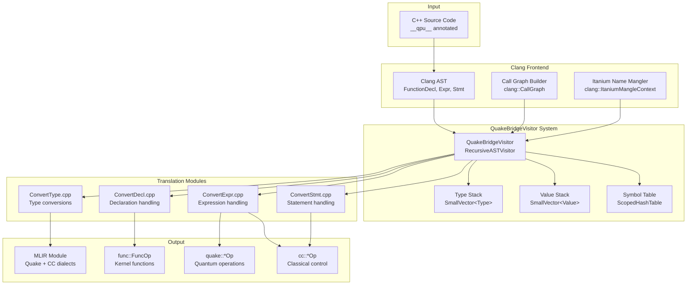

**Key Architectural Principles:**

1. **Post-Order Traversal**: Child nodes are visited before parents, allowing subexpressions to be constructed before their containing expressions
2. **Stack-Based Construction**: Type and value stacks enable bottom-up IR construction
3. **Symbol Table Management**: Scoped symbol tables track variable bindings through nested scopes
4. **Specialized Handlers**: Different AST node types are handled by specialized Visit* and Traverse* methods

**Sources:** [include/cudaq/Frontend/nvqpp/ASTBridge.h:141-161](), [lib/Frontend/nvqpp/ASTBridge.cpp:147-386]()

## QuakeBridgeVisitor Class Structure

The `QuakeBridgeVisitor` class coordinates all aspects of AST-to-MLIR translation:

| Component | Type | Purpose |
|-----------|------|---------|
| `astContext` | `clang::ASTContext*` | Access to Clang type system and diagnostics |
| `mlirContext` | `mlir::MLIRContext*` | MLIR context for creating types and operations |
| `builder` | `mlir::OpBuilder` | MLIR operation builder at current insertion point |
| `module` | `mlir::ModuleOp` | Target MLIR module being constructed |
| `symbolTable` | `SymbolTable` | Maps variable names to MLIR values |
| `typeStack` | `SmallVector<Type>` | Stack of types during traversal |
| `valueStack` | `SmallVector<Value>` | Stack of values during traversal |
| `functionsToEmit` | `EmittedFunctionsCollection` | Queue of kernel functions to translate |
| `mangler` | `clang::ItaniumMangleContext*` | Name mangling for symbol generation |

**Sources:** [include/cudaq/Frontend/nvqpp/ASTBridge.h:146-161](), [include/cudaq/Frontend/nvqpp/ASTBridge.h:516-616]()

## Type Conversion System

C++ types are converted to MLIR types through specialized traversal methods. The system distinguishes between quantum types (Quake dialect) and classical types (CC dialect).

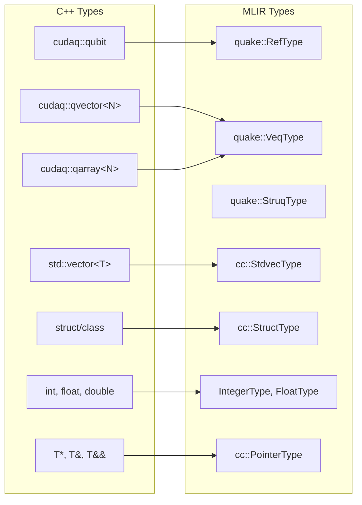

### Type Interception

High-level CUDA-Q types are intercepted during record traversal to map them to appropriate MLIR types:

**Quantum Type Mappings:**
- `cudaq::qubit`, `cudaq::qudit` → `quake::RefType`
- `cudaq::qreg<N>`, `cudaq::qarray<N>`, `cudaq::qspan<N>` → `quake::VeqType` (sized or unsized)
- `cudaq::qvector`, `cudaq::qview` → `quake::VeqType` (unsized)

**Classical Type Mappings:**
- `std::vector<T>` → `cc::StdvecType<T>` (for classical T) or `quake::VeqType` (if T is `qubit`)
- `std::complex<T>` → `ComplexType`
- `std::function<Sig>` → `cc::CallableType`
- `cudaq::qkernel<Sig>` → `cc::IndirectCallableType`
- Struct/class types → `cc::StructType`

**Sources:** [lib/Frontend/nvqpp/ConvertDecl.cpp:124-317](), [lib/Frontend/nvqpp/ConvertType.cpp:167-219]()

### Type Stack Protocol

Type traversal follows a strict stack discipline:

1. **Push**: Each `TraverseType` or `VisitType` method pushes exactly one type onto `typeStack`
2. **Pop**: Parent nodes pop the required number of types when constructing compound types
3. **Assertion**: Debug builds verify stack depth constraints

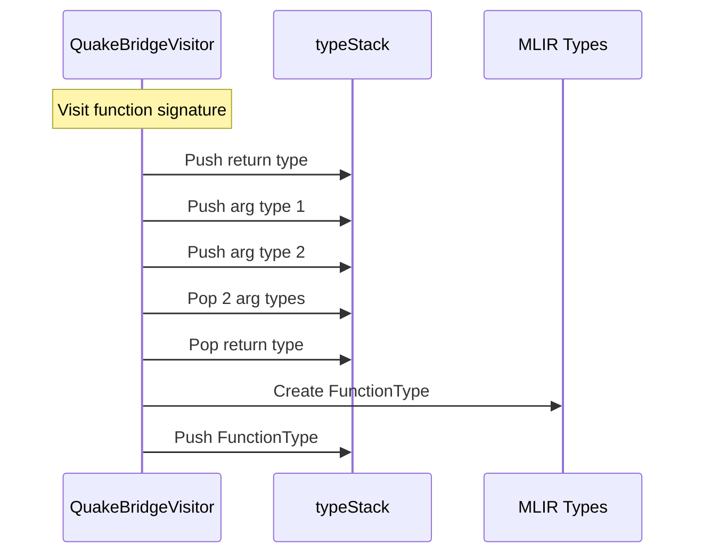

**Sources:** [lib/Frontend/nvqpp/ConvertType.cpp:484-510](), [lib/Frontend/nvqpp/ASTBridge.h:591-616]()

## Expression Translation

Expression nodes are translated through specialized `Visit*` methods that generate MLIR operations and push result values onto the value stack.

### Expression Handling Flow

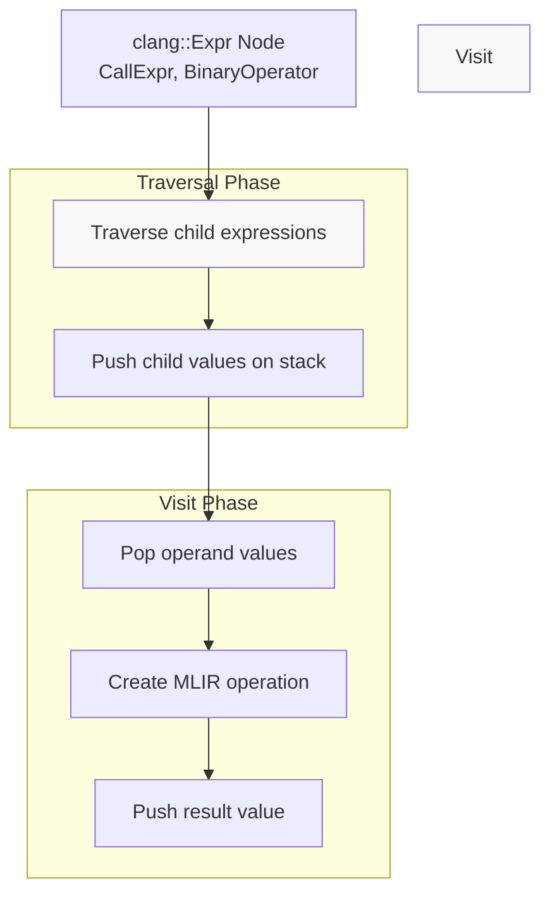

### Literal Translation

Literal expressions are converted to constant operations:

- **IntegerLiteral**: `arith::ConstantIntOp` with appropriate bit width
- **FloatingLiteral**: `arith::ConstantOp` with `FloatAttr`
- **CXXBoolLiteralExpr**: `arith::ConstantIntOp` with i1 type
- **CharacterLiteral**: `arith::ConstantIntOp` with character value

**Sources:** [lib/Frontend/nvqpp/ConvertExpr.cpp:344-376]()

### Binary Operator Translation

Binary operators are translated based on operand types and operator kind:

| C++ Operator | Integer MLIR Op | Floating Point MLIR Op |
|--------------|-----------------|------------------------|
| `+` | `arith::AddIOp` | `arith::AddFOp` |
| `-` | `arith::SubIOp` | `arith::SubFOp` |
| `*` | `arith::MulIOp` | `arith::MulFOp` |
| `/` | `arith::DivSIOp`/`arith::DivUIOp` | `arith::DivFOp` |
| `%` | `arith::RemSIOp`/`arith::RemUIOp` | N/A |
| `<`, `<=`, `>`, `>=`, `==`, `!=` | `arith::CmpIOp` | `arith::CmpFOp` |
| `=` | `cc::StoreOp` | `cc::StoreOp` |

**Type Coercion**: When operands have different types, `castToSameType` function promotes them to a common type following C++ implicit conversion rules.

**Sources:** [lib/Frontend/nvqpp/ConvertExpr.cpp:788-909](), [lib/Frontend/nvqpp/ConvertExpr.cpp:236-282]()

### Unary Operator Translation

| C++ Operator | MLIR Translation |
|--------------|------------------|
| `++` (prefix/postfix) | `arith::AddIOp` + `cc::StoreOp` |
| `--` (prefix/postfix) | `arith::SubIOp` + `cc::StoreOp` |
| `!` | `arith::CmpIOp` with `eq` predicate against zero |
| `-` (negation) | `arith::MulIOp`/`arith::MulFOp` by -1 |
| `*` (dereference) | `cc::LoadOp` |
| `&` (address-of) | No-op (value already an address) |

**Sources:** [lib/Frontend/nvqpp/ConvertExpr.cpp:378-465]()

### Call Expression Translation

Function calls are handled by `VisitCallExpr`, which:

1. **Resolves callee**: Determines if call is to a quantum gate, kernel, or classical function
2. **Processes arguments**: Pops argument values from stack and performs necessary conversions
3. **Generates call**: Creates `func::CallOp`, `quake::ApplyOp`, or quantum gate operation

**Quantum Gate Calls**: Special handling intercepts calls to quantum gates (h, x, y, z, cnot, etc.) and generates corresponding `quake::*Op` operations.

**Sources:** [lib/Frontend/nvqpp/ConvertExpr.cpp:1146-1729]()

## Statement Translation

Control flow statements are translated to CC dialect operations that manage execution flow.

### Control Flow Statement Mapping

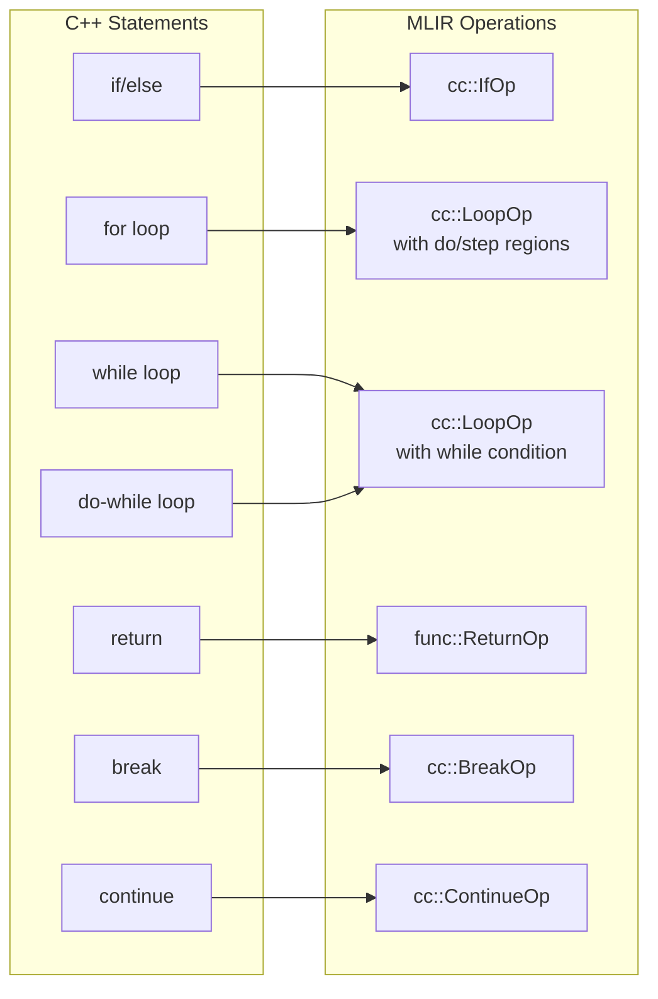

### If Statement Translation

The `TraverseIfStmt` method generates `cc::IfOp` with separate regions for then and else branches:

1. **Condition**: Traverse condition expression, pop boolean value
2. **Then Region**: Create region, set insertion point, traverse then statement
3. **Else Region**: Optionally create region for else clause
4. **Continuation**: Both regions must end with `cc::ContinueOp`

**Sources:** [lib/Frontend/nvqpp/ConvertStmt.cpp:178-248]()

### Loop Translation

Loops are translated to `cc::LoopOp` with up to three regions:

| C++ Loop | Regions Used |
|----------|--------------|
| `for(init; cond; step)` | `while` (condition), `do` (body), `step` (increment) |
| `while(cond)` | `while` (condition), `do` (body) |
| `do {...} while(cond)` | `while` (condition at end), `do` (body) |

**Loop Variables**: Carried through block arguments in the `cc::LoopOp` regions, implementing SSA form for mutable loop state.

**Sources:** [lib/Frontend/nvqpp/ConvertStmt.cpp:250-421]()

### Compound Statement Translation

`TraverseCompoundStmt` creates a new symbol table scope for block-local variables:

1. **Enter Scope**: Create `SymbolTableScope` 
2. **Process Statements**: Traverse each child statement sequentially
3. **Exit Scope**: Automatically pop scope, removing local bindings

**Sources:** [lib/Frontend/nvqpp/ConvertStmt.cpp:92-111]()

## Declaration Translation

### Function Declaration Processing

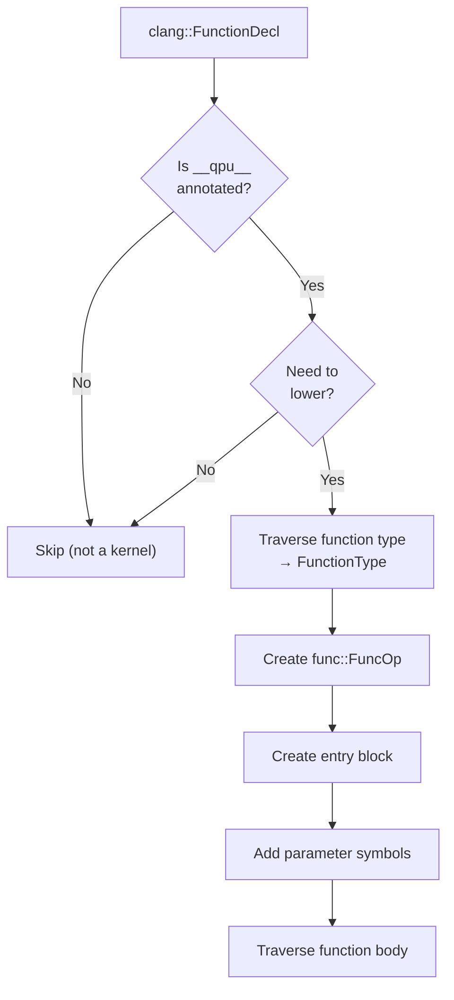

The `TraverseFunctionDecl` method orchestrates function lowering:

1. **Check if kernel**: Determine if function is in `functionsToEmit` collection
2. **Generate name**: Use mangled name or entry point name via `generateCudaqKernelName`
3. **Create function**: Call `getOrAddFunc` to create or retrieve `func::FuncOp`
4. **Setup entry block**: Create block with parameter arguments
5. **Map parameters**: Add parameter symbols to symbol table via `addArgumentSymbols`
6. **Lower body**: Traverse function body statements

**Sources:** [lib/Frontend/nvqpp/ConvertDecl.cpp:358-507](), [lib/Frontend/nvqpp/ConvertDecl.cpp:81-116]()

### Variable Declaration Processing

`TraverseVarDecl` and `VisitVarDecl` handle local variable declarations:

**Quantum Variables:**
- `cudaq::qubit` → `quake::AllocaOp` producing `quake::RefType`
- `cudaq::qvector<N>` → `quake::AllocaOp` producing `quake::VeqType`

**Classical Variables:**
- Scalar types → `cc::AllocaOp` + optional initialization via `cc::StoreOp`
- `std::vector<T>` → Variable bound directly to initializer value
- Struct types → `cc::AllocaOp` with member-wise initialization

**Special Handling for Measurement Results**: When `std::vector<bool>` is initialized from measurement, the system traces back to find the associated `quake::MzOp` and tags it with the variable name as a register name attribute.

**Sources:** [lib/Frontend/nvqpp/ConvertDecl.cpp:629-801]()

### Record Declaration Processing

Struct and class types are processed by `interceptRecordDecl` which maps C++ aggregate types to MLIR types:

**Type Analysis:**
1. Check if all members are quantum references → `quake::StruqType`
2. Check if any members are quantum types → Error (hybrid types not allowed)
3. Otherwise → `cc::StructType` with member types and layout information

**Layout Information**: The `getWidthAndAlignment` function queries Clang for ABI size and alignment, which are encoded in the `cc::StructType` for compatibility with C++ calling conventions.

**Sources:** [lib/Frontend/nvqpp/ConvertDecl.cpp:124-335](), [lib/Frontend/nvqpp/ConvertType.cpp:221-335]()

## Symbol and Value Management

### Symbol Table Operations

The symbol table uses a scoped hash table that automatically manages variable visibility:

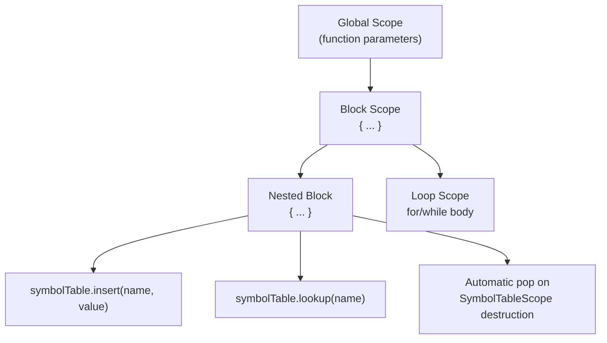

**Key Operations:**
- `symbolTable.insert(name, value)`: Bind name to MLIR value in current scope
- `symbolTable.lookup(name)`: Retrieve value, searching enclosing scopes
- `SymbolTableScope scope(symbolTable)`: RAII scope guard for automatic cleanup

**Sources:** [include/cudaq/Frontend/nvqpp/ASTBridge.h:85-87](), [lib/Frontend/nvqpp/ConvertStmt.cpp:92-111]()

### Value Stack Protocol

The value stack accumulates subexpression results during post-order traversal:

**Stack Operations:**
- `pushValue(v)`: Add value to top of stack (returns true for method chaining)
- `popValue()`: Remove and return top value
- `peekValue()`: Return top value without removing
- `lastValues(n)`: Pop n values in left-to-right order

**Debug Instrumentation**: In debug builds, stack operations are logged with indentation reflecting depth, and assertions verify stack discipline.

**Sources:** [include/cudaq/Frontend/nvqpp/ASTBridge.h:563-589](), [lib/Frontend/nvqpp/ASTBridge.cpp:388-424]()

### Argument Conversion

When calling a function, the `convertKernelArgs` method ensures type conformance:

1. **Promotion**: Load pass-by-reference arguments to pass-by-value
2. **Relaxation**: Relax sized `quake::VeqType` to unsized if callee expects it
3. **Coercion**: Apply integer or floating-point type coercion
4. **Casting**: Cast pointer types when necessary

**Sources:** [lib/Frontend/nvqpp/ConvertExpr.cpp:494-555]()

## Cast Expression Handling

Cast expressions require special traversal to ensure the target type is available:

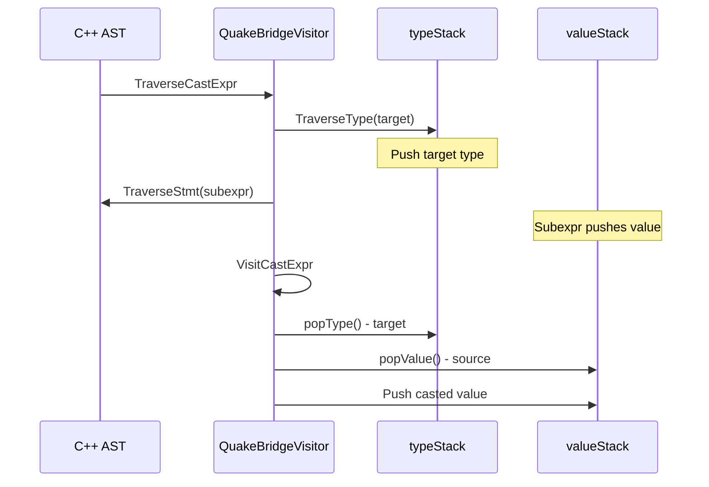

**Cast Kinds Handled:**
- `CK_LValueToRValue`: Generate `cc::LoadOp`
- `CK_IntegralCast`: Generate `cc::CastOp` with signed/unsigned mode
- `CK_FloatingCast`: Generate `cc::CastOp` for float width changes
- `CK_FloatingToIntegral`, `CK_IntegralToFloating`: Generate `cc::CastOp` with conversion mode
- `CK_BitCast`: Generate `cc::CastOp` for reinterpretation
- `CK_NoOp`, `CK_FunctionToPointerDecay`, `CK_ArrayToPointerDecay`: Pass through (no operation)

**Sources:** [lib/Frontend/nvqpp/ConvertExpr.cpp:557-713]()

## Entry Point and Kernel Processing

### Kernel Discovery

The `QPUCodeFinder` visitor identifies kernels before the main lowering pass:

1. **Scan AST**: Visit all function declarations
2. **Check Annotation**: Test for `__qpu__` attribute via `isQuantum()`
3. **Generate Name**: Compute tag name via `getTagNameOfFunctionDecl`
4. **Queue for Emission**: Add to `functionsToEmit` collection
5. **Build Call Graph**: Add to `clang::CallGraph` for reachability analysis

**Lambda Kernels**: Lambda expressions with quantum code are also identified and queued using their type-mangled names.

**Sources:** [lib/Frontend/nvqpp/ASTBridge.cpp:147-386]()

### Name Mangling Strategy

Kernel names are generated to support runtime introspection:

| Kernel Type | Name Format | Example |
|-------------|-------------|---------|
| Plain function | `function_<name>.<mangled>` | `function_ghz._Z3ghzi` |
| Template function | `instance_function_<name><types>.<mangled>` | `instance_function_ghz1N._Z3ghzIiEvv` |
| Class method | `<class_mangled>.<method_mangled>` | `1S._ZN1SclEv` |
| Template method | `instance_<class_mangled><types>.<method_mangled>` | `instance_1S1N._ZN1SclEi` |

This naming scheme allows C++ code to look up kernels at runtime using `cudaq::get_kernel_name()` functions.

**Sources:** [lib/Frontend/nvqpp/ASTBridge.cpp:100-145](), [include/cudaq/Frontend/nvqpp/ASTBridge.h:165-173]()

### Function Signature Validation

The `doSyntaxChecks` method validates that kernel signatures use only allowed types:

**Allowed Argument Types:**
- Arithmetic types (integers, floats, bool, complex)
- Arithmetic sequences: `std::vector<T>`, `T[]` where T is arithmetic
- Arithmetic products: `struct` containing only arithmetic types
- Quantum types: `cudaq::qubit`, `cudaq::qvector`, etc.
- Callables: `std::function`, lambda, `cudaq::qkernel`
- Strings: `const char*` (for runtime arguments)

**Allowed Result Types:**
- Arithmetic types
- Arithmetic sequences with static sizes
- Arithmetic products with static member types

**Error Reporting**: Invalid types trigger Clang diagnostics at the error level, preventing compilation.

**Sources:** [lib/Frontend/nvqpp/ConvertType.cpp:518-552]()

## Quantum Gate Operation Generation

Quantum gate calls are intercepted and converted to Quake operations:

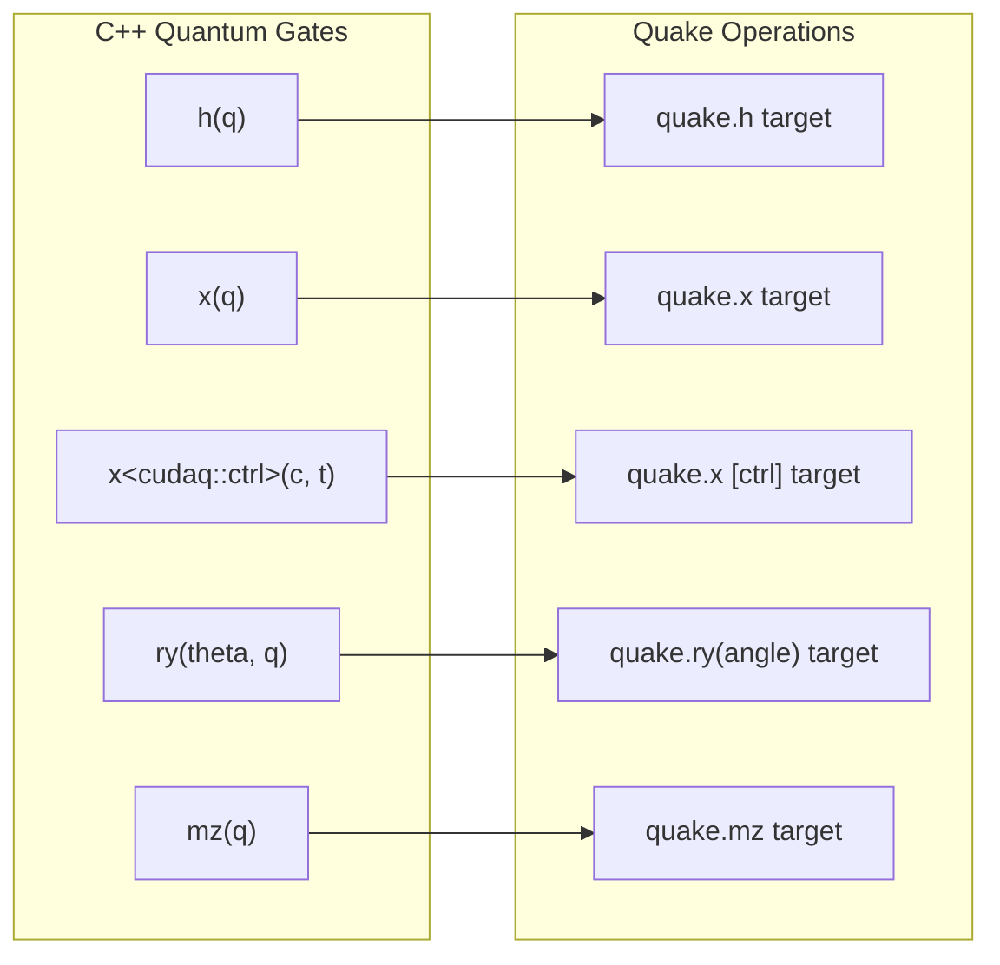

### Gate Operation Construction

The `buildOp` template function handles multiple overload patterns:

**Overload 1: `op(qubit...)`**
- Last qubit is target
- All preceding qubits are controls

**Overload 2: `op(qvector, qubit)`**
- Vector qubits are controls
- Single qubit is target

**Overload 3: `op(qvector)`**
- Apply operation element-wise via `cc::LoopOp`

**Parameterized Gates**: For rotation gates (rx, ry, rz), the first operand is the rotation angle parameter.

**Negated Controls**: The `negatedControlsAttribute` function generates `DenseBoolArrayAttr` to mark negated control qubits.

**Sources:** [lib/Frontend/nvqpp/ConvertExpr.cpp:94-195](), [lib/Frontend/nvqpp/ConvertExpr.cpp:52-92]()

## Error Handling and Diagnostics

### Clang Diagnostic Integration

The bridge integrates with Clang's diagnostic system:

```cpp
reportClangError(astNode, mangler, "error message")
```

This function:
1. Gets Clang's `DiagnosticsEngine`
2. Creates custom diagnostic ID with `Error` level
3. Reports at AST node's source location
4. Message appears in compiler output with source context

**Sources:** [include/cudaq/Frontend/nvqpp/ASTBridge.h:32-46]()

### TODO Macro for Unimplemented Features

The `TODO_x` macro provides consistent error reporting for unsupported C++ features:

```cpp
TODO_x(loc, astNode, mangler, "feature description")
```

In release builds, this reports a Clang error. In debug builds, it additionally emits an MLIR diagnostic with source file and line number for developers.

**Sources:** [include/cudaq/Frontend/nvqpp/ASTBridge.h:48-74]()

### Type System Validation

Several validation functions ensure type safety:

- **Quantum type restrictions**: `cc::StructType` and `cc::ArrayType` verify methods reject quantum element types
- **Hybrid struct detection**: `VisitRecordDecl` enforces that structs are either pure quantum or pure classical
- **Method restrictions**: Product types with user-defined methods are rejected

**Sources:** [lib/Frontend/nvqpp/ConvertType.cpp:107-115](), [lib/Frontend/nvqpp/ConvertDecl.cpp:232-334]()

## Special Translation Cases

### Short-Circuit Logical Operators

The `&&` and `||` operators require special handling because they have conditional evaluation semantics:

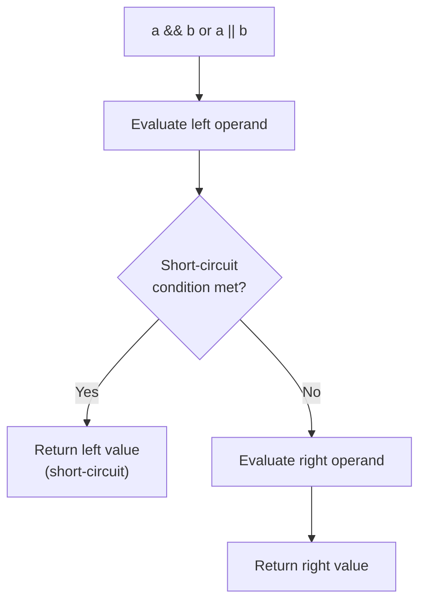

Implementation uses `cc::IfOp`:
- **&&**: If left is false, return false without evaluating right
- **||**: If left is true, return true without evaluating right

**Sources:** [lib/Frontend/nvqpp/ConvertExpr.cpp:715-786]()

### Constructor Expression Handling

C++ constructor expressions (`CXXConstructExpr`) are handled specially:

**Trivial Constructors**: For quantum types and callables, the constructor is elided - the value is simply passed through.

**Aggregate Initialization**: For structs, member-wise initialization is generated with `cc::ComputePtrOp` to address each member.

**Vector Initialization**: For `std::vector`, initialization list is converted to `cc::StdvecInitOp`.

**Sources:** [lib/Frontend/nvqpp/ConvertExpr.cpp:1736-2029]()

### Member Access Translation

Member expressions (`MemberExpr`) translate to pointer arithmetic:

1. **Load base**: If base is addressable, load it
2. **Compute offset**: Use `cc::ComputePtrOp` with member index
3. **Push address**: Result is a pointer to the member

For quantum structs (`quake::StruqType`), members are extracted via `quake::ExtractOp` instead.

**Sources:** [lib/Frontend/nvqpp/ConvertExpr.cpp:2031-2112]()

## Integration with Compilation Pipeline

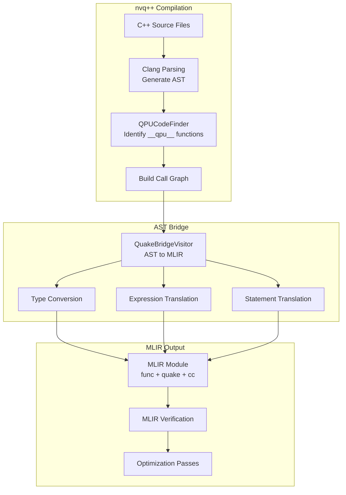

The QuakeBridgeVisitor is invoked from the `ASTBridgeAction::ASTBridgeConsumer` which:

1. Instantiates `QPUCodeFinder` to scan for kernels
2. Builds call graph for reachability analysis
3. Creates `QuakeBridgeVisitor` with initialized context
4. Iterates through `functionsToEmit`, calling visitor for each
5. Verifies resulting MLIR module

**Sources:** [lib/Frontend/nvqpp/ASTBridge.cpp:430-554]()

---

