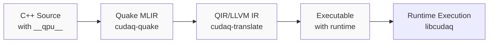
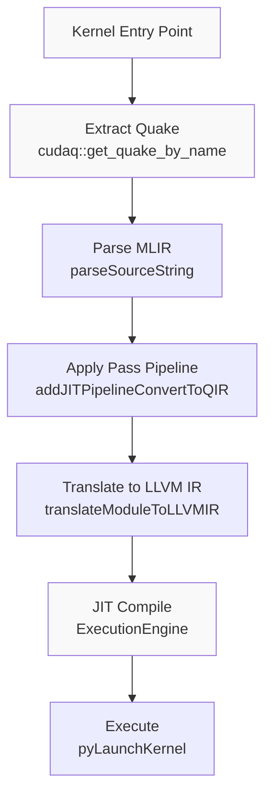
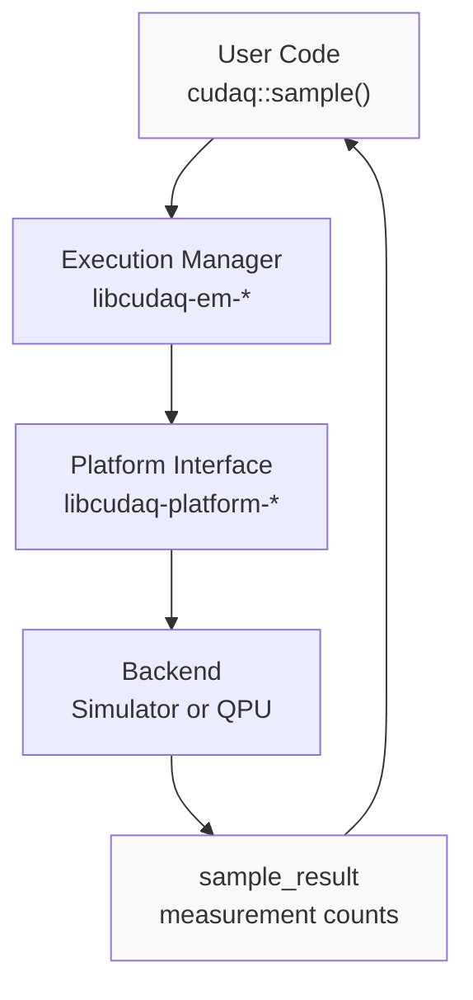
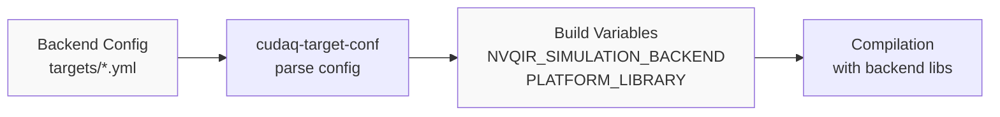
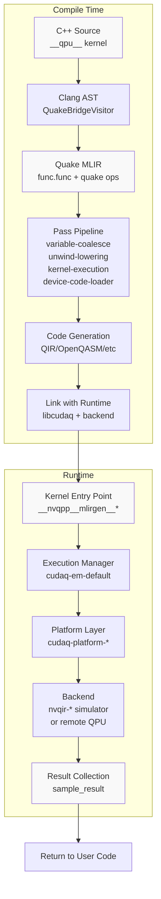

<!-- source: DeepWiki mcp.deepwiki.com · repo NVIDIA/cuda-quantum · page 4.4 C++ Execution and Sampling · fetched 2026-10-26 -->

# C++ Execution and Sampling

<details>
<summary>Relevant source files</summary>

The following files were used as context for generating this wiki page:

- [include/cudaq/Frontend/nvqpp/ASTBridge.h](include/cudaq/Frontend/nvqpp/ASTBridge.h)
- [include/cudaq/Optimizer/CodeGen/Passes.h](include/cudaq/Optimizer/CodeGen/Passes.h)
- [include/cudaq/Optimizer/CodeGen/Passes.td](include/cudaq/Optimizer/CodeGen/Passes.td)
- [include/cudaq/Optimizer/Dialect/CC/CCTypes.h](include/cudaq/Optimizer/Dialect/CC/CCTypes.h)
- [include/cudaq/Optimizer/Dialect/CC/CCTypes.td](include/cudaq/Optimizer/Dialect/CC/CCTypes.td)
- [include/cudaq/Optimizer/InitAllDialects.h](include/cudaq/Optimizer/InitAllDialects.h)
- [lib/Frontend/nvqpp/ASTBridge.cpp](lib/Frontend/nvqpp/ASTBridge.cpp)
- [lib/Frontend/nvqpp/ConvertDecl.cpp](lib/Frontend/nvqpp/ConvertDecl.cpp)
- [lib/Frontend/nvqpp/ConvertExpr.cpp](lib/Frontend/nvqpp/ConvertExpr.cpp)
- [lib/Frontend/nvqpp/ConvertType.cpp](lib/Frontend/nvqpp/ConvertType.cpp)
- [lib/Optimizer/CodeGen/CMakeLists.txt](lib/Optimizer/CodeGen/CMakeLists.txt)
- [lib/Optimizer/CodeGen/ConvertCCToLLVM.cpp](lib/Optimizer/CodeGen/ConvertCCToLLVM.cpp)
- [lib/Optimizer/CodeGen/ConvertToQIR.cpp](lib/Optimizer/CodeGen/ConvertToQIR.cpp)
- [lib/Optimizer/CodeGen/ConvertToQIRProfile.cpp](lib/Optimizer/CodeGen/ConvertToQIRProfile.cpp)
- [lib/Optimizer/Dialect/CC/CCTypes.cpp](lib/Optimizer/Dialect/CC/CCTypes.cpp)
- [runtime/common/RuntimeMLIR.cpp](runtime/common/RuntimeMLIR.cpp)
- [runtime/cudaq/platform/default/rest/RemoteRESTQPU.cpp](runtime/cudaq/platform/default/rest/RemoteRESTQPU.cpp)
- [test/AST-Quake/array.cpp](test/AST-Quake/array.cpp)
- [test/AST-Quake/ctor-1.cpp](test/AST-Quake/ctor-1.cpp)
- [test/AST-Quake/ctor-2.cpp](test/AST-Quake/ctor-2.cpp)
- [test/AST-Quake/struct-1.cpp](test/AST-Quake/struct-1.cpp)
- [test/AST-Quake/struct-2.cpp](test/AST-Quake/struct-2.cpp)
- [tools/cudaq-opt/cudaq-opt.cpp](tools/cudaq-opt/cudaq-opt.cpp)
- [tools/cudaq-quake/CMakeLists.txt](tools/cudaq-quake/CMakeLists.txt)
- [tools/cudaq-quake/cudaq-quake.cpp](tools/cudaq-quake/cudaq-quake.cpp)
- [tools/cudaq-translate/cudaq-translate.cpp](tools/cudaq-translate/cudaq-translate.cpp)
- [tools/nvqpp/nvq++.in](tools/nvqpp/nvq++.in)

</details>


## Purpose and Scope

This page documents the execution model and sampling APIs for C++ quantum kernels in CUDA-Q. It covers how compiled kernels are invoked, how to sample measurement results, and how execution is routed to different backends. For kernel definition syntax and the `__qpu__` annotation, see [C++ Kernel Definition](#4.1). For compilation details and the `nvq++` driver, see [nvq++ Compiler Driver](#4.2). For Python execution APIs, see [Execution and Sampling](#3.3).

## Compilation and Execution Model

CUDA-Q supports two primary execution modes for C++ kernels: Ahead-of-Time (AOT) compilation and Just-in-Time (JIT) compilation.

### Ahead-of-Time (AOT) Compilation

In AOT mode, `nvq++` compiles the entire C++ source to a standalone executable. The compilation pipeline is:



**Compilation Pipeline for AOT**

The `nvq++` driver orchestrates this process through several steps defined in [tools/nvqpp/nvq++.in:782-840](). The key stages are:

1. **C++ to Quake**: `cudaq-quake` tool converts annotated C++ to MLIR Quake dialect [tools/nvqpp/nvq++.in:798]()
2. **MLIR Optimization**: `cudaq-opt` applies transformation passes [tools/nvqpp/nvq++.in:804-808]()
3. **Code Generation**: `cudaq-translate` converts to target format (QIR, OpenQASM, etc.) [tools/nvqpp/nvq++.in:814]()
4. **LLVM Compilation**: `llc` generates object files [tools/nvqpp/nvq++.in:826-831]()
5. **Linking**: Kernels linked with runtime libraries [tools/nvqpp/nvq++.in:838-856]()

The generated executable contains both classical host code and quantum kernel code, linked against:
- `libcudaq` - core runtime
- `libcudaq-em-{manager}` - execution manager
- `libcudaq-platform-{platform}` - platform interface
- `libnvqir-{backend}` - backend simulator/QPU interface

**Sources**: [tools/nvqpp/nvq++.in:782-856](), [tools/nvqpp/nvq++.in:680-688]()

### Just-in-Time (JIT) Compilation

JIT compilation is used when kernels are executed from Python or when the runtime needs to recompile kernels for specific backends. The JIT pipeline:



**JIT Compilation Flow**

The JIT infrastructure is implemented in [runtime/common/RuntimeMLIR.cpp](). Key components:

- **MLIR Initialization**: One-time setup of MLIR context and dialects [runtime/common/RuntimeMLIR.cpp:94-113]()
- **Quake Extraction**: Retrieves stored MLIR representation [runtime/cudaq/platform/default/rest/RemoteRESTQPU.cpp:38]()
- **Module Parsing**: Converts text to MLIR ModuleOp [runtime/cudaq/platform/default/rest/RemoteRESTQPU.cpp:39]()
- **Pass Pipeline**: Applies backend-specific transformations [lib/Optimizer/CodeGen/ConvertToQIR.cpp:195]()

**Sources**: [runtime/common/RuntimeMLIR.cpp:94-113](), [runtime/cudaq/platform/default/rest/RemoteRESTQPU.cpp:31-45]()

## Execution APIs

CUDA-Q provides C++ APIs for kernel execution and result sampling. These APIs are declared in the `cudaq` namespace.

### Sampling API: `cudaq::sample()`

The `sample()` function executes a quantum kernel and returns measurement results.

**Signature Pattern**:
```cpp
cudaq::sample_result sample(KernelType&& kernel, Args&&... args);
cudaq::sample_result sample(std::size_t shots, KernelType&& kernel, Args&&... args);
```

**Key Characteristics**:
- Returns `cudaq::sample_result` containing measurement counts
- Default shot count is 1000 (configurable per call)
- Arguments must match kernel signature
- Kernel can be function pointer, lambda, or callable struct

**Backend Routing**: The sample operation is routed through the execution manager and platform layer to the selected backend.



**Execution Manager Selection**: The execution manager is selected at link time through the `-lcudaq-em-{manager}` library, where `{manager}` can be:
- `default` - standard execution manager
- Custom execution managers for specific workflows

**Sources**: [tools/nvqpp/nvq++.in:685]()

### Observation API: `cudaq::observe()`

The `observe()` function computes expectation values of observables (Pauli operators).

**Signature Pattern**:
```cpp
cudaq::observe_result observe(KernelType&& kernel, 
                              cudaq::spin_op& observable,
                              Args&&... args);
cudaq::observe_result observe(std::size_t shots,
                              KernelType&& kernel,
                              cudaq::spin_op& observable, 
                              Args&&... args);
```

**Key Characteristics**:
- Returns `cudaq::observe_result` with expectation value and variance
- Observable specified as `cudaq::spin_op` (Pauli operators)
- May decompose into multiple kernel executions (one per Pauli term)
- Shot-based or analytic computation depending on backend

### Execution Contexts

Execution behavior is controlled by execution contexts that modify how kernels are processed:

| Context | Purpose | Typical Use |
|---------|---------|-------------|
| Sample Context | Collect measurement statistics | Default for `cudaq::sample()` |
| Observe Context | Compute expectation values | Used by `cudaq::observe()` |
| Optimization Context | Gradient/VQE workflows | Variational algorithms |
| Remote Context | Submit to remote QPU | Hardware backends |

The context determines how the execution manager processes the kernel and aggregates results.

**Sources**: General architecture from system diagrams

## Backend Configuration

Backends are selected either at compile-time via `nvq++` flags or at runtime via API calls.

### Compile-Time Backend Selection

The `--target` flag to `nvq++` selects the backend:

```bash
nvq++ --target nvidia kernel.cpp -o kernel
nvq++ --target quantinuum kernel.cpp -o kernel
```

Backend configuration is specified in YAML files located at `{install_dir}/targets/*.yml`. Each configuration defines:
- Platform library name
- Execution manager
- NVQIR simulation backend
- Custom MLIR pass pipelines

**Configuration Processing**: The `cudaq-target-conf` tool processes YAML configurations and generates build settings [tools/nvqpp/nvq++.in:647-673]().



**Backend Configuration Flow**

For example, the `nvidia` backend configuration would specify:
- `GEN_TARGET_BACKEND=true` to inject target selection code
- `NVQIR_SIMULATION_BACKEND="custatevec-fp32"` for GPU simulation
- Platform-specific compiler and linker flags

**Sources**: [tools/nvqpp/nvq++.in:647-674](), [tools/nvqpp/nvq++.in:376-386]()

### Runtime Backend Selection (Python)

While this page focuses on C++, it's worth noting that Python allows runtime backend switching via `cudaq.set_target()`. The C++ equivalent requires recompilation with a different target.

### Backend-Specific Pass Pipelines

Different backends require different MLIR transformation passes. The pipeline is configured in the target YAML under `TARGET_PASS_PIPELINE` [tools/nvqpp/nvq++.in:768-772]().

Common pass sequences:

| Backend Type | Key Passes |
|--------------|------------|
| Simulators | `device-code-loader` → `kernel-execution` → `lower-to-cfg` |
| QIR Hardware | `kernel-execution` → `convert-to-qir` → QIR profile conversion |
| OpenQASM Hardware | `expand-measurements` → `translate-to-openqasm` |

**Sources**: [tools/nvqpp/nvq++.in:706-774](), [include/cudaq/Optimizer/CodeGen/Passes.td:52-63]()

## Execution Pass Control

The `nvq++` driver provides fine-grained control over the MLIR pass pipeline through command-line flags:

### Core Execution Passes

**Device Code Loading** (`-f[no-]device-code-loading`):
- Default: enabled [tools/nvqpp/nvq++.in:355]()
- Embeds quantum kernel code in executable
- Required for runtime execution

**Kernel Execution** (`-f[no-]kernel-execution`):
- Default: enabled [tools/nvqpp/nvq++.in:356]()
- Generates kernel entry point wrappers
- Handles argument marshalling
- Disabled in library mode [tools/nvqpp/nvq++.in:692]()

**Unwind Lowering** (`-f[no-]unwind-lowering`):
- Default: enabled [tools/nvqpp/nvq++.in:354]()
- Lowers quantum operations to control flow
- Part of standard pass pipeline [tools/nvqpp/nvq++.in:711-714]()

### Pass Pipeline Construction

The pass pipeline is built conditionally based on flags [tools/nvqpp/nvq++.in:704-764]():

```cpp
// Variable coalesce optimization
if (ENABLE_VARIABLE_COALESCE) {
  OPT_PASSES="func.func(variable-coalesce)"
}

// Unwind lowering for control flow
if (ENABLE_UNWIND_LOWERING) {
  OPT_PASSES=$(add_pass_to_pipeline "$OPT_PASSES" "func.func(unwind-lowering)")
}

// Kernel execution wrapper generation
if (ENABLE_KERNEL_EXECUTION) {
  OPT_PASSES=$(add_pass_to_pipeline "$OPT_PASSES" "kernel-execution{...}")
}

// Device code loading (JIT pick-up point)
if (ENABLE_DEVICE_CODE_LOADER) {
  OPT_PASSES=$(add_pass_to_pipeline "$OPT_PASSES" "device-code-loader")
}

// Lower to control flow graph
if (ENABLE_LOWER_TO_CFG) {
  OPT_PASSES=$(add_pass_to_pipeline "$OPT_PASSES" "expand-measurements,lower-to-cfg")
}
```

The final pipeline is wrapped as: `builtin.module($OPT_PASSES)` [tools/nvqpp/nvq++.in:774]().

**Sources**: [tools/nvqpp/nvq++.in:704-774]()

## Result Handling

### Sample Results

The `cudaq::sample_result` type provides access to measurement statistics:

**Structure**:
- Map of basis states to counts
- Support for named registers (if specified in kernel)
- Marginal distribution extraction
- Probability computation

**Typical Access Patterns**:
```cpp
// Iterate over results
for (auto& [bits, count] : result) {
  // bits is the measured state
  // count is the number of occurrences
}

// Get most probable state
auto most_probable = result.most_probable();

// Extract marginal for specific qubits
auto marginal = result.marginal({0, 1}); // qubits 0 and 1
```

### Observation Results

The `cudaq::observe_result` type contains expectation value computations:

**Contents**:
- Expectation value: `<ψ|H|ψ>`
- Variance/standard deviation
- Per-term measurements (if shot-based)

**Sources**: General API knowledge from system architecture

## Complete Execution Flow

The following diagram shows the complete flow from kernel definition to result retrieval:



**End-to-End Execution Flow**

### Detailed Step Breakdown

1. **AST Traversal**: `QuakeBridgeVisitor` walks the C++ AST and generates Quake operations [lib/Frontend/nvqpp/ConvertExpr.cpp]()

2. **MLIR Optimization**: Pass manager applies transformations [tools/nvqpp/nvq++.in:804-808]()
   - Simplification passes (canonicalize, CSE)
   - Backend-specific passes (from target YAML)
   - Code generation passes

3. **Entry Point Generation**: The kernel execution pass creates wrapper functions [include/cudaq/Optimizer/CodeGen/Passes.td:221-227]()
   - Marshals arguments from C++ types to MLIR types
   - Calls the quantum kernel body
   - Handles result extraction

4. **Backend Dispatch**: Platform layer routes execution to selected backend
   - Simulator: Direct execution in-process
   - Remote QPU: Submission via REST API [runtime/cudaq/platform/default/rest/RemoteRESTQPU.cpp]()

5. **Result Aggregation**: Measurement outcomes collected into `sample_result` or `observe_result`

**Sources**: [lib/Frontend/nvqpp/ConvertExpr.cpp:1-873](), [tools/nvqpp/nvq++.in:782-856](), [runtime/cudaq/platform/default/rest/RemoteRESTQPU.cpp:17-55](), [include/cudaq/Optimizer/CodeGen/Passes.td:221-227]()

## Library Mode vs MLIR Mode

The execution model differs between library mode and MLIR mode:

### MLIR Mode (Default)
- Full MLIR compilation pipeline active
- Kernel execution pass generates entry points
- Device code loader embeds quantum code
- Enables JIT recompilation for different backends

Configuration in [tools/nvqpp/nvq++.in:690-693]():
```bash
if ${LIBRARY_MODE}; then
  PREPROCESSOR_DEFINES="${PREPROCESSOR_DEFINES} -D CUDAQ_LIBRARY_MODE"
  ENABLE_KERNEL_EXECUTION=false
fi
```

### Library Mode
- Quantum kernels compiled as regular C++ functions
- No MLIR transformations applied to kernel bodies
- Used for classical-only builds or testing
- Enabled with `--library-mode` flag [tools/nvqpp/nvq++.in:534-536]()

**Key Differences**:

| Aspect | MLIR Mode | Library Mode |
|--------|-----------|--------------|
| Kernel execution pass | Enabled | Disabled |
| Device code loader | Enabled | Disabled |
| Backend selection | Runtime-flexible | Compile-time only |
| MLIR optimization | Full pipeline | Minimal/none |
| Use case | Quantum execution | Testing, classical logic |

**Sources**: [tools/nvqpp/nvq++.in:690-693](), [tools/nvqpp/nvq++.in:534-536](), [tools/nvqpp/nvq++.in:788-794]()

## Type Conversion and Argument Handling

C++ kernel arguments undergo type conversion from C++ surface types to MLIR types during the AST-to-MLIR translation phase.

### Supported Argument Types

The type system enforces restrictions on kernel arguments [lib/Frontend/nvqpp/ConvertType.cpp:139-145]():

**Allowed Types**:
- Arithmetic types: integers, floats
- Quantum types: `cudaq::qubit`, `cudaq::qvector`, `cudaq::qarray`
- Composed types: `std::vector<T>` where T is arithmetic
- Struct types: all members must be arithmetic or quantum
- Callable types: lambdas and `std::function` with valid signatures
- String types: `const char*` for pauli strings

**Type Validation**: The bridge validates that kernel signatures conform to these rules [lib/Frontend/nvqpp/ConvertType.cpp:147-159]().

### Type Conversion Examples

| C++ Type | MLIR Type | Notes |
|----------|-----------|-------|
| `int` | `i32` | Platform-dependent width |
| `double` | `f64` | IEEE 754 double precision |
| `cudaq::qubit` | `!quake.ref` | Quantum reference |
| `cudaq::qvector<N>` | `!quake.veq<N>` | Sized quantum register |
| `cudaq::qvector<>` | `!quake.veq<?>` | Dynamic quantum register |
| `std::vector<double>` | `!cc.stdvec<f64>` | Dynamic array |
| `struct S` | `!cc.struct<"S" {...}>` | Product type |

Type conversion is performed by `builtinTypeToType()` and related functions [lib/Frontend/nvqpp/ConvertType.cpp:355-434]().

**Sources**: [lib/Frontend/nvqpp/ConvertType.cpp:139-159](), [lib/Frontend/nvqpp/ConvertType.cpp:355-434]()

## Kernel Name Mangling

CUDA-Q generates unique names for quantum kernels to support templates and overloading. The naming scheme is documented in [lib/Frontend/nvqpp/ASTBridge.cpp:100-145]().

### Naming Patterns

**Plain Functions**:
```
function_<name>.<mangled_name>
```

**Template Functions**:
```
instance_function_<name><type_params>.<mangled_name>
```

**Member Functions (Kernel Classes)**:
```
<trimmed_class_type>.<mangled_name>
```

**Template Member Functions**:
```
instance_<trimmed_class_type><type_params>.<mangled_name>
```

The tag portion (before the dot) is used for runtime lookup via `cudaq::get_quake_by_name()`, while the mangled name ensures uniqueness.

**Example**:
```cpp
template<typename T>
__qpu__ void my_kernel(T param);

// Instantiation: my_kernel<double>(3.14)
// Tag: instance_function_my_kerneld  (d = mangled double)
// Full name: instance_function_my_kerneld._Z9my_kernelIdEvT_
```

**Sources**: [lib/Frontend/nvqpp/ASTBridge.cpp:100-145]()

## Optimization Levels

The `nvq++` driver does not directly expose LLVM optimization level flags like `-O2`, but optimization occurs at multiple stages:

1. **MLIR Passes**: Canonicalization, CSE, inlining [tools/nvqpp/nvq++.in:737-744]()
2. **LLVM IR**: Optimization via `llc` with `-O2` flag [tools/nvqpp/nvq++.in:349]()
3. **Backend-Specific**: Custom passes from target configuration

The `cudaq-translate` tool supports explicit optimization levels via `--opt-level` and `--size-level` flags [tools/cudaq-translate/cudaq-translate.cpp:51-60]().

**Sources**: [tools/cudaq-translate/cudaq-translate.cpp:51-60](), [tools/nvqpp/nvq++.in:349]()

## Summary

C++ kernel execution in CUDA-Q follows a multi-stage pipeline:
1. **Compilation**: C++ with `__qpu__` → Quake MLIR → QIR/target format → executable
2. **Linking**: Kernel code linked with runtime, execution manager, and backend libraries
3. **Execution**: Entry points invoke execution manager, which routes to backends
4. **Result Collection**: Measurement outcomes aggregated into result objects

The system supports both AOT compilation (via `nvq++`) and JIT compilation (for Python/remote backends), with flexible backend selection and pass pipeline customization.

---

