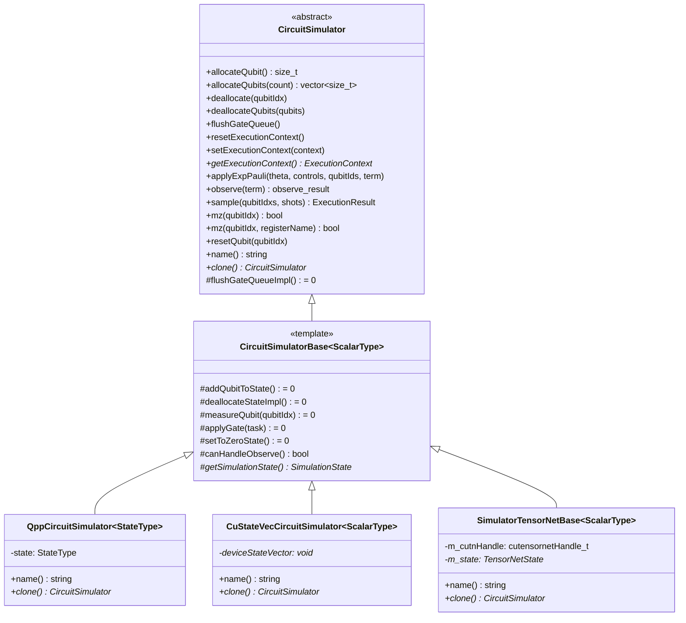
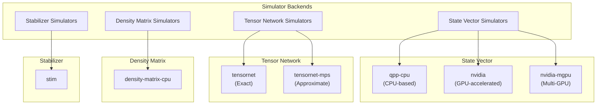
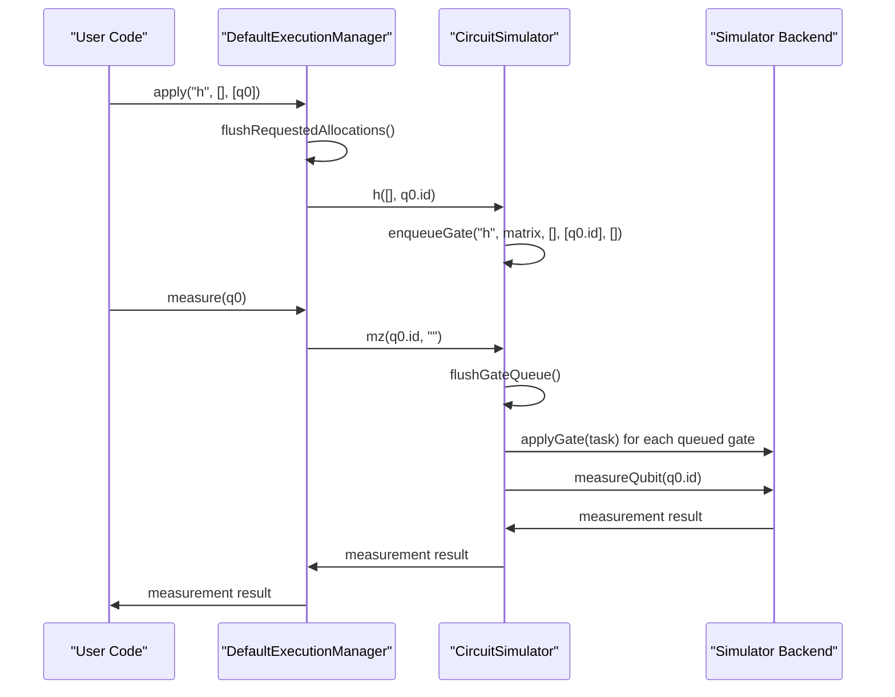

<!-- source: DeepWiki mcp.deepwiki.com · repo NVIDIA/cuda-quantum · page 5 Simulator Backends · fetched 2026-10-26 -->

# Simulator System

<details>
<summary>Relevant source files</summary>

The following files were used as context for generating this wiki page:

- [.github/workflows/config/gitlab_commits.txt](.github/workflows/config/gitlab_commits.txt)
- [.github/workflows/python_metapackages.yml](.github/workflows/python_metapackages.yml)
- [docs/notebook_validation.py](docs/notebook_validation.py)
- [docs/sphinx/applications/python/hybrid_quantum_neural_networks.ipynb](docs/sphinx/applications/python/hybrid_quantum_neural_networks.ipynb)
- [docs/sphinx/applications/python/quantum_pagerank.ipynb](docs/sphinx/applications/python/quantum_pagerank.ipynb)
- [docs/sphinx/applications/python/unitary_compilation_diffusion_models.ipynb](docs/sphinx/applications/python/unitary_compilation_diffusion_models.ipynb)
- [docs/sphinx/examples/python/dynamics/dynamics_intro_2.ipynb](docs/sphinx/examples/python/dynamics/dynamics_intro_2.ipynb)
- [docs/sphinx/using/backends/circuitsimulators.png](docs/sphinx/using/backends/circuitsimulators.png)
- [docs/sphinx/using/backends/sims/svsims.rst](docs/sphinx/using/backends/sims/svsims.rst)
- [pyproject.toml.cu12](pyproject.toml.cu12)
- [pyproject.toml.cu13](pyproject.toml.cu13)
- [python/metapackages/setup.py](python/metapackages/setup.py)
- [scripts/validate_pycudaq.sh](scripts/validate_pycudaq.sh)

</details>


The CUDA-Q Simulator System provides a framework for quantum circuit simulation backends that execute quantum programs. This document describes the architecture of the simulation system, the available simulator backends, and how they integrate with the rest of CUDA-Q.

For information about specific simulator implementations like state vector or tensor network simulators, see [Simulator System](#6). For information about the kernel execution model that uses these simulators, see [Kernel Execution Model](#2.3).

## Architecture Overview

The CUDA-Q simulator system is built around a core abstraction called `CircuitSimulator` that defines the interface for all quantum circuit simulators. This design allows CUDA-Q to support multiple simulation backends with different performance characteristics and capabilities while maintaining a consistent programming interface.



Sources: [runtime/nvqir/CircuitSimulator.h:80-402](). [runtime/nvqir/qpp/QppCircuitSimulator.cpp:122-411](). [runtime/nvqir/custatevec/CuStateVecCircuitSimulator.cu:1-248](). [runtime/nvqir/cutensornet/simulator_cutensornet.h:16-146]().

## Core Components

### CircuitSimulator

The `CircuitSimulator` class is the abstract base class that defines the interface for all quantum circuit simulators in CUDA-Q. It handles:

1. Qubit allocation and deallocation
2. Quantum gate application
3. Measurement operations
4. State sampling
5. Expectation value calculation

Key methods include:

- `allocateQubit()` - Allocates a single qubit and returns its index
- `allocateQubits(count)` - Allocates multiple qubits
- `deallocate(qubitIdx)` - Deallocates a qubit
- `flushGateQueue()` - Applies all queued gates to the state
- `mz(qubitIdx)` - Measures a qubit in the Z basis
- `sample(qubitIdxs, shots)` - Samples the state on specified qubits
- `observe(term)` - Computes the expectation value of a spin operator

Sources: [runtime/nvqir/CircuitSimulator.h:80-402]().

### CircuitSimulatorBase

The `CircuitSimulatorBase` template class extends `CircuitSimulator` and provides common functionality for simulator implementations. It handles:

1. Gate queuing and application
2. Execution context management
3. Sampling and measurement logic
4. State management

Key features include:

- Gate queue for batching operations
- Support for different floating-point precisions (via template parameter)
- Execution context tracking for different simulation modes
- Sampling and measurement result processing

Sources: [runtime/nvqir/CircuitSimulator.h:407-902]().

## Simulator Implementations

CUDA-Q provides several simulator implementations with different performance characteristics and capabilities:



Sources: [docs/sphinx/using/backends/simulators.rst:1-106](). [unittests/CMakeLists.txt:116-118]().

### State Vector Simulators

State vector simulators represent the quantum state as a complex vector of amplitudes. CUDA-Q provides:

1. **qpp-cpu**: CPU-based simulator using the Q++ library
   - Good for small circuits (< 28 qubits)
   - Double precision

2. **nvidia**: GPU-accelerated simulator using cuStateVec
   - Supports single and double precision
   - Efficient for circuits up to 32-33 qubits
   - Default simulator when GPU is available

3. **nvidia-mgpu**: Multi-GPU, multi-node simulator
   - Scales to larger qubit counts (33+)
   - Requires MPI for distribution

Sources: [docs/sphinx/using/backends/sims/svsims.rst:1-304](). [runtime/nvqir/custatevec/CuStateVecCircuitSimulator.cu:1-248]().

### Tensor Network Simulators

Tensor network simulators represent the quantum state as a network of tensors. CUDA-Q provides:

1. **tensornet**: Exact tensor network simulator
   - GPU-accelerated using cuTensorNet
   - Efficient for shallow-depth, high-width circuits
   - Can handle thousands of qubits for certain circuit structures

2. **tensornet-mps**: Matrix Product State simulator
   - Approximate simulation using tensor decomposition
   - Efficient for circuits with limited entanglement
   - Can handle hundreds of qubits

Sources: [docs/sphinx/using/backends/sims/tnsims.rst:1-206](). [runtime/nvqir/cutensornet/simulator_cutensornet.h:16-146](). [runtime/nvqir/cutensornet/tensornet_state.h:20-262]().

## Integration with Execution System

The simulator system integrates with the CUDA-Q execution system through the `ExecutionManager` interface. The `DefaultExecutionManager` is responsible for:

1. Translating high-level quantum operations to simulator calls
2. Managing qubit allocation and deallocation
3. Handling execution contexts for different simulation modes
4. Processing measurement results



Sources: [runtime/cudaq/qis/managers/default/DefaultExecutionManager.cpp:22-325]().

## Simulator Registration and Selection

Simulators are registered with CUDA-Q using a factory pattern. The `NVQIR_REGISTER_SIMULATOR` macro registers a simulator implementation with a name that can be used to select it at runtime.

The simulator selection process works as follows:

1. User specifies a target backend (e.g., "qpp-cpu", "nvidia")
2. CUDA-Q loads the corresponding simulator plugin
3. The simulator is instantiated and used for quantum operations

Sources: [runtime/nvqir/qpp/QppCircuitSimulator.cpp:417-418](). [runtime/nvqir/cutensornet/CMakeLists.txt:85-94]().

## Noisy Simulation Support

CUDA-Q simulators support noisy quantum circuit simulation through:

1. **Trajectory simulation**: Sampling Kraus operators according to a noise model
2. **Density matrix simulation**: Directly evolving the density matrix

Noise can be applied to:
- Gate operations (via noise models)
- Specific qubits (via explicit noise channels)

The `CircuitSimulator` interface provides methods for applying noise:
- `setNoiseModel(noise)`: Sets the current noise model
- `applyNoise(channel, targets)`: Applies a specific noise channel to targets
- `isValidNoiseChannel(type)`: Checks if a noise channel type is supported

Sources: [docs/sphinx/using/backends/sims/noisy.rst:1-176](). [runtime/nvqir/CircuitSimulator.h:125-266]().

## Simulator State Management

Simulators manage quantum state through the `SimulationState` interface, which provides methods for:

1. Accessing state data
2. Computing state overlaps
3. Getting amplitudes for specific basis states
4. Serializing and deserializing states

Each simulator implementation provides its own `SimulationState` subclass:
- `QppState` for the QPP simulator
- `TensorNetSimulationState` for tensor network simulators
- `MPSSimulationState` for MPS simulators

Sources: [runtime/nvqir/qpp/QppCircuitSimulator.cpp:24-120](). [runtime/nvqir/cutensornet/tn_simulation_state.h:21-97](). [runtime/nvqir/cutensornet/mps_simulation_state.h:20-124]().

## Performance Considerations

Different simulators have different performance characteristics:

1. **State vector simulators**:
   - Memory requirements grow exponentially with qubit count (2^n complex numbers)
   - Good for circuits with up to ~30 qubits
   - GPU acceleration provides significant speedup

2. **Tensor network simulators**:
   - Performance depends on circuit structure and entanglement
   - Can handle circuits with many more qubits for certain structures
   - Approximate methods (MPS) trade accuracy for performance

3. **Optimization techniques**:
   - Gate fusion for reducing memory transfers
   - Batched execution for multiple trajectories
   - Multi-GPU distribution for larger circuits

Sources: [docs/sphinx/using/backends/simulators.rst:13-95](). [docs/sphinx/using/backends/sims/svsims.rst:97-143]().

## Extending the Simulator System

CUDA-Q allows for extending the simulator system with custom implementations:

1. Create a new class that inherits from `CircuitSimulatorBase`
2. Implement the required virtual methods
3. Register the simulator with `NVQIR_REGISTER_SIMULATOR`

Example of a custom simulator implementation:

```cpp
class CustomSimulator : public nvqir::CircuitSimulatorBase<double> {
protected:
  void addQubitToState() override { /* ... */ }
  void deallocateStateImpl() override { /* ... */ }
  bool measureQubit(const std::size_t qubitIdx) override { /* ... */ }
  void applyGate(const GateApplicationTask &task) override { /* ... */ }
  void setToZeroState() override { /* ... */ }
  
public:
  std::string name() const override { return "custom-simulator"; }
  NVQIR_SIMULATOR_CLONE_IMPL(CustomSimulator)
};

NVQIR_REGISTER_SIMULATOR(CustomSimulator, custom-simulator)
```

Sources: [unittests/backends/qpp_observe/QPPObserveBackend.cpp:1-65](). [docs/sphinx/using/extending/extending.rst:1-11]().

## Summary

The CUDA-Q Simulator System provides a flexible framework for quantum circuit simulation with multiple backend implementations. The system is designed to support different simulation strategies with varying performance characteristics and capabilities, allowing users to choose the most appropriate simulator for their specific needs.

The core `CircuitSimulator` abstraction ensures a consistent interface across all simulators, while the specific implementations provide optimizations for different hardware platforms and circuit structures.

---

