<!-- source: DeepWiki mcp.deepwiki.com · repo NVIDIA/cuda-quantum · page 5.1 NVIDIA GPU-Accelerated Simulation · fetched 2026-10-26 -->

# NVIDIA GPU-Accelerated Simulation

<details>
<summary>Relevant source files</summary>

The following files were used as context for generating this wiki page:

- [.github/workflows/config/gitlab_commits.txt](.github/workflows/config/gitlab_commits.txt)
- [.github/workflows/python_metapackages.yml](.github/workflows/python_metapackages.yml)
- [docs/notebook_validation.py](docs/notebook_validation.py)
- [docs/sphinx/applications/python/hybrid_quantum_neural_networks.ipynb](docs/sphinx/applications/python/hybrid_quantum_neural_networks.ipynb)
- [docs/sphinx/applications/python/quantum_pagerank.ipynb](docs/sphinx/applications/python/quantum_pagerank.ipynb)
- [docs/sphinx/applications/python/unitary_compilation_diffusion_models.ipynb](docs/sphinx/applications/python/unitary_compilation_diffusion_models.ipynb)
- [docs/sphinx/examples/python/dynamics/dynamics_intro_2.ipynb](docs/sphinx/examples/python/dynamics/dynamics_intro_2.ipynb)
- [docs/sphinx/using/backends/circuitsimulators.png](docs/sphinx/using/backends/circuitsimulators.png)
- [docs/sphinx/using/backends/sims/svsims.rst](docs/sphinx/using/backends/sims/svsims.rst)
- [pyproject.toml.cu12](pyproject.toml.cu12)
- [pyproject.toml.cu13](pyproject.toml.cu13)
- [python/metapackages/setup.py](python/metapackages/setup.py)
- [scripts/validate_pycudaq.sh](scripts/validate_pycudaq.sh)

</details>


This page documents the `nvidia` backend, which provides GPU-accelerated quantum circuit simulation using NVIDIA's cuStateVec library. The nvidia backend supports both single-GPU and multi-GPU distributed simulation modes. For information about tensor network simulators, see page 5.3. For other simulator backends, see [Simulator System](#5).

## Overview

The `nvidia` backend is a state vector simulator that leverages the cuStateVec library to perform high-performance quantum simulations on NVIDIA GPUs. It represents the quantum state as a complex-valued vector and applies quantum operations through GPU-accelerated kernels.

Key features:
- **Single-GPU mode**: Fast simulation on a single GPU with configurable precision (fp32/fp64)
- **Multi-GPU mode**: Distributed simulation across multiple GPUs and nodes using MPI
- **Performance optimization**: Gate fusion, memory migration, and configurable threading
- **Memory management**: Host-device migration for large state vectors
- **Noise simulation**: Support for quantum noise channels via trajectory method

The backend is implemented in the `CuStateVecCircuitSimulator` class, which inherits from `CircuitSimulatorBase` and integrates with the cuStateVec library for GPU acceleration.

Title: NVIDIA Backend Architecture
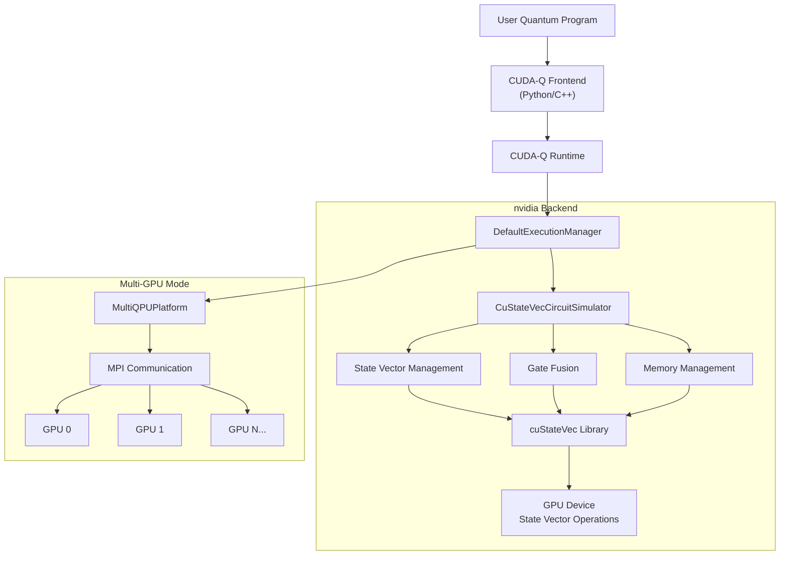

Sources: [runtime/nvqir/custatevec/CuStateVecCircuitSimulator.cu:1-248](), [runtime/cudaq/qis/managers/default/DefaultExecutionManager.cpp:22-275](), [runtime/nvqir/CircuitSimulator.h:407-902]()

## Architecture

The `nvidia` backend implements the `CircuitSimulator` interface through the `CuStateVecCircuitSimulator` class, which extends `CircuitSimulatorBase` with cuStateVec-specific operations. The architecture separates concerns between common simulator functionality and GPU-accelerated implementation.

Title: CuStateVecCircuitSimulator Class Hierarchy
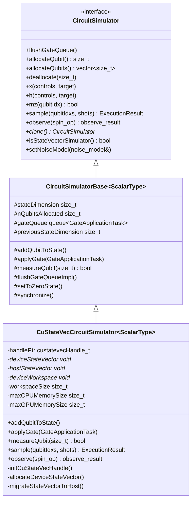

The `CircuitSimulator` interface defines core operations:
- **Qubit management**: `allocateQubit()`, `deallocate()` for quantum register allocation
- **Gate operations**: `x()`, `h()`, `rx()`, etc. for quantum gate application
- **Measurement**: `mz()` for single-qubit measurement, `sample()` for multi-shot sampling
- **Observation**: `observe()` for expectation value computation
- **Noise**: `setNoiseModel()` for noisy simulation support

The `CuStateVecCircuitSimulator` implements these operations using cuStateVec library functions:
- `custatevecApplyMatrix()` for gate application
- `custatevecMeasureOnZBasis()` for measurement
- `custatevecSamplerSample()` for sampling
- `custatevecComputeExpectation()` for expectation values

Sources: [runtime/nvqir/CircuitSimulator.h:80-386](), [runtime/nvqir/CircuitSimulator.h:407-902](), [runtime/nvqir/custatevec/CuStateVecCircuitSimulator.cu:1-248]()

## Single-GPU Mode

The default `nvidia` backend provides a state vector simulator accelerated by the cuStateVec library. The quantum state is represented as a complex-valued vector on GPU memory, and quantum operations are applied through cuStateVec library functions.

### Implementation

The `CuStateVecCircuitSimulator` class manages the state vector on the GPU and provides methods for quantum operations:

```
Key methods:
- addQubitToState(): Grows the state vector to accommodate a new qubit
- applyGate(GateApplicationTask): Applies a quantum gate using custatevecApplyMatrix()
- measureQubit(size_t): Performs measurement using custatevecMeasureOnZBasis()
- sample(qubitIdxs, shots): Multi-shot sampling using custatevecSamplerSample()
- observe(spin_op): Expectation value computation using custatevecComputeExpectation()
```

Title: State Vector Simulator Operation Flow
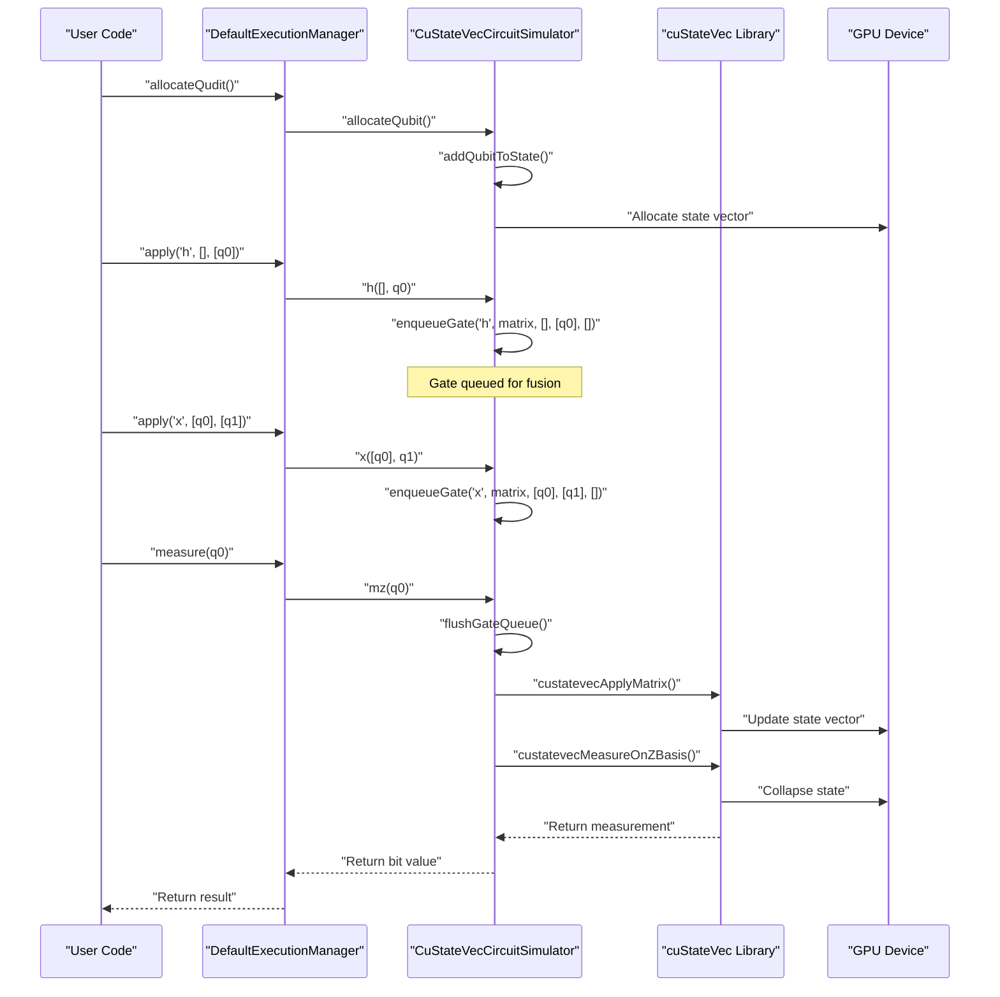

Sources: [runtime/nvqir/custatevec/CuStateVecCircuitSimulator.cu:1-248](), [runtime/cudaq/qis/managers/default/DefaultExecutionManager.cpp:22-275]()

### Usage

Python:
```python
import cudaq

# Single precision (default)
cudaq.set_target('nvidia')
# or explicitly
cudaq.set_target('nvidia', option='fp32')

# Double precision
cudaq.set_target('nvidia', option='fp64')
```

C++:
```bash
# Single precision (default)
nvq++ --target nvidia program.cpp -o program.x

# Double precision
nvq++ --target nvidia --target-option fp64 program.cpp -o program.x

# Execute
./program.x
```

### Configuration

The nvidia backend behavior can be configured through environment variables:

| Environment Variable | Description | Default Value |
|---------------------|-------------|---------------|
| `CUDAQ_FUSION_MAX_QUBITS` | Maximum qubits for gate fusion | GPU-dependent (see table below) |
| `CUDAQ_FUSION_DIAGONAL_GATE_MAX_QUBITS` | Max qubits for diagonal gate fusion | -1 (automatic) |
| `CUDAQ_FUSION_NUM_HOST_THREADS` | CPU threads for circuit processing | 8 |
| `CUDAQ_MAX_CPU_MEMORY_GB` | CPU memory limit for host-device migration (GB) | 0 (disabled) |
| `CUDAQ_MAX_GPU_MEMORY_GB` | GPU memory limit for state vector (GB) | NONE (unlimited) |
| `CUDAQ_ALLOW_FP32_EMULATED` | Enable BF16 emulation for FP32 (Blackwell only) | TRUE |
| `CUDAQ_ENABLE_MEMPOOL` | Enable CUDA memory pool for allocations | TRUE |

**Default Gate Fusion Size by GPU Architecture:**

| Compute Capability | GPU Examples | Default Fusion Size (fp32) | Default Fusion Size (fp64) |
|-------------------|--------------|---------------------------|---------------------------|
| 8.0 | A100 | 4 | 5 |
| 9.0 | H100, H200, GH200 | 5 | 6 |
| 10.0 | GB200, B200 | 5 | 4 |
| 10.3 | B300 | 5 | 1 |
| Other | - | 4 | 4 |

Sources: [docs/sphinx/using/backends/sims/svsims.rst:110-140](), [docs/sphinx/using/backends/sims/svsims.rst:277-300]()

## Multi-GPU Multi-Node Mode

The `nvidia` backend with the `mgpu` option enables distributed simulation across multiple GPUs and compute nodes. The state vector is partitioned across MPI processes, each managing a portion of the quantum state on a GPU.

### Implementation

Multi-GPU mode uses MPI to distribute the state vector and coordinate quantum operations across devices. The implementation leverages cuStateVec's multi-GPU support and requires:
- MPI library for inter-process communication
- Multiple GPUs (can be on single or multiple nodes)
- Power-of-2 number of processes

Key architectural features:
- State vector partitioning across MPI ranks
- Peer-to-peer GPU communication (GPUDirect P2P) when supported
- Network topology-aware distribution (NVLink domains)
- Host-device migration support for large state vectors

Title: Multi-GPU State Vector Distribution
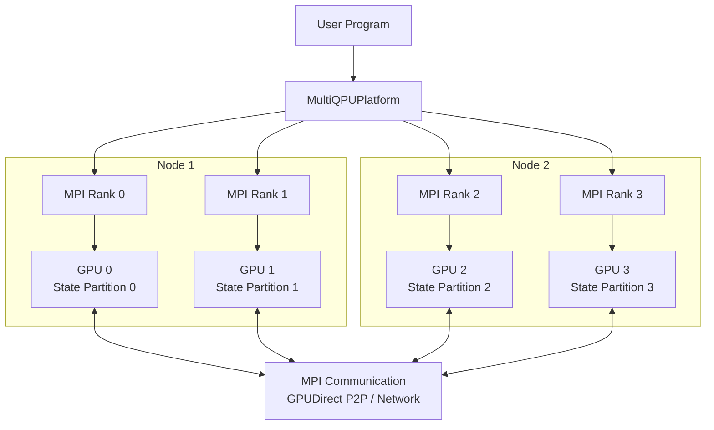

Sources: [docs/sphinx/using/backends/sims/svsims.rst:147-229]()

### Usage

Python:
```python
import cudaq

# Set the target with mgpu option
cudaq.set_target('nvidia', option='mgpu,fp64')

# For single precision
cudaq.set_target('nvidia', option='mgpu,fp32')
# or equivalently (fp32 is default)
cudaq.set_target('nvidia', option='mgpu')

# Note: Options can be in any order
# cudaq.set_target('nvidia', option='fp64,mgpu')
```

Execute with MPI:
```bash
# Double precision, 2 GPUs
mpiexec -np 2 python3 program.py

# With mpi4py for MPI in application code
mpiexec -np 2 python3 -m mpi4py program.py
```

C++:
```bash
# Compile with mgpu option
nvq++ --target nvidia --target-option mgpu,fp64 program.cpp -o program.x

# Execute with MPI
mpiexec -np 2 ./program.x

# Single precision
nvq++ --target nvidia --target-option mgpu,fp32 program.cpp -o program.x
mpiexec -np 2 ./program.x
```

### Configuration

Multi-GPU mode supports all single-GPU environment variables plus additional options for distributed execution:

| Environment Variable | Description | Default Value |
|---------------------|-------------|---------------|
| `CUDAQ_MGPU_LIB_MPI` | Shared library name for MPI | libmpi.so |
| `CUDAQ_MGPU_COMM_PLUGIN_TYPE` | MPI plugin type (AUTO, EXTERNAL, OpenMPI, MPICH) | AUTO |
| `CUDAQ_MGPU_NQUBITS_THRESH` | Qubit threshold for distribution activation | 25 |
| `CUDAQ_MGPU_FUSE` | Max qubits for gate fusion in mgpu mode | GPU-dependent |
| `CUDAQ_MGPU_P2P_DEVICE_BITS` | Number of GPUs that can use GPUDirect P2P | 0 (disabled) |
| `CUDAQ_GPU_FABRIC` | GPU fabric type (MNNVL, NVL, NONE, or domain size) | - |
| `CUDAQ_GLOBAL_INDEX_BITS` | Network structure specification (comma-separated) | - |
| `CUDAQ_HOST_DEVICE_MIGRATION_LEVEL` | Position for migration index bits | Appended at end |
| `CUDAQ_DATA_TRANSFER_BUFFER_BITS` | Buffer size for inter-node transfers (log2 bytes) | 26 (64 MB) |

**Network Topology Configuration:**

The `CUDAQ_GPU_FABRIC` variable automatically configures P2P communication:
- `MNNVL`: Multi-node NVLink (sets P2P for all processes)
- `NVL`: NVLink within node (sets P2P per node)
- `NONE`: Disable P2P
- Integer (power of 2): Specific NVLink domain size

The `CUDAQ_GLOBAL_INDEX_BITS` variable specifies the network hierarchy for optimal data distribution. For example, with 32 MPI processes organized as 4 groups of 8 processes with fast intra-group communication:
```bash
export CUDAQ_GLOBAL_INDEX_BITS=3,2
# First 3 bits (log2(8)) = 8 processes per group
# Next 2 bits (log2(4)) = 4 groups
# Total: 3+2=5 bits = 2^5 = 32 processes
```

**Requirements:**
- Number of MPI processes must be a power of 2
- MPI library (OpenMPI or MPICH recommended)
- CUDA-aware MPI for best performance
- Multiple NVIDIA GPUs

Sources: [docs/sphinx/using/backends/sims/svsims.rst:147-229](), [docs/sphinx/using/backends/sims/svsims.rst:235-268]()

## cuStateVec Integration

The nvidia backend integrates with NVIDIA's cuStateVec library, which provides GPU-accelerated implementations of state vector operations. The `CuStateVecCircuitSimulator` class acts as a bridge between CUDA-Q and cuStateVec.

### cuStateVec Library Functions

The implementation uses the following key cuStateVec functions:

| cuStateVec Function | Purpose | Used By |
|--------------------|---------|---------|
| `custatevecCreate()` | Initialize cuStateVec handle | `CuStateVecCircuitSimulator` constructor |
| `custatevecApplyMatrix()` | Apply quantum gate matrix | `applyGate()` |
| `custatevecMeasureOnZBasis()` | Measure qubit in Z basis | `measureQubit()` |
| `custatevecSamplerCreate()` | Create sampler for shots | `sample()` |
| `custatevecSamplerSample()` | Generate measurement samples | `sample()` |
| `custatevecComputeExpectation()` | Compute observable expectation | `observe()` |
| `custatevecGetWorkspaceSize()` | Query workspace memory requirement | Memory allocation |
| `custatevecDestroy()` | Clean up cuStateVec handle | Destructor |

Title: cuStateVec Integration Architecture
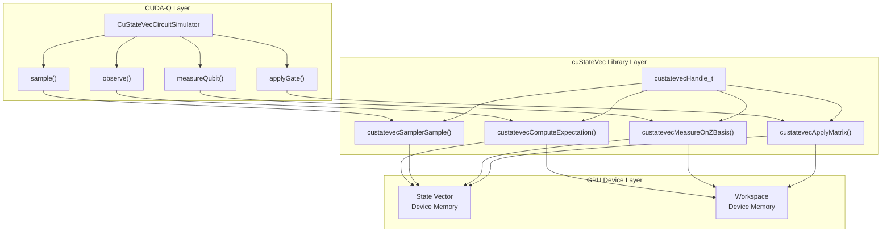

Sources: [runtime/nvqir/custatevec/CuStateVecCircuitSimulator.cu:1-248]()

### State Vector Representation

The state vector is stored as a contiguous array of complex numbers on GPU device memory:

```
State vector format:
- Type: std::complex<float> (fp32) or std::complex<double> (fp64)
- Size: 2^n complex numbers for n qubits
- Memory layout: deviceStateVector pointer to GPU memory
- Endianness: Little-endian qubit ordering (qubit 0 is least significant)
```

Example for 2 qubits:
```
Index | Binary | Amplitude
------|--------|----------
  0   |  00    | α₀₀
  1   |  01    | α₀₁
  2   |  10    | α₁₀
  3   |  11    | α₁₁
```

The state grows exponentially: Adding 1 qubit doubles the state vector size.

Sources: [runtime/nvqir/custatevec/CuStateVecCircuitSimulator.cu:13-248]()

## Implementation Details

### Backend Registration and Selection

GPU backends in CUDA-Q are implemented as plugins that register themselves with the framework using the `NVQIR_REGISTER_SIMULATOR` macro. The backends are built as shared libraries and loaded dynamically at runtime.

Title: Backend Registration and Selection Process
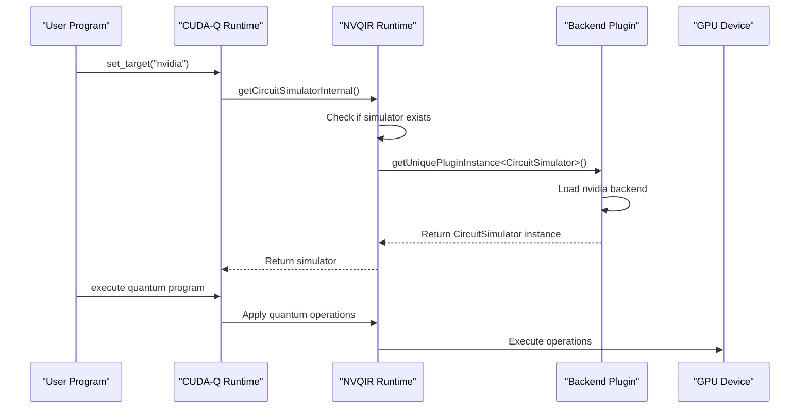

The registration of backends is handled in the CMake build system, which creates the appropriate plugin libraries:

```cmake
# For cuStateVec backends
create_tests_with_backend(custatevec-fp32 "")

# For cuTensorNet backends
nvqir_create_cutn_plugin(tensornet TRUE ${BASE_TENSOR_BACKEND_SRS} simulator_tensornet_fp64_register.cpp)
nvqir_create_cutn_plugin(tensornet-mps TRUE ${BASE_TENSOR_BACKEND_SRS} simulator_mps_fp64_register.cpp)
```

The `DefaultExecutionManager` class is responsible for routing quantum operations to the appropriate simulator:

```cpp
nvqir::CircuitSimulator *simulator() {
  return nvqir::getCircuitSimulatorInternal();
}
```

Sources: [runtime/nvqir/qpp/QppCircuitSimulator.cpp:415-418](), [runtime/cudaq/qis/managers/default/DefaultExecutionManager.cpp:20-32](), [unittests/CMakeLists.txt:100-164](), [runtime/nvqir/cutensornet/CMakeLists.txt:84-94]()

## Memory Management

The nvidia backend implements sophisticated memory management to handle large quantum states and enable simulations that exceed single GPU memory capacity.

### Device Memory Allocation

The state vector is allocated on GPU device memory and grows dynamically as qubits are added:

Title: State Vector Memory Allocation Process
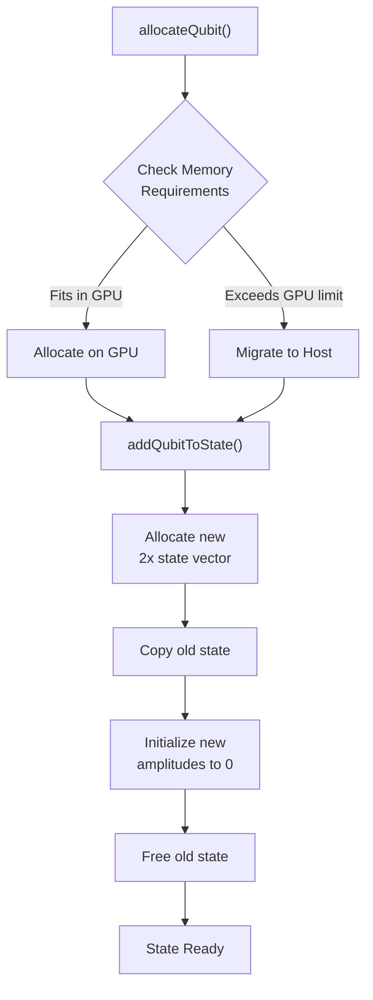

Key implementation details:
- State vector is allocated as `deviceStateVector` (void pointer to GPU memory)
- Size grows from `2^n` to `2^(n+1)` complex numbers when adding a qubit
- Old state is copied to first half of new state
- Second half is initialized to zero
- Old memory is freed after successful allocation

Sources: [runtime/nvqir/custatevec/CuStateVecCircuitSimulator.cu:13-248]()

### Host-Device Migration

When state vectors exceed GPU memory limits, the nvidia backend can migrate the state to host (CPU) memory:

```
Migration triggers:
1. State vector size exceeds CUDAQ_MAX_GPU_MEMORY_GB
2. CUDAQ_MAX_CPU_MEMORY_GB is set and > 0
3. GPU memory allocation fails
```

Title: Host-Device Migration Strategy
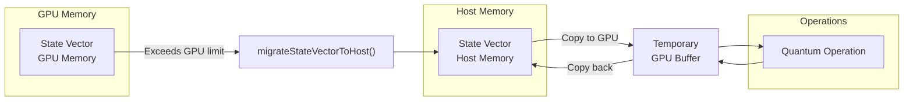

Migration behavior:
- State is copied to `hostStateVector` (pinned host memory)
- GPU memory `deviceStateVector` is freed
- For operations, state is temporarily copied to GPU
- After operation, result is copied back to host
- Enables simulations larger than GPU memory

Configuration:
```bash
# Enable host-device migration with 16 GB CPU limit
export CUDAQ_MAX_CPU_MEMORY_GB=16

# Limit GPU memory to 10 GB
export CUDAQ_MAX_GPU_MEMORY_GB=10
```

Sources: [docs/sphinx/using/backends/sims/svsims.rst:125-145]()

### Memory Pool

The nvidia backend supports CUDA memory pools for efficient allocation/deallocation:

```bash
# Enable memory pool (default)
export CUDAQ_ENABLE_MEMPOOL=1

# Disable memory pool
export CUDAQ_ENABLE_MEMPOOL=0
```

Memory pools reduce allocation overhead by reusing freed memory, improving performance for circuits with many qubit allocations and deallocations.

Sources: [docs/sphinx/using/backends/sims/svsims.rst:127-128]()

### Workspace Memory

cuStateVec operations require temporary workspace memory for computations:

```
Workspace allocation:
- Queried via custatevecGetWorkspaceSize()
- Allocated as deviceWorkspace
- Size stored in workspaceSize
- Reused across multiple operations
- Freed when simulator is destroyed
```

The workspace size depends on:
- Number of qubits in the state
- Type of operation (gate, measurement, sampling)
- Number of controlled qubits
- Floating point precision (fp32 vs fp64)

Sources: [runtime/nvqir/custatevec/CuStateVecCircuitSimulator.cu:1-248]()

## Performance Tuning

### Gate Fusion

Gate fusion combines sequences of quantum gates into larger matrix operations, reducing kernel launch overhead and improving GPU utilization. The nvidia backend automatically queues gates and applies them in batches.

Title: Gate Fusion Process
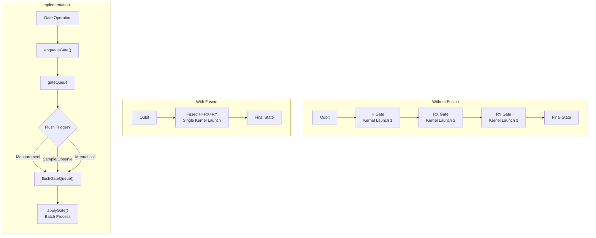

Fusion behavior:
- Gates are enqueued in a queue until a flush trigger
- Flush triggers include: measurement, sampling, observation, explicit flush
- Fused gates act on up to `CUDAQ_FUSION_MAX_QUBITS` qubits
- Diagonal gates (Z, S, T) have separate fusion limit
- Multi-GPU mode uses `CUDAQ_MGPU_FUSE` setting

Configuration:
```bash
# Set fusion size to 6 qubits
export CUDAQ_FUSION_MAX_QUBITS=6

# Set diagonal gate fusion size (auto by default)
export CUDAQ_FUSION_DIAGONAL_GATE_MAX_QUBITS=8

# Multi-GPU fusion (single-GPU setting is ignored in mgpu mode)
export CUDAQ_MGPU_FUSE=5
```

Benefits:
- Reduces kernel launch overhead
- Improves memory bandwidth utilization
- Decreases total execution time
- More effective for circuits with many single-qubit gates

Sources: [runtime/nvqir/CircuitSimulator.h:849-878](), [docs/sphinx/using/backends/sims/svsims.rst:302-327]()

### Threading Configuration

The nvidia backend uses CPU threads for circuit processing before GPU execution:

```bash
# Set number of host threads (default: 8)
export CUDAQ_FUSION_NUM_HOST_THREADS=16
```

This controls parallelism in:
- Gate queue processing
- Matrix preparation
- Control flow handling

More threads can improve performance for large circuits, but may increase CPU overhead.

Sources: [docs/sphinx/using/backends/sims/svsims.rst:115-116]()

### Precision Selection

Choose between single and double precision based on accuracy requirements:

| Precision | Type | Memory Usage | Performance | Use Case |
|-----------|------|--------------|-------------|----------|
| fp32 | `float` | 1x | Faster | Most quantum algorithms |
| fp64 | `double` | 2x | Slower | High-precision requirements |

Single precision (fp32):
- Sufficient for most quantum algorithms
- Allows larger simulations (half memory per qubit)
- Better performance on most GPUs

Double precision (fp64):
- Required for specific algorithms (e.g., quantum chemistry)
- Slower execution and requires more memory
- Some GPUs have limited fp64 performance

On Blackwell architecture (compute capability 10.0+), fp32 can be emulated using BF16:
```bash
# Enable BF16 emulation (default: enabled on Blackwell)
export CUDAQ_ALLOW_FP32_EMULATED=1
```

Sources: [docs/sphinx/using/backends/sims/svsims.rst:79-93](), [docs/sphinx/using/backends/sims/svsims.rst:124-125]()

### Multi-GPU Performance Optimization

For multi-GPU simulations, additional tuning options are available:

**Qubit Distribution Threshold:**
```bash
# Only distribute state for circuits with >= 30 qubits
export CUDAQ_MGPU_NQUBITS_THRESH=30
```

Below this threshold, each MPI rank runs independent simulations for better performance on smaller circuits.

**P2P Communication:**
```bash
# Enable GPUDirect P2P for 4 GPUs
export CUDAQ_MGPU_P2P_DEVICE_BITS=2  # log2(4)

# Or use automatic fabric detection
export CUDAQ_GPU_FABRIC=NVL  # NVLink within node
export CUDAQ_GPU_FABRIC=MNNVL  # Multi-node NVLink
```

P2P communication reduces data transfer latency between GPUs.

**Data Transfer Buffer:**
```bash
# Set 128 MB buffer for inter-node transfers
export CUDAQ_DATA_TRANSFER_BUFFER_BITS=27  # log2(128*1024*1024)
```

Larger buffers may improve performance for high-bandwidth networks.

**Network Topology:**
```bash
# Example: 16 GPUs as 2 nodes with 8 GPUs each
export CUDAQ_GLOBAL_INDEX_BITS=3,1  # 8 GPUs per node, 2 nodes
```

Proper topology specification enables optimal data distribution.

Sources: [docs/sphinx/using/backends/sims/svsims.rst:247-267]()

## Noisy Simulation

The nvidia backend supports noisy quantum simulation using the quantum trajectory method. Noise is applied after each quantum operation according to a user-defined noise model.

### Noise Model Support

The nvidia backend supports both types of quantum noise channels:

| Channel Type | Description | Support |
|--------------|-------------|---------|
| Unitary Mixture | Probabilistic application of unitary operations | YES |
| General Kraus | Non-unitary Kraus operator application | YES |

Examples of supported noise channels:
- Depolarizing channel
- Amplitude damping
- Phase damping
- Bit flip, phase flip
- Custom Kraus operators

### Implementation

Title: Noisy Simulation Flow
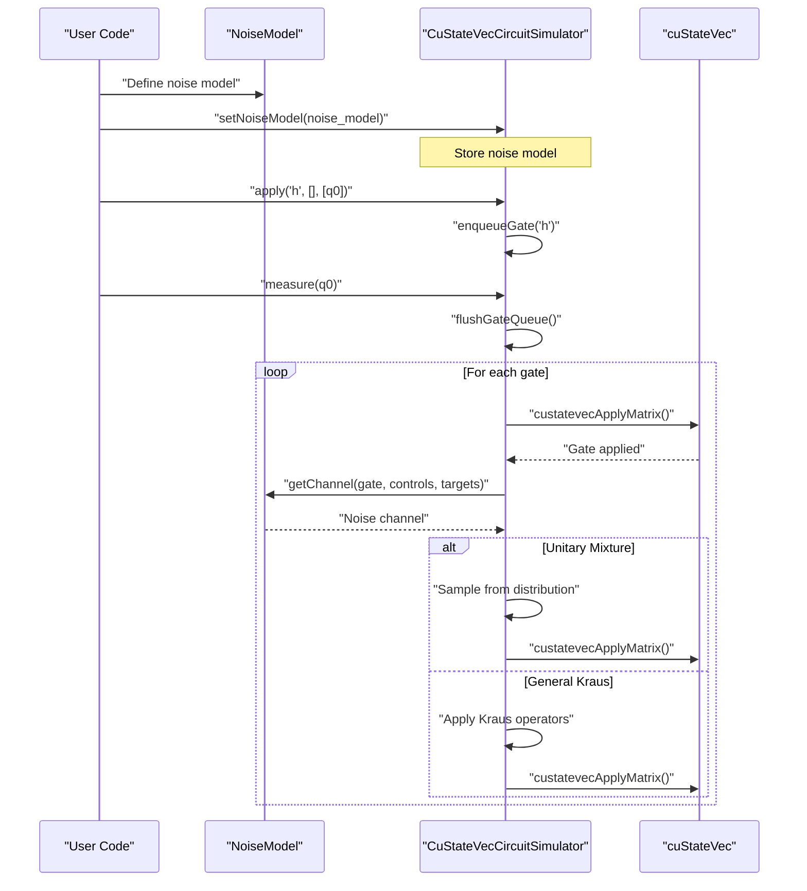

The noise application process:
1. User defines a noise model with channels for specific gates
2. Noise model is set on the simulator via `setNoiseModel()`
3. During gate queue flush, each gate is followed by its noise channel
4. For unitary mixtures, one unitary is sampled and applied
5. For general Kraus channels, all operators are applied

Sources: [runtime/nvqir/CircuitSimulator.h:839-845]()

### Example Usage

Python:
```python
import cudaq

# Define a noise model
noise = cudaq.NoiseModel()

# Add depolarizing noise to single-qubit gates
noise.add_channel('h', [0], cudaq.DepolarizationChannel(0.01))
noise.add_channel('x', [0], cudaq.DepolarizationChannel(0.01))

# Add amplitude damping to measurements
noise.add_channel('mz', [0], cudaq.AmplitudeDampingChannel(0.05))

# Set the target and noise model
cudaq.set_target('nvidia')
cudaq.set_noise(noise)

# Define and run a noisy circuit
@cudaq.kernel
def circuit():
    q = cudaq.qubit()
    h(q)
    mz(q)

# Execute with noise
result = cudaq.sample(circuit, shots_count=1000)
```

C++:
```cpp
// Define a noise model
cudaq::noise_model noise;

// Add depolarizing noise
noise.add_channel<cudaq::types::h>({0}, 
    cudaq::depolarization_channel(0.01));

// Set the noise model
cudaq::set_noise(noise);

// Define and run a noisy circuit
__qpu__ void circuit() {
  cudaq::qubit q;
  h(q);
  mz(q);
}

// Execute with noise
auto result = cudaq::sample(circuit, 1000);
```

### Multi-Trajectory Simulation

Noisy simulation uses the quantum trajectory method:
- Each execution is a single trajectory
- Multiple shots produce multiple independent trajectories
- Final results are averaged over all trajectories

This approach is exact for representing quantum noise and scales efficiently on GPUs.

Sources: [docs/sphinx/using/backends/sims/svsims.rst:1-333]()

## Integration with CUDA-Q

The GPU backends integrate with the rest of CUDA-Q through the `DefaultExecutionManager`, which routes quantum operations to the appropriate simulator:

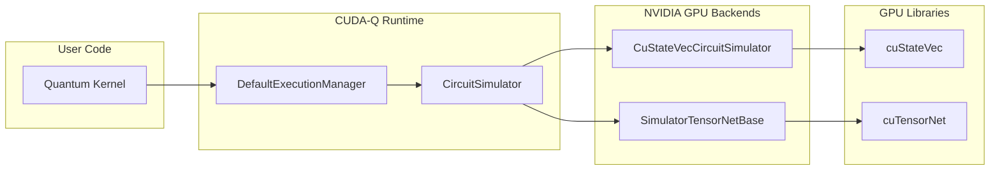

Sources: [runtime/cudaq/qis/managers/default/DefaultExecutionManager.cpp:22-275](), [runtime/nvqir/NVQIR.cpp:75-95]()

The NVIDIA GPU backends form a critical part of CUDA-Q's high-performance simulation capabilities, allowing users to simulate quantum algorithms on powerful GPU hardware with different simulation strategies to suit various types of quantum circuits.

---

