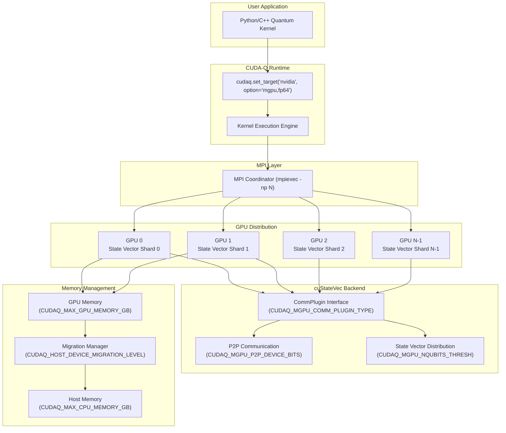
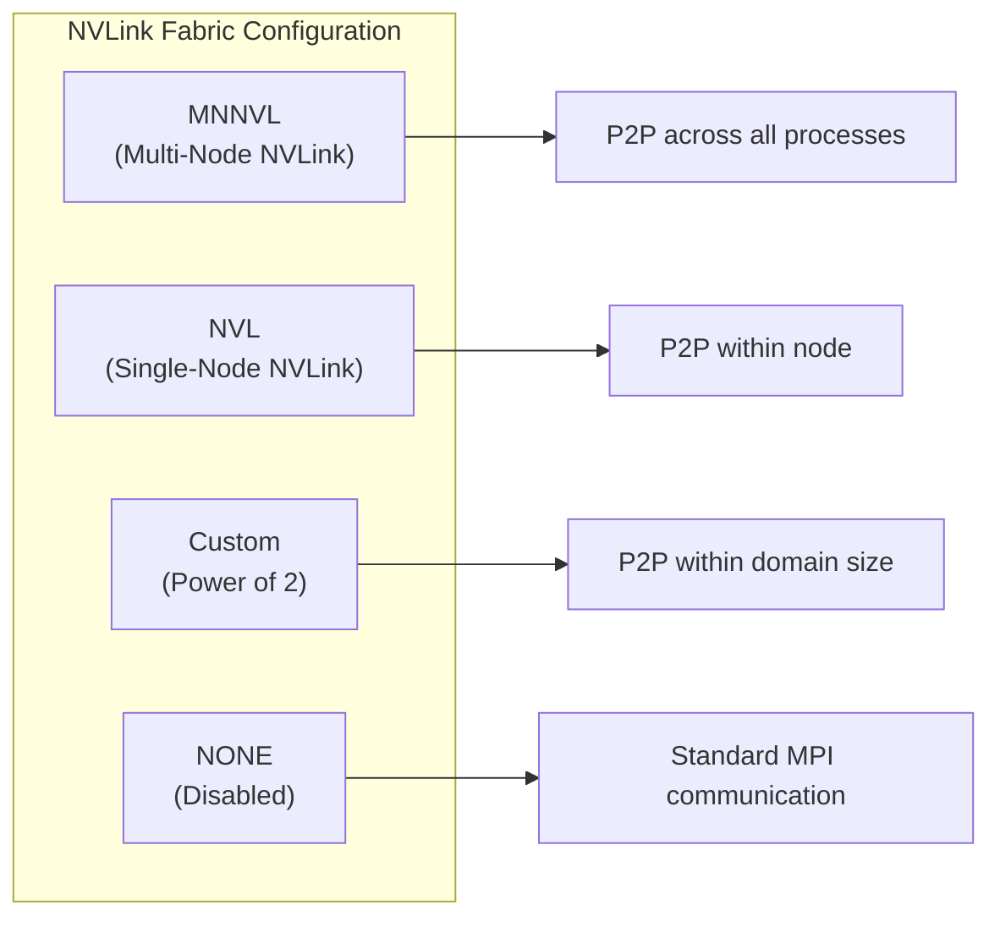
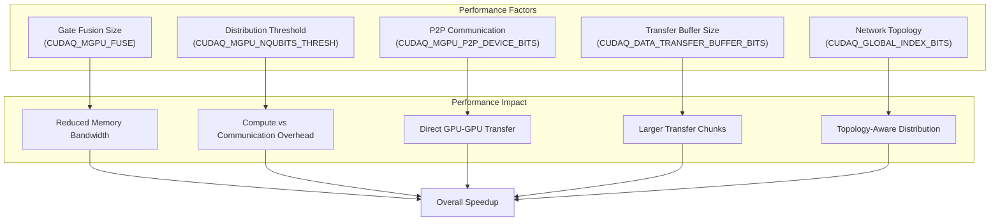
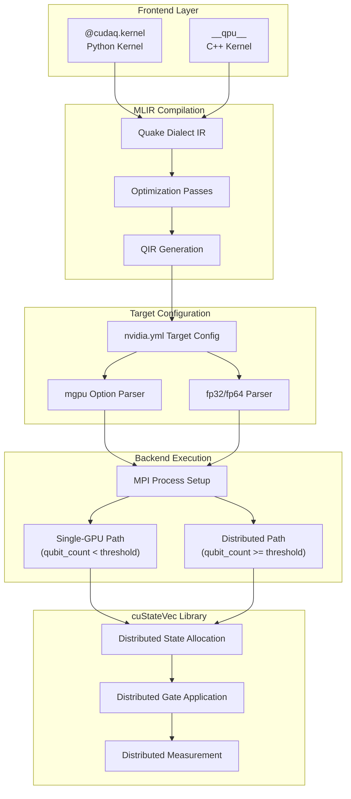

<!-- source: DeepWiki mcp.deepwiki.com · repo NVIDIA/cuda-quantum · page 5.2 Multi-GPU and Multi-Node Simulation · fetched 2026-10-26 -->

# Multi-GPU and Multi-Node Simulation

<details>
<summary>Relevant source files</summary>

The following files were used as context for generating this wiki page:

- [.github/workflows/config/gitlab_commits.txt](.github/workflows/config/gitlab_commits.txt)
- [.github/workflows/python_metapackages.yml](.github/workflows/python_metapackages.yml)
- [docs/notebook_validation.py](docs/notebook_validation.py)
- [docs/sphinx/applications/python/hybrid_quantum_neural_networks.ipynb](docs/sphinx/applications/python/hybrid_quantum_neural_networks.ipynb)
- [docs/sphinx/applications/python/quantum_pagerank.ipynb](docs/sphinx/applications/python/quantum_pagerank.ipynb)
- [docs/sphinx/applications/python/unitary_compilation_diffusion_models.ipynb](docs/sphinx/applications/python/unitary_compilation_diffusion_models.ipynb)
- [docs/sphinx/examples/python/dynamics/dynamics_intro_2.ipynb](docs/sphinx/examples/python/dynamics/dynamics_intro_2.ipynb)
- [docs/sphinx/using/backends/circuitsimulators.png](docs/sphinx/using/backends/circuitsimulators.png)
- [docs/sphinx/using/backends/sims/svsims.rst](docs/sphinx/using/backends/sims/svsims.rst)
- [pyproject.toml.cu12](pyproject.toml.cu12)
- [pyproject.toml.cu13](pyproject.toml.cu13)
- [python/metapackages/setup.py](python/metapackages/setup.py)
- [scripts/validate_pycudaq.sh](scripts/validate_pycudaq.sh)

</details>


This document describes the NVIDIA GPU-accelerated multi-GPU and multi-node simulation backend for CUDA-Q, which enables state vector simulation that scales beyond the memory limits of a single GPU.

For single-GPU simulation capabilities, see [NVIDIA GPU-Accelerated Simulation](#5.1). For other simulation backends, see [Other Simulation Backends](#5.4).

## Overview and Purpose

The `nvidia` backend with the `mgpu` option provides distributed state vector simulation using the `cuStateVec` library with MPI coordination across multiple GPUs and compute nodes. This backend is necessary when simulating quantum circuits that require a state vector larger than what can fit in a single GPU's memory.

**Key capabilities:**
- State vector distribution across multiple GPUs and nodes
- Support for both single and double precision (`fp32` and `fp64`)
- GPU-to-GPU peer-to-peer (P2P) communication optimization
- Host-device memory migration for very large state vectors
- Configurable network topology awareness

The system expects to run within an MPI context where the number of processes and nodes must be a power of 2.

Sources: [docs/sphinx/using/backends/sims/svsims.rst:147-228]()

## System Architecture

The multi-GPU multi-node simulator is built on a distributed architecture where the quantum state vector is partitioned across multiple GPU devices coordinated through MPI:



Sources: [docs/sphinx/using/backends/sims/svsims.rst:147-228](), [scripts/validate_pycudaq.sh:109-115,270-287]()

## Configuration and Usage

### Basic Usage

To execute a quantum program on the multi-GPU multi-node backend:

**Python:**
```bash
mpiexec -np 2 python3 program.py --target nvidia --target-option fp64,mgpu
```

Or set the target in code:
```python
cudaq.set_target('nvidia', option='mgpu,fp64')  # or 'fp32,mgpu'
```

**C++:**
```bash
nvq++ --target nvidia --target-option mgpu,fp64 program.cpp -o program.x
mpiexec -np 2 ./program.x
```

The order of options is interchangeable (e.g., `mgpu,fp64` is equivalent to `fp64,mgpu`).

**Important notes:**
- The number of MPI processes must be a power of 2
- Environment variables must be set **before** setting the target or importing `cudaq`
- If using pip installation, MPI dependencies must be installed separately

Sources: [docs/sphinx/using/backends/sims/svsims.rst:164-228](), [scripts/validate_pycudaq.sh:109-115]()

### MPI Installation for Python

When CUDA-Q is installed via pip, MPI dependencies are not included. Install them following the instructions in the Project Description on PyPI, then use:

```bash
mpiexec -np 2 python3 -m mpi4py program.py --target nvidia --target-option fp64,mgpu
```

Sources: [docs/sphinx/using/backends/sims/svsims.rst:178-188]()

## Environment Variables

The multi-GPU multi-node simulator provides extensive configuration through environment variables. These must be set before setting the target or importing `cudaq`.

### Core MPI Configuration

| Variable | Values | Description |
|----------|--------|-------------|
| `CUDAQ_MGPU_LIB_MPI` | string | Shared library name for inter-process communication (default: `libmpi.so`) |
| `CUDAQ_MGPU_COMM_PLUGIN_TYPE` | `AUTO`, `EXTERNAL`, `OpenMPI`, `MPICH` | cuStateVec CommPlugin selection (default: `AUTO`) |

Sources: [docs/sphinx/using/backends/sims/svsims.rst:230-246]()

### State Vector Distribution

| Variable | Values | Description |
|----------|--------|-------------|
| `CUDAQ_MGPU_NQUBITS_THRESH` | positive integer | Qubit count threshold for activating distribution. Below this, simulation runs as independent tasks (default: 25) |
| `CUDAQ_MGPU_FUSE` | positive integer | Max number of qubits for gate fusion (default: depends on GPU compute capability and precision) |

The `CUDAQ_MGPU_NQUBITS_THRESH` parameter is crucial for performance. For small circuits, running independent simulations on each MPI process is faster than distributed simulation overhead.

Sources: [docs/sphinx/using/backends/sims/svsims.rst:247-252]()

### GPU Communication Optimization

#### P2P Communication

| Variable | Values | Description |
|----------|--------|-------------|
| `CUDAQ_MGPU_P2P_DEVICE_BITS` | positive integer | Number of GPUs that can communicate via GPUDirect P2P (default: 0, disabled) |
| `CUDAQ_GPU_FABRIC` | `MNNVL`, `NVL`, `NONE`, or power-of-2 integer | Automatically configure P2P device bits based on NVLink topology |

**`CUDAQ_GPU_FABRIC` options:**
- `MNNVL`: Multi-node NVLink - sets P2P bits based on total processes
- `NVL`: Single-node NVLink - sets P2P bits based on processes per node
- `NONE`: Disables P2P
- Integer value: Specific NVLink domain size



Sources: [docs/sphinx/using/backends/sims/svsims.rst:253-258]()

### Network Topology

| Variable | Values | Description |
|----------|--------|-------------|
| `CUDAQ_GLOBAL_INDEX_BITS` | comma-separated list of positive integers | Network structure definition (faster to slower). Sum must equal log₂(total processes) |
| `CUDAQ_HOST_DEVICE_MIGRATION_LEVEL` | positive integer | Position to insert migration index bits in the global index bits array |
| `CUDAQ_DATA_TRANSFER_BUFFER_BITS` | integer ≥ 24 | Temporary buffer size for inter-node transfer: 2^N bytes (default: 26 = 64MB, minimum: 24 = 16MB) |

**Network Topology Example:**

For 32 MPI processes organized as 4 groups of 8 processes with fast intra-group communication:
```bash
export CUDAQ_GLOBAL_INDEX_BITS="3,2"  # 3 bits for 8 processes, 2 bits for 4 groups
```

This means:
- First `3` represents 2³ = 8 processes with fast communication
- Second `2` represents 2² = 4 groups
- Total: 3 + 2 = 5 bits = 2⁵ = 32 processes

Sources: [docs/sphinx/using/backends/sims/svsims.rst:259-267]()

### Memory Management

These variables are inherited from the single-GPU mode:

| Variable | Values | Description |
|----------|--------|-------------|
| `CUDAQ_MAX_GPU_MEMORY_GB` | positive integer or `NONE` | GPU memory limit (default: `NONE` = unlimited) |
| `CUDAQ_MAX_CPU_MEMORY_GB` | non-negative integer or `NONE` | CPU memory for state vector migration (default: 0GB = disabled) |

Host-device state vector migration is supported in multi-GPU multi-node configurations. When GPU memory is exhausted, the state vector can migrate to host memory.

Sources: [docs/sphinx/using/backends/sims/svsims.rst:119-128,227-228]()

## Performance Tuning

### Gate Fusion

Gate fusion is critical for performance. It combines multiple single/multi-qubit operations into larger matrix operations, reducing memory bandwidth requirements.

**Default fusion sizes by GPU architecture:**

| Compute Capability | GPU Models | fp32 Fusion | fp64 Fusion |
|-------------------|------------|-------------|-------------|
| 8.0 | NVIDIA A100 | 4 qubits | 5 qubits |
| 9.0 | NVIDIA H100, H200, GH200 | 5 qubits | 6 qubits |
| 10.0 | NVIDIA GB200, B200 | 5 qubits | 4 qubits |
| 10.3 | NVIDIA B300 | 5 qubits | 1 qubit |
| Others | | 4 qubits | 4 qubits |

Override with `CUDAQ_MGPU_FUSE`:
```bash
CUDAQ_MGPU_FUSE=5 mpiexec -np 2 python3 program.py --target nvidia --target-option mgpu,fp64
```

Sources: [docs/sphinx/using/backends/sims/svsims.rst:277-327]()

### Fabric-Based Memory Sharing

On multi-node systems without MNNVL support, the nvidia backend may fail to allocate memory. Disable MNNVL fabric-based memory sharing:

```bash
export UBACKEND_USE_FABRIC_HANDLE=0
```

Sources: [docs/sphinx/using/backends/sims/svsims.rst:329-332]()

### Performance Considerations



Sources: [docs/sphinx/using/backends/sims/svsims.rst:302-327]()

## Testing and Validation

The multi-GPU multi-node backend is validated through automated testing scripts. The validation process includes:

1. **Target verification**: Ensures the `nvidia-mgpu` target can be set
2. **Core tests**: Runs pytest suite against parallel tests
3. **Platform tests**: Validates MPI coordination
4. **Remote MQPU tests**: Tests distributed quantum processing units

The validation script launches multiple `cudaq-qpud.py` server instances with different GPU allocations:

```bash
# Server 1 with second half of GPUs
CUDA_VISIBLE_DEVICES=$server1_devices mpiexec --allow-run-as-root -np 2 python3 "$qpud_py" --port 12001 &

# Server 2 with first half of GPUs (if available)
CUDA_VISIBLE_DEVICES=$server2_devices mpiexec --allow-run-as-root -np 2 python3 "$qpud_py" --port 12002 &
```

Then executes remote platform tests:
```bash
python3 sample_async_remote.py --backend nvidia-mgpu --servers "$servers"
```

Sources: [scripts/validate_pycudaq.sh:109-115,254-287]()

## Integration with CUDA-Q Runtime

The multi-GPU multi-node backend integrates into the broader CUDA-Q runtime architecture:



Sources: [docs/sphinx/using/backends/sims/svsims.rst:147-228]()

## Legacy Backend Name

Prior to version 0.8, the multi-GPU multi-node backend was accessed via a separate `nvidia-mgpu` target name. This is now deprecated:

```python
# Deprecated (pre-0.8)
cudaq.set_target("nvidia-mgpu")

# Current (0.8+)
cudaq.set_target("nvidia", option="mgpu,fp64")
```

Sources: [docs/sphinx/using/backends/sims/svsims.rst:269-271]()

## Relationship to Build System

The multi-GPU multi-node simulator references an external repository for the cuQuantum MPI integration:

- **Repository**: `cuda-quantum/cuquantum-mgpu.git`
- **Commit**: `438397cdc7529293c78a399243c63dc3f6c3886a`

This external component provides the MPI-cuStateVec bridge that enables distributed state vector simulation.

Sources: [.github/workflows/config/gitlab_commits.txt:1-2]()

---

